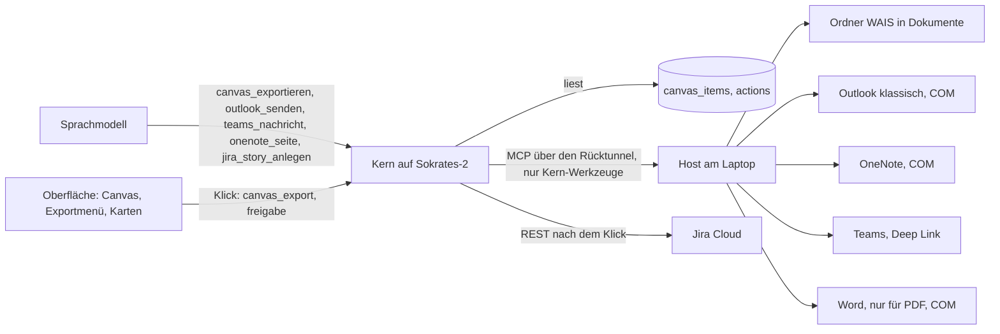

# Office-Dateien und Versand aus dem Canvas: Word, Excel, PowerPoint, PDF, OneNote, Outlook, Teams und Jira

Planpapier, Stand 14.11.2026, Basis `origin/main` 4e32e61 (Zweig `docs/office-versand-plan`, nur dieses Papier, kein Code). Grundlage sind der Wunsch von Niko, die
beiden Gedächtniseinträge vom 14.11.2026 und seine Entscheidungen zu Outlook, Teams, Jira und Office. Kennzeichnung wie in den anderen Planpapieren: **B** belegt
(Datei:Zeile), **A** abgeleitet, **V** vermutet oder nur am Gerät, am Server oder in Jira prüfbar. Nichts wurde am Server, an der Datenbank, am Laptop oder in Jira berührt.
Pfade gelten relativ zur Repo-Wurzel, Bezeichner stehen in ASCII. Im Text heißt der Assistent W.A.I.S., technisch bleibt alles `wamo` (`README.md:1` bis `:17`).
Das Testlabor am 28.11.2026 hat Vorrang: Die Entwicklung für das Labor endet am So 15.11.2026, danach gilt der Freeze für Kern, Migration und Oberfläche
(`docs/testlabor-wamo.md:34`, Entscheidung E14). Dieses Paket beginnt deshalb erst nach dem Labortag.

## Entscheidungen und Kurzfassung

**Wunsch von Niko (wörtlich).** "Ich will aus den Canvas die ich mit WAIS erstelle, auch Words, Excell, Powerpoints Onnotes und alles mögliche erstellen können auch dann
eine User Story in Jira anlegen können oder per Outlook eine Email oder per Teams eine Nachricht verschicken auf dem PC, natürlich nach einer finalen Freigabe durch mich!"

**Entscheidungen von Niko, verbindlich.**

| Nr | Bereich | Entscheidung | Folge im Papier |
| --- | --- | --- | --- |
| D1 | Outlook | Freigabekarte in W.A.I.S. zeigt Empfänger, Betreff, Text und Anhang. Nach dem Klick sendet W.A.I.S. über Outlook auf dem PC (Host). Ohne Klick geht nichts raus | Paket 2, Werkzeug `outlook_senden`, Freigabeart `mail` im Host |
| D2 | Teams | Nach der Freigabe öffnet Teams den Chat mit der Person und dem fertigen Text (Deep Link `msteams:`), Niko drückt selbst Enter. Kein Microsoft Graph | Paket 4, Werkzeug `teams_nachricht`, Freigabeart `teams` |
| D3 | Jira | Standard Projekt `WMCNL`, Typ Story, Epic optional, Projekt je Story wählbar, angelegt mit dem Jira-Zugang am Server, erst nach Freigabe | Paket 3, Werkzeug `jira_story_anlegen`, Karte im Kern (Job `jira`). Befund zum Zugang in 2.4 und Q2 |
| D4 | Office | Word, Excel, PowerPoint und OneNote, dazu PDF, CSV und Markdown aus Canvas-Inhalten, auf dem PC erzeugt und gespeichert (Vorschlag `Dokumente\W.A.I.S.`), Datei danach öffnen. Am PC: Office 365 und das neue Teams | Paket 1 (Dateien), Paket 4 (OneNote). Befund zum Ordnernamen in 2.5 und Q3 |
| D5 | Schutz | Nur Admin-Profile im Büro, nie Laborprofile. Werkzeuge per Sprache unter dem Stimmabdruck-Gate. Jeder Versand mit Freigabekarte, die den genauen Inhalt zeigt. Inhalte aus Werkzeugen sind Daten | Abschnitte 6 und 8 |

**Kurzfassung.**

1. **Empfohlene Architektur: Der Kern liefert Inhalte, der Host erzeugt, prüft und führt aus.** Die Dateien entstehen im Host am Laptop mit drei Open-XML-Bibliotheken
   (`python-docx`, `openpyxl`, `python-pptx`, alle MIT-Lizenz, über `host/uv.lock` mit SHA-256 festgenagelt). PDF macht eine eigene, unsichtbare Word-Instanz per COM
   aus der erzeugten Word-Datei. Outlook und OneNote laufen per COM, weil es dort keinen Weg über Dateien gibt. Teams öffnet sich über den Deep Link. Jira spricht der Kern
   auf Sokrates-2 direkt über REST an. Der Kern schickt dem Host nie Dateibytes, nur strukturierte Canvas-Inhalte aus `canvas_items`; damit schreibt der Host nur Dateien,
   die er selbst gebaut hat (kein Einschleusen fremder Vorlagen oder Makros).
2. **Das Sprachmodell sieht nur Kern-Werkzeuge**, die neuen Host-Werkzeuge stehen nie in `LLM_TOOLS` (`voice-core/pc_host.py:61` bis `:66`). Das folgt dem Muster von
   `auf_bildschirm_klicken`, das im Kern sitzt und im Host `maus_klicken` aufruft (`voice-core/screen.py:177`, `:237`). Versand gibt es nur über die vorhandene
   Freigabe des Hosts mit zweitem Geheimnis (`host/wamo_host.py:15` bis `:22`, `:2098` bis `:2137`), Jira über eine Karte im Kern nach dem geprüften Muster der Labor-Freigaben.
3. **Keine Migration nötig.** Inhalte liegen schon in `canvas_items`, das Protokoll passt in `actions` (`supabase/migrations/0001_wamo_init.sql:178` bis `:207`), das
   Dateiregister liegt am Laptop.
4. **Fünf Befunde ändern den Auftrag:** (a) Der Jira-Zugang am Server ist nur lesend, gehört der Auftrags-Sandbox und ist für den Kern nicht lesbar; Rechte hängen in
   Jira am Benutzer, nicht am Token (2.4, Q2). (b) Senden per COM geht nur mit dem klassischen Outlook, der Host kennt aber auch das neue Outlook `olk.exe`, das keine
   Automatisierung hat (2.3, Q1). (c) `W.A.I.S.` als Ordnername verliert unter Windows den Schlusspunkt, empfohlen ist `Dokumente\WAIS` (2.5, Q3). (d) Der Installer
   nimmt aus `host/` nur `.py`, `pyproject.toml` und `uv.lock` mit, ein Logo für die Dateien braucht eine Filteränderung (`desktop/package.json:48` bis `:62`).
   (e) Die Freigabekarte zeigt heute höchstens rund 1800 Zeichen; längere Mails, Seiten und Stories brauchen die "lange Karte" aus Paket 2 oder gehen als Anhang.
5. **Aufwand 151 Stunden in fünf Paketen** (Abschnitt 10), Start nach dem Labortag am Mo 30.11.2026. Mit zwei Strängen (Strang 1: Prüfauftrag, Dateien, Outlook;
   Strang 2: Jira, danach Teams und OneNote) rund 16 Arbeitstage (A), also bis etwa Mo 21.12.2026; mit einem Strang rund 25 Arbeitstage bis in den Januar.

**IQ:** Jede Grenze sitzt dort, wo sie sich nicht umgehen lässt: der Inhalt im Kern aus der Datenbank, die Prüfung und das Ausführen im Host, die Entscheidung im Klick.
**EQ:** Niko sagt einen Satz oder klickt einmal und hat seine Datei; beim Versand sieht er genau, was rausgeht, und kein Fehlversand passiert ihm "durch W.A.I.S.".
**VQ:** Ein Bild mit drei Stationen (Kern, Host, Ziel), Tabellen mit immer gleichen Spalten, eine Kartenvorschau je Werkzeug. **Synthese:** Erst die Dateien (lokal,
reversibel, ohne Versand), dann Outlook, parallel Jira, zuletzt Teams und OneNote. Alles hinter Schaltern, Standard aus.

## 1. Ziel, Erfolgsmaße, Nicht-Ziele

**Ziel.** Was W.A.I.S. auf dem Canvas zeigt (Dokument, Tabelle, Code, Diagramm), wird auf Zuruf oder per Klick zur Word-, Excel-, PowerPoint-, PDF-, CSV- oder
Markdown-Datei am Laptop von Niko, zur OneNote-Seite, zur Mail über Outlook, zur vorbereiteten Teams-Nachricht oder zur Story in Jira. Alles, was den PC verlässt oder
bei anderen ankommt, geht erst nach einem Klick auf einer Karte raus, die genau den Inhalt zeigt.

**Erfolgsmaße.** (1) "Mach daraus eine Word-Datei" liefert in höchstens 5 Sekunden eine geöffnete Datei im WMC-Design (PDF höchstens 15 Sekunden, A, am Gerät zu messen).
(2) In 20 Versuchen mit präparierten Webseiten und Mails (Prompt-Injection) geht keine Mail, keine Teams-Nachricht und keine Story ohne Klick raus, und jede Karte zeigt den
tatsächlich ausgeführten Inhalt. (3) Eine Mail an einen Empfänger außerhalb der Firma ist auf der Karte als EXTERN erkennbar. (4) Kein Doppelversand bei Doppelklick,
Neuladen oder Zeitüberschreitung. (5) Für Laborprofile und Mitglieder gibt es keines der neuen Werkzeuge (Test).

**Nicht-Ziele.** Microsoft Graph, Mails lesen oder beantworten, Kalender, SharePoint, Dateien bearbeiten, die W.A.I.S. nicht selbst erzeugt hat, Anhänge aus beliebigen
Ordnern, Versand ohne Karte, Office-Werkzeuge für Mitglieder, Änderungen an Laborcode, an `voice-core/labor_freigaben.py` und an `voice-core/pc_freigaben.py` über
neue Freigabearten hinaus.

## 2. Ist-Stand mit Belegen und Prüfung der Annahmen

### 2.1 Canvas: Inhaltsarten, Datenmodell, Ablage

| Befund | Beleg | Kennzeichen |
| --- | --- | --- |
| `canvas_zeigen` kennt vier Arten: `tabelle`, `code`, `dokument` (Markdown mit `#`, `##`, `-`, `**fett**`), `mermaid` | `voice-core/tools.py:47`, `:165` bis `:193` | B |
| Der Kern prüft die Argumente, speichert das Element und schickt es an die Oberfläche; das Modell bekommt nur `{"angezeigt": true}`, keine Kennung | `voice-core/tools.py:293` bis `:311`, `:389` bis `:397` | B |
| Gespeichert wird in `canvas_items` (`user_id`, `session_id`, `type`, `title`, `data` als jsonb, `version`, `parent_id`); `data` enthält das ganze Element | `voice-core/memory.py:627` bis `:635`, `supabase/migrations/0001_wamo_init.sql:178` bis `:189` | B |
| Die Datenbank kennt mehr Arten (`bpmn`, `flow`, `pipeline`, `whiteboard`, `chart`) als das Werkzeug liefert | `0001_wamo_init.sql:57` | B |
| Drucken liest schon eigene Canvas-Dokumente aus der Datenbank (Titel oder das zuletzt geänderte, nur `user_id` des Profils) und baut daraus einen Auftrag | `voice-core/geraete_werkzeuge.py:24`, `:310` bis `:343`, `:345` bis `:367` | B |
| Die Oberfläche zeigt Kopf mit Art, Titel und "Teilen" nur für eigene, gespeicherte Elemente (Kennung als UUID) | `ui/src/components/Canvas.tsx:13` bis `:23`, `:99` bis `:124` | B |
| Mermaid rendert nur der Browser; der Kern hat den Quelltext, kein Bild | `Canvas.tsx:155` bis `:163`, `:245` | B |

### 2.2 Freigaben, Host und Audit

| Befund | Beleg | Kennzeichen |
| --- | --- | --- |
| Risikoklassen im Host: `read` sofort, `change` sofort mit Protokoll, `critical` nur über Freigabe-Anfrage, `blocked` nie; Freigaben kann das Modell nicht erteilen | `host/wamo_host.py:9` bis `:23` | B |
| `freigabe_entscheiden` verlangt ein zweites Geheimnis, prüft Ablauf, nimmt die Anfrage vor dem Ausführen aus der Liste (genau einmal) und prüft direkt davor erneut | `wamo_host.py:2098` bis `:2145` | B |
| Eine Anfrage gilt 300 Sekunden, höchstens 5 sind offen, der Inhalt der Karte höchstens 1800 Zeichen (sonst `rejected`) | `wamo_host.py:125` bis `:128`, `:164`, `:1008` bis `:1022` | B |
| Solange eine Anfrage offen ist oder eine freigegebene Aktion läuft, ruhen alle Eingaben am PC (`status=wartet`): So kann das Modell die Karte nicht selbst bedienen | `wamo_host.py:872` bis `:876`, `:895` bis `:907` | B |
| Der Kern macht aus `needs_approval` eine Karte nur für Werkzeuge in `FREIGABE_WERKZEUGE` und Aktionen in `FREIGABE_AKTIONEN`; die Karte zeigt, was der Host meldet, nicht was das Modell behauptet | `voice-core/activity.py:47` bis `:103` | B |
| Die Oberfläche begrenzt ein Kartenfeld auf 2000 Zeichen | `activity.py:53`, `ui/src/lib/nachrichten.ts:122` bis `:131` | B |
| Audit im Host als JSONL mit Kanal; getippte Texte nur als Länge und Prüfsumme | `wamo_host.py:186` bis `:191`, `:1003` bis `:1005`, `:2074` bis `:2095` | B |
| Muster für ein kritisches Host-Werkzeug mit Karte: `github_repo_anlegen` (Anfrage, Detail, Ausführung nach Klick) | `wamo_host.py:2008` bis `:2061` | B |
| Der Kern ruft Host-Werkzeuge auch ohne Eintrag in `LLM_TOOLS` auf (`call_host_tool`) | `voice-core/pc_host.py:329` bis `:339` | B |
| Klicks auf Karten gehen je Job an ihre Klasse: `pc`, `geraet`, `labor`; im Büro wirkt ein Labor-Klick nie | `voice-core/bot.py:1235` bis `:1250` | B |
| Karten im Kern ohne Host: Muster mit Hash über alle Werte, genau einmal, Protokoll in `actions` ohne Texte | `voice-core/labor_freigaben.py:1` bis `:22`, `:168` bis `:174`, `:388` bis `:427`; `geraete_werkzeuge.py:495`, `:536` | B |
| `actions` hat Risiko und Status als Enum, `log_action`, `update_action`, `aktion_abschliessen` genügen ohne neue Rechte | `0001_wamo_init.sql:53`, `:55`, `:192` bis `:207`, `voice-core/memory.py:512`, `:529`, `:550` | B |
| Stimmabdruck-Gate: offen sind nur `aktuelle_zeit`, `websuche`, `canvas_zeigen`; jedes neue Werkzeug ist damit automatisch geprüft | `voice-core/stimme_gate.py:47` | B |
| Laborsitzungen bekommen nur eine feste Erlaubnisliste | `voice-core/labor.py:39` | B |
| Der Host läuft als geplante Aufgabe in der Sitzung der Person, ohne erhöhte Rechte (Voraussetzung für Office-COM) | `scripts/wamo-tunnel-einrichten.ps1:167` | B |

### 2.3 Office am PC

| Befund | Beleg | Kennzeichen |
| --- | --- | --- |
| Der Host hat `pywin32` und `comtypes`, keine Office-Bibliothek | `host/pyproject.toml:6` bis `:14` | B |
| Der Host kennt Outlook als `outlook.exe` (klassisch), `olk.exe` (neu) und `hxoutlook.exe`, Teams als `ms-teams.exe`; Senden in diesen Fenstern braucht schon heute eine Karte | `host/windows_control.py:41` bis `:49` | B |
| Ein Test des Hosts nutzt ein Fenster "Neue Nachricht" des neuen Outlooks (`olk.exe`) | `host/test_security.py:377` | B |
| Das neue Outlook (`olk.exe`) hat keine COM-Automatisierung; Senden per COM geht nur mit dem klassischen Outlook | Herstellerangabe | V, am PC zu prüfen |
| `oeffnen_mit` öffnet `.docx`, `.xlsx`, `.pptx` schon heute in erlaubten Ordnern | `wamo_host.py:155` bis `:157`, `:816` | B |
| Die Ordnerwurzeln des Hosts sind `HOME\Documents` und `HOME\Dokumente`; ein auf OneDrive umgeleiteter Dokumente-Ordner liegt woanders | `wamo_host.py:734` bis `:735` | B (Umleitung am PC: V) |

### 2.4 Jira-Zugang am Server

| Befund | Beleg | Kennzeichen |
| --- | --- | --- |
| Der Jira-Zugang am Server (`JIRA_API_KEY`, `JIRA_EMAIL`) ist ein technischer Benutzer mit nur "Browse Projects", der Konnektor läuft mit `READ_ONLY_MODE=true` | `infra/sokrates2/README.md:79`, `:169` bis `:183`, `:198`, `:205` bis `:206`; `infra/sokrates2/wamo-einrichten.sh:51` bis `:53` | B |
| Er liegt in `/etc/wamo/geheim.env` (root:wamo 0640) für die Auftrags-Sandbox des Benutzers `wamo` | `infra/sokrates2/README.md:65` | B |
| Der Kern läuft als `wamo-core` mit `/etc/wamo/core.env`; Einstellungen setzt nur `wamo-core-env` mit Erlaubnisliste, sie wirken mit dem nächsten Kern-Release | `infra/sokrates2/wamo-core@.service:16`, `:19`; `infra/sokrates2/wamo_core_env.py:38`, `:83` bis `:88` | B |
| Die Jira-Adresse der Firma steht schon im Repo | `infra/sokrates2/claude-code/managed-mcp.json:30` | B |
| In Jira gelten Rechte für den Benutzer, nicht für ein einzelnes API-Token | Herstellerangabe | A |

**Folge.** "Mit dem Zugang, der am Server schon hinterlegt ist" geht so nicht: Der Zugang darf nichts anlegen, der Kern kann ihn nicht lesen, und bekäme derselbe
Benutzer das Recht "Create Issues", könnte auch jeder Entwicklungsauftrag in der Sandbox mit seinem Token Vorgänge anlegen. Empfehlung: ein zweiter technischer Benutzer
nur für W.A.I.S. mit "Browse Projects" und "Create Issues" in `WMCNL` und den freigegebenen Projekten, dessen Token nur in `core.env` steht (Q2).

### 2.5 Prüfung der weiteren Annahmen

1. **Ablage `Dokumente\W.A.I.S.`:** Windows entfernt den Punkt am Ende eines Ordnernamens (Namensregel von Windows), aus `W.A.I.S.` wird `W.A.I.S`, und manche Programme
   stolpern über Ordner mit Punkten. Empfohlen ist `Dokumente\WAIS`, in der Oberfläche als "W.A.I.S." angezeigt (Q3). Der Ordner wird über den bekannten Ordner
   "Dokumente" bestimmt (`SHGetKnownFolderPath`), nicht über `HOME\Documents`, sonst landet die Datei bei OneDrive-Umleitung im falschen Ordner (A).
2. **Namen der Werkzeuge:** Das Labor kennt schon `mail_senden` und `ticket_anlegen` (`labor_freigaben.py:101` bis `:118`). Die neuen Namen müssen sich davon
   unterscheiden, sonst verwechselt das Modell sie oder ein Test der Laborlisten schlägt an.
3. **Freigabe beim Speichern:** Nikos Satz "nach einer finalen Freigabe durch mich" und der Gedächtniseintrag "wobei der Versand jeweils freigegeben wird" beziehen sich auf
   den Versand. Eine Datei, die nur im eigenen Ordner landet, braucht nach diesem Papier keine Karte (Risikoklasse `change`); das ist Q3.
4. **Teams per Deep Link:** Ob das neue Teams `msteams:` mit vorbefülltem Text (`message`) öffnet, wie lang der Text sein darf und ob Zeilenumbrüche ankommen, ist nur am
   Gerät zu klären (V, Paket 0).
5. **OneNote:** Microsoft 365 bringt OneNote für den Desktop mit COM-Schnittstelle (`OneNote.Application`); ob es auf Nikos PC installiert und mit einem Notizbuch
   verbunden ist, ist offen (V, Paket 0).

### 2.6 Prüfung am PC für Paket 2 (Stand 15.11.2026)

Entscheidung von Niko am 15.11.2026 (wörtlich): "Mache 1 und 2, kommt immer drauf an welches Outlook aktiviert ist!" Damit sind Q1 und Q5
beantwortet: Läuft das klassische Outlook, sendet W.A.I.S. nach dem Klick mit 30 Sekunden zum Zurückholen und mit der Outlook-Signatur;
läuft das neue Outlook, öffnet W.A.I.S. einen fertigen Entwurf mit Anhang, und Niko sendet selbst. Im Zweifel gibt es nur den Entwurf.

| Geprüft am PC von Niko | Ergebnis | Kennzeichen |
| --- | --- | --- |
| Was läuft und was eingestellt ist | `olk.exe` läuft, `OUTLOOK.EXE` nicht; `UseNewOutlook` ist nicht gesetzt; `Outlook.Application` ist registriert, ein Profil ist da; `mailto` und `.eml` gehören dem klassischen Outlook. Die Registry allein hätte also "klassisch" ergeben: Die Erkennung hängt deshalb zuerst an den laufenden Programmen (`host/office_outlook.py`) | B |
| `.eml` mit `X-Unsent: 1`, Text und HTML-Teil, Anhang, geöffnet mit `%LOCALAPPDATA%\Microsoft\WindowsApps\olk.exe <Datei>` | fertiger Entwurf mit An, Betreff, Text und Anhang (auch mit Umlaut im Dateinamen und einer Word-Datei von 124 KB), die Signatur steht unter dem Text, das neue Outlook speichert ihn sofort unter Entwürfe | B (Bilder beim Prüfbericht) |
| dieselbe `.eml` nur mit Textteil | die Signatur landet über dem Text, ohne Umbruch dazwischen | B |
| Start über die App-Kennung (`IApplicationActivationManager.ActivateForFile`) | Fehler "Diese App bietet keine Unterstützung für den angegebenen Vertrag" | B |
| Deep Link `ms-outlook://mail/deeplink/compose?...` | neues Fenster mit "Diese Aktion wird noch nicht unterstützt" | B |
| `olk.exe` mit `mailto:...&attach=...` | Entwurf mit Empfänger, Betreff, Text und Signatur, ohne Anhang: nur Rückfall, dann zeigt der Explorer den Anhang markiert | B |
| Standardprogramm für `.eml` und `mailto` | am PC das klassische Outlook, also das falsche, das dafür erst gestartet würde; deshalb nicht ausgeführt und nicht genutzt | B (Zuordnung) |
| Senden über das klassische Outlook per COM | am PC nicht geprüft: Das klassische Outlook läuft dort nicht, und in keinem Test wird gesendet. Attrappen decken Auflösung, Signatur, Frist, Zurückholen und die Prüfung vor dem Senden ab; der Echttest braucht ein laufendes klassisches Outlook | V |

Die Frist von 30 Sekunden hält der Host selbst (Mail unter Entwürfe, Senden erst danach), nicht Outlooks `DeferredDeliveryTime`: Den Zeitpunkt
arbeitet dort Exchange ab, Zurückholen hieße ein Element im Postausgang finden, und beides ließe sich nur mit echtem Senden prüfen. Fällt der
Host in der Frist aus, bleibt die Mail ungesendet unter Entwürfe.

## 3. Nutzerablauf

| Nr | Niko | W.A.I.S. | Karte |
| --- | --- | --- | --- |
| U1 | Sagt "Mach daraus eine Word-Datei" oder klickt im Canvas auf "Exportieren", dann "Word" | Erzeugt `Dokumente\WAIS\2026-11-30 Angebot Kunde X.docx`, öffnet sie in Word, sagt "Liegt in deinem Ordner WAIS und ist offen", zeigt einen Hinweis mit "Öffnen" und dem Dateinamen | keine (Q3) |
| U2 | "Als PDF" oder "als PowerPoint", bei Tabellen "als Excel" oder "als CSV" | wie U1, PDF über Word, PowerPoint mit einer Folie je Überschrift, Excel mit Kopfzeile, Filter und fixierter erster Zeile | keine |
| U3 | "Schick das als PDF an Max Weber, Betreff Angebot, schreib dazu, dass wir am Freitag sprechen" | Erzeugt die PDF (U2), legt die Mail-Anfrage an, sagt "Die Mail liegt zur Freigabe bereit" | Mail: Konto, An (aufgelöst mit Adresse, intern oder EXTERN), Cc, Betreff, Anhang mit Größe und Prüfsumme, ganzer Text |
| U4 | Klickt "Senden" auf der Karte | Host sendet über Outlook genau einmal, W.A.I.S. sagt "Gesendet" | |
| U5 | "Leg die Story aus dem Canvas in Jira an, Epic WMCNL-42" | Prüft Projekt und Epic in Jira, legt die Karte an | Jira: Projekt mit Name, Typ Story, Epic mit Titel, Titel, Beschreibung, Akzeptanzkriterien |
| U6 | Klickt "Anlegen" | Kern legt die Story an, zeigt den Schlüssel mit Link, sagt "Angelegt als WMCNL-123" | |
| U7 | "Schreib Anna in Teams, dass das Dokument fertig ist" | Löst Anna über das Adressbuch auf, legt die Karte an | Teams: An (Name und Adresse), ganzer Text, Satz "Du sendest in Teams selbst mit Enter" |
| U8 | Klickt "Teams öffnen" | Teams öffnet den Chat mit Anna, der Text steht im Eingabefeld; Niko drückt Enter | |
| U9 | "Leg das in OneNote ab" | Legt die Karte an | OneNote: Notizbuch, Abschnitt, Seitentitel, ganzer Inhalt |
| U10 | Klickt "Anlegen" | Host legt die Seite an und zeigt sie in OneNote | |

Ablehnen, Ablauf (300 Sekunden) und Neuladen enden immer mit "es ist nichts passiert". Eine Karte bestätigt nur ein Klick in der angemeldeten Oberfläche, nie ein
gesprochenes "Ja" (der Ja-Wächter greift bei offener Karte nie, `bot.py:854` bis `:866`). Solange eine Karte des PCs offen ist, tippt und klickt W.A.I.S. am PC nicht
(2.2); das gilt auch für Mail-, Teams- und OneNote-Karten und ist gewollt.

## 4. Architektur

### 4.1 Grundsatz und Bild

Der Kern ist die Quelle der Inhalte und der Regeln (wer darf was, welcher Canvas, welche Schalter, Fremdinhalt im Zug). Der Host am Laptop ist die letzte Instanz: Er
prüft jeden Wert selbst, hält die Freigabe-Anfrage mit genau dem Inhalt, der ausgeführt wird, und führt sie nach dem Klick genau einmal aus. Jira hat keinen Bezug zum
Laptop und läuft deshalb ganz im Kern, mit einer Karte nach dem Muster der Labor-Freigaben.



### 4.2 Wo die Dateien entstehen: drei Varianten

| Kriterium | A: Bibliotheken im Host (empfohlen) | B: Office per COM für alles | C: Bibliotheken im Kern, Datei an den Host |
| --- | --- | --- | --- |
| Neue Abhängigkeiten | `python-docx`, `openpyxl`, `python-pptx` mit `lxml`, `XlsxWriter`, `et_xmlfile` (alle als Wheels, Hash in `uv.lock`) | keine (`pywin32` vorhanden) | im Kern-venv; PDF bräuchte LibreOffice am Server |
| Tempo (geschätzt, am Gerät zu messen) | unter 1 Sekunde je Datei | 2 bis 6 Sekunden je Start von Word, Excel oder PowerPoint | schnell, dazu Übertragung über den Tunnel |
| Verlässlichkeit | ohne Fenster, ohne Dialoge, deterministisch | Dialoge (Aktivierung, Datei gesperrt, Add-ins) können den Host blockieren, Zeitgrenzen und Aufräumen nötig | wie A |
| Tests | in CI ohne Office, Rundlauf mit denselben Bibliotheken | nur am Windows-PC mit Office | in CI |
| Sicherheit | Host schreibt nur selbst gebaute Dateien; keine externen Beziehungen, keine Makros | gleich, aber die Office-Instanz der Person könnte mitbenutzt werden (eigene Instanz nötig) | **Host schreibt Bytes vom Server**: ein kompromittierter Kern könnte eine Datei mit fremder Vorlage (Template-Injection) oder externen Verweisen ablegen |
| Datenschutz | Inhalt nur im Tunnel, Datei nur am PC | wie A | zweite Kopie am Server |
| Firmendesign | im Code (Kopf, Fuß, Logo, Schrift), testbar | über `.dotx` am PC | im Code |
| PDF | über Word per COM aus der erzeugten Datei | direkt | nur mit LibreOffice am Server |
| Freeze-Wirkung | Host liegt nicht unter dem Freeze | wie A | Kern-Release nötig |

**Empfehlung: A, ergänzt um COM nur dort, wo es nicht anders geht** (PDF über eine eigene Word-Instanz, Outlook, OneNote). C scheidet aus, weil der Host dann Bytes
vom Server schreiben müsste; B ist zu langsam und zu störanfällig für "eine Datei auf Zuruf". Fehlt Word, gibt es kein PDF, alles andere geht weiter.

### 4.3 Bibliotheken, Lizenzen, Pinning

| Paket | Zweck | Lizenz (laut PyPI, beim Bau prüfen) | Hinweis |
| --- | --- | --- | --- |
| `python-docx` | Word (.docx) | MIT | zieht `lxml`, `typing_extensions` |
| `openpyxl` | Excel (.xlsx) | MIT | zieht `et_xmlfile`; Zellen als Text, nie Formel (8, B3) |
| `python-pptx` | PowerPoint (.pptx) | MIT | zieht `lxml`, `Pillow` (vorhanden), `XlsxWriter` |
| `lxml` | XML für Word und PowerPoint | BSD-3-Clause | Wheel für Windows x64 vorhanden (A) |
| `XlsxWriter` | Abhängigkeit von `python-pptx` | BSD-2-Clause | |
| `et_xmlfile` | Abhängigkeit von `openpyxl` | MIT | |
| `pywin32` | COM (Word, Outlook, OneNote), bekannter Ordner | PSF-2.0 | schon vorhanden |

Pinning: exakte Versionen (`==`) in `host/pyproject.toml`, `uv lock` schreibt den SHA-256 jeder Datei, die Desktop-App installiert mit `uv sync --locked --no-dev --no-build`
und richtet die Umgebung neu ein, sobald sich der Hash von `uv.lock` ändert (`desktop/host-umgebung.js:3` bis `:6`, `:81` bis `:109`). Vor dem Merge laufen
`pip-audit` und eine Lizenzliste über die gesperrten Pakete. CSV und Markdown brauchen nur die Standardbibliothek.

### 4.4 COM: wo, wie, mit welchen Grenzen

- **Eigener Thread je Aufruf** mit `CoInitialize` und `CoUninitialize`, Zeitgrenze 60 Sekunden (Outlook, OneNote) bzw. 45 Sekunden (PDF); der Host blockiert dabei weder
  den Tunnel noch die Sperrprobe (`asyncio.to_thread` wie `freigabe_entscheiden`, `wamo_host.py:2141` bis `:2145`).
- **Word nur für PDF und nur als eigene Instanz** (`DispatchEx`, unsichtbar, `DisplayAlerts` aus, Datei nur lesend, nicht in "Zuletzt verwendet"), danach `Quit`.
  Hängt sie, beendet der Host genau diesen Prozess, nie ein offenes Word der Person (Weg zur Prozesskennung am Gerät festlegen, V).
- **Outlook:** Es gibt nur eine Instanz, COM hängt sich an das laufende klassische Outlook. Empfänger löst der Host über `Namespace.CreateRecipient` und `Resolve` auf,
  ohne Entwurf. Gesendet wird mit festem Konto (`SendUsingAccount`, Konto aus der Host-Konfiguration, nie vom Modell), Text als reiner Text, Anhänge nur aus dem Register.
  Der "Object Model Guard" von Outlook kann beim Senden nachfragen, wenn der Virenschutz nicht als aktuell gemeldet ist (V, Paket 0).
- **OneNote:** `GetHierarchy`, `CreateNewPage`, `UpdatePageContent` mit OneNote-XML, danach `NavigateTo`. Ziel ist ein fester Abschnitt aus der Host-Konfiguration (Q6).
- **Erkennung:** Ein Lese-Werkzeug `office_faehigkeiten` meldet, was am PC geht (Bibliotheken, Word, klassisches Outlook, OneNote, `msteams:` registriert). Der Kern
  registriert nur Werkzeuge, die auch funktionieren, und die Oberfläche zeigt nur diese Formate.

### 4.5 Teams

Nach dem Klick öffnet der Host `msteams:/l/chat/0/0?users=<Adresse>&message=<Text>` über die Shell. Jeder Wert ist einzeln URL-kodiert, die Adresse muss das Muster einer
Mailadresse erfüllen und in einer internen Domäne liegen (Stufe 1, A). Ein Empfänger je Nachricht. Gesendet wird nur durch Niko mit Enter; ein späteres Enter durch
W.A.I.S. im Teams-Fenster bräuchte wie heute eine eigene Karte (`windows_control.py:41` bis `:49`). Rückfall, wenn `msteams:` nicht registriert ist: dieselbe Adresse
über `https://teams.microsoft.com/l/chat/0/0?...` im Standardbrowser (V).

### 4.6 Jira im Kern

- REST-Schnittstelle Version 3 von `https://wamocon.atlassian.net` mit `httpx` (im Kern schon vorhanden, z. B. `voice-core/labor_client.py:32`), Anmeldung mit Mailadresse
  und API-Token des neuen technischen Benutzers aus `core.env`, TLS mit den System-Zertifikaten.
- Vor der Karte liest der Kern: Projekt aus der Erlaubnisliste `WAMO_JIRA_PROJEKTE` (Standard `WMCNL`) samt Name, Vorgangstyp Story über die Anlege-Metadaten des Projekts,
  das Epic (existiert, Typ Epic, gleiches Projekt) samt Titel und das Recht "Create Issues" des Benutzers.
- Beschreibung und Akzeptanzkriterien gehen als Atlassian Document Format (Absätze, Überschriften, Listen, fett), nie als Wiki-Markup: So kann Text keine Erwähnungen,
  Makros oder eingebetteten Inhalte auslösen. Epic über das Feld `parent` (V, für den Projekttyp von `WMCNL` in Paket 0 prüfen).
- Nach dem Klick genau ein `POST /rest/api/3/issue`. Bei Zeitüberschreitung sucht der Kern per JQL (Projekt, Titel, Ersteller ist der technische Benutzer, letzte zehn
  Minuten), bevor er "fehlgeschlagen" meldet; ein automatischer zweiter Versuch ist verboten.
- Ergebnis: Schlüssel mit Muster `[A-Z][A-Z0-9]+-[0-9]+`, Link aus fester Basisadresse plus Schlüssel, nie eine Adresse aus der Antwort.

### 4.7 Ablage und Dateinamen

- Ordner `WAIS` im bekannten Ordner "Dokumente" (Q3), angelegt beim ersten Export, ohne Verknüpfungen und Abzweigpunkte (Prüfung auf Reparse-Punkte).
- Dateiname: `JJJJ-MM-TT <Titel>.<Endung>`, Titel auf erlaubte Zeichen gekürzt (ohne `<>:"/\|?*`, Steuerzeichen, reservierte Namen, Punkt oder Leerzeichen am Ende),
  höchstens 80 Zeichen; gibt es die Datei schon, folgt " (2)", nie Überschreiben.
- Register `%LOCALAPPDATA%\WAMO\ablage.json`: je Datei Kennung, Name, Format, Größe, SHA-256, Zeit, Canvas-Kennung. Nur Dateien aus diesem Register kann W.A.I.S. öffnen
  oder anhängen. Das Register ist nur für den Benutzer lesbar und hält höchstens 500 Einträge.
- Wird der Ordner Dokumente mit OneDrive synchronisiert, landet die Datei auch dort. Das ist Nikos eigener Speicher der Firma und kein Versand (A).

### 4.8 Firmendesign der Dateien

Word: Kopfzeile mit "WAMOCON GmbH, Mergenthalerallee 79-81, 65760 Eschborn" links und Logo rechts, Fußzeile mit Seitenzahl, Schrift Arial Narrow, Farben Rot `#F40E0E`,
Schwarz und Grautöne wie die Oberfläche. PowerPoint: Logo oben rechts, Fußzeile mit Anschrift und Foliennummer. Excel: Kopfzeile mit Anschrift, Fußzeile mit Seitenzahl
(für den Druck). Das Logo ist eine Kopie von `ui/public/wmc-logo.png` unter `host/vorlagen/`, das Design entsteht im Code und ist damit testbar. Eine Firmenvorlage aus
dem Profil des PCs wird bewusst nicht geladen: Der Host verarbeitet nur, was im Repo geprüft ist.

## 5. Datenfluss

**Canvas zu Datei (Sprache).** (1) Das Modell ruft `canvas_exportieren(format, canvas)`. (2) Der Kern prüft Schalter, Rolle admin, kein Laborprofil, PC-Steuerung an
und Sperre gehalten. (3) Er liest das eigene Element aus `canvas_items` (Kennung aus dem Klick oder Titel, sonst das neueste dieser Sitzung, dann das neueste des Profils)
und baut daraus die feste Struktur `{art, titel, text}` bzw. `{art, titel, spalten, zeilen}`. (4) Er ruft im Host `office_datei_erstellen` (nicht in `LLM_TOOLS`).
(5) Der Host prüft Grenzen und Zeichen, baut die Datei, rechnet SHA-256, trägt sie ins Register ein und öffnet sie. (6) Der Kern schreibt `actions` (Werkzeug, Format,
Canvas-Kennung, Größe, Prüfsummenanfang, kein Inhalt) und schickt der Oberfläche die Nachricht `datei` mit Name und Registerkennung. (7) Das Modell bekommt
`{"gespeichert": true, "datei": "<Name>"}`.

**Canvas zu Datei (Klick).** Die Oberfläche schickt `{"type": "canvas_export", "data": {"canvas_id", "format"}}`; ab Schritt (2) wie oben, ohne Modell. Ein Klick auf
"Öffnen" im Hinweis schickt `datei_oeffnen` mit der Registerkennung, der Host öffnet nur eine Datei aus dem Register.

**Datei zu Mail.** (1) Das Modell ruft `outlook_senden(an, cc, betreff, text, anhaenge)`, `anhaenge` sind Namen aus dem Register. (2) Der Kern prüft wie oben und
merkt, ob im Zug Fremdinhalte vorkamen (`TurnState.tainted`, `voice-core/tools.py:72` bis `:94`). (3) Der Host löst Empfänger auf, prüft Anhänge (Register, Ordner,
Hash, Größe), legt die Anfrage an und antwortet `needs_approval` mit dem Kartentext. (4) `activity.py` macht daraus die Karte (Job `pc`, Aktion `mail`), der Kern
setzt bei Fremdinhalt das neue Feld `warnung`. (5) Klick "Senden": `pc_freigabe_entscheiden` ruft `freigabe_entscheiden` mit Schlüssel. (6) Der Host nimmt die Anfrage
aus der Liste, prüft Anhänge per Hash und das Konto erneut, sendet einmal, protokolliert. (7) Der Kern meldet dem Modell das Ergebnis (höchstens 800 Zeichen,
`voice-core/pc_freigaben.py:43`).

**Canvas zu Jira.** (1) `jira_story_anlegen(...)`, Beschreibung aus dem Canvas oder vom Modell. (2) Kern liest Projekt, Typ, Epic und Recht aus Jira (Daten, nie
Anweisungen). (3) Antrag mit Hash über Sitzung, Profil, Projekt, Werte und Epic-Stand, Karte Job `jira`. (4) Klick: Antrag vor dem ersten `await` aus dem Speicher,
Hash, Frist, genau "ja". (5) `POST`, Schlüssel prüfen, `actions` auf `done`, Ergebnis an Oberfläche und Modell.

**Abbildung der Canvas-Arten.**

| Canvas-Art | Word | Excel | PowerPoint | PDF | CSV | Markdown | OneNote |
| --- | --- | --- | --- | --- | --- | --- | --- |
| `dokument` | Überschriften, Absätze, Listen, fett | nein | Folie je `#` oder `##`, Listen als Punkte | über Word | nein | wie gespeichert | Überschriften, Absätze, Listen |
| `tabelle` | Tabelle mit Kopfzeile | ein Blatt, Kopfzeile, Filter, erste Zeile fixiert, Zellen als Text | Tabellenfolien, je Folie höchstens 12 Zeilen | über Word | Semikolon, UTF-8 mit BOM | Markdown-Tabelle | Tabelle |
| `code` | Festbreitenschrift | nein | eine Folie, Festbreitenschrift | über Word | nein | Codeblock mit Sprache | Absatz in Festbreitenschrift |
| `mermaid` | Quelltext als Codeblock (Bild optional, P1-M) | nein | Quelltext (Bild optional) | über Word | nein | Codeblock `mermaid` | Quelltext (Bild optional) |

Option P1-M: Die Oberfläche rendert das Diagramm ohnehin; sie schickt beim Klick ein PNG mit (höchstens 2 MB), der Host dekodiert es mit Pillow, rechnet es neu
und bettet es ein. Per Sprache gibt es das Bild nur, wenn das Canvas offen ist (A).

**Grenzen (Vorschlag, A).** Text höchstens 100 000 Zeichen, Tabelle höchstens 2000 Zeilen und 50 Spalten, Zelle 2000 Zeichen, Datei 20 MB, 10 Exporte je Minute.
Mail: An und Cc zusammen höchstens 10, kein Bcc, Betreff 200 Zeichen, Anhänge höchstens 5 und zusammen 15 MB, 10 Mails je Stunde. Teams: ein Empfänger, Text
höchstens 1000 Zeichen (V am Gerät), 20 je Stunde. OneNote: Titel 120 Zeichen, 10 Seiten je Stunde. Jira: Titel 200 Zeichen, höchstens 10 Kriterien zu je 300
Zeichen, 20 Stories je Stunde, 5 offene Karten. Kartentext in Stufe 1 höchstens 1800 Zeichen wie heute, mit der langen Karte (Paket 2) höchstens 8000.

## 6. Neue Werkzeuge

### 6.1 Werkzeuge für das Sprachmodell (im Kern)

| Werkzeug | Parameter | Risikoklasse | Karte | Audit |
| --- | --- | --- | --- | --- |
| `canvas_exportieren` | `format` (Enum `word`, `excel`, `powerpoint`, `pdf`, `csv`, `markdown`, nur verfügbare), `canvas` (Titel, leer heißt aktuelles), `oeffnen` (Standard ja) | `change` | keine (Q3) | Kern `actions`: Format, Canvas-Kennung, Dateiname, Größe, Prüfsummenanfang. Host: Format, Name, Größe, SHA-256 |
| `outlook_senden` | `an` (Liste Namen oder Adressen), `cc` (Liste), `betreff`, `text`, `anhaenge` (Liste Dateinamen aus dem Register) | `critical` | Job `pc`, Aktion `mail` | Kern: Anzahl Empfänger, Domänen, extern ja oder nein, Anhangsnamen, Status. Host: dazu Betreff und Text nur als Länge und Prüfsumme, Empfängeradressen nur im lokalen Audit |
| `teams_nachricht` | `an` (ein Name oder eine Adresse), `text` | `critical` | Job `pc`, Aktion `teams` | Kern: Domäne, Status. Host: Text als Länge und Prüfsumme |
| `onenote_seite` | `canvas` (Titel, leer heißt aktuelles), `titel` (optional) | `critical` | Job `pc`, Aktion `onenote` | Kern: Canvas-Kennung, Status. Host: Abschnitt, Titel und Inhalt als Prüfsumme, Seitenkennung |
| `jira_story_anlegen` | `titel`, `beschreibung` oder `canvas`, `akzeptanzkriterien` (Liste), `projekt` (Enum aus `WAMO_JIRA_PROJEKTE`, Standard `WMCNL`), `epic` (Schlüssel, optional) | `critical` | Job `jira` (Kern) | Kern: Projekt, Epic, Schlüssel der Story, Status, keine Texte |

Alle fünf gibt es nur für `admin`, nie in Laborsitzungen (die Erlaubnisliste kennt sie nicht, dazu eine ausdrückliche Prüfung), und nur mit dem jeweiligen Schalter.
Die vier PC-Werkzeuge verlangen zusätzlich PC-Steuerung und Sperre (`voice-core/pc_host.py:162` bis `:184`). Alle unterliegen dem Stimmabdruck-Gate, keines kommt in
`OFFENE_WERKZEUGE`. In der Zeitleiste stehen nur Format, Projekt oder Anzahl, nie Texte (`DETAIL_KEYS`, `activity.py:28` bis `:35`).

### 6.2 Werkzeuge im Host (nur für den Kern, nie in `LLM_TOOLS`)

| Werkzeug | Zweck | Klasse | Freigabeart |
| --- | --- | --- | --- |
| `office_faehigkeiten()` | was am PC geht (Formate, Word, Outlook klassisch, OneNote, Teams) | `read` | |
| `office_datei_erstellen(format, inhalt, oeffnen)` | Datei bauen, ins Register, öffnen | `change` | |
| `office_datei_oeffnen(kennung)` | Datei aus dem Register öffnen | `change` | |
| `outlook_mail_anfragen(an, cc, betreff, text, anhaenge, anlass)` | auflösen, prüfen, Anfrage | `critical` | `mail` |
| `teams_chat_anfragen(an, text, anlass)` | prüfen, Anfrage | `critical` | `teams` |
| `onenote_seite_anfragen(inhalt, titel, anlass)` | prüfen, Anfrage | `critical` | `onenote` |

Ein Hostschalter, die Datei `%LOCALAPPDATA%\WAMO\office.aus`, sperrt alle sechs sofort (bei jedem Aufruf geprüft). `_inhalt_audit` und `_ausfuehren` bekommen die drei
neuen Arten (`wamo_host.py:2074`, `:2184`).

### 6.3 Freigabekarten

**Mail (Job `pc`, Aktion `mail`).** Grund "Mail über Outlook senden", bei externen Empfängern "Mail an EXTERNE Empfänger senden". Ziel "Outlook, Konto" mit der Adresse des festen Kontos.
Detail, genau das, was gesendet wird (Beispiel mit erfundenen Adressen):

```text
An: Max Weber <max.weber@intern.example> (intern)
Cc: Anna Schmidt <anna.schmidt@kunde.example> (EXTERN)
Betreff: Angebot Kunde X
Anhang: 2026-11-30 Angebot Kunde X.pdf (84 KB, Prüfsumme 1a2b3c4d)
Text:
> Hallo Max,
> anbei das Angebot. Lass uns am Freitag sprechen.
```

Warnung (Kern), wenn im Zug Fremdinhalte vorkamen: "Im selben Gespräch kamen Inhalte aus Web, Mail oder Bildschirm. Prüfe Empfänger und Text besonders genau."
Domänen außerhalb ASCII zeigt die Karte in Punycode und markiert sie.

**Teams (Job `pc`, Aktion `teams`).** Grund "Teams-Chat mit vorbereitetem Text öffnen", Ziel "Microsoft Teams". Detail: An mit Name und Adresse, Text mit Präfix,
Schlusssatz "W.A.I.S. sendet nicht, du drückst in Teams selbst Enter."

**OneNote (Job `pc`, Aktion `onenote`).** Grund "Seite in OneNote anlegen", Ziel "OneNote" mit Notizbuch und Abschnitt `WAIS`, Detail: Titel und ganzer Inhalt.

**Jira (Job `jira`).** Überschrift "Jira-Story freigeben". Ziel "Jira, Projekt WMCNL" mit dem Projektnamen aus Jira. Detail: Typ Story, Epic mit Schlüssel und Titel, Titel,
Beschreibung und Akzeptanzkriterien, jede Freitextzeile mit dem Präfix "Größer-Zeichen und Leerzeichen" wie bei den Labor-Karten (`labor_freigaben.py:73`).

Was nicht ganz auf die Karte passt, wird nicht angefragt (Grundsatz aus `activity.py:76` bis `:96`); das Modell bekommt den Satz "Zu lang für die Karte, als Anhang
schicken oder kürzen".

## 7. Änderungen je Teil

| Teil | Dateien | Inhalt |
| --- | --- | --- |
| Kern | `voice-core/office_werkzeuge.py` (neu) | Schemas und Handler der vier PC-Werkzeuge, Schalter `WAMO_OFFICE`, Prüfung admin, Labor, PC-Steuerung, Fähigkeiten des Hosts, Client-Nachrichten `canvas_export` und `datei_oeffnen` |
| Kern | `voice-core/canvas_quelle.py` (neu) | eigenes Canvas-Element nach Kennung oder Titel lesen und in die feste Struktur bringen (Muster `geraete_werkzeuge.py:310` bis `:343`; Drucken bleibt bis nach dem Labor unverändert) |
| Kern | `voice-core/jira_client.py`, `voice-core/jira_freigaben.py`, `voice-core/jira_werkzeuge.py` (neu) | REST-Client mit ADF-Wandler und festen Fehlersätzen, Karten im Kern (Job `jira`, Hash, genau einmal, `actions`), Werkzeug und Schalter `WAMO_JIRA` |
| Kern | `voice-core/activity.py` | `FREIGABE_WERKZEUGE` um `outlook_senden`, `teams_nachricht`, `onenote_seite`; `FREIGABE_AKTIONEN` um `mail`, `teams`, `onenote`; Feld `warnung`; `DETAIL_KEYS`; lange Karte je Aktion (Paket 2) |
| Kern | `voice-core/bot.py` | Registrierung (Haken von wenigen Zeilen), Weiterleitung Job `jira`, Ja-Wächter berücksichtigt offene Jira-Karten, Feld `office` in `betrieb` |
| Kern | `voice-core/persona.py`, `voice-core/pc_tunnel.py`, `voice-core/eval/faelle.py` | Regeln für das Modell (nie "gesendet" vor dem Klick, bei Teams sendet Niko), längere Zeitgrenze für PDF und COM in `LANGE_WERKZEUGE` (`pc_tunnel.py:55`), neue Prüffälle |
| Kern | `voice-core/pc_host.py`, `voice-core/stimme_gate.py`, Laborcode | **unverändert** (`LLM_TOOLS` bleibt gleich), nur Tests |
| Host | `host/office_ablage.py`, `host/office_dateien.py`, `host/office_com.py`, `host/teams_link.py` (neu) | Ordner, Register, Dateinamen; Erzeugen der Formate mit Firmendesign; Word für PDF, Outlook, OneNote; Deep Link |
| Host | `host/wamo_host.py` | sechs Werkzeuge, drei Freigabearten, Schalter `office.aus`, Ratengrenzen |
| Host | `host/pyproject.toml`, `host/uv.lock`, `host/vorlagen/wmc-logo.png` | Abhängigkeiten mit Hash, Logo |
| Oberfläche | `ui/src/components/Canvas.tsx`, `ui/src/lib/export.ts` (neu) | Menü "Exportieren" im Kopf eigener Elemente (nur Formate aus `betrieb.office`), Hinweis mit "Öffnen" |
| Oberfläche | `ui/src/lib/nachrichten.ts`, `ui/src/components/Freigaben.tsx`, `ui/src/lib/laborKarte.ts` | Nachrichten `datei` und `jira_ergebnis`, Feld `warnung`, Texte für Job `jira` (`laborKarte.ts:20` bis `:25`), lange Karte mit Bildlauf |
| Desktop-Installer | `desktop/package.json`, `desktop/dist.test.js` | Filter um `vorlagen/*.png`, neue Version; `host-umgebung.js` bleibt, die neue `uv.lock` löst das Neueinrichten aus |
| Server | `infra/sokrates2/wamo_core_env.py`, `infra/sokrates2/README.md` | Erlaubnisliste um `WAMO_OFFICE`, `WAMO_JIRA`, `WAMO_JIRA_URL`, `WAMO_JIRA_EMAIL`, `WAMO_JIRA_TOKEN`, `WAMO_JIRA_PROJEKTE`, `WAMO_JIRA_STANDARD_PROJEKT` (nur vom Server, nie aus der `.env` des PCs); Abschnitt zum technischen Jira-Benutzer |
| Migration | keine | `canvas_items` und `actions` genügen; Dateiregister am PC |
| Doku | `README.md`, `CLAUDE.md` (Namensvertrag), `CHANGELOG.md` | nach Abschnitt 13 |

## 8. Sicherheitsanalyse

| Nr | Bedrohung | Wirkung | Gegenmaßnahme | Restrisiko |
| --- | --- | --- | --- | --- |
| B1 | Prompt-Injection aus Webseite, Mail oder Bildschirm ("schick die Datei an x@y") | Daten gehen an Fremde | Karte mit aufgelöster Adresse, EXTERN-Marke, Warnung bei Fremdinhalt im Zug, nur Klick, kein Bcc, Anhänge nur aus dem Register, Ratengrenzen | gering: Wer die Karte ungelesen bestätigt, sendet |
| B2 | Anzeigename täuscht ("Max Weber" mit fremder Adresse), ähnliche Domänen | Fehlversand | Karte zeigt immer die SMTP-Adresse nach Auflösung, Punycode für Domänen außerhalb ASCII, intern nur bei exakter Domäne des Kontos oder der Liste | gering |
| B3 | Formel-Injection in Excel und CSV (`=`, `+`, `-`, `@`, Tab, CR am Anfang) | Code oder Datenabfluss beim Öffnen | Zellen immer als Text, Präfix `'` in CSV, Test: keine Formel im XML | gering |
| B4 | Fremde Vorlage, Makros oder externe Verweise in Dateien | Code beim Öffnen | Host baut alle Dateien selbst, nur makrofreie Formate, Test: keine Beziehung mit `TargetMode="External"`, kein `attachedTemplate` | gering |
| B5 | Beliebige Datei als Anhang (Schlüssel, Kundendaten) | Datenabfluss | nur Registerdateien im Ordner `WAIS`, keine Pfade vom Modell, Hash bei Anfrage und vor dem Senden, Reparse-Punkte verboten | gering |
| B6 | Inhalt ändert sich zwischen Karte und Ausführung | anderer Inhalt geht raus | Host hält die Werte, Hash der Anhänge erneut, Jira-Antrag mit Hash wie im Labor | gering |
| B7 | OneNote-XML oder HTML im Seiteninhalt | fremde Links, kaputte Seite | XML mit Elementbaum gebaut, Text in `one:T` HTML-maskiert, `]]>` zerlegt, Links nur als Text | gering |
| B8 | Zusatzparameter im Teams-Link (`&`, `?`) | anderer Chat oder Inhalt | jeder Wert einzeln URL-kodiert, Adresse per Muster, Test mit bösartigen Texten | gering |
| B9 | Fremde Stimme im Raum | Karten oder Dateien auf Zuruf | Stimmabdruck-Gate für alle neuen Werkzeuge, Karte nur per Klick in der Oberfläche mit zweitem Faktor; Dateien ohne Karte bleiben lokal | gering, ohne eingelernten Abdruck mittel für Dateien |
| B10 | Laborprofil oder Mitglied | Werkzeuge außerhalb der Rolle | nur admin, Erlaubnisliste im Labor, ausdrückliche Prüfung, Tests | gering |
| B11 | Doppelversand (Doppelklick, Neuladen, Zeitüberschreitung) | zweite Mail oder Story | Host und Kern nehmen die Anfrage vor dem Ausführen heraus, kein automatischer zweiter Versuch, JQL-Nachprüfung bei Jira | gering |
| B12 | Fehlversand trotz Karte | falsche Person bekommt die Mail | Option Sendeverzögerung 30 Sekunden mit "Zurückholen" (Q5, V), Mail liegt in "Gesendete Elemente" | mittel, wie bei jeder Mail |
| B13 | Office-Dialog oder hängendes Word | Host blockiert | eigener Thread, Zeitgrenze, eigene Word-Instanz, Beenden nur dieses Prozesses | gering |
| B14 | Jira-Token im Kern | Missbrauch bei Einbruch in den Kern | eigener Benutzer nur mit "Create Issues" in freigegebenen Projekten, Token mit Ablauf, Widerruf sofort wirksam, kein Zugang für die Sandbox | mittel: Wer den Kern hat, kann Stories anlegen |
| B15 | Kompromittierter Kern | eigene Freigaben mit dem Schlüssel des Kerns | wie heute bei allen PC-Aktionen: Schlüssel liegt im Kern; Host prüft trotzdem Register, Grenzen und Konto | **bleibt**, gilt schon heute |
| B16 | Datenschutz | Inhalte bei Dritten | Inhalte entstehen ohnehin im Gespräch (Claude); Ziel sind Exchange, Jira und Teams der Firma; Audit ohne Klartext; Dateien nur am PC und in Nikos OneDrive | gering |

**Restrisiken, die bleiben.** (1) Eine Karte schützt nur, wenn sie gelesen wird. (2) Ein gestohlenes Token eines Admins kann Karten erzeugen und bestätigen, wie heute
bei allen PC-Aktionen. (3) Ein kompromittierter Kern hat den Freigabe-Schlüssel (B15). (4) Die COM-Angaben (Outlook-Rückfrage, Teams-Vorbefüllung, OneNote) sind
nicht am Gerät belegt.

## 9. Tests (Rot zuerst)

| Teil | Test | Inhalt |
| --- | --- | --- |
| Host | `host/test_office_dateien.py` | jedes Format aus jeder Canvas-Art, Rundlauf mit denselben Bibliotheken, Firmendesign vorhanden, keine Formel, keine externe Beziehung, CSV mit BOM und Präfix, Grenzen, Dateinamen, kein Überschreiben |
| Host | `host/test_office_ablage.py` | bekannter Ordner, Reparse-Punkt abgelehnt, Register mit Hash, nur Registerdateien öffnen |
| Host | `host/test_office_com.py` | COM als Attrappe: PDF in eigener Instanz, Zeitgrenze, Aufräumen; Outlook klassisch gegen neu, Auflösung, intern und extern, Anhang geändert heißt Abbruch, genau einmal, festes Konto, kein Bcc; OneNote-XML maskiert |
| Host | `host/test_teams_link.py` | Kodierung, bösartige Texte, Domänenregel, Länge |
| Host | `host/test_security.py` (erweitert) | neue Arten nur mit Schlüssel, Eingaben ruhen bei offener Mail-Karte, `office.aus` sperrt alles, Audit ohne Klartext |
| Kern | `voice-core/test_office_werkzeuge.py` | nur admin, nie Labor, nur mit Schalter und Fähigkeit, Gate eingepackt, fremdes Canvas abgelehnt, Warnung bei Fremdinhalt, `needs_approval` wird Karte |
| Kern | `voice-core/test_jira_client.py`, `voice-core/test_jira_freigaben.py` | `httpx.MockTransport`: ADF ohne Erwähnungen, Projektliste, Epic falsch, fehlendes Recht, 401, 403, 429, Zeitüberschreitung mit JQL; Hash, Frist, zweiter Klick, fremde Sitzung |
| Kern | `voice-core/test_pc_freigaben.py`, `voice-core/test_labor_pc_unveraendert.py` (beide erweitert) | neue Einträge der Freigabelisten (Muster `voice-core/test_github_kern.py`); Laborlisten kennen keines der neuen Werkzeuge; `LLM_TOOLS` unverändert |
| Kern | `voice-core/eval/faelle.py` | Fälle "als Word", "als PDF an Max", "Story in WMCNL", "Teams an Anna", Prompt-Injection aus einer Suche |
| Oberfläche | `ui/src/lib/export.test.ts`, Komponententest Canvas und Freigaben | Menü nur bei eigenem Element und verfügbaren Formaten, Nachricht `datei`, Warnung, Job `jira`, lange Karte per Tastatur scrollbar |
| Desktop | `desktop/dist.test.js` | Logo im Paket, `uv.lock` neu |
| Am Gerät (Paket 0 und je Paket) | Prüfliste mit Niko | klassisches oder neues Outlook, Rückfrage beim Senden, Sendeverzögerung, Teams-Vorbefüllung mit Umlauten und Zeilen, OneNote-Abschnitt, PDF-Zeit, OneDrive-Pfad |
| Jira | Rauchtest gegen ein Testprojekt oder `WMCNL` | Story anlegen, Epic, Link; danach von Hand löschen |

Reviews: `python-reviewer` für Kern und Host, `security-reviewer` für alle Versandwege, `react-reviewer` für die Oberfläche, kein `database-reviewer` nötig (keine Migration).

## 10. Pakete, Aufwand, Abhängigkeiten

| Paket | Inhalt | Stunden | Hängt ab von |
| --- | --- | --- | --- |
| P0 | Prüfauftrag am PC und in Jira: Outlook klassisch oder neu, COM für Word, Outlook, OneNote, Rückfrage beim Senden, Teams-Link, bekannter Ordner, Projekttyp und Story-Typ von `WMCNL`, Epic über `parent` | 5 plus 1 mit Niko | Q1, Q2 |
| P1 | Dateien: Ablage und Register (5), Word (6), Excel und CSV (4), PowerPoint (5), Markdown (1), PDF über Word (5), Host-Werkzeuge und Audit (4), Kern `canvas_exportieren` mit Klickweg (7), Oberfläche Menü und Hinweis (6), Installer und Abhängigkeiten (2), Reviews und Nacharbeit (5) | 50 | P0 |
| P1-M | Option: Mermaid als Bild aus dem Browser | 6 | P1 |
| P2 | Outlook: COM mit Auflösung, Konto, Anhängen, Senden, Verzögerung (12), Freigabeart `mail` (3), Kern `outlook_senden` mit Warnung (4), lange Karte in Kern, Host und Oberfläche (6), Oberfläche Warnung und "Zurückholen" (3), Test am Gerät (2), Reviews (3) | 33 | P1, Q1, Q5 |
| P3 | Jira: Client mit ADF und Prüfungen (9), Karten im Kern (6), Werkzeug, Weiterleitung, Ja-Wächter, Persona (4), Oberfläche (3), Server mit Benutzer, Token, Erlaubnisliste, Ausgang prüfen (3), Rauchtest (3), Reviews (3) | 31 | Q2; unabhängig von P1 und P2, parallel möglich |
| P4 | Teams und OneNote: Teams-Link, Auflösung über Outlook, Freigabeart, Kern-Werkzeug (7), OneNote per COM mit XML und Abschnitt (10), Kern-Werkzeug und Menüeintrag (3), Tests und Gerät (6), Reviews (3) | 29 | P1, P2 (Auflösung und lange Karte), Q6 |
| Doku | README, Namensvertrag, CHANGELOG | 3 | je Paket |
| **Summe** | | **151** (plus 6 optional) | |

**Kalender (A).** Bis zum Labortag nichts, auch kein Prüfauftrag (Nikos Zeit gehört dem Labor). Ab Mo 30.11. bei etwa 6 Stunden je Tag: Strang 1 P0, P1, P2 (88 Stunden,
rund 15 Arbeitstage); Strang 2 zuerst P3 (31 Stunden, nach Q2), dann der OneNote-Teil von P4, sobald P1 steht, zuletzt der Teams-Teil nach P2. Ende rund 16 Arbeitstage
nach dem Start, also etwa Mo 21.12.2026. Mit einem Strang rund 25 Arbeitstage, dann liegt P4 im Januar. Streichreihenfolge bei Zeitnot: P1-M, dann OneNote, dann die
lange Karte (Mails und Stories bleiben dann bei 1800 Zeichen).

## 11. Rollout und Rückweg

Vor jedem Merge und jedem Rollout fragt der Umsetzer Niko ausdrücklich. Nur bei Ruhe, Server-Skripte mit `--trocken` zuerst, **nie `systemctl restart wamo-core`**.
Reihenfolge je Paket: Host vor Kern (der Kern registriert nur, was der Host meldet), Kern vor Oberfläche, Schalter zuletzt. Einstellungen über `wamo-core-env` wirken
erst mit dem nächsten Kern-Release.

| Paket | Reihenfolge | Rückweg |
| --- | --- | --- |
| P1 | 1. Installer (`npm run dist`, `scripts/wamo-dist-pruefen.cjs`, Prüfsumme getrennt weitergeben) auf Nikos Laptop; beim ersten Start richtet die App die Umgebung neu ein. 2. Kern über die Slots (`release`, `umschalten-kern`, `bewaehren 30`, `ausleiten`) mit `WAMO_OFFICE` leer. 3. Oberfläche (`wamo_ui_sokrates2.py verteilen`, `umschalten`). 4. `wamo-core-env setzen WAMO_OFFICE dateien`, nächster Kern-Release, Rauchprobe mit Niko | sofort: `%LOCALAPPDATA%\WAMO\office.aus` anlegen; dann `WAMO_OFFICE` leer, `rueckweg-kern`, Oberfläche `zurueck`, alter Installer. Erzeugte Dateien bleiben bei Niko |
| P2 | wie P1, `WAMO_OFFICE` um `outlook` | wie P1; `outlook` aus der Liste |
| P3 | 1. Technischen Benutzer anlegen, Rechte nur in den Projekten aus Q2, Token mit Ablauf. 2. `WAMO_JIRA_*` per `wamo-core-env`, `WAMO_JIRA=aus`. 3. Kern-Release, Oberfläche. 4. `WAMO_JIRA=an`, Rauchtest | sofort: Token unter id.atlassian.com widerrufen; dann `WAMO_JIRA=aus`, `rueckweg-kern` |
| P4 | wie P2, `WAMO_OFFICE` um `teams` und `onenote` | wie P2 |

Keine Migration, also kein Datenbank-Rückweg. Das Labor bleibt unberührt: kein Laborprofil bekommt die Werkzeuge, keine Laborliste ändert sich, und vor dem 28.11.
wird nichts ausgerollt.

## 12. Offene Fragen an Niko

Nur echte Entscheidungen; ohne Antwort gilt die Empfehlung. Nikos Hände sind mit **N** markiert.

| Nr | Frage | Empfehlung | Frist |
| --- | --- | --- | --- |
| Q1 | Nutzt du das klassische Outlook oder das neue Outlook? Senden per COM geht nur mit dem klassischen | Für W.A.I.S. das klassische Outlook. Bleibt es beim neuen: W.A.I.S. öffnet nur einen fertigen Entwurf ohne Anhang, du sendest selbst | vor P2 |
| Q2 | Jira-Zugang: Der Zugang am Server ist nur lesend und gehört den Entwicklungsaufträgen. Einverstanden mit einem zweiten technischen Benutzer nur für W.A.I.S. (Browse und Create Issues)? Welche Projekte außer `WMCNL`? Ersteller ist dann dieser Benutzer, du stehst als Bearbeiter drin | Ja, zweiter Benutzer; Projekte nur auf Zuruf erweitern | vor P3 |
| Q3 | Ablage und Speichern: Ordner `Dokumente\WAIS` statt `Dokumente\W.A.I.S.` (Windows streicht den Schlusspunkt)? Und Dateien ohne Karte speichern und öffnen, weil nichts den PC verlässt? | Beides ja | vor P1 |
| Q4 | **N:** eine Stunde am PC für den Prüfauftrag P0 (Outlook, Teams, OneNote, Word) | Mo 30.11. oder Di 1.12. | Mo 30.11. |
| Q5 | Mail: Sendeverzögerung von 30 Sekunden mit "Zurückholen" in W.A.I.S., und Signatur aus Outlook anhängen? | Verzögerung ja, wenn P0 sie am Gerät belegt; Signatur ja | vor P2 |
| Q6 | OneNote: In welches Notizbuch sollen die Seiten? | eigenes, nicht geteiltes Notizbuch, Abschnitt "WAIS" | vor P4 |

## 13. Neue Namen (passend zum Namensvertrag in `CLAUDE.md`)

| Bereich | Name |
| --- | --- |
| Kern, Werkzeuge | `canvas_exportieren`, `outlook_senden`, `teams_nachricht`, `onenote_seite`, `jira_story_anlegen` |
| Kern, Module | `voice-core/office_werkzeuge.py`, `voice-core/canvas_quelle.py`, `voice-core/jira_client.py`, `voice-core/jira_freigaben.py`, `voice-core/jira_werkzeuge.py` |
| Kern, Umgebung | `WAMO_OFFICE` (Liste aus `dateien`, `outlook`, `teams`, `onenote`, Standard leer), `WAMO_JIRA` (an oder aus, Standard aus), `WAMO_JIRA_URL`, `WAMO_JIRA_EMAIL`, `WAMO_JIRA_TOKEN`, `WAMO_JIRA_PROJEKTE` (Standard `WMCNL`), `WAMO_JIRA_STANDARD_PROJEKT` (Standard `WMCNL`) |
| Kern, Nachrichten | Client `canvas_export`, `datei_oeffnen`; Server `datei`, `jira_ergebnis`; Feld `office` in `betrieb`; Feld `warnung` in Freigabepunkten; Job `jira`; Aktionen `mail`, `teams`, `onenote` |
| Host, Werkzeuge | `office_faehigkeiten`, `office_datei_erstellen`, `office_datei_oeffnen`, `outlook_mail_anfragen`, `teams_chat_anfragen`, `onenote_seite_anfragen`; Freigabearten `mail`, `teams`, `onenote` |
| Host, Module und Dateien | `host/office_ablage.py`, `host/office_dateien.py`, `host/office_com.py`, `host/teams_link.py`, `host/vorlagen/wmc-logo.png`; Ordner `Dokumente\WAIS`; Register `%LOCALAPPDATA%\WAMO\ablage.json`; Schalter `%LOCALAPPDATA%\WAMO\office.aus` |
| Oberfläche | `ui/src/lib/export.ts`, Menü "Exportieren" im Canvas-Kopf |
| Jira | technischer Benutzer für W.A.I.S. mit "Browse Projects" und "Create Issues" (Name in der Atlassian-Verwaltung, nie im Repo) |
| Tests | `host/test_office_dateien.py`, `host/test_office_ablage.py`, `host/test_office_com.py`, `host/test_teams_link.py`, `voice-core/test_office_werkzeuge.py`, `voice-core/test_jira_client.py`, `voice-core/test_jira_freigaben.py`, `ui/src/lib/export.test.ts` |
| Zweig | `docs/office-versand-plan` (dieses Papier), später `feat/office-*` je Paket |

---

WAMOCON GmbH, Mergenthalerallee 79-81, 65760 Eschborn
