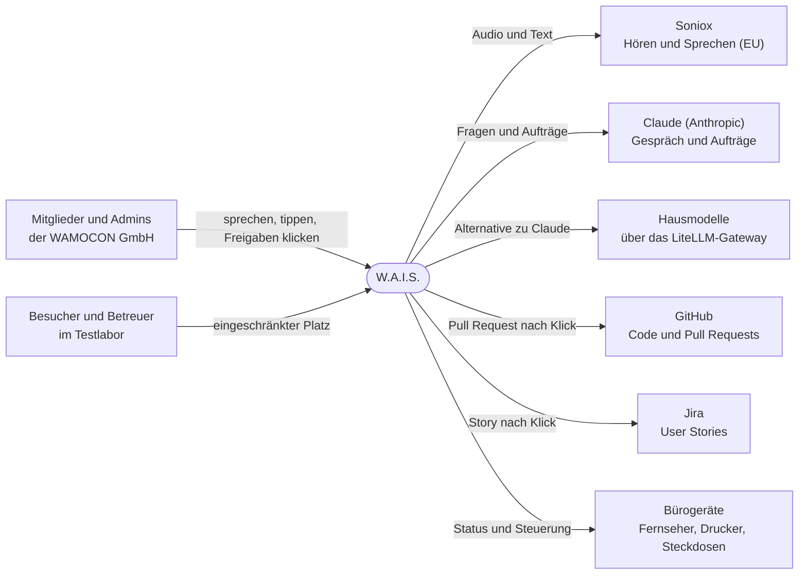
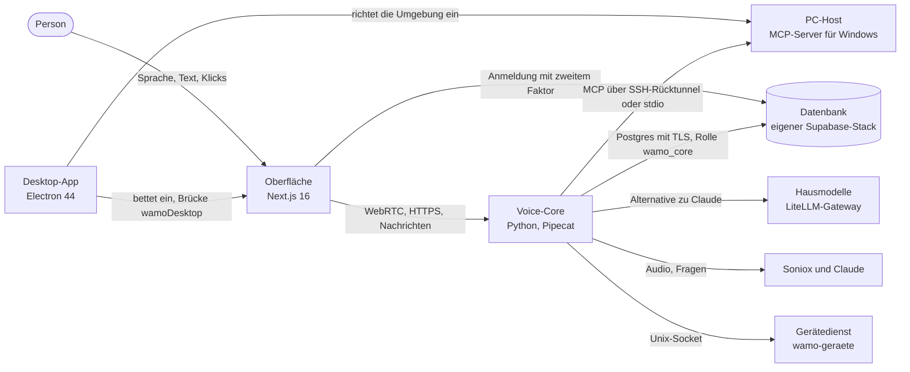
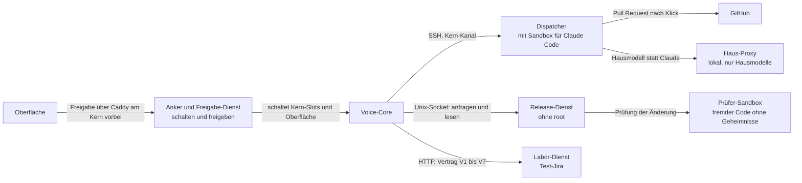
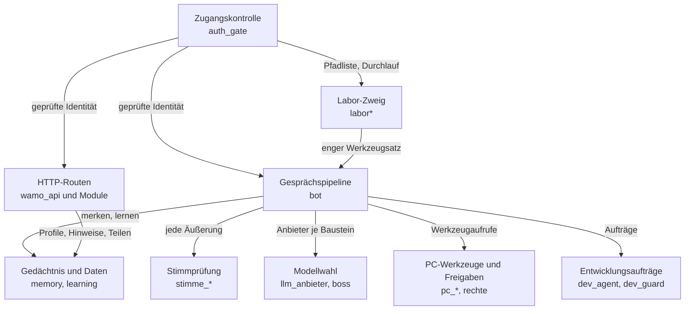
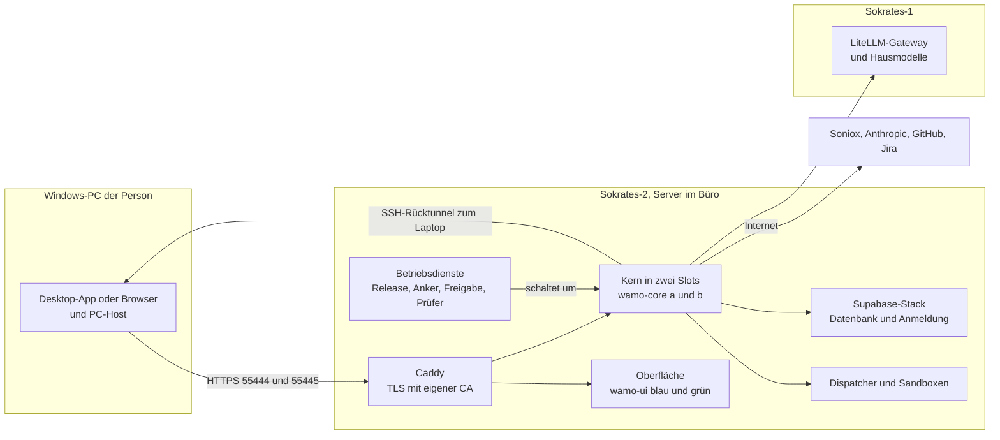
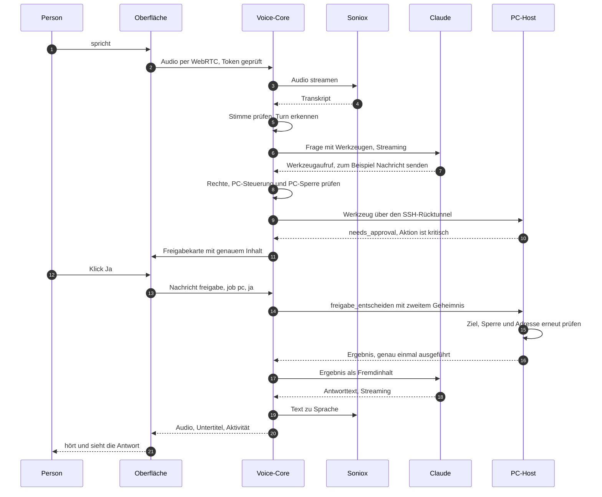
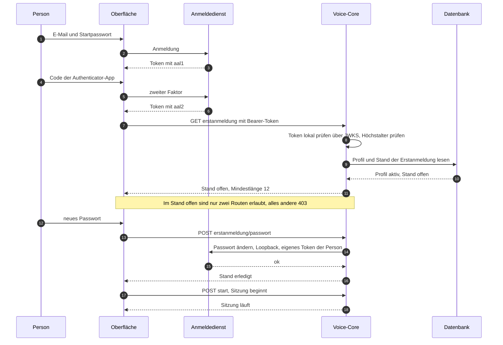
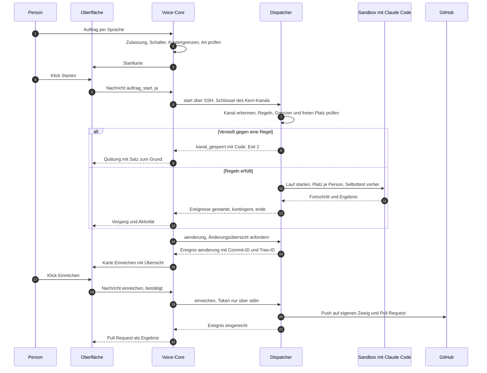

# Architektur

| | |
|---|---|
| Zweck | Beschreibt Aufbau, Zusammenspiel und Entscheidungen von W.A.I.S.: arc42, C4-Diagramme und Entscheidungsregister. |
| Zielgruppe | Architekten, Entwickler, Sicherheit |
| Dokumentart | Erklärung und Referenz |
| Stand | 19.11.2026, geprüft gegen Commit 497e3ce |
| Quellen | Die Kopftabelle jedes Kapitels nennt die Quellen |

## Inhalt

1. [Architekturdokumentation nach arc42](#architekturdokumentation-nach-arc42)
2. [C4-Diagramme von W.A.I.S.](#c4-diagramme-von-wais)
3. [Entscheidungsregister](#entscheidungsregister)

## Architekturdokumentation nach arc42

| | |
|---|---|
| Zweck | Beschreibt Aufbau, Zusammenspiel, Verteilung und Qualitätsziele von W.A.I.S. in den zwölf Abschnitten von arc42. |
| Zielgruppe | Entwicklerinnen und Entwickler, Architektur, Betrieb, Prüferinnen und Prüfer. |
| Dokumentart | Erklärung |
| Quellen | `CLAUDE.md`, `README.md`, `infra/sokrates2/README.md`, `voice-core/bot.py`, `voice-core/auth_gate.py`, `host/wamo_host.py`, `docs/*.md` |

arc42 ist eine Gliederung für Architekturdokumentation mit zwölf festen Abschnitten. Die Diagramme dazu stehen in [C4-Diagramme von W.A.I.S.](#c4-diagramme-von-wais), die Entscheidungen in [Entscheidungsregister](#entscheidungsregister), die Schnittstellen in [Schnittstellen von W.A.I.S.](technik.md#schnittstellen-von-wais). Begriffe erklärt [`glossar.md`](glossar.md). Der Code ist maßgeblich vor Prosa. Wo eine Aussage nur im README steht und sich nicht am Code prüfen lässt, steht "laut README".

### 1. Einführung und Ziele

Quellen: `README.md`, `CLAUDE.md`, `docs/testlabor-wamo.md`.

#### 1.1 Aufgabenstellung

W.A.I.S. ist der Sprachassistent der WAMOCON GmbH. Die Langform ist "WAMOCON's Artificial Intelligence System", gesprochen "Wais". Er führt Livegespräche mit natürlichen Unterbrechungen, bietet eine Oberfläche im WMC-Design, bedient den Windows-PC der Person über Werkzeuge, führt Entwicklungsaufträge mit Claude Code, ECC und REA aus und hält ein persönliches und ein gemeinsames Gedächtnis. Mehrere Profile nutzen denselben Kern.

| Fähigkeit | Kurzbeschreibung | Mehr |
|---|---|---|
| Gespräch | Sprache rein, Sprache raus, Unterbrechen jederzeit, Untertitel, Canvas für Tabellen, Code, Dokumente, Diagramme | [Funktionskatalog W.A.I.S.](fachkonzept.md#funktionskatalog-wais) |
| PC-Steuerung | Fenster, Tastatur, Maus, PowerShell lesen, Office, Mail, Teams, OneNote am eigenen Laptop, jede kritische Aktion nur nach Klick | [PC-Host und Desktop-App](technik.md#pc-host-und-desktop-app) |
| Entwicklungsaufträge | Claude Code in einer Sandbox auf dem Server, Ergebnis als Pull Request nach Klick | [`../entwicklung-im-betrieb.md`](../entwicklung-im-betrieb.md) |
| Gedächtnis | Persönliche Eigenschaften und gemeinsames Firmenwissen, gemeinsame Einträge erst nach Freigabe | [Datenmodell: Datenbank, Rollen und Migrationen](technik.md#datenmodell-datenbank-rollen-und-migrationen) |
| Bürogeräte | Status und Steuerung gemeinsamer Geräte im Büro über einen Gerätedienst | `geraete/README.md` |
| Testlabor | Eingeschränktes Profil für Besucher am Labortag 28.11.2026 | [`../testlabor-wamo.md`](../testlabor-wamo.md) |

Produktumfang und Abgrenzung: [Produktübersicht W.A.I.S.](fachkonzept.md#produktübersicht-wais).

#### 1.2 Qualitätsziele

Die fünf wichtigsten Ziele, geordnet nach Gewicht. Konkrete Szenarien stehen in Abschnitt 10.

| Rang | Qualitätsziel | Bedeutung |
|---|---|---|
| 1 | Sicherheit | Zugang nur mit zweitem Faktor und aktivem Profil. Jede Unsicherheit führt zur Ablehnung. Kritische Aktionen nur nach dem Klick einer Person. Inhalte von außen sind Daten, nie Anweisungen. |
| 2 | Gesprächsqualität und Latenz | Das Gespräch muss sich wie zwischen Menschen anfühlen: kurze Wartezeit bis zum ersten Ton, natürliche Unterbrechungen, keine tote Stille. |
| 3 | Datenschutz | Daten bleiben im Haus (eigener Datenbankstack, Hausmodelle). Spracherkennung und Sprachausgabe laufen über EU-Endpunkte. Stimmabdruck nur mit Einwilligung. Das Labor löscht vollständig. |
| 4 | Verfügbarkeit im Betrieb | Releases ohne Unterbrechung laufender Gespräche. Fällt der PC oder ein Modell aus, bleibt W.A.I.S. ansprechbar und sagt es. |
| 5 | Wartbarkeit | Eindeutige Namen, feste Listen mit Gegenstück und Vertragstest, jedes neue Verhalten hinter einem Schalter mit Rückweg. |

#### 1.3 Stakeholder

| Rolle | Erwartung |
|---|---|
| Mitglieder der WAMOCON GmbH | Verlässlicher Assistent am eigenen Laptop. Rechte und Freigaben sind verständlich. |
| Admins | Verwalten Konten, Geräte, gemeinsames Gedächtnis und Fernzugriff. Geben Änderungen frei. |
| Lead-Entwickler (Niko) | Entscheidet über Umfang, Schalter und Freigabe von Stufen des Produkts. Verbindliche Entscheidungen stehen im Kapitel [Entscheidungsregister](#entscheidungsregister). |
| Geschäftsführung | Entscheidet über Firmenfragen, zum Beispiel Verträge mit Dienstleistern und Datenschutz. |
| Besucher und Betreuer des Testlabors | Eng begrenzter Zugang am Platz, Betreuer führen und können abschalten. |
| Betrieb und Entwicklung | Wiederholbare Einrichtung, Rückwege, klare Fehlermeldungen, Tests. |
| Datenschutz und Recht | Einwilligung, Löschfristen, Nachweis. Beispiele: `docs/labor-datenschutz-entwurf.md`, Einwilligung zum Stimmabdruck in `voice-core/stimme_einwilligung.py`. |

### 2. Randbedingungen

Quellen: `README.md`, `CLAUDE.md`, `voice-core/pyproject.toml`, `ui/package.json`, `desktop/package.json`, `host/pyproject.toml`.

| Art | Randbedingung | Folge |
|---|---|---|
| Technik | Voice-Core auf Pipecat ab 1.12 und unter 2, Python ab 3.11 | Pipeline aus Bausteinen (Frames), Soniox, Anthropic, MCP und WebRTC kommen als Pipecat-Pakete |
| Technik | Oberfläche Next.js 16.4.6 mit React 19.3.0, Desktop-App Electron 44.10.1, beide in Version 0.6.0 | Gemeinsame Oberfläche für Browser und App, Brücke `window.wamoDesktop` |
| Technik | PC-Host nur für Windows (MCP-Server mit PowerShell, UI Automation, COM) | PC-Steuerung gibt es nur an Windows-Laptops |
| Technik | Eigener Supabase-Stack auf dem Server Sokrates-2, Postgres mit TLS, Rolle `wamo_core` | Kein `service_role` im Kern, Schemas `wamo_dev`, `wamo_test`, `wamo_prod` |
| Technik | Modelle im Haus nur über das zentrale LiteLLM-Gateway | Keine direkten Adressen von Modellknoten |
| Technik | Server ist ein ARM64-Linux (Runner-Labels `linux, ARM64`), Zugriff über SSH | Skripte für Einrichtung und Rückweg je Dienst unter `infra/sokrates2/` |
| Organisation | Freeze für Kern, Migrationen, Oberfläche und Dienste ab Montag 23.11.2026 früh, Testlabor am 28.11.2026 | Neuere Pakete laufen hinter Schaltern, Stand je Paket im jeweiligen Planpapier |
| Organisation | Einheitliches Corporate Design WMC, deutsche Texte mit echten Umlauten, keine Gedankenstriche im Fließtext | Gilt für Oberfläche, Sprachausgabe und Dokumente |
| Organisation | Namensvertrag: Anzeigename W.A.I.S., alle technischen Kennungen bleiben `wamo` | Siehe Abschnitt 8.3 |
| Recht | Einwilligung für Stimmabdruck und Laborprofile, Löschfristen, Datenschutzhinweis | Eigene Tabellen und Löschläufe, Version der Einwilligung wird geprüft |
| Konvention | Migrationen sind nach dem Apply auf PROD unveränderlich, neue Tabellen mit Row Level Security | Siehe [Entscheidungsregister](#entscheidungsregister), Abschnitt 5 |

### 3. Kontextabgrenzung

Quellen: `README.md`, `CLAUDE.md`, `voice-core/bot.py`, `voice-core/llm_anbieter.py`, `voice-core/sprache_anbieter.py`.

#### 3.1 Fachlicher Kontext

| Partner | Austausch mit W.A.I.S. |
|---|---|
| Mitglied oder Admin | Spricht und tippt, liest Antworten und Karten, klickt Freigaben |
| Besucher und Betreuer im Labor | Besucher sprechen am Platz, Betreuer führen den Durchlauf und beenden ihn |
| Windows-Laptop der Person | Wird gesteuert, zeigt Fenster, Dateien, Outlook, Teams und OneNote |
| Bürogeräte | Status und Steuerung (Fernseher, Lautsprecher, Steckdosen, Drucker, Scanner, NAS) |
| GitHub | Ziel der Pull Requests aus Entwicklungsaufträgen, Quelle von Prüfläufen |
| Jira | Anlegen von User Stories nach Klick, im Labor ein eigener Test-Dienst |
| Anbieter von Sprach- und Sprachmodellen | Soniox (Hören und Sprechen), Claude (Gespräch und Entwicklungsaufträge), Hausmodelle |

#### 3.2 Technischer Kontext

| Nachbar | Richtung | Protokoll und Absicherung | Quelle |
|---|---|---|---|
| Browser und Desktop-App | beide | WebRTC (Audio, Nachrichten), HTTPS für `/start`, Angebot und `/wamo/api/...`, Bearer-Token mit aal2 | `voice-core/auth_gate.py` |
| Anmeldedienst und Datenbank (Supabase) | Kern und Oberfläche nach Supabase | HTTPS (Token, JWKS), Postgres über Pooler mit TLS und eigener CA | `voice-core/memory.py`, `voice-core/wamo_tls.py` |
| Soniox | Kern nach Soniox | Streaming für Erkennung und Sprachausgabe, EU-Endpunkte | `voice-core/sprache_anbieter.py`, `voice-core/soniox_tts.py` |
| Claude (Anthropic) | Kern nach Anthropic | HTTPS, Schlüssel je Profil oder Server-Schlüssel, Websuche wahlweise über SearXNG | `voice-core/llm_anbieter.py`, `voice-core/suche.py` |
| LiteLLM-Gateway und Hausmodelle | Kern nach Gateway | HTTP im Büro-LAN, OpenAI-kompatible Schnittstelle, Modell-Aliase | `voice-core/llm_anbieter.py`, `docs/hausmodelle-und-kikollege.md` |
| PC-Host | Kern nach Laptop | MCP über Streamable HTTP, nur über SSH-Rücktunnel je Gerät, Bearer-Token | `voice-core/pc_host.py`, `voice-core/pc_tunnel.py` |
| Auftrags-Dispatcher | Kern nach Server | SSH mit eigenem Schlüssel, Forced Command, JSON-Zeilen als Antwort | `voice-core/dev_agent_weg.py`, `infra/sokrates2/wamo_job_dispatch.py` |
| Gerätedienst | Kern nach Dienst | Unix-Socket, eine JSON-Zeile je Anfrage | `voice-core/geraete_client.py`, `geraete/README.md` |
| Labor-Dienst | Kern nach Dienst | HTTP mit Token, Vertrag V1 bis V7 | `voice-core/labor_client.py`, `docs/labor-dienst-vertrag.md` |
| Release-Dienst und Freigabe-Dienst | Kern und Oberfläche nach Dienst | Unix-Socket, die Freigabe geht über Caddy direkt an den Freigabe-Dienst | `voice-core/release_client.py`, `infra/sokrates2/wamo-caddy/kern/wamo-core.caddy` |
| Jira und GitHub | Kern nach extern | REST über HTTPS, Token je Person oder technischer Benutzer | `voice-core/jira_client.py`, `voice-core/github_zugang.py` |

### 4. Lösungsstrategie

Quellen: `CLAUDE.md` (Architektur-Entscheidungen), `README.md` (Sicherheitsmodell), `docs/selbstueberarbeitung.md`, `docs/gespraech-optimierung.md`.

| Ziel | Ansatz | Wo umgesetzt |
|---|---|---|
| Sicherheit | Zugangskontrolle als einzige Middleware vor allen Routen. Rechte im Code, nicht im Prompt. Kritische Aktionen als Karte mit Klick. Fail closed bei jeder Unsicherheit. | `voice-core/auth_gate.py`, `voice-core/rechte.py`, `host/wamo_host.py` |
| Gesprächsqualität | Kaskade aus Sprachaktivität, Spracherkennung, Turn-Erkennung, Modell im Streaming und Sprachausgabe. Innehalten statt hartem Abbruch, Rückmeldelaute stoppen nicht, Latenz je Zug messbar. | `voice-core/bot.py`, `voice-core/soft_interrupt.py`, `voice-core/latenz.py` |
| Datenschutz | Eigener Stack, Hausmodelle als Option, EU-Endpunkte, Stimmabdruck je Mikrofon als Zahlenvektor nach Einwilligung, Fehlerbuch nur im Speicher. | `voice-core/memory.py`, `voice-core/stimme_*.py`, `voice-core/fehlerbuch.py` |
| Verfügbarkeit | Zwei Kern-Instanzen (Slots) und zwei Oberflächen-Container (blau und grün), Umschalten über Include-Dateien, Notanker außerhalb des Repo-Deploys. | `infra/sokrates2/wamo-core-slots.sh`, `infra/sokrates2/wamo-ui-umschalten.sh` |
| Wartbarkeit | Namensvertrag, Vertragstests zwischen Kern und Dispatcher, feste Listen mit Gegenstück, Skripte mit `einrichten` und `rueckweg`. | `voice-core/test_kernkanal_vertrag.py`, `infra/sokrates2/*-einrichten.sh` |
| Beherrschbare Einführung | Neue Pakete laufen hinter Schaltern, Standard aus. Pakete werden in Stufen geschaltet und lassen sich zurücknehmen. | `voice-core/env_schalter.py`, `docs/entwicklung-im-betrieb.md` |
| Modellflexibilität | Anbieter je Baustein umschaltbar. Ein Regelwerk ("Boss") wählt nach Aufgabenklasse, gemessener Güte und Antwortzeit. | `voice-core/llm_anbieter.py`, `voice-core/boss.py`, `voice-core/modellkarte.py` |

### 5. Bausteinsicht

Quellen: `README.md` (Tabelle der Ordner), `CLAUDE.md`, Ordnerstruktur des Repos.

#### 5.1 Ebene 1: das Gesamtsystem

| Baustein | Aufgabe | Technik | Läuft auf | Tiefe |
|---|---|---|---|---|
| `ui/` | Oberfläche: Präsenzkern, Untertitel, Stimmlinie, Werkzeug-Zeitleiste, Canvas, Freigabekarten, Anmeldung mit zweitem Faktor, Einstellungen | Next.js 16, React 19 | als Container `wamo-ui` auf dem Server (Browser), in der Desktop-App eingebettet | [Oberfläche: Aufbau der Next.js-Anwendung](technik.md#oberfläche-aufbau-der-nextjs-anwendung) |
| `desktop/` | App-Fenster, Markierung am Zielfenster, Tray, Autostart, Update, Host-Umgebung, Live-Bild | Electron 44 | Windows-PC | [PC-Host und Desktop-App](technik.md#pc-host-und-desktop-app) |
| `host/` | Werkzeuge am Windows-PC mit Risikoklassen und Audit-Log | Python, MCP (FastMCP) | Windows-PC | [PC-Host und Desktop-App](technik.md#pc-host-und-desktop-app) |
| `voice-core/` | Gespräch, Zugangskontrolle, Rechte, Werkzeuge, Gedächtnis, Entwicklungsaufträge, HTTP-Schnittstellen | Python, Pipecat | Server (Büro) oder PC (Unterwegs) | [Voice-Core: Aufbau des Python-Kerns](technik.md#voice-core-aufbau-des-python-kerns) |
| `supabase/` | Migrationen mit Platzhalter `__SCHEMA__`, SQL-Tests | SQL | eigener Supabase-Stack auf dem Server | [Datenmodell: Datenbank, Rollen und Migrationen](technik.md#datenmodell-datenbank-rollen-und-migrationen) |
| `geraete/` | Gerätedienst `wamo-geraete` für Bürogeräte | Python | Server | `geraete/README.md` |
| `labor-dienst/` | Test-Jira des Testlabors (API, Speicher, Betreuer-Seite) | Python, FastAPI, SQLite | Server (Container) | [`../labor-dienst-vertrag.md`](../labor-dienst-vertrag.md) |
| `infra/sokrates2/` | Einrichtung und Betrieb aller Dienste: Stack, TLS, Firewall, Kern-Slots, Dispatcher, Release, Anker, Freigabe, Prüfer, Proxys, Gateway für Fernzugriff, Runner | Shell, Python, nft, systemd | Server | [Betriebshandbuch](betrieb.md#betriebshandbuch) |
| `scripts/` | Start der Desktop-App, Nutzerverwaltung, Migrationen, Versionsskript, Messwerkzeuge, Labor-Skripte | Python, Node, PowerShell | Entwicklungs-PC und Admin-PC | [Entwicklerhandbuch](entwicklung.md#entwicklerhandbuch) |

#### 5.2 Ebene 2: Voice-Core

Der Kern ist der größte Baustein. Die Gruppen unten fassen die Module in `voice-core/` zusammen. Ein Modul gehört zu genau einer Gruppe. Die Tiefe steht in [Voice-Core: Aufbau des Python-Kerns](technik.md#voice-core-aufbau-des-python-kerns), die Diagramme in [C4-Diagramme von W.A.I.S.](#c4-diagramme-von-wais), Abschnitt 4.

| Gruppe | Module (Auswahl) | Aufgabe |
|---|---|---|
| Zugang und Schnittstellen | `auth_gate.py`, `wamo_api.py`, `*_api.py`, `kern_dienst.py` | Token-Prüfung, Identität, HTTP-Routen, Start als Dienst auf einem Unix-Socket |
| Gespräch | `bot.py`, `persona.py`, `llm_anbieter.py`, `sprache_anbieter.py`, `soniox_tts.py`, `soft_interrupt.py`, `wiedergabe.py`, `turn_wache.py`, `wartesatz.py`, `fuellwoerter.py`, `latenz.py` | Pipeline, Persona, Wahl der Anbieter, Unterbrechungen, Wartesätze, Latenzmessung |
| Stimmprüfung | `stimme_pruefer.py`, `stimme_gate.py`, `stimme_waechter.py`, `stimme_modell.py`, `stimme_mikrofon.py`, `stimme_einlernen.py`, `stimme_sitzung.py`, `stimme_speicher.py` | Stimmabdruck je Mikrofon einlernen, jede Äußerung prüfen, Regeln für Werkzeuge (nur im Modus streng sperrend) |
| Werkzeuge im Gespräch | `tools.py`, `activity.py`, `werkzeug_wache.py`, `ausgaben_kuerzen.py`, `suche.py`, `screen.py` | Zeit, Websuche, Canvas, Merken, Bildschirm, Aktivitätsmeldungen |
| PC-Steuerung | `pc_host.py`, `pc_geraet.py`, `pc_tunnel.py`, `pc_freigaben.py`, `pc_mitglied.py`, `rechte.py` | Verbindung zum Host je Gerät, Freigabekarten, Schutz der Mitglieder |
| Office und Versand | `office_werkzeuge.py`, `outlook_werkzeuge.py`, `teams_werkzeuge.py`, `onenote_werkzeuge.py`, `jira_*.py` | Canvas als Datei, Mail, Teams, OneNote, Jira-Story, jeweils mit Karte |
| Geräte und Teilen | `geraete_*.py`, `buero_api.py`, `teilen.py`, `teilen_werkzeuge.py` | Bürogeräte, geteilte Canvas, Dateien und Aufträge |
| Entwicklungsaufträge | `dev_agent*.py`, `dev_guard.py`, `entwicklung_betrieb.py`, `abnahme*.py`, `github_*.py`, `kontingent.py`, `werkzeugkarte.py`, `vorgang_stream.py` | Aufträge vorbereiten, an den Dispatcher geben, Fortschritt, Prüfen, Einreichen |
| Modelle und Zugänge | `modellzugang.py`, `modellwahl.py`, `schluessel.py`, `boss.py`, `modellkarte.py` | Eigener Schlüssel je Profil (verschlüsselt), Modellwahl, Boss |
| Daten | `memory.py`, `learning.py`, `vorgaenge.py`, `fehlerbuch.py`, `canvas_*.py` | Gedächtnis, Lernen, Vorgänge, Fehlerbuch, Canvas |
| Labor | `labor*.py` | Eng begrenztes Profil: Pfadliste, Durchlauf, Einwilligung, Ticket-Werkzeuge, Löschfunktion |
| Betrieb | `sitzungen.py`, `sitzungen_bruecke.py`, `abschaltung.py`, `release_client.py`, `verteilung_api.py`, `einrichtung_api.py` | Eine Sitzung je Profil, Ablösen zwischen Slots, geordnetes Beenden, Stand der Release-Dienste, Installer, Prüfliste |

#### 5.3 Ebene 2: weitere Bausteine

| Baustein | Teile | Hinweis |
|---|---|---|
| Oberfläche | `ui/src/app` (Seiten und `version.json`), `ui/src/components` (Karten, Canvas, Formulare), `ui/src/lib` (Zustand, Nachrichten, Schnittstellen) | Zentrale Zustandsverwaltung und Verbindung in `ui/src/lib/useWamo.ts`, Nachrichtenformate in `ui/src/lib/nachrichten.ts` |
| Host | `host/wamo_host.py` (Werkzeuge), `windows_control.py`, `uia_control.py` (UI Automation), `office_*.py`, `live_bild.py`, `host_http.py` | Der Host erzwingt Klassen und Freigaben selbst |
| Desktop | `desktop/main.js`, `preload.js`, `geraet.js`, `host-umgebung.js`, `update.js`, `livebild.js`, `markierung.js` | Brücke `window.wamoDesktop` zwischen Oberfläche und Rechner |
| Dienste auf dem Server | Dispatcher mit Kern-Kanal, Release-Dienst, Anker, Freigabe-Dienst, Prüfer-Sandbox, Haus-Proxy, Gerätedienst, Gateway für Fernzugriff, Labor-Dienst | Namen, Pfade und Schalter stehen in der Tabelle "Namensvertrag" in `CLAUDE.md` |

### 6. Laufzeitsicht

Quellen: `voice-core/bot.py`, `voice-core/auth_gate.py`, `voice-core/pc_freigaben.py`, `voice-core/dev_agent.py`, `infra/sokrates2/wamo_job_dispatch.py`. Die Sequenzdiagramme zu 6.1 bis 6.3 stehen in [C4-Diagramme von W.A.I.S.](#c4-diagramme-von-wais), Abschnitt 6.

#### 6.1 Sprachgespräch mit Werkzeugaufruf und Freigabe

1. Die Oberfläche startet die Sitzung mit `POST /start` und sendet das WebRTC-Angebot. Die Zugangskontrolle prüft Token, zweiten Faktor, Höchstalter, aktives Profil und Erstanmeldung und schreibt die geprüfte Identität in den Body.
2. Der Bot baut die Pipeline: Mikrofon, Sprachaktivität (Silero), Spracherkennung (Soniox), Turn-Erkennung (Smart Turn und Satzende-Marker des Modells), Modell im Streaming, Sprachausgabe.
3. Die Stimmprüfung bewertet jede Äußerung und vergleicht sie mit den Abdrücken der Person (ein Abdruck je Mikrofon). Im Standardmodus `beobachten` misst sie nur und sperrt nichts, im Modus `streng` (nur auf ausdrücklichen Wunsch) verwirft sie fremde Stimmen. Für gesprochene PC-Befehle brauchen Mitglieder zusätzlich einen eingelernten Abdruck.
4. Ruft das Modell ein PC-Werkzeug auf, prüft der Kern Rechte (`rechte.py`), PC-Steuerung und PC-Sperre und leitet an den Host weiter. Der Host stuft die Aktion ein.
5. Eine kritische Aktion liefert `needs_approval`. Der Kern zeigt eine Freigabekarte. Erst der Klick der Person führt die Aktion einmal aus, vorher prüft der Host Ziel, Sperre und Adresse erneut.
6. Das Ergebnis geht als Fremdinhalt zurück ins Gespräch. Aktivitäten, Untertitel und Canvas erscheinen live in der Oberfläche.

#### 6.2 Anmeldung mit Erstanmeldung

1. Die Person meldet sich mit Passwort und Code der Authenticator-App an. Das Token trägt `aal2` und `amr` mit dem Zeitstempel der Anmeldung.
2. Vor jeder Sitzung liest das Tor den Stand der Erstanmeldung. Im Stand `offen` sind nur `GET /wamo/api/erstanmeldung` und `POST /wamo/api/erstanmeldung/passwort` erlaubt, alles andere 403.
3. Die Person wechselt das Startpasswort. Der Kern reicht den Wechsel an den Anmeldedienst weiter, weil der Browser ihn dort nicht selbst aufrufen darf.
4. Danach führt die Oberfläche durch die Schritte (Token, API-Schlüssel, Installer, Prüfliste "Erste Schritte"). Ohne beides läuft alles über Hausmodelle.

#### 6.3 Entwicklungsauftrag über den Kern-Kanal

1. Das Modell bereitet einen Auftrag vor. Der Kern prüft Zulassung, Schalter, Kostengrenzen und Auftragsart und zeigt eine Startkarte.
2. Nach dem Klick ruft der Kern den Dispatcher per SSH mit dem Schlüssel des Kern-Kanals auf. Der Dispatcher prüft die Regeln des Kanals in fester Reihenfolge und antwortet bei Verstoß mit `kanal_gesperrt`.
3. Er startet Claude Code in einer abgeschotteten Sandbox mit einem Platz je Person. Ereignisse und Fortschritt kommen als JSON-Zeilen zurück und erscheinen in der Aufgabenleiste.
4. Im persönlichen GitHub-Weg bleibt das Token außerhalb der Sandbox. Der Dispatcher meldet die Änderung, die Person liest die Karte und klickt "Einreichen". Erst dann gehen Push auf `wamo/<auftrag>` und Pull Request hinaus.

#### 6.4 Release ohne Unterbrechung

1. Ein neuer Kern-Stand wird als Release in den inaktiven Slot gelegt und vorgeprüft.
2. Caddy schaltet per Include-Datei um. Neue Sitzungen gehen auf den neuen Slot, laufende bleiben auf ihrer Instanz (Pfad `/i/<slot>/`) und laufen aus.
3. Die Oberfläche wird als Container der anderen Farbe gebaut, geprüft (`GET /version.json`) und umgeschaltet. Der Rückweg ist dieselbe Handlung rückwärts.

#### 6.5 Laborsitzung

1. Ein Laborprofil durchläuft dieselbe Zugangskontrolle, danach gilt eine feste Pfadliste.
2. Vor `/start` und jedem Angebot prüft der Kern beim Labor-Dienst Durchlauf und Einwilligung. Fehlt eine von beiden, endet es mit 403, ist der Dienst nicht erreichbar, mit 503.
3. Die Sitzung kennt nur Zeit, Websuche, Canvas und Ticket-Werkzeuge. Der Betreuer beendet den Durchlauf, die Oberfläche lädt neu.

### 7. Verteilungssicht

Quellen: `infra/sokrates2/README.md` (Abschnitte 0, 5, 6, 10, 12), `CLAUDE.md` (Namensvertrag), `docs/hausmodelle-und-kikollege.md` (Bestandsaufnahme 15.11.2026). Der tatsächliche Zustand des Servers ist nur laut README belegt, Stand je Abschnitt.

#### 7.1 Knoten

| Knoten | Rolle | Dienste |
|---|---|---|
| Windows-PC der Person | Arbeitsplatz | Desktop-App oder Browser, Host (MCP) und Tunnelskripte, Chrome-Profil für den Browserbetrieb |
| Sokrates-2 | Zentraler Server im Büro | Supabase-Stack, Kern in zwei Slots, Oberfläche in zwei Farben, Caddy, Dispatcher mit Sandboxen, Release-Dienst, Anker, Freigabe-Dienst, Prüfer-Sandbox, Haus-Proxy, Gerätedienst, Gateway für Fernzugriff, Labor-Dienst, Runner für das Ausrollen |
| Sokrates-1 | Modellknoten | Zentrales LiteLLM-Gateway, Ollama mit Hausmodellen, Spracherkennung und Sprachausgabe im Haus (Container) |
| Caesar | Weiterer Knoten | Hausmodelle, Websuche im Haus (SearXNG) und Ziel des Fernzugriffs |
| Externe Dienste | Anbieter | Soniox (EU), Anthropic, GitHub, Jira |

#### 7.2 Netze und Ports

Alle WAMO-Ports nehmen nur Verbindungen aus Loopback und dem Büro-LAN an. Unterwegs gilt der Weg über WireGuard ins Büronetz. Die Regeln setzt die Firewall `wamo-firewall` in der Kette `DOCKER-USER` (laut README seit 19.10.2026).

| Port | Dienst | Erlaubt |
|---|---|---|
| 55443 | API und Auth des Supabase-Stacks über HTTPS (Caddy) | Loopback, Büro-LAN |
| 55444 | Kern über HTTPS (Caddy vor dem Unix-Socket, kein TCP-Port am Kern) | Loopback, Büro-LAN |
| 55445 | Oberfläche über HTTPS (Caddy vor `wamo-ui`) | Loopback, Büro-LAN |
| 55446 | Gateway für Fernzugriff über HTTPS | Loopback und freigegebene Admin-Quellen |
| 55447 | Labor-Dienst über HTTPS | feste Quellen (Kette `WAMO-FW-LABOR`) |
| 55322, 56543 | Postgres über Supavisor mit TLS | Loopback und freigegebene Admin-Quellen |
| 55321 | HTTP-Zugang des Stacks, nur intern (Stufe 2) | Loopback und Caddy-Netz |
| 18090, 18080, 18081, 18765 | Haus-Proxy, Proxys der Prüfer-Sandbox, Labor-Dienst für den Kern | nur Loopback |

#### 7.3 Wege zwischen den Knoten

| Weg | Beschreibung |
|---|---|
| Browser oder App zum Kern | HTTPS auf Port 55444 mit der internen CA. Weitere PCs importieren die CA einmal. |
| Kern zum Laptop | SSH-Rücktunnel je Gerät. Jeder Laptop hat einen eigenen Benutzer und Socket auf dem Server. Der Kern erreicht den Host nur über diesen Socket mit Bearer-Token. |
| Kern zum Dispatcher | SSH mit eigenem Schlüssel für den Kern-Kanal. Der Dispatcher erkennt den Kanal am Schlüssel. |
| Kern zu Gerätedienst, Release-Dienst und Labor-Dienst | Unix-Sockets beziehungsweise Loopback |
| Sandbox zum Netz | Ausgang nur über Regeln der Firewall und Proxys mit Allowlist |
| Kern zu Modellen | Über das LiteLLM-Gateway, Spracherkennung und Sprachausgabe im Haus über dieselbe Gateway-Wurzel |

#### 7.4 Betriebsarten

| Art | Wo läuft der Kern | Hinweis |
|---|---|---|
| Büro | Dienst `wamo-core` (Vorlage `wamo-core@.service`, Slots a und b) auf dem Server | Alle Profile, PC-Werkzeuge über den Tunnel, Entwicklungsaufträge über den Kern-Kanal |
| Unterwegs | Auf dem eigenen PC, Host als Unterprozess über stdio | Standard laut README, der Host ist nicht im Netz erreichbar |

### 8. Querschnittliche Konzepte

#### 8.1 Rechte und Freigaben

Quellen: `voice-core/rechte.py`, `voice-core/pc_mitglied.py`, `voice-core/pc_freigaben.py`, `voice-core/auth_gate.py`, `host/wamo_host.py`, `README.md` (Sicherheitsmodell). Die Matrix steht in [Rollen und Rechte](fachkonzept.md#rollen-und-rechte).

| Ebene | Regel |
|---|---|
| Zugang | Token mit `aal2`, aktives Profil, Erstanmeldung erledigt. Jede Unsicherheit führt zur Ablehnung. |
| Rolle | `admin` und `mitglied`. Laborprofile sind immer Mitglieder mit eigener Pfadliste und nie Admin. |
| PC-Steuerung | `rechte.pc_stufe` liefert `admin`, `mitglied` oder keine Stufe. Mitglieder brauchen die Freischaltung je Profil. Für Mitglieder gelten zusätzlich Schutzregeln (eingelernter Stimmabdruck für gesprochene PC-Befehle, Karte nach Fremdinhalt, Einwilligung fürs Bildschirmbild). |
| Stimme | Die Stimme ist ein Hinweis, kein Zugangsschutz. Seit 18.11.2026 sperrt sie nichts, solange der Modus `beobachten` gilt (Standard von `WAMO_STIMME_PRUEFUNG`). Es schützen weiter zweiter Faktor und Freigabekarten. |
| Risikoklassen im Host | `read` sofort, `change` protokolliert, `critical` nur nach Karte, `blocked` nie. Das Modell kann keine Freigabe erteilen. |
| Freigabekarte | Gilt für eine Sitzung, befristet und genau einmal. Solange eine Karte offen ist, ruhen alle Eingaben. |
| Entwicklungsaufträge | Zulassung je Profil, Kostengrenzen, Kanalregeln im Dispatcher, Klick für Start und Einreichen. |

Inhalte aus Web, Dateien, Gedächtnis und Werkzeugen gelten als Daten und werden nie als Anweisung befolgt.

#### 8.2 Gedächtnis

Quellen: `voice-core/memory.py`, `voice-core/learning.py`, `voice-core/gedaechtnis_api.py`.

Das Gedächtnis hat zwei Bereiche. `persoenlich` gehört genau einem Profil, `gemeinsam` gilt für alle, aber nur mit Status `aktiv`. Automatisch gelernte gemeinsame Einträge starten als `vorgeschlagen`. Ausdrücklich gemerkte Einträge von Admins sind sofort aktiv, die von Mitgliedern bleiben Vorschläge. Admins entscheiden in der Oberfläche über Vorschläge. Das Entscheiden läuft über eine Datenbankfunktion, der Kern hat kein Recht, den Status direkt zu ändern. Laborprofile haben kein Gedächtnis.

#### 8.3 Namensvertrag

Quelle: `CLAUDE.md` (Tabelle "Namensvertrag").

Der Anzeigename ist "W.A.I.S." mit Schlusspunkt, gesprochen "Wais" (die Stimme bekommt "Ways"). Alle Kennungen bleiben `wamo`: Pakete `wamo-*`, Umgebung `WAMO_*`, Schemas `wamo_dev`, `wamo_test`, `wamo_prod`, Datenbankrollen `wamo_core` und `wamo_admin`, Dienste, Pfade. Konstanten des Anzeigenamens stehen in `voice-core/persona.py` und `ui/src/lib/anzeigename.ts`. Der Overlay-Fenstertitel und der Weckwort-Wert bleiben bewusst unverändert. Das Repo trägt auf GitHub seit 14.11.2026 den Namen `w.a.i.s`, `SELF_REPOS` führt jeden Namen, den es je trug.

#### 8.4 Schalter und Rückwege

Quellen: `voice-core/env_schalter.py`, `infra/sokrates2/*-einrichten.sh`, `infra/sokrates2/*-rueckweg.sh`, `CLAUDE.md`.

Neue Fähigkeiten stehen hinter einem Schalter, Standard aus. Beispiele: `WAMO_ENTWICKLUNG_BUERO`, `WAMO_ENTWICKLUNG_GITHUB`, `WAMO_OFFICE` (Teile `dateien`, `outlook`, `teams`, `onenote`), `WAMO_JIRA`, `WAMO_PC_MITGLIEDER_PROFILE`. Server-Einstellungen setzt nur `wamo-core-env` über stdin, sie wirken mit dem nächsten Kern-Release. Fast jeder Dienst hat ein Paar Skripte `einrichten` und `rueckweg`, oft mit Probelauf (`--trocken`) und Sicherung des vorigen Standes. Der Notaus des Kern-Kanals ist eine Datei, die alle Starts sperrt. Die vollständige Liste: [Konfiguration: Umgebungsvariablen und Schalter](technik.md#konfiguration-umgebungsvariablen-und-schalter).

#### 8.5 Fehlerbehandlung und Degradierung

Quellen: `voice-core/auth_gate.py`, `voice-core/werkzeug_wache.py`, `voice-core/fehlerbuch.py`, `voice-core/abschaltung.py`.

| Prinzip | Umsetzung |
|---|---|
| Fail closed | Nicht erreichbare Datenbank oder Anmeldedienst ergibt 503, nie einen Durchlass. Unbekannte Werte sperren. |
| Ehrliche Fehler | Abgebrochene Werkzeuge werden gemeldet, doppelte Aufrufe im selben Zug sauber behandelt. Das Fehlerbuch erklärt auf Nachfrage, warum etwas nicht ging, nur im Speicher der Sitzung. |
| Weiter sprechen | Ist der PC nicht erreichbar, sagt W.A.I.S. es und spricht weiter (laut README getestet am 20.10.2026). Im Modus "Nur Hausmodelle" gibt es keinen Rückfall auf Claude, im Modus "Automatisch" wählt der Boss unter den erreichbaren Modellen. |
| Feste Fehlercodes | Zugangskontrolle, Routen und Kern-Kanal melden maschinenlesbare Codes, siehe [Schnittstellen von W.A.I.S.](technik.md#schnittstellen-von-wais), Abschnitt 6. |
| Geordnetes Beenden | Beim Herunterfahren gelten Fristen unter dem Zeitlimit der Unit, damit der Slotwechsel nicht hängt. |
| Protokoll | Audit des Hosts als JSONL, Aktionen in der Tabelle `actions`, Dispatcher mit Zähler `kernkanal.jsonl`. Das Journal des Kerns enthält keine Gesprächsinhalte (Log-Stufe `INFO`). |

#### 8.6 Abschottung von Entwicklungsaufträgen

Quellen: `infra/sokrates2/wamo_job_dispatch.py`, `voice-core/dev_guard.py`, `CLAUDE.md` (Prüfer-Sandbox, Haus-Proxy).

Aufträge laufen als eigener Benutzer in einer Sandbox ohne Zugang zu den Geheimnissen des Servers. Der Ausgang ist durch Firewall-Regeln begrenzt, die Ports je Platz sind getrennt. Ein Wächter vor jedem Werkzeugaufruf von Claude Code entscheidet nach Regeln im Code, nicht im Prompt. Das Repo von W.A.I.S. selbst ist für Aufträge gesperrt. Der Dispatcher prüft jeden Start gegen Regeln des Kanals, Grenzen je Person und Gesamtgrenzen. Fremder Code wird in einer eigenen Prüfer-Sandbox ohne Geheimnisse geprüft.

#### 8.7 Blau und Grün, Kern-Slots

Quellen: `docs/selbstueberarbeitung.md`, `infra/sokrates2/wamo-core-slots.sh`, `ui/src/lib/kernSlot.ts`.

Der Kern läuft in zwei Instanzen (Slots a und b) mit eigenem Release-Ordner und eigenem Socket. Caddy leitet über `/i/<slot>/` und hält jede Sitzung auf ihrer Instanz, die alte Instanz läuft aus, bis ihre letzte Sitzung endet (höchstens `WAMO_MAX_SITZUNG_MIN`, Standard 120 Minuten laut Konzept). Eine Brücke löst Sitzungen zwischen den Instanzen ab ("eine Sitzung je Profil"). Die Oberfläche läuft als `wamo-ui-blau` und `wamo-ui-gruen`, Caddy zeigt über eine Include-Datei auf die aktive Farbe, die Gesundheitsprobe ist `GET /version.json`. Migrationen im Release sind nur erweiternd.

### 9. Architekturentscheidungen

Das Register mit Datum, Begründung, Folge und Quelle steht in [Entscheidungsregister](#entscheidungsregister). Die tragenden Entscheidungen im Überblick:

| Thema | Entscheidung | Nummer |
|---|---|---|
| Datenhaltung | Eigener Supabase-Stack, Kern nur mit Rolle `wamo_core` | E-01 |
| Zugang | Mehrere Profile, zweiter Faktor Pflicht, fail closed | E-02 |
| PC-Steuerung | Risikoklassen im Host, Freigabe nur per Klick, Tunnel je Gerät | E-04, E-09, E-23 |
| Release | Slots, blau und grün, vier getrennte Akteure bei der Selbstüberarbeitung | E-13, E-14 |
| Entwicklungsaufträge | Eigener Kern-Kanal, persönliche GitHub-Zugänge ohne Token in der Sandbox | E-18, E-35 |
| Modelle | Soniox und Claude als Start, Hausmodelle als Option | E-05, E-10, E-30 |
| Stimme | Die Stimme sperrt nichts, Standard `beobachten`, ein Abdruck je Mikrofon | E-33, E-34, E-40 |
| Ausrollen | Erstanmeldung, Installer vom Server, signierte Updates | E-27, E-28 |

### 10. Qualitätsanforderungen

Quellen: `README.md` (Stand 20.10.2026), `docs/gespraech-optimierung.md`, `docs/testlabor-wamo.md`, `docs/labor-lasttest.md`, Tests unter `voice-core/`, `host/`, `ui/src/`.

Zahlen stehen nur, wo sie im Repo belegt sind. Messwerte sind Momentaufnahmen mit Datum, keine Zusagen.

| Nr | Qualität | Szenario | Maß und Beleg |
|---|---|---|---|
| Q-1 | Latenz | Eine Person beendet einen Satz. Bis zum ersten Ton der Antwort vergeht die Zeit. | Büro: p50 1,32 s, p95 2,00 s, je 20 Fragen (laut README, 20.10.2026). Sitzungsprotokoll vom 31.10.2026: 1,4 bis 1,9 s in 11 von 15 Zügen, Ausreißer bis 6,1 s. Die Quellenlage nennt für die Praxis etwa 800 ms als Ziel (`docs/gespraech-optimierung.md`). |
| Q-2 | Unterbrechung | Die Person spricht dazwischen. W.A.I.S. verstummt, Rückmeldelaute stoppen nicht. | Verstummen im Median 1,3 s, 0 von 15 falschen Unterbrechungen (31.10.2026, `docs/gespraech-optimierung.md`). |
| Q-3 | Sicherheit, Zugang | Eine Anfrage kommt ohne zweiten Faktor, ohne aktives Profil oder bei gestörter Datenbank. | Abgelehnt mit 401, 403 oder 503, kein Werkzeug, keine Sitzung. Ende-zu-Ende-Test gegen den echten Stack 12 von 12 (laut README, 20.10.2026). Tests: `voice-core/test_auth_gate.py`. |
| Q-4 | Sicherheit, Freigabe | Das Modell verlangt eine kritische PC-Aktion, etwa Senden einer Nachricht. | Der Host antwortet mit `needs_approval`, ausgeführt wird erst nach dem Klick einmal und befristet. Tests: `host/test_security.py`, `voice-core/test_pc_freigaben.py`. |
| Q-5 | Sicherheit, Entwicklungsaufträge | Ein Auftrag soll eine Datei außerhalb seines Projekts ändern oder das Repo von W.A.I.S. berühren. | Wächter und Kanalregeln weisen ab. Der Vertragstest `voice-core/test_kernkanal_vertrag.py` prüft Kern und Dispatcher gegeneinander. |
| Q-6 | Verfügbarkeit | Ein neuer Kern-Stand wird ausgerollt, während Gespräche laufen. | Neue Sitzungen gehen auf den neuen Slot, laufende bleiben auf der alten Instanz, bis sie enden. Umschaltung am 02.11.2026 live geübt (laut README). |
| Q-7 | Verfügbarkeit | Der Tunnel zum Laptop bricht ab. | W.A.I.S. meldet "PC nicht erreichbar" und spricht weiter, danach wieder verbunden (laut README, Gesprächstest 20.10.2026). |
| Q-8 | Wartbarkeit | Ein Grund-Code des Kern-Kanals wird ergänzt. | Der Vertragstest schlägt fehl, bis beide Seiten dieselbe Liste führen. |
| Q-9 | Datenschutz, Stimme | Eine Person lernt ihren Stimmabdruck ein. | Nur nach ausdrücklicher Einwilligung (Version `stimme-3` nennt je Mikrofon einen Abdruck). Gespeichert wird je Mikrofon ein Zahlenvektor (192 Zahlen), höchstens drei je Person, nie eine Aufnahme. Löschen geht jederzeit. Beleg: `README.md` (Sicherheitsmodell, Stimmabdruck), `voice-core/stimme_einwilligung.py`, `voice-core/stimme_mikrofon.py`. |
| Q-10 | Datenschutz, Labor | Der Labortag ist vorbei. | Laborprofile werden gesperrt, alle Texte gelöscht, Löschfrist 11.12.2026. Test "danach ist nichts mehr da" (`docs/testlabor-wamo.md`, `voice-core/test_labor_loeschen.py`). |
| Q-11 | Last, Labor | Mehrere Plätze laufen gleichzeitig (am Labortag vier Besucher-Plätze, der Lasttest prüft bis acht Sitzungen). | Bestehensregel des Plans bei acht Sitzungen: p95 des ersten Tons höchstens 3500 ms und höchstens das 1,5-fache des Werts bei einer Sitzung, keine Abbrüche, CPU unter 70 Prozent, Speicher unter 2,8 GB, kein 429. Der volle Lasttest ist für Freitag 20.11.2026 geplant (`docs/testlabor-wamo.md`, `docs/labor-lasttest.md`). |

### 11. Risiken und technische Schulden

Quellen: `README.md` (Abschnitte "Stand" und "Offen"), `docs/labor-restplan.md`, `docs/persoenliche-zugaenge.md`, `docs/remote-desktop.md`, `docs/gespraech-optimierung.md`. Genannt sind nur Punkte, die das Repo bereits dokumentiert.

#### 11.1 Risiken

| Nr | Risiko | Stand laut Repo | Gegenmaßnahme |
|---|---|---|---|
| RK-1 | Die Stimmerkennung war bei Mikrofon- oder Raumwechsel zu ungenau, Aufträge und Aktionen blieben stehen. | Standard ist `beobachten` seit 18.11.2026 abends, die Stimme sperrt nichts (`CLAUDE.md`, `README.md`). | Schutz bleibt über zweiten Faktor und Freigabekarten. Ein Abdruck je Mikrofon (höchstens drei, Migration 0029) mindert die Streuung. Mitglieder brauchen für gesprochene PC-Befehle einen eingelernten Abdruck. Recherche: `docs/stimme-recherche-2026-11-18.md`. |
| RK-2 | Wartezeit bis zum ersten Ton liegt über dem Ziel, einzelne Ausreißer bis 6,1 s. | Messung 31.10.2026, Maßnahmen und Schalter in `docs/gespraech-optimierung.md`. | Persona-Block, Wartesatz, Satz vor Werkzeug, Prompt-Cache vorwärmen. Schalter erst nach Messung an. |
| RK-3 | Ein gekaperter Kern sieht entschlüsselte persönliche Tokens. | Bewusst akzeptiert (Plan C, C4). | Token nie in der Sandbox, Push erst nach Klick, Schreiben nur auf eigenen Zweig. |
| RK-4 | Ein gestohlenes Anmelde-Token kann Fernsitzungen starten, bis die Anmeldung abläuft. | Restrisiko in `docs/remote-desktop.md` beschrieben. | Jeder Start geht als Hinweis an alle Admins. Ein Stufenschalter begrenzt das Alter des Codes. |
| RK-5 | Der Labortag am 28.11.2026 hängt an Ausweichwegen: Das Hausmodell als Ausweichweg bricht in Tests ab, ein Büro-Fall besteht nur 4 von 17 Läufen. | `docs/labor-restplan.md` (R9, R10), Stand 17.11.2026. | Laufende Messrunden, Lasttest am 20.11.2026, Freeze ab 23.11.2026. |
| RK-6 | Das gemeinsame Ratenlimit des einen Server-Schlüssels zeigt sich erst bei gleichzeitiger Last von Labor und Büro. | `docs/labor-lasttest.md`. | Der Lasttest misst es ausdrücklich. |
| RK-7 | Der Stand einzelner Pakete am Server ist nur dort prüfbar. Rauchtests des Kern-Kanals liefen laut README Stand 11.11.2026 noch nicht. | Mehrere Abschnitte in `README.md` und `infra/sokrates2/README.md` tragen den Zusatz "nicht ausgerollt". | Stufen mit eigenen Rauchtests je Dienst, siehe [Betriebshandbuch](betrieb.md#betriebshandbuch). |
| RK-8 | Zugänge zu Jira, Vercel und Supabase für Aufträge sind gesperrt, bis technische Konten und enge Token bereitstehen. | `README.md` (Abschnitt "Offen"), Vercel und Supabase persönlich erst nach dem 05.12.2026. | Schalter bleiben aus. |

#### 11.2 Technische Schulden

| Nr | Schuld | Beleg | Hinweis |
|---|---|---|---|
| TS-1 | Migrationen 0010, 0011 und 0013 sind auf `wamo_prod` im Repo nicht als angewendet belegt. | `README.md` (Abschnitt "Offen") | Vor jedem Apply auf PROD prüft der Agent `database-reviewer`. |
| TS-2 | Das README trägt mehrere Stand-Abschnitte, ältere sind teilweise überholt und als solche markiert. | `README.md` | Diese Produktdokumentation soll die Lesbarkeit verbessern. Pflege: [`dokumentationskonzept.md`](dokumentationskonzept.md). |
| TS-3 | Einzelne Dateien sind sehr groß: `infra/sokrates2/wamo_job_dispatch.py` hat 5344 Zeilen, `host/wamo_host.py` 2820, `ui/src/lib/useWamo.ts` 2116, `voice-core/bot.py` 1961, `voice-core/dev_agent.py` 1938 (Zeilen je nach Arbeitsstand). | Zeilenzahl der Dateien | Teile sind schon in Module ausgelagert (zum Beispiel `wamo_job_kernkanal.py`, `wamo_job_github.py`). |
| TS-4 | Codesignatur des Installers: Der Weg ist eingebaut, das Zertifikat folgt. Ohne Zertifikat baut `npm run dist` unsigniert. | `README.md` (Windows-Installer) | Signierte Updates der App sind eigenständig gelöst (E-28). |
| TS-5 | Aktuelle Ergebnisse der Testläufe sind im Repo nicht zusammengefasst, das README nennt Zahlen vom 20.10.2026. | `README.md` | Teststrategie: [Qualität und Tests](entwicklung.md#qualität-und-tests). |
| TS-6 | Das Weckwort "Hey WAMO" ist vorgesehen und nicht umgesetzt. Hören und Stimme im Haus sind eingebaut, aber nicht umgestellt. | `CLAUDE.md` (Namensvertrag) | Soniox bleibt Standard (E-30). |

### 12. Glossar

Die Begriffe stehen in [`glossar.md`](glossar.md). Die wichtigsten, die dieses Dokument braucht: Kern (Voice-Core), Host, Slot, Freigabekarte, Kern-Kanal, Dispatcher, Anker, Stimmabdruck, Laborprofil, aal2.

### Weiterführend

- Schnittstellen und Fehlercodes: [Schnittstellen von W.A.I.S.](technik.md#schnittstellen-von-wais)
- Aufbau des Kerns, der Oberfläche, des Hosts: [Voice-Core: Aufbau des Python-Kerns](technik.md#voice-core-aufbau-des-python-kerns), [Oberfläche: Aufbau der Next.js-Anwendung](technik.md#oberfläche-aufbau-der-nextjs-anwendung), [PC-Host und Desktop-App](technik.md#pc-host-und-desktop-app)
- Betrieb und Sicherheit: [Betriebshandbuch](betrieb.md#betriebshandbuch), [sicherheit-und-datenschutz.md](sicherheit-und-datenschutz.md)
- Planpapiere: [`../selbstueberarbeitung.md`](../selbstueberarbeitung.md), [`../entwicklung-im-betrieb.md`](../entwicklung-im-betrieb.md), [`../hausmodelle-und-kikollege.md`](../hausmodelle-und-kikollege.md)

## C4-Diagramme von W.A.I.S.

| | |
|---|---|
| Zweck | Zeigt die Architektur in den C4-Ebenen Kontext, Container und Komponenten, dazu die Verteilung auf Rechner und drei Sequenzdiagramme der Kernabläufe. |
| Zielgruppe | Entwicklerinnen und Entwickler, Architektur, Betrieb, Prüferinnen und Prüfer. |
| Dokumentart | Erklärung |
| Quellen | `README.md`, `CLAUDE.md`, `infra/sokrates2/README.md`, `voice-core/bot.py`, `voice-core/auth_gate.py`, `host/wamo_host.py`, `infra/sokrates2/wamo_job_dispatch.py` |

### 1. Lesehilfe

C4 beschreibt Software in vier Zoomstufen: Systemkontext (Ebene 1), Container (Ebene 2, getrennt lauffähige Teile), Komponenten (Ebene 3, Teile eines Containers) und Code (Ebene 4, hier nicht dargestellt, siehe [Voice-Core: Aufbau des Python-Kerns](technik.md#voice-core-aufbau-des-python-kerns)). Dazu kommen eine Verteilungssicht und Sequenzdiagramme. Jedes Diagramm zeigt höchstens neun Knoten und beantwortet genau eine Frage. Die Texte dazu stehen in [Architekturdokumentation nach arc42](#architekturdokumentation-nach-arc42), die Schnittstellen in [Schnittstellen von W.A.I.S.](technik.md#schnittstellen-von-wais).

Die Diagramme sind Mermaid-Blöcke. Sie lassen sich in GitHub, in VS Code mit Mermaid-Erweiterung und in jedem Mermaid-fähigen Betrachter darstellen.

### 2. Ebene 1: Systemkontext

**Aussage:** W.A.I.S. steht zwischen den Menschen im Haus und einer kleinen Zahl externer und interner Dienste. Alles, was etwas verändert, geht nur nach dem Klick einer Person.

Das Diagramm zeigt, wer mit W.A.I.S. spricht und welche Systeme W.A.I.S. selbst nutzt. Der Windows-Laptop der Person gehört zum System (Host, Desktop-App), er erscheint erst in Ebene 2.

| Partner | Anlass | Quelle |
|---|---|---|
| Mitglieder und Admins | Gespräch, PC-Steuerung, Entwicklungsaufträge, Gedächtnis | `README.md` |
| Besucher und Betreuer | Eng begrenztes Laborprofil am Labortag, Betreuer führen den Durchlauf | `docs/testlabor-wamo.md` |
| Soniox | Spracherkennung und Sprachausgabe, Standard, wahlweise im Haus | `voice-core/sprache_anbieter.py` |
| Claude | Gespräch (Standard Haiku) und Claude Code für Entwicklungsaufträge | `voice-core/llm_anbieter.py` |
| Hausmodelle | Gespräch und Stimme im Haus, nur über das zentrale Gateway | `docs/hausmodelle-und-kikollege.md` |
| GitHub | Ziel der Änderungen aus Aufträgen, nie der Standardzweig | `docs/persoenliche-zugaenge.md` |
| Jira | Stories, im Labor ein eigener Test-Dienst | `voice-core/jira_client.py` |
| Bürogeräte | Gemeinsame Geräte im Büro über den Gerätedienst | `geraete/README.md` |

### 3. Ebene 2: Container

#### 3.1 Gespräch, Oberfläche und PC

**Aussage:** Der Voice-Core ist die Mitte. Er nimmt Sprache und Text aus der Oberfläche, steuert über den Host den Laptop und liest und schreibt Daten nur über eine eigene Datenbankrolle.

Das Diagramm zeigt die Container, die an einem normalen Gespräch beteiligt sind. Die Oberfläche läuft im Browser oder eingebettet in die Desktop-App. Im Büro läuft der Kern auf dem Server und erreicht den Host über einen SSH-Rücktunnel. In der Betriebsart Unterwegs läuft der Kern auf dem PC und startet den Host als Unterprozess.

| Container | Aufgabe | Technik | Quelle |
|---|---|---|---|
| Oberfläche | Untertitel, Stimmlinie, Zeitleiste, Canvas, Freigabekarten, Anmeldung | Next.js 16.4.6, React 19.3.0 | `ui/` |
| Desktop-App | App-Fenster, Markierung am Zielfenster, Tray, Update, Host-Umgebung | Electron 44.10.1 | `desktop/` |
| PC-Host | Werkzeuge mit Risikoklassen und Audit-Log, erzwingt Freigaben selbst | Python, MCP | `host/wamo_host.py` |
| Voice-Core | Pipeline, Zugangskontrolle, Rechte, Werkzeuge, Gedächtnis, HTTP-Routen | Python, Pipecat 1.12 | `voice-core/` |
| Datenbank | Profile, Gedächtnis, Sitzungen, Geräte, Freigaben | Postgres, GoTrue, Supavisor | `supabase/` |
| Hausmodelle | Sprachmodelle, Spracherkennung und Stimme im Haus | LiteLLM-Gateway | `docs/hausmodelle-und-kikollege.md` |
| Gerätedienst | Bürogeräte mit eigenem Benutzer und Ausgangsfilter | Python, Unix-Socket | `geraete/` |

#### 3.2 Aufträge, Release und Labor

**Aussage:** Entwicklungsaufträge, Release und Labor laufen in eigenen Diensten mit getrennten Rechten. Der Kern darf anfragen und lesen, schalten und freigeben darf er nie.

Das Diagramm zeigt die Dienste auf dem Server, die der Kern anspricht oder die ihn beeinflussen. Die Freigabe einer Änderung geht über Caddy direkt von der Oberfläche an den Freigabe-Dienst, am Kern vorbei.

| Container | Aufgabe | Quelle |
|---|---|---|
| Dispatcher | Forced Command der SSH-Schlüssel, Kanäle `lokal`, `pc`, `kern`, Regeln, Grenzen, Plätze, Sandbox | `infra/sokrates2/wamo_job_dispatch.py`, `infra/sokrates2/wamo_job_kernkanal.py` |
| Haus-Proxy | Lokaler Proxy für Aufträge mit Hausmodellen, Token je Lauf | `CLAUDE.md` (Haus-Proxy) |
| Release-Dienst | Orchestriert Anfragen und Prüfstrecke, schreibt nie nach GitHub | `infra/sokrates2/release/` |
| Anker und Freigabe-Dienst | Root-eigener Teil außerhalb von `/opt/wamo*`. Prüft die Freigabe gegen Token, zweiten Faktor, Commit-ID und Tree-ID und schaltet um | `infra/sokrates2/anker/` |
| Prüfer-Sandbox | Führt Tests und Lint für fremden Code ohne Geheimnisse aus | `infra/sokrates2/pruefer/` |
| Labor-Dienst | Test-Jira des Testlabors (API, Speicher, Betreuer-Seite) | `labor-dienst/`, `docs/labor-dienst-vertrag.md` |

### 4. Ebene 3: Komponenten des Voice-Cores

**Aussage:** Alles, was ein Mensch auslöst, läuft durch die Zugangskontrolle. Erst danach beginnt die Pipeline oder eine Route.

Das Diagramm zeigt die Hauptkomponenten des Kerns. Die Namen entsprechen den Modulgruppen aus [Architekturdokumentation nach arc42](#architekturdokumentation-nach-arc42), Abschnitt 5.2. Der Labor-Zweig baut dieselbe Pipeline mit einer viel kleineren Werkzeugliste.

| Komponente | Aufgabe | Quelle |
|---|---|---|
| Zugangskontrolle | Prüft Token, zweiten Faktor, Höchstalter, aktives Profil, Erstanmeldung. Schreibt die Identität in den Body. Hängt als einzige Middleware vor dem Runner | `voice-core/auth_gate.py` |
| HTTP-Routen | Module unter `/wamo/api`: Geräte, Hinweise, Teilen, Modellzugang, Fernzugriff, Installer, Erstanmeldung und weitere | `voice-core/wamo_api.py`, `voice-core/*_api.py` |
| Gesprächspipeline | Sprachaktivität, Spracherkennung, Turn-Erkennung, Modell, Sprachausgabe, Unterbrechungen, Aktivitätsmeldungen | `voice-core/bot.py` |
| Stimmprüfung | Stimmabdruck je Mikrofon einlernen (höchstens drei je Person), jede Äußerung vergleichen und das Urteil melden. Im Standardmodus `beobachten` sperrt das Urteil nichts, die Regeln für Werkzeuge, Äußerungen und Unterbrechen gelten nur im Modus `streng`. Mitglieder brauchen für gesprochene PC-Befehle einen eingelernten Abdruck | `voice-core/stimme_pruefer.py`, `voice-core/stimme_gate.py`, `voice-core/stimme_mikrofon.py` |
| PC-Werkzeuge und Freigaben | Verbindung zum Host je Gerät, Rechte, Karten, Schutz der Mitglieder | `voice-core/pc_host.py`, `voice-core/pc_freigaben.py`, `voice-core/rechte.py` |
| Entwicklungsaufträge | Aufträge vorbereiten, an den Dispatcher geben, Abnahme, persönlicher GitHub-Weg | `voice-core/dev_agent.py`, `voice-core/dev_agent_weg.py` |
| Modellwahl | Anbieter je Baustein (Gespräch, Bilder, Hintergrund, Hören, Stimme), Boss und Modellkarte | `voice-core/llm_anbieter.py`, `voice-core/boss.py` |
| Gedächtnis und Daten | Gedächtnis, Lernen, Vorgänge, Sitzungen, Gesprächszeilen. Zwei Datenbankrollen mit getrennten Verbindungen | `voice-core/memory.py` |
| Labor-Zweig | Pfadliste, Durchlauf und Einwilligung, Ticket-Werkzeuge, Löschfunktion | `voice-core/labor.py` |

### 5. Verteilungssicht

**Aussage:** Fast alles läuft auf einem Server im Büro, die Hände von W.A.I.S. bleiben am Laptop, die Modelle laufen auf eigenen Knoten oder bei Anbietern.

Das Diagramm zeigt, welche Teile auf welchem Rechner laufen. Alle Ports sind nur aus dem Büro-LAN und aus Loopback erreichbar, unterwegs über WireGuard. Die Ports und ihre Regeln stehen in der Firewall-Tabelle in `infra/sokrates2/README.md`, Abschnitt 6.

| Knoten | Rolle |
|---|---|
| Windows-PC | Arbeitsplatz mit Desktop-App oder Browser. Der Host läuft in der angemeldeten Sitzung der Person |
| Sokrates-2 | Server: Supabase-Stack, Kern in zwei Slots, Oberfläche in zwei Farben, Caddy, Dispatcher mit Sandboxen, Release, Anker, Freigabe, Prüfer, Gerätedienst, Gateway für Fernzugriff, Labor-Dienst |
| Sokrates-1 | Zentrales LiteLLM-Gateway, Ollama mit Hausmodellen, Spracherkennung und Stimme im Haus |
| Extern | Soniox (EU), Anthropic, GitHub, Jira |

Ports und Netze stehen vollständig in [Architekturdokumentation nach arc42](#architekturdokumentation-nach-arc42), Abschnitt 7. Betrieb und Störungen: [Betriebshandbuch](betrieb.md#betriebshandbuch).

### 6. Sequenzdiagramme

#### 6.1 Sprachgespräch mit Werkzeugaufruf und Freigabe

**Aussage:** Ein Werkzeug, das etwas verändern kann, wird nie vom Modell ausgelöst, sondern erst nach dem Klick der Person.

Das Diagramm zeigt ein Gespräch, in dem das Modell eine kritische PC-Aktion verlangt. Der Host stuft die Aktion ein und liefert eine Anfrage statt eines Ergebnisses. Erst der Klick auf die Karte löst die Ausführung aus, genau einmal.

| Schritt | Regel | Quelle |
|---|---|---|
| 2 | Nur Token mit `aal2` und aktivem Profil kommen durch | `voice-core/auth_gate.py` |
| 5 | Im Modus `streng` verwirft die Stimmprüfung fremde Stimmen, im Standardmodus `beobachten` (seit 18.11.2026) misst sie nur | `voice-core/stimme_gate.py` |
| 8 und 9 | Der Kern prüft Stufe (`rechte.pc_stufe`), PC-Steuerung und gehaltene PC-Sperre | `voice-core/rechte.py`, `voice-core/pc_host.py` |
| 10 bis 15 | Die Karte gilt befristet und einmal. Das Modell kann nicht freigeben | `host/wamo_host.py` |
| 17 | Ergebnisse von außen gelten als Daten, nie als Anweisung | `README.md` (Sicherheitsmodell) |

#### 6.2 Anmeldung mit Erstanmeldung

**Aussage:** Ein neues Konto kommt erst nach dem Wechsel des Startpassworts in die Sitzung, und bis dahin ist nur ein enger Weg offen.

Das Diagramm zeigt die erste Anmeldung einer Person. Die Oberfläche meldet sich direkt beim Anmeldedienst an. Der Kern prüft das Token lokal und liest den Stand der Erstanmeldung. Im Stand `offen` sind nur zwei Routen erlaubt, alles andere endet mit 403. Den Passwortwechsel reicht der Kern an den Anmeldedienst weiter.

| Schritt | Regel | Quelle |
|---|---|---|
| 8 | Höchstalter der Anmeldung 168 Stunden, gemessen ab Passwort und Code | `voice-core/auth_gate.py` |
| 9 und 10 | Fehlen Schema, Funktion oder Recht, antwortet der Kern mit 503 (fail closed) | `voice-core/auth_gate.py` |
| 11 | Stände: `keine`, `offen`, `abgelaufen`, `erledigt`. Im Stand `abgelaufen` meldet die Person sich bei einem Admin | `voice-core/erstanmeldung_api.py` |
| 14 | Der Kern reicht den Wechsel weiter, weil Caddy ihn dem Browser nicht erlaubt | `voice-core/erstanmeldung_api.py` |

#### 6.3 Entwicklungsauftrag über den Kern-Kanal

**Aussage:** Der Server entscheidet bei jedem Start selbst, ob er den Auftrag annimmt, und veröffentlicht nur nach einem zweiten Klick.

Das Diagramm zeigt einen Entwicklungsauftrag von der Karte bis zum Pull Request. Der Dispatcher erkennt den Kanal am benutzten SSH-Schlüssel und prüft die Regeln des Kern-Kanals in fester Reihenfolge. Claude Code läuft in einer Sandbox ohne die Geheimnisse des Servers. Im persönlichen GitHub-Weg bleibt das Token der Person außerhalb der Sandbox.

| Schritt | Regel | Quelle |
|---|---|---|
| 2 | Im Büro braucht der Kern `WAMO_ENTWICKLUNG_BUERO`, Profilbindung und Kostengrenzen, sonst startet nichts | `voice-core/entwicklung_betrieb.py` |
| 7 bis 9 | Die Gründe stehen in `KANAL_GRUENDE`, der Kern übersetzt sie in Sätze (`GRUND_SAETZE`) | `infra/sokrates2/wamo_job_kernkanal.py` |
| 7 und 10 | Höchstens sechs Aufträge gleichzeitig, je Person drei | `CLAUDE.md` (Gleichzeitige Entwicklungsaufträge) |
| 19 und 20 | Push nur auf `wamo/<auftrag>`, nie auf den Standardzweig, kein Merge durch W.A.I.S. | `docs/persoenliche-zugaenge.md` |

### Weiterführend

- Nachrichten, Routen und Ereignisse im Einzelnen: [Schnittstellen von W.A.I.S.](technik.md#schnittstellen-von-wais)
- Aufbau des Kerns, des Hosts und der Oberfläche: [Voice-Core: Aufbau des Python-Kerns](technik.md#voice-core-aufbau-des-python-kerns), [PC-Host und Desktop-App](technik.md#pc-host-und-desktop-app), [Oberfläche: Aufbau der Next.js-Anwendung](technik.md#oberfläche-aufbau-der-nextjs-anwendung)
- Betriebshandbuch: [Betriebshandbuch](betrieb.md#betriebshandbuch)

## Entscheidungsregister

| | |
|---|---|
| Zweck | Übersicht aller im Repo belegten Architektur- und Produktentscheidungen von W.A.I.S. mit Datum, Begründung, Folge und Quelle. |
| Zielgruppe | Entwicklerinnen und Entwickler, Architektur, Prüferinnen und Prüfer, neue Teammitglieder. |
| Dokumentart | Referenz |
| Quellen | `CLAUDE.md` (Abschnitt "Architektur-Entscheidungen (19.10.2026)" und Tabelle "Namensvertrag"), `README.md`, `CHANGELOG.md`, `docs/*.md` |

### Format und Regeln

Das Register nutzt ein ADR-Kurzformat (Architecture Decision Record, kurze Entscheidungsnotiz): Nummer, Datum, Entscheidung, Begründung, Folge, Quelle. Aufgenommen ist nur, was im Repo mit Datum oder als verbindliche Entscheidung belegt ist. Wer die Entscheidung getroffen hat, steht in der Quelle (meist Niko, Geschäftsführung der WAMOCON GmbH). Die Nummern E-01 bis E-40 sind in der Reihenfolge der Aufnahme vergeben und ändern sich nicht. Eine spätere Entscheidung, die eine frühere ändert, nennt sie in der Spalte "Folge". Die ausführlichen Begründungen stehen in den verlinkten Planpapieren unter `docs/`, hier steht nur der Kern.

Dauerregeln ohne Datum stehen am Ende in Abschnitt 5. Offene Fragen stehen nicht hier, sondern im jeweiligen Planpapier und im Abschnitt "Risiken und technische Schulden" von [Architekturdokumentation nach arc42](#architekturdokumentation-nach-arc42).

### 1. Grundlagen und Betrieb (Oktober 2026)

| Nr | Datum | Entscheidung | Begründung | Folge | Quelle |
|---|---|---|---|---|---|
| E-01 | 19.10.2026 | Eigener Supabase-Stack auf Sokrates-2, getrennt von allen anderen Diensten (Compose-Projekt `supabase-wamo`, Container `wamo-supabase-*`). | Eigene Konten und Geheimnisse, Registrierung geschlossen, keine Abhängigkeit von fremden Diensten. | API und Auth über HTTPS (Port 55443), Postgres über Supavisor mit TLS. Der Kern arbeitet mit der Rolle `wamo_core`, nie mit `service_role`. Konten legt nur die Verwaltung an. | `CLAUDE.md` (Architektur 1), `infra/sokrates2/README.md` Abschnitt 0 |
| E-02 | 19.10.2026 | Mehrere Profile. Zugang nur mit Konto, zweitem Faktor (aal2) und aktivem Profil in `<schema>.profiles`. Rollen `admin` und `mitglied`. | Mehrere Personen nutzen denselben Kern, Rechte müssen je Person gelten. | Jede Unsicherheit führt zur Ablehnung (fail closed). PC-Werkzeuge und Entwicklungsaufträge waren zunächst nur für `admin`, E-29 öffnet die PC-Steuerung und die Entwicklungsaufträge schrittweise auch für Mitglieder. | `CLAUDE.md` (Architektur 2), `voice-core/auth_gate.py` |
| E-03 | 19.10.2026 | Gedächtnis in zwei Bereichen: `persoenlich` (ein Profil) und `gemeinsam` (alle, nur mit Status `aktiv`). Automatisch gelernte gemeinsame Einträge starten als `vorgeschlagen`. | Firmenwissen soll geteilt werden, ohne dass ungeprüfte Einträge wirken. | Freigabe durch Admins (später in der Oberfläche, Migration 0020). Inhalte aus dem Gedächtnis sind Daten, nie Anweisungen. | `CLAUDE.md` (Architektur 3), `voice-core/gedaechtnis_api.py` |
| E-04 | 19.10.2026 | PC-Steuerung zunächst lokal über stdio, ab Phase P3 über einen SSH-Rücktunnel vom PC zu Sokrates-2. | Der Kern läuft im Büro auf dem Server, die Hände (Host) bleiben am Windows-PC. | Betriebsarten Büro und Unterwegs. Im Büro erreicht der Kern den Host nur über den Tunnel mit Bearer-Token. | `CLAUDE.md` (Architektur 4), `voice-core/pc_host.py` |
| E-05 | 19.10.2026 | Start mit Claude und Soniox. Anbieter je Baustein umschaltbar. Modelle auf den Sparks nur über LiteLLM, nie direkt über Knoten-Adressen. | Ein zentrales Gateway hält Schlüssel, Limits und Aliase an einer Stelle. | Hausmodelle als Rückfall und Alternative (E-10, E-30). | `CLAUDE.md` (Architektur 5), `README.md` Abschnitt "Modelle" |
| E-06 | 19.10.2026 | Oberfläche als Kommandozentrale im WMC-Design: dunkel als Standard, hell wählbar, WMC-Rot als Hauptfarbe, kein Blau, Schriften lokal. | Einheitliches Corporate Design der WAMOCON GmbH. | Next.js-Oberfläche, Schriften lokal gehalten, Logo WMC. | `CLAUDE.md` (Architektur 6) |
| E-07 | 19.10.2026 | Eigene Zertifizierungsstelle (CA) und TLS für alle Wege im LAN. Firewall `wamo-firewall` in der Kette `DOCKER-USER`. Stufe 2: HTTP 55321 im LAN geschlossen. | Docker veröffentlicht Ports an der Host-Firewall vorbei, nur diese Kette wirkt. Tokens und Daten gehen nie unverschlüsselt durchs LAN. | WAMO-Ports nur für Loopback, Büro-LAN und das Caddy-Netz. Weitere PCs importieren einmal die CA. | `infra/sokrates2/README.md` Abschnitte 5 bis 7, `README.md` |
| E-08 | 19.10.2026 | Voice-Core als Dienst `wamo-core` auf Sokrates-2 (Betriebsart Büro), nur auf einem Unix-Socket, davor Caddy auf Port 55444. | Kein TCP-Port am Kern, eine Zugangskontrolle vor allem. | Eigene Datenbankrolle, Tunnel je Laptop (E-23), Slots (E-14). | `README.md` Stand 20.10.2026, `voice-core/kern_dienst.py` |
| E-09 | 20.10.2026 | PC-Aktionen in vier Risikoklassen `read`, `change`, `critical`, `blocked`. `critical` nur als Freigabekarte in der Oberfläche, nie durch das Modell. Höchstalter der Anmeldung (Standard 168 Stunden). | Inhalte aus Web, Dateien und Mails können im Modell wie Anweisungen wirken, deshalb erzwingt der Host die Regeln selbst. | Freigabe befristet und genau einmal, zweites Geheimnis im Host, Eingaben ruhen bei offener Karte. | `host/wamo_host.py`, `README.md` Abschnitt "Sicherheitsmodell" |
| E-10 | 21.10.2026 | Modellzugang je Profil. Eigener Claude-Schlüssel (verschlüsselt in der Datenbank, Standard Haiku) oder nur Hausmodelle ohne Rückfall auf Claude. Zweiter Schlüsseltyp Claude-Code-Token für Entwicklungsaufträge (22.10.2026). | Kosten und Datenfluss sollen je Person steuerbar sein. | Migrationen 0010 und 0011, Boss und Modellkarte (E-11). | `README.md` Abschnitt "Modellzugang je Profil" |
| E-11 | 22.10.2026 | Boss und Modellkarte: Das Gespräch startet ohne Zusatzlatenz mit dem besten schnellen Modell, Fachaufgaben gehen asynchron an Spezialisten. | Antwortzeit im Gespräch geht vor Modellgüte, Fachaufgaben dürfen warten. | Werkzeug `aufgabe_verteilen`, Karte unter Vorgänge. | `README.md` Abschnitt "Boss und Modellkarte" |
| E-12 | 21.10.2026 | Oberfläche zusätzlich als Container `wamo-ui` auf Sokrates-2 (Browserbetrieb, Variante A mit eigener CA). | Jedes Büro-Gerät kann W.A.I.S. ohne Installation nutzen. | Später blau und grün (E-14). Variante B mit öffentlichem Zertifikat ist beschrieben, nicht umgesetzt. | `README.md` Stand 20.10.2026, `infra/sokrates2/README.md` Abschnitt 12 |

### 2. Selbstüberarbeitung, Entwicklungsaufträge und Zugänge (Oktober bis November 2026)

| Nr | Datum | Entscheidung | Begründung | Folge | Quelle |
|---|---|---|---|---|---|
| E-13 | 22.10.2026 | Selbstüberarbeitung mit getrennten Rechten: Agent schreibt, Prüfstrecke prüft, Mensch gibt frei, ein Anker mit Root-Rechten außerhalb des Repo-Deploys schaltet. Freigabe gebunden an Commit-ID und Tree-ID. | Größtes Restrisiko ist die Freigabe selbst. Vier Akteure verhindern, dass einer allein alles kann. | Dienste `wamo-release`, `wamo-anker`, `wamo-freigabe`, Prüfer-Sandbox. `SELF_REPOS` bleibt bis zum Release-Weg gesperrt. | `docs/selbstueberarbeitung.md` Abschnitt 0 |
| E-14 | 22.10.2026 | Zwei Kern-Instanzen (Slots a und b, `wamo-core@.service`) und zwei Oberflächen-Container (blau und grün). Caddy schaltet per Include-Datei um. Migrationen nur erweiternd, Aufräumen frühestens zwei Releases später. | Release ohne Unterbrechung des Gesprächs. | Skripte `wamo-core-slots.sh` und `wamo-ui-umschalten.sh`, Umschaltung am 02.11.2026 live geübt. | `docs/selbstueberarbeitung.md`, `README.md` |
| E-15 | 02.11.2026 | Release-Dienst vorerst nur lesend: kein Schreiben nach GitHub, nie auf `main`, Merge von Hand, bis die zweite GitHub-App angelegt ist. | Schreibrechte nach GitHub sind der größte Hebel eines kompromittierten Dienstes. | Lokale Quelle statt Netzweg zu GitHub. | `docs/selbstueberarbeitung.md` (Entscheidung vom 02.11.2026) |
| E-16 | 02.11.2026 | Soniox-Schlüssel gehört zu einem EU-Projekt, Erkennung und Sprachausgabe über die EU-Adressen. | Die Region gilt je Projekt, US-Adressen lehnen EU-Schlüssel ab. | Standard in `voice-core/bot.py`. | `README.md` Abschnitt "Offen" |
| E-17 | 31.10.2026 | Live-Bild des eigenen Laptops mit Auflagen: Standard aus, nur die Person am Laptop schaltet ein, Einwilligungsdialog, höchstens 30 Minuten, an drei Stellen erzwungen. | Der Bildschirm kann Kundendaten und fremde Chats zeigen. | `desktop/livebild.js`, `host/live_bild.py`, `voice-core/bildstrom.py`. | `README.md` (Live-Bild des eigenen Laptops) |
| E-39 | 31.10.2026 | Gesprächsoptimierung: Persona-Block Gesprächsführung, Wartesatz bei langsamem Modell und eine neue Kennzahl im Messweg werden umgesetzt. Alle neuen Verhaltensschalter stehen aus, bis sie gemessen sind. Assistentenseitige Rückmeldelaute und Full-Duplex-Modelle werden nicht gebaut. | Messung vor Wirkung. Die kaskadierte Pipeline mit Werkzeugen, Freigaben und Mehrprofil lässt sich nicht auf Full-Duplex-Modelle übertragen. | Schalter einzeln gemessen, einige später eingeschaltet (zum Beispiel `WAMO_PERSONA_RUECKFRAGEN` seit 04.11.2026). | `docs/gespraech-optimierung.md` Abschnitt 1, `README.md` Abschnitt "Stimme messen" |
| E-18 | 11.11.2026 | Entwicklungsaufträge im Büro über einen eigenen Kern-Kanal des Dispatchers mit eigenem SSH-Schlüssel, eigenem Schalter `WAMO_ENTWICKLUNG_BUERO`, Profilbindung und Pflicht-Kostengrenzen. Der alte Schalter `WAMO_ENTWICKLUNG` zählt im Büro nicht. | Der Kern auf dem Server darf Aufträge selbst starten, aber nur in einem engen, abschaltbaren Rahmen. | Dispatcher ab Version 7, Notaus, Ereignis `kanal_gesperrt`. Alles standardmäßig aus. | `README.md` Stand 11.11.2026, `docs/entwicklung-im-betrieb.md` |
| E-19 | 11.11.2026 | Folgepaket 1: Der Dispatcher veröffentlicht selbst auf einem eigenen Zweig `wamo/<job>` mit Pull Request, der Auftrag hat nur ein Lese-Token. Kein frischer Code beim Einreichen, die Sitzung genügt. Aufträge 14 Tage, nicht eingereichte Änderungen 7 Tage aufbewahrt. | Der Auftrag in der Sandbox soll nie schreibende Rechte an GitHub haben. | Grundlage des persönlichen GitHub-Wegs (E-35). | `docs/entwicklung-im-betrieb-arbeitsliste.md` (F1 bis F8), `docs/folgepaket-1.md` (E1 bis E6) |
| E-20 | 11.11.2026 | Fernzugriff auf die Sparks: Der Code bei der Anmeldung genügt, ein frischer Code je Start entfällt. Stufenschalter `WAMO_RD_ANMELDUNG_MAX_MIN` begrenzt das Alter des Codes nur für den Fernzugriff. | Weniger Reibung bei Admin-Aufgaben. Die Datenbank meldet jeden Start allen Admins. | Migration 0019. Restrisiko gestohlenes Token ist dokumentiert. | `docs/remote-desktop.md`, `docs/komfort-paket.md` (E2), `voice-core/rd_api.py` |
| E-21 | 11.11.2026 | Komfortpaket: Start beim ersten Tippen (nur Oberfläche), PC-Steuerung auch aus dem Browser (gebunden an das Profil, mit zweitem Faktor und Freigabekarten), Bildschirm auf den Fernseher muss mit allen Laptops gehen. | Wünsche aus dem Test vom 04.11.2026. | Fernanfrage des Live-Bilds bleibt mit frischem Code (Q4). | `docs/komfort-paket.md` (E1 bis E4) |
| E-22 | 14.11.2026 bis 15.11.2026 | Office und Versand: Der Kern liefert Inhalte, der Host am Laptop erzeugt Dateien und führt aus. Jeder Versand (Mail über Outlook, Teams-Chat, OneNote-Seite) nur nach einer Freigabekarte, die den genauen Inhalt zeigt. Teams öffnet nur den vorbefüllten Chat, die Person drückt selbst Enter. Nie für Laborprofile. | Ohne Klick darf nichts rausgehen. Kein Microsoft Graph. | Schalter `WAMO_OFFICE` (Teile `dateien`, `outlook`, `teams`, `onenote`), Standard aus. | `docs/office-und-versand.md` (D1 bis D5), `voice-core/office_werkzeuge.py` |

### 3. Ausrollen, Labor, Stimme und persönliche Zugänge (November 2026)

| Nr | Datum | Entscheidung | Begründung | Folge | Quelle |
|---|---|---|---|---|---|
| E-23 | 21.10.2026 | Tunnel je Laptop: eigener Benutzer `wamo-t-NN` und eigener Unix-Socket je Gerät, Zuordnung nur über Profil und Geräteregister. Bindung des Laptops mit eigenem Schlüssel, Freigabe durch Admins. | Mehrere Personen mit eigenem PC, der Kern ordnet die Sitzung genau ihrem Laptop zu, kein Werkzeugparameter wählt den Zielrechner. | Register `devices`, Gerätedienst, Geräteverwaltung (Migration 0014), Schalter `WAMO_PC_REGISTER`. | `CLAUDE.md` (Tunnel je Laptop), `voice-core/pc_geraet.py`, `voice-core/geraet_api.py` |
| E-24 | 11.11.2026 | Testlabor: Der Umfang beschränkt sich auf W.A.I.S. Gesprächstext der Laborprofile wird gespeichert, dazu eine vollständige Löschfunktion. Mail im Labor nur als Bestätigung. | Datenschutz und klare Grenzen des Labors. | Löschfrist 11.12.2026. Laborprofile bleiben dauerhaft `aktiv = false`, wirksam sind sie nur über `labor_aktiv` (Migration 0018). | `docs/testlabor-wamo.md` (E1 bis E8, Befund 1) |
| E-25 | 11.11.2026 bis 12.11.2026 | W.A.I.S. baut den Labor-Dienst (Test-Jira) selbst und ist von niemandem abhängig. Laborprofile führen das Gespräch über den Server-Schlüssel mit Haiku, nie für Entwicklungsaufträge. Zweite Faktoren der Laborprofile richtet ein Skript automatisch ein. | Termin- und Abhängigkeitsrisiko, ein Schlüssel, ein Skript statt Handarbeit. | `labor-dienst/`, Vertrag in `docs/labor-dienst-vertrag.md`, Zugangsquelle `labor`. | `docs/testlabor-wamo.md` (E8, E13, E15) |
| E-26 | 14.11.2026 | Neuer Anzeigename W.A.I.S. (mit Schlusspunkt). Der interne Name bleibt `wamo`. Das Repo heißt auf GitHub seit 14.11.2026 `w.a.i.s`, `SELF_REPOS` führt jeden Namen, den es je trug. | Der Name erscheint überall, wo Menschen lesen. Bezeichner, Pakete, Schemas und Umgebung bleiben stabil, damit nichts bricht. | Aussprache "Ways" in `voice-core/aussprache.py`. Namensvertrag in `CLAUDE.md`. Ausgeliefert mit Version 0.2.0 am 15.11.2026. | `CLAUDE.md` (Namensvertrag), `README.md`, `CHANGELOG.md` |
| E-27 | 15.11.2026 | Ausrollen an neue Nutzer: erste Anmeldung, zweiter Faktor, Passwort sofort ändern, Installer aus der Oberfläche. Reihenfolge des Modellzugangs: erst Claude-Code-Token, dann API-Schlüssel, ohne beides nur Hausmodelle. Soniox für alle. Anzeigename ist der volle Name. | Neue Mitglieder sollen ohne Handarbeit eines Admins starten. | Pakete P0 bis P7. Erstanmeldung auf Kontoebene (Schema `wamo_auth`, Zweig A) und im Kern, ausgeliefert mit 0.4.0 am 16.11.2026. Installer vom Server mit signiertem Manifest. | `docs/ausrollen-neue-nutzer.md` (D1 bis D4), `CLAUDE.md`, `CHANGELOG.md` |
| E-28 | 15.11.2026 | Signierte Updates der Desktop-App: Manifest und Signatur, öffentliche Schlüsselliste in der App, Signieren nur von Ständen aus `origin/main`. Jeder Versionssprung bekommt einen signierten Installer. | Die App darf nur geprüfte Stände installieren. | `desktop/update.js`, `scripts/wamo-dist-signieren.cjs`, Codesignatur "WAMOCON GmbH" folgt (Entscheidung N8). | `docs/ausrollen-neue-nutzer.md`, `CLAUDE.md` (Ausrollen neuer Nutzer), `README.md` |
| E-29 | 16.11.2026 | Mitglieder bekommen PC-Steuerung für ihren eigenen Laptop mit derselben Werkzeugliste wie Admins (Entscheidung N10), freigeschaltet je Profil über `WAMO_PC_MITGLIEDER_PROFILE`. Enger bleibt der Schutz: gesprochene PC-Befehle nur mit eingelerntem Stimmabdruck (seit E-34 entscheidet das Urteil der Stimme nur im Modus `streng`), nach Fremdinhalt eine Karte für jede Änderung, Einwilligung fürs Bildschirmbild. | Mitglieder sollen am eigenen Laptop arbeiten können, ohne dass ein manipulierter Inhalt Aktionen auslöst. | Rechte an einer Stelle: `voice-core/rechte.py`. Entwicklungsaufträge der Mitglieder (P5) mit Trennung je Profil im Kern-Kanal, ohne eigene Kostengrenze. | `voice-core/rechte.py`, `voice-core/pc_mitglied.py`, `docs/ausrollen-neue-nutzer.md` (N6, N10, Befunde 2, 3, 5) |
| E-30 | 16.11.2026 | Hausmodelle für Hören und Stimme (Paket H5) messen und einbauen, aber nicht umstellen: Soniox bleibt Standard. Wählbare Haus-Stimmen genau `sohee` (Standard), `uncle_fu`, `ono_anna`. Laborsitzung immer Soniox. | Messung vor Umstellung, das Testlabor hat Vorrang. | Schalter und Wahl je Person, Migrationen 0023 und 0024. | `docs/hausmodelle-und-kikollege.md` (Nachtrag 16.11.), `CLAUDE.md` (Hören und Stimme im Haus) |
| E-31 | 16.11.2026 | Gleichzeitige Entwicklungsaufträge: sechs gesamt, je Person drei. Freeze für Kern, Migrationen, Oberfläche und Dienste am Server ab Montag 23.11.2026 früh. | Mehrere Personen arbeiten parallel. Das Testlabor am 28.11.2026 hat Vorrang. | Dispatcher 9, Platzsperren, Portbereich je Platz. | `CLAUDE.md` (Gleichzeitige Entwicklungsaufträge), `docs/labor-restplan.md` (E1), `docs/labor-dienst-vertrag.md` |
| E-32 | 17.11.2026 | Labortag mit vier Besucher-Plätzen, keine Aufzeichnung fürs Schaufenster. Admin-Ports 55446, 55322 und 56543 nur für freigegebene Quellen (Q13). | Kleinere, besser prüfbare Last. Admin-Ports gehören nicht ins gesamte Büro-LAN. | Reserveprofile bleiben eingerichtet. Firewall-Liste `/etc/wamo/admin-quellen`. | `docs/testlabor-wamo.md` (E17, E18), `docs/labor-lasttest.md`, `infra/sokrates2/README.md` Abschnitt 6.1 |
| E-33 | 17.11.2026 | Stimmwächter im Modus streng: Nur die eingelernte Stimme erreicht das Sprachmodell und nur sie unterbricht. Einwilligung im Schattenbetrieb des zweiten Sprechermodells (18.11.2026). | Fremde Stimmen im Raum sollen keine Aktionen auslösen. | `WAMO_STIMME_NUR_EIGEN`, `WAMO_STIMME_UNTERBRECHEN_NUR_EIGEN`. Seit E-34 gilt das nur noch im Modus `streng`. | `README.md` Abschnitt "Stimmabdruck", `voice-core/stimme_waechter.py` |
| E-34 | 18.11.2026 | Die Stimme sperrt nichts mehr (Entscheidung von Niko am Abend, "Mache diese Sperre raus"). Der Standard von `WAMO_STIMME_PRUEFUNG` ist `beobachten`: messen, anzeigen, loggen. `streng` gilt nur auf ausdrücklichen Wunsch. Es wird kein Standard mehr gebaut, der Werkzeuge, Äußerungen, Aufträge, das Unterbrechen oder das Ersetzen des Abdrucks von der erkannten Stimme abhängig macht. | Die Erkennung war bei Mikrofon- und Raumwechsel zu ungenau (eigene Sätze bei 0,0 bis 0,35), Aufträge und Aktionen blieben stehen. Ein schlechter Abdruck verhinderte außerdem das Ersetzen des schlechten Abdrucks. | Es schützen weiter zweiter Faktor und Freigabekarten. Ersetzen und Löschen eines Abdrucks gehen im Standard immer, nur im Modus `streng` braucht es einen Nachweis. Mitglieder brauchen für gesprochene PC-Befehle weiter einen eingelernten Abdruck (E-29), das Urteil sperrt dort nichts. | `CLAUDE.md` (Stimmwächter), `README.md` Abschnitt "Stimmabdruck", `voice-core/stimme_gate.py` |
| E-35 | 18.11.2026 | Persönliche GitHub-Zugänge für Entwicklungsaufträge (Plan C): Das Token kommt nie in die Sandbox. Schreiben nur auf einen eigenen Zweig `wamo/<auftrag>` plus Pull Request, nie auf den Standardzweig, Push erst nach dem Klick auf der Freigabekarte, Merge durch Menschen. Das eigene Repo bleibt gesperrt. Laborprofile bekommen nie etwas davon. | Entwicklungsaufträge sollen mit den eigenen Zugängen der Person laufen, und man soll sehen, wer welche Änderung veranlasst hat. | Dispatcher 10, Schalter `WAMO_ENTWICKLUNG_GITHUB`, live seit 18.11.2026. Vercel und Supabase nach dem 05.12.2026. | `docs/persoenliche-zugaenge.md` (C1 bis C8, Z1 bis Z8), `README.md`, `infra/sokrates2/README.md` Abschnitt 18.3 |
| E-36 | 18.11.2026 | Fehlerbuch nur im Speicher der Sitzung (höchstens 20 Einträge, nie in der Datenbank, nie Wortlaut). | W.A.I.S. soll erklären können, warum etwas nicht ging, ohne Inhalte zu speichern. | Werkzeug `fehler_erklaeren`. | `CLAUDE.md` (Fehlerbuch), `voice-core/fehlerbuch.py` |
| E-40 | 18.11.2026 | Stimmabdruck je Mikrofon: Jede Person lernt jedes ihrer Mikrofone einmal ein, höchstens drei Abdrücke je Person. Die Prüfung nimmt den besten Wert über alle Abdrücke. Neue Einwilligungsfassung `stimme-3`. Dazu ein Mikrofontest, in dem W.A.I.S. schweigt. | Der wichtigste Faktor der Stimmprüfung ist das Mikrofon: Mit dem Laptop-Mikrofon eingelernt lagen kurze eigene Sätze am selben Gerät bei 0,53 bis 0,71, mit einem anderen Gerät bei 0,14 bis 0,49. | Migration 0029 (Spalten `mikrofon` und `mikrofon_name`, die Datenbank erzwingt die Grenze selbst). Client-Nachricht `mikrofontest`, Server-Nachricht `stimmabdruck_mikrofone`. Abdrücke aus früheren Fassungen bleiben gültig. | `voice-core/stimme_mikrofon.py`, `voice-core/stimme_einwilligung.py`, `supabase/migrations/0029_stimme_mikrofone.sql` |

### 4. Ausrollen über GitHub

| Nr | Datum | Entscheidung | Begründung | Folge | Quelle |
|---|---|---|---|---|---|
| E-37 | 14.11.2026 (Einrichtung vorbereitet) | Ausrollen über einen eigenen GitHub-Runner auf Sokrates-2 mit drei Stufen (dev, test, prod). Prod nur von Hand, Environments mit Pflicht-Prüfern und nur `main`. | Kein Zugang von außen auf den Server, geprüfte Wege in drei Stufen. | Benutzer `wais-deploy`, Skript `wais-deploy`, Workflows unter `.github/workflows/`. Laut Betriebsunterlagen noch nicht eingerichtet. | `docs/runner-einrichten.md`, `infra/sokrates2/README.md` Abschnitt 21, `CLAUDE.md` |

Hinweis zu E-37: Die Datierung folgt `docs/runner-einrichten.md` (Stand 14.11.2026). Ob der Runner am Server eingerichtet ist, ist im Repo nicht belegt, `infra/sokrates2/README.md` Abschnitt 21 nennt ihn "vorbereitet, nicht eingerichtet".

### 5. Dauerregeln ohne Datum

Diese Regeln stehen unter "Regeln" in `CLAUDE.md` und gelten für jede Änderung am Repo.

| Nr | Regel | Begründung | Quelle |
|---|---|---|---|
| R-01 | Migrationen sind nach dem Apply auf PROD unveränderlich. Änderungen nur als neue Migration mit `.down.sql`. Anwenden immer mit `psql -v ON_ERROR_STOP=1 --single-transaction`. | Nachvollziehbarer Schemastand, ein zweiter Lauf ändert nichts. | `CLAUDE.md` (Regeln), `supabase/migrations/` |
| R-02 | Jede neue Tabelle hat Row Level Security, die Policy `core_all` für `wamo_core`, nur die nötigen Grants und keine Rechte für `anon`, `authenticated` und `service_role`. | Der Kern bekommt nur, was er braucht. | `CLAUDE.md` (Regeln) |
| R-03 | Geheimnisse nur in `.env`, `ui/.env.local` und auf dem Server in den Dateien unter `/etc/wamo`, nie im Repo. Kein `service_role`-Schlüssel in `ui/` oder im Voice-Core. | Trennung von Code und Geheimnis. | `CLAUDE.md` (Regeln), `README.md` Abschnitt "Sicherheitsmodell" |
| R-04 | Neue PC-Werkzeuge im Host bekommen eine Risikoklasse. Geprüft wird im Host, nicht im Prompt. Jeder Aufruf steht im Audit-Log. | Modelle sind unvertraut. | `CLAUDE.md` (Regeln), `host/wamo_host.py` |
| R-05 | Sprachausgaben sind kurz und ohne Markdown. | Gesprochener Text, Antwortzeit. | `CLAUDE.md` (Regeln), `voice-core/persona.py` |
| R-06 | Prüfungen auf GitHub laufen nur mit Leserechten, ohne Geheimnisse und auf Runnern von GitHub. Fremde Actions sind auf volle Commit-SHAs festgenagelt. | Der Code ändert sich laufend, die Prüfstrecke darf nichts schreiben. | `README.md` Abschnitt "Prüfungen auf GitHub" |
| R-07 | Fremder Code aus Aufträgen wird nur in einer Prüfer-Sandbox ohne Geheimnisse geprüft (eigener Benutzer, Ausgang nur über Allowlist-Proxys, Migrationsprobe in einem Container ohne Netz). | Code aus Aufträgen ist unvertraut. | `CLAUDE.md` (Prüfer-Sandbox, Migrationsprobe) |
| R-08 | Namensvertrag: Anzeigename W.A.I.S., alle Kennungen, Pakete, Umgebung, Schemas, Rollen und Dienste bleiben `wamo` beziehungsweise `WAMO_*`. | Stabile Bezeichner bei neuem Namen. | `CLAUDE.md` (Namensvertrag) |

### Weiterführend

- Begriffe: [`glossar.md`](glossar.md)
- Planpapiere mit den ausführlichen Begründungen: [`../ausrollen-neue-nutzer.md`](../ausrollen-neue-nutzer.md), [`../selbstueberarbeitung.md`](../selbstueberarbeitung.md), [`../entwicklung-im-betrieb.md`](../entwicklung-im-betrieb.md), [`../persoenliche-zugaenge.md`](../persoenliche-zugaenge.md), [`../testlabor-wamo.md`](../testlabor-wamo.md), [`../office-und-versand.md`](../office-und-versand.md)
- Schnittstellen zu den Entscheidungen: [Schnittstellen von W.A.I.S.](technik.md#schnittstellen-von-wais)
