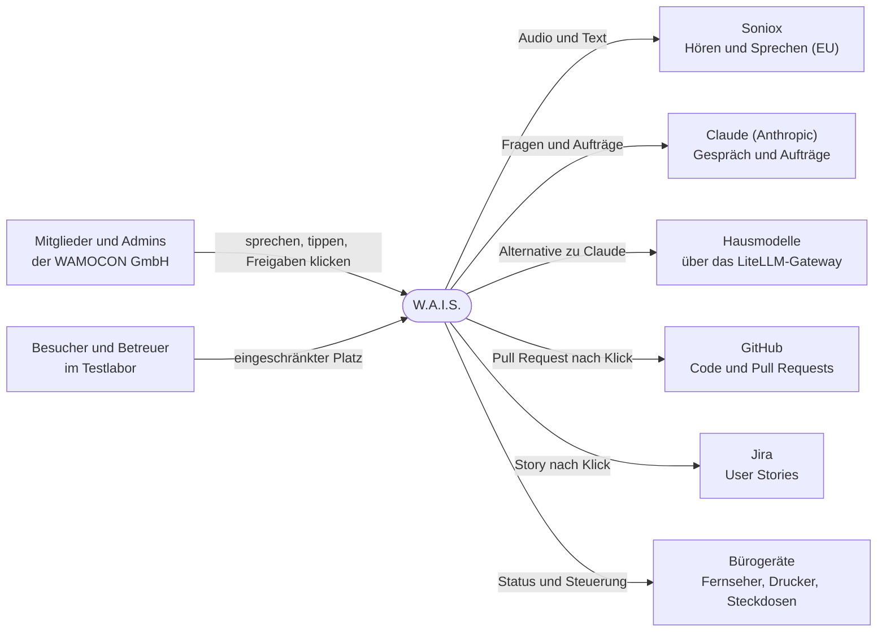
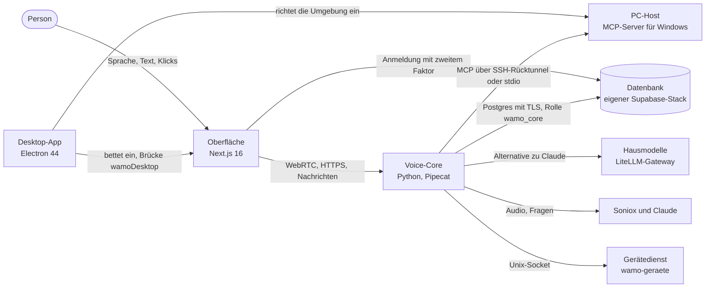
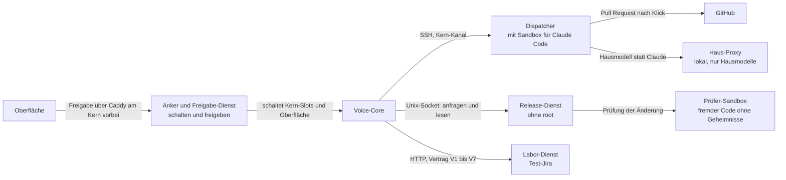
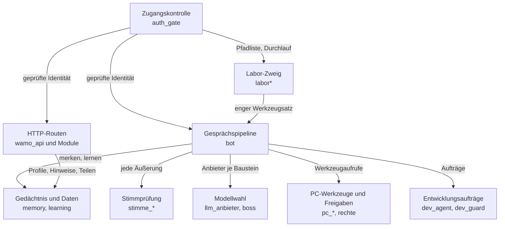
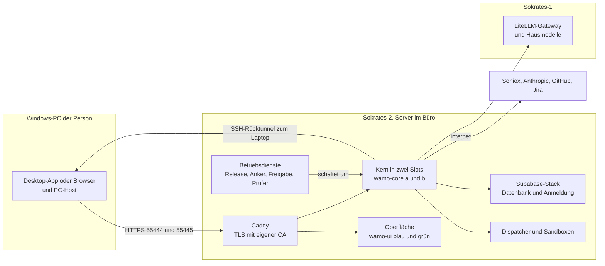
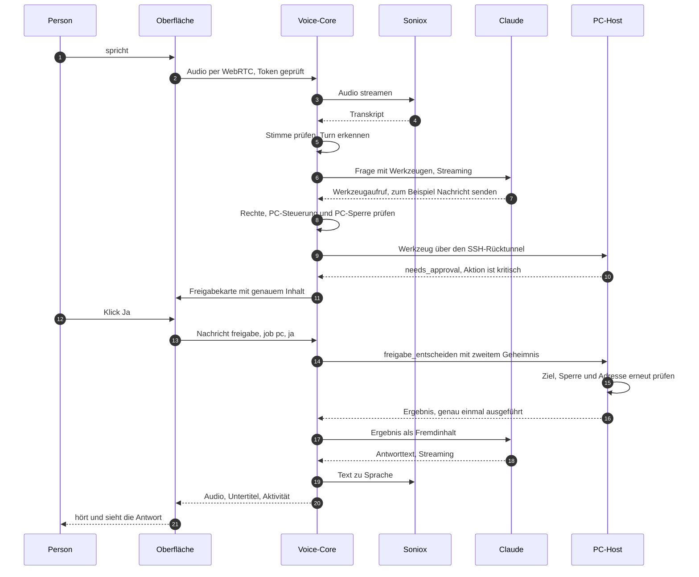
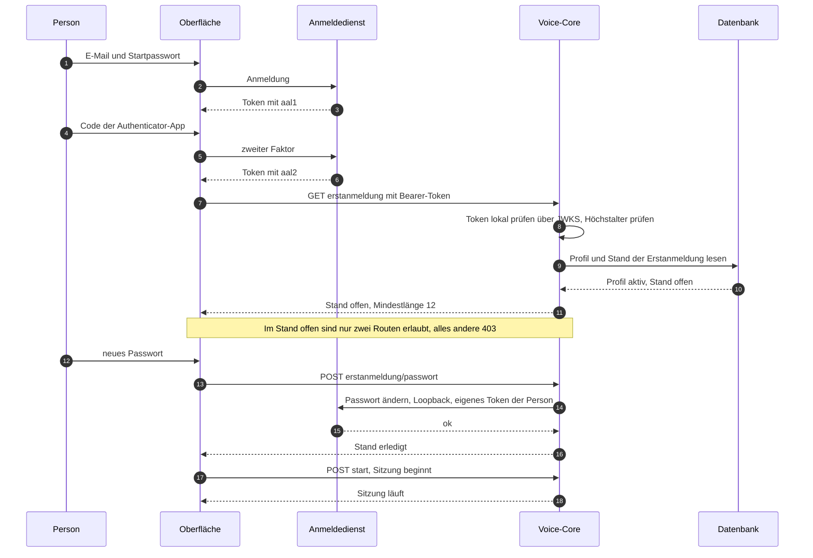
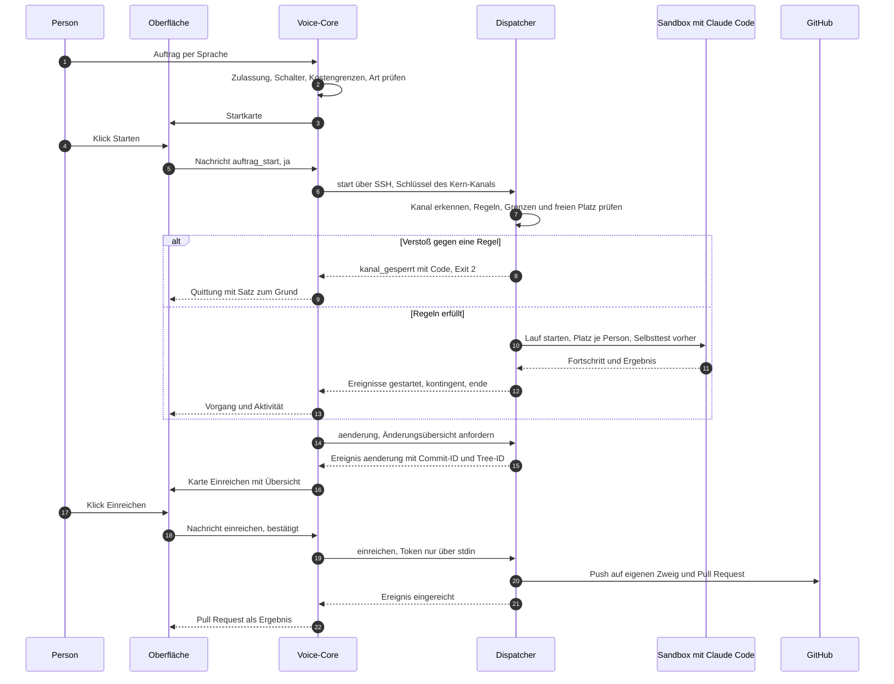

# C4-Diagramme von W.A.I.S.

| | |
|---|---|
| Zweck | Zeigt die Architektur in den C4-Ebenen Kontext, Container und Komponenten, dazu die Verteilung auf Rechner und drei Sequenzdiagramme der Kernabläufe. |
| Zielgruppe | Entwicklerinnen und Entwickler, Architektur, Betrieb, Prüferinnen und Prüfer. |
| Dokumentart | Erklärung |
| Stand | 19.11.2026, geprüft gegen Commit 497e3ce |
| Quellen | `README.md`, `CLAUDE.md`, `infra/sokrates2/README.md`, `voice-core/bot.py`, `voice-core/auth_gate.py`, `host/wamo_host.py`, `infra/sokrates2/wamo_job_dispatch.py` |

## 1. Lesehilfe

C4 beschreibt Software in vier Zoomstufen: Systemkontext (Ebene 1), Container (Ebene 2, getrennt lauffähige Teile), Komponenten (Ebene 3, Teile eines Containers) und Code (Ebene 4, hier nicht dargestellt, siehe [`../technik/voice-core.md`](../technik/voice-core.md)). Dazu kommen eine Verteilungssicht und Sequenzdiagramme. Jedes Diagramm zeigt höchstens neun Knoten und beantwortet genau eine Frage. Die Texte dazu stehen in [`arc42.md`](arc42.md), die Schnittstellen in [`../technik/schnittstellen.md`](../technik/schnittstellen.md).

Die Diagramme sind Mermaid-Blöcke. Sie lassen sich in GitHub, in VS Code mit Mermaid-Erweiterung und in jedem Mermaid-fähigen Betrachter darstellen.

## 2. Ebene 1: Systemkontext

**Aussage:** W.A.I.S. steht zwischen den Menschen im Haus und einer kleinen Zahl externer und interner Dienste. Alles, was etwas verändert, geht nur nach dem Klick einer Person.

Das Diagramm zeigt, wer mit W.A.I.S. spricht und welche Systeme W.A.I.S. selbst nutzt. Der Windows-Laptop der Person gehört zum System (Host, Desktop-App), er erscheint erst in Ebene 2.

| Partner | Anlass | Quelle |
|---|---|---|
| Mitglieder und Admins | Gespräch, PC-Steuerung, Entwicklungsaufträge, Gedächtnis | `README.md` |
| Besucher und Betreuer | Eng begrenztes Laborprofil am Labortag, Betreuer führen den Durchlauf | `docs/testlabor-wamo.md` |
| Soniox | Spracherkennung und Sprachausgabe, Standard, wahlweise im Haus | `voice-core/sprache_anbieter.py` |
| Claude | Gespräch (Standard Haiku) und Claude Code für Entwicklungsaufträge | `voice-core/llm_anbieter.py` |
| Hausmodelle | Gespräch und Stimme im Haus, nur über das zentrale Gateway | `docs/hausmodelle-und-kikollege.md` |
| GitHub | Ziel der Änderungen aus Aufträgen, nie der Standardzweig | `docs/persoenliche-zugaenge.md` |
| Jira | Stories, im Labor ein eigener Test-Dienst | `voice-core/jira_client.py` |
| Bürogeräte | Gemeinsame Geräte im Büro über den Gerätedienst | `geraete/README.md` |

## 3. Ebene 2: Container

### 3.1 Gespräch, Oberfläche und PC

**Aussage:** Der Voice-Core ist die Mitte. Er nimmt Sprache und Text aus der Oberfläche, steuert über den Host den Laptop und liest und schreibt Daten nur über eine eigene Datenbankrolle.

Das Diagramm zeigt die Container, die an einem normalen Gespräch beteiligt sind. Die Oberfläche läuft im Browser oder eingebettet in die Desktop-App. Im Büro läuft der Kern auf dem Server und erreicht den Host über einen SSH-Rücktunnel. In der Betriebsart Unterwegs läuft der Kern auf dem PC und startet den Host als Unterprozess.

| Container | Aufgabe | Technik | Quelle |
|---|---|---|---|
| Oberfläche | Untertitel, Stimmlinie, Zeitleiste, Canvas, Freigabekarten, Anmeldung | Next.js 16.4.6, React 19.3.0 | `ui/` |
| Desktop-App | App-Fenster, Markierung am Zielfenster, Tray, Update, Host-Umgebung | Electron 44.10.1 | `desktop/` |
| PC-Host | Werkzeuge mit Risikoklassen und Audit-Log, erzwingt Freigaben selbst | Python, MCP | `host/wamo_host.py` |
| Voice-Core | Pipeline, Zugangskontrolle, Rechte, Werkzeuge, Gedächtnis, HTTP-Routen | Python, Pipecat 1.12 | `voice-core/` |
| Datenbank | Profile, Gedächtnis, Sitzungen, Geräte, Freigaben | Postgres, GoTrue, Supavisor | `supabase/` |
| Hausmodelle | Sprachmodelle, Spracherkennung und Stimme im Haus | LiteLLM-Gateway | `docs/hausmodelle-und-kikollege.md` |
| Gerätedienst | Bürogeräte mit eigenem Benutzer und Ausgangsfilter | Python, Unix-Socket | `geraete/` |

### 3.2 Aufträge, Release und Labor

**Aussage:** Entwicklungsaufträge, Release und Labor laufen in eigenen Diensten mit getrennten Rechten. Der Kern darf anfragen und lesen, schalten und freigeben darf er nie.

Das Diagramm zeigt die Dienste auf dem Server, die der Kern anspricht oder die ihn beeinflussen. Die Freigabe einer Änderung geht über Caddy direkt von der Oberfläche an den Freigabe-Dienst, am Kern vorbei.

| Container | Aufgabe | Quelle |
|---|---|---|
| Dispatcher | Forced Command der SSH-Schlüssel, Kanäle `lokal`, `pc`, `kern`, Regeln, Grenzen, Plätze, Sandbox | `infra/sokrates2/wamo_job_dispatch.py`, `infra/sokrates2/wamo_job_kernkanal.py` |
| Haus-Proxy | Lokaler Proxy für Aufträge mit Hausmodellen, Token je Lauf | `CLAUDE.md` (Haus-Proxy) |
| Release-Dienst | Orchestriert Anfragen und Prüfstrecke, schreibt nie nach GitHub | `infra/sokrates2/release/` |
| Anker und Freigabe-Dienst | Root-eigener Teil außerhalb von `/opt/wamo*`. Prüft die Freigabe gegen Token, zweiten Faktor, Commit-ID und Tree-ID und schaltet um | `infra/sokrates2/anker/` |
| Prüfer-Sandbox | Führt Tests und Lint für fremden Code ohne Geheimnisse aus | `infra/sokrates2/pruefer/` |
| Labor-Dienst | Test-Jira des Testlabors (API, Speicher, Betreuer-Seite) | `labor-dienst/`, `docs/labor-dienst-vertrag.md` |

## 4. Ebene 3: Komponenten des Voice-Cores

**Aussage:** Alles, was ein Mensch auslöst, läuft durch die Zugangskontrolle. Erst danach beginnt die Pipeline oder eine Route.

Das Diagramm zeigt die Hauptkomponenten des Kerns. Die Namen entsprechen den Modulgruppen aus [`arc42.md`](arc42.md), Abschnitt 5.2. Der Labor-Zweig baut dieselbe Pipeline mit einer viel kleineren Werkzeugliste.

| Komponente | Aufgabe | Quelle |
|---|---|---|
| Zugangskontrolle | Prüft Token, zweiten Faktor, Höchstalter, aktives Profil, Erstanmeldung. Schreibt die Identität in den Body. Hängt als einzige Middleware vor dem Runner | `voice-core/auth_gate.py` |
| HTTP-Routen | Module unter `/wamo/api`: Geräte, Hinweise, Teilen, Modellzugang, Fernzugriff, Installer, Erstanmeldung und weitere | `voice-core/wamo_api.py`, `voice-core/*_api.py` |
| Gesprächspipeline | Sprachaktivität, Spracherkennung, Turn-Erkennung, Modell, Sprachausgabe, Unterbrechungen, Aktivitätsmeldungen | `voice-core/bot.py` |
| Stimmprüfung | Stimmabdruck je Mikrofon einlernen (höchstens drei je Person), jede Äußerung vergleichen und das Urteil melden. Im Standardmodus `beobachten` sperrt das Urteil nichts, die Regeln für Werkzeuge, Äußerungen und Unterbrechen gelten nur im Modus `streng`. Mitglieder brauchen für gesprochene PC-Befehle einen eingelernten Abdruck | `voice-core/stimme_pruefer.py`, `voice-core/stimme_gate.py`, `voice-core/stimme_mikrofon.py` |
| PC-Werkzeuge und Freigaben | Verbindung zum Host je Gerät, Rechte, Karten, Schutz der Mitglieder | `voice-core/pc_host.py`, `voice-core/pc_freigaben.py`, `voice-core/rechte.py` |
| Entwicklungsaufträge | Aufträge vorbereiten, an den Dispatcher geben, Abnahme, persönlicher GitHub-Weg | `voice-core/dev_agent.py`, `voice-core/dev_agent_weg.py` |
| Modellwahl | Anbieter je Baustein (Gespräch, Bilder, Hintergrund, Hören, Stimme), Boss und Modellkarte | `voice-core/llm_anbieter.py`, `voice-core/boss.py` |
| Gedächtnis und Daten | Gedächtnis, Lernen, Vorgänge, Sitzungen, Gesprächszeilen. Zwei Datenbankrollen mit getrennten Verbindungen | `voice-core/memory.py` |
| Labor-Zweig | Pfadliste, Durchlauf und Einwilligung, Ticket-Werkzeuge, Löschfunktion | `voice-core/labor.py` |

## 5. Verteilungssicht

**Aussage:** Fast alles läuft auf einem Server im Büro, die Hände von W.A.I.S. bleiben am Laptop, die Modelle laufen auf eigenen Knoten oder bei Anbietern.

Das Diagramm zeigt, welche Teile auf welchem Rechner laufen. Alle Ports sind nur aus dem Büro-LAN und aus Loopback erreichbar, unterwegs über WireGuard. Die Ports und ihre Regeln stehen in der Firewall-Tabelle in `infra/sokrates2/README.md`, Abschnitt 6.

| Knoten | Rolle |
|---|---|
| Windows-PC | Arbeitsplatz mit Desktop-App oder Browser. Der Host läuft in der angemeldeten Sitzung der Person |
| Sokrates-2 | Server: Supabase-Stack, Kern in zwei Slots, Oberfläche in zwei Farben, Caddy, Dispatcher mit Sandboxen, Release, Anker, Freigabe, Prüfer, Gerätedienst, Gateway für Fernzugriff, Labor-Dienst |
| Sokrates-1 | Zentrales LiteLLM-Gateway, Ollama mit Hausmodellen, Spracherkennung und Stimme im Haus |
| Extern | Soniox (EU), Anthropic, GitHub, Jira |

Ports und Netze stehen vollständig in [`arc42.md`](arc42.md), Abschnitt 7. Betrieb und Störungen: [`../betrieb/betriebshandbuch.md`](../betrieb/betriebshandbuch.md).

## 6. Sequenzdiagramme

### 6.1 Sprachgespräch mit Werkzeugaufruf und Freigabe

**Aussage:** Ein Werkzeug, das etwas verändern kann, wird nie vom Modell ausgelöst, sondern erst nach dem Klick der Person.

Das Diagramm zeigt ein Gespräch, in dem das Modell eine kritische PC-Aktion verlangt. Der Host stuft die Aktion ein und liefert eine Anfrage statt eines Ergebnisses. Erst der Klick auf die Karte löst die Ausführung aus, genau einmal.

| Schritt | Regel | Quelle |
|---|---|---|
| 2 | Nur Token mit `aal2` und aktivem Profil kommen durch | `voice-core/auth_gate.py` |
| 5 | Im Modus `streng` verwirft die Stimmprüfung fremde Stimmen, im Standardmodus `beobachten` (seit 18.11.2026) misst sie nur | `voice-core/stimme_gate.py` |
| 8 und 9 | Der Kern prüft Stufe (`rechte.pc_stufe`), PC-Steuerung und gehaltene PC-Sperre | `voice-core/rechte.py`, `voice-core/pc_host.py` |
| 10 bis 15 | Die Karte gilt befristet und einmal. Das Modell kann nicht freigeben | `host/wamo_host.py` |
| 17 | Ergebnisse von außen gelten als Daten, nie als Anweisung | `README.md` (Sicherheitsmodell) |

### 6.2 Anmeldung mit Erstanmeldung

**Aussage:** Ein neues Konto kommt erst nach dem Wechsel des Startpassworts in die Sitzung, und bis dahin ist nur ein enger Weg offen.

Das Diagramm zeigt die erste Anmeldung einer Person. Die Oberfläche meldet sich direkt beim Anmeldedienst an. Der Kern prüft das Token lokal und liest den Stand der Erstanmeldung. Im Stand `offen` sind nur zwei Routen erlaubt, alles andere endet mit 403. Den Passwortwechsel reicht der Kern an den Anmeldedienst weiter.

| Schritt | Regel | Quelle |
|---|---|---|
| 8 | Höchstalter der Anmeldung 168 Stunden, gemessen ab Passwort und Code | `voice-core/auth_gate.py` |
| 9 und 10 | Fehlen Schema, Funktion oder Recht, antwortet der Kern mit 503 (fail closed) | `voice-core/auth_gate.py` |
| 11 | Stände: `keine`, `offen`, `abgelaufen`, `erledigt`. Im Stand `abgelaufen` meldet die Person sich bei einem Admin | `voice-core/erstanmeldung_api.py` |
| 14 | Der Kern reicht den Wechsel weiter, weil Caddy ihn dem Browser nicht erlaubt | `voice-core/erstanmeldung_api.py` |

### 6.3 Entwicklungsauftrag über den Kern-Kanal

**Aussage:** Der Server entscheidet bei jedem Start selbst, ob er den Auftrag annimmt, und veröffentlicht nur nach einem zweiten Klick.

Das Diagramm zeigt einen Entwicklungsauftrag von der Karte bis zum Pull Request. Der Dispatcher erkennt den Kanal am benutzten SSH-Schlüssel und prüft die Regeln des Kern-Kanals in fester Reihenfolge. Claude Code läuft in einer Sandbox ohne die Geheimnisse des Servers. Im persönlichen GitHub-Weg bleibt das Token der Person außerhalb der Sandbox.

| Schritt | Regel | Quelle |
|---|---|---|
| 2 | Im Büro braucht der Kern `WAMO_ENTWICKLUNG_BUERO`, Profilbindung und Kostengrenzen, sonst startet nichts | `voice-core/entwicklung_betrieb.py` |
| 7 bis 9 | Die Gründe stehen in `KANAL_GRUENDE`, der Kern übersetzt sie in Sätze (`GRUND_SAETZE`) | `infra/sokrates2/wamo_job_kernkanal.py` |
| 7 und 10 | Höchstens sechs Aufträge gleichzeitig, je Person drei | `CLAUDE.md` (Gleichzeitige Entwicklungsaufträge) |
| 19 und 20 | Push nur auf `wamo/<auftrag>`, nie auf den Standardzweig, kein Merge durch W.A.I.S. | `docs/persoenliche-zugaenge.md` |

## Weiterführend

- Texte zu den Diagrammen: [`arc42.md`](arc42.md), Abschnitte 5 bis 7
- Entscheidungen hinter der Struktur: [`entscheidungen.md`](entscheidungen.md)
- Nachrichten, Routen und Ereignisse im Einzelnen: [`../technik/schnittstellen.md`](../technik/schnittstellen.md)
- Aufbau des Kerns, des Hosts und der Oberfläche: [`../technik/voice-core.md`](../technik/voice-core.md), [`../technik/host-und-desktop.md`](../technik/host-und-desktop.md), [`../technik/oberflaeche.md`](../technik/oberflaeche.md)
- Betriebshandbuch: [`../betrieb/betriebshandbuch.md`](../betrieb/betriebshandbuch.md)
