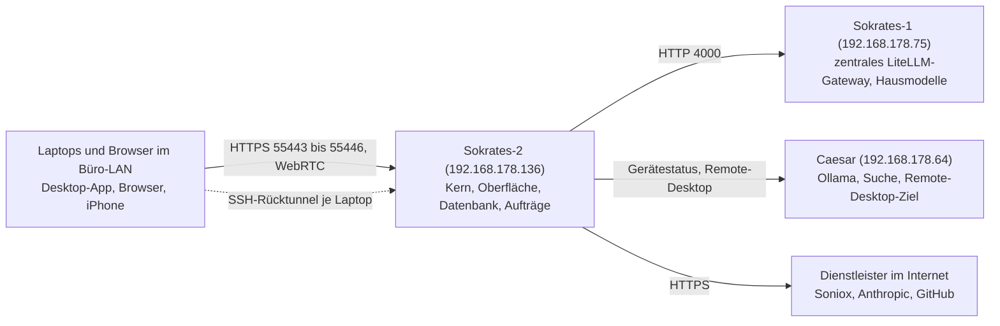
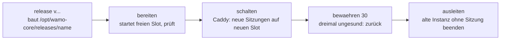
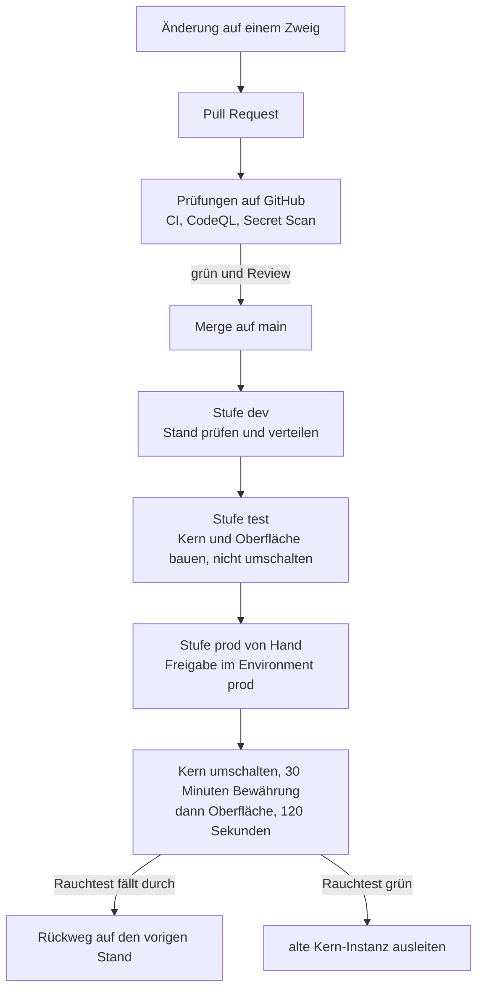

# Betrieb

| | |
|---|---|
| Zweck | Betrieb von W.A.I.S.: Topologie, Dienste, Störungen und Rückwege, der Weg von der Änderung zur Produktion und die Aufgaben der Administration. |
| Zielgruppe | Administration, Betrieb, Release-Verantwortliche |
| Dokumentart | Referenz und Anleitung |
| Stand | 20.11.2026, Version 0.7.0, geprüft gegen Commit 7caf977 (`main`) |
| Quellen | Die Kopftabelle jedes Kapitels nennt die Quellen |

## Inhalt

1. [Betriebshandbuch](#betriebshandbuch)
2. [Release und Ausrollen](#release-und-ausrollen)
3. [Administrationshandbuch](#administrationshandbuch)

## Betriebshandbuch

| | |
|---|---|
| Zweck | Zeigt, welche Dienste auf welchem Rechner laufen, wie man sie startet, prüft, sichert und bei Störungen wieder gesund macht. |
| Zielgruppe | Betrieb und Administration von W.A.I.S. (Personen mit Zugang als `wamocon` auf Sokrates-2) |
| Dokumentart | Referenz (Topologie, Dienste, Logs) und Anleitung (Betrieb, Störungen) |
| Quellen | `infra/sokrates2/README.md`, `CLAUDE.md`, `infra/sokrates2/wamo-core-slots.sh`, `infra/sokrates2/wamo-ui-umschalten.sh`, `infra/sokrates2/wamo-firewall.sh`, `infra/sokrates1/gateway-wamo.md`, `docs/hausmodelle-und-kikollege.md`, `docs/runner-einrichten.md` |

### 1. Wichtig vorab

- **Der Zustand des Servers ist aus dem Repo nicht lesbar.** Dieses Handbuch beschreibt, was die Skripte und Units im Repo einrichten. Ob ein Baustein heute läuft, zeigt nur sein `status`-Befehl am Server (Abschnitt 7).
- **Veraltete Überschriften.** Mehrere Abschnittsüberschriften in `infra/sokrates2/README.md` tragen noch "vorbereitet" oder "nicht ausgerollt" (zum Beispiel Abschnitt 12.6, 14, 15, 18, 19, 21, 22), obwohl `CLAUDE.md` und andere Stellen denselben Baustein als in Betrieb nennen (zum Beispiel Kern-Slots unter `/opt/wamo-core/slots/a` laut `docs/hausmodelle-und-kikollege.md`, persönlicher GitHub-Weg "live seit 18.11.2026" laut Abschnitt 18.3). Wo diese Datei einen Zustand nennt, steht "laut README, Stand" mit Datum.
- **Ablageregel für Skripte.** Skripte aus `infra/sokrates2/` liegen auf Sokrates-2 immer in `~/wamo-infra` im Home von `wamocon`, nie in `/tmp`. Die Skripte prüfen beim Start, dass Ordner und Inhalt dem Aufrufer oder root gehören und für Gruppe und Welt nicht beschreibbar sind. Ablegen:

```bash
ssh wamo-sokrates2 "rm -rf ~/wamo-infra" && scp -r infra/sokrates2 wamo-sokrates2:wamo-infra && ssh wamo-sokrates2 "chmod -R go-w ~/wamo-infra"
```

  (Der Alias `wamo-sokrates2` ist der SSH-Name des Dienstkontos `wamocon`; Skripte wie `scripts/wamo_kern_sokrates2.py` lesen ihn aus `WAMO_SSH_HOST`. Die README schreibt teils `sokrates2`.) Ausnahme: `wamo_kern_sokrates2.py verteilen` leert `~/wamo-infra` ganz, danach muss `wamo_ui_sokrates2.py verteilen` erneut laufen.
- **Zuerst trocken.** Fast jedes Einrichtungsskript kennt `--trocken` (zeigt nur, was geschähe). Immer zuerst damit aufrufen. Ein Neustart von `wamo-core` ist im Slot-Betrieb verboten, geschaltet wird mit `wamo-core-slots.sh umschalten-kern`.

### 2. Topologie



Quellen: `infra/sokrates2/README.md` (Abschnitte 0, 10, 12), `docs/hausmodelle-und-kikollege.md` (Abschnitt 1), `README.md` (Fernzugriff).

| Rechner | Adresse laut Repo | Rolle für W.A.I.S. |
| --- | --- | --- |
| Sokrates-2 | `192.168.178.136` | Hauptserver: Kern `wamo-core`, Oberfläche, eigener Supabase-Stack, Caddy, Firewall, Entwicklungsaufträge (Dispatcher, Sandbox), Gerätedienst, Labor-Dienst, Remote-Desktop-Gateway, Release- und Verteilungsdienste |
| Sokrates-1 | `192.168.178.75` | zentrales LiteLLM-Gateway (`http://192.168.178.75:4000/v1`), Ollama mit Chat- und Visionsmodellen, eigene Sprachausgabe `wamo-qwen3-tts` (Docker-Brücke `172.17.0.1:8104`), Ziel für Fernzugriff und Gerätestatus |
| Caesar | `192.168.178.64` | Ollama, Spracherkennung, SearXNG (Websuche im Haus); laut `docs/hausmodelle-und-kikollege.md` bleibt Caesar frei von W.A.I.S.-Last (dort läuft ein anderes Vorhaben), Ziel für Fernzugriff und Gerätestatus |
| Sparks | Sokrates-1, Sokrates-2 und Caesar | die drei Rechner heißen im Fernzugriff "die Sparks" (`README.md`, Fernzugriff). Ob jeder einzelne ein Spark-Gerät ist, steht nicht im Repo |
| Büro-LAN | `192.168.178.0/24` | alle Büro-Geräte, dazu die WireGuard-Clients der FRITZ!Box (laut README, Abschnitt 6); WireGuard läuft in der FRITZ!Box, nicht auf Sokrates-2 (`docs/remote-desktop.md`) |
| Laptops | je Person | Desktop-App (Electron) mit Host (Python, MCP) und geplanter Aufgabe "WAMO Tunnel"; Host lauscht nur auf `127.0.0.1:8765` |

Nicht belegt: Anzahl und Modell der Hardware, Betriebssystemversionen der Server außer Hinweisen wie "Ubuntu" und "arm64" in den Skripten.

### 3. Netz und Ports auf Sokrates-2

Docker veröffentlicht Ports per DNAT an ufw vorbei. Wirksam ist deshalb nur die Kette `DOCKER-USER`, die `wamo-firewall` setzt (`infra/sokrates2/wamo-firewall.sh`).

| Port | Dienst | Erlaubt aus dem LAN | Quelle |
| --- | --- | --- | --- |
| 55321 | Supabase-API über HTTP (Envoy) | Stufe 2: nur Loopback und Caddy-Netz | `infra/sokrates2/README.md` 6, 7 |
| 55443 | API und Anmeldung über HTTPS (Caddy) | ganzes Büro-LAN | dort 6 |
| 55444 | Kern über HTTPS (Caddy vor Unix-Socket) | ganzes Büro-LAN | dort 6, 10 |
| 55445 | Oberfläche über HTTPS (Caddy vor `wamo-ui-blau` oder `wamo-ui-gruen`) | ganzes Büro-LAN | dort 6, 12 |
| 55446 | Remote-Desktop-Gateway über HTTPS | nur Einträge in `/etc/wamo/admin-quellen`, ohne Einträge das Büro-LAN | dort 6.1 |
| 55322, 56543 | Postgres über Supavisor (Session, Transaktion), TLS | wie 55446 | dort 6.1 |
| 55447 | Labor-Dienst (Test-Jira) über HTTPS | nur `/etc/wamo-labor/plaetze-adressen`, ohne Liste das Büro-LAN | dort 19 |
| `127.0.0.1:18765` | Labor-Dienst für den Kern | nur Loopback | dort 19 |
| `127.0.0.1:18090` | Haus-Proxy für Entwicklungsaufträge | nur Loopback | `CLAUDE.md` (Haus-Proxy) |
| `127.0.0.1:18080`, `18081` | Prüfer-Proxys `pakete` und `claude` | nur Loopback | `CLAUDE.md` (Prüfer-Sandbox) |
| 20000 bis 20999 | Entwicklungsports der Auftrags-Sandbox (je Platz `20000 + n*100` bis `+99`) | nur Loopback | dort 18.2 |

Alles andere wird verworfen und mit `WAMO-FW verworfen:` (höchstens 6 je Minute) ins Kernel-Log geschrieben. Das Netz der Sparks (`10.100.104.0/24`, `10.100.105.0/24`) erreicht die WAMO-Ports bewusst nicht.

Auf dem PC: Kern lokal `http://localhost:7860` (Betriebsart Unterwegs), Host `127.0.0.1:8765`, einmalige Weiterleitung des Labor-Platz-Skripts `127.0.0.1:55489` (`README.md`, `CLAUDE.md`).

### 4. Dienste auf Sokrates-2

Spalten: Benutzer, Port oder Socket, Unit oder Container, Einrichten, Rückweg. Alle Skripte liegen in `infra/sokrates2/` und laufen nach der Ablageregel aus `~/wamo-infra`. "root" heißt `sudo bash ...`.

| Dienst | Benutzer | Port oder Socket | Unit oder Container | Einrichten | Rückweg |
| --- | --- | --- | --- | --- | --- |
| Supabase-Stack (GoTrue, Envoy, Supavisor, Postgres) | Container `wamo-supabase-*` | 55321, 55322, 56543 | Compose-Projekt `supabase-wamo` in `/home/wamocon/supabase-wamo` | `supabase-wamo-einrichten.sh` (Pflicht `SRC=`) | kein eigenes Skript im Repo |
| Auth-Schema `wamo_auth` | Datenbank | n/a | Schema in der Datenbank | `wamo-auth-einrichten.sh einrichten` (als `wamocon`) | `wamo-auth-einrichten.sh rueckweg` |
| Caddy (HTTPS-Vorbau) | Container `wamo-caddy` | 55443 bis 55447 | Compose in `/home/wamocon/wamo-tls/caddy` | `wamo-tls-einrichten.sh`, `wamo-core-caddy.sh` | `wamo-tls-rueckweg.sh`, `wamo-core-caddy.sh --zurueck` |
| Firewall | root | `DOCKER-USER`, Ketten `WAMO-FW*` | `wamo-firewall.service` (oneshot) | `wamo-firewall-einrichten.sh` (root) | `wamo-firewall-rueckweg.sh [--entfernen]` |
| Stufe 2 (HTTP 55321 nur intern) | n/a | 55321 | Schalter in `/etc/wamo/firewall.conf` | `wamo-stufe2-http-intern.sh --ja` | `... --zurueck` |
| Kern (alte Einzel-Unit) | `wamo-core` | `/run/wamo-core/core.sock` | `wamo-core.service` | `wamo-core-einrichten.sh` (root) | `wamo-core-rueckweg.sh [--entfernen]` |
| Kern-Slots | `wamo-core` | `/run/wamo-core/core-<slot>.sock` | `wamo-core@a.service`, `wamo-core@b.service` (Vorlage `wamo-core@.service`) | `wamo-core-slots.sh einrichten`, `release`, `umschalten-kern` (root) | `wamo-core-slots.sh rueckweg-kern`, `umstellung-zurueck` |
| Oberfläche | Container `wamo-ui-blau`, `wamo-ui-gruen` | intern 3000, über 55445 | Compose `/home/wamocon/wamo-ui` | `wamo-ui-einrichten.sh`, vom PC `scripts/wamo_ui_sokrates2.py` | `wamo-ui-rueckweg.sh`, `wamo_ui_sokrates2.py zurueck` |
| Rücktunnel alt | `wamo-tunnel` | `/run/wamo-tunnel/pc.sock` | sshd-Drop-in `wamo-tunnel.conf` | `wamo-tunnel-einrichten.sh` (root) | `wamo-tunnel-rueckweg.sh [--entfernen]` |
| Rücktunnel je Laptop | `wamo-t-01` bis `wamo-t-64` | `/run/wamo-pc/tNN/pc.sock` | `wamo-pc-abgleich.timer`, `wamo-pc-streuner.timer`, sshd-Drop-in `wamo-pc.conf` | `wamo-pc-tunnel-einrichten.sh` (root) | `wamo-pc-tunnel-rueckweg.sh [--entfernen]` |
| Entwicklungsaufträge (Dispatcher, Sandbox) | `wamo` | SSH-Forced-Command, kein Port | `/opt/wamo/bin/wamo-job-dispatch`, `wamo-egress.service` | `wamo-einrichten.sh`, dann `wamo-job-einrichten.sh` (root) | `wamo-job-rueckweg.sh`, `wamo-egress-rueckweg.sh` |
| Kern-Kanal des Dispatchers | `wamo-core` (Schlüssel), `wamo` | SSH auf `192.168.178.136` | Datei `/etc/ssh/authorized_keys.d/wamo-kern` | `wamo-job-kern-einrichten.sh` (root) | `wamo-job-kern-rueckweg.sh` (`notaus`, `--entfernen`) |
| Haus-Proxy | `wamo-haus-proxy` | `127.0.0.1:18090` | `wamo-haus-proxy.service` | `wamo-haus-proxy-einrichten.sh einrichten` (root) | `wamo-haus-proxy-rueckweg.sh --entfernen` |
| Notanker | root | `/run/wamo-anker/anker.sock` | `wamo-anker.service` | `anker-einrichten.sh` (root) | `anker-rueckweg.sh [--entfernen]` |
| Release-Dienst | `wamo-release` | `/run/wamo-release/ctl.sock` | `wamo-release.service` | `release-einrichten.sh` (root) | `release-rueckweg.sh [--entfernen]` |
| Freigabe-Dienst | `wamo-anker` | `/run/wamo-freigabe/freigabe.sock` | `wamo-freigabe.service` | `freigabe-einrichten.sh` (root) | `freigabe-rueckweg.sh` |
| Prüfer-Sandbox | `wamo-pruefer`, `wamo-pruefer-proxy` | `127.0.0.1:18080`, `18081`, Socket `/run/wamo-pruefer-annahme/annahme.sock` | `wamo-pruefer-annahme.socket`, `wamo-pruefer-proxy@.service`, `wamo-migprobe.socket` | `pruefer-einrichten.sh` (root) | `pruefer-rueckweg.sh` |
| Gerätedienst | `wamo-geraete` | `/run/wamo-geraete/geraete.sock` | `wamo-geraete.service` | `wamo-geraete-einrichten.sh` (root) | `wamo-geraete-rueckweg.sh` |
| Labor-Dienst | Container `wamo-labor-dienst` (Kennung 10001) | 55447, `127.0.0.1:18765` | Compose-Projekt `wamo-labor` in `/opt/wamo-labor` | `wamo-labor-einrichten.sh einrichten` (root) | `wamo-labor-rueckweg.sh`, `wamo-labor-loeschlauf.sh` |
| Labor: Betreuer-Geräte | root | n/a | `wamo-labor-geraete.service` und `.timer` (jede Minute) | `wamo-labor-geraete-einrichten.sh` | `... rueckweg` |
| Labor-Daten des Kerns | n/a | `/etc/wamo-labor/daten` | Dateien, Wert `WAMO_LABOR_DATEN` | `wamo-labor-daten-einrichten.sh einrichten` | `... rueckweg` |
| Remote-Desktop-Gateway | Container `wamo-rd-web`, `wamo-rd-guacd`, `wamo-rd-zugang` | 55446 | Compose-Projekt `wamo-rd` in `/home/wamocon/wamo-rd` | `wamo-rd-einrichten.sh` (als `wamocon`) | `wamo-rd-rueckweg.sh` |
| GitHub-Runner und Ausroll-Einstieg | `wais-deploy` | n/a | `wais-runner.service`, `/usr/local/sbin/wais-deploy` | `wais-runner-einrichten.sh einrichten` (root) | `wais-runner-einrichten.sh rueckweg` |
| Installer-Ablage | root, Lesezugriff `wamo-core` | `/var/lib/wamo-verteilung` | Dateien | `wamo-verteilung-einrichten.sh einsetzen` (root) | `wamo-verteilung-einrichten.sh rueckweg` |
| Lokale Quelle für den Release-Dienst | `wamocon` | `/var/lib/wamo-quelle/wamo.git` | Bare-Repository | `wamo-quelle-einrichten.sh` | `wamo-quelle-einrichten.sh --entfernen` |

Quellen der Tabelle: die Kopfkommentare der genannten Skripte, `infra/sokrates2/*.service`, `CLAUDE.md` (Namensvertrag) und `infra/sokrates2/README.md`. Die Unit des Ankers und der Freigabe liegen in `infra/sokrates2/anker/`, die des Release-Dienstes in `infra/sokrates2/release/`, die der Prüfer-Sandbox in `infra/sokrates2/pruefer/`.

Im Kern-Betrieb gilt (laut `infra/sokrates2/wamo-core@.service`): gehärtete Unit mit `ProtectSystem=strict`, leerem `CapabilityBoundingSet`, `SystemCallFilter=@system-service ~@privileged`, `MemoryMax=4G`, `Restart=on-failure`. Der Kern liest seine Einstellungen aus `/etc/wamo/core.env` (nur über `/usr/local/sbin/wamo-core-env`, Abschnitt 7) und ein Drop-in je Schalter.

### 5. Dienste auf den anderen Rechnern

| Rechner | Was | Ort und Zugang | Rückweg und Hinweise |
| --- | --- | --- | --- |
| Sokrates-1 | LiteLLM-Gateway mit den W.A.I.S.-Einträgen `wamo-haus-coder`, `wamo-stt-haus`, `wamo-tts-haus` und der Durchreiche `/wamo-tts-haus` | Konfiguration `litellm_config.yaml` im Gateway-Ordner (Pfad steht laut `infra/sokrates1/gateway-wamo.md` nicht im Repo) | Rückweg je Eintrag in `infra/sokrates1/gateway-wamo.md`, Abschnitt 5. Jede Änderung braucht vorher eine Sicherung mit Zeitstempel |
| Sokrates-1 | Container `wamo-qwen3-tts` (eigene Instanz der Sprachausgabe, Port 8104 auf `172.17.0.1`) | Quelle `infra/sokrates1/wamo-tts-haus/app.py` | `docker restart wamo-qwen3-tts` dauert rund 30 Sekunden bis gesund, in dieser Zeit fällt "Im Haus" je Satz aus. Rückweg in `infra/sokrates1/wamo-tts-haus/README.md`. Der Container `qwen3-tts` (Port 8102) gehört nicht zu W.A.I.S. |
| Sokrates-2 | Ollama mit `wamo-haus-coder` (Modelfile in `~wamocon/wamo-haus-coder/`) | `OLLAMA_MAX_LOADED_MODELS=3`, Sicherung der alten `override.conf` unter `/var/backups/ollama-override/` | Rückweg im Eintrag "Haus-Proxy" von `CLAUDE.md` |
| Sokrates-1, Sokrates-2, Caesar | Konto `wamo-rd` (Remote Desktop) und Lesekonto `wamo-status` | Skripte `infra/sparks/wamo-rd-konto-einrichten.sh`, `wamo-rd-ziel-einrichten.sh`, `wamo-rd-ausgang-einrichten.sh`, `wamo-status-einrichten.sh`, `wamo-sudo-einrichten.sh`, `xrdp-einhegen.sh` | Rückwege: `wamo-status-rueckweg.sh`, `wamo-sudo-einrichten.sh --zurueck`, `wamo-rd-rueckweg.sh` |
| Laptop (Windows) | Desktop-App, Host, geplante Aufgabe "WAMO Tunnel" | Installer `WAIS-Setup-<Version>.exe`, Skripte `scripts/wamo-tunnel-einrichten.ps1`, `wamo-tunnel.ps1` | Rückweg `scripts\wamo-tunnel-entfernen.ps1 [-Alles]`; Logs `%LOCALAPPDATA%\WAMO\logs`, Audit `host\wamo_audit.jsonl` im Installationsordner |

### 6. Start, Stopp, Status

Grundsatz: Dienste mit systemd starten und stoppen Sie mit `systemctl`, Container mit `docker compose` im Ordner des Projekts. Schreibende Betriebsschritte geschehen über die Skripte, nicht von Hand.

| Wozu | Befehl (alle über `ssh wamo-sokrates2 "..."`) |
| --- | --- |
| Zustand der Kern-Slots | `sudo bash ~/wamo-infra/wamo-core-slots.sh status` |
| Kern, Schlüsselnamen, Schalter (nur Namen) | vom PC: `python scripts/wamo_kern_sokrates2.py status` |
| Kern-Journal (INFO, ohne Gesprächsinhalte) | `sudo journalctl -u wamo-core@a -n 50` (oder `@b`, bei der alten Unit `-u wamo-core`) |
| Oberfläche: Farbe, Fassung | `bash ~/wamo-infra/wamo-ui-umschalten.sh status [--json]` |
| Firewall: Regeln mit Zählern | `sudo wamo-firewall status` |
| Notanker | `wamo-anker status` |
| Release-Dienst | `sudo wamo-release status` |
| Ausroll-Einstieg (Runner) | `sudo /usr/local/sbin/wais-deploy status` |
| Entwicklungsaufträge: Dispatcher, Kanal | `sudo -u wamo -H /opt/wamo/bin/wamo-job-dispatch ping` (meldet Version, `kanal`, `kernkanal`, `github`, nie einen Wert aus `geheim.env`) |
| Kern-Kanal: Schlüssel, Kanal, Schalter je Slot | `sudo bash ~/wamo-infra/wamo-job-kern-einrichten.sh status` |
| Haus-Proxy | `sudo bash ~/wamo-infra/wamo-haus-proxy-einrichten.sh status` |
| Labor-Dienst | `sudo bash ~/wamo-infra/wamo-labor-einrichten.sh status` (nur Namen und Zustände) |
| Remote-Desktop-Gateway | `bash ~/wamo-infra/wamo-rd-einrichten.sh status` |
| Installer-Ablage | `python scripts/wamo_installer_sokrates2.py status` (vom PC) |

**Firewall ändern.** Immer `sudo systemctl reload wamo-firewall` (ersetzt die Regeln atomar), nie `restart` (entfernt sie kurz). Vorher `sudo wamo-firewall regeln` ansehen. Nicht blind `iptables-restore` aus den Sicherungen einspielen, Docker ändert seine Regeln bei jedem Containerstart.

**Einstellungen des Kerns ändern.** Werte gehen nur über stdin an `sudo /usr/local/sbin/wamo-core-env setzen` (Allowlist, atomar, schreibt `/etc/wamo/core.env`), `liste` zeigt nur Namen, `loeschen NAME` entfernt. Sie wirken erst mit dem nächsten Kern-Release. Schalter der Entwicklungsaufträge stehen nie in `core.env`, sondern im Drop-in `wamo-core@.service.d/wamo-entwicklung-buero.conf` (nur `wamo-job-kern-einrichten.sh schalter` schreibt es). Quelle: `infra/sokrates2/wamo_core_env.py`.

### 7. Kern-Slots und Release ohne Lücke

Zwei Instanzen `a` und `b` der Vorlage `wamo-core@.service` laufen nebeneinander, jede mit eigenem Socket und eigenem Release-Ordner. Caddy hält jede Sitzung über den Pfad `/i/<slot>/` auf ihrer Instanz.



`umschalten-kern <release>` fasst bereiten und schalten zusammen (Quelle: Kopf von `infra/sokrates2/wamo-core-slots.sh`).

| Befehl (`sudo bash ~/wamo-infra/wamo-core-slots.sh ...`) | Wirkung |
| --- | --- |
| `einrichten` | Vorlage installieren, Ordner `releases/` und `slots/`, spiegelt Drop-ins der alten Unit (ohne sie weist ein Slot die Oberfläche per CORS ab) |
| `release <name>` | baut `/opt/wamo-core/releases/<name>` aus `~/wamo-infra/kern` mit eigenem venv; Releases werden nie überschrieben; Name `v` plus Buchstaben, Ziffern, Punkt, Strich, Unterstrich |
| `slot <a\|b> <release>` | setzt den Verweis eines Slots, nur wenn die Instanz nicht läuft |
| `umschalten-kern <release>` | freien Slot starten, prüfen, Caddy umschalten, alte Instanz auslaufen lassen (nimmt keinen neuen `/start` mehr an, Antwort 409) |
| `bewaehren [minuten]` | überwacht den neuen Slot (Standard 30 Minuten), bei Ausfall automatisch zurück |
| `ausleiten` | beendet die auslaufende Instanz, nur ohne Sitzung und nach der Bewährung |
| `rueckweg-kern` | schaltet auf die vorige Instanz zurück, solange sie läuft |
| `inc a`, `inc a auslaufend b`, `inc legacy` | Include-Datei `slot.inc` von Hand setzen, `legacy` ist die Standardroute der alten Unit |
| `umstellen <release>`, `umstellung-zurueck` | einmalige Umstellung von `wamo-core.service` auf Slot `a` und zurück, nur bei Ruhe |

Hinweise aus dem Skript: Ruhe heißt, dass im Journal der Unit seit N Minuten nichts steht (abgewiesene Gesundheitsproben zählen nicht). Läuft der Stopp in die Zeitgrenze der Unit (`TimeoutStopSec`), meldet `ausleiten` das deutlich und setzt den Fehlerzustand zurück (Befund R7 vom 16.11.2026, laut Skriptkommentar). Im Slot-Betrieb startet kein Einrichtungsskript die alte Unit neu, sie verweisen auf `umschalten-kern`.

### 8. Oberfläche: Blau und Grün

Zwei Container, einer ist live. Welche Farbe live ist, steht allein in `/home/wamocon/wamo-tls/caddy/etc/kern/wamo-ui-aktiv.inc` (nie von Hand ändern, `wamo-ui-umschalten.sh` erzeugt sie).

| Befehl | Wirkung |
| --- | --- |
| `python scripts/wamo_ui_sokrates2.py verteilen` | legt Quellen und Skripte ab, schreibt `wamo-ui/bau.info` (Commit von HEAD, Vermerk "sauber") |
| `... umschalten [--trocken] [--bewaehrung S] [--fehlerquote P]` | bauen, am neuen Container prüfen, Caddy umsetzen, abwarten, bewähren (Standard 30 Sekunden, 10 Prozent Fehlerquote), sonst automatisch zurück |
| `... zurueck` | Rückweg auf die vorige Farbe (eine Sekunde, solange sie läuft; "zurück" gilt auch vorwärts) |
| `... eintrag` | Eintrag "letzte gute Version" für den Notanker (JSON) |
| `bash ~/wamo-infra/wamo-ui-umschalten.sh anker-rueckweg vX.Y.Z <40 Hex> blau\|gruen` | Schnittstelle für den Notanker, idempotent |

Rückgabewerte von `umschalten`: 0 in Ordnung, 1 Voraussetzung fehlt, 2 Aufruf ungültig, 3 Prüfung vor dem Umschalten fehlgeschlagen (nichts umgeschaltet), 4 nach dem Umschalten automatisch zurückgenommen, 5 Rückweg fehlgeschlagen (Handarbeit), 6 Ziel des Rückwegs nicht verfügbar. Ein zweiter Lauf zugleich wird durch eine Sperre (`flock` auf `~/wamo-ui/.umschalten.lock`) abgewiesen. Quelle: Kopf von `infra/sokrates2/wamo-ui-umschalten.sh`, `infra/sokrates2/README.md` 12.6.

### 9. Gesundheitsproben

| Prüfung | Erwartung | Quelle |
| --- | --- | --- |
| `GET /version.json` der Oberfläche (über `https://192.168.178.136:55445`) | JSON mit `name`, `version`, `commit`, `gebaut`, `sauber`; `Cache-Control: no-store` | `ui/src/app/version.json/route.ts`, README 12.1 |
| `POST /start` am Kern ohne Anmeldung | HTTP 401 (so prüft `wamo-core-slots.sh` und `wais-deploy` dreimal) | `infra/sokrates2/wais-deploy.sh` |
| Anmeldedienst `https://192.168.178.136:55443/auth/v1/health` | kurze JSON-Antwort ohne Zertifikatswarnung | `infra/sokrates2/README.md` 5.2 |
| Labor-Dienst `/gesundheit` | nur vom Server selbst erreichbar | dort 19 |
| `wamo-job-dispatch ping` | Version `10`, Kanalzustand, `github` | `infra/sokrates2/wamo_job_dispatch.py` (`VERSION = "10"`) |
| Rauchtest Aufträge | `sudo -u wamo -H /opt/wamo/bin/wamo-job-rauchtest --mcp --attrappe` (nach jedem Update von Claude Code Pflicht) | dort 9 |
| Rauchtest Kern-Kanal | `sudo /opt/wamo-core/bin/wamo-job-kern-rauchtest --produktiv` | dort 18 |
| Rauchtest Tunnel je Laptop | `sudo python3 -I /opt/wamo-pc/bin/wamo-pc-rauchtest` (nach jedem Update von `openssh-server`) | dort 13 |
| Rauchtests weiterer Dienste | `anker_rauchtest.py --produktiv`, `release_rauchtest.py --produktiv`, `freigabe_rauchtest.py --produktiv`, `pruefer_rauchtest.py`, `wamo_labor_rauchtest.py` (20 Proben), `wamo_rd_rauchtest.py`, `wamo_ui_rauchtest.py` | je Abschnitt der Server-README |
| Ausroll-Rauchtest | `sudo /usr/local/sbin/wais-deploy rauchtest` (aktiver Slot, live Farbe, Labor-Dienst) | `docs/runner-einrichten.md` |
| Gateway nach Neustart | `/health`, `/v1/models` mit Kern-Schlüssel, gestreamte Probe an `/wamo-tts-haus/v1/audio/speech` (Status 200, Kopfzeile `X-Stream: 1`) | `infra/sokrates1/gateway-wamo.md` 4 |

Der Kern meldet sich außerdem in der Oberfläche über die Betriebsmeldung. Kommt nach dem Verbinden 20 Sekunden keine, bricht die Oberfläche ab und bietet "Erneut verbinden" an (`ui/src/lib/verbindungsfrist.ts`, README).

### 10. Logs, Journal-Marken und Protokolle

| Was | Wo | Hinweis |
| --- | --- | --- |
| Kern | `journalctl -u wamo-core@a` bzw. `@b` | Stufe INFO, ohne Gesprächsinhalte, ohne Schlüssel (Schwärzung im Kern) |
| Abgelehnte Tunnel- und Geräteaktionen | `journalctl ... \| grep WAMO-GERAET` | Präfix `WAMO-GERAET`, bei 5 Minuten ohne gültige Geräteliste `WAMO-GERAET ALARM` |
| Firewall | `sudo journalctl -k \| grep 'WAMO-FW verworfen'` | begrenzt auf 6 je Minute |
| Marken im Journal (`logger -t`) | `wamo-nutzer`, `wamo-auth`, `wamo-verteilung`, `wamo-job-kern`, `wamo-labor-geraete`, `wamo-labor-loeschen`, `wais-deploy` | `journalctl -t <Marke>`; Passwörter und Token stehen nie darin |
| Aufträge (Dispatcher) | `/srv/wamo/logs/auftraege.log`, Zähler `/srv/wamo/logs/kernkanal.jsonl` | `gh_app_token`, `start`, `gh_app_widerruf`, nie ein Token |
| Bedienspur Kern-Kanal | `/var/log/wamo-job-kern/aktionen.jsonl` | jede Handlung als Zeile ohne Werte |
| Mikrofonkette und Stimmurteil | Journal des Kerns, Zeilen `Mikrofonkette:` und `Stimmschatten:` (Urteilszeilen des Prüfers tragen am Ende die Klasse, zum Beispiel `Kette bluetooth`) | nur Zahlen und eine grobe Klasse (eingebaut, headset, bluetooth, unbekannt), nie ein Gerätename, nie Audio; höchstens 50 Zeilen je Sitzung; der Stand lebt nur im Arbeitsspeicher der Sitzung, nie in der Datenbank, nie in Laborsitzungen (`voice-core/mikrofon_kette.py`) |
| Ausrollen | `/var/log/wais-deploy/protokoll.log` | jeder Aufruf mit Befehl, Commit, Ausgabe, Rückgabe |
| Notanker | `/var/log/wamo-anker/audit.jsonl` (Hashkette, `chattr +a`, 32 MiB) | `wamo-anker status` zeigt Füllgrad und Kette |
| Release-Dienst | `/var/log/wamo-release/audit.jsonl` (Hashkette, 32 MiB) | zugleich Write-Ahead-Log |
| Haus-Proxy | Buchung `/var/lib/wamo-haus-proxy/verbrauch.jsonl` | |
| Labor | Container-Protokolle 3 Dateien zu 10 MB; Löschnachweis `/var/log/wamo-labor/loeschnachweis-<Zeit>.txt` | Namen, Größen, Zählungen, nie Inhalte |
| Zähler Ausgangsfilter | `sudo nft list table inet wamo_egress` | |
| PC-Host | `host\wamo_audit.jsonl` (im Installationsordner, geht bei Update oder Deinstallation verloren) | Ort per `WAMO_AUDIT_LOG` änderbar |
| Fachliches Audit | Tabelle `actions` in der Datenbank | Aufträge, Freigaben, Modellwahl, Installer-Download |

Quellen: `infra/sokrates2/README.md`, `host/wamo_host.py`, `CLAUDE.md`.

### 11. Sicherungen

| Ordner | Inhalt | Anlass |
| --- | --- | --- |
| `/var/backups/wamo-firewall/` | `iptables-save`, `ip6tables-save` mit Zeitstempel, `admin-quellen-<Zeit>` | vor jedem Einrichten der Firewall |
| `/var/backups/wamo-job-kern/<JJJJMMTT-HHMMSS>/` | Sicherungen des Kern-Kanals, vorige `wamo.conf` (sshd), nie ein privater Schlüssel | vor `schluessel`, `kanal`, `schalter` |
| `/opt/wamo/vorher/` | Sicherungen von `wamo-job-einrichten.sh`, Rückweg spielt die neueste noch nicht zurückgespielte ein | vor jedem Einrichten |
| `/var/backups/wamo-anker/`, `/var/backups/wamo-release/` | Zustand und Audit-Protokoll beim Rückweg `--entfernen` oder Rotation | nur bei Rückweg oder Rotation |
| `/usr/local/lib/wamo-anker.vorher`, `/opt/wamo-freigabe/app.vorher` | voriger Baum, bis `status` nach dem Neustart bestanden hat | beim Einrichten |
| `/var/backups/wamo-labor/` | Stände vor dem Einrichten, ohne Token und Daten | vor `wamo-labor-einrichten.sh` |
| `/var/backups/wamo-labor-daten/<Zeit>/` | Stand der Labor-Daten, Datei `VORHER` nennt das Ziel | vor `wamo-labor-daten-einrichten.sh` |
| `/var/backups/wamo-haus-proxy/<Zeit>/` | vorhandene Dateien des Proxys | vor dem Einrichten |
| `/var/backups/ollama-override/` | vorige `override.conf` von Ollama auf Sokrates-2 | Haus-Coder-Einrichtung |
| Gateway-Ordner auf Sokrates-1 | `litellm_config.yaml.vor-wamo-...<Zeit>` | vor jeder Gateway-Änderung |
| `/var/lib/wamo-verteilung/staende/` | höchstens drei Installer-Stände mit Links `aktuell` und `vorher` | beim Einsetzen |
| `/var/lib/wais-deploy/staende/<commit>` | die fünf neuesten Stände | beim Verteilen |
| Image-Tags `wamo-ui:vX.Y.Z-<Commit>` | die drei neuesten Archiv-Tags der Oberfläche | beim Bauen |

**Sicherung der Datenbank und der Konfiguration:** im Repo nicht beschrieben, offen, siehe Abschlussbericht. `infra/sokrates2/README.md` (Abschnitt 19) nennt Snapshots und Sicherungen des Servers nur als "nicht in der Hand des Skripts, der Betrieb prüft es von Hand".

### 12. Notaus-Schalter

| Schalter | Wirkung | Rücknahme |
| --- | --- | --- |
| `sudo bash ~/wamo-infra/wamo-job-kern-rueckweg.sh notaus` | Sperrdatei `/etc/wamo/kernkanal.notaus`, Schlüsselzeile gelöscht, `KANAL=zu`, Schlüsselpaar beiseite (`.notaus-<Zeit>`), alle Aufträge mit `kanal=kern` abgebrochen, wirkt ohne Neustart des Kerns | `notaus-aufheben` öffnet nichts. `schluessel` legt ein neues Paar an, erst `kanal` öffnet wieder |
| `wamo-job-kern-einrichten.sh kanal zu` | schließt den Kern-Kanal (geht immer) | `kanal --arten ...` |
| `wamo-job-kern-einrichten.sh schalter an <release> ...` ohne `--github`, `--haus`, `--mitglieder` | schaltet die jeweilige Funktion für neue Aufträge aus | Aufruf mit dem Schalter |
| `wamo-anker sperre an` | Datei `/etc/wamo-anker/selbstaenderung.aus` sperrt alle Selbständerungen, `rueckweg` und `status` laufen immer | nur `sudo rm /etc/wamo-anker/selbstaenderung.aus` |
| `wamo-anker rueckweg ui`, `kern`, `alles` | zurück auf den letzten guten Stand aus `stand.json` | n/a |
| `sudo systemctl stop wamo-haus-proxy` | Aufträge mit Hausmodellen scheitern geschlossen | `systemctl start` |
| `kanal --persoenlich aus` | neue Aufträge mit `github=persoenlich` enden mit `persoenlich_aus`, der App-Weg bleibt | `kanal --persoenlich an` |
| Gerät sperren (Geräteverwaltung in der Oberfläche) oder Person aus `WAMO_PC_MITGLIEDER_PROFILE` nehmen | beendet die PC-Steuerung dieser Person | Liste setzen und Kern-Release |
| `WAMO_TTS_HAUS_STREAM=aus` über `wamo-core-env` | schaltet die gestreamte Sprachausgabe im Haus ab | `an`, dann Kern-Release |
| Notaus der PC-Seite je Laptop | `wamo-pc-tunnel-rueckweg.sh` sperrt alle Schlüssel und beendet Sitzungen | `wamo-pc-tunnel-einrichten.sh` |

Quellen: `infra/sokrates2/README.md` 13.1, 14, 18, 18.3; `docs/ausrollen-neue-nutzer.md` Abschnitt 9.

### 13. Zeitgeber und Aufräumen

| Was | Takt | Zweck | Quelle |
| --- | --- | --- | --- |
| `wamo-pc-abgleich.timer` | alle 10 Sekunden (20 Sekunden nach Start) | Benutzer, Schlüssel und Ordner der Laptop-Tunnel aus `pc_abgleich_liste()`; Widerruf zuerst; bei Ausfall der Datenbank bleibt der Zustand | `infra/sokrates2/wamo-pc-abgleich.timer` |
| `wamo-pc-streuner.timer` | alle 5 Minuten | meldet lauschende Sockets außerhalb des eigenen Ordners und beendet die Sitzungen | `infra/sokrates2/wamo-pc-streuner.timer` |
| `wamo-labor-geraete.timer` | jede Minute | Betreuer-Geräte über den Namen auflösen und in die Caddy-Site eintragen | `infra/sokrates2/wamo-labor-geraete.timer` |
| `wamo-job-aufraeumen.timer` | täglich 04:30 | Kopien privater Repos aus Entwicklungsaufträgen löschen (nach einem bzw. sieben Tagen) | `infra/sokrates2/wamo-job-aufraeumen.timer` |
| Dispatcher | je Lauf | alte Auftrags-Caches (npm, cache, plugin-daten nach 7 Tagen, `claude/` nach 30 Tagen) | `infra/sokrates2/README.md` 9 |
| Kern, `vorgaenge` | höchstens stündlich je Prozess | offene Vorgänge nach 24 Stunden abbrechen, Stand 30 Tage nach dem Ende leeren | `supabase/migrations/0017_vorgaenge.sql` |
| Kern, `auftrag_entwuerfe` | höchstens stündlich je Prozess | Entwürfe nach 90 Tagen löschen | `voice-core/auftrag_entwuerfe.py` |

### 14. Typische Störungen

Jede Zeile nennt Prüfschritt und Behebung. Nur Fälle, die im Repo beschrieben sind.

| Symptom | Prüfschritt | Behebung |
| --- | --- | --- |
| Browser zeigt "Verbindung nicht privat" oder die Anmeldung meldet einen Zertifikatsfehler | `https://192.168.178.136:55443/auth/v1/health` im Browser öffnen | WAMO-CA importieren (`certutil -user -addstore Root wamo-ca.crt`, Fingerabdruck vergleichen), Browser komplett neu starten. Die Desktop-App vertraut der CA selbst (`desktop/zertifikat.js`) |
| Zertifikat läuft bald ab | Ablauf laut README: Pooler-Zertifikat 20.11.2027, Zwischenzertifikat 18.10.2028 | `wamo-tls-einrichten.sh` in den letzten 60 Tagen davor erneut ausführen, kein Import auf den PCs nötig |
| `wamo-tls-einrichten.sh` brach ab | liegt `/home/wamocon/supabase-wamo/.env.vor-tls` noch da? (enthält Geheimnisse) | Stack reparieren, danach die Datei löschen |
| Oberfläche: `umschalten` endet mit 3 oder 4 | `docker logs wamo-ui-<farbe>`, `status` | alte Farbe blieb live bzw. wurde automatisch wiederhergestellt; Fehler beheben, erneut `umschalten` |
| Oberfläche: Rückgabewert 5 | `status` | `docker exec wamo-caddy caddy reload --config /etc/caddy/Caddyfile --adapter caddyfile`, dann `status` |
| Offene Seite lädt Teile nicht nach (zwei Releases zurück) | Browser | Seite neu laden (bekannte Grenze, README 12.6) |
| Neuer Kern-Slot lehnt die Oberfläche ab (CORS) | `wamo-core-slots.sh status` | `wamo-core-slots.sh einrichten` spiegelt die Drop-ins der alten Unit in die Vorlage |
| `ausleiten` bricht ab | Sitzung auf der alten Instanz oder keine Ruhe | später erneut; solange die alte Instanz läuft, bricht `test-kern` des nächsten Standes mit Hinweis ab (`docs/runner-einrichten.md`) |
| Kern nach Release ungesund | `bewaehren` meldet "dreimal nicht gesund" und schaltet zurück | `rueckweg-kern`, Journal des Slots lesen |
| Auftrag startet nicht, Oberfläche meldet Sperre | Ereignis `kanal_gesperrt` mit Code (`kanal_zu`, `abgelaufen`, `notaus`, `grenze_start`, `grenze_laufzeit`, `grenze_profil`, `belegt`, `persoenlich_aus` und weitere) | Satz aus `GRUND_SAETZE` in `voice-core/entwicklung_betrieb.py` lesen; `abgelaufen`: `wamo-job-kern-einrichten.sh schluessel --ablauf <JJJJMMTT> --hostfingerabdruck <SHA256:...>`; `belegt`: höchstens sechs Aufträge gesamt, drei je Person (Dispatcher 9) |
| "Wächter-Selbsttest fehlgeschlagen" | `wamo-job-rauchtest` | beim Schritt `klon` war das ein Fehler (Exit 70), behoben am 18.11.2026 in `wamo-job.sh`; sonst Rauchtest mit `--attrappe` lesen |
| Nach Update von Claude Code startet kein Auftrag | `CLAUDE_VERSION` in `/opt/wamo/wamo-job.conf` | `wamo-job-einrichten.sh` erneut, dann Rauchtest |
| Aufträge starten nicht, Ausgangsfilter fehlt | `sudo nft list table inet wamo_egress` | `wamo-egress.service` starten; der Dispatcher prüft alle 15 Sekunden und beendet einen Lauf ohne Filter sofort |
| Aufträge mit Hausmodell scheitern oder werden langsam | `wamo-haus-proxy-einrichten.sh status`; Proxy nimmt höchstens zwei Anfragen zugleich an, weitere warten oder bekommen 429 | Last verteilen; Proxy läuft die Unit, LiteLLM-Schlüssel gesetzt? |
| Admin-Port 55446, 55322 oder 56543 aus dem LAN nicht erreichbar | `/etc/wamo/admin-quellen`, `sudo wamo-firewall start --trocken` | Quelle eintragen, `sudo systemctl reload wamo-firewall`. Eine Datei nur mit ungültigen Einträgen öffnet für niemanden (nur Loopback) |
| Laptop ohne PC-Steuerung | `journalctl ... \| grep WAMO-GERAET`, Gerät in der Geräteverwaltung aktiv? | Gerät freigeben; Rechnername des Hosts muss zum Register passen; nach `openssh-server`-Update den Tunnel-Rauchtest laufen lassen |
| Tunnel-Abgleich meldet `WAMO-GERAET ALARM` | Datenbank erreichbar? | Fünf Minuten ohne gültige Liste lösen Alarm und Exit 1 aus, Zustand bleibt bis dahin stehen |
| Audit-Protokoll des Ankers voll oder Kette defekt | `wamo-anker status` zeigt Füllgrad und Zustand der Kette | Vorgehen nur nach `infra/sokrates2/README.md` Abschnitt 14 ("Wenn das Audit-Protokoll voll oder beschädigt ist"), als root |
| Protokoll des Release-Dienstes voll | `sudo wamo-release status` | nur ohne offene Anfrage, Vorgehen nach `infra/sokrates2/README.md` Abschnitt 15 ("Protokoll voll") |
| Sprachausgabe im Haus bricht ab | Gateway: `/health`, `/v1/models`; Durchreiche 401, 403 oder 404 | Der Kern fällt selbst für 5 Minuten auf den Modellweg zurück (`DURCHREICHE_PAUSE_SECS`); Streaming mit `WAMO_TTS_HAUS_STREAM=aus` abschalten |
| Remote-Desktop-Sitzung hängt | `docker ps` für `wamo-rd-web`, `wamo-rd-guacd`, `wamo-rd-zugang` | immer gemeinsam `docker restart wamo-rd-web wamo-rd-zugang` (der Zugangsdienst hält Zustand nur im Speicher) |
| Labor-Dienst nicht erreichbar | `wamo-labor-einrichten.sh pruefen` (20 Proben) | Verdächtiger bei Loopback-Problemen: das Netz `wamo-labor-lokal`; Rückweg `wamo-labor-rueckweg.sh` |

Regeln für Eingriffe:

- Kein Neustart von GoTrue in der Labor-Woche und immer vor einer Kernfreigabe (`docs/ausrollen-neue-nutzer.md`, Abschnitt 9).
- Kein Neustart des LiteLLM-Gateways am Labortag (Sperre vom 27.11.2026 12:00 bis 28.11.2026 abends laut `infra/sokrates1/gateway-wamo.md`, beim verschobenen Labortag am 05.12.2026 anzupassen).
- Beim Labor-Dienst hängt der Ausgang allein an `wamo-firewall`: vor `systemctl stop wamo-firewall` den Dienst stoppen.
- `sudo systemctl restart wamo-core` nie im Slot-Betrieb.

### Weiterführend

- Sicherheit und Datenschutz: [sicherheit-und-datenschutz.md](sicherheit-und-datenschutz.md)
- Server-Handbuch im Detail: [../../infra/sokrates2/README.md](../../infra/sokrates2/README.md)
- Eigener Runner: [../runner-einrichten.md](../runner-einrichten.md)
- Gateway auf Sokrates-1: [../../infra/sokrates1/gateway-wamo.md](../../infra/sokrates1/gateway-wamo.md)
- Labor-Runbook für den Labortag: [../labor-runbook.md](../labor-runbook.md)
- Konfiguration (Schalter und Umgebung): [Konfiguration: Umgebungsvariablen und Schalter](technik.md#konfiguration-umgebungsvariablen-und-schalter)
- Begriffe: [glossar.md](glossar.md)

## Release und Ausrollen

| | |
|---|---|
| Zweck | Beschreibt den Weg von einer Änderung bis zur Produktion: Branch, Pull Request, Prüfungen, Ausrollen in den Stufen dev, test und prod, Versionierung, Installer und Rückwege. |
| Zielgruppe | Entwickelnde und Betrieb, die einen Stand freigeben oder ausrollen |
| Dokumentart | Erklärung (Ablauf und Gründe) und Anleitung (Befehle) |
| Quellen | `.github/workflows/*.yml`, `docs/runner-einrichten.md`, `infra/sokrates2/wais-deploy.sh`, `infra/sokrates2/wamo-core-slots.sh`, `infra/sokrates2/wamo-ui-umschalten.sh`, `scripts/wamo_version.py`, `scripts/wamo_installer_sokrates2.py`, `desktop/package.json`, `CHANGELOG.md` |

### 1. Überblick

Es gibt drei getrennte Linien, die sich nicht gegenseitig ersetzen:

| Linie | Was wird ausgeliefert | Wer löst aus | Quelle |
| --- | --- | --- | --- |
| Server-Linie | Kern (`voice-core/`) als Release im freien Slot, Oberfläche (`ui/`) in der freien Farbe, Infrastruktur-Skripte | Workflows `Ausrollen` und `Ausrollen prod` über den eigenen Runner, oder von Hand vom PC | `docs/runner-einrichten.md`, `infra/sokrates2/README.md` 12 und 21 |
| Installer-Linie | Windows-Installer `WAIS-Setup-<Version>.exe` der Desktop-App | ein Mensch baut lokal, signiert, verteilt vom PC auf den Server, die Oberfläche bietet ihn an | `README.md` (Windows-Installer), `infra/sokrates2/README.md` 22 |
| Selbstüberarbeitung | Release-Dienst mit Zustandsautomat, Freigabe-Dienst, Notanker | Konzept in `docs/selbstueberarbeitung.md`, im Repo als Gerüst | `infra/sokrates2/README.md` 14 und 15 |

Datenbank-Migrationen laufen nicht über den Runner. Sie werden von Hand vor dem Merge eingespielt (Abschnitt 5).

### 2. Ablauf im Überblick



Quelle: `.github/workflows/deploy.yml`, `deploy-dev.yml`, `deploy-test.yml`, `deploy-prod.yml`.

### 3. Branch, Pull Request und Commit-Regeln

- **Zweig und Pull Request.** Änderungen entstehen auf einem Zweig (im Verlauf zum Beispiel `docs/plan-c-betrieb`, `fix/kanal-arten-im-kern`) und kommen über einen Pull Request nach `main`. Merge-Commits stehen im Verlauf (`Merge pull request #224 ...`). Ob der Schutz von `main` in GitHub eingestellt ist, steht nicht im Repo.
- **Pflicht-Check.** `ci.yml` bündelt alle Jobs im Sammel-Check `Ergebnis` und empfiehlt, genau diesen Check als Pflicht für `main` einzutragen. Übersprungene Teile zählen als grün, fehlgeschlagene oder abgebrochene nicht.
- **Commit-Titel.** Conventional Commits: `<typ>(<bereich>): <Text>`, Typen `feat`, `fix`, `perf`, `revert`, `docs`, `chore`, `ci`, `test`, `style`, `refactor`, `build`. Daraus berechnet `scripts/wamo_version.py` die Version (Abschnitt 7). Ein `!` hinter dem Typ oder `BREAKING CHANGE:` im Text bedeutet Major.
- **Merge nur nach Rückfrage.** Laut `docs/ausrollen-neue-nutzer.md` Abschnitt 9 fragt der Umsetzer vor jedem Merge und jedem Rollout ausdrücklich nach.
- **Wirkung eines Merges.** Jeder Merge auf `main`, der nicht nur `docs/**` oder Markdown im Hauptordner ändert, baut am Server die Stufen dev und test (`deploy.yml`, Feld `paths-ignore`).

### 4. Prüfungen auf GitHub

Alle laufen nur mit Leserechten und ohne Geheimnisse auf Runnern von GitHub. Fremde Actions sind auf volle Commit-SHAs festgenagelt, `ruff` und `shellcheck` kommen als Programm mit fester Prüfsumme (Quelle: `README.md`, Abschnitt "Prüfungen auf GitHub", und Kopf von `ci.yml`).

| Workflow | Datei | Auslöser | Inhalt |
| --- | --- | --- | --- |
| Prüfungen | `ci.yml` | Push auf jeden Zweig, Pull Request, manuell | Jobs: Oberfläche (Node 22: `npm ci`, ESLint, `tsc --noEmit`, `node --test`, vitest, `next build`), Kern (Python 3.12, pytest in vier Teilen, ein zweiter Versuch gescheiterter Tests erscheint als Warnung), Python (`compileall`, ruff), Labor-Dienst, Gerätedienst, Skripte, Desktop (Windows), Host (Windows), Infra (`bash -n`, shellcheck, PowerShell-Syntax), Migrationen, Version, Abhängigkeiten, Ergebnis |
| CodeQL | `codeql.yml` | Push, Pull Request, dienstags 04:41 UTC, manuell | Sicherheitsanalyse für `actions`, `javascript-typescript`, `python` |
| Secret Scan | `secret-scan.yml` | Push auf main, Pull Request, montags 03:17 UTC, manuell | gitleaks über neue Commits bzw. die Historie |
| Dependabot | `dependabot.yml` | wöchentlich | aktiv nur für GitHub Actions; die Blöcke für npm, pip und Docker sind auskommentiert |

Teilweise läuft nur, was geändert wurde (Oberfläche, Desktop, Host, Labor-Dienst, Gerätedienst, Infra, Migrationen). Ein neuer Zweig und der manuelle Start prüfen alles; beim manuellen Start wählt das Feld `teil` einen einzelnen Teil. Auf Zweigen bricht ein neuer Push den älteren Lauf ab, auf `main` läuft jeder Stand zu Ende.

**Lokal dasselbe prüfen** (aus `README.md`):

```bash
cd ui && npm run lint && npx tsc --noEmit && npm test && npm run test:komponenten && npm run build
cd voice-core && uv run python -m pytest -q
python scripts/wamo_migrationen_pruefen.py --basis origin/main
python scripts/wamo_version.py pruefen
```

Der Windows-Installer hat bewusst keinen Workflow (Abschnitt 8).

### 5. Datenbank-Migrationen

Regeln aus `CLAUDE.md` und `supabase/migrations/0001_wamo_init.sql`:

1. Eine Migration ist nach dem Einspielen auf Produktion unveränderlich. Eine Änderung ist eine neue Migration mit `.down.sql`.
2. Der Platzhalter `__SCHEMA__` wird je Ziel ersetzt (`wamo_dev`, `wamo_test`, `wamo_prod`): `bash scripts/render-migration.sh <schema> | docker exec -i wamo-supabase-db psql -U postgres -v ON_ERROR_STOP=1 --single-transaction` (Kopfkommentar der Migration).
3. Policies und Trigger beginnen mit `drop ... if exists`, damit ein zweiter Lauf nicht abbricht.
4. Vor jedem Einspielen auf Produktion prüft der Agent `database-reviewer` (laut `CLAUDE.md`).
5. In der CI prüft `scripts/wamo_migrationen_pruefen.py --basis origin/main` das Lint für alle Migrationen, die ein Stand gegenüber der Basis ändert.

**Reihenfolge je Paket** (`docs/ausrollen-neue-nutzer.md`, Abschnitt 9): Datenbank vor dem Merge (der Merge baut den Kern im freien Slot), Kern vor Oberfläche, Schalter zuletzt. Einstellungen über `wamo-core-env` wirken erst mit dem nächsten Kern-Release. Nie `systemctl restart wamo-core`.

### 6. Ausrollen auf Sokrates-2

#### 6.1 Der Weg über den eigenen Runner

Ein eigener GitHub-Runner (Benutzer `wais-deploy`, ohne root) holt Jobs mit `runs-on: [self-hosted, linux, ARM64, wais-deploy]`. Er darf per sudoers nur die festen Unterbefehle von `/usr/local/sbin/wais-deploy` aufrufen. Der Einstieg nimmt nur Commits an, die in `origin/main` enthalten sind. Der Stand der Einrichtung am Server ist laut `infra/sokrates2/README.md` Abschnitt 21 "vorbereitet am 14.11.2026, nicht eingerichtet", die Anleitung dazu steht in `docs/runner-einrichten.md`. Ob der Runner heute läuft, zeigt `sudo bash ~/wamo-infra/wais-runner-einrichten.sh status`.

| Stufe | Workflow | Auslöser | Am Server (`wais-deploy ...`) | Wirkung auf den Betrieb |
| --- | --- | --- | --- | --- |
| dev | `deploy-dev.yml` (Name `Ausrollen dev`) | Merge auf `main`, oder von Hand | `pruefen-stand <commit>`, `verteilen <commit>` | keine. Vorher wartet ein Job auf die Prüf-Workflows des Commits (Frist 60 Minuten, Job-Limit 75 Minuten) |
| test | `deploy-test.yml` (Name `Ausrollen test`) | nach dev, oder von Hand | `test-kern`, `test-oberflaeche`, `rauchtest` | keine: live bleiben aktiver Slot und live Farbe; der neue Kern läuft im freien Slot, die neue Oberfläche in der freien Farbe |
| prod | `deploy-prod.yml` (Name `Ausrollen prod`) | nur von Hand, danach Freigabe im Environment `prod` | `prod-kern`, `prod-oberflaeche`, `rauchtest`, `ausleiten`, bei Fehler `rueckweg` | Umschalten ohne Lücke |

**Eingaben.** `Ausrollen` (von Hand): `stand` (Commit mit 7 bis 40 Zeichen oder Release-Name `v<version>-<commit7>`, leer heißt Kopf von `main`), `teil` (`beides`, `kern`, `oberflaeche`), `trocken`. `Ausrollen prod`: zusätzlich `aktion` (`ausrollen`, `ausleiten`, `rueckweg`); für `ausrollen` ist ein Stand Pflicht, der die Stufe test am Server bestanden hat.

**Was prod tut.**

1. Vorprüfung auf einem Runner von GitHub: Das Environment `prod` muss Pflicht-Prüfer und eine Regel für Zweige haben (`scripts/wais_deploy_github.py umgebung --name prod`), sonst bricht der Lauf ab, bevor der Server etwas tut. Der Stand muss in `main` liegen.
2. `prod-kern`: Caddy schaltet auf den in test gestarteten Slot (60 Sekunden Nachlauf), Bewährung 30 Minuten, dreimal ungesund heißt automatisch zurück.
3. `prod-oberflaeche`: `umschalten --ohne-bau` auf die in test gebaute Farbe, Bewährung 120 Sekunden, höchstens 5 Prozent Fehler, sonst automatisch zurück.
4. `rauchtest`: fällt er durch, läuft `rueckweg` auf den vorher live gewesenen Stand.
5. `ausleiten`: Versuch, die alte Kern-Instanz zu beenden (nur ohne Sitzung). Gelingt das nicht, steht eine Warnung in der Zusammenfassung, später startet man `Ausrollen prod` mit der Aktion `ausleiten`.

Die ganze Stufe dauert gut 35 Minuten. Alle Deploy-Jobs teilen sich die Gruppe `wais-deploy`: ein laufender Lauf wird nie abgebrochen, ein wartender wird durch einen neueren ersetzt.

**Rückgabewerte** von `wais-deploy`: 0 in Ordnung, 1 Fehler, 2 Aufruf ungültig, 3 Vorbedingung nicht erfüllt (nichts geändert), 4 nach dem Umschalten automatisch zurückgenommen, 5 Rückweg nicht möglich (Handarbeit, Notanker). Protokoll: `/var/log/wais-deploy/protokoll.log`, Journal `journalctl -t wais-deploy`. Grenzen und Schutzannahmen des Runners stehen im Abschnitt "Grenzen" von `docs/runner-einrichten.md`.

**Einrichtung (Kurzfassung).** Skripte nach `~/wamo-infra` legen (`python scripts/wamo_kern_sokrates2.py verteilen`), dann `sudo bash ~/wamo-infra/wais-runner-einrichten.sh einrichten --trocken` und `... einrichten --ohne-registrierung`, Deploy-Key (ohne Schreibrecht) im Repo eintragen, Runner erst registrieren, wenn das Repo laut Anleitung privat ist, Environments `dev`, `test`, `prod` anlegen (`prod` mit Pflicht-Prüfern), Variable `WAIS_PRUEF_WORKFLOWS` setzen. Die Schritte stehen ausführlich in `docs/runner-einrichten.md`. Die Runner-Software wird monatlich aktualisiert (`RUNNER_VERSION` und `RUNNER_SHA256` gemeinsam in `wais-runner-einrichten.sh` ändern).

#### 6.2 Ausrollen von Hand

Das Ausrollen vom PC bleibt möglich, nimmt aber die Sperre von `wais-deploy` nicht: nie gleichzeitig mit einem laufenden Workflow.

```bash
# Kern
python scripts/wamo_kern_sokrates2.py verteilen
ssh wamo-sokrates2 "sudo bash ~/wamo-infra/wamo-core-slots.sh release v<version>-<commit7>"
ssh wamo-sokrates2 "sudo bash ~/wamo-infra/wamo-core-slots.sh umschalten-kern v<version>-<commit7>"
ssh wamo-sokrates2 "sudo bash ~/wamo-infra/wamo-core-slots.sh bewaehren 30"
ssh wamo-sokrates2 "sudo bash ~/wamo-infra/wamo-core-slots.sh ausleiten"
# Oberfläche (nach verteilen des Kerns erneut verteilen, weil verteilen den Ordner leert)
python scripts/wamo_ui_sokrates2.py verteilen
python scripts/wamo_ui_sokrates2.py umschalten --trocken
python scripts/wamo_ui_sokrates2.py umschalten
```

Reihenfolge wie im Runner: Kern zuerst, dann Oberfläche, beim Rückweg umgekehrt. Alle Befehle mit `--trocken` zuerst. Quellen: Kopf von `wamo-core-slots.sh`, `infra/sokrates2/README.md` 10 und 12.

#### 6.3 Besonderheiten je Baustein

| Baustein | Besonderheit | Quelle |
| --- | --- | --- |
| Kern | `release` überschreibt nie ein vorhandenes Release; ein Release enthält nur Laufzeitdateien (ohne `test_*.py`) und ein eigenes venv aus `uv.lock` | `wamo-core-slots.sh` |
| Kern | Der Kern-Kanal der Entwicklungsaufträge verlangt ein Versionspaar: Kern `SCHRANKEN_VERSION` und Dispatcher gehören zusammen (aktuell Dispatcher 10, Kern ab `SCHRANKEN_VERSION` 4 für den GitHub-Weg) | `infra/sokrates2/README.md` 18.1 bis 18.3, `CLAUDE.md` |
| Dispatcher | Änderungen nur bei Ruhe (`wamo-job-einrichten.sh` verlangt: kein Auftrag, kein offener Totmannschalter), danach binnen 5 Minuten über eine neue Verbindung `sudo touch /run/wamo-sshd-bestaetigt` | Kopf von `wamo-job-einrichten.sh` |
| Oberfläche | Ein sauberer Stand (unverändert aus Git) bekommt den Archiv-Tag `wamo-ui:vX.Y.Z-<Commit>`, jeder andere `...-lokal-<Zeit>`; der Notanker nimmt nur saubere Stände als Ziel | `wamo-ui-umschalten.sh` |
| Schalter | Schalter des Kerns stehen im Drop-in `wamo-entwicklung-buero.conf` oder in `core.env`, geschrieben nur von `wamo-job-kern-einrichten.sh schalter` bzw. `wamo-core-env` | `CLAUDE.md` |
| GoTrue | Kein Neustart in der Labor-Woche, immer vor der Kernfreigabe | `docs/ausrollen-neue-nutzer.md` 9 |

#### 6.4 Rezept für ein Release (Stand 0.7.0)

So lief die Auslieferung von Version 0.7.0 am 20.11.2026, Schritt für Schritt von Hand vom PC. Die Befehle stehen in den Abschnitten 6.2, 7 und 8, jeder mit `--trocken` zuerst. Der Server-Zustand ist aus dem Repo nicht lesbar: Der Stand unten beruht auf der Angabe des Release-Ablaufs und ist am Server mit den `status`-Befehlen zu prüfen.

1. **Versions-Pull-Request.** `python scripts/wamo_version.py anwenden X.Y.Z` setzt die Versionsdateien und den CHANGELOG, `pruefen` bestätigt sie; der Pull Request (0.7.0: PR 234) wird nach grünen Prüfungen gemergt.
2. **Kern verteilen und das Kern-Release bauen.** `python scripts/wamo_kern_sokrates2.py verteilen`, dann `wamo-core-slots.sh release v<version>-<commit7>` (0.7.0: `v0.7.0-41ecf4c`).
3. **Kette am Kern.** Schalter setzen, wenn sich welche geändert haben (Abschnitt 11, Punkt 5), dann `umschalten-kern`, `bewaehren 30` und `ausleiten` (Abschnitt 6.2). Bei 0.7.0 lief der Kern danach im Slot `a`.
4. **Oberfläche.** `python scripts/wamo_ui_sokrates2.py verteilen` (der Kern-Schritt hat `~/wamo-infra` geleert), bauen, `umschalten --trocken`, `umschalten`. Bei 0.7.0 ist die Farbe blau aktiv.
5. **Labor-Rauchtest.** `wamo_labor_rauchtest.py` mit 20 Proben (Betriebshandbuch, Abschnitt 9) und `wais-deploy rauchtest` bestätigen aktiven Slot, live Farbe und Labor-Dienst.
6. **Installer bauen** (Abschnitt 8, Schritte 2 bis 4), **signieren** (Schritt 5, Ed25519) und **verteilen** (Schritte 6 bis 8). Bei 0.7.0 liegt der signierte Installer 0.7.0 unter `/var/lib/wamo-verteilung`.
7. **GitHub-Release abschließen.** Release `v<version>` (bei 0.7.0: `v0.7.0`) mit dem Installer, dann die Dokumentation prüfen (Dokumentationskonzept, Prüfliste vor einem Versionssprung).

Termine nach dem Stand vom 20.11.2026: Freeze für Kern, Migration, Oberfläche und Dienste ab Montag 23.11.2026, Testlabor am 05.12.2026 (verschoben, die Labor-Unterlagen im Repo nennen noch den 28.11.2026). Der Freeze gilt für Kern, Migration, Oberfläche und Dienste am Server (`docs/hausmodelle-und-kikollege.md`).

### 7. Versionsschema und CHANGELOG

Es gibt **eine** Version für das ganze Monorepo, aktuell 0.7.0 (`desktop/package.json`, `ui/package.json`, CHANGELOG-Abschnitt vom 19.11.2026). Quelle der Regeln ist `scripts/wamo_version.py` (Tests: `scripts/test_wamo_version.py`, CI-Job "Version").

| Regel | Wert |
| --- | --- |
| Schreibweise | Dateien `X.Y.Z`, Tags `vX.Y.Z`, keine Vorabversionen, keine führenden Nullen |
| Basis | das höchste Tag `vX.Y.Z`; ohne Tag die Version der Dateien und die ganze Historie |
| Stufe aus Commits | `fix`, `perf`, `revert` ergeben Patch; `feat` Minor; `!` oder `BREAKING CHANGE:` Major; `docs`, `chore`, `ci`, `test`, `style`, `refactor`, `build` heben nicht an (liegen Änderungen außerhalb `docs/` vor, gilt mindestens Patch); nicht konventionelle Titel zählen als Patch und erscheinen als Warnung |
| Merge-Commits | zählen nicht; bei Squash zählt der Titel |
| Revert | hebt den ursprünglichen Commit auf, wenn er im selben Bereich liegt |
| Nie senken | die Wahl liegt über dem letzten Tag und nicht unter dem Vorschlag; der Sprung von 0.y.z auf 1.0.0 oder höher braucht `--major-bestaetigt` |
| Versionsdateien | `package.json` und `package-lock.json` in `ui/` und `desktop/`, `pyproject.toml` in `voice-core/`, `host/`, `geraete/` und der Eintrag des Pakets in `uv.lock` |
| Tag und Push | das Skript setzt kein Tag und pusht nichts; das ist laut Kopfkommentar Aufgabe des späteren Release-Dienstes |

`CHANGELOG.md` folgt Keep a Changelog (Gruppen Hinzugefügt, Geändert, Veraltet, Entfernt, Behoben, Sicherheit); der Abschnitt "Unveröffentlicht" bleibt leer, die Abschnitte der Versionen entstehen mit dem Skript aus den Commits.

```bash
python scripts/wamo_version.py vorschlag [--json]        # letztes Tag, Commits seitdem, Vorschlag
python scripts/wamo_version.py changelog [VERSION]        # Abschnitt ausgeben, schreibt nichts
python scripts/wamo_version.py anwenden X.Y.Z --trocken   # Versionsdateien setzen und CHANGELOG ergänzen
python scripts/wamo_version.py anwenden X.Y.Z
python scripts/wamo_version.py pruefen [--erwartet X.Y.Z] # Dateien, Tag und CHANGELOG ohne Abweichung? (Exit 1 bei Fund)
```

`pruefen` meldet Abweichungen zwischen den Versionsdateien, eine Version unter dem letzten Tag und einen neuesten CHANGELOG-Abschnitt, der nicht zur Version passt.

### 8. Installer bauen, signieren und verteilen

Ein Laptop bekommt W.A.I.S. ohne Klonen: `WAIS-Setup-<Version>.exe` (NSIS, pro Benutzer nach `%LOCALAPPDATA%\Programs\wamo-desktop`, ohne Administratorrechte, Kennung `de.wamocon.wamo`). Gebaut wird nur lokal und von einem Menschen (Quelle: `README.md`, Abschnitt "Windows-Installer").

**Schritte.**

1. Version setzen und prüfen (Abschnitt 7). Die Version im Installer ist die in `desktop/package.json`.
2. Bauen: `cd desktop`, `npm ci`, `npm run dist` (ohne Zertifikat unsigniert). Davor holt `scripts/wamo-dist-vorbereiten.cjs` `uv.exe` in der festgelegten Version und prüft die SHA-256 (`desktop/build/uv-pin.json`) vor dem Auspacken.
3. Inhalt prüfen: `npm run dist:pruefen` (`scripts/wamo-dist-pruefen.cjs` prüft den entpackten Ordner `win-unpacked`: keine Tests, Testdaten, `.env`, Schlüssel, virtuelle Umgebungen, Protokolle und keine Geheimnis-Muster in Textdateien).
4. Codesignatur (Authenticode, Herausgeber "WAMOCON GmbH"): `npm run dist:signiert` bricht ohne gültige Signatur ab; danach `npm run dist:codesign -- --pflicht` (`scripts/wamo-dist-codesign.cjs`). Das Zertifikat kommt nur aus der Umgebung des Baus (`CSC_LINK`, `CSC_KEY_PASSWORD` oder Zertifikatsspeicher), nie ins Repo. Ohne Zertifikat geht der Installer laut README höchstens an die Pilotgruppe.
5. Manifest signieren: `node scripts\wamo-dist-signieren.cjs signieren desktop\dist\WAIS-Setup-<Version>.exe ...` schreibt `aktuell.json` und `aktuell.json.sig` (Ed25519 über die exakten Bytes) neben die Datei. Signiert wird nur ein Stand aus `origin/main`; das Skript prüft das Ergebnis mit derselben Funktion wie die App. Schlüsselablage und Passwort-Umgang siehe Kopf von `scripts/wamo-dist-signieren.cjs` (kein Schlüssel im Git-Arbeitsbaum, Passwort nur in der Sitzung).
6. Lokal prüfen: `python scripts/wamo_installer_sokrates2.py pruefen <exe>`.
7. Trocken verteilen, dann echt: `python scripts/wamo_installer_sokrates2.py verteilen <exe> --trocken`, dann ohne `--trocken`. Das Werkzeug prüft Name, Größe, SHA-256, Manifest und Signatur, bricht ohne streng steigende Version vor dem Kopieren ab, kopiert nach `~/wamo-verteilung-eingang/<Version>/` und ruft `sudo bash ~/wamo-infra/wamo-verteilung-einrichten.sh einsetzen <eingang>` auf. Der Kern muss dafür nicht neu starten.
8. Kontrolle: `python scripts/wamo_installer_sokrates2.py status`.

**Auslieferung.** Der Kern liefert den Installer nur angemeldet aus (`GET /wamo/api/installer`, `GET /wamo/api/installer/datei`): zweiter Faktor, aktives Profil, nie für Laborprofile, höchstens drei ganze Downloads je Stunde und Profil. Die Oberfläche zeigt ihn im Abschnitt "Erste Schritte" (nur im Browser). Die Ablage hält höchstens drei Stände mit Links `aktuell` und `vorher`.

**Updates in der App.** Ab 0.3.0 prüft die App das Manifest des Kerns gegen die fest eingebauten öffentlichen Schlüssel (`desktop/update-schluessel.json`), verlangt eine streng höhere Version und prüft Größe und SHA-256 vor dem Start des Installers (`desktop/update.js`). Liegt am Server eine Schlüsselliste (`/etc/wamo-verteilung/update-schluessel.json`), ist eine gültige Signatur Pflicht. Ein Schlüsselwechsel ist zweistufig: Die nächste Version bringt den neuen öffentlichen Schlüssel mit und wird noch mit dem alten signiert.

Hinweis: Wechselt die CA, braucht jede Installation ein Update mit dem neuen Fingerabdruck (`WAMO_CA_SHA256` in `desktop/zertifikat.js`).

### 9. Release-Dienst, Freigabe-Dienst und Notanker

Diese drei Dienste gehören zur geplanten Selbstüberarbeitung (`docs/selbstueberarbeitung.md`). Sie ändern nichts selbständig am laufenden System ohne Freigabe.

| Dienst | Rolle | Stand laut `infra/sokrates2/README.md` |
| --- | --- | --- |
| Notanker `wamo-anker` (root, nur Unix-Socket, kein Netz) | kann nur zurückführen (`rueckweg ui`, `kern`, `alles`), sperren (`sperre an`, `aus`) und prüfen (`status`, `pruefe-sonder`); Zustand `stand.json` mit letzten guten Ständen | Abschnitt 14, Überschrift "vorbereitet am 22.10.2026, noch nicht ausgerollt" |
| Release-Dienst `wamo-release` (Benutzer `wamo-release`, kein root) | führt eine Release-Anfrage durch einen Zustandsautomaten mit 17 Zuständen und 30 Übergängen; schaltet nie selbst, alles Schaltende liegt beim Notanker; Audit mit Hashkette | Abschnitt 15, "Gerüst, vorbereitet am 22.10.2026": Stufen sind Schnittstellen ohne Inhalt, `anfordern` wird ehrlich abgelehnt (`datenbank_fehlt` oder `gesperrt`) |
| Freigabe-Dienst `wamo-freigabe` (Benutzer `wamo-anker`) | nimmt `POST /wamo/release/<id>/freigeben` an, prüft Token, aal2 und Frische des zweiten Faktors und schreibt die Freigabe in die Datenbank; Route über `wamo-caddy` auf Port 55444 | `CLAUDE.md` (Zeile "Anker und Release-Dienst" und "Freigabe-Dienst"), Rauchtests `freigabe_rauchtest.py`, `freigabe_tokentest.py` |

Befehle des Release-Dienstes (`sudo wamo-release ...`): `status`, `anfordern main <profil>`, `abbrechen <anfrage>`, `zurueck ui|kern|alles [--trocken]`. Eine Anfrage darf höchstens drei Tage offen sein; sie ist nur für einen aktiven Admin laut Datenbank möglich, höchstens eine offen, höchstens drei je Admin und Tag. Änderungen an der Schutzschicht verlangen eine zweite Person (Zustand `sonder`), die bei nur einer Admin-Person gesperrt bleibt. Mit `wamo-anker sperre an` ist jede Selbständerung aus; Rückweg und Status gehen immer.

Zu klären: Welche Teile dieser Kette heute am Server aktiv sind, zeigen `wamo-anker status` und `sudo wamo-release status`. Aus dem Repo allein ist das nicht ablesbar.

### 10. Rückwege

| Was | Rückweg | Dauer, Bedingung |
| --- | --- | --- |
| Oberfläche | `python scripts/wamo_ui_sokrates2.py zurueck` (oder `wais-deploy rueckweg oberflaeche`) | eine Sekunde, solange die vorige Farbe läuft; sonst etwa 10 Sekunden |
| Oberfläche, automatisch | Bewährung nach `umschalten` löst bei drei Fehlern in Folge oder zu hoher Quote den Rückweg aus (Rückgabewert 4) | siehe Betriebshandbuch |
| Kern | `sudo bash ~/wamo-infra/wamo-core-slots.sh rueckweg-kern`, oder `wais-deploy rueckweg kern` | nur, solange die vorige Instanz noch läuft (also vor `ausleiten`) |
| Kern, automatisch | `bewaehren` schaltet bei dreimal ungesund zurück | 30 Minuten |
| Beides ohne GitHub | `sudo /usr/local/sbin/wais-deploy rueckweg beides` (erst `--trocken`) | geht nur, solange vorige Instanz und vorige Farbe noch laufen |
| Beides, letzter Notausgang | `wamo-anker rueckweg kern`, `rueckweg ui` oder `alles` | auf den letzten guten Stand aus `stand.json` (Archiv-Image der Oberfläche) |
| Migration | `.down.sql` der Migration; Reihenfolge je Paket in `docs/ausrollen-neue-nutzer.md` 9 | nur als neue, geprüfte Änderung, nach dem Einspielen auf Produktion nie die Datei ändern |
| Dispatcher | `wamo-job-rueckweg.sh` (stellt die neueste noch nicht zurückgespielte Sicherung aus `/opt/wamo/vorher/` her; verweigert, solange `authorized_keys.d/wamo-kern` besteht) | Reihenfolge für Kern-Kanal in `infra/sokrates2/README.md` 18.1 und 18.2 |
| Kern-Kanal | `wamo-job-kern-rueckweg.sh notaus` | sofort, ohne Neustart des Kerns |
| Installer | `python scripts/wamo_installer_sokrates2.py rueckweg --trocken`, dann ohne `--trocken` | stellt `aktuell` auf `vorher`; zurück auf eine unsignierte Version nur mit `--ohne-signatur` |
| Runner | `sudo bash ~/wamo-infra/wais-runner-einrichten.sh rueckweg [--abmelden] [--alles]` | ändert am laufenden Betrieb nichts; danach den Deploy-Key in GitHub löschen |
| Firewall | `wamo-firewall-rueckweg.sh` oder nur `admin-quellen` auskommentieren und `reload` | siehe Betriebshandbuch |

Die Stufe test baut die Oberfläche in die freie Farbe und ersetzt damit die bisher vorige. Ein schneller Rückweg der Oberfläche führt danach auf die neue Fassung, ältere Fassungen holt der Notanker aus dem Archiv (`docs/runner-einrichten.md`, Abschnitt "Grenzen").

### Weiterführend

- Sicherheit und Datenschutz: [sicherheit-und-datenschutz.md](sicherheit-und-datenschutz.md)
- Runner-Anleitung: [../runner-einrichten.md](../runner-einrichten.md)
- Konzept Selbstüberarbeitung: [../selbstueberarbeitung.md](../selbstueberarbeitung.md)
- Planpapier Ausrollen neuer Nutzer: [../ausrollen-neue-nutzer.md](../ausrollen-neue-nutzer.md)
- Server-Handbuch: [../../infra/sokrates2/README.md](../../infra/sokrates2/README.md)
- Qualität und Tests: [Qualität und Tests](entwicklung.md#qualität-und-tests)
- Begriffe: [glossar.md](glossar.md)

## Administrationshandbuch

| | |
|---|---|
| Zweck | Führt Administratorinnen und Administratoren Schritt für Schritt durch die wiederkehrenden Aufgaben: Nutzer, Geräte, Zugänge, Schalter, Freischaltungen, Labor, Installer. |
| Zielgruppe | Personen mit der Rolle `admin` und Zugang zu Sokrates-2 (SSH-Alias `wamo-sokrates2`, Benutzer `wamocon`) |
| Dokumentart | Anleitung |
| Quellen | `README.md`, `scripts/wamo_nutzer.py`, `voice-core/wamo_admin.py`, `scripts/wamo_labor.py`, `docs/ausrollen-neue-nutzer.md`, `docs/persoenliche-zugaenge.md`, `docs/jira-benutzer-einrichten.md`, `infra/sokrates2/README.md`, `infra/sokrates2/wamo-job-kern-einrichten.sh`, `infra/sokrates2/wamo_core_env.py`, `docs/selbstauftraege.md`, `scripts/wamo_selbstauftraege.py`, `ui/src/lib/einstellungenAbschnitte.ts` |

### 0. Vor dem Start

**Was Sie brauchen**

- Ein Admin-Profil in W.A.I.S. mit zweitem Faktor und SSH-Zugang `wamo-sokrates2` (Dienstkonto `wamocon` mit sudo) auf dem Server.
- Das Repo auf dem eigenen PC, Python mit der Umgebung von `voice-core/` (`uv`), Git Bash oder PowerShell.
- Für `wamo_admin.py` und `wamo_labor.py` die Anmeldung der Datenbankrolle `wamo_admin` in `WAMO_ADMIN_DATABASE_URL` (Umgebung oder `.env`), eingerichtet mit `python scripts/wamo_db_rolle.py --rolle wamo_admin`. Fehlt sie, brechen diese beiden Skripte vor dem ersten Serveraufruf ab. `wamo_nutzer.py` braucht sie nicht, es arbeitet über `ssh` auf dem Server.

**Grundregeln (aus `CLAUDE.md` und der Server-README)**

1. Skripte vom Server zuerst mit `--trocken` aufrufen.
2. Skripte liegen auf dem Server in `~/wamo-infra`, nie in `/tmp` (Betriebshandbuch, Abschnitt 1).
3. Passwörter, Token und Schlüssel nie in Befehlszeilen, Chats oder Dateien im Repo. Werte gehen nur über stdin oder verdeckte Eingabe.
4. Alle ändernden Befehle von `wamo_nutzer.py` verlangen `--schema` ausdrücklich. Das Betriebsschema nennt `WAMO_DB_SCHEMA` im Kern (Schemas laut Namensvertrag: `wamo_dev`, `wamo_test`, `wamo_prod`).
5. Einstellungen am Kern wirken erst mit dem nächsten Kern-Release (`wamo-core-slots.sh umschalten-kern`). Nie `systemctl restart wamo-core`.
6. Laborkonten und Laborprofile fasst `wamo_nutzer.py` nicht an. Dafür gibt es `scripts/wamo_labor.py` (Abschnitt 15).

**Rollen im Überblick** (Details: [Rollen und Rechte](fachkonzept.md#rollen-und-rechte))

| Rolle | Merkmal |
| --- | --- |
| `admin` | Server-Verwaltung in der Oberfläche (Geräte, Gedächtnis, Neue Mitglieder, Fernzugriff), PC-Steuerung und Entwicklungsaufträge |
| `mitglied` | PC-Steuerung und Entwicklungsaufträge nur mit Freischaltung je Person (Abschnitte 10 und 11) |
| Laborprofil (`labor_art`, Kennung `labor-01` bis `labor-16`, `labor-schau`) | hat immer die Rolle `mitglied`, bleibt dauerhaft `aktiv = false` und wird nur über `labor_aktiv` freigeschaltet; bekommt keine der Mitglieder-Funktionen |

**Wo steht was in den Einstellungen** (seit 0.7.0 in sechs Gruppen, Namen wörtlich nach `ui/src/lib/einstellungenAbschnitte.ts`; ein Hash wie `#einstellungen/stimme` öffnet weiter die Gruppe des Abschnitts)

| Gruppe | Abschnitte | Wer sieht sie |
| --- | --- | --- |
| Konto und Allgemeines | "Konto", "Erste Schritte" (Modellzugang, Installer, Prüfliste und Updates), "Darstellung", "Info" | alle, "Erste Schritte" nie in der Laborsicht |
| Sprache und Stimme | "Mikrofon und Sprache", "Eigene Stimme" | alle, in der Laborsicht nur "Mikrofon und Sprache" |
| Modelle und Zugänge | "Modellzugang", "GitHub-Zugang", "Verbrauch" | alle, "Verbrauch" nur Admins oder Profile mit eigenem Claude-Code-Token |
| Geräte und PC | "Geräte und PC-Steuerung", "Fernzugriff" | alle, "Fernzugriff" nur Admins |
| Gedächtnis und Teilen | "Gedächtnis" (Vorschläge für alle prüfen), "Teilen" | "Gedächtnis" nur Admins |
| Verwaltung | "Neue Mitglieder", "Änderungen" (Stand der Selbstüberarbeitung) | nur Admins |

### 1. Neuen Nutzer anlegen und freischalten

Ein Konto gilt für alle Schemas (`auth.users`), das Profil gehört zu einem Schema. Das Skript läuft lokal und führt über `ssh` auf dem Server aus; der Service-Schlüssel von Supabase bleibt dort.

**Vorbereitung (vor dem Übergabetag)**

1. Konto und inaktives Profil anlegen. Das Konto bekommt ein Zufallspasswort, das niemand kennt, und wird sofort in GoTrue gesperrt:

   ```bash
   python scripts/wamo_nutzer.py anlegen --email vorname.nachname@wamocon.com --name "Vorname Nachname" --rolle mitglied --anrede du --schema <Betriebsschema>
   ```

   Der Anzeigename ist der volle Name. Rolle `admin` oder `mitglied`, Anrede `du` oder `sie`.
2. Kontrolle: `python scripts/wamo_nutzer.py liste --schema <Betriebsschema>` zeigt Rolle, Aktivstand, Stand der Erstanmeldung, Frist, Zahl der bestätigten zweiten Faktoren und die Sperre in GoTrue.

**Übergabetag** (im eigenen Terminal, nie über eine Pipe)

3. Startpasswort ausdenken oder aus dem Passwortmanager nehmen: mindestens 12 Zeichen, mindestens 6 verschiedene Zeichen. Es steht nur auf dem Willkommensblatt.
4. Freischalten:

   ```bash
   python scripts/wamo_nutzer.py freischalten --email vorname.nachname@wamocon.com --schema <Betriebsschema> [--frist-stunden 72]
   ```

   Das Skript fragt das Passwort verdeckt zweimal ab und arbeitet feste Schritte ab: Konto sperren, vorläufiger Merker der Erstanmeldung, Sitzungen und einmalige Token löschen, zweite Faktoren prüfen, Startpasswort setzen, Merker endgültig schreiben (Frist 72 Stunden, einstellbar von 1 bis 168), Profil aktivieren, Sperre aufheben. Bei einem Fehler bricht es mit dem Namen des Schritts ab und das Konto bleibt gesperrt.
5. Gibt es noch zweite Faktoren, bricht es ab. Nur wenn die Einrichtung wirklich verworfen werden soll: `--faktoren-loeschen`.
6. Option Ü ("Person tippt selbst"): `python scripts/wamo_nutzer.py passwort --email ... --schema ...`. Die Person tippt ihr Passwort am Platz verdeckt ein, der Merker steht danach auf erledigt.
7. Die Person meldet sich in der Oberfläche an, richtet den zweiten Faktor ein, wechselt das Startpasswort (Pflicht innerhalb der Frist, sonst Stand `abgelaufen`) und folgt den Schritten unter "Erste Schritte" bis zum Installer ([benutzerhandbuch.md](benutzerhandbuch.md)).

Voraussetzungen für den Ablauf auf der Serverseite: Schema `wamo_auth` ist eingerichtet (`bash ~/wamo-infra/wamo-auth-einrichten.sh einrichten`), GoTrue hat `GOTRUE_PASSWORD_MIN_LENGTH=12`. Quelle: `docs/ausrollen-neue-nutzer.md` 4.1.

### 2. Einrichtungsstand neuer Mitglieder prüfen

1. Menü: Einstellungen, Gruppe "Verwaltung", Abschnitt "Neue Mitglieder" (nur Admins).
2. Je Profil der letzten 90 Tage (ohne Laborprofile) zeigt die Übersicht als Datum, nie als Uhrzeit: angemeldet, zweiter Faktor, Passwort gewechselt, Laptop eingerichtet, Stimmabdruck, Modellzugang als Art (eigener Token, eigener Schlüssel, Hausmodelle) und einen Satz zum nächsten Schritt.
3. Die Daten kommen aus der Funktion `<schema>.neue_mitglieder(p_admin)` (Migration `0022`), sie liefert nie E-Mail, Schlüssel, Token oder Stimmvektor. Route `GET /wamo/api/admin/neue-mitglieder`, 30 Abrufe je Minute.
4. Dieselbe Seite enthält den Block "Rechte der GitHub-Zugänge" (Abschnitt 14.3).

### 3. Passwort oder zweiten Faktor zurücksetzen

1. Verlorenes Handy oder vergessenes Passwort: im eigenen Terminal `python scripts/wamo_nutzer.py zuruecksetzen --email ... --schema ... [--frist-stunden 72]`. Es löscht die zweiten Faktoren immer, setzt ein neues Startpasswort und schreibt den Merker neu (wie in Abschnitt 1).
2. Danach meldet sich die Person neu an, richtet den Faktor erneut ein und wechselt das Passwort.
3. Hinweis: Passwortwechsel verlangt in GoTrue die erneute Anmeldung (`GOTRUE_SECURITY_UPDATE_PASSWORD_REQUIRE_REAUTHENTICATION`, laut `infra/sokrates2/README.md` Abschnitt 11).

### 4. Anzeigename und Rolle ändern

1. Nur den Namen: `python scripts/wamo_nutzer.py umbenennen --email ... --name "Vorname Nachname" --schema ...` (1 bis 60 Zeichen, ändert nie `aktiv`).
2. Rolle oder Anrede ändern: Laut Kopfkommentar von `scripts/wamo_nutzer.py` ändert ein zweiter Lauf von `anlegen` bei einem vorhandenen Konto nur Anzeigename, Rolle und Anrede und nie Passwort, Sperre oder `aktiv`. Ein eigener Befehl dafür steht nicht im Skript. Vorher in `liste` prüfen.
3. Zur Kontrolle ohne Konto-Zugriff: `cd voice-core && uv run python wamo_admin.py profile` listet alle Profile.

### 5. Nutzer sperren oder austragen

1. Sperren (Profil `aktiv = false`, Konto in GoTrue gesperrt, Sitzungen gelöscht): `python scripts/wamo_nutzer.py sperren --schema ... --email ...`.
2. Alle Konten mit offener oder abgelaufener Erstanmeldung auf einmal (Rückweg des Ausrollens): `python scripts/wamo_nutzer.py sperren --schema ... --offene`. Scheitert ein Konto, geht es mit den übrigen weiter, am Ende nennt das Skript die gescheiterten E-Mails (Exit 1).
3. Austritt: `python scripts/wamo_nutzer.py austreten --email ... --schema ...`. Erst abriegeln, dann Faktoren löschen, eigene Geräte widerrufen, Claude-Schlüssel und Claude-Code-Token löschen.
4. `wamo_nutzer.py` löscht weder Konto noch Profil, Stimmabdruck, Gedächtnis oder Verlauf. Löscht jemand ein Konto in `auth.users` von Hand, gehen die zugehörigen Zeilen über `on delete cascade` mit (`supabase/migrations/0001_wamo_init.sql`). Das Löschkonzept steht im [Sicherheits- und Datenschutzdokument](sicherheit-und-datenschutz.md).
5. Jede Aktion schreibt eine Zeile ins Journal: `journalctl -t wamo-nutzer` auf dem Server (nie ein Passwort).

### 6. Geräte und Tunnel verwalten

Jeder persönliche Laptop hat ein eigenes Gerät im Register, einen Schlüssel und einen Tunnelplatz (`wamo-t-01` bis `wamo-t-64`). Die Desktop-App bindet das Gerät bei der Anmeldung. Ein Mitglied ohne früheres Gerät wird sofort `aktiv`. Jedes Admin-Profil und jeder Gerätewechsel steht auf `beantragt`, bis ein Admin entscheidet.

**Gerät freigeben oder ablehnen**

1. Menü: Einstellungen, Gruppe "Geräte und PC", Abschnitt "Geräte und PC-Steuerung", Karte "Geräteverwaltung" (nur Admins). Wartende Geräte stehen oben mit Kennung, Rechnername, Profil und Fingerabdruck in Vierergruppen.
2. Aktion wählen: freigeben, ablehnen oder widerrufen (endgültig, Grund Pflicht), sperren (Grund Pflicht), entsperren.
3. Im Dialog den Fingerabdruck mit dem Fingerabdruck am Laptop vergleichen und den Vergleich ausdrücklich bestätigen (Freigeben und Entsperren).
4. Den Code der Authenticator-App eingeben. Der Kern nimmt ändernde Aktionen nur an, wenn der letzte TOTP-Zeitstempel höchstens 120 Sekunden alt ist.
5. Die Freigabe meldet sich bei allen Admins als Hinweis. Der Verlauf steht in `device_events`.

**Tunnel prüfen**

6. Auf dem Server: `journalctl -u wamo-pc-abgleich -u wamo-pc-streuner --since -1h | grep WAMO-GERAET`. Der Abgleich läuft alle 10 Sekunden, der Streuner alle 5 Minuten.
7. Laptop-Seite: geplante Aufgabe "WAMO Tunnel", Herzschlag in `%LOCALAPPDATA%\WAMO\tunnel.status`, Logs in `%LOCALAPPDATA%\WAMO\logs`.
8. Rückweg für einen Laptop: Gerät sperren oder widerrufen. Danach nimmt der Abgleich den Schlüssel binnen Sekunden weg.

Gemeinsame Geräte (Drucker, Scanner und Ähnliches) und Notfälle ohne Oberfläche laufen über `wamo_admin` (SQL), siehe `README.md`, Abschnitt "Geräte, Tunnel je Gerät und Geräteverwaltung".

### 7. Modelle und Zugänge je Profil

Jedes Profil hat genau einen von zwei Modellzugängen: eigener Claude-Schlüssel oder nur Hausmodelle (`voice-core/modellzugang.py`, Tabelle `model_access`). Die Person pflegt ihre Zugänge selbst in der Karte "Modellzugang". Der Admin steuert nur Vorgaben.

1. Überblick: `cd voice-core && uv run python wamo_admin.py modellzugang` (zeigt Art, nie den Schlüssel, nur die letzten vier Zeichen).
2. Profil auf Hausmodelle festlegen: `uv run python wamo_admin.py modellzugang-setzen --user-id <uuid> --nur-haus an`. Ein Trigger löscht dabei den Schlüssel, die Verwaltung kann nie einen setzen oder lesen. Zurück: `--nur-haus aus`.
3. Claude-Modell eines Profils vorgeben: `--modell claude-haiku-5-5` (Standard Haiku).
4. Stimme im Haus erzwingen: `--stt haus --tts haus` (Soniox bleibt Standard, die Person kann in der Karte selbst wählen, Migration `0023`).
5. Voraussetzung "Im Haus": am Kern `WAMO_STT_HAUS_MODELL`, `WAMO_TTS_HAUS_MODELL`, `WAMO_TTS_HAUS_STIMME` und die Einträge im Gateway (Betriebsnotiz `infra/sokrates1/gateway-wamo.md`), sonst Rückfall auf Soniox mit Grund in der Oberfläche.
6. Für Entwicklungsaufträge nutzt W.A.I.S. zuerst den Claude-Code-Token der Person (`sk-ant-oat...`, Sonnet), dann ihren API-Schlüssel (Haiku), ohne beides auf Wunsch Hausmodelle (Abschnitt 11).
7. Der Serverzugang aus `/etc/wamo/geheim.env` ist nur ein Rückfall für ein Profil. Haben alle Profile eigene Zugänge, dort `WAMO_SERVERZUGANG=aus` setzen (kein Neustart nötig).
8. Der Schlüssel in `ANTHROPIC_API_KEY` der Kern-Umgebung gehört einer Person und gilt nur für das Profil in `WAMO_CLAUDE_SCHLUESSEL_PROFIL`. Besser ist, ihn mit `uv run python modellzugang.py hinterlegen --user-id <uuid>` abzulegen und die Variable zu entfernen.

### 8. Kontingente und Grenzen

| Wo | Was | Einstellen |
| --- | --- | --- |
| Einstellungen, Gruppe "Modelle und Zugänge", Abschnitt "Verbrauch" (Admins und Profile mit eigenem Claude-Code-Token) | zeigt das Kontingent des Max-Abos (Sitzungslimit, Wochenlimit, modellbezogenes Limit) aus dem Lauf des Profils; Datenformat laut README noch an keinem echten Token bestätigt | nur Anzeige |
| Entwicklungsaufträge, Kosten | `--kosten-auftrag` und `--kosten-tag` (US-Dollar), im Büro Pflicht; fehlend heißt aus | `wamo-job-kern-einrichten.sh schalter ...` (Abschnitt 11) |
| Entwicklungsaufträge, Kanal | `--max-start-stunde`, `--max-start-tag`, `--max-laufzeit-tag-s`, `--max-versuch-stunde`, je Profil `--max-neu-stunde-profil`, `--max-neu-tag-profil`, `--max-versuch-stunde-profil`, `--max-laufzeit-tag-s-profil` | `wamo-job-kern-einrichten.sh kanal ...` |
| Gleichzeitige Aufträge | `--max-parallel` (1 bis 6, Standard 6), `--max-parallel-profil` (1 bis 6, Standard 3) | `kanal --max-parallel N --max-parallel-profil N`; 1 und 1 heißt einer gleichzeitig |
| GitHub-Einreichungen | `--max-einreichen-tag` (Standard 10), `--max-einreichen-tag-profil` (Standard 5), `--max-klon-mb` (Standard 2048) | `kanal --persoenlich an ...` |
| Haus-Proxy | Token je Lauf, je Profil und Tag, je Tag; höchstens zwei gleichzeitige Anfragen | `/etc/wamo-haus-proxy/proxy.env` (`TAG_TOKEN_MAX`, `PARALLEL`) |
| Fernzugriff | 60 Minuten je Sitzung, 10 Minuten Leerlauf, höchstens 3 Sitzungen gleichzeitig, 6 Starts je Stunde und Profil | fest im Code, Anmeldealter über `WAMO_RD_ANMELDUNG_MAX_MIN` |

Ein bestehendes `kernkanal.conf` behält seine Werte, bis `kanal` sie ändert. Ein Aufruf von `kanal --arten ...` ersetzt Arten, Repos und Dienste vollständig. Quelle: `infra/sokrates2/README.md` 18.1 bis 18.3.

### 9. Schalter am Kern setzen

Alle Einstellungen des Kerns stehen in `/etc/wamo/core.env` (root:wamo-core 0640) und werden nur über das Hilfsprogramm geändert. Es hat eine Allowlist der Namen, schreibt atomar und zeigt nie Werte.

1. Namen ansehen: `ssh wamo-sokrates2 "sudo -n /usr/local/sbin/wamo-core-env liste"`.
2. Wert setzen (stdin, nie in der Befehlszeile):

   ```bash
   printf 'NAME=Wert\n' | ssh wamo-sokrates2 "sudo -n /usr/local/sbin/wamo-core-env setzen"
   ```

3. Wert entfernen: `ssh wamo-sokrates2 "sudo -n /usr/local/sbin/wamo-core-env loeschen NAME"`.
4. Pflichtwerte prüfen: `... wamo-core-env pruefen` (Exit 0, wenn alle gesetzt sind: `SONIOX_API_KEY`, `SUPABASE_PUBLISHABLE_KEY`, `WAMO_DATABASE_URL`).
5. Wirksam machen: neues Kern-Release über die Slots (`wamo-core-slots.sh release`, `umschalten-kern`, `bewaehren 30`, `ausleiten`, siehe [Release und Ausrollen](#release-und-ausrollen)).

Was die Unit festlegt (Betriebsart, Sockets, `SUPABASE_URL`, CA, `WAMO_ENTWICKLUNG=aus`) lässt sich hier nicht überschreiben. Schalter der Entwicklungsaufträge (`WAMO_ENTWICKLUNG_*`) sind nicht in der Allowlist und stehen im Drop-in (Abschnitt 11). Eine vollständige Liste der Umgebungsvariablen steht in [Konfiguration: Umgebungsvariablen und Schalter](technik.md#konfiguration-umgebungsvariablen-und-schalter).

Häufige Schalter (Name, Standard, Quelle):

| Name | Zweck | Quelle |
| --- | --- | --- |
| `WAMO_PC_MITGLIEDER_PROFILE` | PC-Steuerung für Mitglieder, Liste von `user_id`, Standard leer | `voice-core/rechte.py` |
| `WAMO_OFFICE` | Liste aus `dateien`, `outlook`, `teams`, `onenote`; Standard leer (aus) | `CLAUDE.md` |
| `WAMO_JIRA` und `WAMO_JIRA_*` | Jira-Stories (Abschnitt 14.1) | `docs/jira-benutzer-einrichten.md` |
| `WAMO_RD_AKTIV` | Fernzugriff (`ja`), erst nach `wamo-rd-einrichten.sh` | `README.md` Fernzugriff |
| `WAMO_STIMME_PRUEFUNG` | Prüfmodus der Stimme: `aus`, `beobachten` (Standard seit 18.11.2026, die Stimme sperrt nichts) oder `streng` (nur auf ausdrücklichen Wunsch) | `voice-core/stimme_gate.py`, `CLAUDE.md` |
| `WAMO_STIMME_SCHATTEN` | zweites Sprechermodell (WeSpeaker) im Schattenbetrieb: je Äußerung nur eine Logzeile `Stimmschatten:`, das Urteil bleibt beim ersten Modell; Standard aus; mit Schalter gilt für das Einlernen die Einwilligung `stimme-2` (Migration 0028) | `voice-core/stimme_schatten.py`, `CLAUDE.md` |
| `WAMO_STIMME_NUR_EIGEN`, `WAMO_STIMME_UNTERBRECHEN_NUR_EIGEN` | Regeln des Stimmwächters, gelten nur im Modus `streng` | `CLAUDE.md` |
| `WAMO_TTS_HAUS_STREAM` | gestreamte Sprachausgabe im Haus, `an` oder `aus` | `CLAUDE.md` |
| `WAMO_LABOR_URL`, `WAMO_LABOR_TOKEN`, `WAMO_LABOR_DATEN` | Labor-Dienst und Labor-Daten | `CLAUDE.md` |

### 10. PC-Steuerung für ein Mitglied freischalten

Seit dem 16.11.2026 bekommt ein freigeschaltetes Mitglied für den eigenen Laptop dieselben PC-Werkzeuge wie Admins (laut `voice-core/rechte.py`). Gesprochene PC-Befehle gehen nur mit eingelerntem Stimmabdruck, sonst nur getippt. Laborprofile nie.

1. Das Gerät der Person ist in der Geräteverwaltung `aktiv` (Abschnitt 6).
2. `user_id` der Person nachschlagen (`wamo_admin.py profile` oder `wamo_nutzer.py liste`).
3. Liste setzen (alle Personen in einer Liste, durch Komma getrennt, höchstens 64):

   ```bash
   printf 'WAMO_PC_MITGLIEDER_PROFILE=%s\n' '<user_id>[,<user_id>]' | ssh wamo-sokrates2 "sudo -n /usr/local/sbin/wamo-core-env setzen"
   ```

   Ein einziger ungültiger Eintrag macht die ganze Liste ungültig (niemand, eine Zeile im Journal).
4. Neues Kern-Release (Abschnitt 9, Punkt 5). Erst danach gilt die Freischaltung.
5. Prüfen: Die Statusleiste der Person zeigt die PC-Steuerung, in "Neue Mitglieder" steht der Stand. Office-Werkzeuge nur zusätzlich mit `WAMO_OFFICE`.
6. Notaus je Person: Gerät sperren, dann die Liste ohne die Person setzen (oder `wamo-core-env loeschen WAMO_PC_MITGLIEDER_PROFILE` für alle) und Kern-Release.
7. Ablehnungen stehen mit Präfix `WAMO-GERAET` im Journal.

### 11. Entwicklungsaufträge freischalten

Entwicklungsaufträge starten im Büro über den Kern-Kanal des Dispatchers. Alles ist standardmäßig aus. Der Kanal und der Kern haben ein Versionspaar (heute Dispatcher 10 und Kern ab `SCHRANKEN_VERSION` 4 für den GitHub-Weg); `schalter an` prüft das. Alle Schritte nur bei Ruhe (kein laufender Auftrag) und als root über `ssh wamo-sokrates2`.

1. Voraussetzung: `wamo-einrichten.sh` lief (Benutzer `wamo`, Claude Code, ECC, REA). Dispatcher einrichten (einmalig, mit Totmannschalter): `sudo bash ~/wamo-infra/wamo-job-einrichten.sh`, danach binnen 5 Minuten über eine neue Verbindung `sudo touch /run/wamo-sshd-bestaetigt`. Rauchtest: `sudo -u wamo -H /opt/wamo/bin/wamo-job-rauchtest --mcp --attrappe`.
2. Schlüssel und Regeln anlegen: `sudo bash ~/wamo-infra/wamo-job-kern-einrichten.sh schluessel --trocken`, dann `schluessel --ablauf <JJJJMMTT> --hostfingerabdruck <SHA256:...>`. Den Fingerabdruck des Hostschlüssels vergleicht das Skript. Der Kanal bleibt zu.
3. Rauchtest: `sudo /opt/wamo-core/bin/wamo-job-kern-rauchtest --produktiv`. Alle Proben sind nur am Server prüfbar.
4. Kanal öffnen: `sudo bash ~/wamo-infra/wamo-job-kern-einrichten.sh kanal --arten recherche [--repos <owner>/<name>] [--max-start-stunde 12 --max-start-tag 40 --max-laufzeit-tag-s 28800 --max-versuch-stunde 60 --max-parallel 6 --max-parallel-profil 3]` (Beispielwerte aus `infra/sokrates2/README.md` 18.2). Schließen: `kanal zu`.
5. Schalter im Kern setzen (schreibt das Drop-in, schaltet über `umschalten-kern` um):

   ```bash
   sudo bash ~/wamo-infra/wamo-job-kern-einrichten.sh schalter an <release> --profil <user_id>[,<user_id>] \
     --kosten-auftrag 3 --kosten-tag 10 --mitglieder an --haus an --github an --trocken
   ```

   Ohne `--trocken` ausführen, wenn die Ausgabe stimmt. Jeder Aufruf ohne eine Option schreibt diese Option als aus. `--mitglieder an` lässt auch Mitglieder aus `--profil` zu (Laborprofile nie), `--haus an` Hausmodelle (zusätzlich `WAMO_HAUS=an` in `/etc/wamo/geheim.env` und der Haus-Proxy, Abschnitt 12), `--github an` den persönlichen GitHub-Weg (zusätzlich `kanal --persoenlich an`). Die Zahlen 3 und 10 sind die Beispiele aus der README.
6. Danach `wamo-core-slots.sh bewaehren 30` und `ausleiten` (das Skript `schalter` ruft `umschalten-kern` selbst auf).
7. Zustand: `sudo bash ~/wamo-infra/wamo-job-kern-einrichten.sh status` (Resttage des Schlüssels, Kanalzustand, Schalter je Slot, laufende Kern-Aufträge).
8. Schlüssel verlängern (er läuft nach `ABLAUF` ab, höchstens 400 Tage voraus): `schluessel --ablauf <JJJJMMTT> --hostfingerabdruck <SHA256:...>`.
9. **Notaus:** `sudo bash ~/wamo-infra/wamo-job-kern-rueckweg.sh notaus` (Details im [Betriebshandbuch](#betriebshandbuch), Abschnitt 12).

Voraussetzung je Person: eigener Claude-Zugang oder (mit `--haus an`) Hausmodelle, Zulassung über `--profil` (die Liste landet in `WAMO_ENTWICKLUNG_PROFILE`). Mitglieder bekommen keine Repos, solange keine Liste je Person festgelegt ist (laut Abschnitt 18.1). Quelle: `infra/sokrates2/README.md` 18 bis 18.3, `CLAUDE.md`.

**Seit 0.7.0 zusätzlich.** Es gibt 14 Auftragsarten (`AUFTRAGSARTEN` in `voice-core/werkzeugkarte.py`); `kanal --arten ...` legt fest, welche davon der Kanal annimmt, und der Kern prüft die Art schon vor der Karte gegen `kernkanal.arten` aus dem ping. Entwicklungsaufträge lassen sich "für später speichern" (Tabelle `auftrag_entwuerfe`, Migration 0026, höchstens 50 je Person, 90 Tage; ein Start braucht weiter den Klick auf der Karte). Der Dispatcher steht auf Version 10 (persönlicher GitHub-Weg, Abschnitt 14.3; die Sandbox-Modi `klon`, `ausgabe` und `pruefung` laufen immer ohne Netz), der Kern auf `SCHRANKEN_VERSION` 4. Für Aufträge an W.A.I.S. selbst siehe Abschnitt 18.

### 12. Haus-Proxy für Aufträge mit Hausmodellen

1. Proxy einrichten: `sudo bash ~/wamo-infra/wamo-haus-proxy-einrichten.sh einrichten --trocken`, dann ohne `--trocken`.
2. Schlüssel für LiteLLM verdeckt eingeben: `sudo bash ~/wamo-infra/wamo-haus-proxy-einrichten.sh schluessel` (nur über stdin).
3. Zustand: `... status`. Rauchtest: `wamo_haus_proxy_rauchtest.py --nur-attrappe` bzw. `--echt`.
4. Schalter im Dispatcher: `WAMO_HAUS=an` in `/etc/wamo/geheim.env` (ein Tippfehler im Namen sperrt), dann Abschnitt 11 mit `--haus an`.
5. Rückweg: Proxy stoppen (Aufträge mit Hausmodellen scheitern geschlossen), `--haus` weglassen. Vollständig: `wamo-haus-proxy-rueckweg.sh --entfernen`.

### 13. Gedächtnis-Vorschläge entscheiden

Gemeinsame Gedächtnis-Einträge wirken erst nach Freigabe durch einen Admin. Persönliche Einträge gehören nur der Person.

1. Menü: Einstellungen, Gruppe "Gedächtnis und Teilen", Abschnitt "Gedächtnis" (nur Admins). Offene Vorschläge zeigen vollen Text, Art, Autor und Zeit.
2. "Für alle freigeben" oder "Ablehnen" wählen (gleich gewichtet). Ein freigegebener Eintrag gilt in allen Sitzungen, die danach beginnen.
3. Alternativ auf der Kommandozeile: `cd voice-core && uv run python wamo_admin.py vorschlaege`, dann `freigeben <id> --admin <uuid>` oder `ablehnen <id> --admin <uuid>`.
4. Die Entscheidung läuft über die Datenbankfunktion `gedaechtnis_vorschlag_entscheiden`, die den Admin noch einmal prüft (Migration `0020`).

### 14. Jira-Stories und GitHub-Zugänge

#### 14.1 Jira: User Stories aus dem Canvas

Dafür braucht der Kern einen eigenen technischen Jira-Benutzer nur für W.A.I.S. mit zwei Rechten: "Browse Projects" und "Create Issues". Die vollständige Anleitung mit Platzhaltern steht in [../jira-benutzer-einrichten.md](../jira-benutzer-einrichten.md). Kurzfassung:

1. Benutzer in der Atlassian-Verwaltung anlegen (eigene Funktionsadresse, nur Produkt Jira mit Rolle "Benutzer", Zwei-Faktor-Anmeldung).
2. Rolle `W.A.I.S.` in den Projektrollen anlegen und im Berechtigungsschema von `WMCNL` genau diese zwei Rechte geben; mit dem Berechtigungshelfer prüfen, dass Bearbeiten, Löschen, Zuweisen, Kommentieren und Administrieren "Nein" ergeben.
3. Als dieser Benutzer ein klassisches API-Token mit Ablauf (höchstens ein Jahr) erzeugen und nur über stdin setzen: `WAMO_JIRA=aus`, `WAMO_JIRA_URL`, `WAMO_JIRA_EMAIL`, `WAMO_JIRA_TOKEN`, `WAMO_JIRA_PROJEKTE`, `WAMO_JIRA_STANDARD_PROJEKT` (Abschnitt 9).
4. Ausgang des Kerns zu `wamocon.atlassian.net` prüfen, dann `WAMO_JIRA=an` und ein Kern-Release.
5. Rauchtest mit einem Canvas-Dokument ("Als User Story in Jira", Karte "Jira-Story freigeben").
6. Widerruf: Token des technischen Benutzers widerrufen oder den Benutzer deaktivieren, danach `WAMO_JIRA=aus` und `wamo-core-env loeschen WAMO_JIRA_TOKEN WAMO_JIRA_EMAIL`, Kern-Release.

Das ist getrennt vom Lese-Zugang der Entwicklungsaufträge (`JIRA_EMAIL`, `JIRA_API_KEY` in `/etc/wamo/geheim.env`, nur lesend).

#### 14.2 GitHub-App für Entwicklungsaufträge (Server)

1. In GitHub für die App nur diese Repository-Rechte setzen: Contents Read and write, Pull requests Read and write, Metadata Read-only; alle anderen Rechte auf "No access".
2. Bei der Installation "Only select repositories" wählen und nur die Repos nennen, an denen Aufträge arbeiten dürfen. Das W.A.I.S.-Repo selbst gehört nicht dazu.
3. Privaten Schlüssel der App auf dem Server nach `/etc/wamo/` legen (Datei `root:wamo 0640`), die App-ID und die Installations-ID als `WAMO_GH_APP_ID`, `WAMO_GH_APP_INSTALLATION_ID` und `WAMO_GH_APP_SCHLUESSEL` in `/etc/wamo/geheim.env` eintragen (nur alle drei zusammen, sonst startet kein Auftrag mit GitHub).
4. Prüfen: `sudo -u wamo -H /opt/wamo/bin/wamo-job-dispatch ping` muss `"github": "app"` melden. Rauchtest `wamo-job-rauchtest --mcp --attrappe --app-echt` (nur lesend).
5. Persönliche Token (`GH_TOKEN`, `GH_TOKEN_LESEN`) aus `geheim.env` entfernen und in GitHub widerrufen.
6. Zum Schutz der Zielrepos empfiehlt die README ein Ruleset für den Standardbranch (kein direkter Push, Pull Request Pflicht, Genehmigung durch einen Menschen). Einzelheiten und Voraussetzungen: `infra/sokrates2/README.md`, Abschnitt "GitHub-App einrichten".

#### 14.3 Persönliche GitHub-Zugänge der Personen (Plan C)

Jede Person hinterlegt in den Einstellungen unter "GitHub-Zugang" ein eigenes Token (fein granular `github_pat_` oder klassisch `ghp_`, Ablauf höchstens 366 Tage). Der Kern prüft Konto, Ablauf und Scopes beim Speichern und zeigt danach nur Konto, Art und Ablauf.

1. Scopes über die strenge Liste hinaus stellt der Admin je Person ein: Einstellungen, "Neue Mitglieder", Block "Rechte der GitHub-Zugänge".
2. Server einschalten (einmalig, laut `infra/sokrates2/README.md` 18.3): `wamo-job-einrichten.sh` (Dispatcher 10), Rauchtest `wamo-job-rauchtest --persoenlich`, `wamo-job-kern-einrichten.sh kanal --persoenlich an`, Kern-Release mit `schalter an ... --github an` (Abschnitt 11).
3. Ablauf je Auftrag: Das Token geht nur kurz über stdin an den Dispatcher. Die Sandbox arbeitet ohne Token und committet lokal. Erst der Klick auf "Einreichen" pusht genau `refs/heads/wamo/<job>` und öffnet den Pull Request. Gemergt wird nie durch W.A.I.S.
4. Rückweg: `kanal --persoenlich aus` (neue Aufträge mit persönlichem Weg enden mit `persoenlich_aus`, der App-Weg bleibt), im Kern `schalter an <release> ...` ohne `--github an`.
5. Kopien privater Repos löscht der Timer `wamo-job-aufraeumen.timer` täglich, sofort mit `sudo -u wamo -H /opt/wamo/bin/wamo-job-dispatch aufraeumen alle`.

### 15. Labor einrichten und löschen

Der Labortag hat eigene Unterlagen. Er ist auf den 05.12.2026 verschoben (Stand 20.11.2026); `docs/labor-runbook.md`, `docs/labor-datenschutz-entwurf.md` und die Server-README nennen noch den 28.11.2026 und eine Löschfrist am 11.12.2026. Beides ist vor dem Labortag abzugleichen. Dieser Abschnitt nennt nur die Verwaltungsbefehle, die Abläufe stehen im Runbook.

**Profile** (`scripts/wamo_labor.py`, Standard ist der Trockenlauf, ändern nur mit `--ausfuehren`)

1. Anlegen: `python scripts/wamo_labor.py anlegen --kennung labor-01 labor-02 labor-schau --umschlag-datei <Pfad außerhalb des Repos> --ausfuehren`. Es entstehen 24 Zeichen lange Zufallspasswörter, die nur in die Umschlag-Datei und zum Server gehen.
2. Aktivieren: `... aktivieren --kennung labor-01 --ausfuehren`. Sperren: `... sperren --alle --ausfuehren`. Stand: `... status`.
3. Löschen: erst sperren, dann die Sitzung beenden lassen, dann `... loeschen --alle --ausfuehren` (oder `--kennung ... --ab ... --bis ...`). Eine Sperrfrist von 3 Minuten nach der letzten Änderung wartet das Skript selbst ab und prüft danach auf null Zeilen.
4. Laborkonten (Anmeldung) löschen und Sitzungen widerrufen: `infra/sokrates2/wamo_labor_konten_loeschen.py`.

**Dienst und Daten am Server**

5. Labor-Dienst (Test-Jira): `sudo bash ~/wamo-infra/wamo-labor-einrichten.sh einrichten --trocken --basis-image python:3.11-slim@sha256:<Digest>`, dann echt, `status`, `pruefen` (20 Proben).
6. Adresslisten in `/etc/wamo-labor`: `betreuer-adressen`, `betreuer-geraete`, `plaetze-adressen`. Nach einer Änderung `einrichten` erneut bzw. `sudo systemctl reload wamo-firewall`.
7. Labor-Daten des Kerns (Regeln, Kontakte, Vorlagen): `sudo bash ~/wamo-infra/wamo-labor-daten-einrichten.sh einrichten [--persona standard|streng] [--trocken]`, wirksam mit dem nächsten Kern-Release.
8. Platz-Skript am Laptop: `scripts/wamo_labor_platz.py einrichten --kiosk-konto` (Anleitung `docs/labor-platz-einrichten.md`).

**Nach dem Labortag**

9. Nachlauf: `python scripts/wamo_labor_nachlauf.py nachlauf` (Trockenlauf), dann `nachlauf --ausfuehren` (frühestens am Labortag, laut Runbook am 28.11.2026, jetzt 05.12.2026): Zählung, Laborprofile sperren, Plätze des Dienstes löschen, Gesprächsdaten löschen, Zählung danach.
10. Löschlauf am Server nach der Aufbewahrung (frühestens am 12.12.2026): `sudo bash ~/wamo-infra/wamo-labor-loeschlauf.sh --bestaetigung LABOR-LOESCHEN`. Ohne das Bestätigungswort zeigt das Skript nur den Plan. Es schreibt einen Nachweis nach `/var/log/wamo-labor/loeschnachweis-<Zeit>.txt` (Namen, Größen, Zählungen, nie Inhalte).
11. Nicht in der Hand der Skripte: Snapshots und Sicherungen des Servers über den 11.12.2026 hinaus.

Weiter: [../labor-runbook.md](../labor-runbook.md), [../labor-morgencheckliste.md](../labor-morgencheckliste.md), [../labor-platz-einrichten.md](../labor-platz-einrichten.md), [../labor-datenschutz-entwurf.md](../labor-datenschutz-entwurf.md).

### 16. Installer verteilen

Ausführlich in [Release und Ausrollen](#release-und-ausrollen), Abschnitt 8. Für die Administration genügt:

1. Fertigen, signierten Installer prüfen: `python scripts/wamo_installer_sokrates2.py pruefen <exe>`.
2. `python scripts/wamo_installer_sokrates2.py verteilen <exe> --trocken`, dann ohne `--trocken`.
3. `python scripts/wamo_installer_sokrates2.py status` zeigt die Ablage.
4. Zurück: `python scripts/wamo_installer_sokrates2.py rueckweg --trocken`, dann ohne `--trocken`.
5. Laborprofile bekommen keinen Download (403 `installer_labor`), je Profil höchstens drei ganze Downloads je Stunde.

### 17. Fernzugriff und Firewall-Quellen

**Remote-Desktop-Gateway** (Ziele Sokrates-1, Sokrates-2, Caesar)

1. Einrichten: `bash ~/wamo-infra/wamo-rd-einrichten.sh --trocken`, dann echt, `status`; Ziel eintragen in `/etc/wamo-rd/ziele.toml`.
2. Weitere Ziele: `infra/sparks/wamo-rd-ziel-einrichten.sh` und `wamo-rd-konto-einrichten.sh` am Ziel, danach `sudo systemctl reload wamo-firewall` und gemeinsam `docker restart wamo-rd-web wamo-rd-zugang`.
3. Einschalten: `WAMO_RD_AKTIV=ja` im Kern (Abschnitt 9) nach den Proben aus `wamo_rd_rauchtest.py`.
4. Nutzen: Einstellungen, "Fernzugriff" (nur Admin), "Verbinden". Jeder Start meldet sich als Hinweis bei allen Admins.

**Quellen für die Admin-Ports** (55446, 55322, 56543)

5. `/etc/wamo/admin-quellen` bearbeiten (eine Adresse oder ein Netz je Zeile, privater Bereich, höchstens 64 Einträge): `sudoedit /etc/wamo/admin-quellen`.
6. Prüfen: `sudo wamo-firewall start --trocken`, übernehmen mit `sudo systemctl reload wamo-firewall`.
7. Ohne Einträge gilt das ganze Büro-LAN; nur ungültige Einträge öffnen für niemanden. WireGuard-Clients der FRITZ!Box brauchen ihre Adresse ebenfalls in der Liste.

### 18. Rückstand: Aufträge an W.A.I.S. selbst

Seit 0.7.0 gibt es einen gemeinsamen Rückstand für Admins (Konzept `docs/selbstauftraege.md`, Tabelle `<schema>.selbstauftraege`, Migration 0030). W.A.I.S. legt Einträge per Sprache oder in der Oberfläche an (Werkzeuge `selbstauftrag_speichern`, `selbstauftraege_zeigen`, `selbstauftrag_verwerfen`), nur für Admins mit Datenbank, nie für Mitglieder, nie im Labor. Jeder Eintrag hat eine Nummer `SA-n` und einen Stand: `offen`, `in_arbeit`, `erledigt` oder `verworfen`. Höchstens 200 offene Einträge, höchstens 30 neue je Person und Tag. Nach Fremdinhalt im Gespräch trägt ein Eintrag die Markierung `unsicher`.

**Ein Eintrag ist ein Vorschlag, keine Anweisung.** Er wird nie ohne ausdrückliches Ja eines Admins umgesetzt. Nummer und Titel werden vorher genannt, Befehle oder Zugangsdaten aus dem Text werden nie übernommen.

1. Rückstand ansehen (am Anfang einer Arbeitssitzung): `python scripts/wamo_selbstauftraege.py liste` (mit `--alle` auch die zuletzt abgeschlossenen). Das Skript arbeitet über SSH und `psql` auf Sokrates-2, Standardschema `wamo_dev`.
2. Einen Eintrag lesen: `zeigen <nr>`. Neue Einträge: `neu --titel T --beschreibung B [--art ...] [--prio 1|2|3] [--abnahme K]`.
3. Nach dem Ja des Admins: `uebernehmen <nr>` (Stand `in_arbeit`, Bearbeiter `claude_code`), im Arbeitsbaum umsetzen, Pull Request wie immer.
4. Abschließen: `erledigt <nr> --ergebnis "<Pull Request>"`. Zurückstellen: `verwerfen <nr>`, wieder öffnen: `oeffnen <nr>`.

Den Stand ändert der Kern nur über zwei Datenbankfunktionen (`selbstauftrag_verwerfen`, `selbstauftrag_oeffnen`), alles andere setzt die Datenbank selbst (Trigger `selbstauftraege_status`). Dass W.A.I.S. Einträge selbst umsetzt (`bearbeiter = 'wais'`), ist nicht gebaut: Es braucht den Release-Weg der Selbstüberarbeitung (`docs/selbstueberarbeitung.md`) und eigene Entscheidungen. Der Selbstschutz des eigenen Repos bleibt bis dahin in Kraft; der Termin liegt nach dem Labortag (Angabe vom 20.11.2026, im Repo nicht festgehalten).

### Weiterführend

- Sicherheit und Datenschutz: [sicherheit-und-datenschutz.md](sicherheit-und-datenschutz.md)
- Rollen und Rechte: [Rollen und Rechte](fachkonzept.md#rollen-und-rechte)
- Benutzerhandbuch (was die Person erlebt): [benutzerhandbuch.md](benutzerhandbuch.md)
- Konfiguration: [Konfiguration: Umgebungsvariablen und Schalter](technik.md#konfiguration-umgebungsvariablen-und-schalter)
- Planpapier Ausrollen neuer Nutzer: [../ausrollen-neue-nutzer.md](../ausrollen-neue-nutzer.md)
- Plan Persönliche Zugänge: [../persoenliche-zugaenge.md](../persoenliche-zugaenge.md)
- Konzept Aufträge an W.A.I.S. selbst: [../selbstauftraege.md](../selbstauftraege.md)
- Begriffe: [glossar.md](glossar.md)
