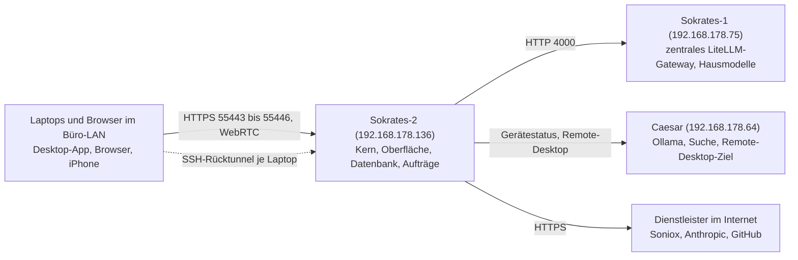
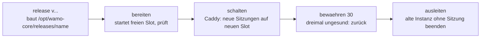

# Betriebshandbuch

| | |
|---|---|
| Zweck | Zeigt, welche Dienste auf welchem Rechner laufen, wie man sie startet, prüft, sichert und bei Störungen wieder gesund macht. |
| Zielgruppe | Betrieb und Administration von W.A.I.S. (Personen mit Zugang als `wamocon` auf Sokrates-2) |
| Dokumentart | Referenz (Topologie, Dienste, Logs) und Anleitung (Betrieb, Störungen) |
| Stand | 19.11.2026, geprüft gegen Commit 497e3ce |
| Quellen | `infra/sokrates2/README.md`, `CLAUDE.md`, `infra/sokrates2/wamo-core-slots.sh`, `infra/sokrates2/wamo-ui-umschalten.sh`, `infra/sokrates2/wamo-firewall.sh`, `infra/sokrates1/gateway-wamo.md`, `docs/hausmodelle-und-kikollege.md`, `docs/runner-einrichten.md` |

## 1. Wichtig vorab

- **Der Zustand des Servers ist aus dem Repo nicht lesbar.** Dieses Handbuch beschreibt, was die Skripte und Units im Repo einrichten. Ob ein Baustein heute läuft, zeigt nur sein `status`-Befehl am Server (Abschnitt 7).
- **Veraltete Überschriften.** Mehrere Abschnittsüberschriften in `infra/sokrates2/README.md` tragen noch "vorbereitet" oder "nicht ausgerollt" (zum Beispiel Abschnitt 12.6, 14, 15, 18, 19, 21, 22), obwohl `CLAUDE.md` und andere Stellen denselben Baustein als in Betrieb nennen (zum Beispiel Kern-Slots unter `/opt/wamo-core/slots/a` laut `docs/hausmodelle-und-kikollege.md`, persönlicher GitHub-Weg "live seit 18.11.2026" laut Abschnitt 18.3). Wo diese Datei einen Zustand nennt, steht "laut README, Stand" mit Datum.
- **Ablageregel für Skripte.** Skripte aus `infra/sokrates2/` liegen auf Sokrates-2 immer in `~/wamo-infra` im Home von `wamocon`, nie in `/tmp`. Die Skripte prüfen beim Start, dass Ordner und Inhalt dem Aufrufer oder root gehören und für Gruppe und Welt nicht beschreibbar sind. Ablegen:

```bash
ssh wamo-sokrates2 "rm -rf ~/wamo-infra" && scp -r infra/sokrates2 wamo-sokrates2:wamo-infra && ssh wamo-sokrates2 "chmod -R go-w ~/wamo-infra"
```

  (Der Alias `wamo-sokrates2` ist der SSH-Name des Dienstkontos `wamocon`; Skripte wie `scripts/wamo_kern_sokrates2.py` lesen ihn aus `WAMO_SSH_HOST`. Die README schreibt teils `sokrates2`.) Ausnahme: `wamo_kern_sokrates2.py verteilen` leert `~/wamo-infra` ganz, danach muss `wamo_ui_sokrates2.py verteilen` erneut laufen.
- **Zuerst trocken.** Fast jedes Einrichtungsskript kennt `--trocken` (zeigt nur, was geschähe). Immer zuerst damit aufrufen. Ein Neustart von `wamo-core` ist im Slot-Betrieb verboten, geschaltet wird mit `wamo-core-slots.sh umschalten-kern`.

## 2. Topologie



Quellen: `infra/sokrates2/README.md` (Abschnitte 0, 10, 12), `docs/hausmodelle-und-kikollege.md` (Abschnitt 1), `README.md` (Fernzugriff).

| Rechner | Adresse laut Repo | Rolle für W.A.I.S. |
| --- | --- | --- |
| Sokrates-2 | `192.168.178.136` | Hauptserver: Kern `wamo-core`, Oberfläche, eigener Supabase-Stack, Caddy, Firewall, Entwicklungsaufträge (Dispatcher, Sandbox), Gerätedienst, Labor-Dienst, Remote-Desktop-Gateway, Release- und Verteilungsdienste |
| Sokrates-1 | `192.168.178.75` | zentrales LiteLLM-Gateway (`http://192.168.178.75:4000/v1`), Ollama mit Chat- und Visionsmodellen, eigene Sprachausgabe `wamo-qwen3-tts` (Docker-Brücke `172.17.0.1:8104`), Ziel für Fernzugriff und Gerätestatus |
| Caesar | `192.168.178.64` | Ollama, Spracherkennung, SearXNG (Websuche im Haus); laut `docs/hausmodelle-und-kikollege.md` bleibt Caesar frei von W.A.I.S.-Last (dort läuft ein anderes Vorhaben), Ziel für Fernzugriff und Gerätestatus |
| Sparks | Sokrates-1, Sokrates-2 und Caesar | die drei Rechner heißen im Fernzugriff "die Sparks" (`README.md`, Fernzugriff). Ob jeder einzelne ein Spark-Gerät ist, steht nicht im Repo |
| Büro-LAN | `192.168.178.0/24` | alle Büro-Geräte, dazu die WireGuard-Clients der FRITZ!Box (laut README, Abschnitt 6); WireGuard läuft in der FRITZ!Box, nicht auf Sokrates-2 (`docs/remote-desktop.md`) |
| Laptops | je Person | Desktop-App (Electron) mit Host (Python, MCP) und geplanter Aufgabe "WAMO Tunnel"; Host lauscht nur auf `127.0.0.1:8765` |

Nicht belegt: Anzahl und Modell der Hardware, Betriebssystemversionen der Server außer Hinweisen wie "Ubuntu" und "arm64" in den Skripten.

## 3. Netz und Ports auf Sokrates-2

Docker veröffentlicht Ports per DNAT an ufw vorbei. Wirksam ist deshalb nur die Kette `DOCKER-USER`, die `wamo-firewall` setzt (`infra/sokrates2/wamo-firewall.sh`).

| Port | Dienst | Erlaubt aus dem LAN | Quelle |
| --- | --- | --- | --- |
| 55321 | Supabase-API über HTTP (Envoy) | Stufe 2: nur Loopback und Caddy-Netz | `infra/sokrates2/README.md` 6, 7 |
| 55443 | API und Anmeldung über HTTPS (Caddy) | ganzes Büro-LAN | dort 6 |
| 55444 | Kern über HTTPS (Caddy vor Unix-Socket) | ganzes Büro-LAN | dort 6, 10 |
| 55445 | Oberfläche über HTTPS (Caddy vor `wamo-ui-blau` oder `wamo-ui-gruen`) | ganzes Büro-LAN | dort 6, 12 |
| 55446 | Remote-Desktop-Gateway über HTTPS | nur Einträge in `/etc/wamo/admin-quellen`, ohne Einträge das Büro-LAN | dort 6.1 |
| 55322, 56543 | Postgres über Supavisor (Session, Transaktion), TLS | wie 55446 | dort 6.1 |
| 55447 | Labor-Dienst (Test-Jira) über HTTPS | nur `/etc/wamo-labor/plaetze-adressen`, ohne Liste das Büro-LAN | dort 19 |
| `127.0.0.1:18765` | Labor-Dienst für den Kern | nur Loopback | dort 19 |
| `127.0.0.1:18090` | Haus-Proxy für Entwicklungsaufträge | nur Loopback | `CLAUDE.md` (Haus-Proxy) |
| `127.0.0.1:18080`, `18081` | Prüfer-Proxys `pakete` und `claude` | nur Loopback | `CLAUDE.md` (Prüfer-Sandbox) |
| 20000 bis 20999 | Entwicklungsports der Auftrags-Sandbox (je Platz `20000 + n*100` bis `+99`) | nur Loopback | dort 18.2 |

Alles andere wird verworfen und mit `WAMO-FW verworfen:` (höchstens 6 je Minute) ins Kernel-Log geschrieben. Das Netz der Sparks (`10.100.104.0/24`, `10.100.105.0/24`) erreicht die WAMO-Ports bewusst nicht.

Auf dem PC: Kern lokal `http://localhost:7860` (Betriebsart Unterwegs), Host `127.0.0.1:8765`, einmalige Weiterleitung des Labor-Platz-Skripts `127.0.0.1:55489` (`README.md`, `CLAUDE.md`).

## 4. Dienste auf Sokrates-2

Spalten: Benutzer, Port oder Socket, Unit oder Container, Einrichten, Rückweg. Alle Skripte liegen in `infra/sokrates2/` und laufen nach der Ablageregel aus `~/wamo-infra`. "root" heißt `sudo bash ...`.

| Dienst | Benutzer | Port oder Socket | Unit oder Container | Einrichten | Rückweg |
| --- | --- | --- | --- | --- | --- |
| Supabase-Stack (GoTrue, Envoy, Supavisor, Postgres) | Container `wamo-supabase-*` | 55321, 55322, 56543 | Compose-Projekt `supabase-wamo` in `/home/wamocon/supabase-wamo` | `supabase-wamo-einrichten.sh` (Pflicht `SRC=`) | kein eigenes Skript im Repo |
| Auth-Schema `wamo_auth` | Datenbank | n/a | Schema in der Datenbank | `wamo-auth-einrichten.sh einrichten` (als `wamocon`) | `wamo-auth-einrichten.sh rueckweg` |
| Caddy (HTTPS-Vorbau) | Container `wamo-caddy` | 55443 bis 55447 | Compose in `/home/wamocon/wamo-tls/caddy` | `wamo-tls-einrichten.sh`, `wamo-core-caddy.sh` | `wamo-tls-rueckweg.sh`, `wamo-core-caddy.sh --zurueck` |
| Firewall | root | `DOCKER-USER`, Ketten `WAMO-FW*` | `wamo-firewall.service` (oneshot) | `wamo-firewall-einrichten.sh` (root) | `wamo-firewall-rueckweg.sh [--entfernen]` |
| Stufe 2 (HTTP 55321 nur intern) | n/a | 55321 | Schalter in `/etc/wamo/firewall.conf` | `wamo-stufe2-http-intern.sh --ja` | `... --zurueck` |
| Kern (alte Einzel-Unit) | `wamo-core` | `/run/wamo-core/core.sock` | `wamo-core.service` | `wamo-core-einrichten.sh` (root) | `wamo-core-rueckweg.sh [--entfernen]` |
| Kern-Slots | `wamo-core` | `/run/wamo-core/core-<slot>.sock` | `wamo-core@a.service`, `wamo-core@b.service` (Vorlage `wamo-core@.service`) | `wamo-core-slots.sh einrichten`, `release`, `umschalten-kern` (root) | `wamo-core-slots.sh rueckweg-kern`, `umstellung-zurueck` |
| Oberfläche | Container `wamo-ui-blau`, `wamo-ui-gruen` | intern 3000, über 55445 | Compose `/home/wamocon/wamo-ui` | `wamo-ui-einrichten.sh`, vom PC `scripts/wamo_ui_sokrates2.py` | `wamo-ui-rueckweg.sh`, `wamo_ui_sokrates2.py zurueck` |
| Rücktunnel alt | `wamo-tunnel` | `/run/wamo-tunnel/pc.sock` | sshd-Drop-in `wamo-tunnel.conf` | `wamo-tunnel-einrichten.sh` (root) | `wamo-tunnel-rueckweg.sh [--entfernen]` |
| Rücktunnel je Laptop | `wamo-t-01` bis `wamo-t-64` | `/run/wamo-pc/tNN/pc.sock` | `wamo-pc-abgleich.timer`, `wamo-pc-streuner.timer`, sshd-Drop-in `wamo-pc.conf` | `wamo-pc-tunnel-einrichten.sh` (root) | `wamo-pc-tunnel-rueckweg.sh [--entfernen]` |
| Entwicklungsaufträge (Dispatcher, Sandbox) | `wamo` | SSH-Forced-Command, kein Port | `/opt/wamo/bin/wamo-job-dispatch`, `wamo-egress.service` | `wamo-einrichten.sh`, dann `wamo-job-einrichten.sh` (root) | `wamo-job-rueckweg.sh`, `wamo-egress-rueckweg.sh` |
| Kern-Kanal des Dispatchers | `wamo-core` (Schlüssel), `wamo` | SSH auf `192.168.178.136` | Datei `/etc/ssh/authorized_keys.d/wamo-kern` | `wamo-job-kern-einrichten.sh` (root) | `wamo-job-kern-rueckweg.sh` (`notaus`, `--entfernen`) |
| Haus-Proxy | `wamo-haus-proxy` | `127.0.0.1:18090` | `wamo-haus-proxy.service` | `wamo-haus-proxy-einrichten.sh einrichten` (root) | `wamo-haus-proxy-rueckweg.sh --entfernen` |
| Notanker | root | `/run/wamo-anker/anker.sock` | `wamo-anker.service` | `anker-einrichten.sh` (root) | `anker-rueckweg.sh [--entfernen]` |
| Release-Dienst | `wamo-release` | `/run/wamo-release/ctl.sock` | `wamo-release.service` | `release-einrichten.sh` (root) | `release-rueckweg.sh [--entfernen]` |
| Freigabe-Dienst | `wamo-anker` | `/run/wamo-freigabe/freigabe.sock` | `wamo-freigabe.service` | `freigabe-einrichten.sh` (root) | `freigabe-rueckweg.sh` |
| Prüfer-Sandbox | `wamo-pruefer`, `wamo-pruefer-proxy` | `127.0.0.1:18080`, `18081`, Socket `/run/wamo-pruefer-annahme/annahme.sock` | `wamo-pruefer-annahme.socket`, `wamo-pruefer-proxy@.service`, `wamo-migprobe.socket` | `pruefer-einrichten.sh` (root) | `pruefer-rueckweg.sh` |
| Gerätedienst | `wamo-geraete` | `/run/wamo-geraete/geraete.sock` | `wamo-geraete.service` | `wamo-geraete-einrichten.sh` (root) | `wamo-geraete-rueckweg.sh` |
| Labor-Dienst | Container `wamo-labor-dienst` (Kennung 10001) | 55447, `127.0.0.1:18765` | Compose-Projekt `wamo-labor` in `/opt/wamo-labor` | `wamo-labor-einrichten.sh einrichten` (root) | `wamo-labor-rueckweg.sh`, `wamo-labor-loeschlauf.sh` |
| Labor: Betreuer-Geräte | root | n/a | `wamo-labor-geraete.service` und `.timer` (jede Minute) | `wamo-labor-geraete-einrichten.sh` | `... rueckweg` |
| Labor-Daten des Kerns | n/a | `/etc/wamo-labor/daten` | Dateien, Wert `WAMO_LABOR_DATEN` | `wamo-labor-daten-einrichten.sh einrichten` | `... rueckweg` |
| Remote-Desktop-Gateway | Container `wamo-rd-web`, `wamo-rd-guacd`, `wamo-rd-zugang` | 55446 | Compose-Projekt `wamo-rd` in `/home/wamocon/wamo-rd` | `wamo-rd-einrichten.sh` (als `wamocon`) | `wamo-rd-rueckweg.sh` |
| GitHub-Runner und Ausroll-Einstieg | `wais-deploy` | n/a | `wais-runner.service`, `/usr/local/sbin/wais-deploy` | `wais-runner-einrichten.sh einrichten` (root) | `wais-runner-einrichten.sh rueckweg` |
| Installer-Ablage | root, Lesezugriff `wamo-core` | `/var/lib/wamo-verteilung` | Dateien | `wamo-verteilung-einrichten.sh einsetzen` (root) | `wamo-verteilung-einrichten.sh rueckweg` |
| Lokale Quelle für den Release-Dienst | `wamocon` | `/var/lib/wamo-quelle/wamo.git` | Bare-Repository | `wamo-quelle-einrichten.sh` | `wamo-quelle-einrichten.sh --entfernen` |

Quellen der Tabelle: die Kopfkommentare der genannten Skripte, `infra/sokrates2/*.service`, `CLAUDE.md` (Namensvertrag) und `infra/sokrates2/README.md`. Die Unit des Ankers und der Freigabe liegen in `infra/sokrates2/anker/`, die des Release-Dienstes in `infra/sokrates2/release/`, die der Prüfer-Sandbox in `infra/sokrates2/pruefer/`.

Im Kern-Betrieb gilt (laut `infra/sokrates2/wamo-core@.service`): gehärtete Unit mit `ProtectSystem=strict`, leerem `CapabilityBoundingSet`, `SystemCallFilter=@system-service ~@privileged`, `MemoryMax=4G`, `Restart=on-failure`. Der Kern liest seine Einstellungen aus `/etc/wamo/core.env` (nur über `/usr/local/sbin/wamo-core-env`, Abschnitt 7) und ein Drop-in je Schalter.

## 5. Dienste auf den anderen Rechnern

| Rechner | Was | Ort und Zugang | Rückweg und Hinweise |
| --- | --- | --- | --- |
| Sokrates-1 | LiteLLM-Gateway mit den W.A.I.S.-Einträgen `wamo-haus-coder`, `wamo-stt-haus`, `wamo-tts-haus` und der Durchreiche `/wamo-tts-haus` | Konfiguration `litellm_config.yaml` im Gateway-Ordner (Pfad steht laut `infra/sokrates1/gateway-wamo.md` nicht im Repo) | Rückweg je Eintrag in `infra/sokrates1/gateway-wamo.md`, Abschnitt 5. Jede Änderung braucht vorher eine Sicherung mit Zeitstempel |
| Sokrates-1 | Container `wamo-qwen3-tts` (eigene Instanz der Sprachausgabe, Port 8104 auf `172.17.0.1`) | Quelle `infra/sokrates1/wamo-tts-haus/app.py` | `docker restart wamo-qwen3-tts` dauert rund 30 Sekunden bis gesund, in dieser Zeit fällt "Im Haus" je Satz aus. Rückweg in `infra/sokrates1/wamo-tts-haus/README.md`. Der Container `qwen3-tts` (Port 8102) gehört nicht zu W.A.I.S. |
| Sokrates-2 | Ollama mit `wamo-haus-coder` (Modelfile in `~wamocon/wamo-haus-coder/`) | `OLLAMA_MAX_LOADED_MODELS=3`, Sicherung der alten `override.conf` unter `/var/backups/ollama-override/` | Rückweg im Eintrag "Haus-Proxy" von `CLAUDE.md` |
| Sokrates-1, Sokrates-2, Caesar | Konto `wamo-rd` (Remote Desktop) und Lesekonto `wamo-status` | Skripte `infra/sparks/wamo-rd-konto-einrichten.sh`, `wamo-rd-ziel-einrichten.sh`, `wamo-rd-ausgang-einrichten.sh`, `wamo-status-einrichten.sh`, `wamo-sudo-einrichten.sh`, `xrdp-einhegen.sh` | Rückwege: `wamo-status-rueckweg.sh`, `wamo-sudo-einrichten.sh --zurueck`, `wamo-rd-rueckweg.sh` |
| Laptop (Windows) | Desktop-App, Host, geplante Aufgabe "WAMO Tunnel" | Installer `WAIS-Setup-<Version>.exe`, Skripte `scripts/wamo-tunnel-einrichten.ps1`, `wamo-tunnel.ps1` | Rückweg `scripts\wamo-tunnel-entfernen.ps1 [-Alles]`; Logs `%LOCALAPPDATA%\WAMO\logs`, Audit `host\wamo_audit.jsonl` im Installationsordner |

## 6. Start, Stopp, Status

Grundsatz: Dienste mit systemd starten und stoppen Sie mit `systemctl`, Container mit `docker compose` im Ordner des Projekts. Schreibende Betriebsschritte geschehen über die Skripte, nicht von Hand.

| Wozu | Befehl (alle über `ssh wamo-sokrates2 "..."`) |
| --- | --- |
| Zustand der Kern-Slots | `sudo bash ~/wamo-infra/wamo-core-slots.sh status` |
| Kern, Schlüsselnamen, Schalter (nur Namen) | vom PC: `python scripts/wamo_kern_sokrates2.py status` |
| Kern-Journal (INFO, ohne Gesprächsinhalte) | `sudo journalctl -u wamo-core@a -n 50` (oder `@b`, bei der alten Unit `-u wamo-core`) |
| Oberfläche: Farbe, Fassung | `bash ~/wamo-infra/wamo-ui-umschalten.sh status [--json]` |
| Firewall: Regeln mit Zählern | `sudo wamo-firewall status` |
| Notanker | `wamo-anker status` |
| Release-Dienst | `sudo wamo-release status` |
| Ausroll-Einstieg (Runner) | `sudo /usr/local/sbin/wais-deploy status` |
| Entwicklungsaufträge: Dispatcher, Kanal | `sudo -u wamo -H /opt/wamo/bin/wamo-job-dispatch ping` (meldet Version, `kanal`, `kernkanal`, `github`, nie einen Wert aus `geheim.env`) |
| Kern-Kanal: Schlüssel, Kanal, Schalter je Slot | `sudo bash ~/wamo-infra/wamo-job-kern-einrichten.sh status` |
| Haus-Proxy | `sudo bash ~/wamo-infra/wamo-haus-proxy-einrichten.sh status` |
| Labor-Dienst | `sudo bash ~/wamo-infra/wamo-labor-einrichten.sh status` (nur Namen und Zustände) |
| Remote-Desktop-Gateway | `bash ~/wamo-infra/wamo-rd-einrichten.sh status` |
| Installer-Ablage | `python scripts/wamo_installer_sokrates2.py status` (vom PC) |

**Firewall ändern.** Immer `sudo systemctl reload wamo-firewall` (ersetzt die Regeln atomar), nie `restart` (entfernt sie kurz). Vorher `sudo wamo-firewall regeln` ansehen. Nicht blind `iptables-restore` aus den Sicherungen einspielen, Docker ändert seine Regeln bei jedem Containerstart.

**Einstellungen des Kerns ändern.** Werte gehen nur über stdin an `sudo /usr/local/sbin/wamo-core-env setzen` (Allowlist, atomar, schreibt `/etc/wamo/core.env`), `liste` zeigt nur Namen, `loeschen NAME` entfernt. Sie wirken erst mit dem nächsten Kern-Release. Schalter der Entwicklungsaufträge stehen nie in `core.env`, sondern im Drop-in `wamo-core@.service.d/wamo-entwicklung-buero.conf` (nur `wamo-job-kern-einrichten.sh schalter` schreibt es). Quelle: `infra/sokrates2/wamo_core_env.py`.

## 7. Kern-Slots und Release ohne Lücke

Zwei Instanzen `a` und `b` der Vorlage `wamo-core@.service` laufen nebeneinander, jede mit eigenem Socket und eigenem Release-Ordner. Caddy hält jede Sitzung über den Pfad `/i/<slot>/` auf ihrer Instanz.



`umschalten-kern <release>` fasst bereiten und schalten zusammen (Quelle: Kopf von `infra/sokrates2/wamo-core-slots.sh`).

| Befehl (`sudo bash ~/wamo-infra/wamo-core-slots.sh ...`) | Wirkung |
| --- | --- |
| `einrichten` | Vorlage installieren, Ordner `releases/` und `slots/`, spiegelt Drop-ins der alten Unit (ohne sie weist ein Slot die Oberfläche per CORS ab) |
| `release <name>` | baut `/opt/wamo-core/releases/<name>` aus `~/wamo-infra/kern` mit eigenem venv; Releases werden nie überschrieben; Name `v` plus Buchstaben, Ziffern, Punkt, Strich, Unterstrich |
| `slot <a\|b> <release>` | setzt den Verweis eines Slots, nur wenn die Instanz nicht läuft |
| `umschalten-kern <release>` | freien Slot starten, prüfen, Caddy umschalten, alte Instanz auslaufen lassen (nimmt keinen neuen `/start` mehr an, Antwort 409) |
| `bewaehren [minuten]` | überwacht den neuen Slot (Standard 30 Minuten), bei Ausfall automatisch zurück |
| `ausleiten` | beendet die auslaufende Instanz, nur ohne Sitzung und nach der Bewährung |
| `rueckweg-kern` | schaltet auf die vorige Instanz zurück, solange sie läuft |
| `inc a`, `inc a auslaufend b`, `inc legacy` | Include-Datei `slot.inc` von Hand setzen, `legacy` ist die Standardroute der alten Unit |
| `umstellen <release>`, `umstellung-zurueck` | einmalige Umstellung von `wamo-core.service` auf Slot `a` und zurück, nur bei Ruhe |

Hinweise aus dem Skript: Ruhe heißt, dass im Journal der Unit seit N Minuten nichts steht (abgewiesene Gesundheitsproben zählen nicht). Läuft der Stopp in die Zeitgrenze der Unit (`TimeoutStopSec`), meldet `ausleiten` das deutlich und setzt den Fehlerzustand zurück (Befund R7 vom 16.11.2026, laut Skriptkommentar). Im Slot-Betrieb startet kein Einrichtungsskript die alte Unit neu, sie verweisen auf `umschalten-kern`.

## 8. Oberfläche: Blau und Grün

Zwei Container, einer ist live. Welche Farbe live ist, steht allein in `/home/wamocon/wamo-tls/caddy/etc/kern/wamo-ui-aktiv.inc` (nie von Hand ändern, `wamo-ui-umschalten.sh` erzeugt sie).

| Befehl | Wirkung |
| --- | --- |
| `python scripts/wamo_ui_sokrates2.py verteilen` | legt Quellen und Skripte ab, schreibt `wamo-ui/bau.info` (Commit von HEAD, Vermerk "sauber") |
| `... umschalten [--trocken] [--bewaehrung S] [--fehlerquote P]` | bauen, am neuen Container prüfen, Caddy umsetzen, abwarten, bewähren (Standard 30 Sekunden, 10 Prozent Fehlerquote), sonst automatisch zurück |
| `... zurueck` | Rückweg auf die vorige Farbe (eine Sekunde, solange sie läuft; "zurück" gilt auch vorwärts) |
| `... eintrag` | Eintrag "letzte gute Version" für den Notanker (JSON) |
| `bash ~/wamo-infra/wamo-ui-umschalten.sh anker-rueckweg vX.Y.Z <40 Hex> blau\|gruen` | Schnittstelle für den Notanker, idempotent |

Rückgabewerte von `umschalten`: 0 in Ordnung, 1 Voraussetzung fehlt, 2 Aufruf ungültig, 3 Prüfung vor dem Umschalten fehlgeschlagen (nichts umgeschaltet), 4 nach dem Umschalten automatisch zurückgenommen, 5 Rückweg fehlgeschlagen (Handarbeit), 6 Ziel des Rückwegs nicht verfügbar. Ein zweiter Lauf zugleich wird durch eine Sperre (`flock` auf `~/wamo-ui/.umschalten.lock`) abgewiesen. Quelle: Kopf von `infra/sokrates2/wamo-ui-umschalten.sh`, `infra/sokrates2/README.md` 12.6.

## 9. Gesundheitsproben

| Prüfung | Erwartung | Quelle |
| --- | --- | --- |
| `GET /version.json` der Oberfläche (über `https://192.168.178.136:55445`) | JSON mit `name`, `version`, `commit`, `gebaut`, `sauber`; `Cache-Control: no-store` | `ui/src/app/version.json/route.ts`, README 12.1 |
| `POST /start` am Kern ohne Anmeldung | HTTP 401 (so prüft `wamo-core-slots.sh` und `wais-deploy` dreimal) | `infra/sokrates2/wais-deploy.sh` |
| Anmeldedienst `https://192.168.178.136:55443/auth/v1/health` | kurze JSON-Antwort ohne Zertifikatswarnung | `infra/sokrates2/README.md` 5.2 |
| Labor-Dienst `/gesundheit` | nur vom Server selbst erreichbar | dort 19 |
| `wamo-job-dispatch ping` | Version `10`, Kanalzustand, `github` | `infra/sokrates2/wamo_job_dispatch.py` (`VERSION = "10"`) |
| Rauchtest Aufträge | `sudo -u wamo -H /opt/wamo/bin/wamo-job-rauchtest --mcp --attrappe` (nach jedem Update von Claude Code Pflicht) | dort 9 |
| Rauchtest Kern-Kanal | `sudo /opt/wamo-core/bin/wamo-job-kern-rauchtest --produktiv` | dort 18 |
| Rauchtest Tunnel je Laptop | `sudo python3 -I /opt/wamo-pc/bin/wamo-pc-rauchtest` (nach jedem Update von `openssh-server`) | dort 13 |
| Rauchtests weiterer Dienste | `anker_rauchtest.py --produktiv`, `release_rauchtest.py --produktiv`, `freigabe_rauchtest.py --produktiv`, `pruefer_rauchtest.py`, `wamo_labor_rauchtest.py` (20 Proben), `wamo_rd_rauchtest.py`, `wamo_ui_rauchtest.py` | je Abschnitt der Server-README |
| Ausroll-Rauchtest | `sudo /usr/local/sbin/wais-deploy rauchtest` (aktiver Slot, live Farbe, Labor-Dienst) | `docs/runner-einrichten.md` |
| Gateway nach Neustart | `/health`, `/v1/models` mit Kern-Schlüssel, gestreamte Probe an `/wamo-tts-haus/v1/audio/speech` (Status 200, Kopfzeile `X-Stream: 1`) | `infra/sokrates1/gateway-wamo.md` 4 |

Der Kern meldet sich außerdem in der Oberfläche über die Betriebsmeldung. Kommt nach dem Verbinden 20 Sekunden keine, bricht die Oberfläche ab und bietet "Erneut verbinden" an (`ui/src/lib/verbindungsfrist.ts`, README).

## 10. Logs, Journal-Marken und Protokolle

| Was | Wo | Hinweis |
| --- | --- | --- |
| Kern | `journalctl -u wamo-core@a` bzw. `@b` | Stufe INFO, ohne Gesprächsinhalte, ohne Schlüssel (Schwärzung im Kern) |
| Abgelehnte Tunnel- und Geräteaktionen | `journalctl ... \| grep WAMO-GERAET` | Präfix `WAMO-GERAET`, bei 5 Minuten ohne gültige Geräteliste `WAMO-GERAET ALARM` |
| Firewall | `sudo journalctl -k \| grep 'WAMO-FW verworfen'` | begrenzt auf 6 je Minute |
| Marken im Journal (`logger -t`) | `wamo-nutzer`, `wamo-auth`, `wamo-verteilung`, `wamo-job-kern`, `wamo-labor-geraete`, `wamo-labor-loeschen`, `wais-deploy` | `journalctl -t <Marke>`; Passwörter und Token stehen nie darin |
| Aufträge (Dispatcher) | `/srv/wamo/logs/auftraege.log`, Zähler `/srv/wamo/logs/kernkanal.jsonl` | `gh_app_token`, `start`, `gh_app_widerruf`, nie ein Token |
| Bedienspur Kern-Kanal | `/var/log/wamo-job-kern/aktionen.jsonl` | jede Handlung als Zeile ohne Werte |
| Ausrollen | `/var/log/wais-deploy/protokoll.log` | jeder Aufruf mit Befehl, Commit, Ausgabe, Rückgabe |
| Notanker | `/var/log/wamo-anker/audit.jsonl` (Hashkette, `chattr +a`, 32 MiB) | `wamo-anker status` zeigt Füllgrad und Kette |
| Release-Dienst | `/var/log/wamo-release/audit.jsonl` (Hashkette, 32 MiB) | zugleich Write-Ahead-Log |
| Haus-Proxy | Buchung `/var/lib/wamo-haus-proxy/verbrauch.jsonl` | |
| Labor | Container-Protokolle 3 Dateien zu 10 MB; Löschnachweis `/var/log/wamo-labor/loeschnachweis-<Zeit>.txt` | Namen, Größen, Zählungen, nie Inhalte |
| Zähler Ausgangsfilter | `sudo nft list table inet wamo_egress` | |
| PC-Host | `host\wamo_audit.jsonl` (im Installationsordner, geht bei Update oder Deinstallation verloren) | Ort per `WAMO_AUDIT_LOG` änderbar |
| Fachliches Audit | Tabelle `actions` in der Datenbank | Aufträge, Freigaben, Modellwahl, Installer-Download |

Quellen: `infra/sokrates2/README.md`, `host/wamo_host.py`, `CLAUDE.md`.

## 11. Sicherungen

| Ordner | Inhalt | Anlass |
| --- | --- | --- |
| `/var/backups/wamo-firewall/` | `iptables-save`, `ip6tables-save` mit Zeitstempel, `admin-quellen-<Zeit>` | vor jedem Einrichten der Firewall |
| `/var/backups/wamo-job-kern/<JJJJMMTT-HHMMSS>/` | Sicherungen des Kern-Kanals, vorige `wamo.conf` (sshd), nie ein privater Schlüssel | vor `schluessel`, `kanal`, `schalter` |
| `/opt/wamo/vorher/` | Sicherungen von `wamo-job-einrichten.sh`, Rückweg spielt die neueste noch nicht zurückgespielte ein | vor jedem Einrichten |
| `/var/backups/wamo-anker/`, `/var/backups/wamo-release/` | Zustand und Audit-Protokoll beim Rückweg `--entfernen` oder Rotation | nur bei Rückweg oder Rotation |
| `/usr/local/lib/wamo-anker.vorher`, `/opt/wamo-freigabe/app.vorher` | voriger Baum, bis `status` nach dem Neustart bestanden hat | beim Einrichten |
| `/var/backups/wamo-labor/` | Stände vor dem Einrichten, ohne Token und Daten | vor `wamo-labor-einrichten.sh` |
| `/var/backups/wamo-labor-daten/<Zeit>/` | Stand der Labor-Daten, Datei `VORHER` nennt das Ziel | vor `wamo-labor-daten-einrichten.sh` |
| `/var/backups/wamo-haus-proxy/<Zeit>/` | vorhandene Dateien des Proxys | vor dem Einrichten |
| `/var/backups/ollama-override/` | vorige `override.conf` von Ollama auf Sokrates-2 | Haus-Coder-Einrichtung |
| Gateway-Ordner auf Sokrates-1 | `litellm_config.yaml.vor-wamo-...<Zeit>` | vor jeder Gateway-Änderung |
| `/var/lib/wamo-verteilung/staende/` | höchstens drei Installer-Stände mit Links `aktuell` und `vorher` | beim Einsetzen |
| `/var/lib/wais-deploy/staende/<commit>` | die fünf neuesten Stände | beim Verteilen |
| Image-Tags `wamo-ui:vX.Y.Z-<Commit>` | die drei neuesten Archiv-Tags der Oberfläche | beim Bauen |

**Sicherung der Datenbank und der Konfiguration:** im Repo nicht beschrieben, offen, siehe Abschlussbericht. `infra/sokrates2/README.md` (Abschnitt 19) nennt Snapshots und Sicherungen des Servers nur als "nicht in der Hand des Skripts, der Betrieb prüft es von Hand".

## 12. Notaus-Schalter

| Schalter | Wirkung | Rücknahme |
| --- | --- | --- |
| `sudo bash ~/wamo-infra/wamo-job-kern-rueckweg.sh notaus` | Sperrdatei `/etc/wamo/kernkanal.notaus`, Schlüsselzeile gelöscht, `KANAL=zu`, Schlüsselpaar beiseite (`.notaus-<Zeit>`), alle Aufträge mit `kanal=kern` abgebrochen, wirkt ohne Neustart des Kerns | `notaus-aufheben` öffnet nichts. `schluessel` legt ein neues Paar an, erst `kanal` öffnet wieder |
| `wamo-job-kern-einrichten.sh kanal zu` | schließt den Kern-Kanal (geht immer) | `kanal --arten ...` |
| `wamo-job-kern-einrichten.sh schalter an <release> ...` ohne `--github`, `--haus`, `--mitglieder` | schaltet die jeweilige Funktion für neue Aufträge aus | Aufruf mit dem Schalter |
| `wamo-anker sperre an` | Datei `/etc/wamo-anker/selbstaenderung.aus` sperrt alle Selbständerungen, `rueckweg` und `status` laufen immer | nur `sudo rm /etc/wamo-anker/selbstaenderung.aus` |
| `wamo-anker rueckweg ui`, `kern`, `alles` | zurück auf den letzten guten Stand aus `stand.json` | n/a |
| `sudo systemctl stop wamo-haus-proxy` | Aufträge mit Hausmodellen scheitern geschlossen | `systemctl start` |
| `kanal --persoenlich aus` | neue Aufträge mit `github=persoenlich` enden mit `persoenlich_aus`, der App-Weg bleibt | `kanal --persoenlich an` |
| Gerät sperren (Geräteverwaltung in der Oberfläche) oder Person aus `WAMO_PC_MITGLIEDER_PROFILE` nehmen | beendet die PC-Steuerung dieser Person | Liste setzen und Kern-Release |
| `WAMO_TTS_HAUS_STREAM=aus` über `wamo-core-env` | schaltet die gestreamte Sprachausgabe im Haus ab | `an`, dann Kern-Release |
| Notaus der PC-Seite je Laptop | `wamo-pc-tunnel-rueckweg.sh` sperrt alle Schlüssel und beendet Sitzungen | `wamo-pc-tunnel-einrichten.sh` |

Quellen: `infra/sokrates2/README.md` 13.1, 14, 18, 18.3; `docs/ausrollen-neue-nutzer.md` Abschnitt 9.

## 13. Zeitgeber und Aufräumen

| Was | Takt | Zweck | Quelle |
| --- | --- | --- | --- |
| `wamo-pc-abgleich.timer` | alle 10 Sekunden (20 Sekunden nach Start) | Benutzer, Schlüssel und Ordner der Laptop-Tunnel aus `pc_abgleich_liste()`; Widerruf zuerst; bei Ausfall der Datenbank bleibt der Zustand | `infra/sokrates2/wamo-pc-abgleich.timer` |
| `wamo-pc-streuner.timer` | alle 5 Minuten | meldet lauschende Sockets außerhalb des eigenen Ordners und beendet die Sitzungen | `infra/sokrates2/wamo-pc-streuner.timer` |
| `wamo-labor-geraete.timer` | jede Minute | Betreuer-Geräte über den Namen auflösen und in die Caddy-Site eintragen | `infra/sokrates2/wamo-labor-geraete.timer` |
| `wamo-job-aufraeumen.timer` | täglich 04:30 | Kopien privater Repos aus Entwicklungsaufträgen löschen (nach einem bzw. sieben Tagen) | `infra/sokrates2/wamo-job-aufraeumen.timer` |
| Dispatcher | je Lauf | alte Auftrags-Caches (npm, cache, plugin-daten nach 7 Tagen, `claude/` nach 30 Tagen) | `infra/sokrates2/README.md` 9 |
| Kern, `vorgaenge` | höchstens stündlich je Prozess | offene Vorgänge nach 24 Stunden abbrechen, Stand 30 Tage nach dem Ende leeren | `supabase/migrations/0017_vorgaenge.sql` |
| Kern, `auftrag_entwuerfe` | höchstens stündlich je Prozess | Entwürfe nach 90 Tagen löschen | `voice-core/auftrag_entwuerfe.py` |

## 14. Typische Störungen

Jede Zeile nennt Prüfschritt und Behebung. Nur Fälle, die im Repo beschrieben sind.

| Symptom | Prüfschritt | Behebung |
| --- | --- | --- |
| Browser zeigt "Verbindung nicht privat" oder die Anmeldung meldet einen Zertifikatsfehler | `https://192.168.178.136:55443/auth/v1/health` im Browser öffnen | WAMO-CA importieren (`certutil -user -addstore Root wamo-ca.crt`, Fingerabdruck vergleichen), Browser komplett neu starten. Die Desktop-App vertraut der CA selbst (`desktop/zertifikat.js`) |
| Zertifikat läuft bald ab | Ablauf laut README: Pooler-Zertifikat 20.11.2027, Zwischenzertifikat 18.10.2028 | `wamo-tls-einrichten.sh` in den letzten 60 Tagen davor erneut ausführen, kein Import auf den PCs nötig |
| `wamo-tls-einrichten.sh` brach ab | liegt `/home/wamocon/supabase-wamo/.env.vor-tls` noch da? (enthält Geheimnisse) | Stack reparieren, danach die Datei löschen |
| Oberfläche: `umschalten` endet mit 3 oder 4 | `docker logs wamo-ui-<farbe>`, `status` | alte Farbe blieb live bzw. wurde automatisch wiederhergestellt; Fehler beheben, erneut `umschalten` |
| Oberfläche: Rückgabewert 5 | `status` | `docker exec wamo-caddy caddy reload --config /etc/caddy/Caddyfile --adapter caddyfile`, dann `status` |
| Offene Seite lädt Teile nicht nach (zwei Releases zurück) | Browser | Seite neu laden (bekannte Grenze, README 12.6) |
| Neuer Kern-Slot lehnt die Oberfläche ab (CORS) | `wamo-core-slots.sh status` | `wamo-core-slots.sh einrichten` spiegelt die Drop-ins der alten Unit in die Vorlage |
| `ausleiten` bricht ab | Sitzung auf der alten Instanz oder keine Ruhe | später erneut; solange die alte Instanz läuft, bricht `test-kern` des nächsten Standes mit Hinweis ab (`docs/runner-einrichten.md`) |
| Kern nach Release ungesund | `bewaehren` meldet "dreimal nicht gesund" und schaltet zurück | `rueckweg-kern`, Journal des Slots lesen |
| Auftrag startet nicht, Oberfläche meldet Sperre | Ereignis `kanal_gesperrt` mit Code (`kanal_zu`, `abgelaufen`, `notaus`, `grenze_start`, `grenze_laufzeit`, `grenze_profil`, `belegt`, `persoenlich_aus` und weitere) | Satz aus `GRUND_SAETZE` in `voice-core/entwicklung_betrieb.py` lesen; `abgelaufen`: `wamo-job-kern-einrichten.sh schluessel --ablauf <JJJJMMTT> --hostfingerabdruck <SHA256:...>`; `belegt`: höchstens sechs Aufträge gesamt, drei je Person (Dispatcher 9) |
| "Wächter-Selbsttest fehlgeschlagen" | `wamo-job-rauchtest` | beim Schritt `klon` war das ein Fehler (Exit 70), behoben am 18.11.2026 in `wamo-job.sh`; sonst Rauchtest mit `--attrappe` lesen |
| Nach Update von Claude Code startet kein Auftrag | `CLAUDE_VERSION` in `/opt/wamo/wamo-job.conf` | `wamo-job-einrichten.sh` erneut, dann Rauchtest |
| Aufträge starten nicht, Ausgangsfilter fehlt | `sudo nft list table inet wamo_egress` | `wamo-egress.service` starten; der Dispatcher prüft alle 15 Sekunden und beendet einen Lauf ohne Filter sofort |
| Aufträge mit Hausmodell scheitern oder werden langsam | `wamo-haus-proxy-einrichten.sh status`; Proxy nimmt höchstens zwei Anfragen zugleich an, weitere warten oder bekommen 429 | Last verteilen; Proxy läuft die Unit, LiteLLM-Schlüssel gesetzt? |
| Admin-Port 55446, 55322 oder 56543 aus dem LAN nicht erreichbar | `/etc/wamo/admin-quellen`, `sudo wamo-firewall start --trocken` | Quelle eintragen, `sudo systemctl reload wamo-firewall`. Eine Datei nur mit ungültigen Einträgen öffnet für niemanden (nur Loopback) |
| Laptop ohne PC-Steuerung | `journalctl ... \| grep WAMO-GERAET`, Gerät in der Geräteverwaltung aktiv? | Gerät freigeben; Rechnername des Hosts muss zum Register passen; nach `openssh-server`-Update den Tunnel-Rauchtest laufen lassen |
| Tunnel-Abgleich meldet `WAMO-GERAET ALARM` | Datenbank erreichbar? | Fünf Minuten ohne gültige Liste lösen Alarm und Exit 1 aus, Zustand bleibt bis dahin stehen |
| Audit-Protokoll des Ankers voll oder Kette defekt | `wamo-anker status` zeigt Füllgrad und Zustand der Kette | Vorgehen nur nach `infra/sokrates2/README.md` Abschnitt 14 ("Wenn das Audit-Protokoll voll oder beschädigt ist"), als root |
| Protokoll des Release-Dienstes voll | `sudo wamo-release status` | nur ohne offene Anfrage, Vorgehen nach `infra/sokrates2/README.md` Abschnitt 15 ("Protokoll voll") |
| Sprachausgabe im Haus bricht ab | Gateway: `/health`, `/v1/models`; Durchreiche 401, 403 oder 404 | Der Kern fällt selbst für 5 Minuten auf den Modellweg zurück (`DURCHREICHE_PAUSE_SECS`); Streaming mit `WAMO_TTS_HAUS_STREAM=aus` abschalten |
| Remote-Desktop-Sitzung hängt | `docker ps` für `wamo-rd-web`, `wamo-rd-guacd`, `wamo-rd-zugang` | immer gemeinsam `docker restart wamo-rd-web wamo-rd-zugang` (der Zugangsdienst hält Zustand nur im Speicher) |
| Labor-Dienst nicht erreichbar | `wamo-labor-einrichten.sh pruefen` (20 Proben) | Verdächtiger bei Loopback-Problemen: das Netz `wamo-labor-lokal`; Rückweg `wamo-labor-rueckweg.sh` |

Regeln für Eingriffe:

- Kein Neustart von GoTrue in der Labor-Woche und immer vor einer Kernfreigabe (`docs/ausrollen-neue-nutzer.md`, Abschnitt 9).
- Kein Neustart des LiteLLM-Gateways am Labortag (Sperre vom 27.11.2026 12:00 bis 28.11.2026 abends laut `infra/sokrates1/gateway-wamo.md`).
- Beim Labor-Dienst hängt der Ausgang allein an `wamo-firewall`: vor `systemctl stop wamo-firewall` den Dienst stoppen.
- `sudo systemctl restart wamo-core` nie im Slot-Betrieb.

## Weiterführend

- Release, CI, Installer, Rückwege: [release-und-ausrollen.md](release-und-ausrollen.md)
- Aufgaben der Administration: [administrationshandbuch.md](administrationshandbuch.md)
- Sicherheit und Datenschutz: [../sicherheit/sicherheit-und-datenschutz.md](../sicherheit/sicherheit-und-datenschutz.md)
- Server-Handbuch im Detail: [../../../infra/sokrates2/README.md](../../../infra/sokrates2/README.md)
- Eigener Runner: [../../runner-einrichten.md](../../runner-einrichten.md)
- Gateway auf Sokrates-1: [../../../infra/sokrates1/gateway-wamo.md](../../../infra/sokrates1/gateway-wamo.md)
- Labor-Runbook für den Labortag: [../../labor-runbook.md](../../labor-runbook.md)
- Konfiguration (Schalter und Umgebung): [../technik/konfiguration.md](../technik/konfiguration.md)
- Begriffe: [../glossar.md](../glossar.md)
