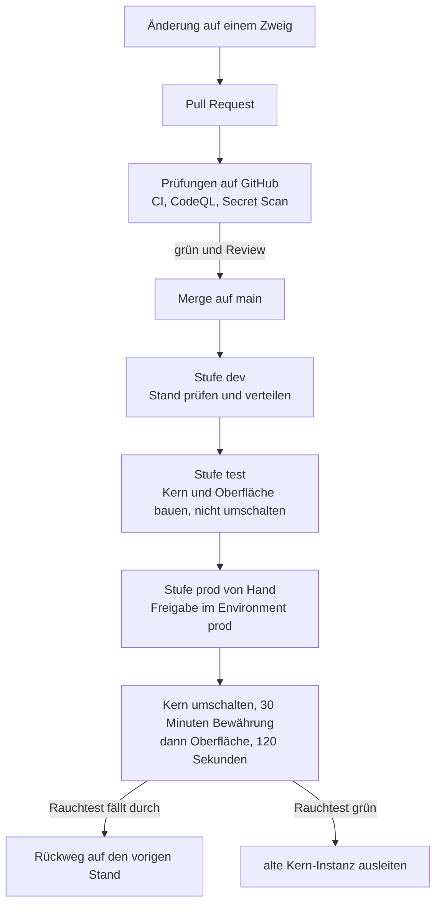

# Release und Ausrollen

| | |
|---|---|
| Zweck | Beschreibt den Weg von einer Änderung bis zur Produktion: Branch, Pull Request, Prüfungen, Ausrollen in den Stufen dev, test und prod, Versionierung, Installer und Rückwege. |
| Zielgruppe | Entwickelnde und Betrieb, die einen Stand freigeben oder ausrollen |
| Dokumentart | Erklärung (Ablauf und Gründe) und Anleitung (Befehle) |
| Stand | 19.11.2026, geprüft gegen Commit 497e3ce |
| Quellen | `.github/workflows/*.yml`, `docs/runner-einrichten.md`, `infra/sokrates2/wais-deploy.sh`, `infra/sokrates2/wamo-core-slots.sh`, `infra/sokrates2/wamo-ui-umschalten.sh`, `scripts/wamo_version.py`, `scripts/wamo_installer_sokrates2.py`, `desktop/package.json`, `CHANGELOG.md` |

## 1. Überblick

Es gibt drei getrennte Linien, die sich nicht gegenseitig ersetzen:

| Linie | Was wird ausgeliefert | Wer löst aus | Quelle |
| --- | --- | --- | --- |
| Server-Linie | Kern (`voice-core/`) als Release im freien Slot, Oberfläche (`ui/`) in der freien Farbe, Infrastruktur-Skripte | Workflows `Ausrollen` und `Ausrollen prod` über den eigenen Runner, oder von Hand vom PC | `docs/runner-einrichten.md`, `infra/sokrates2/README.md` 12 und 21 |
| Installer-Linie | Windows-Installer `WAIS-Setup-<Version>.exe` der Desktop-App | ein Mensch baut lokal, signiert, verteilt vom PC auf den Server, die Oberfläche bietet ihn an | `README.md` (Windows-Installer), `infra/sokrates2/README.md` 22 |
| Selbstüberarbeitung | Release-Dienst mit Zustandsautomat, Freigabe-Dienst, Notanker | Konzept in `docs/selbstueberarbeitung.md`, im Repo als Gerüst | `infra/sokrates2/README.md` 14 und 15 |

Datenbank-Migrationen laufen nicht über den Runner. Sie werden von Hand vor dem Merge eingespielt (Abschnitt 5).

## 2. Ablauf im Überblick



Quelle: `.github/workflows/deploy.yml`, `deploy-dev.yml`, `deploy-test.yml`, `deploy-prod.yml`.

## 3. Branch, Pull Request und Commit-Regeln

- **Zweig und Pull Request.** Änderungen entstehen auf einem Zweig (im Verlauf zum Beispiel `docs/plan-c-betrieb`, `fix/kanal-arten-im-kern`) und kommen über einen Pull Request nach `main`. Merge-Commits stehen im Verlauf (`Merge pull request #224 ...`). Ob der Schutz von `main` in GitHub eingestellt ist, steht nicht im Repo.
- **Pflicht-Check.** `ci.yml` bündelt alle Jobs im Sammel-Check `Ergebnis` und empfiehlt, genau diesen Check als Pflicht für `main` einzutragen. Übersprungene Teile zählen als grün, fehlgeschlagene oder abgebrochene nicht.
- **Commit-Titel.** Conventional Commits: `<typ>(<bereich>): <Text>`, Typen `feat`, `fix`, `perf`, `revert`, `docs`, `chore`, `ci`, `test`, `style`, `refactor`, `build`. Daraus berechnet `scripts/wamo_version.py` die Version (Abschnitt 7). Ein `!` hinter dem Typ oder `BREAKING CHANGE:` im Text bedeutet Major.
- **Merge nur nach Rückfrage.** Laut `docs/ausrollen-neue-nutzer.md` Abschnitt 9 fragt der Umsetzer vor jedem Merge und jedem Rollout ausdrücklich nach.
- **Wirkung eines Merges.** Jeder Merge auf `main`, der nicht nur `docs/**` oder Markdown im Hauptordner ändert, baut am Server die Stufen dev und test (`deploy.yml`, Feld `paths-ignore`).

## 4. Prüfungen auf GitHub

Alle laufen nur mit Leserechten und ohne Geheimnisse auf Runnern von GitHub. Fremde Actions sind auf volle Commit-SHAs festgenagelt, `ruff` und `shellcheck` kommen als Programm mit fester Prüfsumme (Quelle: `README.md`, Abschnitt "Prüfungen auf GitHub", und Kopf von `ci.yml`).

| Workflow | Datei | Auslöser | Inhalt |
| --- | --- | --- | --- |
| Prüfungen | `ci.yml` | Push auf jeden Zweig, Pull Request, manuell | Jobs: Oberfläche (Node 22: `npm ci`, ESLint, `tsc --noEmit`, `node --test`, vitest, `next build`), Kern (Python 3.12, pytest in vier Teilen, ein zweiter Versuch gescheiterter Tests erscheint als Warnung), Python (`compileall`, ruff), Labor-Dienst, Gerätedienst, Skripte, Desktop (Windows), Host (Windows), Infra (`bash -n`, shellcheck, PowerShell-Syntax), Migrationen, Version, Abhängigkeiten, Ergebnis |
| CodeQL | `codeql.yml` | Push, Pull Request, dienstags 04:41 UTC, manuell | Sicherheitsanalyse für `actions`, `javascript-typescript`, `python` |
| Secret Scan | `secret-scan.yml` | Push auf main, Pull Request, montags 03:17 UTC, manuell | gitleaks über neue Commits bzw. die Historie |
| Dependabot | `dependabot.yml` | wöchentlich | aktiv nur für GitHub Actions; die Blöcke für npm, pip und Docker sind auskommentiert |

Teilweise läuft nur, was geändert wurde (Oberfläche, Desktop, Host, Labor-Dienst, Gerätedienst, Infra, Migrationen). Ein neuer Zweig und der manuelle Start prüfen alles; beim manuellen Start wählt das Feld `teil` einen einzelnen Teil. Auf Zweigen bricht ein neuer Push den älteren Lauf ab, auf `main` läuft jeder Stand zu Ende.

**Lokal dasselbe prüfen** (aus `README.md`):

```bash
cd ui && npm run lint && npx tsc --noEmit && npm test && npm run test:komponenten && npm run build
cd voice-core && uv run python -m pytest -q
python scripts/wamo_migrationen_pruefen.py --basis origin/main
python scripts/wamo_version.py pruefen
```

Der Windows-Installer hat bewusst keinen Workflow (Abschnitt 8).

## 5. Datenbank-Migrationen

Regeln aus `CLAUDE.md` und `supabase/migrations/0001_wamo_init.sql`:

1. Eine Migration ist nach dem Einspielen auf Produktion unveränderlich. Eine Änderung ist eine neue Migration mit `.down.sql`.
2. Der Platzhalter `__SCHEMA__` wird je Ziel ersetzt (`wamo_dev`, `wamo_test`, `wamo_prod`): `bash scripts/render-migration.sh <schema> | docker exec -i wamo-supabase-db psql -U postgres -v ON_ERROR_STOP=1 --single-transaction` (Kopfkommentar der Migration).
3. Policies und Trigger beginnen mit `drop ... if exists`, damit ein zweiter Lauf nicht abbricht.
4. Vor jedem Einspielen auf Produktion prüft der Agent `database-reviewer` (laut `CLAUDE.md`).
5. In der CI prüft `scripts/wamo_migrationen_pruefen.py --basis origin/main` das Lint für alle Migrationen, die ein Stand gegenüber der Basis ändert.

**Reihenfolge je Paket** (`docs/ausrollen-neue-nutzer.md`, Abschnitt 9): Datenbank vor dem Merge (der Merge baut den Kern im freien Slot), Kern vor Oberfläche, Schalter zuletzt. Einstellungen über `wamo-core-env` wirken erst mit dem nächsten Kern-Release. Nie `systemctl restart wamo-core`.

## 6. Ausrollen auf Sokrates-2

### 6.1 Der Weg über den eigenen Runner

Ein eigener GitHub-Runner (Benutzer `wais-deploy`, ohne root) holt Jobs mit `runs-on: [self-hosted, linux, ARM64, wais-deploy]`. Er darf per sudoers nur die festen Unterbefehle von `/usr/local/sbin/wais-deploy` aufrufen. Der Einstieg nimmt nur Commits an, die in `origin/main` enthalten sind. Der Stand der Einrichtung am Server ist laut `infra/sokrates2/README.md` Abschnitt 21 "vorbereitet am 14.11.2026, nicht eingerichtet", die Anleitung dazu steht in `docs/runner-einrichten.md`. Ob der Runner heute läuft, zeigt `sudo bash ~/wamo-infra/wais-runner-einrichten.sh status`.

| Stufe | Workflow | Auslöser | Am Server (`wais-deploy ...`) | Wirkung auf den Betrieb |
| --- | --- | --- | --- | --- |
| dev | `deploy-dev.yml` (Name `Ausrollen dev`) | Merge auf `main`, oder von Hand | `pruefen-stand <commit>`, `verteilen <commit>` | keine. Vorher wartet ein Job auf die Prüf-Workflows des Commits (Frist 60 Minuten, Job-Limit 75 Minuten) |
| test | `deploy-test.yml` (Name `Ausrollen test`) | nach dev, oder von Hand | `test-kern`, `test-oberflaeche`, `rauchtest` | keine: live bleiben aktiver Slot und live Farbe; der neue Kern läuft im freien Slot, die neue Oberfläche in der freien Farbe |
| prod | `deploy-prod.yml` (Name `Ausrollen prod`) | nur von Hand, danach Freigabe im Environment `prod` | `prod-kern`, `prod-oberflaeche`, `rauchtest`, `ausleiten`, bei Fehler `rueckweg` | Umschalten ohne Lücke |

**Eingaben.** `Ausrollen` (von Hand): `stand` (Commit mit 7 bis 40 Zeichen oder Release-Name `v<version>-<commit7>`, leer heißt Kopf von `main`), `teil` (`beides`, `kern`, `oberflaeche`), `trocken`. `Ausrollen prod`: zusätzlich `aktion` (`ausrollen`, `ausleiten`, `rueckweg`); für `ausrollen` ist ein Stand Pflicht, der die Stufe test am Server bestanden hat.

**Was prod tut.**

1. Vorprüfung auf einem Runner von GitHub: Das Environment `prod` muss Pflicht-Prüfer und eine Regel für Zweige haben (`scripts/wais_deploy_github.py umgebung --name prod`), sonst bricht der Lauf ab, bevor der Server etwas tut. Der Stand muss in `main` liegen.
2. `prod-kern`: Caddy schaltet auf den in test gestarteten Slot (60 Sekunden Nachlauf), Bewährung 30 Minuten, dreimal ungesund heißt automatisch zurück.
3. `prod-oberflaeche`: `umschalten --ohne-bau` auf die in test gebaute Farbe, Bewährung 120 Sekunden, höchstens 5 Prozent Fehler, sonst automatisch zurück.
4. `rauchtest`: fällt er durch, läuft `rueckweg` auf den vorher live gewesenen Stand.
5. `ausleiten`: Versuch, die alte Kern-Instanz zu beenden (nur ohne Sitzung). Gelingt das nicht, steht eine Warnung in der Zusammenfassung, später startet man `Ausrollen prod` mit der Aktion `ausleiten`.

Die ganze Stufe dauert gut 35 Minuten. Alle Deploy-Jobs teilen sich die Gruppe `wais-deploy`: ein laufender Lauf wird nie abgebrochen, ein wartender wird durch einen neueren ersetzt.

**Rückgabewerte** von `wais-deploy`: 0 in Ordnung, 1 Fehler, 2 Aufruf ungültig, 3 Vorbedingung nicht erfüllt (nichts geändert), 4 nach dem Umschalten automatisch zurückgenommen, 5 Rückweg nicht möglich (Handarbeit, Notanker). Protokoll: `/var/log/wais-deploy/protokoll.log`, Journal `journalctl -t wais-deploy`. Grenzen und Schutzannahmen des Runners stehen im Abschnitt "Grenzen" von `docs/runner-einrichten.md`.

**Einrichtung (Kurzfassung).** Skripte nach `~/wamo-infra` legen (`python scripts/wamo_kern_sokrates2.py verteilen`), dann `sudo bash ~/wamo-infra/wais-runner-einrichten.sh einrichten --trocken` und `... einrichten --ohne-registrierung`, Deploy-Key (ohne Schreibrecht) im Repo eintragen, Runner erst registrieren, wenn das Repo laut Anleitung privat ist, Environments `dev`, `test`, `prod` anlegen (`prod` mit Pflicht-Prüfern), Variable `WAIS_PRUEF_WORKFLOWS` setzen. Die Schritte stehen ausführlich in `docs/runner-einrichten.md`. Die Runner-Software wird monatlich aktualisiert (`RUNNER_VERSION` und `RUNNER_SHA256` gemeinsam in `wais-runner-einrichten.sh` ändern).

### 6.2 Ausrollen von Hand

Das Ausrollen vom PC bleibt möglich, nimmt aber die Sperre von `wais-deploy` nicht: nie gleichzeitig mit einem laufenden Workflow.

```bash
# Kern
python scripts/wamo_kern_sokrates2.py verteilen
ssh wamo-sokrates2 "sudo bash ~/wamo-infra/wamo-core-slots.sh release v<version>-<commit7>"
ssh wamo-sokrates2 "sudo bash ~/wamo-infra/wamo-core-slots.sh umschalten-kern v<version>-<commit7>"
ssh wamo-sokrates2 "sudo bash ~/wamo-infra/wamo-core-slots.sh bewaehren 30"
ssh wamo-sokrates2 "sudo bash ~/wamo-infra/wamo-core-slots.sh ausleiten"
# Oberfläche (nach verteilen des Kerns erneut verteilen, weil verteilen den Ordner leert)
python scripts/wamo_ui_sokrates2.py verteilen
python scripts/wamo_ui_sokrates2.py umschalten --trocken
python scripts/wamo_ui_sokrates2.py umschalten
```

Reihenfolge wie im Runner: Kern zuerst, dann Oberfläche, beim Rückweg umgekehrt. Alle Befehle mit `--trocken` zuerst. Quellen: Kopf von `wamo-core-slots.sh`, `infra/sokrates2/README.md` 10 und 12.

### 6.3 Besonderheiten je Baustein

| Baustein | Besonderheit | Quelle |
| --- | --- | --- |
| Kern | `release` überschreibt nie ein vorhandenes Release; ein Release enthält nur Laufzeitdateien (ohne `test_*.py`) und ein eigenes venv aus `uv.lock` | `wamo-core-slots.sh` |
| Kern | Der Kern-Kanal der Entwicklungsaufträge verlangt ein Versionspaar: Kern `SCHRANKEN_VERSION` und Dispatcher gehören zusammen (aktuell Dispatcher 10, Kern ab `SCHRANKEN_VERSION` 4 für den GitHub-Weg) | `infra/sokrates2/README.md` 18.1 bis 18.3, `CLAUDE.md` |
| Dispatcher | Änderungen nur bei Ruhe (`wamo-job-einrichten.sh` verlangt: kein Auftrag, kein offener Totmannschalter), danach binnen 5 Minuten über eine neue Verbindung `sudo touch /run/wamo-sshd-bestaetigt` | Kopf von `wamo-job-einrichten.sh` |
| Oberfläche | Ein sauberer Stand (unverändert aus Git) bekommt den Archiv-Tag `wamo-ui:vX.Y.Z-<Commit>`, jeder andere `...-lokal-<Zeit>`; der Notanker nimmt nur saubere Stände als Ziel | `wamo-ui-umschalten.sh` |
| Schalter | Schalter des Kerns stehen im Drop-in `wamo-entwicklung-buero.conf` oder in `core.env`, geschrieben nur von `wamo-job-kern-einrichten.sh schalter` bzw. `wamo-core-env` | `CLAUDE.md` |
| GoTrue | Kein Neustart in der Labor-Woche, immer vor der Kernfreigabe | `docs/ausrollen-neue-nutzer.md` 9 |

## 7. Versionsschema und CHANGELOG

Es gibt **eine** Version für das ganze Monorepo, aktuell 0.6.0 (`desktop/package.json`, `ui/package.json`). Quelle der Regeln ist `scripts/wamo_version.py` (Tests: `scripts/test_wamo_version.py`, CI-Job "Version").

| Regel | Wert |
| --- | --- |
| Schreibweise | Dateien `X.Y.Z`, Tags `vX.Y.Z`, keine Vorabversionen, keine führenden Nullen |
| Basis | das höchste Tag `vX.Y.Z`; ohne Tag die Version der Dateien und die ganze Historie |
| Stufe aus Commits | `fix`, `perf`, `revert` ergeben Patch; `feat` Minor; `!` oder `BREAKING CHANGE:` Major; `docs`, `chore`, `ci`, `test`, `style`, `refactor`, `build` heben nicht an (liegen Änderungen außerhalb `docs/` vor, gilt mindestens Patch); nicht konventionelle Titel zählen als Patch und erscheinen als Warnung |
| Merge-Commits | zählen nicht; bei Squash zählt der Titel |
| Revert | hebt den ursprünglichen Commit auf, wenn er im selben Bereich liegt |
| Nie senken | die Wahl liegt über dem letzten Tag und nicht unter dem Vorschlag; der Sprung von 0.y.z auf 1.0.0 oder höher braucht `--major-bestaetigt` |
| Versionsdateien | `package.json` und `package-lock.json` in `ui/` und `desktop/`, `pyproject.toml` in `voice-core/`, `host/`, `geraete/` und der Eintrag des Pakets in `uv.lock` |
| Tag und Push | das Skript setzt kein Tag und pusht nichts; das ist laut Kopfkommentar Aufgabe des späteren Release-Dienstes |

`CHANGELOG.md` folgt Keep a Changelog (Gruppen Hinzugefügt, Geändert, Veraltet, Entfernt, Behoben, Sicherheit); der Abschnitt "Unveröffentlicht" bleibt leer, die Abschnitte der Versionen entstehen mit dem Skript aus den Commits.

```bash
python scripts/wamo_version.py vorschlag [--json]        # letztes Tag, Commits seitdem, Vorschlag
python scripts/wamo_version.py changelog [VERSION]        # Abschnitt ausgeben, schreibt nichts
python scripts/wamo_version.py anwenden X.Y.Z --trocken   # Versionsdateien setzen und CHANGELOG ergänzen
python scripts/wamo_version.py anwenden X.Y.Z
python scripts/wamo_version.py pruefen [--erwartet X.Y.Z] # Dateien, Tag und CHANGELOG ohne Abweichung? (Exit 1 bei Fund)
```

`pruefen` meldet Abweichungen zwischen den Versionsdateien, eine Version unter dem letzten Tag und einen neuesten CHANGELOG-Abschnitt, der nicht zur Version passt.

## 8. Installer bauen, signieren und verteilen

Ein Laptop bekommt W.A.I.S. ohne Klonen: `WAIS-Setup-<Version>.exe` (NSIS, pro Benutzer nach `%LOCALAPPDATA%\Programs\wamo-desktop`, ohne Administratorrechte, Kennung `de.wamocon.wamo`). Gebaut wird nur lokal und von einem Menschen (Quelle: `README.md`, Abschnitt "Windows-Installer").

**Schritte.**

1. Version setzen und prüfen (Abschnitt 7). Die Version im Installer ist die in `desktop/package.json`.
2. Bauen: `cd desktop`, `npm ci`, `npm run dist` (ohne Zertifikat unsigniert). Davor holt `scripts/wamo-dist-vorbereiten.cjs` `uv.exe` in der festgelegten Version und prüft die SHA-256 (`desktop/build/uv-pin.json`) vor dem Auspacken.
3. Inhalt prüfen: `npm run dist:pruefen` (`scripts/wamo-dist-pruefen.cjs` prüft den entpackten Ordner `win-unpacked`: keine Tests, Testdaten, `.env`, Schlüssel, virtuelle Umgebungen, Protokolle und keine Geheimnis-Muster in Textdateien).
4. Codesignatur (Authenticode, Herausgeber "WAMOCON GmbH"): `npm run dist:signiert` bricht ohne gültige Signatur ab; danach `npm run dist:codesign -- --pflicht` (`scripts/wamo-dist-codesign.cjs`). Das Zertifikat kommt nur aus der Umgebung des Baus (`CSC_LINK`, `CSC_KEY_PASSWORD` oder Zertifikatsspeicher), nie ins Repo. Ohne Zertifikat geht der Installer laut README höchstens an die Pilotgruppe.
5. Manifest signieren: `node scripts\wamo-dist-signieren.cjs signieren desktop\dist\WAIS-Setup-<Version>.exe ...` schreibt `aktuell.json` und `aktuell.json.sig` (Ed25519 über die exakten Bytes) neben die Datei. Signiert wird nur ein Stand aus `origin/main`; das Skript prüft das Ergebnis mit derselben Funktion wie die App. Schlüsselablage und Passwort-Umgang siehe Kopf von `scripts/wamo-dist-signieren.cjs` (kein Schlüssel im Git-Arbeitsbaum, Passwort nur in der Sitzung).
6. Lokal prüfen: `python scripts/wamo_installer_sokrates2.py pruefen <exe>`.
7. Trocken verteilen, dann echt: `python scripts/wamo_installer_sokrates2.py verteilen <exe> --trocken`, dann ohne `--trocken`. Das Werkzeug prüft Name, Größe, SHA-256, Manifest und Signatur, bricht ohne streng steigende Version vor dem Kopieren ab, kopiert nach `~/wamo-verteilung-eingang/<Version>/` und ruft `sudo bash ~/wamo-infra/wamo-verteilung-einrichten.sh einsetzen <eingang>` auf. Der Kern muss dafür nicht neu starten.
8. Kontrolle: `python scripts/wamo_installer_sokrates2.py status`.

**Auslieferung.** Der Kern liefert den Installer nur angemeldet aus (`GET /wamo/api/installer`, `GET /wamo/api/installer/datei`): zweiter Faktor, aktives Profil, nie für Laborprofile, höchstens drei ganze Downloads je Stunde und Profil. Die Oberfläche zeigt ihn im Abschnitt "Erste Schritte" (nur im Browser). Die Ablage hält höchstens drei Stände mit Links `aktuell` und `vorher`.

**Updates in der App.** Ab 0.3.0 prüft die App das Manifest des Kerns gegen die fest eingebauten öffentlichen Schlüssel (`desktop/update-schluessel.json`), verlangt eine streng höhere Version und prüft Größe und SHA-256 vor dem Start des Installers (`desktop/update.js`). Liegt am Server eine Schlüsselliste (`/etc/wamo-verteilung/update-schluessel.json`), ist eine gültige Signatur Pflicht. Ein Schlüsselwechsel ist zweistufig: Die nächste Version bringt den neuen öffentlichen Schlüssel mit und wird noch mit dem alten signiert.

Hinweis: Wechselt die CA, braucht jede Installation ein Update mit dem neuen Fingerabdruck (`WAMO_CA_SHA256` in `desktop/zertifikat.js`).

## 9. Release-Dienst, Freigabe-Dienst und Notanker

Diese drei Dienste gehören zur geplanten Selbstüberarbeitung (`docs/selbstueberarbeitung.md`). Sie ändern nichts selbständig am laufenden System ohne Freigabe.

| Dienst | Rolle | Stand laut `infra/sokrates2/README.md` |
| --- | --- | --- |
| Notanker `wamo-anker` (root, nur Unix-Socket, kein Netz) | kann nur zurückführen (`rueckweg ui`, `kern`, `alles`), sperren (`sperre an`, `aus`) und prüfen (`status`, `pruefe-sonder`); Zustand `stand.json` mit letzten guten Ständen | Abschnitt 14, Überschrift "vorbereitet am 22.10.2026, noch nicht ausgerollt" |
| Release-Dienst `wamo-release` (Benutzer `wamo-release`, kein root) | führt eine Release-Anfrage durch einen Zustandsautomaten mit 17 Zuständen und 30 Übergängen; schaltet nie selbst, alles Schaltende liegt beim Notanker; Audit mit Hashkette | Abschnitt 15, "Gerüst, vorbereitet am 22.10.2026": Stufen sind Schnittstellen ohne Inhalt, `anfordern` wird ehrlich abgelehnt (`datenbank_fehlt` oder `gesperrt`) |
| Freigabe-Dienst `wamo-freigabe` (Benutzer `wamo-anker`) | nimmt `POST /wamo/release/<id>/freigeben` an, prüft Token, aal2 und Frische des zweiten Faktors und schreibt die Freigabe in die Datenbank; Route über `wamo-caddy` auf Port 55444 | `CLAUDE.md` (Zeile "Anker und Release-Dienst" und "Freigabe-Dienst"), Rauchtests `freigabe_rauchtest.py`, `freigabe_tokentest.py` |

Befehle des Release-Dienstes (`sudo wamo-release ...`): `status`, `anfordern main <profil>`, `abbrechen <anfrage>`, `zurueck ui|kern|alles [--trocken]`. Eine Anfrage darf höchstens drei Tage offen sein; sie ist nur für einen aktiven Admin laut Datenbank möglich, höchstens eine offen, höchstens drei je Admin und Tag. Änderungen an der Schutzschicht verlangen eine zweite Person (Zustand `sonder`), die bei nur einer Admin-Person gesperrt bleibt. Mit `wamo-anker sperre an` ist jede Selbständerung aus; Rückweg und Status gehen immer.

Zu klären: Welche Teile dieser Kette heute am Server aktiv sind, zeigen `wamo-anker status` und `sudo wamo-release status`. Aus dem Repo allein ist das nicht ablesbar.

## 10. Rückwege

| Was | Rückweg | Dauer, Bedingung |
| --- | --- | --- |
| Oberfläche | `python scripts/wamo_ui_sokrates2.py zurueck` (oder `wais-deploy rueckweg oberflaeche`) | eine Sekunde, solange die vorige Farbe läuft; sonst etwa 10 Sekunden |
| Oberfläche, automatisch | Bewährung nach `umschalten` löst bei drei Fehlern in Folge oder zu hoher Quote den Rückweg aus (Rückgabewert 4) | siehe Betriebshandbuch |
| Kern | `sudo bash ~/wamo-infra/wamo-core-slots.sh rueckweg-kern`, oder `wais-deploy rueckweg kern` | nur, solange die vorige Instanz noch läuft (also vor `ausleiten`) |
| Kern, automatisch | `bewaehren` schaltet bei dreimal ungesund zurück | 30 Minuten |
| Beides ohne GitHub | `sudo /usr/local/sbin/wais-deploy rueckweg beides` (erst `--trocken`) | geht nur, solange vorige Instanz und vorige Farbe noch laufen |
| Beides, letzter Notausgang | `wamo-anker rueckweg kern`, `rueckweg ui` oder `alles` | auf den letzten guten Stand aus `stand.json` (Archiv-Image der Oberfläche) |
| Migration | `.down.sql` der Migration; Reihenfolge je Paket in `docs/ausrollen-neue-nutzer.md` 9 | nur als neue, geprüfte Änderung, nach dem Einspielen auf Produktion nie die Datei ändern |
| Dispatcher | `wamo-job-rueckweg.sh` (stellt die neueste noch nicht zurückgespielte Sicherung aus `/opt/wamo/vorher/` her; verweigert, solange `authorized_keys.d/wamo-kern` besteht) | Reihenfolge für Kern-Kanal in `infra/sokrates2/README.md` 18.1 und 18.2 |
| Kern-Kanal | `wamo-job-kern-rueckweg.sh notaus` | sofort, ohne Neustart des Kerns |
| Installer | `python scripts/wamo_installer_sokrates2.py rueckweg --trocken`, dann ohne `--trocken` | stellt `aktuell` auf `vorher`; zurück auf eine unsignierte Version nur mit `--ohne-signatur` |
| Runner | `sudo bash ~/wamo-infra/wais-runner-einrichten.sh rueckweg [--abmelden] [--alles]` | ändert am laufenden Betrieb nichts; danach den Deploy-Key in GitHub löschen |
| Firewall | `wamo-firewall-rueckweg.sh` oder nur `admin-quellen` auskommentieren und `reload` | siehe Betriebshandbuch |

Die Stufe test baut die Oberfläche in die freie Farbe und ersetzt damit die bisher vorige. Ein schneller Rückweg der Oberfläche führt danach auf die neue Fassung, ältere Fassungen holt der Notanker aus dem Archiv (`docs/runner-einrichten.md`, Abschnitt "Grenzen").

## Weiterführend

- Dienste, Logs, Störungen: [betriebshandbuch.md](betriebshandbuch.md)
- Aufgaben der Administration: [administrationshandbuch.md](administrationshandbuch.md)
- Sicherheit und Datenschutz: [../sicherheit/sicherheit-und-datenschutz.md](../sicherheit/sicherheit-und-datenschutz.md)
- Runner-Anleitung: [../../runner-einrichten.md](../../runner-einrichten.md)
- Konzept Selbstüberarbeitung: [../../selbstueberarbeitung.md](../../selbstueberarbeitung.md)
- Planpapier Ausrollen neuer Nutzer: [../../ausrollen-neue-nutzer.md](../../ausrollen-neue-nutzer.md)
- Server-Handbuch: [../../../infra/sokrates2/README.md](../../../infra/sokrates2/README.md)
- Qualität und Tests: [../entwicklung/qualitaet-und-tests.md](../entwicklung/qualitaet-und-tests.md)
- Begriffe: [../glossar.md](../glossar.md)
