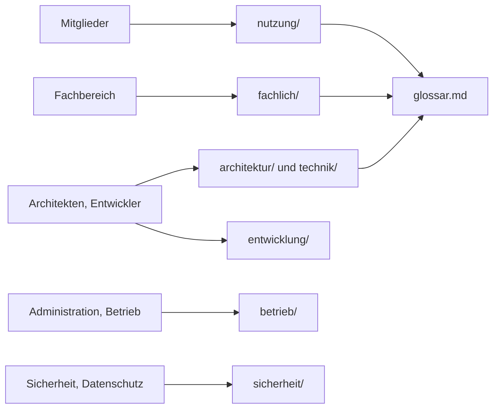

# Dokumentationskonzept: Wie die Produktdokumentation von W.A.I.S. aufgebaut ist

| | |
|---|---|
| Zweck | Begründet Struktur und Inhalt der Produktdokumentation aus einer Recherche und legt fest, wie sie aktuell bleibt. |
| Zielgruppe | Wer die Dokumentation pflegt oder bewertet: Produktverantwortliche, Entwickler, Datenschutz |
| Dokumentart | Erklärung |
| Stand | 19.11.2026, geprüft gegen Commit 497e3ce |
| Quellen | Recherche im Internet (Quellenliste unten), ECC-Skill `docs-governance`, REA, Bestand in `docs/` |

## Ergebnis in Kürze

Eine Produktdokumentation besteht nicht aus einem großen Text, sondern aus mehreren Dokumentarten für verschiedene Leser. Die Recherche liefert dafür drei Ordnungsrahmen: Diátaxis ordnet nach dem Bedarf der Leser (lernen, tun, nachschlagen, verstehen), arc42 mit den C4-Diagrammen beschreibt die Architektur, und Normen und Gesetze (ISO/IEC/IEEE 26514, DSGVO, KI-Verordnung) bestimmen, was für Anwender und für Datenschutz mindestens dazugehört.

W.A.I.S. hatte bisher viel Wissen, aber verteilt: ein 1800 Zeilen langes README, ein sehr dichter Namensvertrag in `CLAUDE.md` und 25 Planpapiere, Runbooks und Berichte in `docs/`. Es fehlte die geordnete Sicht pro Leser. Die neue Produktdokumentation unter `docs/produktdokumentation/` schließt diese Lücke und verweist auf den Bestand, statt ihn zu kopieren.

## Recherche: Was gehört in eine Produktdokumentation?

| Rahmen | Kernidee | Was W.A.I.S. übernimmt |
|---|---|---|
| [Diátaxis](https://diataxis.fr/) | Vier Dokumentarten nach dem Bedarf der Leser: Tutorial (lernen, praktisch), Anleitung (ein Ziel erreichen), Referenz (nachschlagen, sachlich beschreiben), Erklärung (verstehen). Zwei Achsen: Lernen oder Arbeiten, Handeln oder Wissen. Die Reihenfolge ist nicht fest. Ein Denkmodell, keine starre Vorlage ([Canonical zur Einführung](https://canonical.com/blog/diataxis-a-new-foundation-for-canonical-documentation)). | Jedes Dokument trägt im Kopf seine Dokumentart. Eine Seite mischt die Arten nicht. |
| [arc42](https://arc42.org/overview) | Zwölf Abschnitte: 1 Einführung und Ziele, 2 Randbedingungen, 3 Kontext und Abgrenzung, 4 Lösungsstrategie, 5 Bausteinsicht, 6 Laufzeitsicht, 7 Verteilungssicht, 8 Querschnittskonzepte, 9 Architekturentscheidungen, 10 Qualitätsanforderungen, 11 Risiken und technische Schulden, 12 Glossar. Anpassbar, die Bausteinsicht ist meist der längste Teil. | `architektur/arc42.md` folgt den zwölf Abschnitten. |
| [C4-Modell](https://c4model.com/) | Hierarchische Diagramme: Systemkontext, Container, Komponenten, Code. Ergänzend Systemlandschaft, dynamische Sicht und Deployment. Unabhängig von Notation und Werkzeug. Sekundärquellen warnen: Ein veraltetes Diagramm ist schlimmer als keins. | `architektur/c4-diagramme.md` mit Ebene 1 bis 3 und Mermaid als Diagramm im Text, damit Diagramme im Repo mitgeprüft und mitgepflegt werden. |
| [ISO/IEC/IEEE 26514:2022](https://standards.ieee.org/ieee/26514/7467) | Norm für Aufbau, Inhalt und Form von Information für Anwender von Software. Das Inhaltsverzeichnis nennt Aufbau von Anleitungen, von Referenzinformation, von Befehlen sowie Fehlerbehebung und Fehlermeldungen. Der volle Normtext ist kostenpflichtig und wurde nicht gelesen. | Benutzer- und Administrationshandbuch enthalten Anleitung, Referenz und Fehlerbehebung getrennt. |
| DSGVO Art. 30, 32, 35 ([Handreichung LfD Niedersachsen](https://www.lfd.niedersachsen.de/download/120050), [TOM-Checkliste LfD Sachsen-Anhalt](https://datenschutz.sachsen-anhalt.de/fileadmin/Bibliothek/Landesaemter/LfD/Informationen/Internationales/Datenschutz-Grundverordnung/Checkliste_TOM/Checkliste_toM_nach_DS-GVO.pdf)) | Verzeichnis der Verarbeitungstätigkeiten, technische und organisatorische Maßnahmen, Datenschutz-Folgenabschätzung. Die Erleichterung für kleine Unternehmen entfällt bei besonderen Datenkategorien nach Art. 9, zu denen biometrische Daten zur eindeutigen Identifizierung gehören. | `sicherheit/sicherheit-und-datenschutz.md` liefert die technischen Angaben für diese Dokumente, die rechtliche Einordnung bleibt beim Datenschutz. |
| KI-Verordnung Art. 50 und Art. 4 ([Leitfaden zu Art. 50](https://artificialintelligenceact.eu/transparency-rules-article-50/)) | Pflicht zur Kennzeichnung, dass Menschen mit einem KI-System sprechen, spätestens bei der ersten Interaktion. Daneben die Pflicht zur KI-Kompetenz (Art. 4). Zu Terminen und Rollenverteilung (Anbieter oder Betreiber) widersprechen sich die gefundenen Sekundärquellen. | Als offener Punkt im Sicherheitsdokument geführt. Der amtliche Text und die Leitlinien der Kommission sind vor jeder Aussage zu prüfen. |

Grenze der Recherche: Die Webrecherche lief mit der allgemeinen Websuche und dem Abruf der Primärseiten (arc42, Diátaxis, C4). Die ECC-Recherche-Skills mit Firecrawl oder Exa waren in dieser Sitzung nicht verbunden (Firecrawl verlangt eine Anmeldung). Die Rechtsaussagen stammen aus Sekundärquellen und sind keine Rechtsberatung.

## ECC und REA im Konzept

| Werkzeug | Beitrag |
|---|---|
| ECC `docs-governance` | Rollenvertrag für Dokumente: Logische Rollen besitzen Fakten (Verfassung, Karte, Status, Historie, Entscheidungen, Vertrag, Tests), Dateinamen sind nur Voreinstellungen. Dokumentation ist Beleg und Navigation, nie die Wahrheit über Code, Tests und Aufgabenverwaltung. Ein Fakt hat einen kanonischen Besitzer, andere verlinken. Dazu eine deterministische, nur lesende Prüfung (das Skript `audit-docs.py` im Skill-Ordner, nicht im Repo) für Verweise, Entscheidungsregister und verwaiste Dokumente. |
| REA | Belegt am ausgelieferten Artefakt, was der Quellcode nicht zeigt (Schutzschalter der Programmdatei, tatsächlicher Paketinhalt). Ergebnis in `technik/desktop-auslieferung-rea.md`. Für den Quellcode im Repo setzt die REA-Anleitung selbst normale Lesewerkzeuge vor. |

## Soll-Inhalt und Ist-Abdeckung

Aus den Rahmen folgt der Soll-Inhalt einer Produktdokumentation. Die Spalte "Dokument" zeigt, wo er für W.A.I.S. steht.

| Dokumentart (Diátaxis) | Leser | Soll-Inhalt | Dokument |
|---|---|---|---|
| Erklärung | Alle | Zweck, Zielgruppen, Leistungsumfang, Abgrenzung, Stand | `fachlich/produktuebersicht.md` |
| Referenz | Fachbereich, Test, Abnahme | Funktionskatalog mit stabilen IDs | `fachlich/funktionskatalog.md` |
| Referenz, Erklärung | Alle, Sicherheit | Rollen, Rechte, Freigabestufen | `fachlich/rollen-und-rechte.md` |
| Erklärung | Entwickler, Architekten | arc42 und C4 | `architektur/arc42.md`, `architektur/c4-diagramme.md` |
| Referenz | Architekten, Entwickler | Entscheidungsregister | `architektur/entscheidungen.md` |
| Referenz | Entwickler, Integratoren | Schnittstellen: Routen, Nachrichten, Werkzeuge, Kanäle | `technik/schnittstellen.md` |
| Erklärung, Referenz | Entwickler | Aufbau der Komponenten, Datenmodell | `technik/voice-core.md`, `technik/oberflaeche.md`, `technik/host-und-desktop.md`, `technik/datenmodell.md` |
| Referenz | Betrieb, Entwickler | Umgebungsvariablen und Schalter | `technik/konfiguration.md`, `technik/konfiguration-betrieb.md` |
| Referenz | Sicherheit, Release | Befunde am ausgelieferten Artefakt | `technik/desktop-auslieferung-rea.md` |
| Anleitung, Lernpfad | Mitglieder | Erste Schritte, Alltag, Fehlerbehebung | `nutzung/benutzerhandbuch.md` |
| Anleitung | Administration | Nutzer, Geräte, Modelle, Schalter | `betrieb/administrationshandbuch.md` |
| Referenz, Anleitung | Betrieb | Topologie, Dienste, Störungen, Rückwege | `betrieb/betriebshandbuch.md` |
| Erklärung, Anleitung | Release, Betrieb | Weg von der Änderung zur Produktion | `betrieb/release-und-ausrollen.md` |
| Erklärung, Referenz | Datenschutz, Sicherheit | Sicherheitsmodell, Daten, Fristen, Zulieferung für VVT, TOM, DSFA | `sicherheit/sicherheit-und-datenschutz.md` |
| Anleitung | Entwickler | Einrichtung, Konventionen, Arbeitsablauf | `entwicklung/entwicklerhandbuch.md` |
| Referenz | Entwickler, Test | Teststrategie, Testumfang, Prüfungen | `entwicklung/qualitaet-und-tests.md` |
| Referenz | Alle | Begriffe | `glossar.md` |
| Historie | Alle | Änderungen je Version | `CHANGELOG.md` im Wurzelordner (unverändert) |

## Aufbau: Wer liest was



Der Einstieg für alle ist `README.md` in diesem Ordner mit der Dokumentenlandkarte.

## Der Bestand in docs/ und seine Rolle

Die 25 Dateien in `docs/` (Stand 19.11.2026) bleiben unverändert. Sie sind Entscheidungsgrundlagen, Pläne und Betriebsunterlagen. Die neue Produktdokumentation beschreibt den geprüften Ist-Stand und verlinkt sie.

| Art | Dateien | Umgang |
|---|---|---|
| Planpapiere und Konzepte (Stand je Papier, teils überholt oder nur Plan) | `ausrollen-neue-nutzer.md`, `entwicklung-im-betrieb.md`, `entwicklung-im-betrieb-arbeitsliste.md`, `folgepaket-1.md`, `hausmodelle-und-kikollege.md`, `komfort-paket.md`, `office-und-versand.md`, `persoenliche-zugaenge.md`, `testlabor-wamo.md`, `remote-desktop.md`, `selbstueberarbeitung.md` | Verlinken. Der Kopf jedes Papiers nennt seinen Stand. `selbstueberarbeitung.md` beschreibt laut eigenem Kopf ein Konzept, nichts davon ist gebaut. |
| Recherchen und Entscheidungsgrundlagen | `gespraech-optimierung.md`, `sprache-elevenlabs-soniox.md`, `stimme-recherche-2026-11-18.md` | Verlinken, Zahlen daraus nur mit Datum übernehmen. |
| Anleitungen und Runbooks | `jira-benutzer-einrichten.md`, `runner-einrichten.md`, `labor-platz-einrichten.md`, `labor-runbook.md`, `labor-morgencheckliste.md` | Verlinken aus Administrations- und Betriebshandbuch. |
| Vertrag | `labor-dienst-vertrag.md` | Kanonischer Besitzer der Schnittstelle des Labor-Dienstes. |
| Berichte und Messungen | `labor-messrunde-1.md`, `labor-lasttest.md`, `labor-restplan.md` | Verlinken als Belege. |
| Datenschutz | `labor-datenschutz-entwurf.md` | Verlinken aus dem Sicherheitsdokument. |
| Material | `labor-kartensatz.html` | Unverändert. |

Die Rollen der Wurzeldateien nach dem ECC-Rollenvertrag:

| Rolle | Besitzer in diesem Repo |
|---|---|
| Verfassung (dauerhafte Regeln) | `CLAUDE.md` |
| Karte (Struktur, Einstiege) | `docs/produktdokumentation/README.md` |
| Status | Abschnitt "Stand" in `README.md` |
| Historie | `CHANGELOG.md` |
| Entscheidungen | `docs/produktdokumentation/architektur/entscheidungen.md` und die Planpapiere |
| Begriffe | `docs/produktdokumentation/glossar.md` |
| Verträge | `docs/produktdokumentation/technik/schnittstellen.md`, `docs/labor-dienst-vertrag.md` |
| Tests | `docs/produktdokumentation/entwicklung/qualitaet-und-tests.md` und die Testdateien selbst |

## Pflegeregeln

1. **Code gilt vor Prosa.** Widersprechen sich Dokument und Code, gilt der Code, und das Dokument wird korrigiert. Jedes Dokument nennt seine Quellen und den geprüften Commit im Kopfblock.
2. **Ein Fakt, ein Besitzer.** Wer einen Fakt braucht, verlinkt auf den Besitzer, statt ihn zu kopieren. Zahlen mit Datum wandern nicht in mehrere Dokumente.
3. **Änderung und Dokument gehören in denselben Pull Request.** Die Tabelle zeigt, wo nachzuziehen ist.
4. **Vor jedem Versionssprung** gilt die Prüfliste unten.
5. **Keine Geheimnisse, keine Fremdverweise.** Keine Zugangsdaten in Dokumenten. Keine Verweise auf andere Systeme oder Vorgängerprojekte (siehe `CLAUDE.md`).
6. **Text- und Formregeln.** Deutsch mit echten Umlauten, keine Gedankenstriche im Fließtext, Anzeigename "W.A.I.S.".

| Änderung am Produkt | Nachzuziehen in |
|---|---|
| neues Werkzeug oder neue Funktion | `fachlich/funktionskatalog.md`, `fachlich/rollen-und-rechte.md`, bei Bedienung `nutzung/benutzerhandbuch.md` |
| neue Route oder Nachricht | `technik/schnittstellen.md` |
| neue Umgebungsvariable oder neuer Schalter | `technik/konfiguration.md`, bei Wirkung auf den Betrieb `betrieb/administrationshandbuch.md` |
| neue Migration | `technik/datenmodell.md` |
| neuer Dienst, Port oder Host | `betrieb/betriebshandbuch.md`, `architektur/c4-diagramme.md` |
| Architekturentscheidung | `architektur/entscheidungen.md`, bei Strukturwirkung `architektur/arc42.md` |
| neue Datenart oder neuer Dienstleister | `sicherheit/sicherheit-und-datenschutz.md` |
| neuer Versionssprung der Desktop-App | `technik/desktop-auslieferung-rea.md` (Befunde und Hashes erneuern), `CHANGELOG.md` |

### Prüfliste vor einem Versionssprung

1. Versionsstufe, `CHANGELOG.md` und Versionsdateien kommen aus `scripts/wamo_version.py` (Stufe aus Conventional Commits, getestet in `scripts/test_wamo_version.py`). Nach dem Lauf stimmen `desktop/package.json` und `ui/package.json` mit dem Changelog überein.
2. Funktionskatalog und Rechtematrix passen zu den neuen Funktionen.
3. Schnittstellen- und Konfigurationsreferenz enthalten alles Neue.
4. REA-Befunde am gebauten Installer erneuert (zwei Befehle, siehe `technik/desktop-auslieferung-rea.md`).
5. Kopfblöcke der geänderten Dokumente zeigen den neuen geprüften Commit.
6. Formprüfung der Dokumente bestanden (siehe unten).

### Formprüfung (von Hand oder in der CI)

```bash
# Gedankenstriche im Fließtext (Unicode-Zeichen U+2013 und U+2014)
grep -rnP "[\x{2013}\x{2014}]" docs/produktdokumentation
# verbotene Fremdverweise (die eckigen Klammern verhindern einen Treffer im eigenen Muster)
grep -rIn -i -E "n[i]eeeki|j[a]rvis|prompt[c]ontrol|d[a]micon|9e1b8[6]b" docs/produktdokumentation
# Ersatzschreibweisen für Umlaute (Stichprobe, Treffer prüfen)
grep -rnE "\b(f[u]er|[u]eber|k[o]ennen|m[o]eglich|L[o]eschen|Pr[u]efung)\b" docs/produktdokumentation
# Verweise und Entscheidungsregister (ECC, nur lesend)
python <Skill-Ordner>/docs-governance/scripts/audit-docs.py --root . --scope artifacts
```

Eine feste Aufnahme dieser Prüfung in die CI ist ein Vorschlag und nicht umgesetzt.

## Qualitätskriterien je Dokument

- Zielgruppe, Zweck und Dokumentart stehen im Kopf, eine Dokumentart je Seite.
- Jede Aussage ist im Repo belegt oder als "laut README, Stand" beziehungsweise "nicht belegt" gekennzeichnet.
- Zahlen tragen ein Datum oder eine Quelle.
- Diagramme haben eine Aussage und höchstens neun Knoten je Ebene.
- Anleitungen führen in nummerierten Schritten zu einem prüfbaren Ergebnis.
- Referenzen sind Tabellen mit stabilen Namen und IDs.

## Lücken und Empfehlungen

| Nr. | Lücke | Empfehlung |
|---|---|---|
| 1 | Die rechtlichen Dokumente (Verzeichnis der Verarbeitungstätigkeiten, Maßnahmenkonzept, Folgenabschätzung, Transparenz nach KI-Verordnung) sind kein Teil des Repos. | Mit der oder dem Datenschutzbeauftragten klären. Das Sicherheitsdokument liefert die technischen Angaben. Besonders der Stimmabdruck (biometrisch) braucht eine rechtliche Einordnung. |
| 2 | Es gibt nur einen Lernpfad im Benutzerhandbuch. Ein eigenes Tutorial für neue Mitglieder fehlt. | Nach Rückmeldungen aus dem Testlabor ableiten. |
| 3 | Die Formprüfung läuft nicht automatisch. | In die CI aufnehmen (Vorschlag oben). |
| 4 | Das README hat über 1800 Zeilen und mischt Status, Anleitung und Referenz. | Schrittweise in die neuen Dokumente überführen und das README auf Einstieg und Status kürzen. Nicht umgesetzt, weil Tests und Verweise auf README-Abschnitte zuerst geprüft werden müssten. |
| 5 | Es gibt kein Entscheidungsregister mit einzelnen Dateien (ADR-Verzeichnis). | `architektur/entscheidungen.md` ist ein Register in einer Datei. Bei wachsender Zahl in einzelne Dateien teilen. |

## Weiterführend

- [Einstieg und Dokumentenlandkarte](README.md)
- [Glossar](glossar.md)
- [Architektur (arc42)](architektur/arc42.md)
- [Sicherheit und Datenschutz](sicherheit/sicherheit-und-datenschutz.md)
