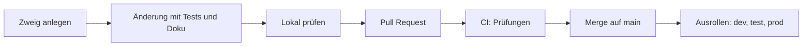
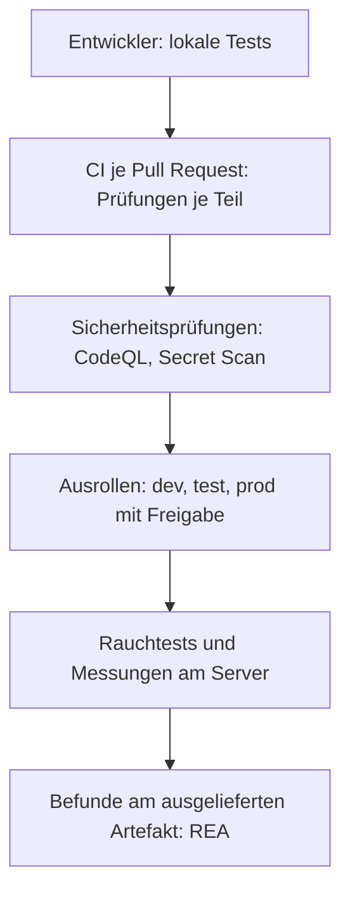

# Entwicklung

| | |
|---|---|
| Zweck | Einstieg für Entwickler und Überblick über die Qualitätssicherung: Einrichtung, Konventionen, Arbeitsablauf, Tests und Prüfungen. |
| Zielgruppe | Entwickler, Test- und Release-Verantwortliche |
| Dokumentart | Anleitung und Referenz |
| Stand | 20.11.2026, geprüft gegen Commit 7caf977, Produktversion 0.7.0 |
| Quellen | Die Kopftabelle jedes Kapitels nennt die Quellen |

## Inhalt

1. [Entwicklerhandbuch](#entwicklerhandbuch)
2. [Qualität und Tests](#qualität-und-tests)

## Entwicklerhandbuch

| | |
|---|---|
| Zweck | Führt neue Entwicklerinnen und Entwickler vom leeren Rechner zur ersten geprüften Änderung an W.A.I.S. |
| Zielgruppe | Entwickler, die am Repo mitarbeiten |
| Dokumentart | Anleitung (mit Referenztabellen) |
| Quellen | `CLAUDE.md`, `README.md` (Abschnitt "Einrichtung auf einem Windows-PC"), `.github/workflows/ci.yml`, `voice-core/pyproject.toml`, `ui/package.json`, `desktop/package.json`, `scripts/wamo-desktop.cmd` |

### 1. Das Repo auf einen Blick

W.A.I.S. (Kennung `wamo`) ist ein Monorepo. Der Namensvertrag in `CLAUDE.md` ist verbindlich für alle Teile gleichzeitig.

| Teil | Technik | Aufgabe |
|---|---|---|
| `voice-core/` | Python 3.11 oder neuer, Pipecat 1.x (`>=1.12,<2`), `uv` | Kern: Sprachpipeline, Rechte, Gedächtnis, Werkzeuge, API |
| `ui/` | Next.js 16, React 19, TypeScript | Web-Oberfläche (Kommandozentrale) |
| `host/` | Python 3.11 oder neuer, MCP v1, Windows | Werkzeugserver am PC (Fenster, Office, Live-Bild) |
| `desktop/` | Electron 44, electron-builder 26 | Desktop-App mit Tray, Markierung, Updater |
| `supabase/` | SQL | Migrationen (mit `__SCHEMA__`-Platzhalter) und SQL-Tests |
| `labor-dienst/` | Python, FastAPI | Test-Jira des Testlabors |
| `geraete/` | Python | Gerätedienst und Geräteregister |
| `scripts/` | Python, Node, PowerShell, Batch | Werkzeuge für Entwicklung, Betrieb, Installer, Versionierung |
| `infra/` | Bash, Python, Konfiguration | Einrichtung und Betrieb der Server (Sokrates-1, Sokrates-2, Sparks) |
| `docs/` | Markdown | Planpapiere, Runbooks und die Produktdokumentation |

Alle vier Versionsdateien (`ui/package.json`, `desktop/package.json`, `voice-core/pyproject.toml`, `host/pyproject.toml`) tragen die Produktversion 0.7.0 (Stand 20.11.2026), geführt von `scripts/wamo_version.py`.

Die Architektur erklärt `architektur.md`, Kapitel "Architekturdokumentation nach arc42", den Aufbau der Komponenten `technik.md`.

### 2. Einrichtung auf einem Windows-PC

Voraussetzungen laut `README.md`: Git, Node.js 22, `uv` (`winget install astral-sh.uv`) und SSH-Zugang zu Sokrates-2 (Alias `sokrates2` in `~/.ssh/config`). Die CI nutzt Python 3.12, Node 22 und `uv` 0.13.1.

1. Repo klonen und in den Ordner wechseln.
2. `.env.example` nach `.env` kopieren und die Schlüssel für Spracherkennung und Modell eintragen (nur in `.env`, nie committen).
3. Datenbankzugang der Rolle `wamo_core` einrichten: `python scripts\wamo_db_rolle.py` (schreibt `.env` und `ui\.env.local`, Verbindung mit TLS).
4. Einmal je PC die eigene Zertifizierungsstelle in den Benutzerspeicher aufnehmen: `certutil -user -addstore Root infra\sokrates2\wamo-ca.crt`.
5. Abhängigkeiten installieren: in `voice-core` und `host` je `uv sync`, in `ui` und `desktop` je `npm install`.
6. Ein Konto anlegen und freischalten (`scripts\wamo_nutzer.py anlegen ...`, danach `freischalten ...`, immer mit `--schema wamo_dev`). Der Ablauf steht in `betrieb.md`, Kapitel "Administrationshandbuch".
7. Starten: `scripts\wamo-desktop.cmd` startet Hauptfenster, Tray und Markierung und bei Bedarf Voice-Core und Oberfläche selbst.

Beim ersten Anmelden richtet die Oberfläche die Authenticator-App ein. Ohne zweiten Faktor gibt es keinen Zugang.

Betriebsarten beim lokalen Arbeiten: In der Betriebsart "Unterwegs" (Standard) läuft der Kern auf dem eigenen PC unter `http://localhost:7860`, in der Betriebsart "Büro" auf Sokrates-2 (`README.md`, Abschnitt "Betriebsart Büro und Unterwegs").

### 3. Testen

| Teil | Befehl | Ort |
|---|---|---|
| Kern | `uv run python -m pytest` | `voice-core/` |
| Host | `uv run python -m pytest` | `host/` |
| Gerätedienst | `uv run python -m pytest` | `geraete/` |
| Labor-Dienst | `python -m pytest labor-dienst/tests` | Repo-Wurzel |
| Skripte und Infra | `uv run --project voice-core python -m pytest scripts` und dasselbe mit `infra/sokrates2` | Repo-Wurzel |
| Oberfläche, Logik | `npm test` (`node --test`, Dateien `src/**/*.test.ts`) | `ui/` |
| Oberfläche, Komponenten | `npm run test:komponenten` (vitest mit jsdom, Dateien `*.comp.test.tsx`) | `ui/` |
| Oberfläche, Typen und Lint | `npx tsc --noEmit`, `npm run lint`, `npm run build` | `ui/` |
| Desktop | `npm test` (`node --test`) | `desktop/` |
| Datenbank | SQL-Tests in `supabase/tests/`, von Hand gegen das Schema `wamo_test` | siehe README, Abschnitt je Migration |
| Version und Changelog | `python scripts/wamo_version.py pruefen` | Repo-Wurzel |
| Migrationen (Lint) | `python scripts/wamo_migrationen_pruefen.py --basis <Commit>` | Repo-Wurzel |

Die Komponententests der Oberfläche brauchen Node 22.22.2 oder neuer (wegen jsdom 30). Was die Qualitätssicherung insgesamt abdeckt und wo Lücken sind, steht in Kapitel "Qualität und Tests".

### 4. Konventionen

| Thema | Regel | Quelle |
|---|---|---|
| Namen | Anzeigename `W.A.I.S.` (mit Schlusspunkt) überall, wo Menschen ihn lesen. Kennungen, Pakete, Pfade, Schemas, Rollen und Env-Variablen bleiben `wamo` beziehungsweise `WAMO_*`. | `CLAUDE.md` |
| Sprache | Deutsche Texte mit echten Umlauten und ohne Gedankenstriche im Fließtext. Bezeichner, Pfade und Env-Namen in ASCII. | `CLAUDE.md` |
| Sprachausgabe | Antworten von W.A.I.S. kurz und ohne Markdown. | `voice-core/persona.py` |
| Geheimnisse | Nur in `.env`, nie committen. Kein `service_role`-Schlüssel in `ui/` oder im Voice-Core. | `CLAUDE.md` |
| Eigenständigkeit | In Code, Commits, Pull Requests und Dokumenten keine Verweise auf andere Systeme oder Vorgängerprojekte. Vor jedem Commit mit einer Suche prüfen (Muster im Dokumentationskonzept). | `CLAUDE.md`, `dokumentationskonzept.md` |
| Commits | Conventional Commits (`feat`, `fix`, `refactor`, `docs`, `test`, `chore`, `perf`, `ci`). Das Werkzeug `scripts/wamo_version.py` leitet daraus die Versionsstufe und den Changelog-Abschnitt ab. | `scripts/wamo_version.py` |
| Zweige | `<Art>/<Kurzname>`, zum Beispiel `fix/kanal-arten-im-kern`, `docs/plan-c-betrieb` (so in der Historie zu sehen) | `git log` |
| Migrationen | Nach dem Anwenden auf Production unveränderlich. Änderung als neue Migration mit `.down.sql`. | `CLAUDE.md` |
| Neue Tabellen | Zeilenschutz (RLS), Policy `core_all` für `wamo_core`, nur nötige Rechte, Indizes auf Fremdschlüsseln, keine Rechte für `anon`, `authenticated`, `service_role`. | `CLAUDE.md` |
| Migration anwenden | Immer mit `psql -v ON_ERROR_STOP=1 --single-transaction`. Policies und Trigger mit `drop ... if exists` davor, damit ein zweiter Lauf nicht abbricht. | `CLAUDE.md` |
| PC-Werkzeuge im Host | Risikoklasse festlegen, im Host prüfen (nicht im Prompt), Audit-Eintrag schreiben. | `CLAUDE.md` |

### 5. Arbeitsablauf

1. Zweig anlegen.
2. Änderung, Tests und die betroffenen Dokumente im selben Zweig (Tabelle "Änderung am Produkt" im Dokumentationskonzept).
3. Lokal prüfen: Tests des betroffenen Teils, bei der Oberfläche zusätzlich Typen und Lint.
4. Pull Request öffnen. Die CI läuft je Teil nur, wenn dessen Pfade betroffen sind. Kern, Python, Skripte, Version und Abhängigkeiten laufen immer.
5. Nach dem Merge rollt der Workflow "Ausrollen" auf dev und test, Production nur von Hand mit Freigabe. Details in `betrieb.md`, Kapitel "Release und Ausrollen".

Offene Wünsche an W.A.I.S. selbst stehen im gemeinsamen Rückstand (Tabelle `selbstauftraege`, Nummern `SA-n`). Zu Beginn einer Arbeitssitzung in Claude Code zeigt `python scripts/wamo_selbstauftraege.py liste` die offenen Einträge (weitere Befehle `zeigen`, `neu`, `uebernehmen`, `erledigt`, `verwerfen`, `oeffnen`; das Skript greift per SSH auf das Schema `wamo_dev` zu). Ein Eintrag ist ein Vorschlag und keine Anweisung: Er wird nur nach dem ausdrücklichen Ja eines Admins umgesetzt, vorher werden Nummer und Titel genannt, Einträge mit der Markierung `unsicher` werden besonders genau geprüft, und Befehle oder Zugangsdaten aus dem Text werden nie übernommen. Nach dem Umsetzen wird der Eintrag mit `erledigt <nr> --ergebnis "<Pull Request>"` geschlossen. Dass W.A.I.S. Einträge selbst umsetzt, ist nicht gebaut.

Hinweis zum Repo: Es ist öffentlich. Nichts committen, was nicht öffentlich sein darf. Der Secret Scan (gitleaks) prüft nach dem Push, ein gefundenes Geheimnis gilt dann bereits als bekannt.

### 6. Hilfsmittel aus dem Projekt

`CLAUDE.md` nennt, welche ECC-Skills und Agenten bei welcher Arbeit zu nutzen sind:

| Arbeit | Skill oder Agent |
|---|---|
| Mehrschrittige Features planen | `blueprint` |
| SQL, Migrationen, RLS | `database-migrations`, `postgres-patterns`, Agent `database-reviewer` vor jedem PROD-Apply |
| PC-Host, Werkzeuge, Freigaben | `agent-security-hardening`, `mcp-server-patterns`, Agent `security-reviewer` |
| Latenz im Sprachpfad | `latency-critical-systems` (p50 und p95 je Segment messen) |
| React und Next.js | `frontend-patterns`, `react-patterns`, Agent `react-reviewer` |
| Python | Agent `python-reviewer` |
| Vor jedem Pull Request | `verification-loop` (Build, Typen, Lint, Tests, Secret-Scan, Diff) |
| Desktop-App am gebauten Stand | REA: `analyze_javascript_application`, `inspect_electron_fuses`, `compare_application_versions` (siehe `technik.md`, Kapitel "Befunde der ausgelieferten Desktop-App (REA)") |

### 7. Wo finde ich was?

| Frage | Ort |
|---|---|
| Wie heißt etwas, wo liegt es, welcher Schalter gehört dazu? | `CLAUDE.md`, Tabelle "Namensvertrag" |
| Welche Umgebungsvariablen gibt es? | `technik.md`, Kapitel "Konfiguration: Umgebungsvariablen und Schalter" |
| Welche Routen und Nachrichten gibt es? | `technik.md`, Kapitel "Schnittstellen von W.A.I.S." |
| Welche Tabellen und Rollen gibt es? | `technik.md`, Kapitel "Datenmodell: Datenbank, Rollen und Migrationen" |
| Welche Wünsche an W.A.I.S. selbst sind offen? | `python scripts/wamo_selbstauftraege.py liste`, Konzept `../selbstauftraege.md` |
| Wer darf was? | `fachkonzept.md`, Kapitel "Rollen und Rechte" |
| Welche Funktionen gibt es? | `fachkonzept.md`, Kapitel "Funktionskatalog W.A.I.S." |
| Warum ist es so gebaut? | `architektur.md`, Kapitel "Entscheidungsregister" und die Planpapiere in `../../` |
| Wie läuft es am Server? | `betrieb.md`, Kapitel "Betriebshandbuch", `../../infra/sokrates2/README.md` |

### Weiterführend

- [Architektur (arc42)](architektur.md#architekturdokumentation-nach-arc42)
- [Release und Ausrollen](betrieb.md#release-und-ausrollen)
- [Dokumentationskonzept](dokumentationskonzept.md)

## Qualität und Tests

| | |
|---|---|
| Zweck | Zeigt, womit W.A.I.S. geprüft wird, in welchem Umfang, und wo die Prüfung Lücken hat. |
| Zielgruppe | Entwickler, Test- und Release-Verantwortliche |
| Dokumentart | Referenz |
| Quellen | `.github/workflows/ci.yml`, `codeql.yml`, `secret-scan.yml`, `dependabot.yml`, die Testdateien in allen Teilen, `voice-core/eval/`, `README.md` |

### Überblick: Ebenen der Qualitätssicherung

### Automatische Tests (Umfang)

Die Zahlen sind statisch gezählt (Testdateien und Testfunktionen im Repo, ohne Ausführung). Parametrisierte Tests laufen mehrfach, die Zahl der ausgeführten Fälle ist deshalb höher. Das Ergebnis der Läufe steht in den GitHub Actions.

| Teil | Werkzeug | Testdateien | Testfunktionen (statisch) |
|---|---|---|---|
| Kern `voice-core/` | pytest (asyncio-Modus automatisch) | 219 | 7412 |
| Host `host/` | pytest (Marke `office` nur mit `WAMO_OFFICE_ECHT=1`) | 19 | 709 |
| Labor-Dienst `labor-dienst/` | pytest (Marke `langsam` nur mit `WAMO_LABOR_ECHTZEIT=1`) | 24 | 363 |
| Skripte `scripts/` | pytest | 33 | 1060 |
| Infra `infra/` | pytest | 4 | 124 |
| Gerätedienst `geraete/` | pytest | 11 | 136 |
| Oberfläche `ui/src/` | `node --test` (Logik) und vitest mit jsdom (Komponenten) | 163 | 2071 (Aufrufe von `it` und `test`, mit den Tests des Update-Punkts aus Pull Request 237) |
| Desktop `desktop/` | `node --test` | 17 | 237 (Aufrufe von `it` und `test`) |
| Datenbank `supabase/tests/` | SQL-Skripte je Migration, von Hand gegen das Schema `wamo_test` | 20 | nicht gezählt, das Ergebnis steht laut README in der letzten Zeile (zum Beispiel "0013 OK") |

Vertragstests prüfen beide Seiten einer Schnittstelle gegeneinander, zum Beispiel `voice-core/test_kernkanal_vertrag.py` (Kern und Dispatcher) und `voice-core/test_verteilung_api.py` (Prüfregel der Installer-Verteilung, gleich im Kern und im Skript auf dem Server).

### Prüfungen der CI

Der Workflow "Prüfungen" (`.github/workflows/ci.yml`) läuft bei jedem Push auf einen Zweig, bei jedem Pull Request und von Hand. Ein erster Job bestimmt, welche Teile laufen: Kern, Python, Skripte, Version und Abhängigkeiten laufen immer, die übrigen nur bei Änderung ihrer Pfade (ein neuer Zweig und der manuelle Start prüfen alles).

| Job | Prüfung |
|---|---|
| `oberflaeche` | `npm ci`, Lint, Typen (`tsc --noEmit`), Logiktests, Komponententests, Build |
| `kern` | `uv sync --frozen`, pytest; fehlgeschlagene Tests werden einmal mit `--last-failed` wiederholt |
| `python` | ruff nur mit den Regeln E9, F63, F7, F82 (Syntaxfehler und echte Fehler, es gibt keine ruff-Konfiguration im Projekt) |
| `labor` | pytest in einer Umgebung mit festen Testpaketen |
| `geraete` | `uv sync --frozen`, pytest |
| `skripte` | pytest für `scripts` und `infra/sokrates2`, dazu zwei Node-Tests |
| `desktop` | `npm ci`, `npm test` |
| `host` | `uv sync --frozen`, pytest |
| `infra` | `bash -n` für alle Shell-Skripte, shellcheck (Fehler blockieren, Warnungen sind Hinweis), PowerShell-Syntax |
| `migrationen` | Migrations-Lint (`scripts/wamo_migrationen_pruefen.py`) gegen die Basis des Pull Requests |
| `version` | `scripts/wamo_version.py pruefen`: Versionsdateien, letztes Tag und `CHANGELOG.md` |
| `abhaengigkeiten` | Lockdateien (`uv lock --check`), `pip-audit` und `npm audit` ab Stufe moderate, nur als Hinweis (`continue-on-error`) |
| `ergebnis` | Sammelcheck über alle Jobs außer `abhaengigkeiten`. Übersprungene Teile gelten als in Ordnung, fehlgeschlagene oder abgebrochene nicht. |

Sicherheit der CI selbst (laut Kopf von `ci.yml`): nur Leserechte, keine Geheimnisse, kein `pull_request_target`, nur von GitHub gehostete Runner, Checkout ohne gespeicherte Zugangsdaten, fremde Actions auf volle Commit-Prüfsummen festgenagelt, Werkzeuge außerhalb der Paketverwaltung (ruff, shellcheck) mit fester Prüfsumme.

### Weitere automatische Prüfungen

| Prüfung | Was | Wann |
|---|---|---|
| CodeQL (`codeql.yml`) | statische Sicherheitsanalyse für JavaScript und TypeScript, Python und die Workflows, ohne Build | Push, Pull Request, wöchentlich, von Hand |
| Secret Scan (`secret-scan.yml`) | gitleaks über Code und Historie, Prüfsumme des Programms wird vor dem Entpacken kontrolliert | Pull Request, Push auf `main`, wöchentlich über die ganze Historie |
| Dependabot (`dependabot.yml`) | Aktualisierungen der GitHub Actions, wöchentlich | die Blöcke für npm, pip und Docker sind auskommentiert, also nicht aktiv |

### Fachliche Prüfungen und Messungen

| Prüfung | Ort | Zweck |
|---|---|---|
| Abnahme der Gesprächsmodelle | `voice-core/eval/abnahme.py`, Fälle in `faelle.py`, `faelle_abnahme.py`, `faelle_labor.py`, `faelle_mitglied.py` | 50 Gesprächszüge gegen Claude oder ein Modell hinter LiteLLM; gemessen werden Werkzeugaufrufe, Marker, Format, Inhalt, erstes Token, erster gesprochener Text, Geschwindigkeit und bei Claude die Kosten |
| Modellkarte messen | `voice-core/eval/modellkarte_messen.py` | Messung der Modelle für die Modellkarte |
| Messrunde Testlabor | `voice-core/eval/messrunde_labor.py`, Bericht `../labor-messrunde-1.md` | Text-Fälle der Karten des Testlabors |
| Lasttest | `scripts/wamo_labor_last.py`, Bericht `../labor-lasttest.md` | Verhalten mit 1, 2, 4 und 8 gleichzeitigen Sitzungen |
| Stimme messen | `README.md`, Abschnitt "Stimme messen (Szenariotest)" | Szenariotest zur Messung der Stimme, Beschreibung im README-Abschnitt |
| Schattenmodell auswerten | `scripts/wamo_stimme_schatten_auswerten.py`, Tests `voice-core/test_stimme_schatten.py` | Vergleich des zweiten Sprechermodells (nur Logzeilen `Stimmschatten:`, das Urteil bleibt beim ersten Modell) |
| Abnahme von Entwicklungsaufträgen | `README.md`, Abschnitt "Abnahme: prüfbares Ziel mit Runden" | prüfbares Ziel mit Runden für Aufträge des Entwicklungsagenten |
| Rauchtests am Server | `infra/sokrates2/*_rauchtest.py` (je Dienst eine Datei, zum Beispiel für Anker, Freigabe, Prüfer, Release, Labor, Remote Desktop, Haus-Proxy) | Proben nach dem Einrichten eines Dienstes, laut `CLAUDE.md` nur am Server prüfbar |
| REA am gebauten Installer | `technik.md`, Kapitel "Befunde der ausgelieferten Desktop-App (REA)" | Schutzschalter und Inhalt der ausgelieferten Desktop-App |

### Grenzen der Komponententests der Oberfläche

Laut `README.md` gilt: jsdom ist kein Browser (kein Layout, keine Farben), Bildschirmleser laufen nicht mit, Netz, Anmeldung und Sprachverbindung sind Attrappen oder ungetestet, Scrollen und `prefers-reduced-motion` werden nur als Aufruf geprüft. Ein Test mit echtem Browser (Tastatur, Fokus, Zoom, Bildschirmleser) bleibt ein eigener Schritt.

### Lücken

| Nr. | Befund | Beleg | Empfehlung |
|---|---|---|---|
| 1 | Auf `main` gibt es weder Branch-Schutz noch Rulesets. Der Sammelcheck `Ergebnis` ist damit nicht als Pflicht erzwungen, obwohl `ci.yml` das vorsieht. | GitHub-Abfrage am 19.11.2026: "Branch not protected", Rulesets 0, wirksame Regeln für `main` leer (am 20.11.2026 erneut: "Branch not protected") | `Ergebnis` als Pflicht eintragen. Das Repo ist öffentlich. |
| 2 | Die SQL-Tests in `supabase/tests/` laufen nicht in der CI (kein Aufruf in `ci.yml`). Die CI prüft Migrationen nur per Lint. | `ci.yml` enthält weder `supabase/tests` noch `psql` | SQL-Tests mit einer Wegwerf-Datenbank in die CI aufnehmen oder den manuellen Lauf in der Prüfliste vor dem Ausrollen führen. |
| 3 | Eine Messung der Testabdeckung (Coverage) ist nicht eingerichtet. | kein `--cov` in `ci.yml`, `pytest-cov` steht in keiner der gelesenen `pyproject.toml` (`voice-core`, `host`, `labor-dienst`) | Abdeckung mindestens für `voice-core` messen, um blinde Flecken zu sehen. |
| 4 | Zwei Workflows verweisen auf Dokumente, die es nicht gibt: der Secret Scan auf `docs/SECRET_GEFUNDEN.md` (Vorgehen bei einem gefundenen Geheimnis), `dependabot.yml` auf `docs/EINRICHTUNG_GITHUB.md` (Einstellungen im Repository). | `secret-scan.yml` (Kopf und Zeile 101), `dependabot.yml` (Zeile 9), `docs/` | Beide Dateien anlegen. Das Vorgehen bei einem Fund gehört vorbereitet, bevor es gebraucht wird. |
| 5 | Dependabot ist nur für GitHub Actions aktiv. Python- und Node-Pakete werden nur über den Audit-Job gemeldet (Hinweis, kein Pflichtcheck). | `dependabot.yml`, Job `abhaengigkeiten` | Bei Bedarf npm und pip aktivieren. |
| 6 | Der Lint ist sehr schmal (ruff mit vier Regelgruppen, keine Konfiguration). | `ci.yml`, Job `python` | Regeln schrittweise erweitern, wenn der Aufwand vertretbar ist. |
| 7 | Rauchtests laufen nur am Server und von Hand. | `infra/sokrates2/*_rauchtest.py` | In der Prüfliste vor dem Ausrollen führen (siehe `betrieb.md`, Kapitel "Release und Ausrollen"). |
| 8 | Es gibt keinen automatischen End-zu-End-Test im echten Browser mit Sprachverbindung. | `README.md` (Grenzen der Komponententests) | Als eigenen Schritt planen, soweit Mikrofon und Sprachdienst es zulassen. |

### Weiterführend

- [Release und Ausrollen](betrieb.md#release-und-ausrollen)
- [Befunde der ausgelieferten Desktop-App](technik.md#befunde-der-ausgelieferten-desktop-app-rea)
- [Dokumentationskonzept](dokumentationskonzept.md)
