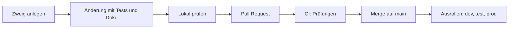

# Entwicklerhandbuch

| | |
|---|---|
| Zweck | Führt neue Entwicklerinnen und Entwickler vom leeren Rechner zur ersten geprüften Änderung an W.A.I.S. |
| Zielgruppe | Entwickler, die am Repo mitarbeiten |
| Dokumentart | Anleitung (mit Referenztabellen) |
| Stand | 19.11.2026, geprüft gegen Commit 497e3ce |
| Quellen | `CLAUDE.md`, `README.md` (Abschnitt "Einrichtung auf einem Windows-PC"), `.github/workflows/ci.yml`, `voice-core/pyproject.toml`, `ui/package.json`, `desktop/package.json`, `scripts/wamo-desktop.cmd` |

## 1. Das Repo auf einen Blick

W.A.I.S. (Kennung `wamo`) ist ein Monorepo. Der Namensvertrag in `CLAUDE.md` ist verbindlich für alle Teile gleichzeitig.

| Teil | Technik | Aufgabe |
|---|---|---|
| `voice-core/` | Python 3.11 oder neuer, Pipecat 1.x (`>=1.12,<2`), `uv` | Kern: Sprachpipeline, Rechte, Gedächtnis, Werkzeuge, API |
| `ui/` | Next.js 16, React 19, TypeScript | Web-Oberfläche (Kommandozentrale) |
| `host/` | Python 3.11 oder neuer, MCP v1, Windows | Werkzeugserver am PC (Fenster, Office, Live-Bild) |
| `desktop/` | Electron 44, electron-builder 26 | Desktop-App mit Tray, Markierung, Updater |
| `supabase/` | SQL | Migrationen (mit `__SCHEMA__`-Platzhalter) und SQL-Tests |
| `labor-dienst/` | Python, FastAPI | Test-Jira des Testlabors |
| `geraete/` | Python | Gerätedienst und Geräteregister |
| `scripts/` | Python, Node, PowerShell, Batch | Werkzeuge für Entwicklung, Betrieb, Installer, Versionierung |
| `infra/` | Bash, Python, Konfiguration | Einrichtung und Betrieb der Server (Sokrates-1, Sokrates-2, Sparks) |
| `docs/` | Markdown | Planpapiere, Runbooks und die Produktdokumentation |

Die Architektur erklärt `../architektur/arc42.md`, den Aufbau der Komponenten `../technik/`.

## 2. Einrichtung auf einem Windows-PC

Voraussetzungen laut `README.md`: Git, Node.js 22, `uv` (`winget install astral-sh.uv`) und SSH-Zugang zu Sokrates-2 (Alias `sokrates2` in `~/.ssh/config`). Die CI nutzt Python 3.12, Node 22 und `uv` 0.13.1.

1. Repo klonen und in den Ordner wechseln.
2. `.env.example` nach `.env` kopieren und die Schlüssel für Spracherkennung und Modell eintragen (nur in `.env`, nie committen).
3. Datenbankzugang der Rolle `wamo_core` einrichten: `python scripts\wamo_db_rolle.py` (schreibt `.env` und `ui\.env.local`, Verbindung mit TLS).
4. Einmal je PC die eigene Zertifizierungsstelle in den Benutzerspeicher aufnehmen: `certutil -user -addstore Root infra\sokrates2\wamo-ca.crt`.
5. Abhängigkeiten installieren: in `voice-core` und `host` je `uv sync`, in `ui` und `desktop` je `npm install`.
6. Ein Konto anlegen und freischalten (`scripts\wamo_nutzer.py anlegen ...`, danach `freischalten ...`, immer mit `--schema wamo_dev`). Der Ablauf steht in `../betrieb/administrationshandbuch.md`.
7. Starten: `scripts\wamo-desktop.cmd` startet Hauptfenster, Tray und Markierung und bei Bedarf Voice-Core und Oberfläche selbst.

Beim ersten Anmelden richtet die Oberfläche die Authenticator-App ein. Ohne zweiten Faktor gibt es keinen Zugang.

Betriebsarten beim lokalen Arbeiten: In der Betriebsart "Unterwegs" (Standard) läuft der Kern auf dem eigenen PC unter `http://localhost:7860`, in der Betriebsart "Büro" auf Sokrates-2 (`README.md`, Abschnitt "Betriebsart Büro und Unterwegs").

## 3. Testen

| Teil | Befehl | Ort |
|---|---|---|
| Kern | `uv run python -m pytest` | `voice-core/` |
| Host | `uv run python -m pytest` | `host/` |
| Gerätedienst | `uv run python -m pytest` | `geraete/` |
| Labor-Dienst | `python -m pytest labor-dienst/tests` | Repo-Wurzel |
| Skripte und Infra | `uv run --project voice-core python -m pytest scripts` und dasselbe mit `infra/sokrates2` | Repo-Wurzel |
| Oberfläche, Logik | `npm test` (`node --test`, Dateien `src/**/*.test.ts`) | `ui/` |
| Oberfläche, Komponenten | `npm run test:komponenten` (vitest mit jsdom, Dateien `*.comp.test.tsx`) | `ui/` |
| Oberfläche, Typen und Lint | `npx tsc --noEmit`, `npm run lint`, `npm run build` | `ui/` |
| Desktop | `npm test` (`node --test`) | `desktop/` |
| Datenbank | SQL-Tests in `supabase/tests/`, von Hand gegen das Schema `wamo_test` | siehe README, Abschnitt je Migration |
| Version und Changelog | `python scripts/wamo_version.py pruefen` | Repo-Wurzel |
| Migrationen (Lint) | `python scripts/wamo_migrationen_pruefen.py --basis <Commit>` | Repo-Wurzel |

Die Komponententests der Oberfläche brauchen Node 22.22.2 oder neuer (wegen jsdom 30). Was die Qualitätssicherung insgesamt abdeckt und wo Lücken sind, steht in `qualitaet-und-tests.md`.

## 4. Konventionen

| Thema | Regel | Quelle |
|---|---|---|
| Namen | Anzeigename `W.A.I.S.` (mit Schlusspunkt) überall, wo Menschen ihn lesen. Kennungen, Pakete, Pfade, Schemas, Rollen und Env-Variablen bleiben `wamo` beziehungsweise `WAMO_*`. | `CLAUDE.md` |
| Sprache | Deutsche Texte mit echten Umlauten und ohne Gedankenstriche im Fließtext. Bezeichner, Pfade und Env-Namen in ASCII. | `CLAUDE.md` |
| Sprachausgabe | Antworten von W.A.I.S. kurz und ohne Markdown. | `voice-core/persona.py` |
| Geheimnisse | Nur in `.env`, nie committen. Kein `service_role`-Schlüssel in `ui/` oder im Voice-Core. | `CLAUDE.md` |
| Eigenständigkeit | In Code, Commits, Pull Requests und Dokumenten keine Verweise auf andere Systeme oder Vorgängerprojekte. Vor jedem Commit mit einer Suche prüfen (Muster im Dokumentationskonzept). | `CLAUDE.md`, `../dokumentationskonzept.md` |
| Commits | Conventional Commits (`feat`, `fix`, `refactor`, `docs`, `test`, `chore`, `perf`, `ci`). Das Werkzeug `scripts/wamo_version.py` leitet daraus die Versionsstufe und den Changelog-Abschnitt ab. | `scripts/wamo_version.py` |
| Zweige | `<Art>/<Kurzname>`, zum Beispiel `fix/kanal-arten-im-kern`, `docs/plan-c-betrieb` (so in der Historie zu sehen) | `git log` |
| Migrationen | Nach dem Anwenden auf Production unveränderlich. Änderung als neue Migration mit `.down.sql`. | `CLAUDE.md` |
| Neue Tabellen | Zeilenschutz (RLS), Policy `core_all` für `wamo_core`, nur nötige Rechte, Indizes auf Fremdschlüsseln, keine Rechte für `anon`, `authenticated`, `service_role`. | `CLAUDE.md` |
| Migration anwenden | Immer mit `psql -v ON_ERROR_STOP=1 --single-transaction`. Policies und Trigger mit `drop ... if exists` davor, damit ein zweiter Lauf nicht abbricht. | `CLAUDE.md` |
| PC-Werkzeuge im Host | Risikoklasse festlegen, im Host prüfen (nicht im Prompt), Audit-Eintrag schreiben. | `CLAUDE.md` |

## 5. Arbeitsablauf

1. Zweig anlegen.
2. Änderung, Tests und die betroffenen Dokumente im selben Zweig (Tabelle "Änderung am Produkt" im Dokumentationskonzept).
3. Lokal prüfen: Tests des betroffenen Teils, bei der Oberfläche zusätzlich Typen und Lint.
4. Pull Request öffnen. Die CI läuft je Teil nur, wenn dessen Pfade betroffen sind. Kern, Python, Skripte, Version und Abhängigkeiten laufen immer.
5. Nach dem Merge rollt der Workflow "Ausrollen" auf dev und test, Production nur von Hand mit Freigabe. Details in `../betrieb/release-und-ausrollen.md`.

Hinweis zum Repo: Es ist öffentlich. Nichts committen, was nicht öffentlich sein darf. Der Secret Scan (gitleaks) prüft nach dem Push, ein gefundenes Geheimnis gilt dann bereits als bekannt.

## 6. Hilfsmittel aus dem Projekt

`CLAUDE.md` nennt, welche ECC-Skills und Agenten bei welcher Arbeit zu nutzen sind:

| Arbeit | Skill oder Agent |
|---|---|
| Mehrschrittige Features planen | `blueprint` |
| SQL, Migrationen, RLS | `database-migrations`, `postgres-patterns`, Agent `database-reviewer` vor jedem PROD-Apply |
| PC-Host, Werkzeuge, Freigaben | `agent-security-hardening`, `mcp-server-patterns`, Agent `security-reviewer` |
| Latenz im Sprachpfad | `latency-critical-systems` (p50 und p95 je Segment messen) |
| React und Next.js | `frontend-patterns`, `react-patterns`, Agent `react-reviewer` |
| Python | Agent `python-reviewer` |
| Vor jedem Pull Request | `verification-loop` (Build, Typen, Lint, Tests, Secret-Scan, Diff) |
| Desktop-App am gebauten Stand | REA: `analyze_javascript_application`, `inspect_electron_fuses`, `compare_application_versions` (siehe `../technik/desktop-auslieferung-rea.md`) |

## 7. Wo finde ich was?

| Frage | Ort |
|---|---|
| Wie heißt etwas, wo liegt es, welcher Schalter gehört dazu? | `CLAUDE.md`, Tabelle "Namensvertrag" |
| Welche Umgebungsvariablen gibt es? | `../technik/konfiguration.md` |
| Welche Routen und Nachrichten gibt es? | `../technik/schnittstellen.md` |
| Welche Tabellen und Rollen gibt es? | `../technik/datenmodell.md` |
| Wer darf was? | `../fachlich/rollen-und-rechte.md` |
| Welche Funktionen gibt es? | `../fachlich/funktionskatalog.md` |
| Warum ist es so gebaut? | `../architektur/entscheidungen.md` und die Planpapiere in `../../` |
| Wie läuft es am Server? | `../betrieb/betriebshandbuch.md`, `../../../infra/sokrates2/README.md` |

## Weiterführend

- [Qualität und Tests](qualitaet-und-tests.md)
- [Architektur (arc42)](../architektur/arc42.md)
- [Release und Ausrollen](../betrieb/release-und-ausrollen.md)
- [Dokumentationskonzept](../dokumentationskonzept.md)
