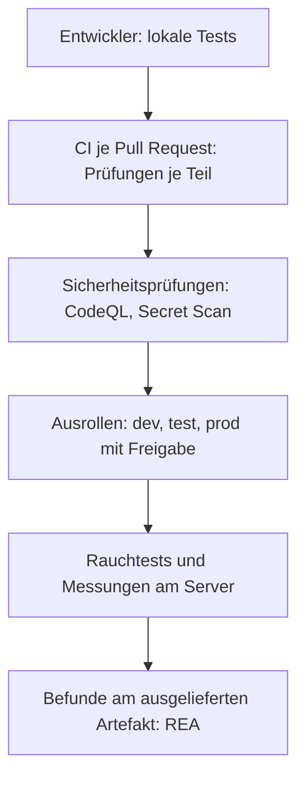

# Qualität und Tests

| | |
|---|---|
| Zweck | Zeigt, womit W.A.I.S. geprüft wird, in welchem Umfang, und wo die Prüfung Lücken hat. |
| Zielgruppe | Entwickler, Test- und Release-Verantwortliche |
| Dokumentart | Referenz |
| Stand | 19.11.2026, geprüft gegen Commit 497e3ce |
| Quellen | `.github/workflows/ci.yml`, `codeql.yml`, `secret-scan.yml`, `dependabot.yml`, die Testdateien in allen Teilen, `voice-core/eval/`, `README.md` |

## Überblick: Ebenen der Qualitätssicherung

## Automatische Tests (Umfang)

Die Zahlen sind statisch gezählt (Testdateien und Testfunktionen im Repo, ohne Ausführung). Parametrisierte Tests laufen mehrfach, die Zahl der ausgeführten Fälle ist deshalb höher. Das Ergebnis der Läufe steht in den GitHub Actions.

| Teil | Werkzeug | Testdateien | Testfunktionen (statisch) |
|---|---|---|---|
| Kern `voice-core/` | pytest (asyncio-Modus automatisch) | 216 | 7286 |
| Host `host/` | pytest (Marke `office` nur mit `WAMO_OFFICE_ECHT=1`) | 19 | 709 |
| Labor-Dienst `labor-dienst/` | pytest (Marke `langsam` nur mit `WAMO_LABOR_ECHTZEIT=1`) | 24 | 363 |
| Skripte `scripts/` | pytest | 33 | 1037 |
| Infra `infra/` | pytest | 4 | 124 |
| Gerätedienst `geraete/` | pytest | 11 | 136 |
| Oberfläche `ui/src/` | `node --test` (Logik) und vitest mit jsdom (Komponenten) | 152 | 1804 (Aufrufe von `it` und `test`) |
| Desktop `desktop/` | `node --test` | 17 | 237 (Aufrufe von `it` und `test`) |
| Datenbank `supabase/tests/` | SQL-Skripte je Migration, von Hand gegen das Schema `wamo_test` | 19 | nicht gezählt, das Ergebnis steht laut README in der letzten Zeile (zum Beispiel "0013 OK") |

Vertragstests prüfen beide Seiten einer Schnittstelle gegeneinander, zum Beispiel `voice-core/test_kernkanal_vertrag.py` (Kern und Dispatcher) und `voice-core/test_verteilung_api.py` (Prüfregel der Installer-Verteilung, gleich im Kern und im Skript auf dem Server).

## Prüfungen der CI

Der Workflow "Prüfungen" (`.github/workflows/ci.yml`) läuft bei jedem Push auf einen Zweig, bei jedem Pull Request und von Hand. Ein erster Job bestimmt, welche Teile laufen: Kern, Python, Skripte, Version und Abhängigkeiten laufen immer, die übrigen nur bei Änderung ihrer Pfade (ein neuer Zweig und der manuelle Start prüfen alles).

| Job | Prüfung |
|---|---|
| `oberflaeche` | `npm ci`, Lint, Typen (`tsc --noEmit`), Logiktests, Komponententests, Build |
| `kern` | `uv sync --frozen`, pytest; fehlgeschlagene Tests werden einmal mit `--last-failed` wiederholt |
| `python` | ruff nur mit den Regeln E9, F63, F7, F82 (Syntaxfehler und echte Fehler, es gibt keine ruff-Konfiguration im Projekt) |
| `labor` | pytest in einer Umgebung mit festen Testpaketen |
| `geraete` | `uv sync --frozen`, pytest |
| `skripte` | pytest für `scripts` und `infra/sokrates2`, dazu zwei Node-Tests |
| `desktop` | `npm ci`, `npm test` |
| `host` | `uv sync --frozen`, pytest |
| `infra` | `bash -n` für alle Shell-Skripte, shellcheck (Fehler blockieren, Warnungen sind Hinweis), PowerShell-Syntax |
| `migrationen` | Migrations-Lint (`scripts/wamo_migrationen_pruefen.py`) gegen die Basis des Pull Requests |
| `version` | `scripts/wamo_version.py pruefen`: Versionsdateien, letztes Tag und `CHANGELOG.md` |
| `abhaengigkeiten` | Lockdateien (`uv lock --check`), `pip-audit` und `npm audit` ab Stufe moderate, nur als Hinweis (`continue-on-error`) |
| `ergebnis` | Sammelcheck über alle Jobs außer `abhaengigkeiten`. Übersprungene Teile gelten als in Ordnung, fehlgeschlagene oder abgebrochene nicht. |

Sicherheit der CI selbst (laut Kopf von `ci.yml`): nur Leserechte, keine Geheimnisse, kein `pull_request_target`, nur von GitHub gehostete Runner, Checkout ohne gespeicherte Zugangsdaten, fremde Actions auf volle Commit-Prüfsummen festgenagelt, Werkzeuge außerhalb der Paketverwaltung (ruff, shellcheck) mit fester Prüfsumme.

## Weitere automatische Prüfungen

| Prüfung | Was | Wann |
|---|---|---|
| CodeQL (`codeql.yml`) | statische Sicherheitsanalyse für JavaScript und TypeScript, Python und die Workflows, ohne Build | Push, Pull Request, wöchentlich, von Hand |
| Secret Scan (`secret-scan.yml`) | gitleaks über Code und Historie, Prüfsumme des Programms wird vor dem Entpacken kontrolliert | Pull Request, Push auf `main`, wöchentlich über die ganze Historie |
| Dependabot (`dependabot.yml`) | Aktualisierungen der GitHub Actions, wöchentlich | die Blöcke für npm, pip und Docker sind auskommentiert, also nicht aktiv |

## Fachliche Prüfungen und Messungen

| Prüfung | Ort | Zweck |
|---|---|---|
| Abnahme der Gesprächsmodelle | `voice-core/eval/abnahme.py`, Fälle in `faelle.py`, `faelle_abnahme.py`, `faelle_labor.py`, `faelle_mitglied.py` | 50 Gesprächszüge gegen Claude oder ein Modell hinter LiteLLM; gemessen werden Werkzeugaufrufe, Marker, Format, Inhalt, erstes Token, erster gesprochener Text, Geschwindigkeit und bei Claude die Kosten |
| Modellkarte messen | `voice-core/eval/modellkarte_messen.py` | Messung der Modelle für die Modellkarte |
| Messrunde Testlabor | `voice-core/eval/messrunde_labor.py`, Bericht `../../labor-messrunde-1.md` | Text-Fälle der Karten des Testlabors |
| Lasttest | `scripts/wamo_labor_last.py`, Bericht `../../labor-lasttest.md` | Verhalten mit 1, 2, 4 und 8 gleichzeitigen Sitzungen |
| Stimme messen | `README.md`, Abschnitt "Stimme messen (Szenariotest)" | Szenariotest zur Messung der Stimme, Beschreibung im README-Abschnitt |
| Abnahme von Entwicklungsaufträgen | `README.md`, Abschnitt "Abnahme: prüfbares Ziel mit Runden" | prüfbares Ziel mit Runden für Aufträge des Entwicklungsagenten |
| Rauchtests am Server | `infra/sokrates2/*_rauchtest.py` (je Dienst eine Datei, zum Beispiel für Anker, Freigabe, Prüfer, Release, Labor, Remote Desktop, Haus-Proxy) | Proben nach dem Einrichten eines Dienstes, laut `CLAUDE.md` nur am Server prüfbar |
| REA am gebauten Installer | `../technik/desktop-auslieferung-rea.md` | Schutzschalter und Inhalt der ausgelieferten Desktop-App |

## Grenzen der Komponententests der Oberfläche

Laut `README.md` gilt: jsdom ist kein Browser (kein Layout, keine Farben), Bildschirmleser laufen nicht mit, Netz, Anmeldung und Sprachverbindung sind Attrappen oder ungetestet, Scrollen und `prefers-reduced-motion` werden nur als Aufruf geprüft. Ein Test mit echtem Browser (Tastatur, Fokus, Zoom, Bildschirmleser) bleibt ein eigener Schritt.

## Lücken

| Nr. | Befund | Beleg | Empfehlung |
|---|---|---|---|
| 1 | Auf `main` gibt es weder Branch-Schutz noch Rulesets. Der Sammelcheck `Ergebnis` ist damit nicht als Pflicht erzwungen, obwohl `ci.yml` das vorsieht. | GitHub-Abfrage am 19.11.2026: "Branch not protected", Rulesets 0, wirksame Regeln für `main` leer | `Ergebnis` als Pflicht eintragen. Das Repo ist öffentlich. |
| 2 | Die SQL-Tests in `supabase/tests/` laufen nicht in der CI (kein Aufruf in `ci.yml`). Die CI prüft Migrationen nur per Lint. | `ci.yml` enthält weder `supabase/tests` noch `psql` | SQL-Tests mit einer Wegwerf-Datenbank in die CI aufnehmen oder den manuellen Lauf in der Prüfliste vor dem Ausrollen führen. |
| 3 | Eine Messung der Testabdeckung (Coverage) ist nicht eingerichtet. | kein `--cov` in `ci.yml`, `pytest-cov` steht in keiner der gelesenen `pyproject.toml` (`voice-core`, `host`, `labor-dienst`) | Abdeckung mindestens für `voice-core` messen, um blinde Flecken zu sehen. |
| 4 | Zwei Workflows verweisen auf Dokumente, die es nicht gibt: der Secret Scan auf `docs/SECRET_GEFUNDEN.md` (Vorgehen bei einem gefundenen Geheimnis), `dependabot.yml` auf `docs/EINRICHTUNG_GITHUB.md` (Einstellungen im Repository). | `secret-scan.yml` (Kopf und Zeile 101), `dependabot.yml` (Zeile 9), `docs/` | Beide Dateien anlegen. Das Vorgehen bei einem Fund gehört vorbereitet, bevor es gebraucht wird. |
| 5 | Dependabot ist nur für GitHub Actions aktiv. Python- und Node-Pakete werden nur über den Audit-Job gemeldet (Hinweis, kein Pflichtcheck). | `dependabot.yml`, Job `abhaengigkeiten` | Bei Bedarf npm und pip aktivieren. |
| 6 | Der Lint ist sehr schmal (ruff mit vier Regelgruppen, keine Konfiguration). | `ci.yml`, Job `python` | Regeln schrittweise erweitern, wenn der Aufwand vertretbar ist. |
| 7 | Rauchtests laufen nur am Server und von Hand. | `infra/sokrates2/*_rauchtest.py` | In der Prüfliste vor dem Ausrollen führen (siehe `../betrieb/release-und-ausrollen.md`). |
| 8 | Es gibt keinen automatischen End-zu-End-Test im echten Browser mit Sprachverbindung. | `README.md` (Grenzen der Komponententests) | Als eigenen Schritt planen, soweit Mikrofon und Sprachdienst es zulassen. |

## Weiterführend

- [Entwicklerhandbuch](entwicklerhandbuch.md)
- [Release und Ausrollen](../betrieb/release-und-ausrollen.md)
- [Befunde der ausgelieferten Desktop-App](../technik/desktop-auslieferung-rea.md)
- [Dokumentationskonzept](../dokumentationskonzept.md)
