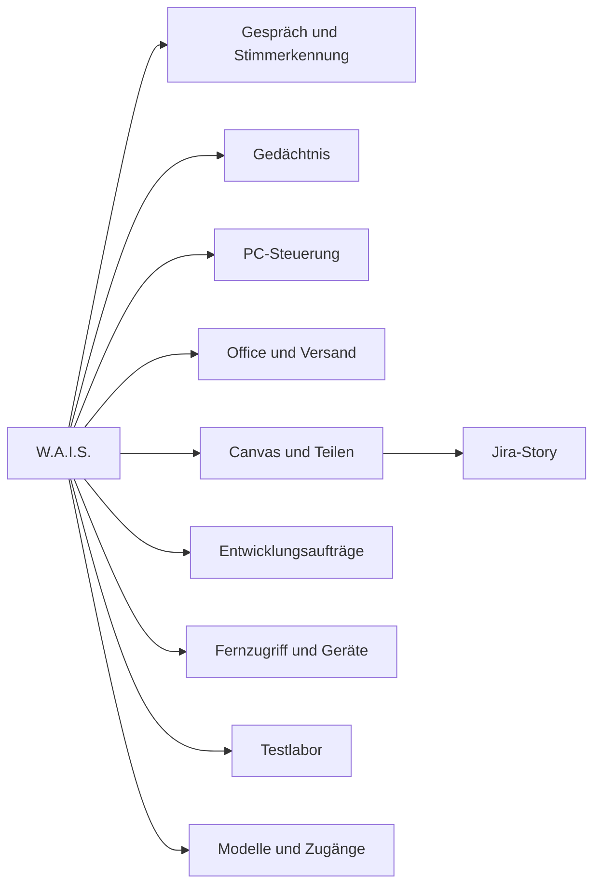
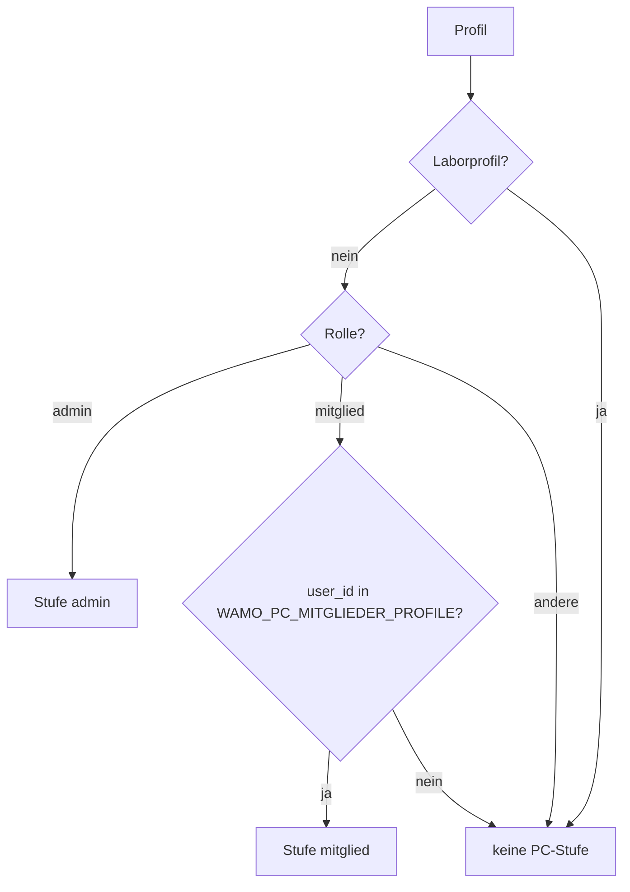

# Fachkonzept

| | |
|---|---|
| Zweck | Beschreibt fachlich, was W.A.I.S. ist, welche Funktionen es gibt und wer was darf. |
| Zielgruppe | Fachbereich, Produktverantwortung, Test und Abnahme, Administration |
| Dokumentart | Erklärung und Referenz |
| Stand | 19.11.2026, geprüft gegen Commit 497e3ce |
| Quellen | Die Kopftabelle jedes Kapitels nennt die Quellen |

## Inhalt

1. [Produktübersicht W.A.I.S.](#produktübersicht-wais)
2. [Funktionskatalog W.A.I.S.](#funktionskatalog-wais)
3. [Rollen und Rechte](#rollen-und-rechte)

## Produktübersicht W.A.I.S.

| | |
|---|---|
| Zweck | Erklärt, was W.A.I.S. ist, für wen es gedacht ist, was es kann, was es bewusst nicht tut und wie weit das Produkt ist. |
| Zielgruppe | Administratoren, Projektleitung, Fachbereiche, neue Mitarbeitende und alle, die W.A.I.S. einführen oder bewerten |
| Dokumentart | Erklärung |
| Quellen | `README.md`, `CHANGELOG.md`, `CLAUDE.md`, `voice-core/tools.py`, `voice-core/rechte.py`, `voice-core/labor.py`, `host/wamo_host.py`, `ui/src/lib/einstellungenAbschnitte.ts` |

### 1. Zweck und Nutzen

W.A.I.S. (WAMOCON's Artificial Intelligence System, gesprochen „Wais“ wie das englische „ways“) ist der Sprachassistent der WAMOCON GmbH. Man spricht mit ihm oder tippt, er antwortet gesprochen und legt Ergebnisse, die man lesen muss, als Tabelle, Code, Dokument oder Diagramm auf eine Fläche neben dem Gespräch (das Canvas). Auf Wunsch bedient er den eigenen Windows-Laptop der Person, erstellt Office-Dateien, bereitet Mails und Teams-Nachrichten vor, startet Entwicklungsaufträge und merkt sich, was für die Arbeit wichtig ist.

Der Nutzen liegt in drei Punkten:

- Routinearbeit am Rechner geht per Zuruf, ohne Wechsel zwischen Programmen.
- Wissen der Firma steht in einem gemeinsamen Gedächtnis, das Admins freigeben.
- Alles, was etwas verändert oder nach außen geht, braucht den Klick der Person auf einer Freigabekarte. Das Sprachmodell kann keine Freigabe selbst erteilen.

Quellen: `README.md` (Kopf und Abschnitt „Sicherheitsmodell“), `host/wamo_host.py` (Kopfkommentar), `voice-core/persona.py`.

### 2. Zielgruppen

| Gruppe | Wer | Was sie bekommt |
|---|---|---|
| Administratoren | Profile mit der Rolle `admin` | Alle Funktionen der Mitglieder, dazu Verwaltung (Geräte freigeben, Gedächtnis-Vorschläge entscheiden, Fernzugriff, Änderungen, Übersicht neuer Mitglieder) und PC-Steuerung ohne weitere Freischaltung |
| Mitglieder | Profile mit der Rolle `mitglied` (laut `README.md` zunächst ein Pilot mit sieben Kollegen) | Gespräch, persönliches Gedächtnis, Canvas, Teilen, Bürogeräte. PC-Steuerung und Entwicklungsaufträge nur, wenn ein Admin sie je Person am Server freischaltet |
| Besucher des Testlabors | Laborprofile (`labor_art` Platz oder Schaufenster, Rolle `mitglied`) | Ein enges Gespräch mit Testwerkzeugen (Uhrzeit, Websuche, Canvas, Test-Jira, Test-Mail), sonst nichts |

Die genaue Zuordnung steht in [Rollen und Rechte](#rollen-und-rechte). Quellen: `voice-core/rechte.py`, `voice-core/labor.py`, `voice-core/entwicklung_betrieb.py`.

### 3. Leistungsumfang je Fachgebiet

Die Funktionen im Einzelnen stehen im [Funktionskatalog](#funktionskatalog-wais). Hier die Kurzfassung.

**Sprachgespräch und Stimmerkennung.** Livegespräch im Browser oder in der Desktop-App mit Unterbrechen mitten im Satz, Live-Untertiteln und alternativer Texteingabe. Spracherkennung und Sprachausgabe laufen standardmäßig über Soniox, wahlweise mit Modellen im Haus. Das Gesprächsmodell ist standardmäßig Claude Haiku. Die Stimmerkennung ist freiwillig: Die Person lernt mit ausdrücklicher Einwilligung einen Stimmabdruck ein (Zahlen, keine Aufnahme), je Mikrofon einen, höchstens drei. Seit dem 18.11.2026 ist der Standardmodus „beobachten“: Die Erkennung misst und zeigt, sperrt aber nichts. Der Modus „streng“ (nur die eigene Stimme wird gehört und darf unterbrechen) gilt nur auf ausdrücklichen Wunsch. Ausnahme: Mitglieder mit PC-Steuerung brauchen für gesprochene PC-Befehle einen eingelernten Abdruck, sonst gehen diese Befehle nur getippt. Ein Mikrofontest in den Einstellungen misst Pegel und Rauschen, ohne dass W.A.I.S. dazwischenredet. Quellen: `voice-core/bot.py`, `voice-core/stimme_gate.py` (`STANDARD_MODUS`), `voice-core/stimme_einwilligung.py`, `voice-core/stimme_mikrofon.py`, `docs/stimme-recherche-2026-11-18.md`.

**Gedächtnis.** Persönliche Einträge (Eigenschaften, Vorlieben, Verhalten) sieht nur die Person selbst. Gemeinsame Einträge (Firma, Projekte, Abläufe) wirken erst nach der Freigabe durch einen Admin, ausdrücklich für alle gemerkte Einträge eines Admins gelten sofort. Inhalte aus dem Gedächtnis gelten für das Sprachmodell als Daten, nie als Anweisung. Quellen: `voice-core/tools.py` (`merken_status`), `voice-core/gedaechtnis_api.py`, `README.md` (Abschnitt „Nutzer und Gedächtnis“).

**PC-Steuerung.** Über den Host auf dem eigenen Windows-Laptop: Programme und Webseiten öffnen, Fenster wechseln, Elemente lesen und bedienen, tippen, scrollen, Browserinhalte lesen, PowerShell nur lesend, Bildschirm ansehen und klicken, Live-Bild des eigenen Laptops. Jedes Werkzeug hat eine Risikoklasse: lesen sofort, ändern protokolliert, kritisch nur nach Freigabekarte, gesperrt nie. Die Steuerung ist je Sitzung ein Schalter und standardmäßig aus. Quellen: `voice-core/pc_host.py` (`LLM_TOOLS`), `host/wamo_host.py`, `voice-core/pc_mitglied.py`.

**Office und Versand.** Ein Canvas-Element lässt sich als Word, Excel, PowerPoint, PDF, CSV oder Markdown im Ordner `Dokumente\WAIS` speichern. Mails bereitet W.A.I.S. über Outlook vor und sendet nur nach Klick auf die Karte, Teams-Nachrichten öffnet es nur mit dem Text im Eingabefeld (senden muss die Person selbst), OneNote-Seiten entstehen im Notizbuch „W.A.I.S.“ erst nach der Karte. Alle vier Wege hängen am Server-Schalter `WAMO_OFFICE`. Quellen: `voice-core/office_werkzeuge.py`, `outlook_werkzeuge.py`, `teams_werkzeuge.py`, `onenote_werkzeuge.py`, `docs/office-und-versand.md`.

**Canvas.** Tabelle, Code, Dokument, Mermaid-Diagramm und Bild (als Verweis). Reiter lassen sich überarbeiten, schließen und über die Historie wieder öffnen, kopieren, herunterladen und mit anderen Profilen teilen (lesen oder bearbeiten). Quellen: `voice-core/tools.py`, `voice-core/canvas_historie.py`, `voice-core/teilen.py`, `ui/src/components/Canvas.tsx`.

**Entwicklungsaufträge.** W.A.I.S. bereitet einen Auftrag für Claude Code als Karte vor, die Person startet ihn per Klick. Der Lauf findet in einer Sandbox auf Sokrates-2 statt, mit ECC-Skills und REA-Werkzeugen je Auftragsart (14 Arten, von Planung bis Recherche). Push und Pull Request gibt es nur nach dem Klick auf „Einreichen“, gemergt wird nie durch W.A.I.S. Aufträge lassen sich mit prüfbaren Kriterien in Runden ausführen und für später speichern. Höchstens sechs Aufträge laufen gleichzeitig, höchstens drei je Person. Quellen: `voice-core/dev_agent.py`, `voice-core/werkzeugkarte.py`, `voice-core/entwicklung_betrieb.py`, `infra/sokrates2/wamo_job_dispatch.py`, `docs/persoenliche-zugaenge.md`.

**Fernzugriff und Geräte.** Admins öffnen den Desktop der Sparks (Sokrates 1, Sokrates 2, Caesar) über ein Gateway, die Sitzung startet immer die Person selbst. Jeder persönliche Laptop wird einmal gebunden und bekommt einen eigenen Tunnel, ein Admin gibt Geräte in der Geräteverwaltung frei. Gemeinsame Bürogeräte (Server, Drucker, Scanner, Router, NAS, Fernseher, Lautsprecher, Steckdosen) zeigt die Büro-Karte, per Zuruf lassen sich Fernseher, Lautsprecher und Steckdosen schalten, drucken geht nur mit Karte. Quellen: `voice-core/rd_api.py`, `voice-core/geraete_werkzeuge.py`, `voice-core/buero_api.py`, `voice-core/geraet_api.py`, `geraete/README.md`.

**Testlabor.** Für den Labortag gibt es eigene Laborprofile (`labor-01` bis `labor-09` laut `docs/testlabor-wamo.md`, Entscheidung E11). Besucher führen ein Gespräch und arbeiten mit einem Test-Jira (`labor-dienst/`), Mails zeigen nur eine Bestätigung. Gesprächstext wird nur mit Einwilligung gespeichert und nach 14 Tagen gelöscht (Löschfrist 11.12.2026). Quellen: `voice-core/labor.py`, `voice-core/labor_werkzeuge.py`, `labor-dienst/`, `docs/testlabor-wamo.md`, `docs/labor-runbook.md`.

**Jira.** Aus einem Canvas-Dokument entsteht auf Wunsch eine User Story (Typ Story) in Jira, aber erst nach dem Klick auf „Freigeben“ und nie per Sprache. Das gibt es nur für Admins im Büro, mit eingeschaltetem Schalter `WAMO_JIRA` und nie im Labor. Quellen: `voice-core/jira_werkzeuge.py`, `voice-core/jira_client.py`, `docs/jira-benutzer-einrichten.md`.

**Modelle und Zugänge.** Jedes Profil hat einen Modellzugang: ein eigener Claude-Schlüssel, ein eigener Claude-Code-Token oder nur Hausmodelle (über LiteLLM, ohne Anthropic). Ein Boss-Baustein wählt das Modell je Aufgabe nach Güte, Antwortzeit und Erreichbarkeit. Modelle für Gespräch, Bilder und Hintergrund sowie Hören und Stimme (Soniox oder im Haus) wählt die Person in den Einstellungen. Der Verbrauch des Claude-Abos wird angezeigt. Quellen: `voice-core/modellzugang.py`, `voice-core/modellwahl.py`, `voice-core/boss.py`, `voice-core/sprache_anbieter.py`, `voice-core/kontingent.py`.

#### Funktionslandkarte

### 4. Bewusste Abgrenzung

Was W.A.I.S. nicht tut oder nur nach Freigabe durch die Person tut:

| Grenze | Beleg |
|---|---|
| Das Sprachmodell erteilt nie eine Freigabe und bedient die eigene Freigabekarte nie. Kritische Aktionen laufen erst nach dem Klick der Person, genau einmal und befristet. | `host/wamo_host.py` (Kopfkommentar), `README.md` (Abschnitt „Sitzungen, Anmeldung und Freigaben“) |
| W.A.I.S. steuert nur den eigenen Laptop der Person, nie fremde PCs, und bei gesperrtem Bildschirm gar nicht. | `voice-core/pc_geraet.py`, `README.md` („Gesperrter PC“) |
| Teams-Nachrichten sendet W.A.I.S. nie selbst. Mails gehen nur nach dem Klick auf die Karte, im neuen Outlook sendet die Person selbst. | `voice-core/teams_werkzeuge.py`, `voice-core/outlook_werkzeuge.py` |
| Pull Requests merged W.A.I.S. nie. Push und Pull Request erst nach „Einreichen“. | `docs/persoenliche-zugaenge.md` (Plan C) |
| Inhalte aus Web, Dateien, Bildschirm und Gedächtnis sind Daten, nie Anweisungen. Nach solchen Inhalten gibt es für Mitglieder für jede Änderung am Laptop eine Karte. | `voice-core/pc_mitglied.py`, `voice-core/tools.py` |
| Passwörter und Schlüssel gehören nicht ins Gespräch: Ein Schlüssel im Gesagten wird entfernt, `merken` speichert keine Zugangsdaten. | `voice-core/schluessel_filter.py`, `voice-core/tools.py` |
| Das Live-Bild wird nie aufgezeichnet und geht nie an ein Sprachmodell. | `voice-core/bildstrom.py` |
| Den Bildschirm eines Laptops auf einen Fernseher spiegeln kann W.A.I.S. noch nicht. | `voice-core/geraete_werkzeuge.py` (Beschreibung `buerogeraet_steuern`) |
| Die Stimmerkennung ist keine Freigabe und kein Schutz gegen Aufnahmen oder geklonte Stimmen. | `README.md` (Abschnitt „Sicherheitsmodell“) |
| Ein Weckwort („Hey WAMO“) gibt es noch nicht. | `CLAUDE.md` (Zeile „Weckwort (später)“) |
| Router lassen sich nur lesend abfragen, schreibend nur als Entwurf. | `README.md` (Stand 10.11.2026), `geraete/README.md` |
| Laborprofile haben nie Gedächtnis, PC-Werkzeuge, Entwicklungsaufträge, Fernzugriff, Geräte, Stimmerkennung oder Teilen. | `voice-core/labor.py` (`WERKZEUGE_BASIS`, Routenliste) |

### 5. Betriebsarten

| Betriebsart | Wo läuft der Kern | Wo läuft die Oberfläche | PC-Werkzeuge |
|---|---|---|---|
| Büro | Sokrates-2 (Dienst `wamo-core`, HTTPS) | Desktop-App oder Browser (Container `wamo-ui` auf Sokrates-2) | Host des Laptops über einen SSH-Rücktunnel je Gerät, nur für das gebundene Profil |
| Unterwegs | Auf dem eigenen PC (Entwicklerbetrieb, Standard ohne Installer) | Desktop-App | Host per stdio |

Die installierte App (Installer `WAIS-Setup-<Version>.exe`) kennt nur die Betriebsart Büro. Im Browser gibt es ebenfalls nur Büro. Unterwegs im Sinn von außerhalb des Büros erreicht man das Büronetz über WireGuard. Quellen: `README.md` (Abschnitte „Betriebsart Büro und Unterwegs“ und „Windows-Installer“), `desktop/installation.js`.

### 6. Produktstand

Aktuelle Version: 0.6.0 (`desktop/package.json`, `ui/package.json`, `CHANGELOG.md`, 17.11.2026). Das Format des Änderungsprotokolls folgt Keep a Changelog und Semantic Versioning.

| Version | Datum | Inhalt in einem Satz |
|---|---|---|
| 0.1.0 | 22.10.2026 | Erstes Release: Gespräch mit Soniox und Claude, Mehrprofil-Anmeldung mit zweitem Faktor, Oberfläche im WMC-Design, PC-Host mit Freigaben, Gedächtnis, Modellzugang, Entwicklungsaufträge in der Sandbox, Geräte und Tunnel |
| 0.2.0 | 15.11.2026 | Neuer Name W.A.I.S., Office-Funktionen (Datei, Outlook, Teams, OneNote), Jira-Story, PC-Steuerung im Browser, Stimmabdruck, Büro-Karte, Vorgänge-Tafel und Vorbereitung von Testlabor und Entwicklungsaufträgen im Büro |
| 0.3.0 | 15.11.2026 | Prüfliste „Erste Schritte“ und signierte Updates der Desktop-App |
| 0.4.0 | 16.11.2026 | Ausrollen an Mitglieder: Installer vom Server, Erstanmeldung mit Passwortwechsel, PC-Steuerung und Entwicklungsaufträge für Mitglieder, Hausmodelle für Aufträge, gleichzeitige Aufträge, Übersicht neuer Mitglieder |
| 0.4.1 | 16.11.2026 | Härtung: Karte beim Lesen sensibler Host-Daten, Karte für Mitglieder nach Fremdinhalt, Einwilligung fürs Bildschirmbild |
| 0.5.0 | 16.11.2026 | Strengerer Stimmwächter, Hören und Stimme im Haus wählbar, Modelle je Person umschaltbar, gestreamte Stimme im Haus |
| 0.6.0 | 17.11.2026 | Nur die eingelernte Stimme hört und unterbricht (im Modus streng), Mikrofonwahl und Pegelwarnung, Werkzeuge für das Testlabor, Admin-Ports nur für freigegebene Quellen |

Nach 0.6.0 sind im Repo ohne Eintrag im Änderungsprotokoll (Abschnitt „Unveröffentlicht“ ist leer) unter anderem gelandet: persönliche GitHub-Zugänge für Entwicklungsaufträge (Plan C, laut `README.md` live seit 18.11.2026), gespeicherte Aufträge, Fehlerbuch (`fehler_erklaeren`), Canvas schließen mit Historie, Bildern und Dateien, Stimmabdruck je Mikrofon (Migration 0029), Mikrofontest ohne W.A.I.S. und der Wechsel des Stimm-Standards auf „beobachten“. Quellen: `CLAUDE.md` (Namensvertrag), `git log` ab `v0.6.0`.

### 7. Offene Punkte und Ausbaustufen

Die Liste stammt aus `README.md` und ist teilweise älter als der Code. Wo der Code oder das Änderungsprotokoll etwas überholt, steht es dabei.

| Punkt | Stand laut README | Einordnung |
|---|---|---|
| TR-064-Zugang der FRITZ!Box für die Erkennung unbekannter Geräte | offen, Stand 10.11.2026 | Ohne ihn zeigt die Büro-Karte keine Zahl |
| Sprachmessung der Persona-Schalter (`WAMO_PERSONA_ABNAHME`, `WAMO_PERSONA_GESPRAECH`, `WAMO_WARTESATZ_MODELL`) | offen, Stand 10.11.2026 | ungemessen |
| Befehlskriterien für Aufträge auf Sokrates-2 (Dispatcher-Befehl `pruefen`) | gebaut, standardmäßig aus, Stand 10.11.2026 | Für Mitglieder bleiben Befehlskriterien aus (`voice-core/dev_agent.py`) |
| Router schreibend | nur als Entwurf, Stand 10.11.2026 | `geraete/README.md` |
| Codesignatur des Installers | Weg eingebaut, Zertifikat folgt (Entscheidung N8) | Ohne Zertifikat warnt Windows SmartScreen |
| Selbstüberarbeitung (Release-Dienst, Anker, Karte „Änderungen“) | Stufe 0 vorbereitet, Stand 20.10.2026 | Ob der Dienst in Betrieb ist, ist im Repo nicht belegt |
| Migrationen 0010, 0011 und 0013 auf `wamo_prod` | nicht als angewendet belegt | laut `README.md` Stand 10.11.2026 |
| Ausbaustufen P4 (eigene Sprachmodelle über LiteLLM) und P5 (Hören und Sprechen im Haus) | Stand 20.10.2026 | Hausmodelle, Hören und Stimme im Haus sind inzwischen wählbar (0.5.0), die Abnahme der Modelle im Haus steht laut README aus |
| Weckwort „Hey WAMO“ | später | `CLAUDE.md` |
| Testlabor | Labortag 28.11.2026 laut `docs/labor-restplan.md`, Löschfrist 11.12.2026 | `docs/persoenliche-zugaenge.md` nennt den 05.12. für den Labortag, der Widerspruch ist im Repo nicht aufgelöst |
| Persönliche Zugänge für Vercel, Supabase und weitere Konnektoren | Ausbaustufe nach dem Labortag | `docs/persoenliche-zugaenge.md` |

### Weiterführend

- [Benutzerhandbuch](benutzerhandbuch.md): Anleitung für Mitglieder
- [Glossar](glossar.md)
- [Recherche zur Sprechererkennung](../stimme-recherche-2026-11-18.md)
- Bestehende Planpapiere: [Testlabor](../testlabor-wamo.md), [Office und Versand](../office-und-versand.md), [Ausrollen neuer Nutzer](../ausrollen-neue-nutzer.md), [Persönliche Zugänge](../persoenliche-zugaenge.md)

## Funktionskatalog W.A.I.S.

| | |
|---|---|
| Zweck | Listet jede Funktion, die W.A.I.S. per Sprachwerkzeug oder in der Oberfläche anbietet, mit Rolle, Voraussetzung, Freigabepflicht und Quelle, als Grundlage für Tests und Abnahme. |
| Zielgruppe | Testmanagement, Abnahme, Produktverantwortliche, Entwickler |
| Dokumentart | Referenz |
| Quellen | `voice-core/tools.py`, `voice-core/*_werkzeuge.py`, `voice-core/pc_host.py`, `voice-core/pc_mitglied.py`, `host/wamo_host.py`, `geraete/wamo_geraete/dienst.py`, `ui/src/components/`, `ui/src/lib/` |

### Lesehilfe

**Rollen in der Spalte „Wer“:**

| Kürzel | Bedeutung |
|---|---|
| A | Profil mit der Rolle `admin` |
| M | Profil mit der Rolle `mitglied`, ohne Zusatzfreischaltung |
| M* | Mitglied nur mit Freischaltung je Person (PC-Steuerung: `WAMO_PC_MITGLIEDER_PROFILE`, Entwicklung: `WAMO_ENTWICKLUNG_PROFILE` und `WAMO_ENTWICKLUNG_MITGLIEDER`), dazu stets alle Admins nach den Regeln der Zeile |
| L | Laborprofil (Testlabor) |

Steht nur „A, M“, gilt die Funktion nie im Labor. Die vollständige Matrix steht in [Rollen und Rechte](#rollen-und-rechte).

**Spalte „Freigabe“:** „ja“ heißt, die Person muss die Aktion auf einer Freigabekarte oder durch einen eigenen Klick bestätigen. „nein“ heißt, die Funktion läuft ohne Karte, wenn die Voraussetzung erfüllt ist. **Fremdinhalt** heißt: Im selben Zug kamen Inhalte von außen ins Gespräch (Websuche, Webseite, Bildschirm, Ergebnis vom Laptop oder von einem Auftrag). Für Mitglieder (M*) verlangt jede ändernde PC-Aktion nach Fremdinhalt eine Karte des Kerns, bis zum Ende der Sitzung (`voice-core/pc_mitglied.py`).

**IDs:** Das Muster ist `F-<Gebiet>-<Nummer>`. Eine ID wird nie wiederverwendet. Entfällt eine Funktion, bleibt die Zeile mit dem Vermerk „entfallen“ stehen. Neue Funktionen bekommen die nächste freie Nummer des Gebiets.

**Sprachwerkzeug** heißt ein Werkzeug, das das Sprachmodell im Gespräch aufruft. Jedes Sprachwerkzeug außer `aktuelle_zeit`, `websuche`, `canvas_zeigen` und `fehler_erklaeren` läuft zusätzlich durch das Gate der Stimmprüfung (`voice-core/stimme_gate.py`, `OFFENE_WERKZEUGE`).

### 1. Gespräch und Sprache (GES)

| ID | Funktion | Wer | Voraussetzung oder Schalter | Freigabe | Quelle |
|---|---|---|---|---|---|
| F-GES-01 | Livegespräch (sprechen, zuhören, gesprochene Antwort) | A, M, L | Anmeldung mit zweitem Faktor, aktives Profil, Mikrofon | nein | `voice-core/bot.py`, `ui/src/lib/useWamo.ts` |
| F-GES-02 | Text eingeben statt sprechen (Eingabefeld am Kern) | A, M, L | Verbindung zum Kern (laut Labor: höchstens 4000 Zeichen je Eingabe) | nein | `ui/src/components/kommando/Kernbereich.tsx`, `ui/src/lib/textEingabe.ts`, `voice-core/labor.py` |
| F-GES-03 | Unterbrechen mitten im Satz, Rückmeldelaute („mhm“) unterbrechen nicht | A, M | Standard an; Innehalten bei einem Wort `WAMO_INNEHALTEN` (Standard an) | nein | `voice-core/soft_interrupt.py`, `voice-core/wiedergabe.py` |
| F-GES-04 | Still starten beim Tippen (erster Tastendruck startet eine Sitzung ohne Mikrofon, Antworten als Text) | A, M | Geräteschalter in den Einstellungen, Standard aus, nie auf Laborgeräten | nein | `ui/src/lib/stillStart.ts`, `ui/src/lib/useStillStart.ts`, `ui/src/components/StillStart.tsx` |
| F-GES-05 | Untertitel und Verlauf (Schublade) | A, M, L | Untertitel unter dem Kern standardmäßig aus (Einstellungen, Darstellung) | nein | `ui/src/components/LiveCaption.tsx`, `ui/src/components/Verlauf.tsx`, `ui/src/lib/stimmFilter.ts` |
| F-GES-06 | Darstellung wählen (Normal, Fokus, Zentrale, Nacht) und Hell oder Dunkel | A, M, L | Wahl je Gerät im Browser-Speicher | nein | `ui/src/components/kommando/DarstellungsWahl.tsx`, `ui/src/components/ThemaSchalter.tsx` |
| F-GES-07 | Seitenleisten in der Breite ziehen | A, M | nur Oberfläche | nein | `ui/src/components/kommando/Seitengriff.tsx`, `ui/src/components/kommando/seitenbreite.ts` |
| F-GES-08 | Mikrofon wählen, Pegelwarnung bei leisem Mikrofon | A, M, L | Mikrofon vorhanden und erlaubt | nein | `ui/src/components/MikrofonWahl.tsx`, `ui/src/lib/pegelWarnung.ts`, `ui/src/lib/mikrofon.ts` |
| F-GES-09 | Mikrofontest (etwa 3 Sekunden Stille, 5 Sekunden Sprechen, Ampel mit Messwerten); läuft ein Gespräch, schweigt W.A.I.S. (Client-Nachricht `mikrofontest` unterbricht eine laufende Antwort) | A, M, L | Abschnitt „Sprache und Ton“, kein Gespräch nötig; im Labor ohne Unterbrechen und ohne gemerktes Ergebnis | nein | `ui/src/components/einstellungen/MikrofonTest.tsx`, `ui/src/lib/mikrofonTest.ts`, `voice-core/stimme_sitzung.py`, `voice-core/bot.py` |
| F-GES-10 | Sprachwerkzeug `aktuelle_zeit` (Datum, Wochentag, Uhrzeit) | A, M, L | keine | nein | `voice-core/tools.py` |
| F-GES-11 | Sprachwerkzeug `websuche` (aktuelle Infos aus dem Web) | A, M, L | `WAMO_SUCHE` (Standard Anthropic-Suche, alternativ SearXNG); im Labor Grenze je Sitzung | nein | `voice-core/tools.py`, `voice-core/suche.py`, `voice-core/labor_limit.py` |
| F-GES-12 | Sprachwerkzeug `fehler_erklaeren` (warum etwas nicht ging) | A, M | nicht im Labor; Fehlerbuch nur im Speicher der Sitzung | nein | `voice-core/fehlerbuch.py` |
| F-GES-13 | Sprachwerkzeug `ausgabe_nachladen` (gekürzte lange Werkzeugausgabe nachladen) | A, M | `WAMO_AUSGABE_SCHWELLE` (Standard 3000 Zeichen), nicht im Labor | nein | `voice-core/ausgaben_kuerzen.py` |
| F-GES-14 | Sprachwerkzeuge `aufgabe_verteilen` und `aufgabe_ergebnis` (große Aufgabe an einen Spezialisten im Hintergrund, Ergebnis abholen) | A, M | nicht im Labor; Art `bild` nur mit PC-Steuerung und PC-Stufe, läuft immer im Haus | nein | `voice-core/boss.py` |
| F-GES-15 | Vorgänge-Tafel und Aufgabenanzeige (Fortschritt, Schritte, Zur Freigabe, Ergebnis ansehen) | A, M | Kern liefert `vorgang`-Meldungen; im Labor nur die Schaufenster-Art | nein | `ui/src/components/kommando/Vorgaenge.tsx`, `ui/src/components/kommando/Aufgabenanzeige.tsx`, `voice-core/vorgaenge_api.py` |
| F-GES-16 | Hinweise an das eigene Profil (geteilte Arbeit, Änderungen an Geräten, neue Geräte für Admins) | A, M | Abfrage jede Minute bei sichtbarem Fenster | nein | `ui/src/components/Hinweise.tsx`, `voice-core/hinweise_api.py` |
| F-GES-17 | Statusleiste (Büro, Modelle, PC, Mikro, Stimme, PC-Steuerung, Entwicklung, Netz) | A, M | Rangfolge, was nicht passt, fällt als ganzes Modul weg | nein | `ui/src/components/Statusleiste.tsx`, `ui/src/components/Kopfzeile.tsx` |
| F-GES-18 | Eine Sitzung je Profil: eine neue Sitzung löst die laufende ab | A, M | `WAMO_SITZUNG_EINZELN` (Standard an) | nein | `voice-core/sitzungen.py` |

### 2. Stimmerkennung (STI)

| ID | Funktion | Wer | Voraussetzung oder Schalter | Freigabe | Quelle |
|---|---|---|---|---|---|
| F-STI-01 | Stimme einlernen (Einwilligung lesen und bestätigen, etwa 20 Sekunden vorlesen) | A, M | Gespräch läuft, Stimmprüfung am Kern geladen, nie im Labor; Einwilligungsfassung `stimme-3` mit Abdrücken je Mikrofon, sonst `stimme-2` im Schattenbetrieb und `stimme-1` | ja (ausdrückliche Einwilligung nach Art. 9 DSGVO, freiwillig) | `voice-core/stimme_einlernen.py`, `voice-core/stimme_einwilligung.py`, `ui/src/components/kommando/StimmeEinlernen.tsx` |
| F-STI-02 | Abdruck je Mikrofon (höchstens drei je Person, ältere Abdrücke gelten als unbekanntes Mikrofon), neu einlernen (ersetzt nur dieses Mikrofon), einzeln oder alle löschen (nur „alle“ gilt als Widerruf der Einwilligung) | A, M | Migration 0029, sonst ein Abdruck; Ersetzen, weiteres Mikrofon und Löschen brauchen einen Stimmnachweis nur im Modus streng | ja (Bestätigungsfrage beim Löschen) | `voice-core/stimme_mikrofon.py`, `ui/src/components/einstellungen/StimmeAbschnitt.tsx`, `ui/src/lib/stimmMikrofon.ts` |
| F-STI-03 | Modul „Stimme“ in der Kopfzeile (Eigen, Fremd, Unklar, Nicht eingelernt) und Hinweis „Fremd, ignoriert“ | A, M | Stimmprüfung in der Sitzung | nein | `ui/src/lib/stimme.ts`, `ui/src/components/kommando/StimmeIgnoriert.tsx` |
| F-STI-04 | Prüfmodus aus, beobachten (Standard seit 18.11.2026, misst und zeigt, sperrt nichts) oder streng | Betrieb am Server | `WAMO_STIMME_PRUEFUNG` über `wamo-core-env` | nein | `voice-core/stimme_gate.py` (`STANDARD_MODUS`) |
| F-STI-05 | Nur die eigene Stimme hören und unterbrechen | A, M mit Abdruck | nur im Modus streng, `WAMO_STIMME_NUR_EIGEN` und `WAMO_STIMME_UNTERBRECHEN_NUR_EIGEN` (Standard an) | nein | `voice-core/stimme_waechter.py` |
| F-STI-06 | Pflichtstufe: gesprochene PC-Befehle von Mitgliedern nur mit eingelerntem Abdruck, sonst nur getippt; mit Abdruck entscheidet das Stimmurteil nur im Modus streng | M* | gilt in jedem Modus; im Modus aus oder ohne bereite Prüfung nur getippt, im Modus beobachten mit Abdruck erlaubt | nein | `voice-core/stimme_gate.py` (`pflicht_grund`), `voice-core/pc_mitglied.py` |
| F-STI-07 | Zweites Sprechermodell im Schattenbetrieb (nur Messung im Log, kein Einfluss auf das Urteil) | Betrieb am Server | `WAMO_STIMME_SCHATTEN` (Standard aus), Einwilligung `stimme-2` oder neuer | ja (Einwilligung) | `voice-core/stimme_schatten.py` |

### 3. Gedächtnis (GED)

| ID | Funktion | Wer | Voraussetzung oder Schalter | Freigabe | Quelle |
|---|---|---|---|---|---|
| F-GED-01 | Sprachwerkzeug `merken`, Bereich persönlich (sofort aktiv) | A, M | nicht im Labor; nach Fremdinhalt nur bei ausdrücklichem Merk-Auftrag | nein | `voice-core/tools.py` (`merken_gesperrt`) |
| F-GED-02 | Sprachwerkzeug `merken`, Bereich gemeinsam: Admin sofort aktiv bei ausdrücklichem „für alle“ ohne Fremdinhalt, sonst und für Mitglieder immer Vorschlag | A, M | Vorschläge wirken erst nach Freigabe | nein (Freigabe erfolgt durch F-GED-04) | `voice-core/tools.py` (`merken_status`) |
| F-GED-03 | Hinweis „Gemerkt“ mit „Rückgängig“ (Eintrag wieder vergessen) | A, M | Client-Nachricht `vergessen` | nein | `ui/src/components/GemerktHinweis.tsx`, `voice-core/bot.py` |
| F-GED-04 | Vorschläge fürs gemeinsame Gedächtnis prüfen: „Für alle freigeben“ oder „Ablehnen“ | A | Abschnitt „Gedächtnis“, 30 Aufrufe je Minute | ist selbst die Freigabe | `voice-core/gedaechtnis_api.py`, `ui/src/components/einstellungen/Gedaechtnis.tsx` |
| F-GED-05 | Lernen aus dem Gespräch (Vorschläge entstehen automatisch, gemeinsame Einträge starten als Vorschlag) | A, M | nicht in Abschnitten mit Fremdinhalt | nein | `voice-core/learning.py`, `voice-core/memory.py` |
| F-GED-06 | Vorschläge per Kommandozeile prüfen (`wamo_admin.py vorschlaege`, `freigeben`, `ablehnen`) | A am Server | Datenbankzugang `wamo_admin` | ist selbst die Freigabe | `voice-core/wamo_admin.py` |

### 4. PC-Steuerung (PC)

Alle Werkzeuge dieses Gebiets wirken nur auf den eigenen, gebundenen Laptop der Person und nur bei eingeschalteter PC-Steuerung mit gehaltener PC-Sperre. Die Risikoklasse stammt vom Host (`host/wamo_host.py`): `read` sofort, `change` protokolliert, `critical` nur nach Karte, `blocked` nie.

| ID | Funktion | Wer | Voraussetzung oder Schalter | Freigabe | Quelle |
|---|---|---|---|---|---|
| F-PC-01 | PC-Steuerung ein- und ausschalten (Schalter je Sitzung, Standard aus) | A, M* | Gerät gebunden und freigegeben, Tunnel steht, nur eine Sitzung steuert (PC-Sperre) | nein | `voice-core/bot.py`, `ui/src/lib/pcSchalter.ts`, `voice-core/rechte.py` |
| F-PC-02 | `system_info` (Rechnername, Benutzer, Ordner, Sperrzustand) | A, M* | PC-Steuerung an | nein (read) | `host/wamo_host.py`, `voice-core/pc_host.py` |
| F-PC-03 | `fenster_auflisten` (offene Fenster mit Titel und Programm) | A, M* | PC-Steuerung an, Bildschirm nicht gesperrt | nein (read) | `host/wamo_host.py` |
| F-PC-04 | `fenster_fokussieren` (Fenster nach vorn) | A, M* | wie oben | nein; M* nach Fremdinhalt ja | `host/wamo_host.py`, `voice-core/pc_mitglied.py` |
| F-PC-05 | `programm_oeffnen` (installiertes Programm aus fester Liste starten) | A, M* | wie oben | nein; M* nach Fremdinhalt ja | `host/wamo_host.py` |
| F-PC-06 | `webseite_oeffnen` (Adresse im aktiven Browser-Tab laden) | A, M* | nur http und https, keine privaten Ziele | nein; ja bei sehr langer Suchanfrage; M* nach Fremdinhalt ja | `host/wamo_host.py` |
| F-PC-07 | `oeffnen_mit` (Ordner oder Datei in VS Code, Explorer oder Notepad) | A, M* | nur Pfade im Benutzerordner | nein; M* nach Fremdinhalt ja | `host/wamo_host.py` |
| F-PC-08 | `ordner_anlegen` (Projektordner unter Projekte, Dokumente, Desktop, Downloads) | A, M* | nie in AppData oder versteckten Ordnern | nein; M* nach Fremdinhalt ja | `host/wamo_host.py` |
| F-PC-09 | `tastatur_tippen` (Text ins Fenster vorn) | A, M* | nie in Konsolen, Admin- und Passwortfenster | nein; ja beim Senden in Mail- und Messenger-Fenstern (Enter, Zeilenumbruch); M* nach Fremdinhalt ja | `host/wamo_host.py` |
| F-PC-10 | `tasten_druecken` (Taste oder Kombination) | A, M* | Windows-Taste und Adressleiste gesperrt | nein; ja bei Senden-Tasten in Mail- und Messenger-Fenstern; M* nach Fremdinhalt ja | `host/wamo_host.py` |
| F-PC-11 | `maus_scrollen` | A, M* | PC-Steuerung an | nein; M* nach Fremdinhalt ja | `host/wamo_host.py` |
| F-PC-12 | `elemente_auflisten` (bedienbare Elemente eines Fensters nummerieren) | A, M* | UI Automation, Passwortfelder ohne Wert | nein (read) | `host/wamo_host.py`, `host/uia_control.py` |
| F-PC-13 | `element_lesen` | A, M* | Nummer aus der letzten Liste (höchstens 3 Minuten alt) | nein (read) | `host/wamo_host.py` |
| F-PC-14 | `element_klicken` | A, M* | Nummer aus der letzten Liste | nein; ja in Mail- und Messenger-Fenstern und bei Elementen wie Senden, Bezahlen, Löschen, Veröffentlichen; M* nach Fremdinhalt ja | `host/wamo_host.py` |
| F-PC-15 | `element_text_setzen` (Eingabefeld füllen) | A, M* | nie in Passwortfelder und Adressleisten | nein; ja in Mail- und Messenger-Fenstern; M* nach Fremdinhalt ja | `host/wamo_host.py` |
| F-PC-16 | `browser_lesen` (Titel, Adresse, Tabs, Seitentext) | A, M* | Chrome, Edge, Firefox, Brave; keine Anmelde- und Zahlungsseiten; Ergebnis gilt als Fremdinhalt | nein (read) | `host/wamo_host.py`, `host/uia_control.py` |
| F-PC-17 | `powershell_lesen` (nur Get-, Test- und ähnliche Cmdlets) | A, M* | Allowlist; bestimmte Befehle `blocked` | nein für reines Lesen; ja bei Befehlen, die etwas ändern, und beim Lesen von Zugangsdaten, Verlauf, Prozess-Befehlszeilen | `host/wamo_host.py` (`READ_CMDLET`, `SENSITIVE_READ`, `BLOCKED_PATTERNS`) |
| F-PC-18 | `dark_mode` (Windows Dark Mode, nur HKCU) | A, M* | PC-Steuerung an | nein; M* nach Fremdinhalt ja | `host/wamo_host.py` |
| F-PC-19 | `git_klonen` (Repository der Firma nach Projekte klonen) | A, M* | `gh` am Laptop | nein; M* nach Fremdinhalt ja | `host/wamo_host.py`, `voice-core/pc_mitglied.py` |
| F-PC-20 | `github_repo_anlegen` (neues Repository in der Organisation, Standard privat) | A, M* | `gh` am Laptop | ja, immer (critical) | `host/wamo_host.py` |
| F-PC-21 | Sprachwerkzeug `bildschirm_ansehen` (Foto an das Bildmodell, Frage dazu beantworten) | A, M* | Bild geht an das Bildmodell des Profils; M*: Einwilligung einmal je Sitzung per Karte | M*: ja (einmal je Sitzung); A: nein | `voice-core/screen.py`, `voice-core/pc_mitglied.py` |
| F-PC-22 | Sprachwerkzeug `auf_bildschirm_klicken` (beschriebenes Element anklicken) | A, M* | Rückfall für Zeichenflächen, sonst `element_klicken` | ja in Mail- und Messenger-Fenstern; M*: Einwilligung fürs Bild und nach Fremdinhalt Karte | `voice-core/screen.py` |
| F-PC-23 | Live-Bild des eigenen Laptops in der Oberfläche (keine Aufzeichnung, Zeitlimit) | A, M* | Schalter AM Laptop (Tray der Desktop-App), Einwilligung, roter Rahmen; Fernanfrage mit frischem Code (höchstens 120 Sekunden alt) | ja (am Laptop) | `voice-core/bildstrom.py`, `voice-core/bild_fern.py`, `desktop/livebild.js`, `ui/src/components/BildschirmAnsicht.tsx` |
| F-PC-24 | Freigabekarte entscheiden (Freigeben oder Ablehnen) | A, M* nur in der eigenen Sitzung | PC-Steuerung an, PC-Sperre gehalten; Klick, nie per Sprache | ist selbst die Freigabe | `voice-core/bot.py` (`darf_pc_freigeben`), `voice-core/pc_freigaben.py`, `ui/src/components/Freigaben.tsx` |
| F-PC-25 | Nur für den Kern, nie für das Sprachmodell: `freigabe_entscheiden`, `bildschirmfoto`, `maus_klicken`, `sperre_pruefen`, `bild_holen`, `live_bild_status`, `live_bild_anfordern`, `live_bild_beenden` | Kern | zweites Geheimnis (Freigabe-Schlüssel) neben dem Bearer-Token | nein | `host/wamo_host.py`, `voice-core/pc_host.py` (`LLM_TOOLS` enthält sie nicht) |

### 5. Office und Versand (OFF)

Alle Funktionen dieses Gebiets brauchen PC-Steuerung an, eine PC-Stufe (A oder M*) und den Server-Schalter `WAMO_OFFICE` mit dem jeweiligen Teil. Sie gelten nie im Labor.

| ID | Funktion | Wer | Voraussetzung oder Schalter | Freigabe | Quelle |
|---|---|---|---|---|---|
| F-OFF-01 | Sprachwerkzeug `canvas_exportieren` (Canvas-Element als Datei in `Dokumente\WAIS` speichern und öffnen) | A, M* | `WAMO_OFFICE` mit `dateien`, Host meldet die Formate | nein; M* nach Fremdinhalt ja | `voice-core/office_werkzeuge.py`, `host/office_dateien.py` |
| F-OFF-02 | Knopf „Als Word, Excel, PowerPoint, PDF speichern“ am Canvas (Formate Word, Excel, PowerPoint, PDF, CSV, Markdown; Excel und CSV nur für Tabellen) | A, M* | nur eigene, gespeicherte Elemente | nein | `ui/src/components/Canvas.tsx`, `ui/src/lib/export.ts` |
| F-OFF-03 | Gespeicherte Datei öffnen (Hinweis mit Ordner und Öffnen) | A, M* | Client-Nachricht `datei_oeffnen`, Register `ablage.json` | nein | `ui/src/components/DateiHinweis.tsx`, `host/office_ablage.py` |
| F-OFF-04 | Sprachwerkzeug `outlook_senden` (E-Mail vorbereiten, auf Wunsch mit Canvas als Anhang) | A, M* | `WAMO_OFFICE` mit `outlook`; Empfänger nur, was die Person nannte | ja, immer; klassisches Outlook sendet nach dem Klick (30 Sekunden zurückholbar), neues Outlook öffnet einen Entwurf und die Person sendet selbst | `voice-core/outlook_werkzeuge.py`, `host/office_outlook.py`, `host/office_outlook_com.py` |
| F-OFF-05 | Knopf „Als E-Mail“ mit Formular (Empfänger, Betreff, Text, Anhang) | A, M* | wie F-OFF-04 | ja | `ui/src/components/MailFormular.tsx`, `ui/src/lib/mail.ts` |
| F-OFF-06 | Versand zurückholen und Versandstatus | A, M* | nur klassisches Outlook, 30 Sekunden | nein | `ui/src/components/MailVersand.tsx`, `voice-core/outlook_werkzeuge.py` |
| F-OFF-07 | Sprachwerkzeug `teams_nachricht` (Teams mit Text im Eingabefeld öffnen) | A, M* | `WAMO_OFFICE` mit `teams`; Text höchstens 1000 Zeichen; W.A.I.S. sendet nie | ja, immer | `voice-core/teams_werkzeuge.py`, `host/office_teams.py` |
| F-OFF-08 | Knopf „Als Teams-Nachricht“ mit Formular (Empfänger, Text, Gruppenname) | A, M* | wie F-OFF-07 | ja | `ui/src/components/TeamsFormular.tsx`, `ui/src/lib/teams.ts` |
| F-OFF-09 | Sprachwerkzeug `onenote_seite` (Canvas als Seite im Notizbuch „W.A.I.S.“ im OneDrive der Firma) | A, M* | `WAMO_OFFICE` mit `onenote`; ohne OneNote Rückfall auf eine Word-Datei | ja, immer | `voice-core/onenote_werkzeuge.py`, `host/office_onenote.py` |
| F-OFF-10 | Knopf „Als OneNote-Seite“ am Canvas | A, M* | wie F-OFF-09, nur eigene Elemente | ja | `ui/src/components/Canvas.tsx`, `ui/src/lib/export.ts` |

### 6. Canvas und Teilen (CAN, TEI)

| ID | Funktion | Wer | Voraussetzung oder Schalter | Freigabe | Quelle |
|---|---|---|---|---|---|
| F-CAN-01 | Sprachwerkzeug `canvas_zeigen` (Tabelle, Code, Dokument, Mermaid-Diagramm) | A, M, L | keine | nein | `voice-core/tools.py`, `ui/src/components/Canvas.tsx` |
| F-CAN-02 | `canvas_zeigen` mit Bild (nur öffentliche https-Adresse, die Oberfläche zeigt einen Verweis) | A, M | nie im Labor; der Kern lädt und speichert das Bild nie | nein | `voice-core/tools.py` (`CANVAS_SCHEMA_BILD`) |
| F-CAN-03 | Element überarbeiten (neue Fassung ersetzt den offenen Reiter) | A, M, L | Parameter `ersetzt`, nur Elemente dieser Sitzung | nein | `voice-core/canvas_sitzung.py` |
| F-CAN-04 | Reiter schließen (Sprachwerkzeug `canvas_schliessen`, Knopf ×) | A, M | nie im Labor; Schließen blendet nur aus | nein | `voice-core/tools.py`, `ui/src/components/Canvas.tsx` |
| F-CAN-05 | Historie des Canvas, geschlossene und frühere Elemente wieder öffnen | A, M | `GET /wamo/api/canvas/historie`, nie im Labor | nein | `voice-core/canvas_historie.py`, `ui/src/components/CanvasHistorie.tsx` |
| F-CAN-06 | Kopieren (Chip „Kopiert“) | A, M, L | nur Oberfläche | nein | `ui/src/components/Canvas.tsx`, `ui/src/lib/kopieren.ts` |
| F-CAN-07 | Herunterladen im Browser (Text, Markdown, HTML im WMC-Design, JSON, CSV ohne Formeln, Quelltext, Mermaid als PNG, SVG und Quelle) | A, M | nur im Browser, nie im Labor | nein | `ui/src/lib/canvasExport.ts`, `ui/src/lib/canvasBild.ts`, `ui/src/components/CanvasDateien.tsx` |
| F-CAN-08 | Datei im Canvas öffnen (PNG, JPEG, GIF, WebP bis 10 MB; SVG, HTML und Text als Quelltext bis 2 MB) | A, M | nur im Browser, die Datei geht nie an Kern oder Modell | nein | `ui/src/lib/canvasDatei.ts`, `ui/src/components/CanvasDateien.tsx` |
| F-TEI-01 | Teilen eines Dokuments, einer Notiz, eines Auftragsergebnisses oder einer Datei mit aktiven Profilen (lesen oder bearbeiten) | A, M | nur der Besitzer teilt; nicht mit sich selbst; Ergebnisse und Projekte von Aufträgen nur lesend | nein | `voice-core/teilen.py`, `voice-core/teilen_api.py`, `ui/src/components/Teilen.tsx` |
| F-TEI-02 | Recht ändern, Teilung widerrufen (Besitzer) und zurückgeben (Empfänger) | A, M | Widerruf wirkt sofort | nein | `voice-core/teilen_api.py` |
| F-TEI-03 | Datei hochladen, neue Fassung, löschen (höchstens 25 MB, Löschen erst weich, nach 7 Tagen endgültig) | A, M | Typprüfung an den ersten Bytes | nein | `voice-core/teilen.py`, `voice-core/teilen_api.py` |
| F-TEI-04 | Sprachwerkzeuge `geteilte_arbeit` und `geteilte_arbeit_oeffnen` | A, M | nicht im Labor; geteilte Inhalte sind Daten | nein | `voice-core/teilen_werkzeuge.py` |
| F-TEI-05 | Protokoll einer Teilung (wer hat wann geteilt, geändert, abgerufen, ohne Inhalte) | A, M | nur Besitzer | nein | `voice-core/teilen_api.py`, `supabase/migrations/` (Migration 0003) |

### 7. Entwicklungsaufträge (ENT)

| ID | Funktion | Wer | Voraussetzung oder Schalter | Freigabe | Quelle |
|---|---|---|---|---|---|
| F-ENT-01 | Sprachwerkzeug `entwicklung_vorbereiten` (Auftrag als Karte vorbereiten; 14 Arten von `planung` bis `recherche`) | A; M* nur im Büro | Unterwegs `WAMO_ENTWICKLUNG=an`; Büro `WAMO_ENTWICKLUNG_BUERO=an`, Profil in `WAMO_ENTWICKLUNG_PROFILE`, Kostengrenzen je Auftrag und je Tag, eigener Zugang (Token, Schlüssel oder Hausmodell); Mitglieder zusätzlich `WAMO_ENTWICKLUNG_MITGLIEDER=an`; nie im Labor | ja (Start per Klick) | `voice-core/dev_agent.py`, `voice-core/werkzeugkarte.py`, `voice-core/entwicklung_betrieb.py` |
| F-ENT-02 | Karte „Entwicklungsauftrag“: Starten oder Verwerfen | A, M* | zeigt Projekt, Auftragsart, Auftragstext, Abnahme | ist selbst die Freigabe | `ui/src/components/Freigaben.tsx`, `ui/src/lib/auftragStart.ts` |
| F-ENT-03 | Sprachwerkzeug `entwicklung_status` (Stand des laufenden oder letzten Auftrags) | A, M* | Entwicklung in der Sitzung | nein | `voice-core/dev_agent.py` |
| F-ENT-04 | Prüfbares Ziel (Abnahme mit bis zu 5 Kriterien, Arbeit in Runden, Zeitlimit) | A, M* | Befehlskriterien nur mit `WAMO_ABNAHME_BEFEHLE=ja` (im Büro zusätzlich `WAMO_ENTWICKLUNG_BEFEHLE_BUERO=an`) und nur für Admins | nein | `voice-core/abnahme.py`, `voice-core/dev_agent.py` |
| F-ENT-05 | Für später speichern, Liste „Gespeicherte Aufträge“ mit Laden und Löschen; Sprachwerkzeuge `entwicklung_speichern` und `entwicklung_gespeichert` | A, M* | höchstens 50 je Person, 90 Tage; Laden legt nur die Karte wieder an | nein (Start wieder per Klick) | `voice-core/auftrag_entwuerfe.py`, `ui/src/components/GespeicherteAuftraege.tsx` |
| F-ENT-06 | Freigaben im Lauf (zum Beispiel `git push`, Produktions-Deployments, verändernde REA-Werkzeuge) | A, M* | Wächter prüft jeden Schritt; eine Freigabe gilt genau einmal | ja | `voice-core/dev_guard.py` |
| F-ENT-07 | Auftrag in der Sandbox auf Sokrates-2 (bis 6 gleichzeitig, bis 3 je Person) | A, M* | Dispatcher 9 oder neuer, Kern-Kanal mit eigenem Schlüssel | nein | `infra/sokrates2/wamo_job_dispatch.py`, `infra/sokrates2/wamo_job_kernkanal.py` |
| F-ENT-08 | Hausmodelle für Aufträge (Zugangsart `haus`, Modell `wamo-haus-coder`) | A, M* | `WAMO_ENTWICKLUNG_HAUS=an`, nur im Büro, Profil ohne eigenen Zugang oder nur mit Hausmodellen | nein | `voice-core/boss.py` (`entwicklung_quelle`), `infra/sokrates2/wamo_job_dispatch.py` |
| F-ENT-09 | Persönlichen GitHub-Zugang hinterlegen, prüfen, löschen (Einstellungen, GitHub-Zugang) | A, M* | `WAMO_ENTWICKLUNG_GITHUB=an`, Zulassung für Aufträge; Löschen geht immer; nie im Labor | nein | `voice-core/github_zugang.py`, `voice-core/github_zugang_api.py`, `ui/src/components/GithubZugang.tsx` |
| F-ENT-10 | Änderung einreichen (Push des Zweigs `wamo/<auftrag>` und Pull Request) oder verwerfen; gemergt wird nie durch W.A.I.S. | A, M* mit eigenem Token | Karte „Einreichen“, jede markierte Datei einzeln bestätigen | ja | `ui/src/components/Freigaben.tsx`, `ui/src/lib/einreichen.ts`, `infra/sokrates2/wamo_job_github.py` |
| F-ENT-11 | Rechte-Ausnahmen für GitHub-Tokens je Profil festlegen | A | Abschnitt „Neue Mitglieder“, nur Werte aus `SCOPES_AUSNAHMEN` | nein | `voice-core/github_zugang_api.py`, `ui/src/components/einstellungen/GithubRechte.tsx` |
| F-ENT-12 | Ergebnis eines Auftrags ansehen oder teilen (nur lesend) | A, M* | Karte unter Vorgänge, Teilen nur zum Lesen | nein | `ui/src/components/kommando/Vorgaenge.tsx`, `voice-core/teilen.py` |

### 8. Fernzugriff und Geräte (FER)

| ID | Funktion | Wer | Voraussetzung oder Schalter | Freigabe | Quelle |
|---|---|---|---|---|---|
| F-FER-01 | Sprachwerkzeug `fernzugriff_oeffnen` (öffnet den Dialog, startet nie selbst) | A | `WAMO_RD_AKTIV=ja`; nie im Labor | ja (die Person klickt „Verbinden“) | `voice-core/tools.py`, `voice-core/rd_api.py` |
| F-FER-02 | Fernzugriff auf die Sparks (Ziele, Start, Ende), Desktop im Gateway | A | `WAMO_RD_AKTIV=ja`; Code der Anmeldung genügt, optional Höchstalter über `WAMO_RD_ANMELDUNG_MAX_MIN` | ja (Klick, ggf. frischer Code) | `voice-core/rd_api.py`, `ui/src/components/einstellungen/Fernzugriff.tsx` |
| F-FER-03 | Eigenen Laptop binden (Desktop-App bei der Anmeldung) | A, M | Mitglied ohne früheres Gerät sofort aktiv; Admin und jeder Gerätewechsel stehen auf „beantragt“ | ja (Freigabe durch einen Admin) | `voice-core/geraet_api.py`, `desktop/geraet.js` |
| F-FER-04 | Geräteverwaltung: freigeben, ablehnen, widerrufen, sperren, entsperren | A | frischer zweiter Faktor (höchstens 120 Sekunden), Fingerabdruck vergleichen | ja (Bestätigungsdialog) | `voice-core/geraete_admin_api.py`, `ui/src/components/einstellungen/GeraeteVerwaltung.tsx` |
| F-FER-05 | Tunnel je Laptop (eigener Schlüssel, eigener Platz `wamo-t-NN`) | A, M* | `WAMO_PC_REGISTER=an`, Einrichtung mit `scripts/wamo-tunnel-einrichten.ps1` | nein | `voice-core/pc_tunnel.py`, `voice-core/pc_geraet.py`, `scripts/wamo-tunnel.ps1` |
| F-FER-06 | Büro-Karte (Zustand der gemeinsamen Bürogeräte, Zahl unbekannter Geräte) | A, M | Reiter „Büro“; nie im Labor | nein | `voice-core/buero_api.py`, `ui/src/components/kommando/BueroKarte.tsx` |
| F-FER-07 | Knöpfe der Büro-Karte (Fernseher, Lautsprecher, Steckdosen: an, aus, lauter, leiser, stumm, laut) | A | Aktion ist eine ausdrückliche Handlung | nein | `voice-core/buero_api.py`, `ui/src/components/kommando/BueroSchalter.tsx` |
| F-FER-08 | Sprachwerkzeug `buerogeraet_status` | A, M | Gerätedienst erreichbar | nein (read) | `voice-core/geraete_werkzeuge.py`, `geraete/wamo_geraete/dienst.py` |
| F-FER-09 | Sprachwerkzeug `buerogeraet_steuern` (Fernseher, Lautsprecher, Steckdosen) | A, M | nur auf ausdrücklichen Wunsch; Rechte und Grenzen prüft der Dienst | nein; nach Fremdinhalt ja | `voice-core/geraete_werkzeuge.py` |
| F-FER-10 | Sprachwerkzeug `drucken` (eigenes Canvas-Dokument, höchstens 20 Seiten) | A, M | Drucker im Register | ja, immer | `voice-core/geraete_werkzeuge.py` |
| F-FER-11 | Sprachwerkzeug `scannen` (in die eigene Ablage, PDF) | A, M | Scanner im Register | nein; nach Fremdinhalt ja | `voice-core/geraete_werkzeuge.py` |
| F-FER-12 | Sprachwerkzeuge `nas_suchen` und `nas_abrufen` (Datei vom NAS in die eigene Ablage) | A, M | NAS im Register; der Inhalt geht nie ins Sprachmodell | nein (read) | `voice-core/geraete_werkzeuge.py` |
| F-FER-13 | Ablage „Scans“ in der Oberfläche (herunterladen, löschen, nur eigene Einträge) | A, M | Ablage je Person auf Sokrates-2 | nein | `ui/src/components/Scans.tsx`, `voice-core/geraete_api.py` |
| F-FER-14 | Sprachwerkzeug `router_geraete` (am Router angemeldete Geräte auf dem Canvas) | A | personenbezogen, nicht vorlesen | nein (read) | `voice-core/geraete_werkzeuge.py`, `geraete/wamo_geraete/dienst.py` |
| F-FER-15 | Sprachwerkzeug `unbekannte_geraete` (Geräte im Netz, die W.A.I.S. nicht kennt, passiv, kein Scan) | A | FRITZ!Box-Zugang für die Hostliste | nein (read) | `voice-core/geraete_werkzeuge.py` |
| F-FER-16 | Betriebsart Büro oder Unterwegs umschalten (Einstellungen, Tray) | A, M | nur ohne laufendes Gespräch; die installierte App kennt nur Büro | nein | `desktop/main.js`, `desktop/installation.js`, `ui/src/lib/betriebsart.ts` |
| F-FER-17 | Desktop-App: Tray-Menü (W.A.I.S. öffnen, Live-Bild, Mit Windows starten, Voice-Core neu starten, Beenden) | A, M | Autostart nur über den Tray, der Installer legt keinen an | nein | `desktop/main.js` |

### 9. Testlabor (LAB)

| ID | Funktion | Wer | Voraussetzung oder Schalter | Freigabe | Quelle |
|---|---|---|---|---|---|
| F-LAB-01 | Laborsitzung (Durchlauf mit Einwilligung, Laborprompt, Erlaubnisliste der Werkzeuge) | L | offener Durchlauf, gültige Einwilligung, `labor_aktiv` | nein | `voice-core/labor.py`, `voice-core/labor_sitzung.py`, `voice-core/labor_durchlauf.py` |
| F-LAB-02 | Sprachwerkzeug `ticket_suchen` (Test-Jira, höchstens 10 Treffer) | L | Labor-Dienst erreichbar | nein (read) | `voice-core/labor_ticket.py`, `voice-core/labor_werkzeuge.py` |
| F-LAB-03 | Sprachwerkzeuge `ticket_anlegen`, `ticket_aendern`, `ticket_verschieben`, `ticket_kommentieren` | L | Karte mit Hash der Werte, Idempotenz, Version des Tickets | ja, immer | `voice-core/labor_ticket.py`, `voice-core/labor_freigaben.py` |
| F-LAB-04 | Sprachwerkzeug `mail_senden` (nur Bestätigung „gesendet“, kein Postfach) | L | Domänenfilter `@labor.test` | ja, immer | `voice-core/labor_mail.py`, `voice-core/labor_freigaben.py` |
| F-LAB-05 | Freigabekarte des Labors (Ticket und Mail, Texte aus `laborKarte.ts`) und Laborsicht der Oberfläche (nur Abschnitt „Sprache und Ton“) | L | Laborprofil | ist selbst die Freigabe | `ui/src/components/Freigaben.tsx`, `ui/src/lib/laborKarte.ts`, `ui/src/lib/laborPlatz.ts` |
| F-LAB-06 | Platz-Skript für Laptops (einrichten, starten, prüfen, Rückweg; Kiosk-Konto, Chrome-Richtlinien) | Betreuer, A | Windows, Kiosk-Konto ohne Administrator | nein | `scripts/wamo_labor_platz.py`, `docs/labor-platz-einrichten.md` |
| F-LAB-07 | Zweite Faktoren der Laborprofile automatisch einrichten (mit QR) | A | `scripts/wamo_labor_faktoren.py` | nein | `scripts/wamo_labor_faktoren.py` |
| F-LAB-08 | Nachlauf: Sperren, Löschen der Laborkonten, Nachweis (Löschfrist 11.12.2026) | Betreuer, A | Bestätigungswort beim Löschlauf | ja (Bestätigungswort) | `scripts/wamo_labor_nachlauf.py`, `voice-core/labor_loeschliste.py`, `docs/labor-runbook.md` |
| F-LAB-09 | Labor-Dienst (Test-Jira mit Betreuer-Seite) | Betreuer | Container `wamo-labor-dienst` | nein | `labor-dienst/`, `docs/labor-dienst-vertrag.md` |

### 10. Jira (JIR)

| ID | Funktion | Wer | Voraussetzung oder Schalter | Freigabe | Quelle |
|---|---|---|---|---|---|
| F-JIR-01 | Sprachwerkzeug `jira_story_anlegen` (User Story aus einem Canvas-Dokument) | A im Büro | `WAMO_JIRA=an`, `WAMO_JIRA_URL`, `WAMO_JIRA_EMAIL`, `WAMO_JIRA_TOKEN`; nie im Labor | ja, immer (Karte, Klick auf „Freigeben“, nie per Sprache) | `voice-core/jira_werkzeuge.py`, `voice-core/jira_freigaben.py` |
| F-JIR-02 | Knopf „Als User Story in Jira“ am Canvas | A im Büro | wie F-JIR-01; Kern sendet `jira_status` mit den freigegebenen Projekten | ja | `ui/src/components/JiraStory.tsx`, `ui/src/lib/jiraStory.ts` |
| F-JIR-03 | Erlaubnisliste der Jira-Projekte (Standard `WMCNL`) und Standardprojekt | Betrieb am Server | `WAMO_JIRA_PROJEKTE`, `WAMO_JIRA_STANDARD_PROJEKT` | nein | `voice-core/jira_client.py` |

### 11. Modelle und Zugänge (MOD)

| ID | Funktion | Wer | Voraussetzung oder Schalter | Freigabe | Quelle |
|---|---|---|---|---|---|
| F-MOD-01 | Eigenen Claude-API-Schlüssel hinterlegen, ersetzen, löschen (verschlüsselt in der Datenbank) | A, M | nie im Labor; Standard Haiku; gilt ab der nächsten Sitzung; nie im Gesagten | nein | `voice-core/modellzugang.py`, `ui/src/components/ModellZugang.tsx`, `ui/src/components/SchluesselFormular.tsx` |
| F-MOD-02 | Claude-Code-Token hinterlegen (für Entwicklungsaufträge) | A, M | Max-Tarif; Token hat Vorrang vor dem Schlüssel | nein | `voice-core/schluessel.py`, `ui/src/components/ModellZugang.tsx` |
| F-MOD-03 | Modus „Automatisch“ oder „Nur Hausmodelle“ wählen | A, M | Ein Admin kann das Profil auf Hausmodelle festlegen, dann sind eigene Schlüssel gesperrt | nein | `voice-core/modellzugang.py`, `voice-core/boss.py` |
| F-MOD-04 | Modelle je Aufgabe wählen (Gespräch, Bilder, Hintergrund) | A, M | Migration 0024; NULL heißt automatisch | nein | `voice-core/modellwahl.py`, `ui/src/components/ModellAuswahl.tsx` |
| F-MOD-05 | Hören und Stimme wählen (Soniox oder „Im Haus“), Stimme im Haus (`sohee`, `uncle_fu`, `ono_anna`) | A, M | Hausmodelle `wamo-stt-haus` und `wamo-tts-haus` eingerichtet; Rückfall auf Soniox; im Labor immer Soniox | nein | `voice-core/sprache_anbieter.py`, `ui/src/components/SprachWahl.tsx` |
| F-MOD-06 | Verbrauch (Kontingent des Claude-Abos: Sitzungslimit, Wochenlimit) | A und jedes Profil mit eigenem Claude-Code-Token | Datenformat laut Quelle noch an keinem echten Token bestätigt | nein | `voice-core/kontingent.py`, `ui/src/components/einstellungen/Verbrauch.tsx` |
| F-MOD-07 | Automatische Modellwahl durch den Boss (Aufgabenklasse, Güte, Antwortzeit, Erreichbarkeit) | A, M | Standard; Modellkarte in `voice-core/modellkarte.py` | nein | `voice-core/boss.py`, `voice-core/modellkarte.py` |
| F-MOD-08 | Geführter Modellzugang bei der Erstanmeldung (Token, API-Schlüssel, Zusammenfassung „So arbeitet W.A.I.S. für dich“) | A, M | beide Schlüsselschritte überspringbar; bei Festlegung auf Hausmodelle entfallen sie | nein | `ui/src/lib/einrichtungSchritte.ts`, `ui/src/components/einrichtung/` |

### 12. Konto und Einrichtung (KON)

| ID | Funktion | Wer | Voraussetzung oder Schalter | Freigabe | Quelle |
|---|---|---|---|---|---|
| F-KON-01 | Anmelden mit E-Mail und Passwort, Option „Angemeldet bleiben“ | A, M, L | Anmeldung höchstens 168 Stunden alt (`WAMO_ANMELDUNG_MAX_STUNDEN`), im Browser 24 Stunden | nein | `ui/src/components/LoginGate.tsx`, `voice-core/auth_gate.py`, `ui/src/lib/anmeldung.ts` |
| F-KON-02 | Zweiten Faktor einrichten (QR-Code, Authenticator-App) und Code eingeben | A, M, L | ohne zweiten Faktor (aal2) kein Zugang | nein | `ui/src/components/LoginGate.tsx` |
| F-KON-03 | Erstanmeldung: Startpasswort durch eigenes Passwort ersetzen (mindestens 12 Zeichen) | A, M | Stand „offen“, Frist; andere Sitzungen werden abgemeldet; nie für Laborprofile | nein | `voice-core/erstanmeldung_api.py`, `ui/src/components/erstanmeldung/PasswortSchritt.tsx` |
| F-KON-04 | Prüfliste „Erste Schritte“ (Anmeldung, Kern, Passwort, App-Version, Gerät, Host-Umgebung, Tunnel, Mikrofon, Stimme, Gespräch, Entwicklung, Stimmabdruck, PC-Steuerung) | A, M | nie im Labor | nein | `voice-core/einrichtung_api.py`, `ui/src/lib/einrichtung.ts`, `ui/src/components/einstellungen/ErsteSchritte.tsx` |
| F-KON-05 | Installer laden (`WAIS-Setup-<Version>.exe`) | A, M | nur im Browser, nie im Labor, höchstens begrenzte Abrufe | nein | `voice-core/verteilung_api.py`, `ui/src/components/einrichtung/InstallerDownload.tsx` |
| F-KON-06 | App-Update prüfen und installieren (Ed25519-Signatur, steigende Version, SHA-256) | A, M | nur Desktop-App | ja (Rückfrage der App) | `desktop/update.js`, `desktop/update-schluessel.json`, `ui/src/lib/einrichtung.ts` |
| F-KON-07 | Abmelden (für Laborkonten mit Rückfrage „Ja, abmelden“ oder „Angemeldet bleiben“) | A, M, L | Laborkonten kommen ohne die Zugangsdaten des Platzes nicht wieder hinein | nein; nur Labor: ja (Rückfrage) | `ui/src/components/AbmeldenRueckfrage.tsx`, `ui/src/components/Kopfzeile.tsx` |
| F-KON-08 | Einstellungsseite mit 15 Abschnitten (Konto, Erste Schritte, Modellzugang, GitHub-Zugang, Verbrauch, Sprache und Ton, Stimme, Gedächtnis, Neue Mitglieder, Darstellung, Geräte und PC, Fernzugriff, Änderungen, Teilen, Info) | A, M; je Abschnitt eingeschränkt | Abschnitte mit `nurAdmin` nur für Admins, Verbrauch auch mit Token; Laborsicht nur „Sprache und Ton“ | nein | `ui/src/lib/einstellungenAbschnitte.ts`, `ui/src/components/einstellungen/Abschnitte.tsx` |

### 13. Administration (ADM)

Die Verwaltungsfunktionen, die schon in anderen Gebieten stehen, sind hier nur verwiesen: Gedächtnis-Vorschläge (F-GED-04), Geräteverwaltung (F-FER-04), GitHub-Rechte (F-ENT-11).

| ID | Funktion | Wer | Voraussetzung oder Schalter | Freigabe | Quelle |
|---|---|---|---|---|---|
| F-ADM-01 | Übersicht „Neue Mitglieder“ (Einrichtungsstand je Profil der letzten 90 Tage, ohne Laborprofile) | A | Migration 0022, 30 Abrufe je Minute | nein | `voice-core/mitglieder_admin_api.py`, `ui/src/components/einstellungen/NeueMitglieder.tsx` |
| F-ADM-02 | Karte „Änderungen“ (Stand der Selbstüberarbeitung, Freigabe einer Änderung mit frischem Code) | A | Release-Dienst am Server; Betriebszustand im Repo nicht belegt | ja (Code der Authenticator-App) | `voice-core/release_api.py`, `ui/src/components/einstellungen/Aenderungen.tsx`, `ui/src/components/einstellungen/AenderungenFreigabe.tsx` |
| F-ADM-03 | Konten verwalten per Skript (anlegen, freischalten, zuruecksetzen, passwort, umbenennen, sperren, austreten, liste) | A am eigenen PC | Datenbankzugang `wamo_admin`; `--schema` ist bei allen ändernden Befehlen Pflicht | ja (Startpasswort wird verdeckt eingetippt) | `scripts/wamo_nutzer.py` |
| F-ADM-04 | Server-Schalter je Person setzen (PC-Steuerung für Mitglieder, Entwicklung, Office, Jira, Hausmodelle) | A am Server | nur über `wamo-core-env` und das Drop-in, wirkt mit dem nächsten Kern-Release | nein | `voice-core/rechte.py`, `voice-core/entwicklung_betrieb.py`, `infra/sokrates2/wamo-job-kern-einrichten.sh` |
| F-ADM-05 | Version und Änderungsprotokoll pflegen (`vorschlag`, `changelog`, `anwenden`, `pruefen`) | A am PC | leitet die Version aus Conventional Commits ab, setzt kein Tag | nein | `scripts/wamo_version.py` |

### Abdeckung und Grenzen

- Der Katalog erfasst die Sprachwerkzeuge der Sitzung (`voice-core/tools.py`, `*_werkzeuge.py`, `screen.py`, `boss.py`, `dev_agent.py`, `fehlerbuch.py`, `geraete_werkzeuge.py`, `teilen_werkzeuge.py`, `labor_*`), die 19 Werkzeuge des Hosts in `LLM_TOOLS` und die Nutzerfunktionen der Oberfläche in `ui/src/components/` und `ui/src/lib/`. Reine Entwicklerfunktionen (Vorschaumodus, Messwerkzeuge, Lasttest) stehen nicht darin.
- Welche Schalter am Server wirklich gesetzt sind, belegt das Repo nicht. Der Katalog nennt nur die Voraussetzung, nicht den Betriebszustand.
- Die Funktionen der Selbstüberarbeitung (Anker, Release-Dienst) sind im Code angelegt, ihr Betriebszustand ist nicht belegt (`README.md`, Stand 20.10.2026).

### Weiterführend

- [Benutzerhandbuch](benutzerhandbuch.md)
- [Schnittstellen](technik.md#schnittstellen-von-wais): Routen, Nachrichten und Werkzeuge im technischen Detail
- [Konfiguration](technik.md#konfiguration-umgebungsvariablen-und-schalter): alle Schalter und Umgebungsvariablen
- [Glossar](glossar.md)

## Rollen und Rechte

| | |
|---|---|
| Zweck | Beschreibt, wer in W.A.I.S. was darf: Rollen, Profilzustände, zweiter Faktor, PC-Stufe, Freigabestufen und die Grenzen der Laborprofile, jeweils mit Beleg im Code. |
| Zielgruppe | Administratoren, Sicherheits- und Datenschutzverantwortliche, Testmanagement, Entwickler |
| Dokumentart | Referenz mit Erklärungen |
| Quellen | `voice-core/auth_gate.py`, `voice-core/rechte.py`, `voice-core/pc_mitglied.py`, `voice-core/labor.py`, `voice-core/entwicklung_betrieb.py`, `voice-core/bot.py`, `host/wamo_host.py`, `geraete/wamo_geraete/dienst.py` |

### 1. Grundsatz

Rechte werden dort durchgesetzt, wo man sie nicht umgehen kann, nicht im Gespräch und nicht in der Oberfläche. Die Rolle kommt allein aus dem geprüften Token und dem Profil in der Datenbank (`voice-core/auth_gate.py`, `Identity`), nie aus dem, was jemand sagt oder die Oberfläche meldet. Die Schichten:

| Schicht | Was sie prüft | Beleg |
|---|---|---|
| Zugangstor des Kerns | Token (Signatur, Ablauf, Aussteller), zweiter Faktor aal2, Höchstalter der Anmeldung, aktives Profil, Stand der Erstanmeldung | `voice-core/auth_gate.py` |
| Routen des Kerns | Rolle `admin` bei Verwaltungsrouten, Sperre für Laborprofile | `voice-core/*_api.py`, `voice-core/labor.py` |
| Werkzeuge im Kern | PC-Stufe, Schalter, Stimme, Fremdinhalt, Karten | `voice-core/rechte.py`, `voice-core/pc_mitglied.py`, `voice-core/stimme_gate.py` |
| Host am Laptop | Risikoklassen, Freigabe-Schlüssel, Sperrerkennung, Zielfenster | `host/wamo_host.py` |
| Datenbank | Zeilensicherheit (RLS) je Rolle, Funktionen mit eigener Adminprüfung | `supabase/migrations/`, `CLAUDE.md` (Regeln) |

### 2. Rollen

| Rolle | Wo festgelegt | Beschreibung |
|---|---|---|
| `admin` | Spalte `rolle` in `<schema>.profiles` (`ROLLEN` in `voice-core/memory.py`) | Volle Funktionen und Verwaltung. PC-Stufe `admin` ohne weitere Freischaltung |
| `mitglied` | dieselbe Spalte | Gespräch, persönliches Gedächtnis, Canvas, Teilen, Bürogeräte. Weitere Rechte nur per Freischaltung je Person |
| Laborprofil | `labor_art` (`platz` oder `schaufenster`), Rolle immer `mitglied`, `aktiv = false` und eigene Freischaltung `labor_aktiv` | Besucher des Testlabors. Nie Admin (`Identity.is_admin` ist bei gesetzter `labor_art` falsch) |

Außerdem hat jedes Profil eine Anrede (`du` oder `sie`, `ANREDEN`), sie beeinflusst nur die Sprache. Konten legt nur ein Admin an, die Registrierung ist geschlossen (`CLAUDE.md`, Architektur-Entscheidung 1). Eine unbekannte Rolle gilt in der Oberfläche wie `mitglied` (`ui/src/lib/einstellungenAbschnitte.ts`), im Kern hat sie keine PC-Stufe (`voice-core/rechte.py`).

### 3. Profilzustände und Zugang

#### 3.1 Zustände eines Profils

| Zustand | Bedeutung | Wirkung | Beleg |
|---|---|---|---|
| aktiv | `profiles.aktiv = true` | Zugang möglich (Cache 60 Sekunden) | `voice-core/auth_gate.py` (`PROFILE_HIT_SECS`) |
| inaktiv oder gesperrt | `aktiv = false`, Konto in GoTrue gesperrt (`wamo_nutzer.py anlegen`, `sperren`) | Zugang abgelehnt (Cache 10 Sekunden); eine laufende Sitzung endet binnen einer Minute | `voice-core/auth_gate.py`, `voice-core/bot.py` (`SessionGuard`), `scripts/wamo_nutzer.py` |
| Erstanmeldung `offen` | Startpasswort noch nicht gewechselt | Nur `GET /wamo/api/erstanmeldung` und `POST /wamo/api/erstanmeldung/passwort` erlaubt, alles andere 403 mit Code `passwort_wechsel_noetig` | `voice-core/auth_gate.py`, `voice-core/erstanmeldung_api.py` |
| Erstanmeldung `abgelaufen` | Frist des Startpassworts vorbei | 403 mit Code `startpasswort_abgelaufen`, Satz „Dein Startpasswort ist abgelaufen. Bitte melde dich bei Niko.“ | `voice-core/auth_gate.py` |
| Erstanmeldung `keine` oder `erledigt` | kein Wechsel nötig | normaler Zugang | `voice-core/auth_gate.py` (`ERSTANMELDUNG_FREI`) |
| Laborprofil aktiv | `labor_aktiv` gesetzt und Felder stimmig (Rolle `mitglied`, Platz 1 bis 16) | Zugang nur zu Start, Offer, Laborrouten (und beim Schaufenster `vorgaenge`) | `voice-core/labor.py` |

Das Profil wird in einer laufenden Sitzung jede Minute neu geprüft. Die Sitzung endet, wenn das Profil nicht mehr aktiv ist, sich die Rolle ändert, die Erstanmeldung wieder offen oder abgelaufen ist, die Anmeldung zu alt wird oder die maximale Sitzungsdauer erreicht ist (`voice-core/bot.py`, `SessionGuard.check`). Ein Admin setzt Konten mit `scripts/wamo_nutzer.py` (`anlegen`, `freischalten`, `zuruecksetzen`, `passwort`, `umbenennen`, `sperren`, `austreten`, `liste`) auf die gewünschten Zustände.

#### 3.2 Zweiter Faktor und Anmeldealter

| Regel | Wert | Beleg |
|---|---|---|
| Zweiter Faktor | Pflicht (Claim `aal` = `aal2`), ohne ihn 403 | `voice-core/auth_gate.py` |
| Höchstalter der Anmeldung | gemessen am frühesten Zeitstempel in `amr`; Standard 168 Stunden, erlaubt mehr als 0 und höchstens 720 (`WAMO_ANMELDUNG_MAX_STUNDEN`); im Browser 24 Stunden | `voice-core/auth_gate.py`, `ui/src/lib/anmeldung.ts` |
| Statuscodes | 401 Token ungültig oder abgelaufen, 403 zweiter Faktor fehlt oder kein aktives Profil, 503 Anmeldedienst oder Datenbank nicht erreichbar (fail closed) | `voice-core/auth_gate.py` |
| Frischer zweiter Faktor (höchstens 120 Sekunden alt) | für ändernde Aktionen der Geräteverwaltung und für die Fernanfrage des Live-Bilds; für den Fernzugriff nur, wenn `WAMO_RD_ANMELDUNG_MAX_MIN` gesetzt ist | `voice-core/geraete_admin_api.py`, `voice-core/bild_fern.py`, `voice-core/rd_api.py` |

#### 3.3 Zustände eines Geräts (Laptop)

| Zustand | Bedeutung | Beleg |
|---|---|---|
| `beantragt` | Gerät gebunden, wartet auf einen Admin. Jedes Admin-Profil und jeder Gerätewechsel startet hier | `README.md` (Abschnitt „Geräte, Tunnel je Gerät und Geräteverwaltung“) |
| `aktiv` | freigegeben, zählt für den Tunnel. Ein Mitglied ohne früheres Gerät wird sofort `aktiv` | `voice-core/geraet_api.py` |
| `gesperrt` | von einem Admin gesperrt, mit Grund, wieder entsperrbar | `voice-core/geraete_admin_api.py` |
| `widerrufen` | endgültig | `voice-core/geraete_admin_api.py` |

### 4. Rechtematrix

Die Zeilen fassen Funktionen aus dem [Funktionskatalog](#funktionskatalog-wais) zusammen. Spalten: **Admin** (`admin`), **Mitglied** (ohne Freischaltung), **Mitglied freigeschaltet** (M* im Katalog), **Labor**. „ja, Karte“ heißt: mit Freigabekarte. „Schalter“ heißt: zusätzlich nur, wenn der Server-Schalter gesetzt ist. Welche Schalter am Server wirklich gesetzt sind, belegt das Repo nicht.

| Funktion (Katalog-IDs) | Admin | Mitglied | Mitglied freigeschaltet | Labor | Beleg |
|---|---|---|---|---|---|
| Gespräch, Text, Untertitel, Verlauf (GES-01 bis 09) | ja | ja | ja | ja | `voice-core/bot.py`, `voice-core/labor.py` |
| Uhrzeit, Websuche, Canvas zeigen (GES-10, 11, CAN-01) | ja | ja | ja | ja, Websuche mit Grenze je Sitzung | `voice-core/labor.py` (`WERKZEUGE_BASIS`) |
| Fehler erklären, Nachladen, Boss-Aufgaben (GES-12 bis 14) | ja | ja | ja | nein | `voice-core/bot.py`, `voice-core/labor.py` |
| Persönliches Gedächtnis (GED-01, 03, 05) | ja | ja | ja | nein | `voice-core/tools.py`, `voice-core/labor.py` |
| Gemeinsames Gedächtnis: sofort wirksam (GED-02) | ja, nur bei ausdrücklichem „für alle“ ohne Fremdinhalt | nein, nur Vorschlag | nein, nur Vorschlag | nein | `voice-core/tools.py` (`merken_status`) |
| Vorschläge freigeben oder ablehnen (GED-04, 06) | ja | nein | nein | nein | `voice-core/gedaechtnis_api.py` (403 ohne Admin) |
| Stimmabdruck einlernen, löschen (STI-01 bis 03) | ja | ja | ja | nein, keine Stimmsitzung | `voice-core/stimme_sitzung.py` (`StimmSitzung.fuer`) |
| Canvas Bild, schließen, Historie, Herunterladen (CAN-02 bis 08) | ja | ja | ja | nein | `voice-core/canvas_historie.py`, `voice-core/labor.py` |
| Teilen und geteilte Arbeit (TEI-01 bis 05) | ja | ja | ja | nein | `voice-core/teilen_api.py`, `voice-core/labor.py` |
| Bürogeräte per Sprache: Status, steuern, drucken, scannen, NAS (FER-08 bis 13) | ja | ja | ja | nein | `geraete/wamo_geraete/dienst.py` (`WERKZEUGE`), `voice-core/geraete_werkzeuge.py` |
| Router-Geräte und unbekannte Geräte (FER-14, 15) | ja | nein | nein | nein | `geraete/wamo_geraete/dienst.py` (`ADMIN_FAEHIGKEITEN`) |
| Büro-Karte ansehen (FER-06) | ja | ja | ja | nein | `voice-core/buero_api.py` |
| Büro-Karte schalten per Knopf (FER-07) | ja | nein | nein | nein | `voice-core/buero_api.py` (`STEUER_ROLLEN`) |
| PC-Steuerung, Host-Werkzeuge (PC-01 bis 20) | ja, Schalter je Sitzung | nein | ja, mit Schutz (Abschnitt 5) | nein | `voice-core/rechte.py`, `voice-core/pc_host.py` |
| Bildschirm ansehen und klicken, Live-Bild (PC-21 bis 23) | ja | nein | ja, Einwilligung fürs Bild einmal je Sitzung per Karte | nein | `voice-core/pc_mitglied.py`, `voice-core/bildstrom.py` |
| Office: Datei, Mail, Teams, OneNote (OFF-01 bis 10) | ja, Schalter | nein | ja, Schalter, Karte nach Fremdinhalt | nein | `voice-core/office_werkzeuge.py` (`pc_person`) |
| Jira-Story (JIR-01 bis 03) | ja, Büro und Schalter, Karte | nein | nein | nein | `voice-core/jira_werkzeuge.py` (`sitzung_bauen`) |
| Entwicklungsaufträge (ENT-01 bis 12) | ja, Schalter, im Büro Profilliste | nein | ja, nur im Büro und mit Schalter (Abschnitt 7) | nein | `voice-core/entwicklung_betrieb.py`, `voice-core/bot.py` |
| Persönlicher GitHub-Zugang (ENT-09) | ja, mit Zulassung | nein | ja, mit Zulassung | nein | `voice-core/github_zugang_api.py` |
| GitHub-Rechte je Profil, Neue Mitglieder (ENT-11, ADM-01) | ja | nein | nein | nein | `voice-core/github_zugang_api.py`, `voice-core/mitglieder_admin_api.py` |
| Fernzugriff auf die Sparks (FER-01, 02) | ja, Schalter | nein | nein | nein | `voice-core/rd_api.py` (403 ohne Admin) |
| Geräteverwaltung, Änderungen (FER-04, ADM-02) | ja, frischer Code | nein | nein | nein | `voice-core/geraete_admin_api.py`, `voice-core/release_api.py` |
| Eigenen Laptop binden (FER-03) | ja, startet als beantragt | ja, bei erstem Gerät sofort aktiv | ja | nein | `voice-core/geraet_api.py` |
| Modellzugang, Modelle, Sprache (MOD-01 bis 05, 08) | ja | ja | ja | nein, Soniox fest | `voice-core/modellzugang_api.py`, `voice-core/sprache_anbieter.py` |
| Verbrauch (MOD-06) | ja | nur mit eigenem Claude-Code-Token | wie Mitglied | nein | `ui/src/lib/einstellungenAbschnitte.ts` (`auchMitToken`) |
| Erstanmeldung, Erste Schritte, Installer (KON-03 bis 05) | ja | ja | ja | nein | `voice-core/erstanmeldung_api.py`, `voice-core/einrichtung_api.py`, `voice-core/verteilung_api.py` |
| Testwerkzeuge: Tickets, Test-Mail (LAB-02 bis 04) | nein | nein | nein | ja, mit Karte | `voice-core/labor.py` (`WERKZEUGE_TICKET`) |

### 5. PC-Stufe

Alle Stellen, die über PC-Werkzeuge entscheiden, fragen dieselbe Funktion: `rechte.pc_stufe(identity)` liefert `admin`, `mitglied` oder nichts (`voice-core/rechte.py`). Dazu gehören der Host-Client, das Nachverbinden des Tunnels, der Schalter und die Freigabekarten in `voice-core/bot.py`, die Office-Werkzeuge, das Live-Bild und der Schutz der Mitglieder.

Regeln der Freischaltung (`voice-core/rechte.py`):

- Die Liste `WAMO_PC_MITGLIEDER_PROFILE` enthält `user_id` durch Komma getrennt, höchstens 64 Einträge (so viele Tunnelplätze gibt es). Ein einziger ungültiger Eintrag macht die ganze Liste ungültig, dann hat niemand die Stufe (fail closed, eine Zeile im Journal).
- Die Liste kommt nur vom Server über `wamo-core-env`, Standard leer heißt aus. Der frühere kernweite Schalter `WAMO_PC_MITGLIEDER` wirkt nicht mehr.
- Admin-Rechte am Server (Geräte freigeben, Gedächtnis, Konten) hängen nie an der PC-Stufe, sondern an der Rolle.

**Werkzeuge:** Seit dem 16.11.2026 bekommt ein freigeschaltetes Mitglied für seinen eigenen Laptop dieselbe Werkzeugliste wie ein Admin (`pc_host.werkzeuge_fuer`, 19 Werkzeuge in `LLM_TOOLS`). Dazu kommen für beide die Werkzeuge des Kerns (Bildschirm, Office) jeweils nur mit dem Server-Schalter.

**Zusätzlicher Schutz nur für die Stufe `mitglied`** (`voice-core/pc_mitglied.py`, `MitgliedSchutz.vorab`), in dieser Reihenfolge und jeweils fail closed:

| Nr | Prüfung | Wirkung |
|---|---|---|
| 1 | Werkzeug steht in `WERKZEUGE_MITGLIED` (Liste der Admins plus `KERN_WERKZEUGE`) | sonst `blocked` |
| 2 | Wartet eine Karte des Kerns noch | alle PC-Werkzeuge der Sitzung ruhen (`wartet`) |
| 3 | Pflichtstufe der Stimme: gesprochene Befehle nur mit eingelerntem Stimmabdruck, sonst nur getippt | `blocked`; seit 18.11.2026 entscheidet das Stimmurteil nur im Modus streng, ohne Abdruck bleibt Sprache gesperrt (`stimme_gate.pflicht_grund`) |
| 4 | Einwilligung fürs Bildschirmbild (`bildschirm_ansehen`, `auf_bildschirm_klicken`): einmal je Sitzung per Karte | ohne Ja kein Bild an das Bildmodell |
| 5 | Fremdinhalt im Zug oder früher in der Sitzung | jedes ändernde Werkzeug nur mit Karte des Kerns (Aktion `aendern`), bis zum Ende der Sitzung (`NACHWIRKUNG_MITGLIED`) |

Die Karte des Kerns zeigt jedes Argument vollständig (jedes Enter als ⏎); enthält ein Argument Zeichen, die sie nicht zeigen kann, oder ist es länger als 1500 Zeichen, wird nichts ausgeführt. Lesende Werkzeuge (`LESEN_MITGLIED`) und Werkzeuge mit eigener Karte (`EIGENE_KARTE`: `github_repo_anlegen`, `outlook_senden`, `teams_nachricht`, `onenote_seite`) bekommen keine zweite Karte. Jeder zugelassene Aufruf steht mit dem Präfix `WAMO-MITGLIED`, der Kurzkennung des Profils und dem Werkzeugnamen im Journal, ohne Argumente. In `actions` steht für Mitglieder bei Office kein Dateiname.

### 6. Freigabestufen und Karten

#### 6.1 Risikoklassen am Host

| Klasse | Verhalten | Beispiele |
|---|---|---|
| `read` | sofort | `system_info`, `fenster_auflisten`, `browser_lesen`, `powershell_lesen` mit reinen Get- und Test-Befehlen |
| `change` | sofort, protokolliert im Audit-Log | `webseite_oeffnen`, `programm_oeffnen`, `dark_mode`, `git_klonen`, `ordner_anlegen` |
| `critical` | nur als Freigabe-Anfrage, ausgeführt erst nach dem Klick | `github_repo_anlegen`, verändernde PowerShell-Befehle, Senden in Mail- und Messenger-Fenstern |
| `blocked` | nie | zum Beispiel Befehle mit `bcdedit`, `vssadmin`, `Get-Credential`, `net user` |

Beleg: `host/wamo_host.py` (Kopfkommentar, `BLOCKED_PATTERNS`). Das Sprachmodell kann eine Freigabe weder erteilen noch die Karte anklicken. Solange eine Anfrage offen ist oder eine freigegebene Aktion läuft, ruhen am Laptop alle Eingaben (`wartet`). Der Host führt nur nach einem Klick aus, den der Kern mit einem zweiten Geheimnis (Freigabe-Schlüssel) neben dem Bearer-Token meldet. Eine Freigabe gilt genau einmal.

#### 6.2 Karten in der Oberfläche

| Karte (Job) | Auslöser | Wer entscheidet | Gültigkeit | Beleg |
|---|---|---|---|---|
| PC (`pc`), Aktionen `powershell`, `senden`, `webseite`, `klicken`, `github`, `mail`, `onenote`, `teams` | kritische Host-Aktion oder Werkzeug mit eigener Karte | die Person der Sitzung, die den Laptop steuert (PC-Stufe, PC-Steuerung an, PC-Sperre gehalten), nie ein Admin für einen fremden Laptop | 300 Sekunden für Befehle und Webseiten, 120 Sekunden für Senden, Tasten und Klicks; höchstens 5 offen | `host/wamo_host.py`, `voice-core/pc_freigaben.py`, `voice-core/bot.py` (`darf_pc_freigeben`) |
| PC, Aktionen `aendern` und `bildschirm` (Kern-Karte) | Mitglied: Änderung nach Fremdinhalt, Einwilligung fürs Bildschirmbild | das Mitglied selbst | 300 Sekunden | `voice-core/pc_mitglied.py`, `voice-core/activity.py` (`KERN_AKTIONEN`) |
| Bürogeräte (`geraet`) | `drucken` immer, `steuern` und `scannen` nach Fremdinhalt | die Person der Sitzung | 300 Sekunden | `voice-core/geraete_werkzeuge.py` |
| Jira (`jira`) | `jira_story_anlegen` | der Admin der Sitzung | höchstens 1800 Zeichen auf der Karte | `voice-core/jira_freigaben.py` |
| Labor (`labor`) | Ticket anlegen, ändern, verschieben, kommentieren, Mail senden | das Laborprofil der Sitzung; Hash der Werte, einmalig | befristet | `voice-core/labor_freigaben.py` |
| Entwicklungsauftrag | Auftrag vorbereitet | die Person der Sitzung („Starten“ oder „Verwerfen“) | bis zur Quittung des Kerns; verfällt mit der Verbindung | `ui/src/components/Freigaben.tsx`, `ui/src/lib/auftragStart.ts` |
| Einreichen | Änderung eines Auftrags mit eigenem GitHub-Token | die Person, nach Bestätigung jeder markierten Datei | bis zum Klick | `ui/src/components/Freigaben.tsx`, `ui/src/lib/einreichen.ts` |
| Dialog mit frischem Code | Geräteverwaltung, Fernanfrage des Live-Bilds, Freigabe einer Änderung | der Admin (Live-Bild: der Besitzer des Laptops) | Code höchstens 120 Sekunden alt | `voice-core/geraete_admin_api.py`, `voice-core/bild_fern.py` |

Ohne Karte, aber mit ausdrücklicher Einwilligung: das Einlernen des Stimmabdrucks (Einwilligung nach Art. 9 DSGVO, freiwillig, jederzeit durch Löschen widerrufbar), das Live-Bild am Laptop (Schalter am Laptop, roter Rahmen) und das Update der Desktop-App (Rückfrage der App).

### 7. Entwicklungsaufträge je Rolle

| Aspekt | Admin | Mitglied freigeschaltet | Labor |
|---|---|---|---|
| Unterwegs (Kern auf dem PC) | ja, mit `WAMO_ENTWICKLUNG=an` | nein, nur im Büro (`bot.py`: `im_buero and ent_mitglied`) | nein |
| Büro | ja, mit `WAMO_ENTWICKLUNG_BUERO=an`, `user_id` in `WAMO_ENTWICKLUNG_PROFILE`, Kostengrenzen je Auftrag und je Tag (Pflicht), Ort `sokrates2` | ja, zusätzlich `WAMO_ENTWICKLUNG_MITGLIEDER=an` und `user_id` in `WAMO_ENTWICKLUNG_PROFILE` | nie (`GRUND_LABOR`) |
| Zugang für Claude Code | eigener Token, eigener API-Schlüssel oder Hausmodell (`WAMO_ENTWICKLUNG_HAUS=an`); der Zugang des Servers gilt im Büro nicht | gleich | nie |
| Repository | im Büro außer bei Recherche Pflicht (`owner/name`) | im Büro nur Recherche ohne Repo; mit eigenem GitHub-Token (Plan C) ist ein Repo möglich | nie |
| Kostengrenzen | aus dem Drop-in | dieselben Grenzen, keine eigene für Mitglieder | nie |
| Befehlskriterien in der Abnahme | mit `WAMO_ABNAHME_BEFEHLE=ja` und im Büro `WAMO_ENTWICKLUNG_BEFEHLE_BUERO=an` | nie | nie |
| Gleichzeitige Aufträge | höchstens 6 gesamt und 3 je Person (Dispatcher 9) | gleiche Grenzen | nie |
| Statuszeile „Entwicklung“ | zeigt den Grund ganz | zeigt nur Sätze aus `GRUENDE_FUER_MITGLIEDER`, sonst „Entwicklungsaufträge sind gerade nicht verfügbar“ | nie |

Belege: `voice-core/entwicklung_betrieb.py` (`zulassung_erteilen`, `grund_vorab`, `anzeige_grund`, `buero_projekt`), `voice-core/bot.py`, `voice-core/dev_agent.py`, `infra/sokrates2/wamo_job_dispatch.py`. Der Kern-Kanal des Dispatchers trennt zusätzlich je Profil: Ein Projektordner eines anderen Profils ist ein Konflikt (`profil_fremd`), und die Grenzen gelten je Profil (`MAX_NEU_STUNDE_PROFIL` und weitere in `kernkanal.conf`, laut `CLAUDE.md`).

### 8. Was Laborprofile nie dürfen

Alles, was nicht ausdrücklich erlaubt ist, ist gesperrt (Erlaubnisliste, fail closed, `voice-core/labor.py`):

- Gedächtnis (`merken`), Lernen, Boss, Teilen, Bürogeräte, Fehlerbuch (`fehler_erklaeren`) und `ausgabe_nachladen`: werden in der Laborsitzung nie gebaut.
- PC-Steuerung, Bildschirm, Live-Bild, Office, Jira-Stories: keine PC-Stufe (`rechte.pc_stufe` liefert für jedes Laborprofil nichts).
- Entwicklungsaufträge und GitHub-Zugänge, Fernzugriff: nie.
- Stimmerkennung: Laborprofile bekommen keine Stimmsitzung (`StimmSitzung.fuer` liefert für sie nichts).
- Modellzugang, Installer, Prüfliste, Canvas-Historie, Erstanmeldung: Die Routen lehnen Laborprofile mit 403 und dem Code `labor_pfad_gesperrt` ab, zusätzlich zur Sperre der Middleware.
- Sprache: immer Soniox, kein Hausmodell für Hören und Stimme.
- Routen: nur `/start`, `/api/offer`, `/sessions/<id>/api/offer` und `/wamo/api/labor/<name>`, beim Schaufenster zusätzlich `GET /wamo/api/vorgaenge`.
- Client-Nachrichten: nur die Freigabe mit Job `labor`, alles andere wird verworfen.
- Text: höchstens 4000 Zeichen je Eingabe.

Erlaubt sind `aktuelle_zeit`, `websuche` (mit Grenze), `canvas_zeigen` ohne Bild, die Ticket-Werkzeuge im Test-Jira und `mail_senden` (nur Bestätigung), die schreibenden mit Freigabekarte.

### 9. Abweichungen zwischen Doku und Code

Diese Stellen widersprechen dem Code und gelten hier nicht:

| Stelle | Aussage dort | Stand im Code |
|---|---|---|
| `README.md`, Abschnitt „Sitzungen, Anmeldung und Freigaben“ | „Freigeben darf nur ein Admin ...“ | Freigeben darf jedes Profil mit PC-Stufe in der eigenen Sitzung, also auch ein freigeschaltetes Mitglied (`voice-core/bot.py`, `darf_pc_freigeben`) |
| `README.md`, Abschnitt „Nutzer und Gedächtnis“ | „PC-Werkzeuge und Entwicklungsaufträge stehen vorerst nur Profilen mit Rolle `admin` zur Verfügung.“ | Freigeschaltete Mitglieder haben beides (`voice-core/rechte.py`, `voice-core/entwicklung_betrieb.py`) |
| `ui/src/lib/pcSchalter.ts` | Meldung „... keine Admin-Rolle“ | Die Voraussetzung ist die PC-Stufe, nicht die Rolle allein |
| `voice-core/persona.py` (`DEV_OHNE_REPO_PROMPT`) | Für Mitglieder im Büro nur Recherchen ohne Repo | Mit eigenem GitHub-Token ist ein Repo möglich (`entwicklung_betrieb.buero_projekt`, `persoenlich`) |

### Weiterführend

- [Benutzerhandbuch](benutzerhandbuch.md)
- [Sicherheit und Datenschutz](sicherheit-und-datenschutz.md)
- [Administrationshandbuch](betrieb.md#administrationshandbuch)
- Planpapiere: [Ausrollen neuer Nutzer](../ausrollen-neue-nutzer.md), [Entwicklung im Betrieb](../entwicklung-im-betrieb.md), [Persönliche Zugänge](../persoenliche-zugaenge.md), [Testlabor](../testlabor-wamo.md)
