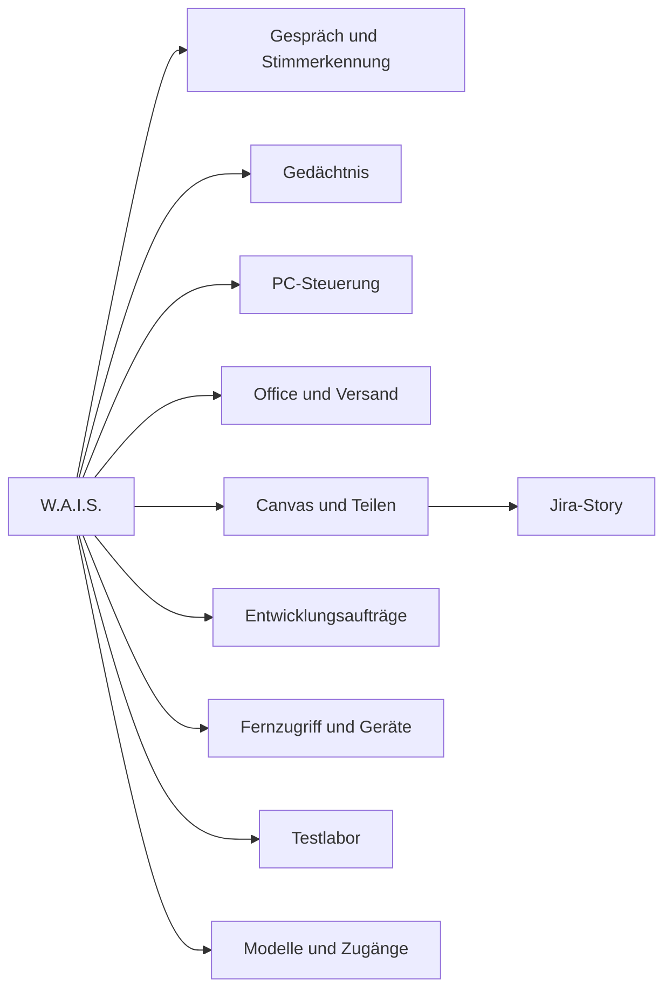

# Produktübersicht W.A.I.S.

| | |
|---|---|
| Zweck | Erklärt, was W.A.I.S. ist, für wen es gedacht ist, was es kann, was es bewusst nicht tut und wie weit das Produkt ist. |
| Zielgruppe | Administratoren, Projektleitung, Fachbereiche, neue Mitarbeitende und alle, die W.A.I.S. einführen oder bewerten |
| Dokumentart | Erklärung |
| Stand | 19.11.2026, geprüft gegen Commit 497e3ce |
| Quellen | `README.md`, `CHANGELOG.md`, `CLAUDE.md`, `voice-core/tools.py`, `voice-core/rechte.py`, `voice-core/labor.py`, `host/wamo_host.py`, `ui/src/lib/einstellungenAbschnitte.ts` |

## 1. Zweck und Nutzen

W.A.I.S. (WAMOCON's Artificial Intelligence System, gesprochen „Wais“ wie das englische „ways“) ist der Sprachassistent der WAMOCON GmbH. Man spricht mit ihm oder tippt, er antwortet gesprochen und legt Ergebnisse, die man lesen muss, als Tabelle, Code, Dokument oder Diagramm auf eine Fläche neben dem Gespräch (das Canvas). Auf Wunsch bedient er den eigenen Windows-Laptop der Person, erstellt Office-Dateien, bereitet Mails und Teams-Nachrichten vor, startet Entwicklungsaufträge und merkt sich, was für die Arbeit wichtig ist.

Der Nutzen liegt in drei Punkten:

- Routinearbeit am Rechner geht per Zuruf, ohne Wechsel zwischen Programmen.
- Wissen der Firma steht in einem gemeinsamen Gedächtnis, das Admins freigeben.
- Alles, was etwas verändert oder nach außen geht, braucht den Klick der Person auf einer Freigabekarte. Das Sprachmodell kann keine Freigabe selbst erteilen.

Quellen: `README.md` (Kopf und Abschnitt „Sicherheitsmodell“), `host/wamo_host.py` (Kopfkommentar), `voice-core/persona.py`.

## 2. Zielgruppen

| Gruppe | Wer | Was sie bekommt |
|---|---|---|
| Administratoren | Profile mit der Rolle `admin` | Alle Funktionen der Mitglieder, dazu Verwaltung (Geräte freigeben, Gedächtnis-Vorschläge entscheiden, Fernzugriff, Änderungen, Übersicht neuer Mitglieder) und PC-Steuerung ohne weitere Freischaltung |
| Mitglieder | Profile mit der Rolle `mitglied` (laut `README.md` zunächst ein Pilot mit sieben Kollegen) | Gespräch, persönliches Gedächtnis, Canvas, Teilen, Bürogeräte. PC-Steuerung und Entwicklungsaufträge nur, wenn ein Admin sie je Person am Server freischaltet |
| Besucher des Testlabors | Laborprofile (`labor_art` Platz oder Schaufenster, Rolle `mitglied`) | Ein enges Gespräch mit Testwerkzeugen (Uhrzeit, Websuche, Canvas, Test-Jira, Test-Mail), sonst nichts |

Die genaue Zuordnung steht in [Rollen und Rechte](rollen-und-rechte.md). Quellen: `voice-core/rechte.py`, `voice-core/labor.py`, `voice-core/entwicklung_betrieb.py`.

## 3. Leistungsumfang je Fachgebiet

Die Funktionen im Einzelnen stehen im [Funktionskatalog](funktionskatalog.md). Hier die Kurzfassung.

**Sprachgespräch und Stimmerkennung.** Livegespräch im Browser oder in der Desktop-App mit Unterbrechen mitten im Satz, Live-Untertiteln und alternativer Texteingabe. Spracherkennung und Sprachausgabe laufen standardmäßig über Soniox, wahlweise mit Modellen im Haus. Das Gesprächsmodell ist standardmäßig Claude Haiku. Die Stimmerkennung ist freiwillig: Die Person lernt mit ausdrücklicher Einwilligung einen Stimmabdruck ein (Zahlen, keine Aufnahme), je Mikrofon einen, höchstens drei. Seit dem 18.11.2026 ist der Standardmodus „beobachten“: Die Erkennung misst und zeigt, sperrt aber nichts. Der Modus „streng“ (nur die eigene Stimme wird gehört und darf unterbrechen) gilt nur auf ausdrücklichen Wunsch. Ausnahme: Mitglieder mit PC-Steuerung brauchen für gesprochene PC-Befehle einen eingelernten Abdruck, sonst gehen diese Befehle nur getippt. Ein Mikrofontest in den Einstellungen misst Pegel und Rauschen, ohne dass W.A.I.S. dazwischenredet. Quellen: `voice-core/bot.py`, `voice-core/stimme_gate.py` (`STANDARD_MODUS`), `voice-core/stimme_einwilligung.py`, `voice-core/stimme_mikrofon.py`, `docs/stimme-recherche-2026-11-18.md`.

**Gedächtnis.** Persönliche Einträge (Eigenschaften, Vorlieben, Verhalten) sieht nur die Person selbst. Gemeinsame Einträge (Firma, Projekte, Abläufe) wirken erst nach der Freigabe durch einen Admin, ausdrücklich für alle gemerkte Einträge eines Admins gelten sofort. Inhalte aus dem Gedächtnis gelten für das Sprachmodell als Daten, nie als Anweisung. Quellen: `voice-core/tools.py` (`merken_status`), `voice-core/gedaechtnis_api.py`, `README.md` (Abschnitt „Nutzer und Gedächtnis“).

**PC-Steuerung.** Über den Host auf dem eigenen Windows-Laptop: Programme und Webseiten öffnen, Fenster wechseln, Elemente lesen und bedienen, tippen, scrollen, Browserinhalte lesen, PowerShell nur lesend, Bildschirm ansehen und klicken, Live-Bild des eigenen Laptops. Jedes Werkzeug hat eine Risikoklasse: lesen sofort, ändern protokolliert, kritisch nur nach Freigabekarte, gesperrt nie. Die Steuerung ist je Sitzung ein Schalter und standardmäßig aus. Quellen: `voice-core/pc_host.py` (`LLM_TOOLS`), `host/wamo_host.py`, `voice-core/pc_mitglied.py`.

**Office und Versand.** Ein Canvas-Element lässt sich als Word, Excel, PowerPoint, PDF, CSV oder Markdown im Ordner `Dokumente\WAIS` speichern. Mails bereitet W.A.I.S. über Outlook vor und sendet nur nach Klick auf die Karte, Teams-Nachrichten öffnet es nur mit dem Text im Eingabefeld (senden muss die Person selbst), OneNote-Seiten entstehen im Notizbuch „W.A.I.S.“ erst nach der Karte. Alle vier Wege hängen am Server-Schalter `WAMO_OFFICE`. Quellen: `voice-core/office_werkzeuge.py`, `outlook_werkzeuge.py`, `teams_werkzeuge.py`, `onenote_werkzeuge.py`, `docs/office-und-versand.md`.

**Canvas.** Tabelle, Code, Dokument, Mermaid-Diagramm und Bild (als Verweis). Reiter lassen sich überarbeiten, schließen und über die Historie wieder öffnen, kopieren, herunterladen und mit anderen Profilen teilen (lesen oder bearbeiten). Quellen: `voice-core/tools.py`, `voice-core/canvas_historie.py`, `voice-core/teilen.py`, `ui/src/components/Canvas.tsx`.

**Entwicklungsaufträge.** W.A.I.S. bereitet einen Auftrag für Claude Code als Karte vor, die Person startet ihn per Klick. Der Lauf findet in einer Sandbox auf Sokrates-2 statt, mit ECC-Skills und REA-Werkzeugen je Auftragsart (14 Arten, von Planung bis Recherche). Push und Pull Request gibt es nur nach dem Klick auf „Einreichen“, gemergt wird nie durch W.A.I.S. Aufträge lassen sich mit prüfbaren Kriterien in Runden ausführen und für später speichern. Höchstens sechs Aufträge laufen gleichzeitig, höchstens drei je Person. Quellen: `voice-core/dev_agent.py`, `voice-core/werkzeugkarte.py`, `voice-core/entwicklung_betrieb.py`, `infra/sokrates2/wamo_job_dispatch.py`, `docs/persoenliche-zugaenge.md`.

**Fernzugriff und Geräte.** Admins öffnen den Desktop der Sparks (Sokrates 1, Sokrates 2, Caesar) über ein Gateway, die Sitzung startet immer die Person selbst. Jeder persönliche Laptop wird einmal gebunden und bekommt einen eigenen Tunnel, ein Admin gibt Geräte in der Geräteverwaltung frei. Gemeinsame Bürogeräte (Server, Drucker, Scanner, Router, NAS, Fernseher, Lautsprecher, Steckdosen) zeigt die Büro-Karte, per Zuruf lassen sich Fernseher, Lautsprecher und Steckdosen schalten, drucken geht nur mit Karte. Quellen: `voice-core/rd_api.py`, `voice-core/geraete_werkzeuge.py`, `voice-core/buero_api.py`, `voice-core/geraet_api.py`, `geraete/README.md`.

**Testlabor.** Für den Labortag gibt es eigene Laborprofile (`labor-01` bis `labor-09` laut `docs/testlabor-wamo.md`, Entscheidung E11). Besucher führen ein Gespräch und arbeiten mit einem Test-Jira (`labor-dienst/`), Mails zeigen nur eine Bestätigung. Gesprächstext wird nur mit Einwilligung gespeichert und nach 14 Tagen gelöscht (Löschfrist 11.12.2026). Quellen: `voice-core/labor.py`, `voice-core/labor_werkzeuge.py`, `labor-dienst/`, `docs/testlabor-wamo.md`, `docs/labor-runbook.md`.

**Jira.** Aus einem Canvas-Dokument entsteht auf Wunsch eine User Story (Typ Story) in Jira, aber erst nach dem Klick auf „Freigeben“ und nie per Sprache. Das gibt es nur für Admins im Büro, mit eingeschaltetem Schalter `WAMO_JIRA` und nie im Labor. Quellen: `voice-core/jira_werkzeuge.py`, `voice-core/jira_client.py`, `docs/jira-benutzer-einrichten.md`.

**Modelle und Zugänge.** Jedes Profil hat einen Modellzugang: ein eigener Claude-Schlüssel, ein eigener Claude-Code-Token oder nur Hausmodelle (über LiteLLM, ohne Anthropic). Ein Boss-Baustein wählt das Modell je Aufgabe nach Güte, Antwortzeit und Erreichbarkeit. Modelle für Gespräch, Bilder und Hintergrund sowie Hören und Stimme (Soniox oder im Haus) wählt die Person in den Einstellungen. Der Verbrauch des Claude-Abos wird angezeigt. Quellen: `voice-core/modellzugang.py`, `voice-core/modellwahl.py`, `voice-core/boss.py`, `voice-core/sprache_anbieter.py`, `voice-core/kontingent.py`.

### Funktionslandkarte

## 4. Bewusste Abgrenzung

Was W.A.I.S. nicht tut oder nur nach Freigabe durch die Person tut:

| Grenze | Beleg |
|---|---|
| Das Sprachmodell erteilt nie eine Freigabe und bedient die eigene Freigabekarte nie. Kritische Aktionen laufen erst nach dem Klick der Person, genau einmal und befristet. | `host/wamo_host.py` (Kopfkommentar), `README.md` (Abschnitt „Sitzungen, Anmeldung und Freigaben“) |
| W.A.I.S. steuert nur den eigenen Laptop der Person, nie fremde PCs, und bei gesperrtem Bildschirm gar nicht. | `voice-core/pc_geraet.py`, `README.md` („Gesperrter PC“) |
| Teams-Nachrichten sendet W.A.I.S. nie selbst. Mails gehen nur nach dem Klick auf die Karte, im neuen Outlook sendet die Person selbst. | `voice-core/teams_werkzeuge.py`, `voice-core/outlook_werkzeuge.py` |
| Pull Requests merged W.A.I.S. nie. Push und Pull Request erst nach „Einreichen“. | `docs/persoenliche-zugaenge.md` (Plan C) |
| Inhalte aus Web, Dateien, Bildschirm und Gedächtnis sind Daten, nie Anweisungen. Nach solchen Inhalten gibt es für Mitglieder für jede Änderung am Laptop eine Karte. | `voice-core/pc_mitglied.py`, `voice-core/tools.py` |
| Passwörter und Schlüssel gehören nicht ins Gespräch: Ein Schlüssel im Gesagten wird entfernt, `merken` speichert keine Zugangsdaten. | `voice-core/schluessel_filter.py`, `voice-core/tools.py` |
| Das Live-Bild wird nie aufgezeichnet und geht nie an ein Sprachmodell. | `voice-core/bildstrom.py` |
| Den Bildschirm eines Laptops auf einen Fernseher spiegeln kann W.A.I.S. noch nicht. | `voice-core/geraete_werkzeuge.py` (Beschreibung `buerogeraet_steuern`) |
| Die Stimmerkennung ist keine Freigabe und kein Schutz gegen Aufnahmen oder geklonte Stimmen. | `README.md` (Abschnitt „Sicherheitsmodell“) |
| Ein Weckwort („Hey WAMO“) gibt es noch nicht. | `CLAUDE.md` (Zeile „Weckwort (später)“) |
| Router lassen sich nur lesend abfragen, schreibend nur als Entwurf. | `README.md` (Stand 10.11.2026), `geraete/README.md` |
| Laborprofile haben nie Gedächtnis, PC-Werkzeuge, Entwicklungsaufträge, Fernzugriff, Geräte, Stimmerkennung oder Teilen. | `voice-core/labor.py` (`WERKZEUGE_BASIS`, Routenliste) |

## 5. Betriebsarten

| Betriebsart | Wo läuft der Kern | Wo läuft die Oberfläche | PC-Werkzeuge |
|---|---|---|---|
| Büro | Sokrates-2 (Dienst `wamo-core`, HTTPS) | Desktop-App oder Browser (Container `wamo-ui` auf Sokrates-2) | Host des Laptops über einen SSH-Rücktunnel je Gerät, nur für das gebundene Profil |
| Unterwegs | Auf dem eigenen PC (Entwicklerbetrieb, Standard ohne Installer) | Desktop-App | Host per stdio |

Die installierte App (Installer `WAIS-Setup-<Version>.exe`) kennt nur die Betriebsart Büro. Im Browser gibt es ebenfalls nur Büro. Unterwegs im Sinn von außerhalb des Büros erreicht man das Büronetz über WireGuard. Quellen: `README.md` (Abschnitte „Betriebsart Büro und Unterwegs“ und „Windows-Installer“), `desktop/installation.js`.

## 6. Produktstand

Aktuelle Version: 0.6.0 (`desktop/package.json`, `ui/package.json`, `CHANGELOG.md`, 17.11.2026). Das Format des Änderungsprotokolls folgt Keep a Changelog und Semantic Versioning.

| Version | Datum | Inhalt in einem Satz |
|---|---|---|
| 0.1.0 | 22.10.2026 | Erstes Release: Gespräch mit Soniox und Claude, Mehrprofil-Anmeldung mit zweitem Faktor, Oberfläche im WMC-Design, PC-Host mit Freigaben, Gedächtnis, Modellzugang, Entwicklungsaufträge in der Sandbox, Geräte und Tunnel |
| 0.2.0 | 15.11.2026 | Neuer Name W.A.I.S., Office-Funktionen (Datei, Outlook, Teams, OneNote), Jira-Story, PC-Steuerung im Browser, Stimmabdruck, Büro-Karte, Vorgänge-Tafel und Vorbereitung von Testlabor und Entwicklungsaufträgen im Büro |
| 0.3.0 | 15.11.2026 | Prüfliste „Erste Schritte“ und signierte Updates der Desktop-App |
| 0.4.0 | 16.11.2026 | Ausrollen an Mitglieder: Installer vom Server, Erstanmeldung mit Passwortwechsel, PC-Steuerung und Entwicklungsaufträge für Mitglieder, Hausmodelle für Aufträge, gleichzeitige Aufträge, Übersicht neuer Mitglieder |
| 0.4.1 | 16.11.2026 | Härtung: Karte beim Lesen sensibler Host-Daten, Karte für Mitglieder nach Fremdinhalt, Einwilligung fürs Bildschirmbild |
| 0.5.0 | 16.11.2026 | Strengerer Stimmwächter, Hören und Stimme im Haus wählbar, Modelle je Person umschaltbar, gestreamte Stimme im Haus |
| 0.6.0 | 17.11.2026 | Nur die eingelernte Stimme hört und unterbricht (im Modus streng), Mikrofonwahl und Pegelwarnung, Werkzeuge für das Testlabor, Admin-Ports nur für freigegebene Quellen |

Nach 0.6.0 sind im Repo ohne Eintrag im Änderungsprotokoll (Abschnitt „Unveröffentlicht“ ist leer) unter anderem gelandet: persönliche GitHub-Zugänge für Entwicklungsaufträge (Plan C, laut `README.md` live seit 18.11.2026), gespeicherte Aufträge, Fehlerbuch (`fehler_erklaeren`), Canvas schließen mit Historie, Bildern und Dateien, Stimmabdruck je Mikrofon (Migration 0029), Mikrofontest ohne W.A.I.S. und der Wechsel des Stimm-Standards auf „beobachten“. Quellen: `CLAUDE.md` (Namensvertrag), `git log` ab `v0.6.0`.

## 7. Offene Punkte und Ausbaustufen

Die Liste stammt aus `README.md` und ist teilweise älter als der Code. Wo der Code oder das Änderungsprotokoll etwas überholt, steht es dabei.

| Punkt | Stand laut README | Einordnung |
|---|---|---|
| TR-064-Zugang der FRITZ!Box für die Erkennung unbekannter Geräte | offen, Stand 10.11.2026 | Ohne ihn zeigt die Büro-Karte keine Zahl |
| Sprachmessung der Persona-Schalter (`WAMO_PERSONA_ABNAHME`, `WAMO_PERSONA_GESPRAECH`, `WAMO_WARTESATZ_MODELL`) | offen, Stand 10.11.2026 | ungemessen |
| Befehlskriterien für Aufträge auf Sokrates-2 (Dispatcher-Befehl `pruefen`) | gebaut, standardmäßig aus, Stand 10.11.2026 | Für Mitglieder bleiben Befehlskriterien aus (`voice-core/dev_agent.py`) |
| Router schreibend | nur als Entwurf, Stand 10.11.2026 | `geraete/README.md` |
| Codesignatur des Installers | Weg eingebaut, Zertifikat folgt (Entscheidung N8) | Ohne Zertifikat warnt Windows SmartScreen |
| Selbstüberarbeitung (Release-Dienst, Anker, Karte „Änderungen“) | Stufe 0 vorbereitet, Stand 20.10.2026 | Ob der Dienst in Betrieb ist, ist im Repo nicht belegt |
| Migrationen 0010, 0011 und 0013 auf `wamo_prod` | nicht als angewendet belegt | laut `README.md` Stand 10.11.2026 |
| Ausbaustufen P4 (eigene Sprachmodelle über LiteLLM) und P5 (Hören und Sprechen im Haus) | Stand 20.10.2026 | Hausmodelle, Hören und Stimme im Haus sind inzwischen wählbar (0.5.0), die Abnahme der Modelle im Haus steht laut README aus |
| Weckwort „Hey WAMO“ | später | `CLAUDE.md` |
| Testlabor | Labortag 28.11.2026 laut `docs/labor-restplan.md`, Löschfrist 11.12.2026 | `docs/persoenliche-zugaenge.md` nennt den 05.12. für den Labortag, der Widerspruch ist im Repo nicht aufgelöst |
| Persönliche Zugänge für Vercel, Supabase und weitere Konnektoren | Ausbaustufe nach dem Labortag | `docs/persoenliche-zugaenge.md` |

## Weiterführend

- [Funktionskatalog](funktionskatalog.md): alle Funktionen mit stabilen IDs
- [Rollen und Rechte](rollen-und-rechte.md): Rechtematrix und Freigabestufen
- [Benutzerhandbuch](../nutzung/benutzerhandbuch.md): Anleitung für Mitglieder
- [Glossar](../glossar.md)
- [Recherche zur Sprechererkennung](../../stimme-recherche-2026-11-18.md)
- Bestehende Planpapiere: [Testlabor](../../testlabor-wamo.md), [Office und Versand](../../office-und-versand.md), [Ausrollen neuer Nutzer](../../ausrollen-neue-nutzer.md), [Persönliche Zugänge](../../persoenliche-zugaenge.md)
