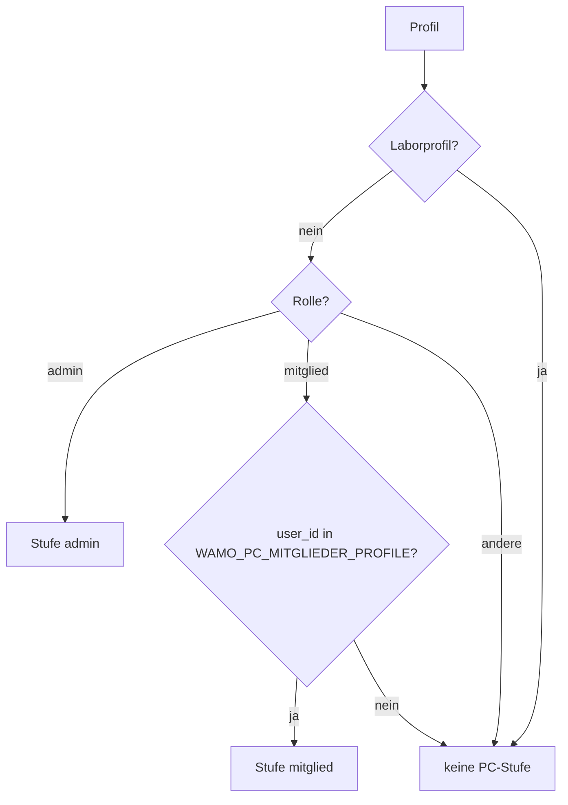

# Rollen und Rechte

| | |
|---|---|
| Zweck | Beschreibt, wer in W.A.I.S. was darf: Rollen, Profilzustände, zweiter Faktor, PC-Stufe, Freigabestufen und die Grenzen der Laborprofile, jeweils mit Beleg im Code. |
| Zielgruppe | Administratoren, Sicherheits- und Datenschutzverantwortliche, Testmanagement, Entwickler |
| Dokumentart | Referenz mit Erklärungen |
| Stand | 19.11.2026, geprüft gegen Commit 497e3ce |
| Quellen | `voice-core/auth_gate.py`, `voice-core/rechte.py`, `voice-core/pc_mitglied.py`, `voice-core/labor.py`, `voice-core/entwicklung_betrieb.py`, `voice-core/bot.py`, `host/wamo_host.py`, `geraete/wamo_geraete/dienst.py` |

## 1. Grundsatz

Rechte werden dort durchgesetzt, wo man sie nicht umgehen kann, nicht im Gespräch und nicht in der Oberfläche. Die Rolle kommt allein aus dem geprüften Token und dem Profil in der Datenbank (`voice-core/auth_gate.py`, `Identity`), nie aus dem, was jemand sagt oder die Oberfläche meldet. Die Schichten:

| Schicht | Was sie prüft | Beleg |
|---|---|---|
| Zugangstor des Kerns | Token (Signatur, Ablauf, Aussteller), zweiter Faktor aal2, Höchstalter der Anmeldung, aktives Profil, Stand der Erstanmeldung | `voice-core/auth_gate.py` |
| Routen des Kerns | Rolle `admin` bei Verwaltungsrouten, Sperre für Laborprofile | `voice-core/*_api.py`, `voice-core/labor.py` |
| Werkzeuge im Kern | PC-Stufe, Schalter, Stimme, Fremdinhalt, Karten | `voice-core/rechte.py`, `voice-core/pc_mitglied.py`, `voice-core/stimme_gate.py` |
| Host am Laptop | Risikoklassen, Freigabe-Schlüssel, Sperrerkennung, Zielfenster | `host/wamo_host.py` |
| Datenbank | Zeilensicherheit (RLS) je Rolle, Funktionen mit eigener Adminprüfung | `supabase/migrations/`, `CLAUDE.md` (Regeln) |

## 2. Rollen

| Rolle | Wo festgelegt | Beschreibung |
|---|---|---|
| `admin` | Spalte `rolle` in `<schema>.profiles` (`ROLLEN` in `voice-core/memory.py`) | Volle Funktionen und Verwaltung. PC-Stufe `admin` ohne weitere Freischaltung |
| `mitglied` | dieselbe Spalte | Gespräch, persönliches Gedächtnis, Canvas, Teilen, Bürogeräte. Weitere Rechte nur per Freischaltung je Person |
| Laborprofil | `labor_art` (`platz` oder `schaufenster`), Rolle immer `mitglied`, `aktiv = false` und eigene Freischaltung `labor_aktiv` | Besucher des Testlabors. Nie Admin (`Identity.is_admin` ist bei gesetzter `labor_art` falsch) |

Außerdem hat jedes Profil eine Anrede (`du` oder `sie`, `ANREDEN`), sie beeinflusst nur die Sprache. Konten legt nur ein Admin an, die Registrierung ist geschlossen (`CLAUDE.md`, Architektur-Entscheidung 1). Eine unbekannte Rolle gilt in der Oberfläche wie `mitglied` (`ui/src/lib/einstellungenAbschnitte.ts`), im Kern hat sie keine PC-Stufe (`voice-core/rechte.py`).

## 3. Profilzustände und Zugang

### 3.1 Zustände eines Profils

| Zustand | Bedeutung | Wirkung | Beleg |
|---|---|---|---|
| aktiv | `profiles.aktiv = true` | Zugang möglich (Cache 60 Sekunden) | `voice-core/auth_gate.py` (`PROFILE_HIT_SECS`) |
| inaktiv oder gesperrt | `aktiv = false`, Konto in GoTrue gesperrt (`wamo_nutzer.py anlegen`, `sperren`) | Zugang abgelehnt (Cache 10 Sekunden); eine laufende Sitzung endet binnen einer Minute | `voice-core/auth_gate.py`, `voice-core/bot.py` (`SessionGuard`), `scripts/wamo_nutzer.py` |
| Erstanmeldung `offen` | Startpasswort noch nicht gewechselt | Nur `GET /wamo/api/erstanmeldung` und `POST /wamo/api/erstanmeldung/passwort` erlaubt, alles andere 403 mit Code `passwort_wechsel_noetig` | `voice-core/auth_gate.py`, `voice-core/erstanmeldung_api.py` |
| Erstanmeldung `abgelaufen` | Frist des Startpassworts vorbei | 403 mit Code `startpasswort_abgelaufen`, Satz „Dein Startpasswort ist abgelaufen. Bitte melde dich bei Niko.“ | `voice-core/auth_gate.py` |
| Erstanmeldung `keine` oder `erledigt` | kein Wechsel nötig | normaler Zugang | `voice-core/auth_gate.py` (`ERSTANMELDUNG_FREI`) |
| Laborprofil aktiv | `labor_aktiv` gesetzt und Felder stimmig (Rolle `mitglied`, Platz 1 bis 16) | Zugang nur zu Start, Offer, Laborrouten (und beim Schaufenster `vorgaenge`) | `voice-core/labor.py` |

Das Profil wird in einer laufenden Sitzung jede Minute neu geprüft. Die Sitzung endet, wenn das Profil nicht mehr aktiv ist, sich die Rolle ändert, die Erstanmeldung wieder offen oder abgelaufen ist, die Anmeldung zu alt wird oder die maximale Sitzungsdauer erreicht ist (`voice-core/bot.py`, `SessionGuard.check`). Ein Admin setzt Konten mit `scripts/wamo_nutzer.py` (`anlegen`, `freischalten`, `zuruecksetzen`, `passwort`, `umbenennen`, `sperren`, `austreten`, `liste`) auf die gewünschten Zustände.

### 3.2 Zweiter Faktor und Anmeldealter

| Regel | Wert | Beleg |
|---|---|---|
| Zweiter Faktor | Pflicht (Claim `aal` = `aal2`), ohne ihn 403 | `voice-core/auth_gate.py` |
| Höchstalter der Anmeldung | gemessen am frühesten Zeitstempel in `amr`; Standard 168 Stunden, erlaubt mehr als 0 und höchstens 720 (`WAMO_ANMELDUNG_MAX_STUNDEN`); im Browser 24 Stunden | `voice-core/auth_gate.py`, `ui/src/lib/anmeldung.ts` |
| Statuscodes | 401 Token ungültig oder abgelaufen, 403 zweiter Faktor fehlt oder kein aktives Profil, 503 Anmeldedienst oder Datenbank nicht erreichbar (fail closed) | `voice-core/auth_gate.py` |
| Frischer zweiter Faktor (höchstens 120 Sekunden alt) | für ändernde Aktionen der Geräteverwaltung und für die Fernanfrage des Live-Bilds; für den Fernzugriff nur, wenn `WAMO_RD_ANMELDUNG_MAX_MIN` gesetzt ist | `voice-core/geraete_admin_api.py`, `voice-core/bild_fern.py`, `voice-core/rd_api.py` |

### 3.3 Zustände eines Geräts (Laptop)

| Zustand | Bedeutung | Beleg |
|---|---|---|
| `beantragt` | Gerät gebunden, wartet auf einen Admin. Jedes Admin-Profil und jeder Gerätewechsel startet hier | `README.md` (Abschnitt „Geräte, Tunnel je Gerät und Geräteverwaltung“) |
| `aktiv` | freigegeben, zählt für den Tunnel. Ein Mitglied ohne früheres Gerät wird sofort `aktiv` | `voice-core/geraet_api.py` |
| `gesperrt` | von einem Admin gesperrt, mit Grund, wieder entsperrbar | `voice-core/geraete_admin_api.py` |
| `widerrufen` | endgültig | `voice-core/geraete_admin_api.py` |

## 4. Rechtematrix

Die Zeilen fassen Funktionen aus dem [Funktionskatalog](funktionskatalog.md) zusammen. Spalten: **Admin** (`admin`), **Mitglied** (ohne Freischaltung), **Mitglied freigeschaltet** (M* im Katalog), **Labor**. „ja, Karte“ heißt: mit Freigabekarte. „Schalter“ heißt: zusätzlich nur, wenn der Server-Schalter gesetzt ist. Welche Schalter am Server wirklich gesetzt sind, belegt das Repo nicht.

| Funktion (Katalog-IDs) | Admin | Mitglied | Mitglied freigeschaltet | Labor | Beleg |
|---|---|---|---|---|---|
| Gespräch, Text, Untertitel, Verlauf (GES-01 bis 09) | ja | ja | ja | ja | `voice-core/bot.py`, `voice-core/labor.py` |
| Uhrzeit, Websuche, Canvas zeigen (GES-10, 11, CAN-01) | ja | ja | ja | ja, Websuche mit Grenze je Sitzung | `voice-core/labor.py` (`WERKZEUGE_BASIS`) |
| Fehler erklären, Nachladen, Boss-Aufgaben (GES-12 bis 14) | ja | ja | ja | nein | `voice-core/bot.py`, `voice-core/labor.py` |
| Persönliches Gedächtnis (GED-01, 03, 05) | ja | ja | ja | nein | `voice-core/tools.py`, `voice-core/labor.py` |
| Gemeinsames Gedächtnis: sofort wirksam (GED-02) | ja, nur bei ausdrücklichem „für alle“ ohne Fremdinhalt | nein, nur Vorschlag | nein, nur Vorschlag | nein | `voice-core/tools.py` (`merken_status`) |
| Vorschläge freigeben oder ablehnen (GED-04, 06) | ja | nein | nein | nein | `voice-core/gedaechtnis_api.py` (403 ohne Admin) |
| Stimmabdruck einlernen, löschen (STI-01 bis 03) | ja | ja | ja | nein, keine Stimmsitzung | `voice-core/stimme_sitzung.py` (`StimmSitzung.fuer`) |
| Canvas Bild, schließen, Historie, Herunterladen (CAN-02 bis 08) | ja | ja | ja | nein | `voice-core/canvas_historie.py`, `voice-core/labor.py` |
| Teilen und geteilte Arbeit (TEI-01 bis 05) | ja | ja | ja | nein | `voice-core/teilen_api.py`, `voice-core/labor.py` |
| Bürogeräte per Sprache: Status, steuern, drucken, scannen, NAS (FER-08 bis 13) | ja | ja | ja | nein | `geraete/wamo_geraete/dienst.py` (`WERKZEUGE`), `voice-core/geraete_werkzeuge.py` |
| Router-Geräte und unbekannte Geräte (FER-14, 15) | ja | nein | nein | nein | `geraete/wamo_geraete/dienst.py` (`ADMIN_FAEHIGKEITEN`) |
| Büro-Karte ansehen (FER-06) | ja | ja | ja | nein | `voice-core/buero_api.py` |
| Büro-Karte schalten per Knopf (FER-07) | ja | nein | nein | nein | `voice-core/buero_api.py` (`STEUER_ROLLEN`) |
| PC-Steuerung, Host-Werkzeuge (PC-01 bis 20) | ja, Schalter je Sitzung | nein | ja, mit Schutz (Abschnitt 5) | nein | `voice-core/rechte.py`, `voice-core/pc_host.py` |
| Bildschirm ansehen und klicken, Live-Bild (PC-21 bis 23) | ja | nein | ja, Einwilligung fürs Bild einmal je Sitzung per Karte | nein | `voice-core/pc_mitglied.py`, `voice-core/bildstrom.py` |
| Office: Datei, Mail, Teams, OneNote (OFF-01 bis 10) | ja, Schalter | nein | ja, Schalter, Karte nach Fremdinhalt | nein | `voice-core/office_werkzeuge.py` (`pc_person`) |
| Jira-Story (JIR-01 bis 03) | ja, Büro und Schalter, Karte | nein | nein | nein | `voice-core/jira_werkzeuge.py` (`sitzung_bauen`) |
| Entwicklungsaufträge (ENT-01 bis 12) | ja, Schalter, im Büro Profilliste | nein | ja, nur im Büro und mit Schalter (Abschnitt 7) | nein | `voice-core/entwicklung_betrieb.py`, `voice-core/bot.py` |
| Persönlicher GitHub-Zugang (ENT-09) | ja, mit Zulassung | nein | ja, mit Zulassung | nein | `voice-core/github_zugang_api.py` |
| GitHub-Rechte je Profil, Neue Mitglieder (ENT-11, ADM-01) | ja | nein | nein | nein | `voice-core/github_zugang_api.py`, `voice-core/mitglieder_admin_api.py` |
| Fernzugriff auf die Sparks (FER-01, 02) | ja, Schalter | nein | nein | nein | `voice-core/rd_api.py` (403 ohne Admin) |
| Geräteverwaltung, Änderungen (FER-04, ADM-02) | ja, frischer Code | nein | nein | nein | `voice-core/geraete_admin_api.py`, `voice-core/release_api.py` |
| Eigenen Laptop binden (FER-03) | ja, startet als beantragt | ja, bei erstem Gerät sofort aktiv | ja | nein | `voice-core/geraet_api.py` |
| Modellzugang, Modelle, Sprache (MOD-01 bis 05, 08) | ja | ja | ja | nein, Soniox fest | `voice-core/modellzugang_api.py`, `voice-core/sprache_anbieter.py` |
| Verbrauch (MOD-06) | ja | nur mit eigenem Claude-Code-Token | wie Mitglied | nein | `ui/src/lib/einstellungenAbschnitte.ts` (`auchMitToken`) |
| Erstanmeldung, Erste Schritte, Installer (KON-03 bis 05) | ja | ja | ja | nein | `voice-core/erstanmeldung_api.py`, `voice-core/einrichtung_api.py`, `voice-core/verteilung_api.py` |
| Testwerkzeuge: Tickets, Test-Mail (LAB-02 bis 04) | nein | nein | nein | ja, mit Karte | `voice-core/labor.py` (`WERKZEUGE_TICKET`) |

## 5. PC-Stufe

Alle Stellen, die über PC-Werkzeuge entscheiden, fragen dieselbe Funktion: `rechte.pc_stufe(identity)` liefert `admin`, `mitglied` oder nichts (`voice-core/rechte.py`). Dazu gehören der Host-Client, das Nachverbinden des Tunnels, der Schalter und die Freigabekarten in `voice-core/bot.py`, die Office-Werkzeuge, das Live-Bild und der Schutz der Mitglieder.

Regeln der Freischaltung (`voice-core/rechte.py`):

- Die Liste `WAMO_PC_MITGLIEDER_PROFILE` enthält `user_id` durch Komma getrennt, höchstens 64 Einträge (so viele Tunnelplätze gibt es). Ein einziger ungültiger Eintrag macht die ganze Liste ungültig, dann hat niemand die Stufe (fail closed, eine Zeile im Journal).
- Die Liste kommt nur vom Server über `wamo-core-env`, Standard leer heißt aus. Der frühere kernweite Schalter `WAMO_PC_MITGLIEDER` wirkt nicht mehr.
- Admin-Rechte am Server (Geräte freigeben, Gedächtnis, Konten) hängen nie an der PC-Stufe, sondern an der Rolle.

**Werkzeuge:** Seit dem 16.11.2026 bekommt ein freigeschaltetes Mitglied für seinen eigenen Laptop dieselbe Werkzeugliste wie ein Admin (`pc_host.werkzeuge_fuer`, 19 Werkzeuge in `LLM_TOOLS`). Dazu kommen für beide die Werkzeuge des Kerns (Bildschirm, Office) jeweils nur mit dem Server-Schalter.

**Zusätzlicher Schutz nur für die Stufe `mitglied`** (`voice-core/pc_mitglied.py`, `MitgliedSchutz.vorab`), in dieser Reihenfolge und jeweils fail closed:

| Nr | Prüfung | Wirkung |
|---|---|---|
| 1 | Werkzeug steht in `WERKZEUGE_MITGLIED` (Liste der Admins plus `KERN_WERKZEUGE`) | sonst `blocked` |
| 2 | Wartet eine Karte des Kerns noch | alle PC-Werkzeuge der Sitzung ruhen (`wartet`) |
| 3 | Pflichtstufe der Stimme: gesprochene Befehle nur mit eingelerntem Stimmabdruck, sonst nur getippt | `blocked`; seit 18.11.2026 entscheidet das Stimmurteil nur im Modus streng, ohne Abdruck bleibt Sprache gesperrt (`stimme_gate.pflicht_grund`) |
| 4 | Einwilligung fürs Bildschirmbild (`bildschirm_ansehen`, `auf_bildschirm_klicken`): einmal je Sitzung per Karte | ohne Ja kein Bild an das Bildmodell |
| 5 | Fremdinhalt im Zug oder früher in der Sitzung | jedes ändernde Werkzeug nur mit Karte des Kerns (Aktion `aendern`), bis zum Ende der Sitzung (`NACHWIRKUNG_MITGLIED`) |

Die Karte des Kerns zeigt jedes Argument vollständig (jedes Enter als ⏎); enthält ein Argument Zeichen, die sie nicht zeigen kann, oder ist es länger als 1500 Zeichen, wird nichts ausgeführt. Lesende Werkzeuge (`LESEN_MITGLIED`) und Werkzeuge mit eigener Karte (`EIGENE_KARTE`: `github_repo_anlegen`, `outlook_senden`, `teams_nachricht`, `onenote_seite`) bekommen keine zweite Karte. Jeder zugelassene Aufruf steht mit dem Präfix `WAMO-MITGLIED`, der Kurzkennung des Profils und dem Werkzeugnamen im Journal, ohne Argumente. In `actions` steht für Mitglieder bei Office kein Dateiname.

## 6. Freigabestufen und Karten

### 6.1 Risikoklassen am Host

| Klasse | Verhalten | Beispiele |
|---|---|---|
| `read` | sofort | `system_info`, `fenster_auflisten`, `browser_lesen`, `powershell_lesen` mit reinen Get- und Test-Befehlen |
| `change` | sofort, protokolliert im Audit-Log | `webseite_oeffnen`, `programm_oeffnen`, `dark_mode`, `git_klonen`, `ordner_anlegen` |
| `critical` | nur als Freigabe-Anfrage, ausgeführt erst nach dem Klick | `github_repo_anlegen`, verändernde PowerShell-Befehle, Senden in Mail- und Messenger-Fenstern |
| `blocked` | nie | zum Beispiel Befehle mit `bcdedit`, `vssadmin`, `Get-Credential`, `net user` |

Beleg: `host/wamo_host.py` (Kopfkommentar, `BLOCKED_PATTERNS`). Das Sprachmodell kann eine Freigabe weder erteilen noch die Karte anklicken. Solange eine Anfrage offen ist oder eine freigegebene Aktion läuft, ruhen am Laptop alle Eingaben (`wartet`). Der Host führt nur nach einem Klick aus, den der Kern mit einem zweiten Geheimnis (Freigabe-Schlüssel) neben dem Bearer-Token meldet. Eine Freigabe gilt genau einmal.

### 6.2 Karten in der Oberfläche

| Karte (Job) | Auslöser | Wer entscheidet | Gültigkeit | Beleg |
|---|---|---|---|---|
| PC (`pc`), Aktionen `powershell`, `senden`, `webseite`, `klicken`, `github`, `mail`, `onenote`, `teams` | kritische Host-Aktion oder Werkzeug mit eigener Karte | die Person der Sitzung, die den Laptop steuert (PC-Stufe, PC-Steuerung an, PC-Sperre gehalten), nie ein Admin für einen fremden Laptop | 300 Sekunden für Befehle und Webseiten, 120 Sekunden für Senden, Tasten und Klicks; höchstens 5 offen | `host/wamo_host.py`, `voice-core/pc_freigaben.py`, `voice-core/bot.py` (`darf_pc_freigeben`) |
| PC, Aktionen `aendern` und `bildschirm` (Kern-Karte) | Mitglied: Änderung nach Fremdinhalt, Einwilligung fürs Bildschirmbild | das Mitglied selbst | 300 Sekunden | `voice-core/pc_mitglied.py`, `voice-core/activity.py` (`KERN_AKTIONEN`) |
| Bürogeräte (`geraet`) | `drucken` immer, `steuern` und `scannen` nach Fremdinhalt | die Person der Sitzung | 300 Sekunden | `voice-core/geraete_werkzeuge.py` |
| Jira (`jira`) | `jira_story_anlegen` | der Admin der Sitzung | höchstens 1800 Zeichen auf der Karte | `voice-core/jira_freigaben.py` |
| Labor (`labor`) | Ticket anlegen, ändern, verschieben, kommentieren, Mail senden | das Laborprofil der Sitzung; Hash der Werte, einmalig | befristet | `voice-core/labor_freigaben.py` |
| Entwicklungsauftrag | Auftrag vorbereitet | die Person der Sitzung („Starten“ oder „Verwerfen“) | bis zur Quittung des Kerns; verfällt mit der Verbindung | `ui/src/components/Freigaben.tsx`, `ui/src/lib/auftragStart.ts` |
| Einreichen | Änderung eines Auftrags mit eigenem GitHub-Token | die Person, nach Bestätigung jeder markierten Datei | bis zum Klick | `ui/src/components/Freigaben.tsx`, `ui/src/lib/einreichen.ts` |
| Dialog mit frischem Code | Geräteverwaltung, Fernanfrage des Live-Bilds, Freigabe einer Änderung | der Admin (Live-Bild: der Besitzer des Laptops) | Code höchstens 120 Sekunden alt | `voice-core/geraete_admin_api.py`, `voice-core/bild_fern.py` |

Ohne Karte, aber mit ausdrücklicher Einwilligung: das Einlernen des Stimmabdrucks (Einwilligung nach Art. 9 DSGVO, freiwillig, jederzeit durch Löschen widerrufbar), das Live-Bild am Laptop (Schalter am Laptop, roter Rahmen) und das Update der Desktop-App (Rückfrage der App).

## 7. Entwicklungsaufträge je Rolle

| Aspekt | Admin | Mitglied freigeschaltet | Labor |
|---|---|---|---|
| Unterwegs (Kern auf dem PC) | ja, mit `WAMO_ENTWICKLUNG=an` | nein, nur im Büro (`bot.py`: `im_buero and ent_mitglied`) | nein |
| Büro | ja, mit `WAMO_ENTWICKLUNG_BUERO=an`, `user_id` in `WAMO_ENTWICKLUNG_PROFILE`, Kostengrenzen je Auftrag und je Tag (Pflicht), Ort `sokrates2` | ja, zusätzlich `WAMO_ENTWICKLUNG_MITGLIEDER=an` und `user_id` in `WAMO_ENTWICKLUNG_PROFILE` | nie (`GRUND_LABOR`) |
| Zugang für Claude Code | eigener Token, eigener API-Schlüssel oder Hausmodell (`WAMO_ENTWICKLUNG_HAUS=an`); der Zugang des Servers gilt im Büro nicht | gleich | nie |
| Repository | im Büro außer bei Recherche Pflicht (`owner/name`) | im Büro nur Recherche ohne Repo; mit eigenem GitHub-Token (Plan C) ist ein Repo möglich | nie |
| Kostengrenzen | aus dem Drop-in | dieselben Grenzen, keine eigene für Mitglieder | nie |
| Befehlskriterien in der Abnahme | mit `WAMO_ABNAHME_BEFEHLE=ja` und im Büro `WAMO_ENTWICKLUNG_BEFEHLE_BUERO=an` | nie | nie |
| Gleichzeitige Aufträge | höchstens 6 gesamt und 3 je Person (Dispatcher 9) | gleiche Grenzen | nie |
| Statuszeile „Entwicklung“ | zeigt den Grund ganz | zeigt nur Sätze aus `GRUENDE_FUER_MITGLIEDER`, sonst „Entwicklungsaufträge sind gerade nicht verfügbar“ | nie |

Belege: `voice-core/entwicklung_betrieb.py` (`zulassung_erteilen`, `grund_vorab`, `anzeige_grund`, `buero_projekt`), `voice-core/bot.py`, `voice-core/dev_agent.py`, `infra/sokrates2/wamo_job_dispatch.py`. Der Kern-Kanal des Dispatchers trennt zusätzlich je Profil: Ein Projektordner eines anderen Profils ist ein Konflikt (`profil_fremd`), und die Grenzen gelten je Profil (`MAX_NEU_STUNDE_PROFIL` und weitere in `kernkanal.conf`, laut `CLAUDE.md`).

## 8. Was Laborprofile nie dürfen

Alles, was nicht ausdrücklich erlaubt ist, ist gesperrt (Erlaubnisliste, fail closed, `voice-core/labor.py`):

- Gedächtnis (`merken`), Lernen, Boss, Teilen, Bürogeräte, Fehlerbuch (`fehler_erklaeren`) und `ausgabe_nachladen`: werden in der Laborsitzung nie gebaut.
- PC-Steuerung, Bildschirm, Live-Bild, Office, Jira-Stories: keine PC-Stufe (`rechte.pc_stufe` liefert für jedes Laborprofil nichts).
- Entwicklungsaufträge und GitHub-Zugänge, Fernzugriff: nie.
- Stimmerkennung: Laborprofile bekommen keine Stimmsitzung (`StimmSitzung.fuer` liefert für sie nichts).
- Modellzugang, Installer, Prüfliste, Canvas-Historie, Erstanmeldung: Die Routen lehnen Laborprofile mit 403 und dem Code `labor_pfad_gesperrt` ab, zusätzlich zur Sperre der Middleware.
- Sprache: immer Soniox, kein Hausmodell für Hören und Stimme.
- Routen: nur `/start`, `/api/offer`, `/sessions/<id>/api/offer` und `/wamo/api/labor/<name>`, beim Schaufenster zusätzlich `GET /wamo/api/vorgaenge`.
- Client-Nachrichten: nur die Freigabe mit Job `labor`, alles andere wird verworfen.
- Text: höchstens 4000 Zeichen je Eingabe.

Erlaubt sind `aktuelle_zeit`, `websuche` (mit Grenze), `canvas_zeigen` ohne Bild, die Ticket-Werkzeuge im Test-Jira und `mail_senden` (nur Bestätigung), die schreibenden mit Freigabekarte.

## 9. Abweichungen zwischen Doku und Code

Diese Stellen widersprechen dem Code und gelten hier nicht:

| Stelle | Aussage dort | Stand im Code |
|---|---|---|
| `README.md`, Abschnitt „Sitzungen, Anmeldung und Freigaben“ | „Freigeben darf nur ein Admin ...“ | Freigeben darf jedes Profil mit PC-Stufe in der eigenen Sitzung, also auch ein freigeschaltetes Mitglied (`voice-core/bot.py`, `darf_pc_freigeben`) |
| `README.md`, Abschnitt „Nutzer und Gedächtnis“ | „PC-Werkzeuge und Entwicklungsaufträge stehen vorerst nur Profilen mit Rolle `admin` zur Verfügung.“ | Freigeschaltete Mitglieder haben beides (`voice-core/rechte.py`, `voice-core/entwicklung_betrieb.py`) |
| `ui/src/lib/pcSchalter.ts` | Meldung „... keine Admin-Rolle“ | Die Voraussetzung ist die PC-Stufe, nicht die Rolle allein |
| `voice-core/persona.py` (`DEV_OHNE_REPO_PROMPT`) | Für Mitglieder im Büro nur Recherchen ohne Repo | Mit eigenem GitHub-Token ist ein Repo möglich (`entwicklung_betrieb.buero_projekt`, `persoenlich`) |

## Weiterführend

- [Funktionskatalog](funktionskatalog.md)
- [Produktübersicht](produktuebersicht.md)
- [Benutzerhandbuch](../nutzung/benutzerhandbuch.md)
- [Sicherheit und Datenschutz](../sicherheit/sicherheit-und-datenschutz.md)
- [Administrationshandbuch](../betrieb/administrationshandbuch.md)
- Planpapiere: [Ausrollen neuer Nutzer](../../ausrollen-neue-nutzer.md), [Entwicklung im Betrieb](../../entwicklung-im-betrieb.md), [Persönliche Zugänge](../../persoenliche-zugaenge.md), [Testlabor](../../testlabor-wamo.md)
