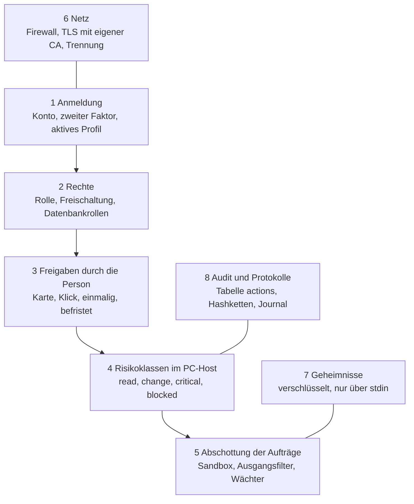

# Sicherheit und Datenschutz

| | |
|---|---|
| Zweck | Erklärt das Sicherheitsmodell von W.A.I.S. in Schichten und stellt zusammen, welche Daten wo liegen, wozu und wie lange, als Zulieferung für das Datenschutzmanagement. |
| Zielgruppe | Verantwortliche Person, Datenschutzmanagement, Administration, Prüfende |
| Dokumentart | Erklärung (Sicherheitsmodell) und Referenz (Daten, Dienstleister, Zulieferungen) |
| Stand | 20.11.2026, Version 0.7.0, geprüft gegen Commit 7caf977 (`main`) |
| Quellen | `README.md` (Kapitel "Sicherheitsmodell"), `CLAUDE.md`, `voice-core/auth_gate.py`, `voice-core/rechte.py`, `voice-core/schluessel.py`, `voice-core/stimme_einwilligung.py`, `voice-core/stimme_gate.py`, `voice-core/mikrofon_kette.py`, `voice-core/selbstauftraege.py`, `docs/ausrollen-neue-nutzer.md` (Abschnitt 5, Risiko S9), `docs/selbstauftraege.md`, `host/wamo_host.py`, `supabase/migrations/`, `docs/labor-datenschutz-entwurf.md`, `docs/hausmodelle-und-kikollege.md`, `infra/sokrates2/README.md` |

**Hinweis.** Dieses Dokument ist keine Rechtsberatung und behauptet nicht, dass eine Verarbeitung rechtmäßig ist. Es nennt, was das Repo belegt. Alles, was rechtlich zu bewerten oder vertraglich zu klären ist, steht als "mit der oder dem Datenschutzbeauftragten zu klären". Das Repo nennt im Labor-Hinweis (Stand 17.11.2026) "Ein Datenschutzbeauftragter ist nicht bestellt". Wo hier steht "Datenschutzbeauftragte", ist dann die verantwortliche Person der WAMOCON GmbH gemeint.

Das Sicherheitsmodell in Kurzform steht auch im Kapitel [Sicherheitsmodell der README](../../README.md#sicherheitsmodell).

## 1. Sicherheitsmodell in Schichten

Leitgedanke (`README.md`): Jede Unsicherheit führt zur Ablehnung (fail closed). Pflichten sitzen dort, wo sie sich nicht umgehen lassen: im Host, im Kern, in der Datenbank, nicht im Prompt.

### 1.1 Anmeldung und zweiter Faktor

Quelle: `voice-core/auth_gate.py`, `infra/sokrates2/README.md` (Abschnitte 0, 5, 11).

- Zugang nur mit Konto im eigenen Supabase (GoTrue auf Sokrates-2, Registrierung geschlossen, Konten legt nur ein Admin an), **zweitem Faktor (aal2)** und **aktivem Profil** in `<schema>.profiles`.
- Der Kern prüft jedes Token: Signatur über die öffentlichen Schlüssel (JWKS, ES256), Ablauf, Aussteller, Zielgruppe, aal2 und ein Höchstalter der Anmeldung (`WAMO_ANMELDUNG_MAX_STUNDEN`, Standard 168 Stunden, gemessen ab Passwort und Code). Ist die Datenbank oder der Anmeldedienst nicht erreichbar, wird abgelehnt (503).
- Eine laufende Sitzung prüft das Profil jede Minute neu (`SessionGuard`). Eine Sitzung je Profil (`WAMO_SITZUNG_EINZELN`, Standard an). GoTrue begrenzt Sitzungen (`GOTRUE_SESSIONS_TIMEBOX` 168 Stunden, Inaktivität 72 Stunden). Im Browser gilt die Anmeldung 24 Stunden.
- **Erstanmeldung:** Neue Konten sind gesperrt, bis ein Admin freischaltet. Das Startpasswort gilt nur 72 Stunden (einstellbar), bis zum Wechsel sind nur die Wege der Erstanmeldung offen (Merker im Schema `wamo_auth`, Trigger auf `auth.users`). Passwortlänge mindestens 12.
- Geräte: Jeder Laptop bindet sich mit eigenem Schlüssel; ändernde Aktionen in der Geräteverwaltung verlangen einen TOTP-Code, der höchstens 120 Sekunden alt ist.

### 1.2 Rechte

Quelle: `voice-core/rechte.py`, `supabase/migrations/0001_wamo_init.sql`, `CLAUDE.md`.

- Rollen `admin` und `mitglied`. Laborprofile haben immer die Rolle `mitglied`, sind dauerhaft `aktiv = false` und bekommen nie PC-Steuerung, Entwicklungsaufträge, Gedächtnis, Stimmabdruck und keinen Installer.
- PC-Steuerung hängt an einer Stelle (`pc_stufe` in `voice-core/rechte.py`): `admin` für Admins, `mitglied` nur mit der eigenen `user_id` in `WAMO_PC_MITGLIEDER_PROFILE` (Liste kommt nur vom Server), sonst keine. Ein ungültiger Eintrag macht die Liste ungültig.
- **Datenbankrollen:** Der Kern arbeitet als `wamo_core` (nur WAMO-Schemas, lesen, einfügen, gezielte Updates, kein `delete` ohne Grund), die Verwaltung als `wamo_admin`. `anon`, `authenticated` und `service_role` haben keine Rechte auf die WAMO-Schemas, die Oberfläche liest keine Tabellen. Row Level Security mit Policy `core_all` für `wamo_core` an jeder Tabelle. Kein `service_role`-Schlüssel im Kern oder in `ui/`.
- Gemeinsames Gedächtnis wirkt erst nach Freigabe durch einen Admin (Trigger `memories_guard`).

### 1.3 Freigaben durch die Person

Quelle: `README.md` (Sicherheitsmodell), `host/wamo_host.py`, `voice-core/pc_freigaben.py`.

- Aktionen mit Risiko brauchen eine **Freigabekarte** in der Oberfläche. Das Modell kann sie weder anklicken noch bestätigen: Das Werkzeug `freigabe_entscheiden` ruft nur der Kern nach einem Klick auf, es steht nie in `LLM_TOOLS` und verlangt ein zweites Geheimnis im Host. Eine Freigabe ist befristet und wird genau einmal ausgeführt. Direkt davor prüft der Host Ziel, Sperre und Adresse erneut.
- Solange eine Freigabe offen ist, ruhen alle Eingaben. Bei gesperrtem Bildschirm gibt es keine Eingaben, Klicks, Fotos, kein Öffnen und kein Lesen.
- Getippter Text ersetzt nie eine Freigabe. Die Stimmprüfung (Abdruck) ist keine Freigabe und sperrt seit dem 18.11.2026 nichts mehr (Standard `beobachten`, Abschnitt 2, Punkt 4). Für Mitglieder bleibt eine einzige Voraussetzung: PC-Befehle per Sprache brauchen einen eingelernten Abdruck, sonst gehen nur getippte Befehle.
- Inhalte aus Web, Dateien, Mails und Gedächtnis sind **Daten, nie Anweisungen** an W.A.I.S. Für Mitglieder verlangt `voice-core/pc_mitglied.py` nach Fremdinhalt im Zug eine Karte für jede Änderung am Laptop.
- Weitere Karten: Jira-Story (Job `jira`, höchstens 1800 Zeichen), Mail (`mail`), Teams (`teams`), OneNote (`onenote`), persönlicher GitHub-Push ("Einreichen"), Bildschirmbild einmal je Sitzung.

### 1.4 Risikoklassen im PC-Host

Quelle: Kopf von `host/wamo_host.py`. Die Prüfung geschieht im Host, nicht im Prompt.

| Klasse | Bedeutung | Beispiele laut Quelle |
| --- | --- | --- |
| `read` | sofort | `system_info`, `powershell_lesen` mit reinen Get- und Test-Befehlen (enge Allowlist) |
| `change` | sofort, protokolliert | `webseite_oeffnen`, `programm_oeffnen`, `dark_mode`, `git_klonen`, Office-Dateien nur in `Dokumente\WAIS` |
| `critical` | nur Freigabe-Anfrage, Ausführung erst nach Klick der Person | PowerShell-Befehle mit Wirkung, `github_repo_anlegen`, Senden über Outlook, Teams-Chat, OneNote-Seite |
| `blocked` | nie | gesperrte Befehle; unbekannte Befehle sind nie `read` |

Weitere Grenzen im Host: Host lauscht nur auf `127.0.0.1:8765` mit Bearer-Token, die Oberfläche von W.A.I.S. selbst (Freigabekarte) bedient er nie, Rate-Grenzen je Werkzeug, Live-Bild nur mit Einwilligung am Laptop und rotem Rahmen (Quelle `README.md`, Abschnitt Live-Bild).

### 1.5 Abschottung der Entwicklungsaufträge

Quelle: `infra/sokrates2/README.md` (Abschnitte 4, 9, 18 bis 18.3).

- Aufträge laufen als eigener Benutzer `wamo` in `bubblewrap` mit Landlock (Verbinden und Binden), `seccomp` und systemd-Grenzen, ohne Zugriff auf `/etc/wamo`. Start nur über den Dispatcher per SSH-Forced-Command.
- **Ausgangsfilter** (`nft`-Tabelle `inet wamo_egress`): nur Internet auf TCP 80 und 443, DNS, dazu Loopback-Ports im Bereich 20000 bis 20999. LAN, Docker-Netze und die Adressen des Servers sind gesperrt. Der Dispatcher prüft alle 15 Sekunden und beendet einen Lauf ohne Filter.
- **Wächter** (`voice-core/dev_guard.py`): `git push`, Merge, Produktions-Deployments, Schreiben auf Produktionsdatenbanken und verändernde REA-Werkzeuge brauchen Freigabe; Befehle, die Zugangsvariablen nennen, sind gesperrt.
- **Kern-Kanal:** eigener SSH-Schlüssel nur auf dem Server, strikte Regeln aus `/etc/wamo/kernkanal.conf` (Arten, Repos, Kosten- und Zeitgrenzen, höchstens sechs gleichzeitige Aufträge, drei je Person), Notaus-Datei, Ablaufdatum des Schlüssels.
- **Selbstschutz:** Das eigene Repo ist für Aufträge gesperrt (`SELF_REPOS`, `ist_eigenes_repo`, GitHub-ID).
- **Zugänge:** GitHub über kurzlebige App-Token je Lauf (Widerruf am Ende) oder über den persönlichen Weg (Plan C, live seit 18.11.2026, Dispatcher 10). Dort erreicht das Token die Sandbox nie: Es geht nur über stdin an den Dispatcher (Bytes-Leser, nie als Text, `PR_SET_DUMPABLE=0`) und über eine geerbte Pipe an den Credential-Helfer. Die Sandbox-Modi `klon`, `ausgabe` und `pruefung` laufen immer ohne Netz, im Lauf sperrt der Wächter `push`, `send-pack`, `gh` und das Ändern von Remotes. Erst der Klick auf "Einreichen" pusht genau `refs/heads/wamo/<job>` und öffnet den Pull Request; gemergt wird nie durch W.A.I.S. Claude-Zugang der Person nur für einen Lauf über stdin, in Ausgaben geschwärzt.
- **Aufträge an W.A.I.S. selbst:** Der Rückstand `selbstauftraege` (Migration 0030, nur Admins, nie Mitglieder, nie Labor) ist ein Speicher für Vorschläge. Ein Eintrag ist keine Anweisung: Er wird nie ohne das ausdrückliche Ja eines Admins umgesetzt, nach Fremdinhalt trägt er die Markierung `unsicher`, und Befehle oder Zugangsdaten aus seinem Text werden nie übernommen. Dass W.A.I.S. Einträge selbst umsetzt, ist nicht gebaut; der Selbstschutz des eigenen Repos bleibt bis dahin voll in Kraft.
- **Notanker, Release- und Freigabe-Dienst** (Selbstüberarbeitung): Der Anker liegt außerhalb von `/opt/wamo*`, gehört root, nimmt Anfragen nur per `SO_PEERCRED` von erlaubten Benutzern an und kann nur zurückführen, sperren und prüfen. Änderungen an der Schutzschicht verlangen eine zweite Admin-Person.

### 1.6 Firewall und Netztrennung

Quelle: `infra/sokrates2/README.md` (Abschnitte 5 bis 7, 12, 19), `infra/sokrates2/wamo-firewall.sh`.

- Kette `DOCKER-USER` (`wamo-firewall`): WAMO-Ports nur für Loopback, das Caddy-Netz und das Büro-LAN. Admin-Ports (Gateway, Pooler) nur für Einträge in `/etc/wamo/admin-quellen`. Der Labor-Dienst hat eine eigene Quellenliste und keinen Ausgang.
- **TLS mit eigener CA** mit Name Constraints nur für die Adressen von Sokrates-2. Datenbank mit `sslmode=verify-full`. HTTP-Port 55321 ist seit Stufe 2 nur noch intern.
- Die Oberfläche läuft in einem internen Netz ohne Internet und LAN (`read_only`, `cap_drop: ALL`, `no-new-privileges`), nur GET und HEAD, Sicherheitsköpfe (CSP, nosniff, COOP).
- Rücktunnel je Laptop: ein Benutzer und ein Socket-Ordner je Gerät, Abgleich alle 10 Sekunden, Streuner alle 5 Minuten.

### 1.7 Geheimnisverwaltung

Quelle: `README.md`, `voice-core/schluessel.py`, `infra/sokrates2/wamo_core_env.py`.

- Geheimnisse nur in `.env`, `ui/.env.local`, `/etc/wamo/geheim.env` (Aufträge) und `/etc/wamo/core.env` (Kern). Nie im Repo; `gitleaks` prüft jeden Pull Request, jeden Push auf `main` und wöchentlich die Historie.
- Werte gehen nur über stdin an `wamo-core-env` (Allowlist der Namen, atomar, keine Anzeige) und nie über Befehlszeilen.
- Eigene Claude-Schlüssel, Claude-Code-Token und GitHub-Token der Personen: **AES-256-GCM** mit dem Hauptschlüssel `WAMO_SCHLUESSEL_KEK` (nur in der Umgebung des Kerns, nie in der Datenbank), Profil-ID und Zweck als zusätzliche Daten. Zurück an die Oberfläche gehen nur "hinterlegt" und die letzten vier Zeichen. Ein Filter ersetzt `sk-ant-...` schon hinter der Spracherkennung, bevor Verlauf, Modell oder Log etwas sehen.
- Host-Token und Freigabe-Schlüssel liegen am PC in `%LOCALAPPDATA%\WAMO` (nur für den Benutzer lesbar, für die PC-Werkzeuge gesperrt); Kindprozesse erben den Freigabe-Schlüssel nicht.
- Updates der Desktop-App: Ed25519-signiertes Manifest, Prüfung gegen eingebaute öffentliche Schlüssel, dazu Codesignatur des Installers.

### 1.8 Audit und Protokolle

Quelle: `supabase/migrations/0001_wamo_init.sql`, `host/wamo_host.py`, `infra/sokrates2/README.md` (Abschnitte 14, 15, 18).

| Protokoll | Inhalt | Eigenschaft |
| --- | --- | --- |
| Tabelle `actions` | Aufträge, Freigaben, Modellwahl, Installer-Download, Bürogeräte, Jira; Mitglieder ohne Wortlaut | Audit und Kostenbremse |
| `device_events`, `teilung_events`, `rd_sitzungen` | Gerätestatus, Teilungen, Fernzugriff (wer, Ziel, Start, Ende, Grund) | ohne Inhalte, ohne Aufzeichnung |
| `host\wamo_audit.jsonl` | jeder Aufruf des PC-Hosts | JSONL, Ort per `WAMO_AUDIT_LOG` |
| `/var/log/wamo-anker/audit.jsonl`, `/var/log/wamo-release/audit.jsonl` | Rückwege, Sperren, Release-Zustände | Hashkette, angehängt, 32 MiB |
| `/srv/wamo/logs/auftraege.log`, `kernkanal.jsonl`, `/var/log/wamo-job-kern/aktionen.jsonl` | Auftragsereignisse, Zähler, Bedienspur | nie ein Wert eines Tokens |
| Journal | Marken wie `wamo-nutzer`, `wamo-job-kern`, `wais-deploy` | Kern mit INFO, ohne Gesprächsinhalte; dazu die Zeilen der Stimmerkennung (`Mikrofonkette:` mit grober Klasse, Echo, Rauschen, Verstärkung, Rate; `Stimmschatten:` nur bei eingeschaltetem Schattenbetrieb), nie ein Gerätename, nie Audio |
| Hinweise an Admins | Geräte freigeben, Fernzugriff gestartet, Erstanmeldung | Tabelle `hinweise` |

## 2. Bedrohungsmodell (Kategorien)

Das Modell bleibt auf Kategorien beschränkt: Angreifer, Angriffsfläche, Gegenmaßnahme, Quelle. Es nennt keine Ausnutzungsdetails.

| Nr | Angreifer | Angriffsfläche | Gegenmaßnahme | Quelle |
| --- | --- | --- | --- | --- |
| 1 | Unbefugte im Büro-LAN oder VPN | Ports 55443 bis 55447 | Firewall, TLS mit eigener CA, Anmeldung mit zweitem Faktor, Admin-Ports nur für Quellenliste | `infra/sokrates2/README.md` 5 bis 7 |
| 2 | Wer fremde Zugangsdaten hat | Konto, Sitzung, Token | zweiter Faktor, Höchstalter, Einzelsitzung, Pflicht zum Passwortwechsel, Sperren | `voice-core/auth_gate.py` |
| 3 | Manipulierte Inhalte (Web, Dateien, Mails, Gedächtnis) | Eingaben des Sprachmodells | Inhalte gelten als Daten, Risikoklassen im Host, Freigabe per Klick, Karte nach Fremdinhalt | `host/wamo_host.py`, `voice-core/pc_mitglied.py` |
| 4 | Fremde Stimme am Mikrofon | Mikrofon, Spracheingabe | Stimmprüfung (Standard "beobachten": messen, anzeigen, protokollieren; sie sperrt nur im Modus "streng" auf ausdrücklichen Wunsch); sie ersetzt keine Freigabe und schützt nicht vor Aufnahmen; PC-Befehle per Sprache brauchen für Mitglieder einen eingelernten Abdruck; es schützen Anmeldung mit zweitem Faktor, der eigene Laptop und die Karten für jede Änderung am Laptop nach Fremdinhalt (Restrisiko S9 unten) | `README.md` Sicherheitsmodell, `voice-core/stimme_gate.py`, `docs/ausrollen-neue-nutzer.md` Abschnitt 5 |
| 5 | Fehlsteuerung oder Manipulation eines Entwicklungsauftrags | Sandbox, Werkzeuge, Repos | Sandbox, Ausgangsfilter, Wächter, kurzlebige Token, Selbstschutz des eigenen Repos; Einträge im Rückstand für Aufträge an W.A.I.S. selbst sind Vorschläge und brauchen das Ja eines Admins | `infra/sokrates2/README.md` 4, 9, `docs/selbstauftraege.md` |
| 6 | Missbrauch von Zugängen der Personen | Claude-Schlüssel, GitHub-Token | Verschlüsselung, stdin, Schwärzung, Widerruf, Klick vor dem Push | `voice-core/schluessel.py`, `docs/persoenliche-zugaenge.md` |
| 7 | Missbrauch von Dienstkonten auf dem Server | Dienste, Sockets | eigene Benutzer, `SO_PEERCRED`, gehärtete Units, Notanker außerhalb von `/opt/wamo*` | `infra/sokrates2/README.md` 10, 14 |
| 8 | Übernahme eines Laptops oder Tunnels | Rücktunnel | ein Benutzer je Gerät, Abgleich, Streuner, Gerät sperren oder widerrufen | `infra/sokrates2/README.md` 13 |
| 9 | Unerwünschter Datenabfluss an Dienstleister | Audio, Text, Bilder | Modus "Nur Hausmodelle", Stimme im Haus, Auswahl je Person | `README.md` Modellzugang |
| 10 | Kompromittierte Lieferkette | Abhängigkeiten, Actions, Installer | Actions auf Commit-SHA, Prüfsummen, gitleaks, CodeQL, Dependabot, signierte Updates | `README.md` Prüfungen, `.github/workflows/` |
| 11 | Unbeteiligte im Testlabor | Laborplätze | eigene Profile ohne PC und Gedächtnis, Dienst ohne Ausgang, Löschfrist | `docs/labor-datenschutz-entwurf.md` |
| 12 | Interne Fehlbedienung | Admin-Aktionen | `--trocken`, Sicherungen, Rückwege, Notaus, Protokolle | `infra/sokrates2/README.md` 8 |

**Restrisiko S9 (fremde Stimme löst PC-Befehle bei einem Mitglied aus).** Das Planpapier `docs/ausrollen-neue-nutzer.md` (Abschnitt 5) bewertet es seit dem 18.11.2026 neu mit der Stufe **mittel**. Anlass ist die Entscheidung des Lead-Entwicklers vom 18.11.2026, dass das Urteil der Stimme nichts mehr sperrt (Standard `WAMO_STIMME_PRUEFUNG=beobachten`). Der eingelernte Abdruck bleibt für Mitglieder Voraussetzung für PC-Befehle per Sprache. Es schützen die Anmeldung mit zweitem Faktor, der eigene Laptop und die Karten für jede Änderung am Laptop nach Fremdinhalt. Eine Fremdstimme im Raum kann damit lesende PC-Befehle auslösen, Änderungen brauchen weiter den Klick der Person. Zurück zum strengen Verhalten geht es nur mit ausdrücklich gesetztem `WAMO_STIMME_PRUEFUNG=streng` (Server-Einstellung, wirksam mit dem nächsten Kern-Release). Ob dieses Restrisiko für den Echtbetrieb tragbar ist, entscheidet die verantwortliche Person.

Offene Punkte aus Datenschutz und Betrieb stehen in Abschnitt 6.

## 3. Datenarten, Speicherort, Zweck und Löschfrist

Spalte "Frist" nennt nur, was im Repo belegt ist. "Keine automatische Frist belegt" heißt, dass der Code oder die Migrationen keine Löschung vorsehen. Das ist mit der oder dem Datenschutzbeauftragten zu klären.

| Datenart | Inhalt | Speicherort | Zweck | Frist und Löschweg | Quelle |
| --- | --- | --- | --- | --- | --- |
| Sprache (Audio) | Mikrofon-Audio im Gespräch | wird zur Erkennung an Soniox gestreamt; W.A.I.S. speichert laut Labor-Hinweis keine Tonaufnahme | Gespräch | beim Anbieter nach dessen Regeln (zu klären) | `docs/labor-datenschutz-entwurf.md` 1 und 2 |
| Gesprächstext | Sätze der Person, Antworten, Unterbrechungen | Tabelle `turns` (Sitzungen `sessions`, Zusammenfassung `summary`) | Verlauf, Gedächtnis | Keine automatische Frist belegt; geht mit dem Konto (`on delete cascade`) | `supabase/migrations/0001_wamo_init.sql`, `voice-core/memory.py` |
| Stimmabdruck | je eingelerntem Mikrofon ein Abdruck aus 192 Zahlen, höchstens drei je Person (Einwilligung `stimme-3`, Migration 0029); mit Schattenbetrieb zusätzlich 256 Zahlen (nur bei eingeschaltetem `WAMO_STIMME_SCHATTEN`, Einwilligung `stimme-2` oder `stimme-3`, Migration 0028); Zeit und Version der Einwilligung; Name des Mikrofons, wie Browser oder App ihn nennt (nur hier, damit die Person es in der Liste wiedererkennt, dazu eine Kennung aus dem SHA-256 des Namens) | Tabelle `speakers` (`voiceprint`, `voiceprint_shadow`, `mikrofon`, `mikrofon_name`), nie eine Aufnahme | Stimme der Person erkennen, fremde Stimmen nicht verarbeiten | Löschen und Widerruf jederzeit in den Einstellungen (Gruppe "Sprache und Stimme", Abschnitt "Eigene Stimme"), einzeln je Mikrofon oder alle, sofort; mit dem Konto gelöscht | `voice-core/stimme_einwilligung.py`, `docs/labor-datenschutz-entwurf.md` 4 |
| Ton für den Abdruck | rund 20 Sekunden beim Einlernen, Ton der Prüfung | nur Arbeitsspeicher des Kerns | Berechnung | verworfen nach dem Rechnen | dort |
| Schatten-Messwerte | Ähnlichkeit zweier Modelle, Länge, Urteil, Rechenzeit je Äußerung | Protokoll des Servers (nur mit `WAMO_STIMME_SCHATTEN`) | Vergleich zweier Modelle | Rotation des Protokolls (Frist nicht belegt) | dort |
| Mikrofonkette | grobe Klasse (eingebaut, headset, bluetooth, unbekannt), Echo, Rauschen, Verstärkung, Abtastrate, Kanäle der Aufnahme | Arbeitsspeicher der Sitzung und Zeile `Mikrofonkette:` im Kernprotokoll (höchstens 50 Zeilen je Sitzung) | Fehlersuche bei der Stimmerkennung (Messung vom 19.11.2026: Bluetooth-Kopfhörer drücken die Werte stark) | Protokoll: Rotation des Systems (Frist nicht belegt); nie ein Gerätename, nie Audio, nie in der Datenbank, nie in Laborsitzungen | `voice-core/mikrofon_kette.py` |
| Fehlerbuch | die letzten Gründe, warum etwas nicht ging (höchstens 20 Einträge), nie der Wortlaut | nur Arbeitsspeicher der Sitzung | Antwort auf "Warum ging das nicht?" | endet mit der Sitzung; nie Datenbank | `voice-core/fehlerbuch.py` |
| Gedächtnis | persönliche und gemeinsame Einträge (Fakten, Vorlieben, Lektionen) | Tabelle `memories` | Personalisierung, Firmenwissen | Keine automatische Frist belegt; Einträge lassen sich ersetzen und ablehnen | Migration `0001`, `0020` |
| Canvas | Dokumente, Tabellen, Diagramme der Sitzung | Tabelle `canvas_items` (Schließen blendet nur aus) | Arbeitsergebnisse | Keine automatische Frist belegt | `CLAUDE.md` (Canvas) |
| Aktionen und Audit | Werkzeug, Parameter, Status, Grund; bei Mitgliedern kein Wortlaut | Tabelle `actions`, Host-Audit `wamo_audit.jsonl` | Nachvollziehbarkeit, Kostenbremse | Keine automatische Frist in der Datenbank belegt; Host-Audit geht bei Update oder Deinstallation verloren | Migration `0001`, `README.md` |
| Vorgänge | Aufgaben und Aufträge mit Titel (kann Auftragstext enthalten) | Tabelle `vorgaenge` | Anzeige, Verlauf | Stand 30 Tage nach dem Ende geleert (Titel "abgelaufen"); offene Vorgänge nach 24 Stunden als abgebrochen | `supabase/migrations/0017_vorgaenge.sql` |
| Auftragsentwürfe | gespeicherte Entwicklungsaufträge | Tabelle `auftrag_entwuerfe`, höchstens 50 je Person | Aufträge für später | 90 Tage, danach gelöscht (höchstens stündlich je Prozess) | `voice-core/auftrag_entwuerfe.py` |
| Aufträge an W.A.I.S. selbst | Rückstand der Admins: Titel, Beschreibung (kann Auftragstext enthalten), Art, Priorität, Stand `offen`, `in_arbeit`, `erledigt`, `verworfen`, Markierung `unsicher` | Tabelle `selbstauftraege` (Migration 0030), höchstens 200 offene Einträge, 30 neue je Person und Tag | Sammeln von Verbesserungsvorschlägen, Abarbeiten durch Claude Code nach Ja eines Admins | Keine automatische Frist belegt; beim Löschen des Kontos bleibt der Eintrag stehen (`on delete set null`), das ist mit der oder dem Datenschutzbeauftragten zu klären | `docs/selbstauftraege.md`, `voice-core/selbstauftraege.py` |
| Kopien für persönliche GitHub-Aufträge | Arbeitskopien privater Repos in den Auftragsordnern des Servers (`basis.git`, `aus.git`, `ausgabe/`) | Sokrates-2, Ordner `/srv/wamo/jobs` | Entwicklungsauftrag mit persönlichem Zugang (Plan C) | täglich gelöscht durch `wamo-job-aufraeumen.timer`, sofort im Rückweg oder mit `wamo-job-dispatch aufraeumen alle`; die Sandbox arbeitet ohne Token | `infra/sokrates2/README.md` 18.3, `CLAUDE.md` |
| Geteilte Dateien | Dateien und Fassungen | Tabelle `dateien` in der Datenbank (höchstens 25 MB je Datei) | Teilen | Löschen weich, nach 7 Tagen endgültig (täglich) | `supabase/migrations/0003_wamo_teilen.sql` |
| Geräteregister | Gerät, Rechnername, Schlüsselfingerabdruck, Status, Verlauf | Tabellen `devices`, `device_events` | Rücktunnel, Freigabe | Widerruf endgültig; Aufbewahrung des Verlaufs nicht belegt | `README.md` Geräte |
| Fernzugriff | wer, Ziel, Start, Ende, Grund | Tabelle `rd_sitzungen` | Nachweis | keine Aufzeichnung; Frist nicht belegt | `README.md` Fernzugriff |
| Zugänge der Personen | Claude-Schlüssel, Claude-Code-Token, GitHub-Token, Kontingent | Tabellen `model_access`, `github_zugang` als Chiffrat (AES-256-GCM) | Modellzugang, Aufträge | Person löscht selbst, Austritt über `wamo_nutzer.py austreten` | `voice-core/schluessel.py` |
| Bildschirm und Live-Bild | Einzelbilder des eigenen Laptops | nur Arbeitsspeicher (Host, Kern, Browser), nie Datenbank oder Log | PC-Steuerung | höchstens 15 bis 30 Minuten Dauer, keine Aufzeichnung | `README.md` Live-Bild |
| Büro-Mails und Nachrichten | Entwürfe für Outlook, Teams, OneNote | Entwurfsdateien `%LOCALAPPDATA%\WAMO\entwuerfe`, Dateien in `Dokumente\WAIS` | Versand durch die Person | Aufbewahrung am Laptop nicht belegt | `CLAUDE.md` (Mail, Office) |
| Labor-Daten | Gesprächstext, Tickets, Kommentare, Einwilligungsvermerk je Platz | Tabellen des Kerns (nur mit `WAMO_LABOR_TEXT_SPEICHERN=an`), Dienst `wamo-labor-dienst` | Testlabor (geplant 28.11.2026, auf 05.12.2026 verschoben, Stand 20.11.2026) | spätestens 11.12.2026; Löschlauf frühestens 12.12.2026 mit Nachweis. Die Labor-Unterlagen im Repo nennen noch den alten Labortag; die Frist ist nach der Verschiebung neu festzulegen (zu klären) | `docs/labor-datenschutz-entwurf.md` 2 |
| Kern-Journal | Metadaten, kein Gesprächstext (INFO) | Journal von Sokrates-2 | Betrieb | Rotation des Systems (Frist nicht belegt) | `infra/sokrates2/README.md` 10 |
| Sicherungen | Datenbank und Konfiguration | im Repo nicht beschrieben | Verfügbarkeit, Wiederherstellung | offen, siehe Abschnitt 6 (Punkt 7) | `infra/sokrates2/README.md` 19 |

Löschen einer Person: `wamo_nutzer.py austreten` riegelt ab, löscht Faktoren, widerruft Geräte und entfernt Claude-Schlüssel und Claude-Code-Token. Stimmabdruck, Gedächtnis und Verlauf löscht dieses Skript nicht. Ein vollständiges Löschkonzept nach Austritt ist mit der oder dem Datenschutzbeauftragten zu klären.

## 4. Eingesetzte Dienstleister und Datenflüsse laut Repo

| Dienst | Was geht dorthin | Region und Vertrag laut Repo | Quelle |
| --- | --- | --- | --- |
| Soniox (Spracherkennung, Sprachausgabe) | Mikrofon-Audio, Antworttext | EU-Endpunkte (`stt-rt.eu.soniox.com`, `tts-rt.eu.soniox.com`); Vertragspartner laut Entscheidungspapier Soniox Inc. (USA); AVV laut Papier "in Arbeit", Konto noch nicht auf die GmbH umgestellt (Stand der Papiere beachten, mit der oder dem Datenschutzbeauftragten zu klären) | `README.md` (Abschnitt Stand, Soniox), `docs/sprache-elevenlabs-soniox.md` |
| Anthropic (Claude) | Gesprächstext, Gedächtnis- und Canvas-Inhalte im Prompt, Bildschirmfotos (`VISION_MODEL`), Websuche, Claude Code für Aufträge | USA laut `docs/hausmodelle-und-kikollege.md` 3.6; Auftragsverarbeitung (Art. 28 DSGVO) und Drittlandübermittlung zu prüfen (Labor-Entwurf Abschnitt 3, Punkt 1) | `docs/hausmodelle-und-kikollege.md`, `docs/labor-datenschutz-entwurf.md` |
| Hausmodelle (LiteLLM-Gateway, Ollama auf Sokrates-1, Sokrates-2, Caesar) | Gespräch, Bilder, Stimme im Haus | eigene Server im Büro, kein externer Dienstleister | `infra/sokrates1/gateway-wamo.md` |
| SearXNG (Websuche im Haus, Caesar) | Suchanfragen ohne Personenbezug | gehen an Suchmaschinen | `docs/hausmodelle-und-kikollege.md` 3.5 |
| Supabase (eigener Stack) | alle Daten der Datenbank | Sokrates-2 im Büro, nicht Supabase Cloud | `infra/sokrates2/README.md` 0 |
| GitHub | Repos, Pull Requests, Token der App oder der Person | Dienstleister des Entwicklungsablaufs; CI läuft auf Runnern von GitHub ohne Geheimnisse | `.github/workflows/`, `docs/persoenliche-zugaenge.md` |
| Atlassian (Jira) | Stories aus dem Canvas, Lesezugriff der Aufträge | `wamocon.atlassian.net`, technischer Benutzer | `docs/jira-benutzer-einrichten.md` |
| Vercel, Supabase Cloud | optionale Konnektoren in Entwicklungsaufträgen (Token der Auftragsart) | Produktions-Deployments und Schreibzugriffe nur nach Freigabe | `infra/sokrates2/README.md` 2 und 3 |
| Microsoft (Outlook, Teams, OneNote, OneDrive) | Entwürfe und Seiten über die auf dem Laptop installierten Programme | Versand nur nach Karte und durch die Person; W.A.I.S. sendet in Teams nie selbst | `CLAUDE.md` |
| FRITZ!Box, Drucker, Fernseher, Steckdosen | Gerätestatus im Büro | lokales Netz, Gerätedienst nur lesend bei Router | `README.md` Geräte, `geraete/README.md` |

## 5. Zulieferungen für das Datenschutzmanagement

Diese Abschnitte nennen nur, welche Angaben aus dem Repo für die jeweiligen Dokumente zugeliefert werden können. Die Dokumente selbst gibt es im Repo nicht. Rechtliche Bewertung und Entscheidung liegen bei der verantwortlichen Person.

### 5.1 Verzeichnis von Verarbeitungstätigkeiten (Art. 30 DSGVO)

| Angabe des Verzeichnisses | Zulieferung aus dem Repo | Offen |
| --- | --- | --- |
| Zwecke | Abschnitt 3 (Spalte Zweck), `README.md` (Überblick) | Formulierung der Zwecke je Verarbeitung |
| Kategorien betroffener Personen | Beschäftigte (Profile), Besucher im Testlabor, Betreuer | Vollständigkeit prüfen |
| Datenkategorien | Abschnitt 3, besondere Kategorie: Stimmabdruck (biometrisch, Art. 9) | Einordnung Live-Bild, Bildschirmfotos |
| Empfänger | Abschnitt 4 | Vertragsstand je Empfänger (Auftragsverarbeitung) |
| Drittlandübermittlung | Anthropic (USA), Soniox Inc. (USA, Datenverarbeitung EU), GitHub, Atlassian, Microsoft | Rechtsgrundlage je Übermittlung |
| Löschfristen | Abschnitt 3 (Spalte Frist) | fehlende Fristen (Gesprächstext, Gedächtnis, Canvas, Audit, Journal, Sicherungen) |
| TOM | Abschnitt 1 und 5.2 | Aufnahme in das Verzeichnis |

### 5.2 Technische und organisatorische Maßnahmen (Art. 32 DSGVO)

Aus dem Repo belegbare Maßnahmen, gegliedert nach den üblichen Gruppen:

| Gruppe | Maßnahmen im Produkt | Abschnitt |
| --- | --- | --- |
| Zugangskontrolle | zweiter Faktor, aktives Profil, Höchstalter, Einzelsitzung, Erstanmeldung | 1.1 |
| Zugriffskontrolle | Rollen, Freischaltung je Person, Datenbankrollen, Row Level Security | 1.2 |
| Weitergabekontrolle | TLS mit eigener CA, Firewall, Netztrennung, Ausgangsfilter | 1.5, 1.6 |
| Eingabekontrolle | Tabelle `actions`, Host-Audit, Hashketten, Journal | 1.8 |
| Auftragskontrolle | Freigabe durch die Person, Auswahl der Modelle je Person | 1.3, 4 |
| Verfügbarkeit | Kern-Slots, Blau und Grün, Rückwege, Notanker; Sicherung: offen | Betriebshandbuch |
| Trennungsgebot | Schemas, getrennte Profile, Labor ohne Gedächtnis | 1.2 |
| Organisatorisch | Rückwege und Rauchtests je Dienst, Änderungen an der Schutzschicht nur mit zweiter Admin-Person | Administrationshandbuch, 1.5 |

Mit der oder dem Datenschutzbeauftragten zu klären: Ergänzung um organisatorische Maßnahmen außerhalb des Produkts (Schulung, Richtlinien, Zutritt zum Serverraum, Sicherungskonzept).

### 5.3 Datenschutz-Folgenabschätzung (Art. 35 DSGVO)

Das Repo nennt selbst, dass die Folgenabschätzung für den **Stimmabdruck** vor dem Echtbetrieb vorliegen soll (`README.md`, `docs/labor-datenschutz-entwurf.md` Abschnitt 4, Migration `0001`). Zuliefernd:

| Baustein | Quelle im Repo |
| --- | --- |
| Beschreibung der Verarbeitung (je Mikrofon 192 Zahlen, höchstens drei Abdrücke je Person, mit dem zweiten Modell im Schattenbetrieb zusätzlich 256 Zahlen je Mikrofon und je Äußerung eine Zeile mit Zahlen im Protokoll, keine Aufnahme, Berechnung auf dem eigenen Server) | `docs/labor-datenschutz-entwurf.md` 4, `voice-core/stimme_einwilligung.py` |
| Einwilligungstexte und Versionen (`stimme-1`, `stimme-2`, `stimme-3`; für ein neues Einlernen gilt `stimme-3`, ältere Abdrücke bleiben gültig), Widerruf durch Löschen | `voice-core/stimme_einwilligung.py` |
| Grenzen der Methode (keine Freigabe, kein Schutz gegen Aufnahmen oder geklonte Stimmen, Fehlerkennung möglich, besonders bei kurzen Äußerungen und beim Wechsel der Signalkette, zum Beispiel Bluetooth; das Urteil sperrt seit 18.11.2026 nichts, Risiko S9 mittel) | `README.md` Sicherheitsmodell, `voice-core/stimme_gate.py`, `docs/ausrollen-neue-nutzer.md` Abschnitt 5 |
| Schutzmaßnahmen (Zugriff nur `wamo_core`, Oberfläche liest die Spalte nicht, Verwerfen des Tons) | Abschnitt 1.2, `docs/labor-datenschutz-entwurf.md` 4 |

Offen, mit der oder dem Datenschutzbeauftragten zu klären: Datenschutz-Folgenabschätzung selbst (Risikobewertung), Sicherungen und Löschung des Stimmabdrucks, Freiwilligkeit der Einwilligung bei Beschäftigten (Abhängigkeitsverhältnis, § 26 BDSG; der Entwurf nennt es selbst), Wortlaut der Einwilligung. Ebenso zu prüfen: ob das **Live-Bild** und die Bildschirmfunktionen eine eigene Bewertung brauchen. Die README nennt "eine Betriebsvereinbarung beziehungsweise Information der Beschäftigten" als offen.

### 5.4 Transparenz bei KI-Systemen (Art. 50 KI-Verordnung)

Das Repo enthält keine Aussage zur KI-Verordnung. Zuliefernd sind folgende Tatsachen:

| Sachverhalt | Beleg im Repo |
| --- | --- |
| Der Assistent heißt W.A.I.S., Langform "WAMOCON's Artificial Intelligence System" | `README.md`, `voice-core/persona.py`, `ui/src/lib/anzeigename.ts` |
| Die Persona stellt sich als Sprachassistent der WAMOCON GmbH vor | `voice-core/persona.py` (Kopf des Prompts) |
| Die Sprachausgabe ist synthetisch (Soniox oder Hausmodell, Stimmen `sohee`, `uncle_fu`, `ono_anna` im Haus) | `voice-core/sprache_anbieter.py`, `README.md` Modellzugang |
| Besucher im Testlabor bekommen vor dem Start einen Datenschutzhinweis und bestätigen ihn mit Versionsnummer | `docs/labor-datenschutz-entwurf.md` |
| Texte und Dateien, die W.A.I.S. erzeugt (Office-Dokumente, Mails als Entwurf), werden von der Person geprüft und versendet | `README.md`, `CLAUDE.md` (Office, Mail) |

Mit der oder dem Datenschutzbeauftragten zu klären: Ob und wie die Pflichten nach Art. 50 (Information über die Interaktion mit einem KI-System, Kennzeichnung synthetischer Audioinhalte) für den internen Einsatz und das Testlabor erfüllt sind und welche Rolle die WAMOCON GmbH dabei hat. Das Repo enthält dafür keine Entscheidung.

## 6. Offene Punkte für die Klärung

| Nr | Punkt | Wer |
| --- | --- | --- |
| 1 | Auftragsverarbeitung und Drittlandübermittlung für Soniox und Anthropic | Datenschutzbeauftragte oder Datenschutzbeauftragter, Geschäftsführung |
| 2 | Löschfristen für Gesprächstext, Gedächtnis, Canvas, Audit, Journal und Sicherungen | dito, Betrieb |
| 3 | Datenschutz-Folgenabschätzung Stimmabdruck (je Mikrofon, mit zweitem Modell im Schattenbetrieb) und Live-Bild | dito |
| 4 | Freiwilligkeit bei Beschäftigten, Betriebsvereinbarung oder Information der Beschäftigten | dito |
| 5 | Löschkonzept bei Austritt einer Person | dito, Administration |
| 6 | Art. 50 KI-Verordnung für Gespräch und synthetische Stimme | dito |
| 7 | Verzeichnis von Verarbeitungstätigkeiten und Sicherungskonzept | dito, Betrieb |
| 8 | Löschfrist des Testlabors nach Verschiebung auf den 05.12.2026 (die Papiere nennen 28.11. und 11.12.2026) | Datenschutz, Betrieb |
| 9 | Rückstand `selbstauftraege`: Frist und Umgang mit Einträgen nach Austritt der verfassenden Person | Datenschutz, Administration |
| 10 | Restrisiko S9 (Stimme sperrt nichts): Tragbarkeit für den Echtbetrieb | verantwortliche Person |

## Weiterführend

- Labor-Hinweis und Einwilligung (Entwurf): [../labor-datenschutz-entwurf.md](../labor-datenschutz-entwurf.md)
- Sicherheitsmodell der README: [../../README.md](../../README.md#sicherheitsmodell)
- Rollen und Rechte: [Rollen und Rechte](fachkonzept.md#rollen-und-rechte)
- Betrieb, Logs und Sicherungen: [Betriebshandbuch](betrieb.md#betriebshandbuch)
- Administration: [Administrationshandbuch](betrieb.md#administrationshandbuch)
- Datenmodell: [Datenmodell: Datenbank, Rollen und Migrationen](technik.md#datenmodell-datenbank-rollen-und-migrationen)
- Architektur: [Architekturdokumentation nach arc42](architektur.md#architekturdokumentation-nach-arc42)
- Entscheidungen: [Entscheidungsregister](architektur.md#entscheidungsregister)
- Begriffe: [glossar.md](glossar.md)
