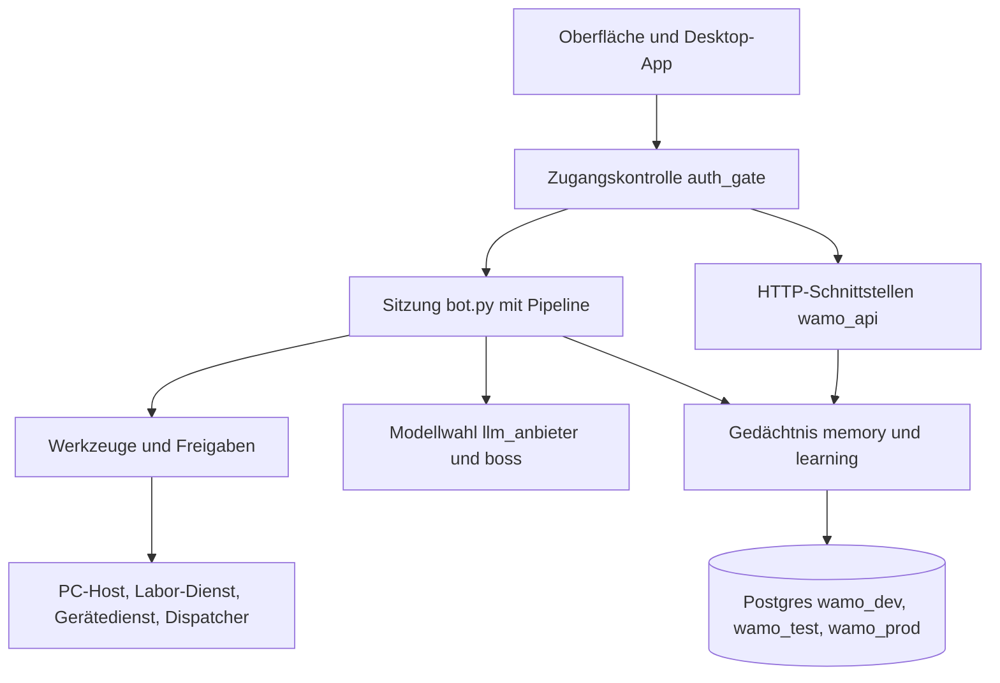
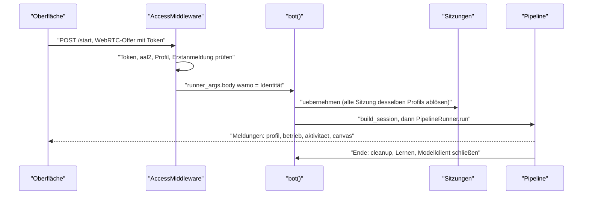
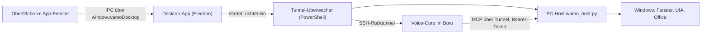
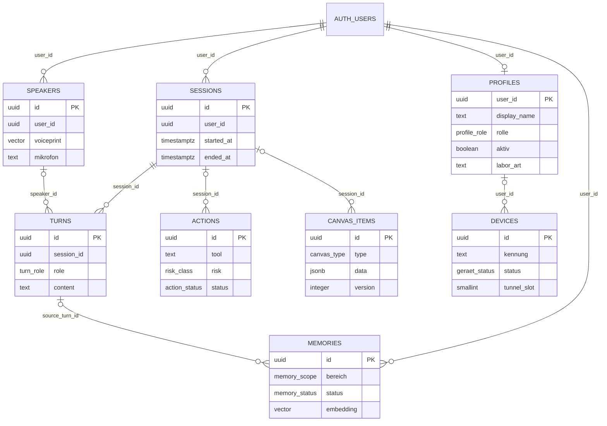

# Technik

| | |
|---|---|
| Zweck | Technische Referenz der Komponenten: Aufbau von Kern, Oberfläche, Host und Desktop-App, Befunde der ausgelieferten App, Datenmodell, Schnittstellen und Konfiguration. |
| Zielgruppe | Entwickler, Integratoren, Betrieb |
| Dokumentart | Erklärung und Referenz |
| Stand | 20.11.2026, Version 0.7.0, geprüft gegen Commit 7caf977 |
| Quellen | Die Kopftabelle jedes Kapitels nennt die Quellen |

## Inhalt

1. [Voice-Core: Aufbau des Python-Kerns](#voice-core-aufbau-des-python-kerns)
2. [Oberfläche: Aufbau der Next.js-Anwendung](#oberfläche-aufbau-der-nextjs-anwendung)
3. [PC-Host und Desktop-App](#pc-host-und-desktop-app)
4. [Befunde der ausgelieferten Desktop-App (REA)](#befunde-der-ausgelieferten-desktop-app-rea)
5. [Datenmodell: Datenbank, Rollen und Migrationen](#datenmodell-datenbank-rollen-und-migrationen)
6. [Schnittstellen von W.A.I.S.](#schnittstellen-von-wais)
7. [Konfiguration: Umgebungsvariablen und Schalter](#konfiguration-umgebungsvariablen-und-schalter)
8. [Konfiguration: Betriebsskripte und Einrichtungsvariablen](#konfiguration-betriebsskripte-und-einrichtungsvariablen)

## Voice-Core: Aufbau des Python-Kerns

| | |
|---|---|
| Zweck | Zeigt, wie der Kern von W.A.I.S. (Ordner `voice-core/`) aufgebaut ist: Pipeline, Modulgruppen, Start, Lebenszyklus und wiederkehrende Muster. |
| Zielgruppe | Entwicklerinnen und Entwickler, die den Kern ändern, prüfen oder betreiben. |
| Dokumentart | Erklärung mit Referenztabellen |
| Quellen | `voice-core/bot.py`, `voice-core/auth_gate.py`, `voice-core/wamo_api.py`, `voice-core/kern_dienst.py`, `voice-core/abschaltung.py`, `voice-core/pyproject.toml`, `infra/sokrates2/wamo-core@.service`, `CLAUDE.md` |

### 1. Überblick

Der Kern ist ein Python-Dienst auf Basis von Pipecat (Paket `pipecat-ai`, laut `voice-core/pyproject.toml` Version 1.12 bis unter 2). Er nimmt die Sprache der Person über WebRTC entgegen, erkennt sie, lässt ein Sprachmodell antworten, ruft bei Bedarf Werkzeuge auf und spricht die Antwort. Daneben stellt er unter `/wamo/api/` eigene HTTP-Schnittstellen bereit, die ohne laufendes Gespräch funktionieren.

Auf oberster Ebene liegen 341 Python-Dateien, davon 209 Testdateien (`test_*.py`). Es gibt keine Unterpakete: jedes Modul liegt flach in `voice-core/`, die Module importieren sich gegenseitig über ihren Dateinamen. Die Ausnahme ist `voice-core/eval/` mit Messläufen und Testsätzen für die Modellabnahme.

Der Kern läuft in zwei Betriebsarten (`WAMO_BETRIEB`, siehe `voice-core/bot.py` `betrieb_modus`): `lokal` (Standard, auf dem PC der Person, "Unterwegs") und `buero` (als Dienst `wamo-core` auf Sokrates-2). Alles andere als der Wert `buero` gilt als `lokal`.

Gemeinsame Begriffe stehen in [glossar.md](glossar.md).

### 2. Sprachpipeline

Eine Sitzung ist eine Pipecat-Pipeline, die `build_session` in `voice-core/bot.py` pro Verbindung aufbaut. Die Reihenfolge der Verarbeiter steht dort im Aufruf `Pipeline([...])`.

```mermaid
flowchart LR
  MIK["Mikrofon und WebRTC"] --> PRF["Stimmprüfer (Abdruck)"]
  PRF --> STT["Spracherkennung (Soniox oder Haus)"]
  STT --> WAE["Filter und Stimmwächter"]
  WAE --> TRN["Nutzer-Aggregator (VAD, Smart-Turn)"]
  TRN --> LLM["Sprachmodell (Claude oder LiteLLM)"]
  LLM --> AKT["Aktivität, Wartesatz, Kürzer"]
  AKT --> TTS["Sprachausgabe (Soniox oder Haus)"]
  TTS --> OUT["Ausgang und Wiedergabe-Tracker"]
```



| Stufe | Modul und Verarbeiter | Aufgabe |
|---|---|---|
| Eingang | `transport.input()` (Pipecat WebRTC), `AudioInputMonitor` in `audio_monitor.py` | Mikrofon-Audio, Diagnose von Lücken und Pegel, Meldung `mikrofon` bei Stille |
| Stimmprüfer | `Stimmpruefer` in `stimme_pruefer.py` (nur mit Stimmabdruck) | schneidet jede Äußerung aus einem Ringpuffer und vergleicht sie mit dem Abdruck |
| Spracherkennung | `soniox_stt()` in `bot.py` oder `HausSTTService` in `sprache_anbieter.py` | Streaming-Erkennung, Deutsch strikt (`language_hints_strict`), Sprechertrennung |
| Schlüsselfilter | `SchluesselFilter` in `schluessel_filter.py` | entfernt Muster von Schlüsseln aus Text, der ans Modell ginge |
| Sprecher | `SpeakerTracker` in `audio_monitor.py`, `StimmWaechter` in `stimme_waechter.py` | färbt Kern und Stimmlinie, hält fremde Äußerungen vom Modell fern (Modus streng) |
| Zug | `user_agg` (Pipecat `LLMUserAggregator`) mit Silero-VAD und `LocalSmartTurnAnalyzerV3` | erkennt Sprechbeginn und Satzende, `LLMTurnCompletionUserTurnStopStrategy` lässt das Modell über Unfertiges mitentscheiden |
| Weiche Unterbrechung | `SoftInterruptGate`, `MeaningfulWordsUserTurnStartStrategy` in `soft_interrupt.py` | Rückmeldelaute ("mhm") stoppen nichts, Echo wird erkannt, bei Unterbrechung wird der Satz zu Ende gesprochen oder innegehalten |
| Wächter vor dem Modell | `JaWaechter` (`ja_waechter.py`), `AbbruchHinweis` (`werkzeug_wache.py`), `TurnWache.vorne()` (`turn_wache.py`) | "Ja" auf eine Rückfrage führt aus, abgebrochene Werkzeuge werden gemeldet, doppelte Antworten verhindert |
| Sprachmodell | `llm` aus `gespraech_llm` in `llm_anbieter.py` | Gespräch und Werkzeugaufrufe, Persona als Systemprompt aus `persona.py` |
| Wächter nach dem Modell | `TurnWache.hinten()`, `Wartesatz` (`wartesatz.py`), `ActivityReporter` (`activity.py`), `AusgabenKuerzer` (`ausgaben_kuerzen.py`), `FuellwortSpieler` (`fuellwoerter.py`) | kurzer Satz bei langen Werkzeugen, Zeitleiste für die Oberfläche, lange Ausgaben kürzen, "Moment." statt Stille |
| Sprachausgabe | `LazySonioxTTSService` in `soniox_tts.py` oder `HausTTSService` | Streaming-Sprachausgabe, `aussprache.py` schreibt "Wais" für die Stimme um |
| Ausgang | `WiedergabeStart` (`wiedergabe.py`), `transport.output()`, `PlaybackTracker` (`wiedergabe_tracker.py`) | Ton hinaus, meldet dem Gate jedes Wort, das wirklich gesprochen wurde |

Die Stimmprüfung misst im Standard nur (Modus `beobachten`, `voice-core/stimme_gate.py`): Sie zeigt das Urteil an und sperrt nichts. Nur mit `WAMO_STIMME_PRUEFUNG=streng` verwirft der Wächter fremde Äußerungen und sperrt Werkzeuge. Für PC-Befehle per Sprache brauchen Mitglieder unabhängig davon einen eingelernten Abdruck (`StimmGate.pflicht_grund`).

Die Stufen Füllwörter, Wartesatz, Ja-Wächter, Abbruchhinweis und Kürzer hängen an Schaltern (Abschnitt 6), sie sind nur bei eingeschaltetem Schalter in der Pipeline. Zusätzlich wirken Beobachter ohne Eingriff: `PipelineProtokoll` (`pipeline_protokoll.py`), `fehlerbuch.FehlerBeobachter` und, nur mit `WAMO_LATENZ_LOG=1`, `LatenzObserver` (`latenz.py`).

### 3. Komponentendiagramm



Die Zugangskontrolle hängt als ASGI-Middleware vor allen Routen des Pipecat-Runners (`install_access_gate` in `voice-core/auth_gate.py`). Ohne sie startet der Server nicht (`pruefe_zugang` in `voice-core/kern_dienst.py`). Der Bot liest die geprüfte Identität aus `runner_args.body["wamo"]`, einen anderen Weg zur Identität gibt es nicht.

### 4. Modulgruppen

Zeilenzahlen sind nicht angegeben, sie ändern sich laufend. Große Module sind `bot.py`, `dev_agent.py`, `llm_anbieter.py`, `soft_interrupt.py` und `modellzugang.py`.

#### 4.1 Zugang, Sitzung, Dienst

| Modul | Aufgabe | wichtigste Schnittstelle |
|---|---|---|
| `auth_gate.py` | Token (ES256 lokal über JWKS), zweiter Faktor (aal2), Höchstalter, aktives Profil, Erstanmeldung, fail-closed | `AccessGate.authorize`, `install_access_gate`, `Identity`, `identity_from_body`, `erstanmeldung_sperre` |
| `bot.py` | Einstieg, Sitzungsaufbau, Pipeline, Meldungen an die Oberfläche | `bot`, `build_session`, `run_bot`, `SessionGuard`, `betrieb_message` |
| `sitzungen.py`, `sitzungen_bruecke.py` | eine Sitzung je Profil, Ablösung auch zwischen zwei Kern-Instanzen (Slots) | `Sitzungen.uebernehmen`, `Sitzung`, `Bruecke` |
| `kern_dienst.py` | Log-Stufe halten, Unix-Socket statt TCP, Zugangskontrolle erzwingen | `runner_vorbereiten`, `pruefe_zugang`, `pruefe_socket_verzeichnis` |
| `abschaltung.py` | begrenztes Herunterfahren mit Fristen und Notbremse | `lifespan_begrenzen`, `aufgaben_beenden`, `notbremse_starten` |
| `wamo_api.py` | Rahmen der HTTP-Schnittstellen unter `/wamo/api`, Lesen von Bodys mit Obergrenze | `installieren`, `identitaet`, `lies_json`, `lies_bytes` |
| `wamo_tls.py` | Vertrauen in die interne CA für Verbindungen zum Supabase-Stack | Umgebung `WAMO_CA_FILE` |
| `wamo_admin.py` | Kommandozeile für Profile und gemeinsame Gedächtnisvorschläge (Rolle `wamo_admin`) | `main` |

#### 4.2 Stimme und Wächter

| Modul | Aufgabe | wichtigste Schnittstelle |
|---|---|---|
| `stimme_modell.py` | Rechenteil: Sprechermodell (TitaNet-Large als ONNX über `sherpa-onnx`), Abdruck aus Sprache | `StimmModell`, `Embedder`, `kosinus`, `ohne_pausen` |
| `stimme_pruefer.py` | Prüfer im Audiopfad, schneidet Äußerungen, lernt auf Klick ein | `Stimmpruefer`, `Urteil` |
| `stimme_gate.py` | Regelwerk: Urteil je Äußerung (eigen, fremd, unklar) als bester Wert über alle Abdrücke der Person. Der Modus kommt aus `WAMO_STIMME_PRUEFUNG` (Standard `beobachten`: messen und anzeigen). `StimmGate.sperrt` ist nur im Modus `streng` wahr, sonst ist das Urteil ein Hinweis. Pflichtstufe für PC-Befehle von Mitgliedern (`pflicht_grund`). | `StimmGate`, `Schwellen`, `Abdruck`, `pruefmodus`, `werkzeuge_absichern`, `schemas_absichern`, `tippen_beobachten` |
| `stimme_waechter.py` | nur im Modus `streng` mit bereitem Abdruck: nur die eigene Stimme erreicht das Modell und unterbricht (Laborprofile nie) | `StimmWaechter`, `ist_eigen`, `nur_endgueltig`, `nur_eigen_unterbricht` |
| `stimme_sitzung.py` | Klebstoff zwischen `bot.py` und den Teilen: Laden, Client-Nachrichten, Einwilligung, Löschen | `StimmSitzung`, `nachricht_aus` |
| `stimme_einlernen.py` | 20 Sekunden Sprache aufnehmen, Abdruck und persönliche Schwelle berechnen | `Einlernen`, Protokoll `Speichern` |
| `stimme_speicher.py` | Abdrücke in Tabelle `speakers` (eine Zeile je Mikrofon, seit Migration 0029), nur eigenes Profil, nur Rolle `wamo_core` | `abdruecke_laden`, `abdruck_speichern`, `abdruck_loeschen`, `schatten_alle_laden` |
| `stimme_mikrofon.py` | je eingelerntem Mikrofon ein Abdruck, höchstens drei je Person (`MAX_ABDRUECKE`, Migration 0029); Kennung `unbekannt` oder 32 Hexzeichen aus dem Namen | `Mikrofon`, `mikrofon_kennung`, `mikrofon_name`, `kennung_gueltig` |
| `stimme_einwilligung.py` | Text und Version der Einwilligung (Art. 9 DSGVO): `stimme-1` (ein Abdruck), `stimme-2` (mit Schattenabdruck), `stimme-3` (je Mikrofon, verlangt, sobald Migration 0029 da ist) | `einwilligung_gilt`, `einwilligung_nachricht`, `schatten_erlaubt` |
| `stimme_schatten.py` | zweites Sprechermodell, misst nur mit und entscheidet nie | `SchattenModell`, `SchattenPruefung`, `schatten_an` |
| `mikrofon_kette.py` | Mikrofonkette im Protokoll: Die Oberfläche meldet nach jedem Wechsel der Aufnahmespur die Client-Nachricht `mikrofon_info` (Echo-, Rausch- und Verstärkungsschalter, Rate, Kanäle, grobe Klasse `eingebaut`, `headset`, `bluetooth` oder `unbekannt`). Der Kern prüft sie streng (nur diese sechs Felder, feste Grenzen, nie ein Gerätename, nie Audio), schreibt höchstens 50 Logzeilen `Mikrofonkette:` je Sitzung und hängt die Klasse an die Urteilszeilen der Stimmprüfung (`, Kette <klasse>`). Der Stand liegt nur im Arbeitsspeicher der Sitzung, Laborprofile dürfen die Nachricht nicht senden. | `Kette`, `StimmSitzung.mikrofon_info` |
| `soft_interrupt.py` | weiche Unterbrechung, Echo-Erkennung, Innehalten | `SoftInterruptGate`, `MeaningfulWordsUserTurnStartStrategy`, `ist_echo` |
| `wiedergabe.py`, `wiedergabe_tracker.py` | Ton anhalten und fortsetzen, tatsächlich gesprochene Wörter melden | `WiedergabeStart`, `halt_fuer`, `PlaybackTracker` |

#### 4.3 Gedächtnis und Lernen

| Modul | Aufgabe | wichtigste Schnittstelle |
|---|---|---|
| `memory.py` | Sitzungen, Gesprächszeilen, Lernspeicher, Profile in Postgres, zwei Rollen mit getrennten Verbindungen | `MemoryStore.from_env`, `MemoryStore.recall`, `Database`, `Recall`, `Profile`, `SharedProposal` |
| `learning.py` | Auswertung eines Gesprächsabschnitts, hält Fakten und Vorlieben fest | `learn_from_session`, `Gemerkt` |
| `gedaechtnis_api.py` | gemeinsame Vorschläge prüfen (nur Admins) | `router` |
| `canvas_sitzung.py`, `canvas_quelle.py`, `canvas_historie.py` | Canvas-Elemente der Sitzung, Lesen eigener Elemente, Historie | `CanvasSitzung`, `canvas_lesen`, `historie` |
| `teilen.py`, `teilen_api.py`, `teilen_werkzeuge.py` | Arbeit teilen: Canvas, Ergebnisse, Scans, Dateien | `Teilen`, `router` |
| `vorgaenge.py`, `vorgaenge_api.py`, `vorgang_stream.py` | Aufgabenleiste "Vorgänge" mit Livefortschritt, Verlauf aus Tabelle `vorgaenge` | `Vorgaenge`, `EntwicklungsVorgang` |
| `fehlerbuch.py` | Was nicht ging und warum, nur im Speicher der Sitzung | `Fehlerbuch`, `FehlerBeobachter`, Werkzeug `fehler_erklaeren` |

#### 4.4 Rechte und Freigaben

| Modul | Aufgabe | wichtigste Schnittstelle |
|---|---|---|
| `rechte.py` | Stufe der PC-Steuerung an einer Stelle: `admin`, `mitglied` oder `None` | `pc_stufe`, `pc_mitglieder_profile` |
| `pc_mitglied.py` | Schutz vor jedem PC-Werkzeug für Mitglieder (Liste, Pflichtstufe der Stimme, Karte nach Fremdinhalt) | `MitgliedSchutz`, `kern_erlaubt`, `kern_werkzeuge_absichern` |
| `pc_freigaben.py` | Freigabekarte kritischer PC-Aktionen, von der Anfrage des Hosts bis zum Klick | `PcFreigaben` |
| `labor_freigaben.py` | Freigaben schreibender Labor-Aktionen (Job `labor`) | `LaborFreigaben`, `Antrag`, `Angebot` |
| `jira_freigaben.py` | Freigabekarte für Jira-Stories (Job `jira`) | `JiraFreigaben` |
| `activity.py` | Aktivitätszeitleiste, Karten und Markierungen für die Oberfläche | `ActivityReporter`, `freigabe_karte` |
| `schluessel.py`, `schluessel_filter.py` | AES-256-GCM für eigene Schlüssel und Tokens, Schwärzen in Logs, Schutz vor gesprochenen Schlüsseln | `Tresor`, `schwaerzen`, `SchluesselFilter` |

#### 4.5 Werkzeuge

| Modul | Aufgabe | wichtigste Schnittstelle |
|---|---|---|
| `tools.py` | Werkzeuge im Gespräch: Zeit, Merken, Canvas, Websuche | `register_tools`, `TurnState`, `canvas_schema`, `web_search` |
| `suche.py` | Websuche über SearXNG statt Anthropic-Websuche | `searxng_suche`, `suchmodus` |
| `screen.py`, `bildstrom.py`, `bild_fern.py` | Bildschirm sehen und klicken, Live-Bild des eigenen Laptops, Prüfung der Fernanfrage | `register_screen_tools`, `Bildstrom`, `pruefer` |
| `office_werkzeuge.py`, `outlook_werkzeuge.py`, `onenote_werkzeuge.py`, `teams_werkzeuge.py` | Canvas als Datei, Mail über Outlook, OneNote-Seite, Teams-Nachricht (jeweils nur mit Schalter und PC-Stufe) | `fuer_sitzung`, `schema` |
| `jira_werkzeuge.py`, `jira_client.py` | User Stories in Jira aus dem Canvas, nur Admin im Büro | `JiraStory`, `sitzung_bauen` |
| `geraete_werkzeuge.py`, `geraete_client.py`, `geraete_register.py` | Bürogeräte über den Gerätedienst, Register `devices` | `Buerogeraete`, `aufruf`, `GeraeteRegister` |
| `werkzeug_wache.py` | abgebrochene und doppelte Werkzeugaufrufe | `umhuellen`, `DoppelWache`, `AbbruchHinweis` |
| `ausgaben_kuerzen.py` | lange Werkzeugausgaben kürzen, Original nachladen | `AusgabenKuerzer`, `register_nachladen` |
| `werkzeugkarte.py` | welche ECC-Skills und REA-Werkzeuge je Auftragsart zuerst genutzt werden | `Karte`, `anweisungsblock` |

#### 4.6 Modelle

| Modul | Aufgabe | wichtigste Schnittstelle |
|---|---|---|
| `llm_anbieter.py` | Anbieter-Fabrik je Baustein (Gespräch, Lernen, Bildschirm, Zusammenfassung), Claude oder LiteLLM, Rückfall, Verbrauchslog | `gespraech_llm`, `zusammenfassung_llm`, `Zugang`, `Wahl`, `LLMNichtVerfuegbar` |
| `modellzugang.py`, `modellzugang_api.py` | Zugang je Profil: eigener Claude-Schlüssel oder nur Hausmodelle | `zugang_laden`, `hinterlegen`, `modus_setzen`, `modell_setzen`, `stimme_setzen` |
| `modellwahl.py` | was eine Person je Bereich wählen darf (Gespräch, Bilder, Hintergrund) | `optionen`, `gueltig` |
| `modellkarte.py` | Datenmodul: Fähigkeiten, gemessene Werte, Latenzklasse, Datenschutz je Modell | `modell`, `alle`, `mit_faehigkeit` |
| `boss.py` | wählt nach Aufgabenklasse das beste erlaubte Modell, verteilt Aufgaben an Spezialisten | `Boss`, `waehlen`, `rangliste`, `entwicklung_quelle` |
| `sprache_anbieter.py`, `soniox_tts.py` | Spracherkennung und Sprachausgabe je Sitzung: Soniox oder im Haus | `sprach_wahl`, `SprachWahl`, `haus_stt`, `haus_tts` |
| `cache_waerme.py`, `kontingent.py` | Prompt-Cache vorwärmen, Kontingent aus Ereignissen von Claude Code | `vorwaermen`, `nachricht` |
| `persona.py`, `aussprache.py` | Systemprompt (fester Teil zuerst für Prompt-Caching), Namensschreibweisen, Aussprache | `build_system_prompt`, `fuer_sprachausgabe` |

#### 4.7 Labor (Testlabor)

Laborprofile (Profil mit `labor_art`) bekommen einen eigenen, engen Zweig: nur Zeit, Websuche, Canvas und die Labor-Werkzeuge, kein Gedächtnis, kein PC, keine Entwicklung (`voice-core/labor.py`).

| Modul | Aufgabe | wichtigste Schnittstelle |
|---|---|---|
| `labor.py` | Politik der Laborprofile an einer Stelle (Erlaubnislisten, Prüfungen) | `ist_labor`, `werkzeuge_erlaubt`, `client_nachricht_erlaubt` |
| `labor_sitzung.py` | die Laborsitzung als ein Objekt: Annahme, Speicher, Wache, Prompt | `LaborSitzung.starten` |
| `labor_durchlauf.py`, `labor_limit.py`, `labor_rtvi.py` | Durchlauf und Einwilligung, Ratenbegrenzung, Erlaubnisliste für Client-Nachrichten | `LaborWache`, `LaborRTVIProcessor` |
| `labor_werkzeuge.py`, `labor_ticket.py`, `labor_mail.py`, `labor_vertrag.py` | Werkzeuge `ticket_*` und `mail_senden` (nur Bestätigung, kein Versand), Prüfungen, Vertragskonstanten | `labor_sitzung` und `LaborSitzung` (Werkzeuge) in `labor_werkzeuge.py`, `pruefe_mail`, `bestaetigen` |
| `labor_client.py` | Client zum Test-Jira-Dienst (Vertrag Version 1) | `LaborClient`, `client_aus_umgebung` |
| `labor_speicher.py`, `labor_loeschliste.py`, `labor_verwaltung.py`, `labor_daten.py`, `labor_prompt.py` | Speicher ohne Gedächtnis, Löschliste, Löschung, Daten vom Server, Prompt | `LaborSpeicher` |
| `labor_attrappe.py`, `labor_testhilfe.py` | Attrappen, nur für Tests | nicht im Betrieb |

#### 4.8 Entwicklungsaufträge

| Modul | Aufgabe | wichtigste Schnittstelle |
|---|---|---|
| `dev_agent.py` | Entwicklungsaufträge per Sprache an Claude Code, Karte, Runden, Freigabe | `DevAgent`, `Job`, `entwicklung_enabled` |
| `dev_agent_regeln.py`, `dev_agent_weg.py` | Umgebungs-Allowlist und Sperrmuster, SSH-Weg zu Sokrates-2 | `ssh_argv`, `remote_status` |
| `dev_guard.py` | Wächter als PreToolUse-Hook von Claude Code, prüft jeden Werkzeugaufruf | Aufruf über stdin, Konstante `SELF_REPOS` |
| `entwicklung_betrieb.py` | Büro-Schranken: Zulassung, Kostengrenzen, Quittung, Audit über `actions` | `BueroZulassung`, `zulassung_fuer`, `grund_fuer`, `SCHRANKEN_VERSION` |
| `abnahme.py`, `abnahme_befehl.py`, `abnahme_remote.py` | prüfbares Ziel mit Runden, Allowlist für Befehlskriterien, Prüfung am Dispatcher | `parse_abnahme`, `RemoteAusfuehrer`, `DispatcherPing` |
| `auftrag_entwuerfe.py` | Aufträge für später speichern (Tabelle `auftrag_entwuerfe`) | `DatenbankEntwuerfe`, Protokoll `EntwurfSpeicher` |
| `github_zugang.py`, `github_zugang_api.py`, `github_auftrag.py`, `dev_agent_github.py` | persönlicher GitHub-Weg (Plan C): Zugang je Person, Einreichen erst nach Klick | `github_zugang_fuer`, `Aenderung` |
| `selbstauftraege.py`, `dev_agent_selbst.py` | Aufträge an W.A.I.S. selbst: gemeinsamer Rückstand für Admins in der Tabelle `selbstauftraege` (Nummer `SA-n`, Migration 0030), nur Admins mit Datenbank, nie Mitglieder, nie Labor. Anlegen per Sprache (`selbstauftrag_speichern`, `selbstauftraege_zeigen`, `selbstauftrag_verwerfen`), Oberfläche (Client-Nachricht `selbstauftrag`) oder Claude Code (`scripts/wamo_selbstauftraege.py`). Der Kern führt nichts aus: Ein Eintrag ist ein Vorschlag und keine Anweisung, umgesetzt wird er nur nach dem ausdrücklichen Ja eines Admins. Nach Fremdinhalt wird er als `unsicher` markiert, Zugangswerte werden vor dem Speichern ersetzt, höchstens 30 neue Einträge je Person und Tag. Dass W.A.I.S. Einträge selbst umsetzt (`bearbeiter` `wais`), ist nicht gebaut. | `Selbstauftrag`, `DatenbankSelbstauftraege`, `SelbstWeg` |

#### 4.9 Geräte, PC, Büro

| Modul | Aufgabe | wichtigste Schnittstelle |
|---|---|---|
| `pc_host.py` | Verbindung zum PC-Host per MCP, PC-Sperre je Sitzung | `host_client`, `host_tools`, `werkzeuge_fuer`, `pc_lease_nehmen` |
| `pc_tunnel.py` | PC-Host über den SSH-Rücktunnel (Unix-Socket, Gegenstellenprüfung) | `TunnelHost`, `pruefe_gegenstelle` |
| `pc_geraet.py`, `pc_nachverbinden.py` | Zuordnung der Sitzung zum eigenen Laptop (Tunnel je Gerät), Nachholen des Zugangs | `pc_zugang_fuer`, `register_modus`, `PcNachholer` |
| `geraet_api.py`, `geraete_admin_api.py`, `geraete_api.py`, `hinweise_api.py` | Gerätebindung, Geräteverwaltung für Admins, Scans, Hinweise | `router` |
| `buero_api.py`, `rd_api.py` | Büro-Karte (Gerätestatus), Fernzugriff auf die Sparks über das Gateway | `router` |
| `release_api.py`, `release_client.py`, `verteilung_api.py` | Stand des Release-Dienstes, Installer der Desktop-App vom Kern | `router`, `status` |

#### 4.10 API-Module unter `/wamo/api`

Die Liste steht in `ROUTEN_MODULE` in `voice-core/wamo_api.py`. Welche Routen die Module bieten, steht in [Schnittstellen von W.A.I.S.](#schnittstellen-von-wais).

`geraet_api`, `hinweise_api`, `teilen_api`, `geraete_api`, `einwilligung_api`, `modellzugang_api`, `geraete_admin_api`, `rd_api`, `release_api`, `buero_api`, `vorgaenge_api`, `gedaechtnis_api`, `einrichtung_api`, `mitglieder_admin_api`, `verteilung_api`, `erstanmeldung_api`, `canvas_historie`, `github_zugang_api`.

Beobachtung: `einwilligung_api` steht in der Liste, im Ordner `voice-core/` liegt aber keine Datei dieses Namens. `_module()` in `wamo_api.py` überspringt fehlende Module ausdrücklich (Teilbereiche sollen sich unabhängig ausliefern lassen), der Eintrag schadet also nicht.

### 5. Start und Lebenszyklus

#### 5.1 Start

Auf Sokrates-2 startet systemd die Vorlage `wamo-core@.service` (Instanz `a` oder `b`, Quelle `infra/sokrates2/wamo-core@.service`). Die Unit führt zuerst `wamo-core-vorpruefung` aus (`ExecStartPre`) und dann `venv/bin/python bot.py -t webrtc` im Ordner `/opt/wamo-core/slots/<slot>/voice-core`. Umgebung: `EnvironmentFile=/etc/wamo/core.env` plus feste `Environment=`-Zeilen (`WAMO_BETRIEB=buero`, `WAMO_CORE_UDS`, `WAMO_SLOT`, `SUPABASE_URL` und weitere).

Im Hauptteil von `bot.py` (`if __name__ == "__main__"`) passiert in dieser Reihenfolge:

1. `PIPECAT_ALLOWED_ORIGINS` wird auf einen Standardwert gesetzt, falls leer (sonst erlaubte der Runner jede Herkunft).
2. `install_access_gate(app)` hängt die Zugangskontrolle vor alle Routen.
3. `wamo_api.installieren(app, gate)` hängt alle vorhandenen API-Module unter `/wamo/api` ein und deren Hintergrundaufgaben an den Lebenszyklus der App.
4. `runner_vorbereiten(...)` aus `kern_dienst.py` setzt die Log-Stufe zurück (der Runner setzt Loguru auf DEBUG, das enthielte Gesprächsinhalte) und stellt, wenn `WAMO_CORE_UDS` gesetzt ist, auf einen Unix-Socket um. Der Socket-Ordner muss dem Dienstbenutzer gehören und für andere gesperrt sein, sonst bricht der Start ab.
5. `main()` des Pipecat-Runners startet uvicorn.

Im lokalen Betrieb ohne Unix-Socket lauscht der Runner auf TCP (Port 7860 im Container laut `voice-core/Dockerfile`).

#### 5.2 Eine Sitzung



- `bot()` beendet jede Sitzung ohne geprüfte Identität sofort.
- `Sitzungen.uebernehmen` löst eine laufende Sitzung desselben Profils ab (Schalter `WAMO_SITZUNG_EINZELN`, Standard an). Mit `WAMO_SLOT` bittet die Instanz auch die andere Instanz um Ablösung (`sitzungen_bruecke.py`).
- `build_session` verzweigt früh: Laborprofil (eigener Zweig), sonst Stufe der PC-Steuerung, Entwicklungszulassung, Modellzugang, Gedächtnis laden, Dienste und Pipeline bauen.
- `SessionGuard` in `bot.py` prüft jede Minute (`PROFILE_RECHECK_SECS` 60): Höchstalter der Anmeldung, maximale Sitzungsdauer (`WAMO_MAX_SITZUNG_MIN`, Standard 120), Profil noch aktiv, Rolle unverändert und, außer bei Laborprofilen, der Stand der Erstanmeldung. Datenbankfehler toleriert er dreimal, dann endet die Sitzung.
- Scheitert der Aufbau (zum Beispiel `LLMNichtVerfuegbar`, `LaborAbgelehnt`), schickt `_verbindung_beenden` der Person einen Grund und trennt. Die Verbindung bleibt nie ohne Pipeline offen. Bei unerwarteten Fehlern gilt ein fester Satz (`SITZUNG_FEHLER_TEXT`), nie ein Detail der Ausnahme.

#### 5.3 Slots und Herunterfahren

Zwei Instanzen (`a`, `b`) laufen nebeneinander, jede mit eigenem Socket `/run/wamo-core/core-<slot>.sock` und eigenem Release-Ordner (`/opt/wamo-core/releases/<name>` mit `voice-core/` und `venv/`). Caddy hält jede Sitzung über den Pfad `/i/<slot>/` auf ihrer Instanz. Verwaltet wird das mit `infra/sokrates2/wamo-core-slots.sh` (`umschalten-kern`, `bewaehren`, `ausleiten`, `rueckweg-kern`). Betriebsablauf: [Release und Ausrollen](betrieb.md#release-und-ausrollen).

Das Herunterfahren hat Fristen unter `TimeoutStopSec=20` der Unit (`voice-core/abschaltung.py`): Verbindungen 4 s, Lifespan 5 s, Hintergrundaufgaben 2 s, Notbremse nach 9 s mit Exit 1. Anlass war ein Hänger zwischen Pipecat und aiortc beim Schließen alter Peer-Verbindungen.

### 6. Muster im Code

| Muster | Beschreibung | Belege |
|---|---|---|
| Schalter über Umgebung | Verhalten hängt an `WAMO_*`-Variablen. `schalter_an`, `schalter_oder_none` und `zahl_im_bereich` parsen einheitlich: leer oder nicht gesetzt gilt der Standard, ein unbekannter Wert bleibt beim Standard und wird einmal gewarnt. Auf Sokrates-2 setzt nur `wamo-core-env` die Werte, die Entwicklungsschalter stehen allein in einem Drop-in. Liste: [Konfiguration: Umgebungsvariablen und Schalter](#konfiguration-umgebungsvariablen-und-schalter) | `voice-core/env_schalter.py`, `infra/sokrates2/wamo_core_env.py` |
| Ports und Adapter | Abhängigkeiten nach außen sind kleine `Protocol`-Klassen, Datenbank oder Dienst stecken dahinter und lassen sich im Test ersetzen. | `ProfileLookup` in `auth_gate.py`, `EntwurfSpeicher` in `auftrag_entwuerfe.py`, `AuftragsSpeicher` in `entwicklung_betrieb.py`, `DurchlaufQuelle` in `labor_durchlauf.py`, `Speichern` in `stimme_einlernen.py`, `Rechner` und `ModellQuelle` in `stimme_modell.py` |
| Einhängepunkte je Sitzung | Ein Werkzeugbereich ist ein Modul mit `fuer_sitzung` oder `sitzung_bauen`, das `bot.py` nur aufruft, wenn Rolle, Stufe und Schalter es erlauben. | `office_werkzeuge.py`, `jira_werkzeuge.py`, `labor_werkzeuge.py`, `geraete_werkzeuge.py` |
| Router-Module | Jedes API-Modul stellt `router` (FastAPI-`APIRouter`) und optional `hintergrund` bereit, `wamo_api.installieren` sammelt sie. Fehlende Module werden übersprungen. | `voice-core/wamo_api.py` |
| Fail-closed | Fehlt Konfiguration oder ist ein Dienst nicht erreichbar, wird abgelehnt (503), nicht durchgelassen. Gilt für Tor, Erstanmeldung, Freigabestatus (fehlendes Attribut gilt als "Freigabe offen"). | `auth_gate.py`, `bot.py` `freigabe_offen` |
| Karte und Klick | Folgenreiche Aktionen erzeugen eine Karte in der Oberfläche, ausgeführt wird erst nach dem Klick der berechtigten Person. | `pc_freigaben.py`, `labor_freigaben.py`, `jira_freigaben.py`, `dev_agent.py` |
| Fremdinhalt ist Daten | Ergebnisse vom PC, aus dem Gedächtnis, vom Boss oder von Werkzeugen gelten als Daten, nie als Anweisung. Ein gefärbter Zug (`turn.taint()`) verhindert Lernen und sofort wirksames gemeinsames Wissen. | `boss.py`, `tools.py`, `pc_mitglied.py` |
| Fehlerbuch | Je Sitzung höchstens 20 Einträge im Speicher, nie in der Datenbank, nie Wortlaut. Das Werkzeug `fehler_erklaeren` gibt sie dem Modell, damit die Person erfährt, warum etwas nicht ging. Laborprofile bekommen es nicht. | `voice-core/fehlerbuch.py` |
| Gleiche Regel an einer Stelle | Rechte und Listen liegen je Thema in einem Modul, andere importieren sie. Verträge zwischen Kern und Dispatcher prüft ein Vertragstest. | `rechte.py`, `labor.py`, `test_kernkanal_vertrag.py` |
| Begrenztes Schreiben | Bodys mit Obergrenze lesen, Texte kürzen, Steuerzeichen entfernen, Geheimnisse schwärzen. | `wamo_api.py` `lies_json`, `persona.py` `clean_inline`, `schluessel.py` `schwaerzen` |

### 7. Tests und Messläufe

- Tests liegen neben den Modulen (`voice-core/test_*.py`, 209 Dateien), Konfiguration in `voice-core/pyproject.toml` (`pytest`, `asyncio_mode = "auto"`). Aufruf im Ordner `voice-core/` mit `uv run pytest`.
- `voice-core/eval/` enthält den Testsatz für die Abnahme der Gesprächsmodelle (`eval/faelle.py`, 51 Gesprächszüge laut Modulbeschreibung), Messungen am Stream (`eval/messung.py`), Messläufe für die Modellkarte (`eval/modellkarte_messen.py`) und den Bericht über gespeicherte Läufe (`eval/bericht.py`). Teststrategie insgesamt: [Qualität und Tests](entwicklung.md#qualität-und-tests).

### Weiterführend

- Architektur: [Architekturdokumentation nach arc42](architektur.md#architekturdokumentation-nach-arc42), [C4-Diagramme von W.A.I.S.](architektur.md#c4-diagramme-von-wais)
- Sicherheit: [sicherheit-und-datenschutz.md](sicherheit-und-datenschutz.md)
- Bestehende Konzepte: [../selbstueberarbeitung.md](../selbstueberarbeitung.md) (Slots), [../entwicklung-im-betrieb.md](../entwicklung-im-betrieb.md), [../testlabor-wamo.md](../testlabor-wamo.md), [../hausmodelle-und-kikollege.md](../hausmodelle-und-kikollege.md)

## Oberfläche: Aufbau der Next.js-Anwendung

| | |
|---|---|
| Zweck | Beschreibt, wie die Web-Oberfläche von W.A.I.S. (Ordner `ui/`) aufgebaut ist: Seiten, Komponenten, Logik, Anmeldung, Darstellung, Sicherheitsrichtlinien und Tests. |
| Zielgruppe | Entwicklerinnen und Entwickler, die an der Oberfläche arbeiten oder sie prüfen. |
| Dokumentart | Erklärung mit Referenztabellen |
| Quellen | `ui/package.json`, `ui/next.config.ts`, `ui/src/app/`, `ui/src/components/`, `ui/src/lib/`, `ui/vitest.config.ts`, `ui/AGENTS.md` |

### 1. Überblick

Die Oberfläche ist eine Next.js-Anwendung (`next` 16.4.6, `react` 19.3.0, laut `ui/package.json`, Version 0.7.0). Sie ist die "Kommandozentrale" im WMC-Corporate-Design: ein Präsenzkern, Live-Untertitel, Stimmlinie, Zeitleiste der Werkzeuge, Canvas, Freigabekarten und die Einstellungen. Sprachverbindung zum Kern über den Pipecat-Client (`@pipecat-ai/client-js`) mit `@pipecat-ai/small-webrtc-transport`, Anmeldung über `@supabase/supabase-js`, Diagramme über `mermaid`.

Dieselbe Oberfläche läuft an drei Orten:

| Ort | Wie | Kern |
|---|---|---|
| Desktop-App | Electron lädt die Oberfläche (siehe [PC-Host und Desktop-App](#pc-host-und-desktop-app)) | lokal ("Unterwegs") oder Büro, wählbar |
| Browser am PC | `next start` oder Entwicklungsserver auf Port 3000 | lokal oder Büro |
| Browser im Büro-LAN | Container `wamo-ui-blau` und `wamo-ui-gruen` auf Sokrates-2, gebaut mit `NEXT_PUBLIC_WAMO_NUR_BUERO=ja` | nur Büro |

Der Build für Sokrates-2 kennt keinen lokalen Kern: er steht nicht in der Sicherheitsrichtlinie (CSP), und die Betriebsart "unterwegs" gibt es dort nicht (`ui/src/lib/geraet.ts`, `ui/src/lib/betriebsart.ts`). Das Image entsteht mit `WAMO_UI_STANDALONE=1` (`output: "standalone"` in `ui/next.config.ts`).

Hinweis aus `ui/AGENTS.md`: Diese Next.js-Version hat laut Datei Änderungen gegenüber früheren Versionen, vor Änderungen an der Struktur gilt die mitgelieferte Dokumentation unter `ui/node_modules/next/dist/docs/`.

### 2. App-Router und Seiten

Es gibt genau eine Seite. Alles andere sind Ansichten innerhalb dieser Seite, erreichbar über den Hash der Adresse.

| Datei | Aufgabe |
|---|---|
| `ui/src/app/page.tsx` | Einzige Seite (`"use client"`). Zeigt `LoginGate`, nach der Anmeldung `Wamo`, das `useWamo()` aufruft und `WamoAnsicht` rendert. Eine Entwicklungsvorschau (`?vorschau=...`) lädt `components/Vorschau.tsx`, nur bei `next dev` und `NEXT_PUBLIC_WAMO_VORSCHAU=1`. |
| `ui/src/app/layout.tsx` | Schriften (vier lokale Schriftfamilien über `next/font/local`), Metadaten, Viewport (`viewportFit: "cover"`), Initialskript für das Farbschema vor dem ersten Zeichnen. |
| `ui/src/app/manifest.ts` | Web-App-Manifest (installierbar, `display: standalone`, Hintergrund `#07070a`). |
| `ui/src/app/version.json/route.ts` | Route `GET /version.json`: Gesundheitsprobe mit Version, Commit und Bauzeit (`no-store`). Das Umschaltskript `wamo-ui-umschalten.sh` nutzt sie laut `CLAUDE.md`. |
| `ui/src/app/globals.css` | Designtokens und Importe aller Komponenten-Stile. |
| `ui/src/app/fonts/` | Schriftdateien mit Lizenzen und `HERKUNFT.md`, Bau und Betrieb laden nichts von Fremdservern. |

Die Einstellungen sind keine eigene Route. Der Hash (`#einstellungen`, `#einstellungen/modellzugang`) wählt die Ansicht (`ui/src/lib/einstellungenAbschnitte.ts`, `einstellungenHash.ts`). Das funktioniert im Browser wie in der Desktop-App.

### 3. Zustand und Verbindung

| Pfad | Aufgabe |
|---|---|
| `ui/src/lib/useWamo.ts` | Der zentrale Hook. Baut `PipecatClient` mit `SmallWebRTCTransport`, startet über `startBotAndConnect({ endpoint, headers })`, empfängt Servernachrichten (`onServerMessage`), sendet Client-Nachrichten (`sendClientMessage`) und liefert die Aktionen (`WamoAktionen`: `connect`, `disconnect`, `decide`, `toggleMic`, `textSenden`, `stimmabdruck`, `office`, `mail`, `teams`, `entwuerfe` und weitere). Deklariert auch den Typ der Desktop-Brücke `window.wamoDesktop`. |
| `ui/src/lib/wamo.ts` | Zustand der Sitzung (`WamoState`, `initialState`) und abgeleitete Auswahlen (`istOnline`, `offeneEntscheidungen`, `wartetAufEntscheidung`). Der Store `wamo` ist global. |
| `ui/src/lib/store.ts` | Kleiner Store (`createStore`, `useSelect` über `useSyncExternalStore`): Komponenten abonnieren nur ihren Ausschnitt, ein neues Satzstück im Untertitel rendert nur den Untertitel. |
| `ui/src/lib/nachrichten.ts` | Prüft jede Servernachricht des Kerns (RTVI), unbekannte oder unvollständige ergeben `null` und werden ignoriert. Typen `Profil`, `Betrieb`, `Activity`, `Vorgang` und weitere. |
| `ui/src/lib/kernApi.ts` | Aufrufe an `/wamo/api` des Kerns mit dem Token der Sitzung (nur https oder Loopback, keine Cookies, einmal Token erneuern bei 401, `KernFehler`). |
| `ui/src/lib/kernSlot.ts` | Fragt `GET /wamo/slot` nach der aktiven Kern-Instanz (`a` oder `b`) und startet über `<kern>/i/<slot>/start`. Älterer Server ohne Slot: `<kern>/start`. |
| `ui/src/lib/betriebsart.ts` | Betriebsart `unterwegs` oder `buero` je Gerät. In der Desktop-App hält sie das Hauptprogramm, im Browser `localStorage`. Adressen stehen zur Build-Zeit fest, über die Brücke kommt nur der Name. |
| `ui/src/lib/geraet.ts`, `umgebung.ts` | Browser-Betrieb auf dem Server, Einrichtung des Laptops, Prüfung öffentlicher Adressen (Hinweis auf unverschlüsselte Verbindungen). |
| `ui/src/lib/verbindungsfrist.ts`, `drossel.ts`, `useGedrosselt.ts` | Fristen beim Verbinden, Drosselung von Anzeigen. |

### 4. Anmeldung und Erstanmeldung

| Pfad | Aufgabe |
|---|---|
| `ui/src/components/LoginGate.tsx` | Tür der Oberfläche: E-Mail und Passwort, danach der Code der Authenticator-App (zweiter Faktor, aal2). Rendert die App erst mit gültiger Sitzung (`Sitzung`). |
| `ui/src/lib/supabase.ts` | Browser-Client nur für die Anmeldung, öffentlicher Schlüssel, nie `service_role`. |
| `ui/src/lib/anmeldung.ts` | "Angemeldet bleiben" (`localStorage` oder `sessionStorage`), Höchstalter der Anmeldung: 168 Stunden in der Desktop-App (`DESKTOP_MAX_STUNDEN`), 24 Stunden im Browser (`BROWSER_MAX_STUNDEN`, `NEXT_PUBLIC_WAMO_ANMELDUNG_MAX_STUNDEN_BROWSER`). Komfortgrenze, erzwungen wird im Kern. |
| `ui/src/lib/nutzer.ts` | Kennung und E-Mail der angemeldeten Person in einem Modulspeicher (nichts wird gespeichert). |
| `ui/src/lib/erstanmeldung.ts` | Reine Logik der Erstanmeldung: Stand `keine`, `offen`, `abgelaufen`, `erledigt` von `GET /wamo/api/erstanmeldung`. Jede andere Antwort heißt `keine`, durchgesetzt wird im Kern. Passwörter stehen nie in Meldungen oder Speichern. |
| `ui/src/components/erstanmeldung/` | Geführter Ablauf: `Erstanmeldung.tsx` (Leiste der Schritte), `schritte.tsx` (Liste `ERSTANMELDUNG_SCHRITTE`), `PasswortSchritt.tsx`, `typen.ts`. Merker im `sessionStorage` (`wamo-erstanmeldung-<user_id>`). |
| `ui/src/components/einrichtung/` | Geführte Einrichtung beim Ausrollen: `EinrichtungsAblauf.tsx`, Schritte Token, API-Schlüssel, Zusammenfassung, Installer (`InstallerDownload.tsx`), Anbindung `fuerErstanmeldung.tsx`. |
| `ui/src/lib/einrichtung.ts`, `einrichtungSchritte.ts`, `installer.ts`, `installerApi.ts` | Prüfliste (`GET /wamo/api/einrichtung/stand`), Schritteliste, Installer-Download, Updates der App über die Brücke. |

### 5. Kommandozentrale (Hauptansicht)

Die Hauptansicht setzt `components/WamoAnsicht.tsx` zusammen, den Rahmen mit Reitern liefert `components/kommando/Rahmen.tsx`. Es gibt vier Darstellungen (`ui/src/components/kommando/darstellung.ts`): `normal` (drei Spalten), `fokus` (nur Kern und Untertitel), `zentrale` (große Kommandozentrale) und `nacht` (erzwungen dunkel).

| Pfad (unter `ui/src/components/`) | Aufgabe |
|---|---|
| `WamoAnsicht.tsx`, `kommando/Rahmen.tsx`, `kommando/Reiter.tsx` | Zusammenbau, Reiter, Hauptschaltfläche |
| `Kopfzeile.tsx`, `Statusleiste.tsx`, `ProfilChip.tsx`, `kommando/Statusanzeige.tsx`, `kommando/ZentraleStatus.tsx` | Wortmarke, Profil, Verbindung, Betriebsart, Modelle, PC-Host, Mikrofon, Uhrzeit, Zahnrad zu den Einstellungen |
| `kommando/PraesenzKern.tsx`, `Orb.tsx`, `kommando/KernRinge.tsx`, `kommando/Kernbereich.tsx` | Lichtkugel (WebGL, ein Fragment-Shader) in HUD-Ringen (SVG). Fehlt WebGL, zeigt das Stylesheet eine Kugel aus einem Farbverlauf. |
| `VoiceLine.tsx`, `kommando/Gespraech.tsx`, `LiveCaption.tsx`, `Verlauf.tsx` | Stimmlinie, Block Gespräch, Live-Untertitel, Verlauf (`role="log"`, nur fertige Züge) |
| `ActivityFeed.tsx`, `kommando/Aufgabenanzeige.tsx`, `kommando/Vorgaenge.tsx` | Zeitleiste der Werkzeugaufrufe, Aufgabenanzeige, Tafel "Vorgänge" |
| `Freigaben.tsx` | Freigabekarten und Auftragskarten, Entscheidung nur per Klick (ein getipptes Ja ersetzt keine Freigabe) |
| `kommando/Bedienung.tsx`, `MikrofonWahl.tsx` | Eingabepille mit Mikrofon, Texteingabe, Senden, Mikrofonliste |
| `kommando/StimmeEinlernen.tsx`, `kommando/StimmeIgnoriert.tsx`, `kommando/KernOderEinlernen.tsx` | Einlernen des Stimmabdrucks, Hinweis auf nicht angenommene Äußerungen (gibt es nur im Modus `streng`, im Standard `beobachten` verwirft der Kern nichts) |
| `kommando/BueroKarte.tsx`, `kommando/BueroSchalter.tsx` | Radialkarte der Bürogeräte |
| `Hinweise.tsx`, `GemerktHinweis.tsx`, `FehlerAnzeige.tsx`, `StillStart.tsx`, `AbmeldenRueckfrage.tsx` | Hinweiskarten, "Gemerkt"-Hinweis, Fehler, Hinweis nach Übernahme einer Sitzung, Rückfrage vor Abmelden (Laborkonten) |
| `BildschirmAnsicht.tsx` | Live-Bild des eigenen Laptops (Admin oder freigeschaltetes Mitglied mit laufender PC-Steuerung) |

### 6. Canvas, Dateien und Arbeitsergebnisse

| Pfad | Aufgabe |
|---|---|
| `ui/src/components/Canvas.tsx` | Zeigt, was W.A.I.S. per `canvas_zeigen` schickt: Tabelle, Code, Dokument, Diagramm (`mermaid`, per dynamischem Import geladen), Bild. |
| `ui/src/components/CanvasDateien.tsx`, `ui/src/lib/canvasDatei.ts` | Dateien der Person öffnen, nur im Browser und nie für Laborkonten. Typ nach den ersten Bytes, Grenzen laut `CLAUDE.md`: 10 MB, 16384 Pixel je Seite, 40 Megapixel, Text höchstens 2 MB. Die Datei geht nie an Kern oder Modell. |
| `ui/src/lib/canvasExport.ts`, `canvasBild.ts`, `export.ts` | Herunterladen als Text, Markdown, HTML im WMC-Design, JSON, CSV, Quelltext, Mermaid als PNG und SVG; Office-Dateien am PC (`export.ts`, Host). |
| `ui/src/components/CanvasHistorie.tsx`, `ui/src/lib/canvasHistorie.ts`, `canvasOeffnen.ts`, `canvasWahl.ts` | Historie geschlossener Reiter, Wiederöffnen |
| `ui/src/components/DateiHinweis.tsx` | Hinweis nach dem Speichern einer Datei am PC (Pfad, "Im Ordner zeigen") |
| `ui/src/components/MailFormular.tsx`, `MailVersand.tsx`, `TeamsFormular.tsx`, `JiraStory.tsx`, `ui/src/lib/mail.ts`, `teams.ts`, `jiraStory.ts` | Mail über Outlook, Teams-Nachricht, User Story in Jira: jeweils vorbereiten, Karte freigeben lassen |
| `ui/src/components/GespeicherteAuftraege.tsx`, `ui/src/lib/auftragEntwuerfe.ts`, `auftragStart.ts`, `auftragFrist.ts`, `auftragAbnahme.ts`, `einreichen.ts` | Entwicklungsaufträge: starten, für später speichern, Frist, Abnahme, Einreichen mit eigenem GitHub-Token (nur per Klick) |
| `ui/src/components/SelbstAuftraege.tsx`, `ui/src/lib/selbstAuftraege.ts` | Aufträge an W.A.I.S. selbst: Liste des gemeinsamen Rückstands, Anlegen, Verwerfen und Wieder-Öffnen (Reiter Aufträge der Hauptansicht, `WamoAnsicht.tsx`). Nur für Admins, nie in der Laborsicht. Die Stände "in Arbeit" und "erledigt" setzt diese Seite nie. |
| `ui/src/components/Teilen.tsx`, `Geteilt.tsx`, `Scans.tsx`, `ui/src/lib/teilenHilfe.ts` | Arbeit teilen, geteilte Arbeit, Scans und NAS-Dateien |

### 7. Einstellungen

Die Ansicht liegt in `ui/src/components/einstellungen/`, die Gliederung in `ui/src/lib/einstellungenAbschnitte.ts` (`GRUPPEN`, `ABSCHNITTE`). Seit 0.7.0 ordnen sechs Gruppen die Seite, jede Gruppe zeigt ihre Abschnitte untereinander. Wer welchen Abschnitt sieht, bestimmt `nurAdmin`, `auchMitToken` und `laborSicht` dort. Die Rolle kommt vom Kern, der sie noch einmal prüft. Eine Gruppe erscheint, sobald ein Abschnitt für die Rolle sichtbar ist: Mitglieder sehen fünf Gruppen (ohne Verwaltung), die Laborsicht genau eine.

Die Adresse steht im Hash. Gruppen und Abschnitte haben getrennte Kennungen (`allgemein`, `sprache-stimme`, `zugaenge`, `geraete-pc`, `inhalte`, `verwaltung` für die Gruppen). Eine Abschnittskennung wie `#einstellungen/stimme` öffnet die Gruppe des Abschnitts und springt zu ihm, eine Gruppenkennung öffnet die Gruppe am Anfang. Im Hash steht nur eine Kennung aus den festen Listen, nie ein Wert aus dem Formular.

| Gruppe (ID) | Abschnitt (ID) | Titel | Sichtbar | Komponente oder Logik |
|---|---|---|---|---|
| Konto und Allgemeines (`allgemein`) | `konto` | Konto | alle | `KontoAbschnitt` in `Abschnitte.tsx` |
| | `start` | Erste Schritte | alle, nie in der Laborsicht | `ErsteSchritte.tsx`, `einrichtung/` (Modellzugang, Installer, Prüfliste und Updates der App) |
| | `darstellung` | Darstellung | alle | `DarstellungAbschnitt` in `Abschnitte.tsx`, `kommando/darstellung.ts` |
| | `info` | Info | alle | `InfoAbschnitt` in `Abschnitte.tsx` (Version aus `WAMO_VERSION`) |
| Sprache und Stimme (`sprache-stimme`) | `sprache` | Mikrofon und Sprache | alle, auch Laborsicht (dort nur Mikrofon wählen) | `SpracheAbschnitt` in `Abschnitte.tsx`, `MikrofonTest.tsx` (Mikrofontest in Sprache und Ton ohne W.A.I.S., Ergebnis je Gerät und Person im Browser), `SprachWahl.tsx` |
| | `stimme` | Eigene Stimme | alle | `StimmeAbschnitt.tsx`: Liste der eingelernten Mikrofone (ein Abdruck je Mikrofon, höchstens drei), Einlernen, Löschen einzeln oder alle |
| Modelle und Zugänge (`zugaenge`) | `modellzugang` | Modellzugang | alle | `ModellZugang.tsx` mit `ModellWahl.tsx`, `ModellAuswahl.tsx`, `SprachWahl.tsx`, `SchluesselFormular.tsx` |
| | `github` | GitHub-Zugang | alle (der Kern sagt, ob erlaubt) | `GithubZugang.tsx`, `lib/githubZugang.ts` |
| | `verbrauch` | Verbrauch | Admins und Profile mit eigenem Claude-Code-Token | `Verbrauch.tsx`, `lib/verbrauch.ts` |
| Geräte und PC (`geraete-pc`) | `geraete` | Geräte und PC-Steuerung | alle | `Geraete.tsx`, `GeraeteVerwaltung.tsx` |
| | `fernzugriff` | Fernzugriff | nur Admins | `Fernzugriff.tsx`, `lib/fernzugriff.ts` |
| Gedächtnis und Teilen (`inhalte`) | `gedaechtnis` | Gedächtnis | nur Admins | `Gedaechtnis.tsx`, `lib/gedaechtnis.ts` |
| | `teilen` | Teilen | alle | `Geteilt.tsx` (Block "Geteilte Arbeit") |
| Verwaltung (`verwaltung`) | `mitglieder` | Neue Mitglieder | nur Admins | `NeueMitglieder.tsx`, `GithubRechte.tsx`, `lib/mitgliederUebersicht.ts` |
| | `aenderungen` | Änderungen | nur Admins | `Aenderungen.tsx`, `AenderungenFreigabe.tsx`, `lib/aenderungen.ts` |

Ein weiterer Abschnitt "Updates" (Updates der Desktop-App suchen und installieren) in der Gruppe Konto und Allgemeines gehört zu 0.7.0, liegt zum Stand dieser Dokumentation aber noch als offener Pull Request vor. Er steht deshalb nicht in der Liste `ABSCHNITT_IDS` von `main`. Die Brücke dafür, `window.wamoDesktop.version` und `update`, gibt es bereits (Abschnitt 3.4), bisher bedient sie der Schritt Installer in "Erste Schritte".

### 8. Logik unter `ui/src/lib/` nach Themen

Reine Logik liegt in `.ts`-Dateien ohne React, damit sie unter `node:test` prüfbar ist. Hooks haben das Präfix `use` und liegen daneben.

| Thema | Dateien | Aufgabe |
|---|---|---|
| Gespräch und Ton | `gespraech.ts`, `untertitel.ts`, `weicherStopp.ts`, `stillStart.ts`, `useStillStart.ts`, `pegelWarnung.ts`, `mikrofon.ts`, `mikrofonTest.ts` | Zeilen, Untertitel, Verhalten beim Unterbrechen, stiller Start beim Tippen, Mikrofon und Test |
| Stimme | `stimme.ts`, `stimmFilter.ts`, `stimmMikrofon.ts`, `mikrofonTest.ts`, `mikrofonKette.ts`, `stimmfarben.ts`, `sprachwahl.ts` | Stimmabdruck, Sätze erst nach dem Urteil zeigen (nur im Modus `streng`), Mikrofonkette (nach jedem Spurwechsel eine Nachricht `mikrofon_info` mit Schaltern, Rate, Kanälen und grober Klasse, nie ein Gerätename), Liste der Mikrofone der Abdrücke und Hinweis "Für dieses Mikrofon einlernen" (Name des Mikrofons nur im Browser, Schlüssel `wamo.stimme.mikrofon.<user_id>`), Mikrofontest (Schlüssel `wamo.mikrofontest.<user_id>`), Farben, Wahl Soniox oder Haus |
| Modelle | `modellauswahl.ts`, `modellwahl.ts`, `modellKurz.ts`, `modellzugangApi.ts`, `modellzugangHilfe.ts`, `schluesselhilfe.ts` | Wahl je Bereich, Zugang, Hilfetexte |
| Geräte und PC | `geraeteApi.ts`, `geraeteVerwaltung.ts`, `geraeteAnzeige.ts`, `geraeteMedien.ts`, `pcSchalter.ts`, `usePcSchalter.ts`, `liveBild.ts`, `bueroApi.ts`, `fernzugriff.ts`, `fernzugriffApi.ts` | Geräteliste, PC-Steuerung, Live-Bild, Büro-Karte, Fernzugriff |
| Labor | `laborPlatz.ts`, `laborKarte.ts`, `laborNeuladen.ts` | Laborsicht (Laborkonten), Karten, Neuladen |
| Darstellung | `thema.ts`, `useThema.ts`, `anzeigename.ts`, `kernRinge.ts`, `profilName.ts` | Hell und Dunkel, Namensschreibweisen, Ringe |
| Einstellungen | `einstellungen.ts`, `einstellungenAbschnitte.ts`, `einstellungenHash.ts`, `einstellungenVerlauf.ts` | gemerkte Wahl je Person und Gerät, Abschnitte, Hash |
| Sonstiges | `aenderungen*.ts`, `gedaechtnis*.ts`, `vorgaenge*.ts`, `buildInfo.ts`, `kopieren.ts`, `textEingabe.ts` | Selbstüberarbeitung, Gedächtnisvorschläge, Vorgänge, Version, Zwischenablage, Eingabe |

Der Name des Assistenten steht an einer Stelle: `ui/src/lib/anzeigename.ts` (Konstanten wie `LANGFORM`), gespiegelt zu `voice-core/persona.py`.

### 9. Darstellung und WMC-Design

- Dunkel ist der Standard, Hell wählbar je Gerät (`ui/src/lib/thema.ts`, Schlüssel `wamo.thema` in `localStorage`, Attribut `data-theme` am Element `html`). Ein Initialskript (`INIT_SKRIPT` in `layout.tsx`) setzt es vor dem ersten Zeichnen. Jeder Speicherzugriff steht in `try/catch`.
- Farben und Rollen als CSS-Variablen in `ui/src/app/globals.css` (`:root`). Hauptfarbe ist WMC-Rot `#F40E0E`, dazu Grautöne, Bernstein für "wartet" und Pink für Fehler, kein Blau (laut Kommentar in `globals.css` und `CLAUDE.md`). Hintergrund `#07070a` dunkel, `#f3f3f3` hell (`LEISTENFARBE` in `thema.ts`).
- Vier Schriften, je eine Aufgabe (`layout.tsx`): Cormorant Garamond nur für den Namen W.A.I.S., Unbounded für Überschriften und große Zahlen, JetBrains Mono für Beschriftungen und Zähler, Atkinson Hyperlegible für Fließtext. Die Dateien liegen im Repo, Lizenzen (OFL) daneben.
- Logos: `ui/public/wmc-logo.png`, `wmc-logo-dunkel.png`, `wmc-logo-klein.png`, Symbole für die installierbare App unter `ui/public/icons/`.
- Stile je Bereich in eigenen CSS-Dateien neben den Komponenten, mit Präfixen (`.kz` Kommandozentrale, `.kr-` Kernringe, `.vg-` Vorgänge, `.ez` Einstellungen, `.mz-` Modellzugang, `.ea-` Einrichtung, `.bk-` Büro-Karte, `.lb-` Live-Bild). `globals.css` importiert sie alle.
- Barrierefreiheit: Kontrastwerte sind im Kommentar von `globals.css` genannt (zum Beispiel WMC-Rot auf dem Hintergrund 4,7:1), Radiogruppen nach WAI-ARIA, Fokus wird nach Entscheidungen weitergegeben (`Freigaben.tsx`), das Zoomen bleibt erlaubt.

### 10. Sicherheitsrichtlinien

Die Header setzt `ui/next.config.ts` für alle Pfade (`source: "/:path*"`).

| Header | Wert und Wirkung |
|---|---|
| `Content-Security-Policy` | `default-src 'self'`. `connect-src` erlaubt nur die eigene Seite, die Supabase-Adresse und die Adressen der Kerne (`NEXT_PUBLIC_VOICE_CORE_URL`, im Sokrates-2-Build ohne lokalen Kern; `NEXT_PUBLIC_WAMO_KERN_BUERO` nur über https). `script-src` mit `'unsafe-inline'` (Hydration) und `blob:` (Audio-Worklet des Mikrofons), `'unsafe-eval'` nur in der Entwicklung. `style-src 'unsafe-inline'`. `img-src 'self' data: blob:`, also keine fremden Bilder. `object-src 'none'`, `base-uri 'self'`, `form-action 'self'`, `frame-ancestors 'none'`. |
| `Referrer-Policy` | `no-referrer` |
| `X-Content-Type-Options` | `nosniff` |
| `X-Frame-Options` | `DENY` |
| `Permissions-Policy` | `microphone=(self)`, `screen-wake-lock=(self)`, Kamera, Standort, Zahlung und USB aus |

Weitere Eigenschaften im Code: `poweredByHeader: false`, kein `service_role`-Schlüssel in `ui/`, Token gehen nur an https oder Loopback (`kernApi.ts`), jede Servernachricht wird geprüft (`nachrichten.ts`), Dateien der Person gehen nie an den Kern (`canvasDatei.ts`). Wer etwas Sicherheitsrelevantes tut, entscheidet der Kern, die Oberfläche führt nur durch den Ablauf.

### 11. Brücke zur Desktop-App

In der Desktop-App gibt es `window.wamoDesktop` (Typ in `ui/src/lib/useWamo.ts`). Felder: `isDesktop`, `levels` (Zustand melden), `markierung`, `betriebsart`, `rechnername`, `mikrofonStatus`, `geraet`, `version`, `update`. Im Browser fehlt das Objekt, die Oberfläche nennt dort, was fehlt. Die Gegenseite beschreibt [PC-Host und Desktop-App](#pc-host-und-desktop-app).

### 12. Tests und Befehle

| Befehl (im Ordner `ui/`) | Wirkung |
|---|---|
| `npm run dev` | Entwicklungsserver |
| `npm run build`, `npm start` | Produktions-Build und Start |
| `npm run lint` | ESLint 9 mit `eslint-config-next` |
| `npm test` | Logiktests: `node --test "src/**/*.test.ts"` (Node lädt TypeScript selbst, kein DOM). 88 Dateien. |
| `npm run test:komponenten` | `vitest run` in jsdom für `*.comp.test.tsx` (Testing Library, user-event). 71 Dateien. |

Zwei getrennte Systeme, damit sich beide nicht stören (Begründung im Kopf von `ui/vitest.config.ts`). Testdateien liegen neben dem Code und gehören nie zum Build. Strategie insgesamt: [Qualität und Tests](entwicklung.md#qualität-und-tests).

### Weiterführend

- Benutzersicht: [benutzerhandbuch.md](benutzerhandbuch.md)
- Architektur: [C4-Diagramme von W.A.I.S.](architektur.md#c4-diagramme-von-wais)
- Bestehende Planpapiere: [../ausrollen-neue-nutzer.md](../ausrollen-neue-nutzer.md), [../komfort-paket.md](../komfort-paket.md)

## PC-Host und Desktop-App

| | |
|---|---|
| Zweck | Beschreibt die zwei Teile von W.A.I.S., die auf dem Windows-PC der Person laufen: den Werkzeugserver `host/` ("die Hände") und die Electron-App `desktop/`. |
| Zielgruppe | Entwicklerinnen und Entwickler sowie Sicherheitsprüfer. |
| Dokumentart | Erklärung mit Referenztabellen |
| Quellen | `host/wamo_host.py`, `host/host_http.py`, `host/live_bild.py`, `host/windows_control.py`, `host/uia_control.py`, `host/pyproject.toml`, `desktop/main.js`, `desktop/preload.js`, `desktop/update.js`, `desktop/installation.js`, `desktop/package.json`, `scripts/wamo-tunnel.ps1`, `voice-core/pc_host.py` |

Befunde zur ausgelieferten App (gebautes Paket, Fuses, Dateiliste) stehen in [Befunde der ausgelieferten Desktop-App (REA)](#befunde-der-ausgelieferten-desktop-app-rea). Dieses Dokument beschreibt den Quellcode.

### 1. Zusammenspiel



Zwei Betriebsarten, beide am selben Host:

| Betriebsart | Kern läuft | Verbindung zum Host |
|---|---|---|
| Unterwegs (`lokal`) | auf dem PC | Der Kern startet den Host als Unterprozess (`--stdio`), nicht im Netz erreichbar (`voice-core/pc_host.py`) |
| Büro (`buero`) | auf Sokrates-2 | Der Host lauscht nur auf Loopback (`--http`), der Kern erreicht ihn über einen SSH-Rücktunnel mit Bearer-Token (`host/host_http.py`, `scripts/wamo-tunnel.ps1`) |

### 2. PC-Host (`host/`)

#### 2.1 Aufbau

Python-Paket `wamo-host` (Version 0.7.0, `host/pyproject.toml`), Abhängigkeiten laut Datei: `mcp` (MCP-SDK, Version 1.x), `mss`, `pillow`, `pywin32` und `comtypes` (nur Windows), `python-docx`, `openpyxl`, `python-pptx`. Der Server heißt in FastMCP `wamo-host` (`FastMCP("wamo-host", ...)` in `wamo_host.py`). Start: `wamo_host.py --stdio` oder `--http`, ohne Argument bricht er mit einer Aufrufhilfe ab.

| Datei | Aufgabe |
|---|---|
| `host/wamo_host.py` | Alle MCP-Werkzeuge, Risikoklassen, Freigabeverwaltung (`PENDING`), Audit, Programmliste `APPS`, Sperrmuster `BLOCKED_PATTERNS` |
| `host/host_http.py` | HTTP-Betrieb: nur Loopback, Bearer-Token, kein Origin, nur Pfad `/mcp`, zustandslos, Gerätebindung |
| `host/windows_control.py` | Fenster, Tastatur, installierte Programme, Sperrstatus; Sicherheitsregeln direkt vor der Aktion |
| `host/uia_control.py` | UI-Automation: Elemente eines Fensters bedienen, ohne die Maus zu übernehmen |
| `host/live_bild.py` | Entscheidung, ob ein Einzelbild des Laptops entstehen darf (bei jedem Bild) |
| `host/office_dateien.py` | Word, Excel, PowerPoint, CSV und Markdown aus Canvas-Inhalten, ohne installiertes Office |
| `host/office_ablage.py` | Ablage `Dokumente\WAIS`, Dateinamen, Register `%LOCALAPPDATA%\WAMO\ablage.json` |
| `host/office_com.py` | Office per COM, nur wo es nicht anders geht (PDF über Word in eigener unsichtbarer Instanz) |
| `host/office_outlook.py`, `office_outlook_com.py` | Outlook: Erkennung, Karte, Senden über das klassische Outlook (zurückholbar), Entwurf im neuen Outlook |
| `host/office_onenote.py` | OneNote-Seite im Notizbuch "W.A.I.S." im OneDrive der Firma (COM) |
| `host/office_teams.py` | Teams-Chat mit Text im Eingabefeld, die Person drückt selbst Enter |
| `host/prozess_prioritaet.py` | hebt den Host-Prozess auf normale Priorität, schaltet EcoQoS ab (Befund 17.11.2026) |
| `host/vorlagen/` (darin `wmc-logo.png`) | Logo für erzeugte Dokumente |
| `host/test_*.py`, `host/conftest.py` | Tests; Marker `office` braucht Word oder OneNote am PC (`WAMO_OFFICE_ECHT=1`) |

#### 2.2 Risikoklassen

Erzwungen wird hier im Host, nicht im Prompt (Kopf von `wamo_host.py`). Alles, was ein Modell schickt, gilt als nicht vertrauenswürdig.

| Klasse | Bedeutung |
|---|---|
| `read` | sofort, zum Beispiel `system_info`, `fenster_auflisten`, `powershell_lesen` mit reinen Get-/Test-Befehlen |
| `change` | sofort, protokolliert, zum Beispiel `webseite_oeffnen`, `programm_oeffnen`, `ordner_anlegen`, `tastatur_tippen` |
| `critical` | nur eine Freigabe-Anfrage (Status `needs_approval`), ausgeführt erst nach dem Klick der Person in der Oberfläche |
| `blocked` | nie, zum Beispiel Muster aus `BLOCKED_PATTERNS` (`bcdedit`, `net user`, Passwortbegriffe, "live-bild") |

Freigaben: Das Modell kann sie nicht selbst erteilen. Solange eine Anfrage offen ist oder eine freigegebene Aktion läuft, ruhen alle Eingaben (Status `wartet`). Das Werkzeug `freigabe_entscheiden` ruft nur der Kern nach einem Klick auf. Es steht nicht in `LLM_TOOLS` und verlangt ein zweites Geheimnis neben dem Bearer-Token (Umgebung `WAMO_HOST_FREIGABE` oder Datei `WAMO_HOST_FREIGABE_DATEI`). Eine Anfrage gilt `FREIGABE_GUELTIG_SECS` (300 s), für Eingaben `FREIGABE_EINGABE_SECS` (120 s), wird genau einmal ausgeführt, und direkt davor prüft der Host Ziel, Sperre und Adresse erneut. Höchstens `MAX_PENDING` (5) Anfragen sind offen.

Weitere Schutzmechanismen im Code (Auswahl): Doppelaufrufe innerhalb von 6 s werden nicht wiederholt (`_duplicate`), Eingaben und Klicks bei gesperrtem Bildschirm werden abgelehnt, Tippen nie in Konsolen, Registry, Admin- und Anmeldefenster oder Passwort-Manager, keine Tastenkürzel mit der Windows-Taste (`windows_control.py`), Passwortfelder werden nie gelesen oder beschrieben (`uia_control.py`), Ausgaben auf `MAX_OUTPUT_CHARS` (6000) gekürzt, Adressen auf `MAX_URL_LEN` (2048).

#### 2.3 Werkzeuge

35 Werkzeuge sind mit `@mcp.tool()` in `wamo_host.py` registriert. Das Sprachmodell sieht nur die 19 aus `LLM_TOOLS` in `voice-core/pc_host.py`. Die übrigen 16 ruft allein der Kern auf (Spalte "Aufrufer").

| Werkzeug | Klasse laut Code | Aufrufer | Zweck |
|---|---|---|---|
| `webseite_oeffnen` | change (sehr lange Suchanfrage: Freigabe) | Modell | Seite im aktiven Tab des Browsers laden |
| `programm_oeffnen` | change | Modell | installiertes Programm aus fester Liste starten |
| `ordner_anlegen` | change | Modell | Ordner unter festen Wurzeln anlegen |
| `oeffnen_mit` | change | Modell | Ordner oder Datei in einem Programm öffnen |
| `fenster_auflisten` | read | Modell | offene Fenster mit Titel und Programm |
| `fenster_fokussieren` | change | Modell | Fenster nach vorne holen |
| `tastatur_tippen` | change | Modell | Text ins Zielfenster tippen |
| `tasten_druecken` | change | Modell | Taste oder Kombination |
| `maus_scrollen` | change | Modell | im Fenster scrollen |
| `powershell_lesen` | read, sonst critical oder blocked | Modell | lesende PowerShell-Befehle |
| `system_info` | read | Modell | Rechnername, Benutzer, feste Ordner |
| `dark_mode` | change | Modell | Windows-Dark-Mode (nur `HKCU`) |
| `elemente_auflisten` | read | Modell | bedienbare Elemente eines Fensters (UIA) |
| `element_lesen` | read | Modell | Wert oder Text eines Elements |
| `element_klicken` | change (Senden, Bezahlen, Löschen: Freigabe) | Modell | Element per UIA klicken |
| `element_text_setzen` | change | Modell | Text eines Eingabefelds setzen |
| `browser_lesen` | read | Modell | angezeigten Inhalt des Browsers lesen |
| `git_klonen` | change, ohne Freigabe | Modell | GitHub-Repo der Firma nach `Projekte\<name>` klonen |
| `github_repo_anlegen` | critical | Modell | Repo in der Organisation anlegen (nur per Karte) |
| `sperre_pruefen` | read | Kern | ist der Bildschirm gesperrt |
| `bildschirmfoto` | read | Kern | JPEG für ein Bildmodell |
| `maus_klicken` | change | Kern | Klick an Koordinaten (aus dem Bildmodell) |
| `live_bild_status`, `bild_holen`, `live_bild_anfordern`, `live_bild_beenden` | read oder change | Kern | Live-Bild des Laptops |
| `office_faehigkeiten` | read | Kern | welche Formate dieser PC erzeugt |
| `office_datei_erstellen`, `office_datei_oeffnen` | change | Kern | Datei aus Canvas-Inhalt bauen, selbst erzeugte Datei öffnen |
| `outlook_mail_anfragen`, `outlook_zurueckholen`, `outlook_versand_status` | critical (Senden), change (Entwurf), read | Kern | Mail vorbereiten, anhalten, Stand |
| `onenote_seite_anfragen` | critical | Kern | OneNote-Seite aus Canvas |
| `teams_chat_anfragen` | critical | Kern | Teams-Chat vorbereiten, W.A.I.S. sendet dort nie selbst |
| `freigabe_entscheiden` | durch Schlüssel geschützt | Kern | Entscheidung nach Klick ausführen |

Der Kern reicht die Werkzeuge nach Stufe der Person weiter (`werkzeuge_fuer` in `voice-core/pc_host.py`): Admins und freigeschaltete Mitglieder haben seit dem 16.11.2026 dieselbe Liste, Schutz und Freigabe für Mitglieder übernimmt `voice-core/pc_mitglied.py` (siehe [Voice-Core: Aufbau des Python-Kerns](#voice-core-aufbau-des-python-kerns)).

#### 2.4 HTTP-Betrieb und Tunnel

`host/host_http.py` erzwingt:

- Bindung nur an `127.0.0.1` oder `::1` (Standard `127.0.0.1:8765` aus `WAMO_HOST_BIND` und `WAMO_HOST_PORT`), sonst startet der Host nicht.
- Jede Anfrage braucht genau einen Header `Authorization: Bearer <Token>`, sonst 401, auch für unbekannte Pfade. Vergleich in konstanter Zeit (`hmac.compare_digest`). Das Token kommt aus einer Datei (`WAMO_HOST_TOKEN_FILE`), nie aus Befehlszeile oder Umgebung, mindestens 43 Zeichen.
- Anfragen mit `Origin`-Header (Browser) werden mit 403 abgelehnt. Nur der Pfad `/mcp` ist erreichbar, WebSockets werden geschlossen. MCP läuft zustandslos mit JSON-Antworten.
- Gerätebindung (wenn `WAMO_HOST_GERAET_DATEI` gesetzt ist): `X-WAMO-Geraet` und `X-WAMO-Profil` müssen zu `geraet.json` passen, das die Desktop-App bei der Bindung schreibt. Zweite Schicht neben dem Token, keine Grenze gegen die Person am Laptop selbst.
- Fehlversuche landen gedrosselt im Audit, nie mit dem gesendeten Wert.

Den Tunnel hält `scripts/wamo-tunnel.ps1` am Laufen. Eine geplante Aufgabe "WAMO Tunnel" startet ihn bei der Anmeldung und alle 5 Minuten, nur für den aktuellen Benutzer, ohne Administratorrechte (eingerichtet von `scripts/wamo-tunnel-einrichten.ps1`, Rückweg `scripts/wamo-tunnel-entfernen.ps1`). Im Gerätebetrieb (`geraet.json` vorhanden) erzeugt der Überwacher bei jedem Start des Hosts ein neues Token und einen neuen Freigabe-Schlüssel und öffnet einen SSH-Rücktunnel mit einem Benutzer je Laptop (`wamo-t-NN`, Namensvertrag in `CLAUDE.md`). Beenden: Datei `%LOCALAPPDATA%\WAMO\tunnel.stop`.

#### 2.5 Audit

Jeder Werkzeugaufruf schreibt eine JSON-Zeile in `host/wamo_audit.jsonl` (Pfad überschreibbar mit `WAMO_AUDIT_LOG`, `_audit` in `wamo_host.py`). Felder: `ts` (UTC, ISO), `kanal` (`stdio` oder `http`), `tool`, `risk` (`read`, `change`, `critical`, `blocked`, `rejected`, `duplicate` und weitere) und werkzeugabhängige Angaben, Adressen auf 200 Zeichen gekürzt. Fenstertitel von Browsern werden als "(Browser)" protokolliert, weil der Titel der Seiteninhalt wäre (`_audit_titel`). Die Datei steht in `.gitignore` und ist nicht Teil des Repos. Das Audit ist die Grundlage der Nachvollziehbarkeit, Einordnung in [sicherheit-und-datenschutz.md](sicherheit-und-datenschutz.md).

#### 2.6 Live-Bild

Entscheidend ist der Host, bei jedem einzelnen Bild (`host/live_bild.py`), nicht der Kern und nicht die Oberfläche:

- Schalter am Laptop: die Desktop-App schreibt `%LOCALAPPDATA%\WAMO\live-bild.json` (Standard aus). Kein Host-Werkzeug schreibt sie, PowerShell-Befehle mit "live-bild" sind gesperrt.
- Der Schalter gilt nur, wenn Kennung und Besitzer zu `geraet.json` passen, die Stufe `admin` oder `mitglied` ist, die Einwilligung erteilt ist, die Frist `bis` (höchstens eine Stunde je Einschalten) nicht abgelaufen ist und der Hinweis am Laptop lebt (Herzschlag alle 2 s, roter Rahmen sichtbar).
- Höchstens ein Zuschauer je Laptop und ein Mindestabstand zwischen Bildern.

Die Gegenseite in der App ist `desktop/livebild.js`, im Kern `voice-core/bildstrom.py`.

### 3. Desktop-App (`desktop/`)

#### 3.1 Aufbau

Electron 44 (`desktop/package.json`, Paket `wamo-desktop`, Version 0.7.0), gebaut mit `electron-builder` 26 als NSIS-Installer pro Benutzer ohne Administratorrechte (`oneClick`, `perMachine: false`, `allowElevation: false`). App-Kennung `de.wamocon.wamo`, Produktname "W.A.I.S.", Artefakt `WAIS-Setup-<Version>.exe`. Alle Module außer `main.js` und den Preload-Dateien sind reine Node-Module ohne `electron`-Import und deshalb mit `node --test` prüfbar (17 Testdateien).

| Datei | Aufgabe |
|---|---|
| `main.js` | Hauptprozess: Fenster, Tray, IPC, Dienste starten, Zertifikatsprüfung, Berechtigungen, Updates |
| `preload.js` | Brücke `window.wamoDesktop` für das Hauptfenster (nur Text und ganze Zahlen) |
| `overlay-preload.js`, `overlay.html`, `overlay.css`, `markierung.js` | Markierungsfenster je Monitor: roter Rahmen und Klickwelle |
| `lichtrahmen.js` | Prüfung und Umrechnung der Markierung, Entscheidung, ob auf diesem Laptop gezeichnet wird |
| `livebild.js`, `livebild-hinweis.html/.js/.css` | Schalter am Laptop für das Live-Bild, Einwilligung, roter Rahmen mit Plakette |
| `vollbild.js` | Wächter für Vollbild-Programme (PowerShell ruft `SHQueryUserNotificationState`), dann keine Markierung |
| `geraet.js` | Einrichtung des Laptops: Geräteschlüssel (ed25519), Signatur der Herausforderung, `known_hosts`, `geraet.json`, Tunnel, Wächter der Aufgabe "WAMO Tunnel" |
| `host-umgebung.js` | Python-Umgebung des Hosts beim ersten Start (`uv sync --locked --no-dev` aus `host/uv.lock`) |
| `installation.js` | Pfade und Formen: Entwickler (Repo) oder installiert (Ressourcen unter dem Installationsordner), Standardadressen im Code (`BUERO_UI_URL`, `BUERO_KERN_URL`, `LOKALE_UI_URL`, `LOKALER_KERN_URL`) |
| `zertifikat.js` | Vertrauen in die WAMO-CA nur innerhalb der App, Fingerabdruck fest eingetragen |
| `update.js` | Signierte Updates (siehe 3.4) |
| `berechtigungen.js` | Mikrofon nur Audio und Zwischenablage nur Schreiben, nur für das Hauptfenster; Diagnose-Log |
| `entladen.js` | Rückfrage beim Beenden, solange ein Entwicklungsauftrag läuft |
| `taskleiste.js`, `symbol-reparatur.js` | Absicherung des Taskleistensymbols, Reparaturwerkzeug im Tray (`scripts/wamo-symbol-reparieren.ps1`, nach Rückfrage) |
| `start.html`, `start.js` | Lade- und Fehlerseite mit "Wiederholen" |
| `update-schluessel.json` | öffentliche Schlüssel für die Signaturprüfung (nur öffentliche Teile) |
| `build/installer.nsh` | NSIS-Zusätze: Aufgabe "WAMO Tunnel" beim Deinstallieren entfernen, Sandbox-Leserecht, Symbol-Erneuerung |
| `testdaten/` | Zertifikate und ein Update-Beispiel für die Tests (`testdaten/update/`) |

#### 3.2 Hauptprozess, Fenster und Sicherheit

- Hauptfenster mit der Oberfläche, ohne Hintergrund-Drosselung (`backgroundThrottling: false`), damit Mikrofon und Sprachausgabe weiterlaufen. Beim Start zeigt es sofort `start.html`.
- `webPreferences`: `contextIsolation: true`, `sandbox: true`, `nodeIntegration: false`. Navigation und Weiterleitungen bleiben auf dem Ursprung der Oberfläche (`will-navigate`, `setWindowOpenHandler`), keine Webviews, fremde Seiten öffnen im normalen Browser.
- Genau eine Instanz (`requestSingleInstanceLock`), Datenordner `%APPDATA%\WAMO` in der installierten App.
- Tray-Symbol: "W.A.I.S. öffnen", Betriebsart (Büro oder Unterwegs, Unterwegs in der installierten App ausgegraut), Live-Bild ein oder aus, "Mit Windows starten" (`app.setLoginItemSettings`, Autostart), Symbol reparieren, Voice-Core neu starten (nur Unterwegs), Beenden. Schließen des Fensters versteckt nur ins Tray, das Gespräch bleibt.
- `powerSaveBlocker` (`prevent-app-suspension`) während eines Gesprächs.
- Die WAMO-CA gilt nur in der App (`session.setCertificateVerifyProc` mit `zertifikat.js`), nie als Änderung am Windows-Speicher und nie über `--ignore-certificate-errors`. Der Kommentar im Kopf von `main.js` spricht noch vom "Windows-Speicher"; der Code in `zertifikat.js` und der spätere Kommentar in `main.js` sind eindeutig: nur innerhalb der App.
- Entwicklermodus: startet Voice-Core und Oberfläche bei Bedarf selbst (`WAMO_MANAGE_SERVICES=off` schaltet ab, `WAMO_UI_DEV=1` nutzt `next dev`). Installiert gibt es nur die Betriebsart Büro, die Oberfläche kommt vom Server.

#### 3.3 Brücke `window.wamoDesktop` und IPC-Kanäle

Der Preload schneidet jeden Wert auf Text (höchstens 512 Zeichen) oder ganze Zahlen zu, `main.js` prüft Absender (`fromMainUi`: nur das Hauptfenster mit der eigenen Oberfläche) und Werte noch einmal.

| Brücke | IPC-Kanal | Richtung | Aufgabe |
|---|---|---|---|
| `isDesktop`, `version` | (Startargument) | Hauptprozess zu Seite | Kennzeichen, Version `x.y.z` |
| `levels({zustand})` | `levels` (`send`) | Seite zu Hauptprozess | Zustand für Energiesparschutz und Markierung, keine Pegel |
| `markierung(m)` | `markierung` (`send`) | Seite zu Hauptprozess | Rahmen und Welle: Art, Gerätekennung, Rechner, Rechtecke und Punkt als ganze Zahlen |
| `betriebsart.lesen/setzen/abonnieren` | `betriebsart:lesen`, `betriebsart:setzen`, `betriebsart` | beide | `buero` oder `unterwegs`, nie eine Adresse |
| `rechnername()` | `rechnername` | Seite fragt | Rechnername für den Autostart der PC-Steuerung |
| `mikrofonStatus()` | `mikrofon:status` | Seite fragt | Windows-Datenschutzstatus des Mikrofons |
| `geraet.vorbereiten/signieren/aktivieren/status` | `geraet:vorbereiten`, `geraet:signieren`, `geraet:aktivieren`, `geraet:status` | Seite fragt | Einrichtung des Laptops (nur Büro), der private Schlüssel bleibt im Hauptprozess |
| `update.pruefen/installieren` | `update:pruefen`, `update:installieren` | Seite fragt | signierte Updates |
| (Overlay) `overlay.onMarkierung` | `markierung` (Hauptprozess zu Overlay) | Hauptprozess zu Overlay | geprüfte, umgerechnete Markierung oder `null` |

Das Live-Bild lässt sich ausdrücklich nicht über die Brücke schalten: nur Tray-Menü oder eine Fernanfrage des Besitzers mit vorhandener Einwilligung (`desktop/livebild.js`).

#### 3.4 Updater und Installation

`desktop/update.js` (nur installierte App):

1. Die Oberfläche holt beim Kern das Manifest (`GET /wamo/api/installer`) und gibt Text und Signatur an die App.
2. Die App vertraut dem Kern nicht. Sie prüft die Ed25519-Signatur über die exakten Bytes des Manifests gegen die fest eingebauten öffentlichen Schlüssel (`desktop/update-schluessel.json`), erst danach liest sie das JSON.
3. Ein Update gibt es nur bei streng steigender Version, nach einer Rückfrage im Hauptprozess, über eine Verbindung, deren Kette vor dem ersten gesendeten Byte zur WAMO-CA geprüft ist, und nur, wenn Größe und SHA-256 der geladenen Datei genau zum signierten Manifest passen. Dann startet der Installer.
4. Manifest `aktuell.json`: genau die Felder `v` (1), `produkt` (`wais-desktop`), `version`, `datei`, `groesse`, `sha256`, `bauzeit`, `commit`; höchstens 4 KB, UTF-8 ohne BOM. Signatur `aktuell.json.sig`: eine Zeile Base64 über 64 Byte.

Bau und Signatur (`scripts/`):

| Skript | Aufgabe |
|---|---|
| `wamo-dist-vorbereiten.cjs` | holt `uv` in der festgelegten Version (`desktop/build/uv-pin.json`), prüft SHA-256 vor dem Auspacken |
| `wamo-dist-pruefen.cjs` | prüft das entpackte Paket: keine Tests, Testdaten, `.env`, Schlüssel, Geheimnis-Muster |
| `wamo-dist-signieren.cjs` | erzeugt und signiert das Manifest (`signieren`, `pruefen`, `schluessel-erzeugen`), Schlüsseldatei nie in einem Git-Arbeitsbaum, Ziel ist ein Hardware-Token über PKCS#11 |
| `wamo-dist-codesign.cjs` | prüft die Authenticode-Signatur, Herausgeber "WAMOCON GmbH" |

Die npm-Skripte (`dist`, `dist:signiert`, `dist:pruefen`, `dist:codesign`) stehen in `desktop/package.json`. Betriebsablauf und Rückwege: [Release und Ausrollen](betrieb.md#release-und-ausrollen).

`desktop/installation.js` unterscheidet zwei Formen. Entwickler: nicht paketiert (`npm start`, `scripts/wamo-desktop.cmd`), das Repo liegt eine Ebene über `desktop/`, Logs in `desktop/logs`. Installiert: Host und Skripte liegen als `extraResources` unter `resources/host` und `resources/scripts`, dazu die WAMO-CA und `uv`; es gibt keinen lokalen Kern, Logs und Einstellungen liegen unter `%APPDATA%\WAMO`. Die Python-Umgebung des Hosts entsteht beim ersten Start (`host-umgebung.js`), nicht im Installer.

#### 3.5 Dateien am PC (Auswahl)

| Pfad | Inhalt |
|---|---|
| `%LOCALAPPDATA%\WAMO\geraet.json` | Bindung des Laptops (Kennung, Besitzer, Stufe), geschrieben von `geraet.js` |
| `%LOCALAPPDATA%\WAMO\tunnel.status`, `tunnel.stop` | Zustand des Tunnel-Überwachers, Stop-Datei |
| `%LOCALAPPDATA%\WAMO\live-bild.json` | Schalter des Live-Bilds |
| `%LOCALAPPDATA%\WAMO\ablage.json` | Register der erzeugten Office-Dateien (nie Inhalte) |
| `%LOCALAPPDATA%\WAMO\host-token`, `host-freigabe` | Geheimnisse des Hosts, nur für diesen Benutzer lesbar (Inhalte nie dokumentiert) |
| `%LOCALAPPDATA%\WAMO\updates` | Ordner für geladene Updates |
| `Dokumente\WAIS` | erzeugte Office-Dateien |
| `userData\einstellungen.json` | Betriebsart je Gerät |

### Weiterführend

- Sicherheit: [sicherheit-und-datenschutz.md](sicherheit-und-datenschutz.md)
- Bestehende Dokumente: [../office-und-versand.md](../office-und-versand.md), [../ausrollen-neue-nutzer.md](../ausrollen-neue-nutzer.md), [../remote-desktop.md](../remote-desktop.md)

## Befunde der ausgelieferten Desktop-App (REA)

| | |
|---|---|
| Zweck | Belegt am fertig installierten Artefakt, was die Desktop-App von W.A.I.S. tatsächlich enthält und welche Schutzschalter gesetzt sind. |
| Zielgruppe | Sicherheits- und Release-Verantwortliche, Entwickler der Desktop-App |
| Dokumentart | Referenz (Befundbericht) |
| Quellen | Installation unter `%LOCALAPPDATA%\Programs\wamo-desktop`, `desktop/main.js`, `desktop/preload.js`, `desktop/package.json`, `README.md` (Abschnitt zu den Fuses) |

### Warum REA, und warum nur hier

REA (Reverse Engineer Anything) untersucht ausgelieferte Artefakte. Für den Quellcode im Repo nutzt diese Dokumentation normale Lesewerkzeuge, so sieht es auch die REA-Anleitung selbst vor. REA beantwortet dagegen eine Frage, die der Quellcode nicht beantworten kann: Was steckt in der Datei, die auf dem PC der Mitglieder liegt? Das ist für die Desktop-App (Electron) wichtig, weil Schutzschalter wie die Electron-Fuses erst beim Verpacken in die Programmdatei geschrieben werden.

Die README nennt sechs der neun Fuses kurz. Dieses Dokument ergänzt sie um alle neun, mit Evidence, und um die Kanalkarte und die Fensterschalter. Die Begründungen der README bleiben dort maßgeblich.

### Methode

| Schritt | Befehl (REA 6.8.0, nur lesend, die App wurde nicht gestartet) |
|---|---|
| Fuses der Programmdatei | `rea inspect-electron-fuses <Installationsordner>\WAMO.exe` |
| Statische Analyse des Anwendungsarchivs | `rea analyze-javascript-application <Installationsordner>\resources\app.asar --detail summary --evidence_output <Datei>` |
| Gegenprobe der Kanalnamen | `app.asar` mit `@electron/asar` in einen eigenen leeren Ordner entpackt, Textsuche nach `ipcMain`, `ipcRenderer`, `contextBridge`, `BrowserWindow` |

Jede REA-Aussage trägt eine Evidence-Kennung. Beobachtung, Ableitung und Unbekanntes sind getrennt gehalten, siehe Abschnitt "Grenzen".

### Befund 1: Identität des Artefakts

| Merkmal | Wert |
|---|---|
| Programmdatei | `WAMO.exe`, PE, x86-64, 245.785.600 Byte |
| SHA-256 der Programmdatei | `97e4dd60c643482e2acc50a7f54f00d7a788591b30a93a2524c826f7ce9ae9d4` |
| Anwendungsarchiv | `resources/app.asar` |
| SHA-256 des Archivs | `3962bf4c576e4447e2ef81b114386725c2e368d4e5f6624e22b7d1f00b2a25d8` |
| Version in `package.json` des Archivs | 0.6.0, der damals analysierte Stand. `desktop/package.json` im Repo steht seit dem Release auf 0.7.0, die Befunde dieses Kapitels sind für 0.7.0 nicht neu erhoben |
| Evidence Fuses | `ev_be93c9ebee6928ac2d00034d419053f72c7eed64e8d83a03ab42a9e0d1e0e2c5` |
| Evidence Analyse (Elternbefund) | `ev_b145597f1fe24d6012ccebc3cb220fcc0f8cf1c14660562155c74a369f6c2410` |

### Befund 2: Electron-Fuses (beobachtet)

Fuses sind Schalter in der Programmdatei, die Funktionen von Electron abschalten, bevor der eigene Code läuft. REA liest sie aus der Programmdatei, ohne sie zu starten.

| Fuse | Zustand | Wirkung |
|---|---|---|
| `RunAsNode` | aus | Die Programmdatei lässt sich nicht als Node-Interpreter missbrauchen. |
| `EnableNodeOptionsEnvironmentVariable` | aus | `NODE_OPTIONS` wird ignoriert. |
| `EnableNodeCliInspectArguments` | aus | `--inspect` und verwandte Schalter werden nicht beachtet. |
| `EnableEmbeddedAsarIntegrityValidation` | an | Das Archiv wird beim Laden gegen den eingebetteten Hash geprüft. |
| `OnlyLoadAppFromAsar` | an | Die App wird nur aus `app.asar` geladen, nicht aus einem daneben abgelegten Ordner. |
| `EnableCookieEncryption` | an | Cookies der App werden verschlüsselt abgelegt. |
| `GrantFileProtocolExtraPrivileges` | an | Seiten über `file://` behalten erweiterte Rechte (Voreinstellung von Electron). Laut README bleibt der Schalter an, weil `start.html` und `overlay.html` per `file://` aus dem Archiv geladen werden; mit "aus" scheitert der Start am gebauten Programm mit `ERR_FILE_NOT_FOUND`. |
| `LoadBrowserProcessSpecificV8Snapshot` | aus | Kein gesonderter Snapshot für den Browserprozess. |
| `WasmTrapHandlers` | an | WebAssembly nutzt Trap-Handler. |

Ableitung von REA: Inspector-Zugriff über die Kommandozeile und Node-Missbrauch sind nicht möglich, die Archivprüfung wird erzwungen und die App lädt nur aus dem Archiv.

### Befund 3: Inhalt des Pakets

| Teil | Inhalt |
|---|---|
| `resources/app.asar` | 28 Einträge ohne `node_modules`: `main.js`, `preload.js`, `overlay-preload.js`, `update.js`, `geraet.js`, `installation.js`, `livebild.js`, `markierung.js`, `lichtrahmen.js`, `berechtigungen.js`, `zertifikat.js`, `vollbild.js`, `taskleiste.js`, `entladen.js`, `host-umgebung.js`, `symbol-reparatur.js`, `start.html`, `start.js`, `overlay.html`, `overlay.css`, `livebild-hinweis.*`, `update-schluessel.json`, `package.json`, Bilder unter `assets/` |
| REA-Zählung | 23 relevante Dateien, 18 JavaScript-Dateien geparst, keine Parsefehler, 113 untersuchte Elemente im Anwendungsgraphen |
| `resources/host/` | der PC-Host (Python): `wamo_host.py`, `windows_control.py`, `uia_control.py`, `live_bild.py`, die Office-Module, `host_http.py`, `pyproject.toml`, `uv.lock` |
| `resources/scripts/` | PowerShell-Skripte für Tunnel und Symbolreparatur |
| `resources/uv/` | das Werkzeug `uv` für die Python-Umgebung des Hosts |
| `resources/wamo-ca.crt` | das Zertifikat der eigenen Zertifizierungsstelle |

### Befund 4: Fenster, Brücken und Kanäle

#### Fenster

REA findet drei Browserfenster. Sie sind in der Quelle mit den sicheren Einstellungen angelegt (Gegenprobe per Textsuche in den entpackten Quellen):

| Einstellung | Wert in allen drei Fenstern |
|---|---|
| `contextIsolation` | `true` |
| `nodeIntegration` | `false` |
| `sandbox` | `true` |

REA zählt 18 ausdrücklich gesetzte Web-Einstellungen in diesen Fenstern. Neue Fenster und Navigation sind in `main.js` gesperrt (`setWindowOpenHandler` verweigert, `will-navigate` wird verhindert).

#### Brücken

Zwei Brücken (`contextBridge`) mit zusammen 19 freigegebenen Mitgliedern:

| Brücke | Datei | Zweck |
|---|---|---|
| `window.wamoDesktop` | `preload.js` | Schnittstelle der Oberfläche zur Desktop-App: Betriebsart, Rechnername, Mikrofonstatus, Geräteeinrichtung, Updates, Zustand und Markierung |
| `window.overlay` | `overlay-preload.js` | Schnittstelle des Markierungsfensters |

#### Kanäle (13 Namen, 12 Handler)

| Kanal | Art | Richtung | Zweck |
|---|---|---|---|
| `betriebsart:lesen` | handle | Oberfläche an Hauptprozess | liest die Betriebsart (Büro oder Unterwegs) |
| `betriebsart:setzen` | handle | Oberfläche an Hauptprozess | setzt eine der zwei bekannten Betriebsarten |
| `betriebsart` | Ereignis | Hauptprozess an Oberfläche | meldet Wechsel der Betriebsart |
| `rechnername` | handle | Oberfläche an Hauptprozess | Name des PCs, damit die PC-Steuerung im Büro automatisch eingeschaltet werden kann |
| `mikrofon:status` | handle | Oberfläche an Hauptprozess | Windows-Datenschutzstatus des Mikrofons (einer von fünf festen Werten) |
| `geraet:vorbereiten` | handle | Oberfläche an Hauptprozess | Laptop für den Tunnel vorbereiten (nur Büro) |
| `geraet:signieren` | handle | Oberfläche an Hauptprozess | feste Bindungsnachricht mit dem Geräteschlüssel signieren (der Schlüssel bleibt im Hauptprozess) |
| `geraet:aktivieren` | handle | Oberfläche an Hauptprozess | Geräteeinrichtung abschließen |
| `geraet:status` | handle | Oberfläche an Hauptprozess | Stand der Geräteeinrichtung |
| `update:pruefen` | handle | Oberfläche an Hauptprozess | prüft ein Update-Angebot (Signatur und steigende Version) |
| `update:installieren` | handle | Oberfläche an Hauptprozess | lädt, prüft Größe und SHA-256 und startet erst dann den Installer |
| `levels` | on | Oberfläche an Hauptprozess | meldet den Zustand der Oberfläche (Energiesparschutz, Bezug für die Markierung); der Name stammt aus früherer Verträglichkeit, Pegel werden nicht ausgewertet |
| `markierung` | on und Ereignis | Oberfläche an Hauptprozess, dann an das Markierungsfenster | Lichtrahmen und Klickwelle am Zielfenster |

Die Zwecke stehen in den Kommentaren und Handlern von `desktop/main.js` und `desktop/preload.js`. REA belegt Anzahl und Kopplung: 12 Sendungen der Oberfläche, 12 Handler im Hauptprozess, alle gepaart, keine dynamisch gebildeten Kanalnamen, keine mehrdeutigen Zuordnungen.

#### Absenderprüfung: REA und Quelle

REA meldet 0 "Beobachtungen zur Absenderprüfung". Das ist keine Lücke der App: Alle zwölf Handler prüfen den Absender über die Hilfsfunktion `fromMainUi(event)` (`desktop/main.js`, Zeile 919). Sie verlangt, dass der Absender das Hauptfenster ist und der Rahmen von der eigenen Adresse stammt. Die statische Erkennung von REA erfasst solche Hilfsfunktionen nicht als Muster. Für die Prüfung gilt deshalb die Quelle, und REA bestätigt dazu die Zahl der Handler.

#### Prozesse und native Teile

REA findet keine Utility-Prozesse und keine nativen Erweiterungen (Addons) in der Desktop-App. Die Python-Teile liegen als Quelltext im Ordner `resources/host`.

### Grenzen dieses Befunds

- Alle Aussagen sind statisch. Nichts wurde ausgeführt, die App wurde nicht gestartet.
- Der Zustand der Fuses beweist nicht, dass die App den Inspector nicht auf anderem Weg einschaltet, etwa über einen Schalter im Anwendungscode. In `desktop/main.js` wurde dazu nicht gesucht.
- REA nennt 4519 semantische Unbekannte (dynamische Ausdrücke, nicht aufgelöste Verweise). Sie sind im Evidence-Bündel erhalten, aber nicht einzeln geprüft.
- Das Evidence-Bündel (24 MB) liegt nur im lokalen Arbeitsordner dieser Sitzung und gehört nicht ins Repo.

### Offener Punkt für das Release-Team

| Punkt | Stand |
|---|---|
| Im Installationsordner liegt `resources/host/wamo_audit.jsonl` (Laufzeitdatei des Hosts). | Der Inhalt wurde nicht gelesen. Ob Updates diese Datei erhalten, ist nicht geprüft. |

### Befunde nachprüfen

```text
rea inspect-electron-fuses "%LOCALAPPDATA%\Programs\wamo-desktop\WAMO.exe"
rea analyze-javascript-application "%LOCALAPPDATA%\Programs\wamo-desktop\resources\app.asar" --detail summary --evidence_output <neue Datei>
```

REA überschreibt kein vorhandenes Bündel, der zweite Befehl braucht einen neuen Dateinamen. Nach jedem Versionssprung der Desktop-App (Installer, siehe `betrieb.md`, Kapitel "Release und Ausrollen") sind beide Befehle zu wiederholen und die Hashes in Befund 1 zu erneuern. Der Plan dafür steht in `../ausrollen-neue-nutzer.md` (Abschnitt zur REA-Prüfung am gebauten Installer).

### Weiterführend

- [Sicherheit und Datenschutz](sicherheit-und-datenschutz.md)
- [Release und Ausrollen](betrieb.md#release-und-ausrollen)
- [Dokumentationskonzept (zur Methode)](dokumentationskonzept.md)

## Datenmodell: Datenbank, Rollen und Migrationen

| | |
|---|---|
| Zweck | Beschreibt die Postgres-Datenbank von W.A.I.S.: Schemas, Tabellen je Migration, Rollen und Rechte, Trigger und Funktionen, Aufbewahrungsregeln und die Regeln für Migrationen. |
| Zielgruppe | Entwicklerinnen und Entwickler, Datenbankprüfer, Administratoren. |
| Dokumentart | Referenz mit Erklärung |
| Quellen | `supabase/migrations/` (Dateien `0001` bis `0003` und `0010` bis `0030`), `supabase/tests/`, `infra/sokrates2/supabase-wamo/wamo_auth.sql`, `scripts/render-migration.sh`, `scripts/wamo_db_rolle.py`, `scripts/wamo_dienst_db.py`, `CLAUDE.md` |

Dieses Dokument nennt nur Aufbau, Namen und Regeln. Zugangsdaten, Schlüssel und Inhalte von Datensätzen stehen nirgends, auch nicht gekürzt.

### 1. Überblick

Die Daten liegen in einem eigenen Supabase-Stack (Postgres mit GoTrue für die Anmeldung) auf Sokrates-2. Der Voice-Core spricht direkt mit Postgres, über den Pooler im Session-Modus und mit TLS-Prüfung (`CLAUDE.md`, Architektur-Entscheidung 1). Es gibt einen Datenbankzugriff der Oberfläche ausdrücklich nicht: `anon`, `authenticated` und `service_role` haben auf die W.A.I.S.-Schemas keinerlei Rechte (Kopf von `supabase/migrations/0001_wamo_init.sql`). Die Oberfläche meldet sich bei GoTrue an und redet danach nur mit dem Kern.

| Schema | Zweck | Quelle |
|---|---|---|
| `wamo_dev`, `wamo_test`, `wamo_prod` | je Umgebung ein vollständiger Satz der Tabellen. Die Migrationen enthalten den Platzhalter `__SCHEMA__`, `scripts/render-migration.sh` ersetzt ihn per `sed` und akzeptiert nur diese drei Namen. | `scripts/render-migration.sh` |
| `wamo_auth` | Erstanmeldung je Konto, global (nicht je Schema), weil Konten für alle drei Schemas dieselben sind | `infra/sokrates2/supabase-wamo/wamo_auth.sql` |
| `auth` | Konten (`auth.users`), gehört GoTrue | Supabase |
| `extensions` | Erweiterung `vector` (pgvector) für Stimm- und Gedächtnisvektoren | `0001_wamo_init.sql` |

Welche Migrationen in welchem Schema angewendet sind, steht in der Tabelle `schema_migrations` jedes Schemas. Der Zustand der Server ist nicht aus dem Repo belegbar, dafür gelten die Angaben in `README.md` und `infra/sokrates2/README.md`.

### 2. Rollen

Rollen gelten je Datenbank-Cluster, nicht je Schema. Login und Passwort setzen Skripte, nie die Migrationen.

| Rolle | Art | Zweck | Quelle |
|---|---|---|---|
| `wamo_core` | Gruppenrolle, `nologin` | Voice-Core: lesen, einfügen, wenige gezielte Updates, kein `delete` ohne Grund, keine Profile anlegen, keine Rollen ändern. Timeouts: `statement_timeout` 10 s, `idle_in_transaction_session_timeout` 15 s. | `0001` |
| `wamo_admin` | Gruppenrolle, `nologin` | Verwaltung (`voice-core/wamo_admin.py`): Profile anlegen und pflegen, gemeinsame Vorschläge freigeben, Laborprofile löschen. `statement_timeout` 30 s. | `0001` |
| `wamo_release` | Gruppenrolle, `nologin` | Release-Dienst (unprivilegiert): Anfragen anlegen, Ereignisse anfügen, veröffentlichen | `0013` |
| `wamo_anker` | Gruppenrolle, `nologin` | Freigabe-Dienst und Anker ohne root: klassifizieren, Freigaben schreiben, umschalten | `0013` |
| `wamo_core_s2` | Login-Rolle | Verbindung des Büro-Kerns auf Sokrates-2, Mitglied von `wamo_core` (laut `README.md` und `scripts/wamo_dienst_db.py`) | `scripts/wamo_db_rolle.py` |
| `wamo_release_s2`, `wamo_anker_s2` | Login-Rollen | Verbindungen der beiden Dienste, je Mitglied der Gruppenrolle | `scripts/wamo_dienst_db.py` |
| `postgres` | Eigentümer | führt Migrationen aus, besitzt `SECURITY DEFINER`-Funktionen wie `neue_mitglieder` und die Funktionen von `wamo_auth` | `0022`, `wamo_auth.sql` |

Verbindungen im Betrieb: `WAMO_DATABASE_URL` (Kern, Rolle `wamo_core`) und `WAMO_ADMIN_DATABASE_URL` (nur `voice-core/wamo_admin.py`, Rolle `wamo_admin`). Namen der Variablen stehen in [Konfiguration: Umgebungsvariablen und Schalter](#konfiguration-umgebungsvariablen-und-schalter), Werte nie.

### 3. Regeln für Rechte (verbindlich aus `CLAUDE.md`)

- Jede neue Tabelle: Row Level Security aktiviert, Policy `core_all` für `wamo_core`, nur die nötigen Grants (kein `delete` ohne Grund), Indizes auf Fremdschlüsseln (partiell bei optionalen Spalten), keine Rechte für `anon`, `authenticated` und `service_role`.
- Spaltenrechte statt Tabellenrechte, wo es genügt, zum Beispiel `grant update (is_active, use_count, last_used_at) on memories to wamo_core`.
- Rechte werden zuerst entzogen (`revoke all ... from public, anon, authenticated, service_role`) und dann neu vergeben, damit ein erneuter Lauf zum selben Stand führt.
- Zugriffsmuster des Kerns: Er arbeitet ohne JWT. Die Policy `core_all` lautet `for all to wamo_core using (true) with check (true)`, die Grenzen zwischen Profilen setzt der Kern im Code (immer `user_id` aus der geprüften Identität), die Datenbank begrenzt über Grants, Trigger und Funktionen, was ein fehlerhafter Kern anrichten könnte (Kopf von `0001` und `0002`).
- Funktionen mit `SECURITY DEFINER` setzen `search_path` leer und gehen den Pfad über vollqualifizierte Namen. Ausführen darf sie nur die genannte Rolle.
- Geheimnisse (Claude-Schlüssel, Claude-Code-Token, GitHub-Token) liegen nur als Chiffrat (`bytea`, AES-256-GCM, Profil-ID als zusätzliche Daten) in der Datenbank. Der Hauptschlüssel liegt nur in der Umgebung des Kerns (`voice-core/schluessel.py`). `wamo_admin` hat auf die Schlüsselspalten kein Recht.

### 4. Kerntabellen (Diagramm)



Hinweis zum Diagramm: In `0001` verweisen `user_id` von `profiles`, `sessions`, `speakers`, `memories`, `actions` und `canvas_items` auf `auth.users(id)`. Ab `0002` verweist `devices.user_id` auf `profiles(user_id)`. Neuere Tabellen (`model_access`, `vorgaenge`, `dateien`, `teilungen`, `auftrag_entwuerfe`, `github_zugang`, `selbstauftraege`) verweisen bewusst auf `profiles(user_id)`, nicht auf `auth.users`, damit die Tabelle der Anmeldung nicht gesperrt wird und GoTrue nicht staut (Kommentar in `0017` und `0026`).

### 5. Tabellen je Migration

Die Nummern `0004` bis `0009` fehlen im Verzeichnis. Als Beobachtung: Der Kommentar in `0010_modellzugang.sql` sagt, die Nummern `0002` bis `0009` gehörten anderen Strängen (Geräte, Teilen). Ein weiterer Beleg für die Lücke steht nicht im Repo. Insgesamt gibt es 24 Migrationen mit je einer `.down.sql`. SQL-Tests in `supabase/tests/` gibt es zu `0002`, `0003`, `0011`, `0013` bis `0015` und `0017` bis `0030`; zu `0001`, `0010`, `0012` und `0016` liegt dort keine Testdatei.

| Nr. | Datei | Zweck in einer Zeile | Neue Tabellen |
|---|---|---|---|
| 0001 | `0001_wamo_init` | Grundschema: Rollen, Typen, Profile, Gespräche, Gedächtnis, Canvas, Aktionen, Stimmabdrücke, Semantiksuche | `schema_migrations`, `profiles`, `devices`, `sessions`, `speakers`, `turns`, `memories`, `feedback`, `canvas_items`, `actions` |
| 0002 | `0002_wamo_geraete` | Geräteregister (persönliche Laptops mit Rücktunnel, gemeinsame Bürogeräte) und Hinweise an Profile | `device_events`, `hinweise` (umbaut `devices`) |
| 0003 | `0003_wamo_teilen` | Arbeit teilen mit Rechten, Widerruf, Hinweis und Protokoll, Dateien in der Datenbank | `dateien`, `teilungen`, `teilung_events` |
| 0010 | `0010_modellzugang` | Modellzugang je Profil: eigener Claude-Schlüssel (Chiffrat) oder nur Hausmodelle, Wahl Soniox oder Haus für Hören und Sprechen | `model_access` |
| 0011 | `0011_modellmodus_und_codetoken` | Modellwahl der Person (`automatisch` oder `nur_haus`) und zweiter Schlüsseltyp Claude-Code-Token | Spalten in `model_access` |
| 0012 | `0012_kontingent` | Kontingent des Max-Abos je Profil aus den Ereignissen von Claude Code | Spalten `kontingent`, `kontingent_stand` |
| 0013 | `0013_release_freigaben` | Freigaben und Rollen der Selbstüberarbeitung: Anfragen, Freigaben, Ereigniskette per Hash, Stand je Komponente, Rollen `wamo_release` und `wamo_anker` | `release_anfragen`, `release_freigaben`, `release_ereignisse`, `release_stand` |
| 0014 | `0014_geraete_verwaltung` | Geräteverwaltung durch Admins über die Oberfläche (freigeben, sperren, entsperren, widerrufen) als Funktionen | keine (Funktionen `geraete_verwaltung_liste`, `geraet_entscheiden`) |
| 0015 | `0015_rd_sitzungen` | Protokoll und Belegung der Fernsitzungen (Remote Desktop der Sparks), ein Zuschauer je Ziel per Index | `rd_sitzungen` |
| 0016 | `0016_release_freigaben_lesen` | Fehlerbehebung zu 0013: der Trigger liest Freigaben über zwei `SECURITY DEFINER`-Funktionen mit festen Rechten | keine |
| 0017 | `0017_vorgaenge` | Aufgabenleiste "Vorgänge" mit Status, Fortschritt und letztem Stand | `vorgaenge` |
| 0018 | `0018_labor_profile` | Laborprofile für das Testlabor (`labor_art`, `labor_platz`, `labor_aktiv`) und Löschfunktion `labor_loeschen` | Spalten in `profiles` |
| 0019 | `0019_rd_anmeldung_genuegt` | Fernzugriff startet mit dem Code der Anmeldung (höchstens 31 Tage alt), jeder Start geht als Hinweis an alle Admins | keine (ersetzt `rd_sitzung_beginnen`) |
| 0020 | `0020_gedaechtnis_vorschlaege` | Gemeinsame Gedächtnisvorschläge in der Oberfläche freigeben oder ablehnen | keine (Funktion `gedaechtnis_vorschlag_entscheiden`) |
| 0021 | `0021_profil_freischaltung` | Kein gewöhnliches Profil wird ohne Erstanmeldung aktiv (Trigger `profiles_freischaltung_guard`), zwei neue Hinweisarten | keine |
| 0022 | `0022_neue_mitglieder` | Admin-Übersicht "Neue Mitglieder" als Lesefunktion `neue_mitglieder(p_admin)` | keine |
| 0023 | `0023_stimme_selbst` | Die Person wählt Hören und Stimme selbst: Schreibrecht des Kerns auf `stt` und `tts` | keine (Rechte) |
| 0024 | `0024_modellwahl_selbst` | Die Person wählt Modelle je Bereich und die Stimme im Haus | Spalten `modell_gespraech`, `modell_bilder`, `modell_hintergrund`, `tts_stimme` |
| 0025 | `0025_stimme_schwelle` | Persönliche Schwelle der Stimme (Kalibrierung) in `speakers` | Spalte `voice_threshold` |
| 0026 | `0026_auftrag_entwuerfe` | Entwicklungsaufträge für später speichern, 50 je Person, 90 Tage | `auftrag_entwuerfe` |
| 0027 | `0027_github_zugang` | Persönliche GitHub-Zugänge für Entwicklungsaufträge, Rechte je Person | `github_zugang`, `github_rechte` |
| 0028 | `0028_stimme_schatten` | Abdruck des zweiten Sprechermodells im Schattenbetrieb | Spalten `voiceprint_shadow`, `shadow_model` |
| 0029 | `0029_stimme_mikrofone` | Ein Stimmabdruck je Mikrofon, höchstens drei je Person | Spalten `mikrofon`, `mikrofon_name`, Trigger `speakers_mikrofon_grenze` |
| 0030 | `0030_selbstauftraege` | Rückstand an Aufträgen an W.A.I.S. selbst, gemeinsam für Admins, Nummer `SA-n` | `selbstauftraege` |

Reihenfolgen und Abhängigkeiten stehen im Kopf jeder Datei (zum Beispiel "0010 danach nie erneut anwenden" in `0011` und `0023`, weil ihr `revoke all` die Spaltenrechte der späteren Migrationen zurücknähme; `0018` vor dem Kern-Release, `0020` vor dem Kern mit `gedaechtnis_api.py`, `0029` nach dem Kern mit dem neuen Stand, `0030` hängt nur von `0001` ab und braucht vor dem Anwenden in `wamo_prod` die ausdrückliche Freigabe und den Agenten `database-reviewer`).

### 6. Wichtige Tabellen im Detail

| Tabelle | Inhalt und Besonderheiten | Quelle |
|---|---|---|
| `profiles` | Profil je Konto: Anzeigename, Rolle (`admin` oder `mitglied`), `aktiv`, Anrede (`du` oder `sie`), `settings` (höchstens 16 KB). Laborprofile haben `labor_art` (`platz` oder `schaufenster`), `labor_platz` 1 bis 16, `labor_aktiv`. | `0001`, `0018` |
| `sessions`, `turns` | Gespräch und seine Zeilen. `turns.content` höchstens 20000 Zeichen, bei `assistant` das tatsächlich Gesprochene. | `0001` |
| `memories` | Gedächtnis. `bereich` `persoenlich` oder `gemeinsam`, `status` `aktiv`, `vorgeschlagen`, `abgelehnt`, Vektor 1024 Werte (HNSW-Index). | `0001` |
| `speakers` | Stimmabdruck (biometrisch, DSGVO Art. 9): Vektor 192 Werte, nur mit dokumentierter Einwilligung (`stimme-1`, `stimme-2`, `stimme-3`) und nur für den Profilinhaber, dazu persönliche Schwelle `voice_threshold`, Schatten (`voiceprint_shadow`, `shadow_model`) und Mikrofon (`mikrofon`: `unbekannt` oder 32 Hexzeichen, `mikrofon_name`). Seit `0029` eine Zeile je Mikrofon, eindeutig je `user_id` und `mikrofon` (Index `speakers_owner_mikrofon_idx` statt `speakers_one_owner_idx`), höchstens drei je Person (Trigger `speakers_mikrofon_grenze`). Ein Abdruck aus der Zeit davor gilt als Mikrofon `unbekannt`. | `0001`, `0025`, `0028`, `0029` |
| `actions` | Audit und Freigaben: Werkzeug, Parameter, Risikoklasse (`read`, `change`, `critical`, `blocked`), Status. Trigger sichert unveränderliche Felder und den Statusablauf. Wird auch für Audit-Zeilen wie Entwicklungsaufträge, Stimm- und Modellwahl genutzt (`CLAUDE.md`). | `0001` |
| `canvas_items` | Canvas-Elemente (Typ, `data`, Version, `parent_id`, `bearbeitet_von`). | `0001`, `0003` |
| `devices`, `device_events` | Register aller Geräte. Persönlich: ein Besitzer, ed25519-Schlüssel, Tunnelplatz 1 bis 64, Kennung `pc-...`. Ein aktives persönliches Gerät je Profil (partieller Unique-Index). Statuswechsel nur durch einen aktiven Admin, Verlauf in `device_events`. | `0002`, `0014` |
| `hinweise` | Karten an Profile (Gerät gebunden, Teilung erhalten, Scan fertig, Erstanmeldung begonnen und weitere), `bezug` bewusst ohne Fremdschlüssel. | `0002`, `0021` |
| `dateien`, `teilungen`, `teilung_events` | Dateien liegen in der Datenbank (höchstens 25 MB je Datei, feste Typenliste), Teilungen mit Recht `lesen` oder `bearbeiten`, Protokoll ohne Inhalte. | `0003` |
| `model_access` | Eine Zeile je Profil: `nur_haus`, Claude-Schlüssel und Claude-Code-Token als Chiffrat mit je vier Endzeichen, `stt`, `tts`, `modell_modus`, Modellwahl, Kontingent. | `0010` bis `0012`, `0024` |
| `release_*` | Anfragen, Freigaben (gebunden an Commit und Tree-ID, zweiter Faktor höchstens 60 s alt), nur anfügbare Ereigniskette mit Hash, Stand je Komponente (`ui` oder `kern`). | `0013`, `0016` |
| `rd_sitzungen` | Wer, welches Ziel, wann, wie lange, warum beendet. Keine Bildschirminhalte, keine Eingaben. Höchstdauer 4 Stunden. | `0015` |
| `vorgaenge` | Eine Zeile je Boss-Aufgabe oder Entwicklungsauftrag, `daten` hält den letzten Stand (höchstens 256 KB). | `0017` |
| `auftrag_entwuerfe` | Gespeicherte Auftragskarten: Projekt, Art, Repo, Text (1 bis 4000 Zeichen), höchstens 5 Kriterien, Runden 1 bis 5, Zeitlimit 1 bis 60 Minuten. Nie ein Zugang. | `0026` |
| `github_zugang`, `github_rechte` | Persönliches GitHub-Token als Chiffrat (Art `fein` oder `klassisch`, Ablauf, geprüfter Login), Scope-Ausnahmen je Person durch Admins. Nie für Laborprofile. | `0027` |
| `selbstauftraege` | Gemeinsamer Rückstand für Admins: fortlaufende Nummer `nr` (Anzeige `SA-n`), Titel (1 bis 80 Zeichen), Beschreibung (1 bis 4000), Art, höchstens 5 Abnahmekriterien, Priorität 1 bis 3, Stand `offen`, `in_arbeit`, `erledigt` oder `verworfen`, Quelle (`sprache`, `oberflaeche`, `claude_code`), `unsicher` (Eintrag entstand nach Fremdinhalt), Bearbeiter (`claude_code` oder `wais`) und Ergebnis. Ein Eintrag ist ein Vorschlag, keine Anweisung. `wamo_core` darf lesen und einfügen, aber nicht ändern und nichts entfernen. Den Stand ändert der Kern nur über zwei Funktionen. | `0030` |
| `wamo_auth.erstanmeldungen` | Merker je Konto (`start_hash` ist ein SHA-256 des Hashes), Frist höchstens 168 Stunden. | `wamo_auth.sql` |

### 7. Funktionen und Trigger (Auswahl)

| Name | Art | Aufgabe | Migration |
|---|---|---|---|
| `touch_updated_at` | Trigger-Funktion | pflegt `updated_at` (bei `memories` nur bei inhaltlicher Änderung) | `0001` |
| `memories_guard` | Trigger | gemeinsames Wissen wird nur durch einen aktiven Admin wirksam | `0001` |
| `actions_guard` | Trigger | `user_id`, `tool`, `params`, `risk` unveränderlich, Statuswechsel nur `pending` nach `approved` oder `rejected` oder `blocked`, `approved` nach `running`, `running` nach `done` oder `failed`, gesperrte Aktionen nie freigebbar | `0001` |
| `match_memories` | Funktion (`security invoker`) | semantische Suche: eigene persönliche plus aktive gemeinsame Einträge, `p_user_id` Pflicht, höchstens 50 Treffer | `0001` |
| `geraet_binden`, `devices_guard`, `pc_abgleich_liste` | Funktion, Trigger | erste Bindung automatisch nur für ein Mitglied ohne früheres Gerät, sonst beantragt. Verbraucher (Abgleich der Schlüssel, Kern, Tunnel) werten nur Geräte mit Status `aktiv` und aktivem Besitzerprofil aus. | `0002` |
| `teilung_recht_setzen`, `teilung_beenden`, `canvas_fassung_anlegen`, `datei_loeschen` | Funktionen | Teilen mit Besitzerprüfung, Fassungen (Konflikt `P0409` bei gleichzeitiger Bearbeitung) | `0003` |
| `model_access_guard` | Trigger | räumt Schlüssel, wenn ein Admin das Profil auf `nur_haus` setzt | `0010`, `0011` |
| `release_kette_pruefen`, `release_anfragen_guard`, `release_freigaben_guard` | Funktionen, Trigger | Hash-Kette prüfen, Statuswege vorwärts, Freigabe nur mit passender Commit- und Tree-ID, Sonderfreigabe nur mit zwei aktiven Admins | `0013`, `0016` |
| `rd_sitzung_beginnen`, `rd_sitzung_beenden` | Funktionen | Belegung und Protokoll der Fernsitzung | `0015`, `0019` |
| `profiles_labor_guard` | Trigger | `labor_art` und `labor_platz` nach dem Anlegen für jede Rolle unveränderlich | `0018` |
| `labor_loeschen`, `labor_zaehlen` | Funktionen (nur `wamo_admin`) | gesamten Text eines Laborprofils löschen, Zeilen zählen (Nachweis "nichts mehr da") | `0018` |
| `gedaechtnis_vorschlag_entscheiden` | Funktion | freigeben oder ablehnen, nur durch aktiven Admin | `0020` |
| `profiles_freischaltung_guard` | Trigger | `aktiv` von `false` auf `true` nur mit Merker in `wamo_auth.erstanmeldungen`, nie für Laborprofile (eigene Freischaltung) | `0021` |
| `neue_mitglieder` | Funktion (`SECURITY DEFINER`, nur `wamo_core`) | Stand der Einrichtung je Mitglied, ohne E-Mail, Schlüssel oder Vektoren, Laborprofile fehlen | `0022` |
| `auftrag_entwuerfe_grenze` | Trigger | höchstens 50 Entwürfe je Person (Sperre je Person) | `0026` |
| `github_zugang_guard`, `github_rechte_guard` | Trigger | Form und Grenzen der Token-Angaben und der Rechte | `0027` |
| `speakers_schatten_verwerfen`, `speakers_mikrofon_grenze` | Trigger | Schatten nur mit passender Einwilligung, höchstens drei Mikrofone je Person, Kennung nicht änderbar | `0028`, `0029` |
| `selbstauftraege_grenze`, `selbstauftraege_status` | Trigger | höchstens 200 Einträge mit Stand `offen` oder `in_arbeit` (auch beim Wiedereröffnen, unter einer Sperre), nur feste Übergänge des Standes | `0030` |
| `selbstauftrag_verwerfen`, `selbstauftrag_oeffnen` | Funktionen (`SECURITY DEFINER`, leerer `search_path`, nur `wamo_core`) | einzige Wege des Kerns, den Stand zu ändern: `offen` oder `in_arbeit` nach `verworfen`, `verworfen` nach `offen`. `in_arbeit` und `erledigt` setzt allein der Bearbeiter über die Datenbank. | `0030` |
| `wamo_auth.erstanmeldung_stand`, `erstanmeldung_begonnen` | Funktionen | einzige Funktionen, die `wamo_core` ausführen darf | `wamo_auth.sql` |
| `wamo_auth.erstanmeldung_anlegen`, `erstanmeldung_uebersicht`, `passwort_geaendert` | Funktion, Trigger | nur `postgres`; der Trigger auf `auth.users` setzt "erledigt" beim Passwortwechsel und blockiert GoTrue nie | `wamo_auth.sql` |

### 8. Schema `wamo_auth`

Stände (`erstanmeldung_stand`): `keine` (kein Merker, zum Beispiel Konten von vor der Einführung und Laborkonten), `offen` (Frist läuft), `abgelaufen` (Frist vorbei, bleibt so, nur ein neues Freischalten hilft), `erledigt`. Schreiben darf nur `postgres` (Admin-Skript `scripts/wamo_nutzer.py` und der Trigger). Der Kern darf lesen und den Beginn melden. Einrichten nur über `infra/sokrates2/wamo-auth-einrichten.sh` (`einrichten`, `test`, `status`, `rueckweg`), in einer Transaktion, wiederholbar. Der Rückweg (`wamo_auth.down.sql`) entfernt Trigger und Rechte, die Tabelle der Merker bleibt. Ein Update von GoTrue kann am Trigger scheitern, wenn es den Typ von `auth.users.encrypted_password` ändert (Hinweis im Kopf von `wamo_auth.sql`).

### 9. Aufbewahrung und Löschen (aus dem SQL belegt)

| Daten | Regel | Quelle |
|---|---|---|
| Stimmabdrücke | Löschen erlaubt für `wamo_core` (DSGVO Art. 17), alle Abdrücke einer Person (`delete ... where user_id = ... and is_owner`) oder einzeln je Mikrofon; Schwelle und Schatten verschwinden mit der Zeile; Abdruck nur mit Einwilligung | `0001`, `0025`, `0028` |
| Gedächtnis | `wamo_core` kann nicht löschen, "Vergessen" setzt `is_active` auf `false` | `0001` |
| Dateien | Löschen zuerst weich (`geloescht_at`), nach 7 Tagen endgültig (`dateien_endgueltig_loeschen`, vom Kern täglich aufgerufen), Fassungen und Teilungen per Kaskade; höchstens 20 Fassungen je Datei | `0003` |
| Teilungen | Widerruf ist endgültig und wirkt sofort | `0003` |
| Geräte | Widerruf ist endgültig; Tunnelplätze werden nach dem Widerruf mindestens eine Stunde nicht neu vergeben; die Verwaltungsliste zeigt Widerrufene 90 Tage lang | `0002`, `0014` |
| Vorgänge | kein `delete`; nach 24 Stunden gilt ein offener Vorgang als abgebrochen, 30 Tage nach dem Ende wird der Stand geleert, die Zeile bleibt als Spur | `0017` |
| Auftragsentwürfe | höchstens 50 je Person, Aufbewahrung 90 Tage, der Kern löscht ältere höchstens einmal je Stunde und Prozess | `0026` |
| Aufträge an W.A.I.S. selbst | werden nie gelöscht: Verwerfen und Erledigen sind Stände, der Verlauf bleibt. Wird das Profil des Erstellers gelöscht, bleibt der Eintrag erhalten (Verweis auf `NULL` gesetzt), denn der Rückstand gehört W.A.I.S. Eine Ausnahme in `voice-core/labor_loeschliste.py` hält fest, dass Laborprofile hier nie Einträge haben. | `0030` |
| Fernsitzungen | Protokoll bleibt (Fremdschlüssel `restrict`): nur wer, wann, welches Ziel, wie lange, warum beendet | `0015` |
| Release-Wege | Anfragen, Freigaben und Ereignisse nicht löschbar, Ereignisse nicht änderbar; Profile mit Einträgen werden deaktiviert statt gelöscht | `0013` |
| Laborprofile | gesamter Text löschbar mit `labor_loeschen` (Liste in `voice-core/labor_loeschliste.py`), optional nur das Zeitfenster eines Durchlaufs | `0018` |
| Erstanmeldung | Frist höchstens 168 Stunden | `wamo_auth.sql` |
| Gespräche (`turns`) | im SQL keine Aufbewahrungsfrist belegt | `0001` |

### 10. Migrationsregeln

Aus `CLAUDE.md` und den Köpfen der Migrationsdateien:

- Migrationen sind nach dem Anwenden auf `wamo_prod` unveränderlich. Änderungen kommen als neue Migration mit `.down.sql`.
- Anwenden immer mit `psql -v ON_ERROR_STOP=1 --single-transaction`. Policies und Trigger werden mit `drop ... if exists` davor angelegt, damit ein zweiter Lauf nicht abbricht. Beispiel aus den Dateiköpfen: `bash scripts/render-migration.sh <schema> <datei> | docker exec -i wamo-supabase-db psql -U postgres -v ON_ERROR_STOP=1 --single-transaction`.
- Reihenfolge der Umgebungen: `wamo_dev`, `wamo_test`, dann das Schema des Büro-Kerns. `wamo_prod` nur nach ausdrücklicher Freigabe und nach dem Agenten `database-reviewer` (Dateiköpfe, `CLAUDE.md`).
- Jede Migration prüft ihre Voraussetzung selbst (Abbruch mit klarer Meldung, zum Beispiel "0003 braucht 0002") und trägt sich in `schema_migrations` ein. Ab `0013` hat die Tabelle eine Spalte `sha256` (Prüfsumme der angewendeten Datei, einmal gesetzt unveränderlich).
- Der Migrations-Lint `scripts/wamo_migrationen_pruefen.py` (CI-Job "Migrationen") prüft die vom Zweig geänderten Dateien unter `supabase/migrations/` und gibt Pfad, Zeile und Art aus, nie den Fundtext.
- Tests: SQL-Selbsttests unter `supabase/tests/<nr>_<name>_test.sql`, Python-Tests je Thema im Kern (zum Beispiel `voice-core/test_migration_0024.py`).
- Rückwege: `<nr>_<name>.down.sql`. Manche gelten nur unter Bedingungen (zum Beispiel `0002` nur solange `devices` leer ist, `0018` bricht bei jedem Laborprofil ab, `0003` nur ohne geteilte Arbeit).
- Reihenfolge mit dem Kern ist je Migration festgelegt und steht im Kopf (Kern zuerst oder Migration zuerst). Sie ist Teil der Ausrollschritte, siehe [Release und Ausrollen](betrieb.md#release-und-ausrollen).

### Weiterführend

- Sicherheit und Datenschutz: [sicherheit-und-datenschutz.md](sicherheit-und-datenschutz.md)
- Betrieb: [Betriebshandbuch](betrieb.md#betriebshandbuch), [Release und Ausrollen](betrieb.md#release-und-ausrollen)
- Bestehende Planpapiere: [../ausrollen-neue-nutzer.md](../ausrollen-neue-nutzer.md), [../testlabor-wamo.md](../testlabor-wamo.md), [../selbstueberarbeitung.md](../selbstueberarbeitung.md)

## Schnittstellen von W.A.I.S.

| | |
|---|---|
| Zweck | Vollständige Referenz der Schnittstellen: HTTP-Routen des Kerns, Nachrichten zwischen Oberfläche und Kern, Werkzeuge des PC-Hosts, Schnittstelle zum Auftrags-Dispatcher und Fehlercodes. |
| Zielgruppe | Entwicklerinnen und Entwickler, Betrieb, Prüferinnen und Prüfer. |
| Dokumentart | Referenz |
| Quellen | `voice-core/wamo_api.py`, `voice-core/auth_gate.py`, `voice-core/*_api.py`, `voice-core/bot.py`, `ui/src/lib/nachrichten.ts`, `ui/src/lib/useWamo.ts`, `host/wamo_host.py`, `voice-core/pc_host.py`, `infra/sokrates2/wamo_job_dispatch.py`, `infra/sokrates2/wamo_job_kernkanal.py` |

Der Code ist maßgeblich. Wo ein Modul unter `voice-core/` im Kopf einer Route etwas anderes sagt als der Handler, gilt der Handler. Begriffe wie Kern, Host, Slot und Freigabekarte stehen in [`glossar.md`](glossar.md).

### 1. Zugangsregeln für alle Wege

Jede HTTP-Anfrage an den Kern läuft zuerst durch die Zugangskontrolle `AccessMiddleware` in `voice-core/auth_gate.py`. Sie ist als einzige Middleware vor den Runner gehängt, `voice-core/kern_dienst.py` lässt den Server ohne sie nicht starten.

| Prüfung | Ergebnis bei Verstoß |
|---|---|
| Bearer-Token vorhanden, Signatur, Ablauf, Aussteller und Zielgruppe gültig | 401 |
| Zweiter Faktor (`aal2`) im Token | 403 `zweiter faktor fehlt` |
| Höchstalter der Anmeldung (`WAMO_ANMELDUNG_MAX_STUNDEN`, Standard 168 Stunden) ab Passwort und Code | 401, Code `anmeldung_zu_alt` |
| Aktives Profil in `<schema>.profiles` | 403 |
| Erstanmeldung erledigt (außer Laborprofile): sonst nur die zwei Wege aus Abschnitt 2.1 | 403 `passwort_wechsel_noetig` oder `startpasswort_abgelaufen` |
| Datenbank oder Anmeldedienst nicht erreichbar | 503 (fail closed, nie Durchlass) |
| WebSocket | wird abgelehnt, W.A.I.S. nutzt nur WebRTC |

Preflight (`OPTIONS`) bleibt offen, er trägt keine Daten. Die Routen unter `/wamo/api` holen die geprüfte Identität erneut über `wamo_api.identitaet`, die Profil-ID kommt nie aus Body oder Header. Antworten tragen bei den meisten Routen `Cache-Control: no-store`. Viele Routen begrenzen zusätzlich die Zahl der Anfragen je Profil (Ratengrenze, 429) und die Größe des Bodys.

Laborprofile (Testlabor, Rolle `mitglied` mit Laborkennung) erreichen nur eine feste Liste aus `voice-core/labor.py`: Start, WebRTC-Angebot und ICE-Updates, die Laborrouten und beim Schaufenster zusätzlich `GET /wamo/api/vorgaenge`. Alles andere endet mit 403 und dem Code `labor_pfad_gesperrt`.

### 2. HTTP-Routen des Kerns

Basis ist `https://<Server>:55444` (Caddy vor dem Unix-Socket des Kerns, siehe [Architekturdokumentation nach arc42](architektur.md#architekturdokumentation-nach-arc42), Abschnitt 7). "Anmeldung" bedeutet die vollständige Prüfung aus Abschnitt 1. Jede Route hängt in einem Modul, das `ROUTEN_MODULE` in `voice-core/wamo_api.py` nennt. Das Modul `einwilligung_api` steht dort, die Datei fehlt im Repo, `wamo_api._module` überspringt sie.

#### 2.1 Sitzung und Anmeldung

| Methode und Pfad | Zweck | Zugriff | Grenzen und Hinweise |
|---|---|---|---|
| `POST /start` | Pipecat-Runner: Sitzung anlegen. Die Middleware schreibt die geprüfte Identität in `body.wamo` und ersetzt jeden vom Client gesendeten Schlüssel `wamo`. | Anmeldung | Body höchstens 256 KB |
| `POST /api/offer`, `POST /sessions/<id>/api/offer` | WebRTC-Angebot (SDP), startet den Bot. Die Identität steht in `request_data.wamo`. | Anmeldung | Body höchstens 256 KB |
| `PATCH /api/offer`, `PATCH /sessions/<id>/api/offer` | ICE-Kandidaten nachreichen | Anmeldung | |
| `GET /wamo/slot` | Welcher Kern-Slot (a oder b) neue Sitzungen bekommt. Der Pfad ist eine Route von Caddy, nicht des Kerns. | ohne Token (Caddy `slot.inc`) | `ui/src/lib/kernSlot.ts` liest ihn vor dem Verbinden. Pfade `/i/a/` und `/i/b/` halten eine Sitzung auf ihrer Instanz |
| `GET /wamo/api/erstanmeldung` | Stand der Erstanmeldung: `keine`, `offen`, `abgelaufen`, `erledigt`, dazu `mindestlaenge` (12). Im Stand `offen` vermerkt sie den Beginn. | Anmeldung, auch im Stand `offen` und `abgelaufen` | Ratengrenze je Profil. Laborprofil 403 |
| `POST /wamo/api/erstanmeldung/passwort` | Startpasswort wechseln. Der Kern reicht den Wechsel mit dem eigenen Token an GoTrue weiter (`PUT /auth/v1/user` über Loopback), weil Caddy `PUT` auf `.../user` sperrt. | Anmeldung, nur im Stand `offen` | Ratengrenze je Profil. Passwort mindestens 12 Zeichen |
| `POST /wamo/release/<id>/freigeben` | Freigabe einer Änderung der Selbstüberarbeitung. Caddy leitet genau diesen Pfad am Kern vorbei an den Freigabe-Dienst des Ankers. | Token mit aal2 und zweitem Faktor höchstens 60 Sekunden alt, geprüft vom Freigabe-Dienst | Body `{"commit_id", "tree_id"}`. CORS nur für die Oberfläche auf Port 55445. Fehlercodes in Abschnitt 6.3 |

Quellen: `voice-core/auth_gate.py`, `voice-core/erstanmeldung_api.py`, `infra/sokrates2/wamo-caddy/kern/wamo-core.caddy`, `infra/sokrates2/anker/freigabe_dienst.py`.

#### 2.2 Profil, Gedächtnis, Hinweise, Einrichtung

| Methode und Pfad | Zweck | Zugriff | Grenzen und Hinweise |
|---|---|---|---|
| `GET /wamo/api/einrichtung/stand` | Prüfliste der Ersteinrichtung ("Erste Schritte"): Punkte mit Stufe `gruen`, `rot` oder `hinweis` und je einem Satz. Nur lesen. | Anmeldung, nie Labor (403) | Ergebnis gilt kurz je Profil (Knopf "Erneut prüfen") |
| `GET /wamo/api/hinweise` | Neueste 50 eigene Hinweise und Zahl der ungelesenen | Anmeldung | |
| `POST /wamo/api/hinweise/gelesen` | Alle eigenen Hinweise quittieren | Anmeldung | |
| `POST /wamo/api/hinweise/{id}/gelesen` | Einen eigenen Hinweis quittieren | Anmeldung | 404 bei unbekanntem Hinweis |
| `GET /wamo/api/gedaechtnis/vorschlaege` | Offene Vorschläge für das gemeinsame Gedächtnis | Rolle `admin` | Ratengrenze |
| `POST /wamo/api/gedaechtnis/entscheiden` | Vorschlag `freigeben` oder `ablehnen`, Antwort `ergebnis` `freigegeben`, `abgelehnt` oder `nicht_offen` | Rolle `admin` | Ratengrenze. Entscheiden nur über die Datenbankfunktion `gedaechtnis_vorschlag_entscheiden` (Migration 0020) |
| `GET /wamo/api/vorgaenge` | Letzte 20 eigene Vorgänge (Aufgabenleiste), neueste zuerst | Anmeldung, beim Schaufenster-Laborprofil erlaubt | Tabelle `vorgaenge` (Migration 0017) |
| `GET /wamo/api/canvas/historie` | Geschlossene und ältere Canvas-Elemente: `eigene` und `geteilte`, je `id`, `titel`, `art`, `zeit` | Anmeldung, Laborprofil 403 `labor_pfad_gesperrt` | Nur Titel, Art und Zeit, nie Inhalte. Wieder geöffnet wird über `GET /geteilt/canvas/{id}` |
| `GET /wamo/api/admin/neue-mitglieder` | Einrichtungsstand je Profil (ohne Laborprofile), nur Stände und Ja oder Nein | Rolle `admin`, kein Laborprofil | Ratengrenze. Funktion `neue_mitglieder` (Migration 0022) |

Quellen: `voice-core/einrichtung_api.py`, `voice-core/hinweise_api.py`, `voice-core/gedaechtnis_api.py`, `voice-core/vorgaenge_api.py`, `voice-core/canvas_historie.py`, `voice-core/mitglieder_admin_api.py`.

#### 2.3 Modelle, Schlüssel und persönliche Zugänge

| Methode und Pfad | Zweck | Zugriff | Grenzen und Hinweise |
|---|---|---|---|
| `GET /wamo/api/modellzugang` | Stand des eigenen Modellzugangs (nur "hinterlegt" und die letzten vier Zeichen) | Anmeldung, Laborprofil 403 `labor_pfad_gesperrt` | no-store |
| `POST /wamo/api/modellzugang` | Aktion im Feld `aktion`: `hinterlegen`, `loeschen`, `modus`, `stimme`, `modell`, `haus_stimme`, `status`. Gleiche Funktion wie die Client-Nachricht `modellzugang`. | Anmeldung, kein Laborprofil | Body wird nie geloggt. Ratengrenzen für Testanfragen, Modellwahl und Stimme. Fehler stehen als Text im Feld `fehler` der Antwort |
| `GET /wamo/api/github-zugang` | Stand des eigenen GitHub-Zugangs (Art, Login, Rechte, Ablauf, letzte vier Zeichen) | Anmeldung, kein Laborprofil | no-store |
| `POST /wamo/api/github-zugang` | Aktion `stand`, `speichern` (Feld `token`), `pruefen`, `loeschen` | Anmeldung, Speichern und Prüfen nur mit Zulassung für Entwicklungsaufträge und `WAMO_ENTWICKLUNG_GITHUB=an` | Ratengrenze für Prüfungen bei GitHub. Löschen geht immer |
| `GET /wamo/api/admin/github-rechte` | Je Profil die erlaubten Ausnahmen der Token-Rechte und der Stand ohne Wert | Rolle `admin`, kein Laborprofil | Ratengrenze |
| `POST /wamo/api/admin/github-rechte` | `user_id` und `scopes_ausnahmen` setzen, nur Werte aus `SCOPES_AUSNAHMEN` | Rolle `admin` | Ratengrenze. Jede Änderung als Zeile in `actions` (Werkzeug `github_rechte`) |

Quellen: `voice-core/modellzugang_api.py`, `voice-core/github_zugang_api.py`.

#### 2.4 Geräte, Büro und Fernzugriff

| Methode und Pfad | Zweck | Zugriff | Grenzen und Hinweise |
|---|---|---|---|
| `GET /wamo/api/geraet/herausforderung` | Einmal-Herausforderung für die Bindung des Laptops (an das Profil gebunden, 5 Minuten) | Anmeldung, nur Büro-Kern (`WAMO_BETRIEB=buero`), sonst 404 | 429 bei zu vielen Versuchen |
| `POST /wamo/api/geraet/binden` | Gerät binden: Schlüssel, Rechnername, Signatur der Herausforderung. Antwort bei aktivem Gerät mit Tunnelziel. | Anmeldung, nur Büro-Kern | Regeln der Erstbindung in Migration 0002. 400 bei ungültiger Signatur, 403 bei fremdem Gerät, 429 bei zu vielen Geräten |
| `GET /wamo/api/geraete/verwaltung` | Alle persönlichen Geräte aller Profile ohne Schlüsselmaterial | Rolle `admin` | Ratengrenze |
| `POST /wamo/api/geraete/verwaltung/aktion` | Gerät freigeben, sperren, entsperren oder widerrufen (`kennung`, `aktion`, `grund`, `fingerabdruck`) | Rolle `admin` und zweiter Faktor höchstens 120 Sekunden alt, sonst 403 `zweiter_faktor_zu_alt` | Ratengrenze. Fingerabdruck ist Pflicht bei Freigeben und Entsperren, ein Grund bei Sperren und Widerruf |
| `GET /wamo/api/buero/status` | Bürogeräte mit Ampel, Klartext und Kennzahlen, dazu die Zahl unbekannter Geräte | Anmeldung (jede Rolle), nur Büro-Kern, sonst 503 | Antwortfelder fest, keine Namen oder Adressen unbekannter Geräte |
| `POST /wamo/api/buero/steuern` | Gerät `an`, `aus`, `lauter`, `leiser`, `stumm`, `laut` (nur Fernseher, Lautsprecher, Steckdosen) | Rolle `admin` | Der Gerätedienst prüft Rechte und hat eine eigene Grenze. Jeder Versuch steht in `actions` |
| `GET /wamo/api/buerogeraete` | Bürogeräte mit Fähigkeiten | Anmeldung, nur Büro-Kern | |
| `GET /wamo/api/scans` | Eigene Einträge der Ablage (Scans, NAS-Dateien) | Anmeldung, nur Büro-Kern | |
| `GET /wamo/api/scans/{id}` | Eigene Datei herunterladen (Anhang) | Anmeldung | `id` 32 Hexzeichen, sonst 404 |
| `DELETE /wamo/api/scans/{id}` | Eigenen Eintrag löschen | Anmeldung | |
| `GET /wamo/api/rd/ziele` | Ziele des Fernzugriffs mit Zustand `frei`, `belegt`, `nicht_erreichbar` | Rolle `admin` | Ratengrenze |
| `POST /wamo/api/rd/start` | Fernsitzung starten (`{"ziel": "sokrates2"}`), liefert die Adresse der Gateway-Seite | Rolle `admin`. Alter des Codes begrenzt `WAMO_RD_ANMELDUNG_MAX_MIN`, sonst 403 `zweiter_faktor_zu_alt` | Ziel nur aus `/etc/wamo-rd/ziele.toml`. Höchstens 3 Sitzungen gleichzeitig und 6 Starts je Stunde und Profil |
| `POST /wamo/api/rd/ende` | Eigene Fernsitzung beenden (`{"sitzung": "<uuid>"}`) | Rolle `admin` | Ratengrenze |
| `GET /wamo/api/release/status` | Stand des Release-Dienstes in geprüfter Sicht. Ist der Dienst weg, kommt 200 mit `{"verfuegbar": false, "grund": ...}`. | Rolle `admin` | Ratengrenze |

Quellen: `voice-core/geraet_api.py`, `voice-core/geraete_admin_api.py`, `voice-core/buero_api.py`, `voice-core/geraete_api.py`, `voice-core/rd_api.py`, `voice-core/release_api.py`.

#### 2.5 Geteilte Arbeit und Installer

Alle Routen in `voice-core/teilen_api.py` verlangen die Anmeldung. Besitz und Teilung prüft `voice-core/teilen.py`.

| Methode und Pfad | Zweck | Hinweise |
|---|---|---|
| `GET /wamo/api/profile` | Aktive Profile außer dem eigenen (Empfängerwahl) | |
| `GET /wamo/api/teilen` | Laufende Teilungen `von_mir` und `mit_mir` | |
| `POST /wamo/api/teilen` | Teilen: `art` (`canvas`, `auftrag`, `datei`, `scan`), `objekt`, `empfaenger`, `recht`, optional `hinweis` | |
| `POST /wamo/api/teilen/{id}/recht` | Recht ändern | nur Besitzer |
| `POST /wamo/api/teilen/{id}/widerrufen` | Teilung widerrufen | nur Besitzer |
| `POST /wamo/api/teilen/{id}/zurueckgeben` | Teilung zurückgeben | nur Empfänger |
| `GET /wamo/api/teilen/{id}/protokoll` | Protokoll einer Teilung | nur Besitzer |
| `GET /wamo/api/teilen/{id}/dokumente` | Ergebnisdokumente eines geteilten Projekts | |
| `GET /wamo/api/geteilt/canvas/{id}` | Neueste Fassung eines Canvas (eigen oder geteilt) mit Fassungsnummer | |
| `PUT /wamo/api/geteilt/canvas/{id}` | Neue Fassung (`inhalt`, `basis`) | Besitzer oder Recht `bearbeiten`, 409 bei Konflikt |
| `GET /wamo/api/dateien` | Eigene Dateien ohne Inhalt | |
| `POST /wamo/api/dateien` | Datei hochladen, Rohdaten im Body, Name URL-kodiert im Header `X-Dateiname` | Größenobergrenze im Kern. Caddy erlaubt hier bis 26 MiB, sonst 512 KB |
| `GET /wamo/api/dateien/{id}` | Herunterladen, immer als Anhang | Besitzer oder Empfänger |
| `POST /wamo/api/dateien/{id}/fassung` | Neue Fassung | wie Upload |
| `POST /wamo/api/dateien/{id}/loeschen` | Datei weich löschen, widerruft laufende Teilungen | nur Besitzer, endgültig nach 7 Tagen |
| `GET /wamo/api/installer` | Stand der Installer-Ablage: exaktes `manifest`, `signatur`, geprüfte Felder `v`, `produkt`, `version`, `datei`, `groesse`, `sha256`, `bauzeit`, `commit` | Laborprofil 403 `installer_labor`. Ratengrenze |
| `GET /wamo/api/installer/datei` | Installer genau aus dem Manifest, Range möglich | Ratengrenze je Stunde und Profil, 429 `installer_zu_oft`, 503 `installer_fehlt`. Jeder Download steht in `actions` (Werkzeug `installer_download`) |

Quellen: `voice-core/teilen_api.py`, `voice-core/verteilung_api.py`, `infra/sokrates2/wamo-caddy/kern/wamo-core.caddy`.

#### 2.6 Weitere Endpunkte ohne Kern

| Endpunkt | Zweck | Quelle |
|---|---|---|
| `GET /version.json` der Oberfläche | Gesundheitsprobe und Build-Angaben der Oberfläche, Grundlage des Umschaltens von Blau und Grün | `ui/src/app/version.json/route.ts`, `ui/src/lib/buildInfo.ts` |
| Host-HTTP (`--http`) | MCP über Streamable HTTP nur auf Loopback (`WAMO_HOST_BIND`, Standard `127.0.0.1:8765`), Bearer-Token aus `WAMO_HOST_TOKEN_FILE`. Erreichbar für den Kern nur über den SSH-Rücktunnel. | `host/wamo_host.py`, `host/host_http.py` |
| Release-Dienst (`ctl.sock`) | Unix-Socket, Befehle `status`, `anfordern`, `abbrechen`, `zurueck`. Der Kern darf nur `status` und `anfordern`. Freigaben nimmt der Release-Dienst nie an. | `infra/sokrates2/release/wamo_release.py` |
| Labor-Dienst | Aufrufe V1 bis V7 des Kerns an den Dienst des Testlabors | [`../labor-dienst-vertrag.md`](../labor-dienst-vertrag.md) |

### 3. Nachrichten zwischen Oberfläche und Kern

Die Oberfläche spricht mit dem Kern über eine WebRTC-Verbindung (Pipecat, RTVI). Sprache läuft als Audio, alles andere als Nachrichten mit `type`. Der Kern prüft jede Client-Nachricht gegen feste Listen. In Laborsitzungen verwirft `voice-core/labor_rtvi.py` alles außer `client-ready`, `send-text` (in der Länge begrenzt) und der Freigabe mit `job` `labor`.

#### 3.1 Client zu Kern

Typen der Oberfläche in `ui/src/lib/useWamo.ts` (`ClientMessage`), Auswertung in `voice-core/bot.py` (`on_client_message`) und `voice-core/dev_agent.py`.

| `type` | Felder in `data` | Wirkung und Voraussetzung |
|---|---|---|
| `freigabe` | `job`, `id`, `entscheidung` (`ja` oder `nein`) | Klick auf eine Freigabekarte. `job` `pc` (PC-Aktion), `geraet` (Bürogerät), `labor` (nur Laborsitzung), `jira` (Jira-Story), sonst Entwicklungsaufträge. Karte und Klick gehören zur selben Sitzung |
| `vergessen` | `id` | Eigenen Gedächtniseintrag deaktivieren, Antwort `vergessen` |
| `pc_steuerung` | `an` | PC-Steuerung ein oder aus. Ein nur mit Stufe (`rechte.pc_stufe`), eingerichtetem Host und freier PC-Sperre, aus geht immer |
| `bildstrom` | `aktion` (`an`, `aus`, `monitor`, `ack`, `anfordern`), `monitor`, `seq`, `token` | Live-Bild des eigenen Laptops, nur mit Stufe der PC-Steuerung, gebundenem Gerät und PC-Steuerung an |
| `modellzugang` | `aktion` wie bei `POST /wamo/api/modellzugang`, `schluesselart` (`api`, `code`), `schluessel`, `workspace`, `modus`, `stt`, `tts`, `bereich`, `modell`, `stimme` | Modellzugang ohne Umweg über HTTP. Inhalt wird nie geloggt |
| `github_zugang` | `aktion`, `token` | Wie `POST /wamo/api/github-zugang` |
| `stimmabdruck` | `aktion` `start` (mit `einwilligung`, optional `mikrofon` als Name des Mikrofons im Gespräch), `abbrechen`, `loeschen` (optional `mikrofon` als Kennung, ohne Angabe alle Abdrücke) | Stimmabdruck einlernen, abbrechen oder löschen. Nur per Klick, nie per Sprache, nie im Labor. Einlernen nur mit der aktuellen Version der Einwilligung (`stimme-1` bis `stimme-3`), ersetzt nur den Abdruck dieses Mikrofons. Ersetzen und Löschen verlangen seit 18.11.2026 nur im Modus `streng` einen Nachweis |
| `mikrofon_info` | `echo`, `rauschen`, `verstaerkung` (`true`, `false` oder `null`), `rate` (Hz), `kanaele`, `klasse` (`eingebaut`, `headset`, `bluetooth`, `unbekannt`) | Mikrofonkette für das Protokoll, genau eine Nachricht je Wechsel der Aufnahmespur. Der Kern verwirft jedes andere Feld und jeden Wert außerhalb der Grenzen, nie ein Gerätename, nie Audio. Nur mit Stimmsitzung, nie im Labor. Keine Antwortnachricht (`voice-core/mikrofon_kette.py`) |
| `selbstauftrag` | `aktion` `liste`, `speichern`, `verwerfen`, `oeffnen` mit `titel`, `beschreibung`, `art`, `abnahme[]`, `prioritaet`, `nr` | Aufträge an W.A.I.S. selbst (Tabelle `selbstauftraege`, Migration 0030). Nur Admins mit Datenbank, nie Mitglieder, nie im Labor. Antwort ist immer genau eine Nachricht `selbstauftraege` |
| `mikrofontest` | `aktion` `start` | Mikrofontest in den Einstellungen: Der Kern unterbricht eine laufende Antwort von W.A.I.S., die Oberfläche schaltet die Wiedergabe stumm. Keine Antwortnachricht, nie im Labor |
| `kontingent` | leer | Stand des Max-Abos abfragen (gespeicherter Stand) |
| `auftrag_start` | `job`, `entscheidung` | Klick "Starten" oder Ablehnen auf der Startkarte eines Entwicklungsauftrags |
| `einreichen` | `job`, `commit_id`, `tree_id`, `bestaetigt[]` | Persönlicher GitHub-Weg: Änderung einreichen (Push und Pull Request) nach der Karte |
| `verwerfen` | `job` | Persönlicher GitHub-Weg: Änderung verwerfen |
| `auftrag_entwurf` | `aktion` `liste`, `speichern` (`job`), `laden` und `loeschen` (`id`) | Gespeicherte Entwicklungsaufträge (Tabelle `auftrag_entwuerfe`, Migration 0026) |
| `jira_story` | `canvas_id` | Knopf "Als User Story in Jira", legt nur die Karte an, nie die Story |
| `canvas_export` | `canvas_id`, `format` | Canvas als Datei am PC speichern (`WAMO_OFFICE=dateien`) |
| `datei_oeffnen` | `kennung`, `ordner` | Gespeicherte Datei oder ihren Ordner öffnen |
| `mail_vorbereiten` | `canvas_id`, `an[]`, `cc[]`, `betreff`, `text`, `anhang` | Mail über Outlook zur Freigabe vorbereiten (`WAMO_OFFICE=outlook`) |
| `mail_zurueckholen` | `id` | Geplanten Versand zurückholen |
| `onenote_seite` | `canvas_id` | Canvas als OneNote-Seite, erst nach der Karte (`WAMO_OFFICE=onenote`) |
| `teams_vorbereiten` | `an[]`, `gruppenname`, `text` | Teams-Chat mit vorbefülltem Text vorbereiten (`WAMO_OFFICE=teams`). Gesendet wird in Teams nur von der Person |
| `canvas_aktiv` | `canvas_id` oder null | Offener Reiter des Canvas, das Modell bekommt einen Systemhinweis ohne Antwort |

Die Office-Nachrichten gehen nur in Sitzungen mit Stufe der PC-Steuerung und dem jeweiligen Teil von `WAMO_OFFICE`, nie im Labor. Ohne die Voraussetzung loggt der Kern eine Abweisung und antwortet nicht.

#### 3.2 Kern zu Client

Typen in `ui/src/lib/nachrichten.ts` (`ServerMessage`, `parseServerMessage` verwirft Unbekanntes und Unvollständiges), Sender in `voice-core/bot.py` und den Modulen.

| `type` | Inhalt | Anlass |
|---|---|---|
| `profil` | `name`, `rolle` | beim Verbinden |
| `betrieb` | `modus` (`lokal`, `buero`), `modelle` (`llm`, `stt`, `tts`), `pc` (`verbindet`, `verbunden`, `getrennt`, `aus`, `gesperrt`), `ort`, `pcLatenzMs`, `pcSteuerung`, `pcStufe` (`admin`, `mitglied`), `entwicklung`, `entwicklungGrund`, `pcName`, `pcBelegt`, `modellModus`, `modellQuelle`, `modellHinweis`, `office[]`, `mail`, `onenote`, `teams`, `spracheGrund` | beim Verbinden und wenn der PC-Host steht |
| `canvas` | `item` (Tabelle, Code, Dokument, Mermaid, Bild), optional `ersetzt` | Modell zeigt oder überarbeitet ein Element |
| `canvas_schliessen` | `ziel` `offen`, `alle` oder `ids` mit `ids[]` | Werkzeug `canvas_schliessen` |
| `aktivitaet` | `id`, `name`, `detail`, `status` (`laeuft`, `fertig`, `abgelehnt`, `fehler`, `wartet`) | Werkzeug-Zeitleiste |
| `vorgang` | `vorgang` (Art, Status, Schritte, Kriterien) | Aufgabenleiste |
| `freigaben` | `job`, `projekt`, `items[]` | Freigabekarte eines Entwicklungsauftrags |
| `auftrag` | Startkarte eines Auftrags ohne Zustand (den setzt allein die Oberfläche) | Entwicklungsauftrag vorbereitet |
| `auftrag_quittung` | `job`, `ok`, `grund` | Antwort auf `auftrag_start` |
| `auftrag_entwuerfe` | `aktion`, `ok`, `text`, `job`, `entwuerfe[]`, `max` | Antwort auf `auftrag_entwurf` |
| `gemerkt` | `bereich`, `status`, `text`, `id` | nach jedem gespeicherten Gedächtniseintrag |
| `vergessen` | `id`, `ok` | Antwort auf `vergessen` |
| `modellzugang` | Stand, Modellwahl je Aufgabe, Stimmwahl, `fehler` | Antwort auf `modellzugang` |
| `github_zugang` | Stand des GitHub-Zugangs, `verfuegbar`, `fehler` | Antwort auf `github_zugang` |
| `selbstauftraege` | `aktion`, `ok`, `text` (bei Erfolg) oder `grund` (sonst, landet im Fehlerbuch), wenn lesbar die Liste `auftraege[]` | Antwort auf `selbstauftrag`. Die Liste ist Daten, nie eine Anweisung |
| `kontingent` | Limits des Max-Abos | Antwort auf `kontingent` und bei Beobachtung |
| `stimme` | Stand (`aus`, `fehlt`, `laedt`, `kaputt`, `bereit`) mit `modus` (`aus`, `beobachten`, `streng`) oder Ergebnis (`eigen`, `fremd`, `unklar`) mit `wert`, `ignoriert`, `zeit` | nach jedem Urteil der Stimmprüfung. Standardmodus ist `beobachten` (messen und anzeigen, nichts sperren), `ignoriert` gibt es nur im Modus `streng` |
| `stimmabdruck` | `status` (`start`, `aufnahme`, `rechnet`, `fertig`, `fehler`, `abgebrochen`, `geloescht`), `sekunden`, `ziel`, `text`, `mikrofon` (Kennung bei `fertig` und beim Löschen eines einzelnen Abdrucks) | Einlernen |
| `stimmabdruck_mikrofone` | `mikrofone[]` mit `kennung`, `name`, `am`, dazu `max` (höchstens 3, ohne Migration 0029 nur 1) | eingelernte Mikrofone, ein Abdruck je Mikrofon (`voice-core/stimme_mikrofon.py`) |
| `stimmabdruck_einwilligung` | `version` (`stimme-1`, im Schattenbetrieb `stimme-2`, mit Abdrücken je Mikrofon `stimme-3`), `text` | beim Verbinden |
| `mikrofon` | `zustand` (`still`, `fehlt`, `ok`), `sekunden` | 10 Sekunden digitale Stille, 5 Sekunden ohne Audiopakete, wieder Ton |
| `sprecher` | `index` | aktiver Sprecher der Anzeige |
| `leiser_stopp`, `stimme_leiser` | `sofort`, `an` | weiche Unterbrechung der Stimme |
| `bildstrom`, `bild` | Zustand, Monitor, Bild als JPEG mit `seq`, `restS` | Live-Bild (Rückstau über `ack`) |
| `markierung` | Rechteck und Punkt des Zielfensters | Rahmen am gesteuerten Fenster, die Desktop-App zeichnet ihn |
| `fernzugriff_oeffnen` | keine Nutzdaten | Oberfläche zeigt den Abschnitt Fernzugriff, gestartet wird nur per Klick |
| `datei` | `ok`, Kennung, Name, Ordner, Pfad oder `grund` | Antwort auf `canvas_export`, nie ein Dateiinhalt |
| `mail_antwort`, `mail_versand` | `ok`, `grund`; `id`, `zustand`, `restS`, `text` | Antworten auf Mail-Nachrichten, nie ein Inhalt |
| `onenote`, `teams_antwort` | `ok`, `text` oder `grund` | Antworten auf die Nachrichten |
| `jira_status`, `jira_ergebnis` | Projekte und Standard; `ok`, `text`, `schluessel`, `link` | Jira-Stories |
| `sitzung_beendet` | `grund`, `anmelden` | Sitzung vom Kern beendet, optional mit Aufforderung zur neuen Anmeldung |
| `labor_durchlauf_ende` | keine Felder | Betreuer beendet den Durchlauf, die Seite lädt neu |

Daneben sendet Pipecat selbst `bot-output` (Antworttext mit Wortfortschritt) und `user-transcription` (Transkript der Person). Die Oberfläche zeigt Sätze der Person im strengen Stimmmodus erst nach der Meldung `stimme` mit `zeit` (`ui/src/lib/stimmFilter.ts`).

### 4. Werkzeuge des PC-Hosts

Der Host (`host/wamo_host.py`, MCP) erzwingt Risikoklassen selbst, nicht der Prompt. Klassen: `read` sofort, `change` sofort und protokolliert, `critical` nur als Freigabe-Anfrage, ausgeführt erst nach dem Klick der Person, `blocked` nie. Jeder Aufruf steht im Audit-Log `host/wamo_audit.jsonl`. Ob ein Werkzeug das Sprachmodell sieht, regelt `LLM_TOOLS` in `voice-core/pc_host.py`. Admins und freigeschaltete Mitglieder bekommen dieselbe Liste.

| Werkzeug | Klasse laut Audit | Sieht das Modell |
|---|---|---|
| `system_info`, `fenster_auflisten`, `elemente_auflisten`, `element_lesen`, `browser_lesen` | `read` | ja (außer `fenster_auflisten` und `element_lesen` je nach Liste, siehe `LLM_TOOLS`) |
| `powershell_lesen` | `read` bei reinen Get- und Test-Befehlen, `critical` bei allem, was sich nicht sicher als Lesen einstufen lässt, `blocked` bei gesperrten Befehlen | ja |
| `sperre_pruefen`, `live_bild_status`, `bild_holen`, `live_bild_beenden`, `bildschirmfoto` | `read` | nein, nur der Kern ruft sie auf |
| `webseite_oeffnen`, `programm_oeffnen`, `ordner_anlegen`, `oeffnen_mit`, `fenster_fokussieren`, `dark_mode`, `maus_scrollen` | `change` | ja |
| `tastatur_tippen`, `tasten_druecken` | `change`, `critical` wenn das Ziel ein Mail- oder Messenger-Fenster ist und die Eingabe sendet | ja |
| `element_klicken`, `element_text_setzen` | `change`, `critical` bei Mail- und Messenger-Fenstern, Systemfenstern und Elementen zum Senden, Bezahlen, Löschen oder Veröffentlichen | ja |
| `maus_klicken` | `change`, `critical` in Mail- und Messenger-Fenstern | nein, nur der Kern (Koordinaten aus dem Bildmodell) |
| `git_klonen` | `change` | ja |
| `github_repo_anlegen` | `critical` | ja |
| `live_bild_anfordern` | `change` | nein |
| `office_faehigkeiten` | `read` | nein |
| `office_datei_erstellen`, `office_datei_oeffnen` | `change` (Dateien nur in `Dokumente\WAIS`, Sperre `office.aus`) | nein |
| `outlook_mail_anfragen` | `critical` bei Senden über das klassische Outlook, `change` bei einem Entwurf im neuen Outlook, beides erst nach der Karte | nein |
| `outlook_zurueckholen`, `outlook_versand_status` | `change`, `read` | nein |
| `onenote_seite_anfragen` | `critical` | nein |
| `teams_chat_anfragen` | `critical`, W.A.I.S. sendet in Teams nie selbst | nein |
| `freigabe_entscheiden` | Ausführung einer freigegebenen Anfrage | nie, nur der Kern nach dem Klick, dazu ein zweites Geheimnis neben dem Bearer-Token |

Eine Freigabe gilt `FREIGABE_GUELTIG_SECS` lang und wird genau einmal ausgeführt. Direkt davor prüft der Host Ziel, Sperre und Adresse erneut. Solange eine Anfrage offen ist, ruhen alle Eingaben (`status=wartet`). Bei gesperrtem Bildschirm gibt es keine Eingaben, Klicks, Fotos, kein Öffnen und kein Lesen. Das Verhalten im Einzelnen: [PC-Host und Desktop-App](#pc-host-und-desktop-app).

### 5. Schnittstelle zum Auftrags-Dispatcher

Der Dispatcher (`infra/sokrates2/wamo_job_dispatch.py`, `VERSION = "10"`) ist das Forced Command der SSH-Schlüssel auf Sokrates-2. Der Kern ruft ihn mit dem Schlüssel `wamo-kern-jobs` auf. Der Kanal ergibt sich aus dem benutzten Schlüssel (`ExposeAuthInfo`), nie aus der Adresse: `lokal` (ohne SSH), `pc` (Schlüssel aus `authorized_keys.d/wamo`) und `kern` (Schlüssel aus `authorized_keys.d/wamo-kern`, gewinnt vor `pc`). Regeln des Kern-Kanals stehen in `infra/sokrates2/wamo_job_kernkanal.py`, Regeldatei ist `/etc/wamo/kernkanal.conf`.

#### 5.1 Befehle

| Befehl | Argumente | Zweck |
|---|---|---|
| `ping` | | Erreichbarkeit, Version, Kanal, `kernkanal.arten`, `haus` |
| `start` | `<job> <projekt> <art> [<session>]`, stdin: Kopfzeile als JSON, optional zweite Zeile mit dem persönlichen Claude-Zugang | Auftrag ausführen. Danach bleibt stdin als Lebenslinie offen, endet sie, endet der Auftrag |
| `status` | `<job>` | Zustand des Auftrags |
| `pending` | `<job>` | Offene Freigabe-Anfragen, geprüft |
| `approve` | `<job> <fingerabdruck>` | Freigabe für den nächsten Lauf |
| `cancel` | `<job>` | Laufenden Auftrag beenden |
| `pruefen` | `<job>` | Ein Befehl der Abnahme in der Sandbox (Standard aus, Schalter `WAMO_PRUEFEN=an` in `geheim.env`) |
| `aenderung`, `einreichen`, `verwerfen` | `<job> <profil>` | Persönlicher GitHub-Weg: Änderungsübersicht, Push mit Pull Request, Kandidat löschen |
| `aufraeumen` | `[alle]` | Nur lokal (Timer, Rückweg): Kopien privater Repos löschen |

Im Kern-Kanal gilt die Liste `BEFEHLE_KERN` (ohne `pruefen` und `aufraeumen`). Bei geschlossenem Kanal gehen nur `ping`, `status`, `pending`, `cancel`, `aenderung` und `verwerfen`, bei Notaus nur `ping` und `status`. Kopffelder von `start`: `auftrag`, `system`, `modell`, `repo`, `zugang` (`folgt`, `server`, `haus`), `profil` (8 Hexzeichen, Pflicht bei `folgt` und `haus`), `github` (`persoenlich`) und `scopes_ausnahmen`. Im Kern-Kanal sind nur `folgt` und `haus` erlaubt (`ZUGAENGE_KERN`). Der Kern kennt 14 Auftragsarten (`AUFTRAGSARTEN` in `voice-core/werkzeugkarte.py`: `planung`, `umsetzung`, `fehlerbehebung`, `review`, `test`, `sicherheit`, `refactoring`, `dokumentation`, `datenbank`, `frontend`, `deployment`, `analyse`, `reverse_engineering`, `recherche`). Welche davon der Kanal zulässt, steht je Server im Schlüssel `ARTEN` der Regeldatei `kernkanal.conf`, der Kern prüft die Art vor der Karte gegen die gemeldeten Arten (`kernkanal.arten` im `ping`).

#### 5.2 Ereignisse und Exit-Codes

Der Dispatcher schreibt auf stdout Zeilen `{"type": "wamo", "ereignis": ...}` neben der Ausgabe von Claude Code. Zeilen dieses Typs aus der Sandbox verwirft er.

| Ereignis | Bedeutung |
|---|---|
| `gestartet`, `ende` | Lauf beginnt, Lauf endet (mit Dauer) |
| `selbsttest_ok`, `selbsttest_fehlgeschlagen` | Selbsttest der Sandbox vor dem Start (Exit 3 bei Fehlschlag) |
| `kanal_gesperrt` | Ein Verstoß gegen die Regeln des Kern-Kanals, Feld `grund` aus `KANAL_GRUENDE`, Exit 2 |
| `belegt` | Ein Start an einer Platzgrenze, Feld `grenze` aus `BELEGT_GRENZEN` (`auftrag`, `projekt`, `gesamt`, `profil`) und `max`, Exit 4 |
| `keine_zugangsdaten` | Es fehlt der Claude-Zugang oder bei `haus` der Ordner `/run/wamo-haus`, Exit 5 |
| `zugang_ungueltig`, `zugang_erweitert` | Zugang unbrauchbar, oder der Lauf bekäme einen Zugang, den frühere Läufe im Projekt nicht hatten (nur nach Freigabe), Exit 7 |
| `start_abgelehnt` | GitHub-Teil des Starts gescheitert, Exit 8, Feld `grund` aus `GITHUB_GRUENDE` |
| `gh_widerruf_fehlgeschlagen` | Das kurzlebige Installations-Token ließ sich nicht widerrufen |
| `github`, `aenderung`, `eingereicht`, `einreichen_fehler`, `verworfen` | Persönlicher GitHub-Weg. `aenderung` trägt `gruende` aus `AENDERUNG_GRUENDE`, `einreichen_fehler` einen Grund aus `EINREICHEN_GRUENDE` oder `KANAL_GRUENDE` |
| `kontingent` | Limits des Max-Abos aus den `rate_limit_event` von Claude Code (nur Felder einer Allowlist) |

| Exit | Bedeutung |
|---|---|
| 0 | in Ordnung |
| 2 | abgewiesen oder nicht möglich |
| 3 | Selbsttest fehlgeschlagen |
| 4 | belegt |
| 5 | keine Zugangsdaten |
| 6 | interner Fehler |
| 7 | Zugang erweitert, Freigabe nötig |
| 8 | GitHub-Teil gescheitert |
| 124 | Zeitlimit |
| 130 | abgebrochen |

Bei `pruefen` bedeutet Exit 0, dass der Befehl lief (auch wenn er scheiterte). Die Antwort ist eine JSON-Zeile mit `ok`, `exit`, `abgebrochen`, `grund`, `dauer_s`, `ausgabe`, `gekuerzt`.

#### 5.3 Gründe der Abweisung im Kern-Kanal

Die feste Liste `KANAL_GRUENDE` bildet die Schnittstelle zum Kern. `voice-core/entwicklung_betrieb.py` hält `GRUND_SAETZE` mit denselben Schlüsseln, `voice-core/test_kernkanal_vertrag.py` prüft beide Seiten gegeneinander. Die Reihenfolge der Prüfungen steht im Modulkopf von `wamo_job_kernkanal.py`.

| Code | Bedeutung |
|---|---|
| `notaus` | Notaus-Datei vorhanden |
| `konfig_ungueltig`, `kanal_zu`, `abgelaufen` | Regeldatei fehlerhaft, Kanal geschlossen, Freigabe des Kanals abgelaufen |
| `befehl` | Befehl nicht in der Liste des Kanals |
| `fremd` | Auftrag gehört nicht zum Kern-Kanal (`auftrag.json` ohne `kanal=kern`) |
| `art`, `repo`, `repo_fehlt`, `dienst` | Auftragsart, Repo oder Dienst nicht erlaubt, oder das Repo fehlt |
| `projekt` | Projektname passt nicht zu `kern-<Kennung>-<Name>`, oder der Ordner gehört einem anderen Profil |
| `zugang` | Zugang nicht `folgt` oder `haus`, oder der Wert kam nicht wie vorgesehen an |
| `fork` | Repo ist Kopie oder Vorlage und gesperrt (Fork-Prüfung beim ersten Zugriff) |
| `herkunft_unklar` | Schlüssel lässt sich keinem Kanal zuordnen (strikter Modus) |
| `grenze_start`, `grenze_laufzeit`, `grenze_folgen`, `abstand`, `platz`, `grenze_profil` | Obergrenzen je Stunde und Tag, Fortsetzungen, Mindestabstand, freier Platz, Grenzen je Profil |
| `persoenlich_aus`, `grenze_einreichen` | Persönlicher GitHub-Weg nicht eingeschaltet, Tagesgrenze fürs Einreichen erreicht |

Für den GitHub-Teil gelten drei weitere feste Listen. `GITHUB_GRUENDE`: `github_zeile`, `token_ungueltig`, `token_abgelaufen`, `token_rechte`, `repo_nicht_erreichbar`, `eigenes_repo`, `repo_zu_gross`, `klon_fehler`, `bereinigung`, `projekt_gewechselt`, `github_wechsel`. `AENDERUNG_GRUENDE`: `pfad_gesperrt`, `geheimnis`, `zu_gross`, `zu_viele_commits`, `symlink`, `sonderdatei`, `basis_fehlt`, `bundle_ungueltig`, `pruefung_fehler`, `schon_eingereicht`. `EINREICHEN_GRUENDE`: `zustand`, `veraltet`, `bestaetigung`, `konto`, `token_rechte`, `repo_geaendert`, `keine_schreibrechte`, `zweig_belegt`, `geheimnis`, `token_abgelaufen`, `github_fehler`. Die Sätze dazu halten `GITHUB_SAETZE`, `AENDERUNG_SAETZE` und `EINREICHEN_SAETZE` in `voice-core/entwicklung_betrieb.py`.

Dauerhaft sind `notaus`, `konfig_ungueltig`, `kanal_zu`, `abgelaufen`, `herkunft_unklar` und `persoenlich_aus` (`GRUENDE_DAUERHAFT`): Nach so einer Abweisung stellt der Kern 120 Sekunden lang keine neue Karte.

### 6. Fehlercodes

Fehler der Zugangskontrolle kommen als `{"error": "nicht berechtigt", "detail": <Satz>, "code": <Code>}` (der Code ist optional). Fehler der Routen kommen als `{"detail": <Satz>}`, bei einigen Routen mit `code`.

#### 6.1 Zugang und Labor

| Status | Code | Bedeutung |
|---|---|---|
| 401 | ohne | Token fehlt, ungültig, abgelaufen, ohne Konto, ohne `amr` oder Signaturverfahren nicht erlaubt |
| 401 | `anmeldung_zu_alt` | Anmeldung älter als `WAMO_ANMELDUNG_MAX_STUNDEN`, die Oberfläche meldet ab |
| 403 | ohne | zweiter Faktor fehlt, kein Profil, Profil deaktiviert |
| 403 | `passwort_wechsel_noetig` | Erstanmeldung offen, Startpasswort muss zuerst geändert werden |
| 403 | `startpasswort_abgelaufen` | Startpasswort nicht rechtzeitig gewechselt, Admin ansprechen |
| 403 | `labor_pfad_gesperrt` | Weg für Laborprofile gesperrt |
| 403 | `labor_profil_unstimmig` | Laborprofil nicht stimmig eingerichtet |
| 403 | `labor_durchlauf_beendet` | Durchlauf vom Betreuer beendet |
| 403 | `labor_keine_einwilligung` | Für den Platz liegt keine gültige Einwilligung vor |
| 429 | `labor_zu_viele_anfragen` | Zu viele `/start` und Angebote je Profil |
| 503 | ohne | Anmeldedienst, Datenbank oder Profilprüfung nicht erreichbar, Erstanmeldung nicht prüfbar |
| 503 | `labor_dienst_nicht_erreichbar` | Labor-Dienst nicht erreichbar (bleibt die Prüfung aus, endet die Sitzung nach einer Frist) |

#### 6.2 Fehlercodes einzelner Routen

| Route | Status und Code | Bedeutung |
|---|---|---|
| Erstanmeldung | 429 `zu_oft`, 413 `zu_gross`, 400 `passwort_ungueltig`, 409 `kein_wechsel_noetig`, 403 `startpasswort_abgelaufen` | Grenzen, Form des Passworts, falscher Stand |
| Erstanmeldung (aus GoTrue abgebildet) | 422 `same_password`, 422 `weak_password`, 401 `insufficient_aal`, 401 `reauthentication_needed`, 401 `sitzung_ungueltig`, 502 `anmeldedienst` | Passwort gleich dem alten oder zu schwach, zweiter Faktor oder neue Anmeldung nötig, Anmeldedienst gestört. Vom Text der GoTrue-Antwort liest der Kern nur Status und `error_code` |
| Erstanmeldung (Ablehnung der Zugangskontrolle) | `nicht_angemeldet` (401), `nicht_berechtigt` (403), `nicht_pruefbar` (503) | Ersatzcodes, wenn die Zugangskontrolle selbst keinen Code trägt |
| Installer | 403 `installer_labor`, 429 `installer_zu_oft`, 503 `installer_fehlt` | Laborprofil, Ratengrenze, Ablage unvollständig oder Prüfsumme passt nicht |
| Geräteverwaltung, Fernzugriff | 403 `zweiter_faktor_zu_alt` | Code des zweiten Faktors älter als 120 Sekunden (beim Fernzugriff nach `WAMO_RD_ANMELDUNG_MAX_MIN`) |
| Fernzugriff | 409 | Ziel belegt, nicht erreichbar oder Start durch neueren Start abgelöst |
| Allgemein | 400, 413 | Body kein JSON-Objekt oder zu groß |
| Allgemein | 429, 503 | Rate-Grenze der Route, Datenbank oder Dienst nicht eingerichtet oder nicht erreichbar |

#### 6.3 Fehlercodes des Freigabe-Dienstes

Quelle: `infra/sokrates2/anker/freigabe.py`, Tabelle `FEHLER`.

| Status | Code | Bedeutung |
|---|---|---|
| 400 | `angaben` | Angaben unvollständig oder falsche Form |
| 401 | `token_ungueltig` | Anmeldung ungültig |
| 403 | `aal2_fehlt`, `aal2_alt`, `aal2_zukunft` | Zweiter Faktor fehlt, ist zu alt oder liegt in der Zukunft |
| 403 | `keine_berechtigung`, `zweiter_admin` | Keine Berechtigung, für die Sonderfreigabe fehlt ein zweiter Admin |
| 404 | `anfrage_unbekannt` | Anfrage gibt es nicht |
| 409 | `falscher_status`, `fassung_passt_nicht`, `wartezeit`, `schon_freigegeben`, `regel` | Anfrage wartet nicht auf Freigabe, Anfrage hat sich geändert, Wartezeit der Sonderfreigabe läuft, schon freigegeben, Regel der Datenbank lehnt ab |
| 429 | `zu_viele` | Zu viele Versuche |
| 503 | `datenbank` | Datenbank nicht erreichbar |

### Weiterführend

- Architektur im Überblick: [Architekturdokumentation nach arc42](architektur.md#architekturdokumentation-nach-arc42), Diagramme: [C4-Diagramme von W.A.I.S.](architektur.md#c4-diagramme-von-wais)
- Rollen und Rechte hinter den Zugriffsspalten: [Rollen und Rechte](fachkonzept.md#rollen-und-rechte)
- Vertrag mit dem Labor-Dienst: [`../labor-dienst-vertrag.md`](../labor-dienst-vertrag.md)
- Konzept des Kern-Kanals: [`../entwicklung-im-betrieb.md`](../entwicklung-im-betrieb.md), Betrieb: `infra/sokrates2/README.md`, Abschnitt 18

## Konfiguration: Umgebungsvariablen und Schalter

| | |
|---|---|
| Zweck | Listet die Umgebungsvariablen und Schalter von W.A.I.S., die der Code des Kerns, der Oberfläche, des Hosts, der Desktop-App und der Dienste liest: Name, Zweck, Standard, Ort der Einstellung. |
| Zielgruppe | Entwicklerinnen und Entwickler, Administratoren. |
| Dokumentart | Referenz |
| Quellen | `voice-core/.env.example`, `voice-core/env_schalter.py`, `infra/sokrates2/wamo_core_env.py`, `infra/sokrates2/wamo-core@.service`, `host/wamo_host.py`, `desktop/main.js`, `ui/next.config.ts`, `geraete/wamo_geraete/konfig.py`, `labor-dienst/wamo_labor_dienst/konfig.py` |

Dieses Dokument nennt nur Namen, Zweck und Standardwerte aus dem Code. Werte von Geheimnissen stehen nirgends. Variablen, die Geheimnisse tragen, sind mit "Geheimnis" markiert. Zugangsdaten, Schlüsselpfade mit Inhalt und interne Adressen stehen hier bewusst nicht, auch wenn der Code Standardadressen enthält.

Betriebsskripte und Einrichtungsvariablen (Firewall, Remote Desktop, Release, Haus-Proxy, Probeläufe) stehen in [Konfiguration: Betriebsskripte und Einrichtungsvariablen](#konfiguration-betriebsskripte-und-einrichtungsvariablen).

### 1. Wo wird eingestellt?

| Ort | Bedeutung |
|---|---|
| `.env` | Lokaler Kern (Unterwegs): `.env` im Hauptordner des Repos oder `voice-core/.env`. Vorlage `voice-core/.env.example` mit allen gelesenen Einstellungen. Leere Zeilen heißen: Standard aus dem Code. Nie committen. |
| `wamo-core-env` | Kern auf Sokrates-2: Datei `/etc/wamo/core.env`, geschrieben nur über `wamo-core-env setzen` (Werte über stdin, nie über die Befehlszeile). Erlaubt sind nur Namen aus `ERLAUBT` und mit Präfix `WAMO_LLM_` in `infra/sokrates2/wamo_core_env.py`. Pflichtschlüssel: `SONIOX_API_KEY`, `SUPABASE_PUBLISHABLE_KEY`, `WAMO_DATABASE_URL`. Wirkt mit dem nächsten Kern-Release. |
| Unit | Feste Zeilen `Environment=` in `infra/sokrates2/wamo-core@.service` (`WAMO_BETRIEB`, `WAMO_CORE_UDS`, `WAMO_SLOT`, `WAMO_PC_HOST`, `WAMO_PC_REGISTER`, `WAMO_PC_SOCKET_WURZEL`, `WAMO_ENTWICKLUNG=aus`, `WAMO_LOG_LEVEL`, `WAMO_CHANNEL`, `WAMO_CA_FILE`, `PIPECAT_ALLOWED_ORIGINS`, `SUPABASE_URL`). `EnvironmentFile` hätte sonst Vorrang, deshalb lassen sich diese Namen nicht über `wamo-core-env` setzen. |
| Drop-in | `/etc/systemd/system/wamo-core@.service.d/wamo-entwicklung-buero.conf`, geschrieben nur von `wamo-job-kern-einrichten.sh schalter`. Enthält die Büro-Schalter der Entwicklungsaufträge. Kein Name `WAMO_ENTWICKLUNG*` steht in `ERLAUBT`. |
| Build | Zur Build-Zeit der Oberfläche (`NEXT_PUBLIC_*` und `WAMO_UI_STANDALONE`), stehen danach fest im Bundle und in der CSP. |
| Desktop | Umgebung der Desktop-App oder Datei am PC (siehe Abschnitt 11). |

Schalter lesen einheitlich über `voice-core/env_schalter.py` (`schalter_an`, `schalter_oder_none`, `zahl_im_bereich`): leer oder nicht gesetzt gilt der Standard, `aus`, `off`, `0`, `false`, `nein` schalten ab, ein unbekannter Wert behält den Standard und wird einmal gewarnt (Ausnahmen sind bei den Variablen genannt, etwa sicherheitsrelevante Schalter, die bei einem Tippfehler aus bleiben).

### 2. Kern: Betrieb, Sitzung, Protokoll

| Name | Zweck | Standard | Ort | Quelle |
|---|---|---|---|---|
| `WAMO_BETRIEB` | Betriebsart: `buero` (Kern als Dienst auf Sokrates-2) oder sonst `lokal` | `lokal` | Unit | `voice-core/bot.py` |
| `WAMO_CORE_UDS` | Unix-Socket statt TCP, absoluter Pfad ohne `..`, Ordner muss dem Dienstbenutzer gehören und für andere gesperrt sein | leer (TCP) | Unit | `voice-core/kern_dienst.py` |
| `WAMO_SLOT` | Name der Kern-Instanz (`a` oder `b`), schaltet die Ablöse-Brücke zwischen Instanzen ein | leer | Unit | `voice-core/sitzungen_bruecke.py` |
| `WAMO_SITZUNGEN_DIR` | Ordner für die Marken der Ablöse-Brücke | Konstante `ORDNER_STANDARD` | Standard im Code | `voice-core/sitzungen_bruecke.py` |
| `WAMO_SITZUNG_EINZELN` | eine Sitzung je Profil, eine neue löst die laufende ab | an | `.env`, `wamo-core-env` | `voice-core/sitzungen.py` |
| `WAMO_MAX_SITZUNG_MIN` | Höchstdauer einer Sitzung in Minuten (das Profil wird jede Minute neu geprüft) | 120 | `.env`, `wamo-core-env` | `voice-core/bot.py` |
| `WAMO_LOG_LEVEL` | Log-Stufe; INFO enthält keine Gesprächsinhalte, DEBUG schon | INFO | Unit, `.env` | `voice-core/bot.py` |
| `WAMO_CHANNEL` | Kanal, der in der Sitzung gespeichert wird | `web` (Unit: `buero`) | Unit, `.env` | `voice-core/bot.py` |
| `WAMO_CITY`, `WAMO_TIMEZONE` | Ort für die Websuche, Zeitzone | `Eschborn`, `Europe/Berlin` | `.env`, `wamo-core-env` | `voice-core/tools.py`, `voice-core/memory.py` |
| `WAMO_GREETING` | Begrüßung beim Verbinden, `{name}` wird ersetzt, leer schaltet ab | Konstante `DEFAULT_GREETING` | `.env`, `wamo-core-env` | `voice-core/bot.py` |
| `WAMO_AUSGABE_SCHWELLE` | Werkzeugausgaben ab so vielen Zeichen kürzen, 0 schaltet das Kürzen ab | 3000 | `.env`, `wamo-core-env` | `voice-core/ausgaben_kuerzen.py` |
| `WAMO_CACHE_VORWAERMEN` | Prompt-Cache von Claude beim Sitzungsstart vorwärmen | an | `wamo-core-env` | `voice-core/cache_waerme.py` |
| `WAMO_LATENZ_LOG` | Latenz je Gesprächszug ins Log, ohne Inhalte | aus | `.env`, `wamo-core-env` | `voice-core/latenz.py` |
| `PIPECAT_ALLOWED_ORIGINS` | Seiten, von denen Sitzungen starten dürfen, kommagetrennt | `http://localhost:3000,http://127.0.0.1:3000` | Unit, `.env` | `voice-core/bot.py` |
| `MIN_INTERRUPT_WORDS` | Wörter ohne Rückmeldelaute, ab denen unterbrochen wird | 1 | `.env`, `wamo-core-env` | `voice-core/bot.py` |
| `LEARN_EVERY_USER_TURNS` | nach so vielen neuen Sätzen lernt W.A.I.S. im laufenden Gespräch | 4 | `.env`, `wamo-core-env` | `voice-core/.env.example` |
| `SUMMARY_TRIGGER_TOKENS`, `SUMMARY_TARGET_TOKENS` | Zusammenfassung langer Gespräche ab so vielen Tokens, Ziel danach | 60000 und 25000 | `.env`, `wamo-core-env` | `voice-core/.env.example` |
| `WAMO_BOSS_PROBE` | Antwortzeit-Probe des Boss vor der Modellwahl | an | `.env` | `voice-core/boss.py` |

### 3. Kern: Gesprächsverhalten und Persona

Alle als Schalter (`an` oder `aus`), Quelle `voice-core/env_schalter.py` und das genannte Modul. Ort: `.env` oder `wamo-core-env`.

| Name | Zweck | Standard |
|---|---|---|
| `WAMO_ECHO_FILTER`, `WAMO_ECHO_MODUS` | Echo der eigenen Stimme erkennen, bei Echo unterbricht nur ein Stoppwort (der Modus wirkt nur mit dem Filter) | an, an |
| `WAMO_STOPP_GRENZE` | Unterbrechung an der nächsten hörbaren Wortgrenze statt nach bis zu drei weiteren Wörtern | an |
| `WAMO_DUCKEN` | Stimme sofort leiser, sobald die Person spricht | an |
| `WAMO_RUECKMELDUNG`, `WAMO_RUECKMELDUNG_WERKZEUG` | erweiterte Erkennung kurzer Zustimmung, Rückmeldelaut bei laufendem Werkzeug startet keinen Zug | an, an |
| `WAMO_INNEHALTEN`, `WAMO_INNEHALTEN_WEITER_SECS`, `WAMO_INNEHALTEN_MAX_SECS` | Innehalten statt Abbrechen bei einem einzelnen Wort, Stille bis zum Weitersprechen, Höchstdauer | an, 0,7 s, 2,5 s (höchstens 3,5) |
| `WAMO_VAD_STOP_SECS` | Stille für das Ende des Redebeitrags (Voice Activity Detection) | 0,2 |
| `SMART_TURN_STOP_SECS`, `TURN_INCOMPLETE_SHORT_SECS`, `TURN_INCOMPLETE_LONG_SECS` | Satzende-Erkennung in Sekunden | 1,0, 1,5, 3,0 |
| `SOFT_INTERRUPT_MAX_WORDS`, `SOFT_INTERRUPT_LAG_SECS` | weiche Unterbrechung: höchstens so viele Wörter nach einem Einwurf, Ton-Verzug | 3, 0,5 |
| `WAMO_WARTESATZ`, `WAMO_WARTESATZ_SECS` | kurzer Satz, wenn ein Werkzeug lange dauert, Schwelle in Sekunden | aus (`standard=False` in `wartesatz.py`), Schwelle 0,9 s |
| `WAMO_WARTESATZ_MODELL`, `WAMO_WARTESATZ_MODELL_SECS` | kurzer Satz, wenn das Modell zu lange kein Zeichen liefert, Schwelle | aus, 2,5 s |
| `WAMO_FUELLWOERTER`, `WAMO_FUELLWORT_SECS` | vorab aufgenommenes "Moment." bei Werkzeugen, Verzögerung | an, 0,4 s |
| `WAMO_MHM` | Rückmeldelaut "Mhm", wenn das Modell den Satz für unfertig hält | aus |
| `WAMO_JA_WAECHTER` | "Ja" auf eine Rückfrage führt aus, statt erneut zu fragen | an |
| `WAMO_ABBRUCH_HINWEIS`, `WAMO_WERKZEUG_DOPPELT` | abgebrochene Werkzeuge im Verlauf erklären, doppelte Öffnen-Aktion im selben Zug verhindern | an |
| `WAMO_MARKER_FALLBACK` | fehlt der Satzende-Marker, Text sofort freigeben | an |
| `WAMO_LERNEN_OHNE_MOMENT` | Lernen ohne Momentaufnahmen und Aufgabenstände | an |
| `WAMO_LERNEN_HAUS_SECS` | so lange darf ein Hausmodell für "lernen" brauchen, bevor Claude übernimmt (0 = aus) | 15 |
| `WAMO_PAUSEN_PROMPT` | Texte nach einer Pause ohne Floskel "Ich bin noch da" | an |
| `WAMO_TTS_VOR_WERKZEUG` | Text vor einem Werkzeugaufruf sofort sprechen | an |
| `WAMO_TTS_SATZLEERZEICHEN` | Leerzeichen am Satzende, damit Soniox das Satzzeichen nicht vorliest | aus |
| `WAMO_TTS_START_ZEICHEN` | Zeichen ohne Leerraum, ab denen der erste Text an Soniox geht (0 = aus) | Standard in `soniox_tts.py` |
| `WAMO_PERSONA_RUECKFRAGEN` | Persona: Rückfragen begrenzen | an |
| `WAMO_PERSONA_PC_ORDNER` | Persona: Ordner des PCs nie raten | aus |
| `WAMO_PERSONA_BROWSER`, `WAMO_PERSONA_TAB` | Persona: Browserinhalte zuerst lesen, Seiten im offenen Tab laden | an, an |
| `WAMO_PERSONA_GESPRAECH` | Persona: Gesprächsführung | aus (bis zur Messung) |
| `WAMO_PERSONA_NATUERLICH` | Persona: natürliche Sprechweise | an |
| `WAMO_PERSONA_ABNAHME` | Persona: Entwicklungsaufträge mit prüfbarem Ziel in Runden | an |

### 4. Kern: Stimme (Stimmabdruck)

Wirken nur für Profile mit eingelerntem Abdruck, nie für Laborprofile (`voice-core/stimme_gate.py`, `stimme_waechter.py`). Im Standardmodus `beobachten` sperrt die Stimme nichts, die Regeln für Verwerfen, Nur-eigen und Unterbrechen wirken nur im Modus `streng`. Pro Person gibt es seit Migration 0029 einen Abdruck je Mikrofon (höchstens drei), das Urteil nimmt den besten Wert. Die persönliche Schwelle aus dem Einlernen (`speakers.voice_threshold`, Migration 0025, gültig zwischen 0,2 und 0,8, beim Einlernen aus dem 10-Prozent-Quantil minus 0,15 und auf 0,30 bis 0,35 begrenzt) liegt im Gate nie über `WAMO_STIMME_EIGEN_MIN_KURZ`. Für PC-Befehle per Sprache brauchen Mitglieder einen eingelernten Abdruck, auch im Standardmodus. Ort: `.env` oder `wamo-core-env`, nie in `AUS_ENV` von `scripts/wamo_kern_sokrates2.py` laut `CLAUDE.md`.

| Name | Zweck | Standard |
|---|---|---|
| `WAMO_STIMME_PRUEFUNG` | Modus `aus`, `beobachten` (messen, anzeigen, loggen, nichts sperren) oder `streng` (nur auf ausdrücklichen Wunsch: verwirft fremde Äußerungen, sperrt Werkzeuge). Ein unbekannter Wert wird einmal gewarnt und gilt als Standard. | `beobachten` (Konstante `STANDARD_MODUS` in `stimme_gate.py`; der Docstring von `pruefmodus` spricht noch von `streng`) |
| `WAMO_STIMME_EIGEN_MIN_KURZ`, `WAMO_STIMME_EIGEN_MIN_LANG` | Schwelle (Kosinus) für "eigen" bis 1,5 s und ab 3 s Sprache, dazwischen linear | 0,35 und 0,45 |
| `WAMO_STIMME_EIGEN_MIN` | alte einheitliche Schwelle, gilt nur, wo KURZ oder LANG leer sind | nicht gesetzt |
| `WAMO_STIMME_FREMD_MAX` | bis zu diesem Wert gilt eine Äußerung als fremd | 0,3 |
| `WAMO_STIMME_MIN_SECS` | so viel reine Sprache braucht eine Äußerung für ein Urteil | 1 |
| `WAMO_STIMME_VERTRAUEN_SECS`, `WAMO_STIMME_KURZ_VERTRAUEN_SECS` | so lange gilt "eigen" für Folgesätze, kürzer nach nur kurzen Äußerungen | 120 s, 15 s |
| `WAMO_STIMME_KURZ_ERBEN_SECS` | Äußerung unter der Mindestlänge erbt das Urteil eigen (0 = aus) | 60 |
| `WAMO_STIMME_NUR_EIGEN` | im Modus streng erreicht nur die eigene Stimme das Modell | an |
| `WAMO_STIMME_UNTERBRECHEN_NUR_EIGEN` | während W.A.I.S. spricht, unterbricht nur die eigene Stimme | an |
| `WAMO_STIMME_VERWERFEN_MAX`, `WAMO_STIMME_VERWERFEN_MIN_SECS` | nur mit `WAMO_STIMME_NUR_EIGEN=aus`: unklare Äußerungen unter diesem Wert verwerfen, Mindestsprache | 0,4, 0 |
| `WAMO_STIMME_MODELL` | Pfad der Modelldatei (TitaNet-Large als ONNX) | Cache-Ordner des Dienstes |
| `WAMO_STIMME_SCHATTEN` | zweites Sprechermodell (WeSpeaker ResNet34) im Schattenbetrieb, entscheidet nie | aus |

### 5. Kern: Modelle, Sprachdienste, Suche

| Name | Zweck | Standard | Ort | Quelle |
|---|---|---|---|---|
| `ANTHROPIC_API_KEY` | Claude-Schlüssel (Geheimnis); im Kern nur für das in `WAMO_CLAUDE_SCHLUESSEL_PROFIL` genannte Profil | leer | `.env`, `wamo-core-env` | `voice-core/modellzugang.py` |
| `ANTHROPIC_WORKSPACE_ID` | Workspace bei Organisationsschlüsseln ohne Workspace-Bindung | leer | `.env`, `wamo-core-env` | `voice-core/modellzugang.py` |
| `WAMO_CLAUDE_SCHLUESSEL_PROFIL` | `user_id` des einen Profils, dem der Schlüssel des Kerns gehört | leer | `wamo-core-env` | `voice-core/modellzugang.py` |
| `WAMO_SCHLUESSEL_KEK`, `WAMO_SCHLUESSEL_KEK_ALT` | Hauptschlüssel für die Verschlüsselung der Schlüssel und Tokens je Profil (Geheimnis), der alte nur zum Entschlüsseln | leer (ohne: nur Hausmodelle) | `wamo-core-env` | `voice-core/schluessel.py` |
| `CLAUDE_MODEL_FAST`, `SEARCH_MODEL`, `VISION_MODEL` | Gesprächsmodell, Modell der Websuche, Bildmodell | Haiku, Haiku, Sonnet (laut `.env.example`) | `.env`, `wamo-core-env` | `voice-core/.env.example` |
| `LITELLM_BASE_URL`, `LITELLM_API_KEY` | Gateway für Hausmodelle, Schlüssel ist ein Geheimnis. Nur über das Gateway, nie direkt an Knoten | leer | `.env`, `wamo-core-env` | `voice-core/llm_anbieter.py` |
| `WAMO_LLM_ANBIETER`, `WAMO_LLM_MODELL` | Anbieter (`claude` oder `litellm`) und Modell für das Gespräch | `claude` | `.env`, `wamo-core-env` (Präfix `WAMO_LLM_`) | `voice-core/llm_anbieter.py` |
| `WAMO_LLM_LERNEN`, `WAMO_LLM_LERNEN_MODELL` | dasselbe für das Lernen | wie Gespräch | wie oben | `voice-core/llm_anbieter.py` |
| `WAMO_LLM_VISION`, `WAMO_LLM_VISION_MODELL` | dasselbe für Bildschirm ansehen und klicken | Claude (`VISION_MODEL`) | wie oben | `voice-core/llm_anbieter.py` |
| `WAMO_LLM_ZUSAMMENFASSUNG`, `WAMO_LLM_ZUSAMMENFASSUNG_MODELL` | dasselbe für die Zusammenfassung | wie Gespräch | wie oben | `voice-core/llm_anbieter.py` |
| `WAMO_LLM_RUECKFALL` | Rückfall auf Claude, wenn LiteLLM nicht nutzbar ist: leer oder `claude` für alle Bausteine, `aus`, oder Liste | leer | wie oben | `voice-core/llm_anbieter.py` |
| `WAMO_LLM_EXTRA` | zusätzliche Parameter je LiteLLM-Anfrage als JSON-Objekt | leer | wie oben | `voice-core/llm_anbieter.py` |
| `WAMO_LLM_AUSBLENDEN` | Wortteile, deren Modellnamen aus Listen und Ausgaben ausgeblendet werden (nur lokale `.env`) | leer | `.env` | `voice-core/llm_anbieter.py` |
| `WAMO_LITELLM_EXTRA` | steht in `ERLAUBT` von `wamo_core_env.py`, im Kern wird er nicht gelesen (der Code liest `WAMO_LLM_EXTRA`) | nicht belegt | `wamo-core-env` | `infra/sokrates2/wamo_core_env.py` |
| `SONIOX_API_KEY` | Spracherkennung und Sprachausgabe (Geheimnis, Pflicht) | leer | `.env`, `wamo-core-env` | `voice-core/bot.py` |
| `SONIOX_STT_URL`, `SONIOX_TTS_URL` | Endpunkte (EU-Spracherkennung, Soniox-Sprachausgabe) | Konstanten in `bot.py` | `.env`, `wamo-core-env` | `voice-core/bot.py` |
| `SONIOX_VOICE`, `SONIOX_TERMS` | Stimme, Fachbegriffe für die Spracherkennung (leer schaltet ab) | Konstanten in `bot.py` | `.env`, `wamo-core-env` | `voice-core/bot.py` |
| `SONIOX_SPEED`, `SONIOX_REDUCE_SILENCE` | Tempo und Pausen der Stimme | Soniox-Standard | `.env`, `wamo-core-env` | `voice-core/bot.py` |
| `WAMO_STT_ANBIETER`, `WAMO_TTS_ANBIETER` | Übersteuerung für alle Sitzungen: `soniox` oder `haus`, leer heißt Wahl des Profils | leer | `wamo-core-env` (nur Server) | `voice-core/sprache_anbieter.py` |
| `WAMO_STT_HAUS_MODELL`, `WAMO_TTS_HAUS_MODELL`, `WAMO_TTS_HAUS_STIMME` | Gateway-Modelle und Stimme für Hören und Sprechen im Haus | leer | `wamo-core-env` | `voice-core/sprache_anbieter.py` |
| `WAMO_TTS_HAUS_STREAM` | gestreamte Sprachausgabe über die Durchreiche des Gateways | aus | `wamo-core-env` | `voice-core/sprache_anbieter.py` |
| `WAMO_SUCHE` | `anthropic` (Claude-Websuche) oder `searxng` | `anthropic` | `.env`, `wamo-core-env` | `voice-core/suche.py` |
| `WAMO_SEARXNG_URL` | Adresse der SearXNG-Instanz, Pflicht bei `WAMO_SUCHE=searxng` | leer | `.env`, `wamo-core-env` | `voice-core/suche.py` |

### 6. Kern: Anmeldung und Datenbank

| Name | Zweck | Standard | Quelle |
|---|---|---|---|
| `SUPABASE_URL` | Adresse des Supabase-Stacks, nur `https://` (http nur über Loopback), sonst lehnt der Kern jede Anmeldung ab | leer (Unit setzt sie) | `voice-core/auth_gate.py` |
| `SUPABASE_PUBLISHABLE_KEY` | öffentlicher Schlüssel für den HS256-Rückfall der Token-Prüfung und den Passwortwechsel | leer | `voice-core/auth_gate.py` |
| `WAMO_AUTH_ISSUER` | nur setzen, wenn der Aussteller der Tokens nicht `SUPABASE_URL/auth/v1` ist | leer | `voice-core/auth_gate.py` |
| `WAMO_CA_FILE` | öffentliches Root-Zertifikat der WAMO-CA, gilt nur für Verbindungen zum WAMO-Stack | leer | `voice-core/wamo_tls.py` |
| `WAMO_GOTRUE_INTERN_URL` | Ziel für den Wechsel des Startpassworts (nur Loopback-http oder https mit dem Host aus `SUPABASE_URL`) | Loopback-Adresse des Stacks | `voice-core/erstanmeldung_api.py` |
| `WAMO_ANMELDUNG_MAX_STUNDEN` | Höchstalter der Anmeldung in Stunden ab Passwort und Code (größer 0, höchstens 720) | 168 | `voice-core/auth_gate.py` |
| `WAMO_DATABASE_URL` | Postgres als Rolle `wamo_core` (Geheimnis, enthält Zugangsdaten); ohne sie ist das Gedächtnis aus und die Anmeldung gesperrt | leer | `voice-core/memory.py` |
| `WAMO_ADMIN_DATABASE_URL` | Postgres als Rolle `wamo_admin`, nur `wamo_admin.py` (Geheimnis) | leer | `voice-core/memory.py` |
| `WAMO_DB_SCHEMA` | `wamo_dev`, `wamo_test` oder `wamo_prod` | `wamo_dev` | `voice-core/memory.py` |

### 7. Kern: PC-Steuerung, Geräte, Fernzugriff

| Name | Zweck | Standard | Ort | Quelle |
|---|---|---|---|---|
| `WAMO_PC_HOST` | `off` schaltet die PC-Werkzeuge ganz ab | `on` | Unit, `.env` | `voice-core/pc_host.py` |
| `WAMO_PC_HOST_TOKEN` | Bearer-Token des Hosts im alten Tunnelweg (Geheimnis) | leer | `wamo-core-env` | `voice-core/pc_host.py` |
| `WAMO_PC_HOST_FREIGABE` | zweites Geheimnis für Freigaben kritischer PC-Aktionen (Geheimnis). Lokal erzeugt der Kern es selbst. | leer | `wamo-core-env` | `voice-core/pc_host.py` |
| `WAMO_PC_HOST_SOCKET`, `WAMO_PC_HOST_PROFILE` | Socket des alten Tunnels, Bindung des PCs an genau eine `user_id` | leer | `wamo-core-env`, Unit | `voice-core/pc_host.py` |
| `WAMO_PC_REGISTER` | Tunnel je Gerät: die Sitzung bekommt nur den eigenen Laptop aus dem Register | `aus` (Unit: `an`) | Unit | `voice-core/pc_geraet.py` |
| `WAMO_PC_SOCKET_WURZEL` | Wurzelordner der Sockets je Laptop | Konstante `WURZEL_STANDARD` | Unit | `voice-core/pc_geraet.py` |
| `WAMO_PC_SSH_HOST`, `WAMO_PC_SSH_HOSTKEY_DATEI` | Ziel und Hostschlüsseldatei, die der Kern bei der Gerätebindung an die Desktop-App meldet | Konstanten in `geraet_api.py` | Standard im Code, kein Eintrag in `ERLAUBT` | `voice-core/geraet_api.py` |
| `WAMO_PC_MITGLIEDER_PROFILE` | Liste von `user_id` der Mitglieder mit PC-Steuerung, leer heißt niemand, Laborprofile nie | leer | `wamo-core-env` | `voice-core/rechte.py` |
| `WAMO_PC_MITGLIEDER` | alter Schalter, wirkt nicht mehr | nicht belegt | nicht belegt | `voice-core/rechte.py` |
| `WAMO_GERAETE`, `WAMO_GERAETE_SOCKET`, `WAMO_GERAETE_BENUTZER` | Gerätedienst im Kern an oder aus, Socket, erwarteter Benutzer des Dienstes | an, Konstanten | Standard im Code, kein Eintrag in `ERLAUBT` | `voice-core/geraete_client.py` |
| `WAMO_GERAETE_REGISTER` | mit Wert `pflicht` verlangt der Kern das Geräteregister | leer | Standard im Code, kein Eintrag in `ERLAUBT` | `voice-core/geraete_werkzeuge.py` |
| `WAMO_RD_AKTIV` | Fernzugriff auf die Sparks im Kern einschalten (nur Admins) | `nein` | Drop-in `wamo-rd.conf`, geschrieben von `wamo-rd-einrichten.sh kern` | `voice-core/rd_api.py` |
| `WAMO_RD_SOCKET`, `WAMO_RD_ZIELE`, `WAMO_RD_ENV`, `WAMO_RD_KEY`, `WAMO_RD_URL` | Socket, Zieldatei, Umgebungsdatei, Schlüsseldatei und Adresse des Gateways (Pfade und Adresse mit Standard im Code) | Konstanten in `rd_api.py` | Standard im Code, kein Eintrag in `ERLAUBT` | `voice-core/rd_api.py` |
| `WAMO_RD_ANMELDUNG_MAX_MIN` | Höchstalter des Codes der Anmeldung nur für den Fernzugriff in Minuten (1 bis 43200). Leer oder 0 heißt aus, jeder andere Wert gilt als strengste Stufe. | aus | `wamo-core-env` | `voice-core/rd_api.py`, `infra/sokrates2/wamo_core_env.py` |
| `WAMO_RELEASE_SOCKET` | Socket des Release-Dienstes | Konstante `SOCKET_STANDARD` | Standard im Code, kein Eintrag in `ERLAUBT` | `voice-core/release_client.py` |

### 8. Entwicklungsaufträge

| Name | Zweck | Standard | Ort | Quelle |
|---|---|---|---|---|
| `WAMO_ENTWICKLUNG` | Entwicklungsaufträge an Claude Code, nur außerhalb des Büros; im Büro zählt er nicht | `aus` | `.env`, Unit (`aus`) | `voice-core/dev_agent.py` |
| `WAMO_ENTWICKLUNG_ORT` | `sokrates2` (Sandbox als Benutzer `wamo`) oder `lokal` | `sokrates2` | `.env`, Drop-in | `voice-core/dev_agent.py` |
| `WAMO_ENTWICKLUNG_LOKAL_BESTAETIGT` | Wert `ja` zusätzlich für Ort `lokal` (ohne Abschottung, Warnung im Log) | leer | `.env` | `voice-core/dev_agent.py` |
| `WAMO_ENTWICKLUNG_SSH_ZIEL`, `_SSH_SCHLUESSEL`, `_SSH_KNOWN_HOSTS` | SSH-Weg zum Dispatcher: Ziel, Schlüsseldatei, `known_hosts` | Konstanten in `dev_agent_weg.py` | `.env` | `voice-core/dev_agent_weg.py` |
| `WAMO_ENTWICKLUNG_SERVERZUGANG_PROFIL` | `user_id`, die ohne eigenen Zugang den Zugang des Servers nutzen darf; leer heißt das Profil aus `WAMO_CLAUDE_SCHLUESSEL_PROFIL` | leer | `.env` | `voice-core/dev_agent.py` |
| `WAMO_ENTWICKLUNG_MODELL` | Modell für Claude Code im Auftrag | leer | `.env` | `voice-core/dev_agent.py` |
| `WAMO_PROJECTS_DIR` | nur lokal: Ordner für Projekte, darf das W.A.I.S.-Repo nicht enthalten | Benutzerordner `Projekte` | `.env` | `voice-core/dev_agent.py` |
| `WAMO_JOB_ENV_PASSTHROUGH` | weitere Namen, die Claude Code erben darf (Allowlist), kommagetrennt | leer | `.env` | `voice-core/dev_agent_regeln.py` |
| `DEV_JOB_TIMEOUT_SECS` | Zeitlimit je Auftrag in Sekunden | 1800 | `.env` | `voice-core/.env.example` |
| `WAMO_ABNAHME_BEFEHLE` | Befehlskriterien der Abnahme; nur bei Ort `lokal`, im Büro zusätzlich `WAMO_ENTWICKLUNG_BEFEHLE_BUERO=an` | aus | `.env`, `wamo-core-env` | `voice-core/abnahme.py` |
| `WAMO_ENTWICKLUNG_BUERO` | Büro-Schalter (`an` oder `aus`) | aus | Drop-in | `voice-core/entwicklung_betrieb.py` |
| `WAMO_ENTWICKLUNG_PROFILE` | `user_id` der Profile mit Zulassung im Büro (Pflicht) | leer | Drop-in | `voice-core/entwicklung_betrieb.py` |
| `WAMO_ENTWICKLUNG_KOSTEN_AUFTRAG_USD`, `WAMO_ENTWICKLUNG_KOSTEN_TAG_USD` | Pflicht-Kostengrenzen je Auftrag und je Tag und Profil in USD, fehlend heißt aus | fehlend | Drop-in | `voice-core/entwicklung_betrieb.py` |
| `WAMO_ENTWICKLUNG_BEFEHLE_BUERO` | Befehlskriterien im Büro | aus | Drop-in | `voice-core/entwicklung_betrieb.py` |
| `WAMO_ENTWICKLUNG_HAUS` | Hausmodelle für Entwicklungsaufträge (nur Büro) | aus | Drop-in | `voice-core/entwicklung_betrieb.py` |
| `WAMO_ENTWICKLUNG_MITGLIEDER` | Entwicklungsaufträge für freigeschaltete Mitglieder (braucht `SCHRANKEN_VERSION` 2 oder höher) | aus | Drop-in | `voice-core/entwicklung_betrieb.py` |
| `WAMO_ENTWICKLUNG_GITHUB` | persönlicher GitHub-Weg (Plan C, braucht Schranken-Version 4) | aus | Drop-in | `voice-core/entwicklung_betrieb.py` |
| `WAMO_PRUEFEN` | Dispatcher: Befehl `pruefen` für Befehlskriterien auf Sokrates-2 (Dispatcher ab Version 6) | aus | `/etc/wamo/geheim.env` laut Docstring | `voice-core/abnahme_remote.py`, `infra/sokrates2/wamo_job_dispatch.py` |
| `WAMO_HAUS`, `WAMO_HAUS_MAX_TOKEN` | Dispatcher: Zugangsart `haus` über den Haus-Proxy (nur `an` schaltet ein, jeder Tippfehler sperrt), Höchstmenge Token je Lauf | aus, 3000000 | `/etc/wamo/geheim.env` | `infra/sokrates2/wamo_job_dispatch.py` |
| `WAMO_SERVERZUGANG` | Dispatcher: `aus` schaltet den Server-Zugang ab, sobald jedes Profil einen eigenen hat | an (Standard nicht belegt) | `/etc/wamo/geheim.env` | `infra/sokrates2/wamo_job_dispatch.py` |
| `WAMO_GITHUB`, `WAMO_ZWEIG` | in der Sandbox: Wert `persoenlich` und Zweig `wamo/<auftrag>`, der Wächter sperrt dann `push`, `gh` und das Ändern von Remotes | gesetzt vom Dispatcher | Sandbox | `voice-core/dev_guard.py`, `infra/sokrates2/wamo-job.sh` |
| `WAMO_PORT_VON`, `WAMO_PORT_BIS` | Portbereich je Platz der Sandbox (20000 + n mal 100 bis plus 99) | gesetzt je Platz | Sandbox | `infra/sokrates2/wamo-job.sh` |

### 9. Office, Jira

Alle nur vom Server, nie aus der `.env` des PCs.

| Name | Zweck | Standard | Quelle |
|---|---|---|---|
| `WAMO_OFFICE` | Liste der Teile `dateien`, `outlook`, `teams`, `onenote`; leer oder unbekannt heißt aus. Gilt nur für Personen mit PC-Stufe, nie im Labor; am PC sperrt zusätzlich die Datei `office.aus`. | leer (aus) | `voice-core/office_werkzeuge.py` |
| `WAMO_JIRA` | Jira-Stories aus dem Canvas (`an` oder `aus`, Tippfehler bleibt aus) | aus | `voice-core/jira_client.py` |
| `WAMO_JIRA_URL` | Jira Cloud, nur `https://<name>.atlassian.net` | Standardtenant im Code | `voice-core/jira_client.py` |
| `WAMO_JIRA_EMAIL`, `WAMO_JIRA_TOKEN` | technischer Jira-Benutzer nur für W.A.I.S.; das Token ist ein Geheimnis (nie in Logs, nie an Entwicklungsaufträge) | leer | `voice-core/jira_client.py` |
| `WAMO_JIRA_PROJEKTE`, `WAMO_JIRA_STANDARD_PROJEKT` | Erlaubnisliste der Projektschlüssel, Standardprojekt (muss in der Liste stehen) | `WMCNL` | `voice-core/jira_client.py` |

### 10. Labor (Kern)

Alle nur vom Server (`wamo-core-env`), Quelle `voice-core/labor*.py`. Das Dienst-Token ist ein Geheimnis.

| Name | Zweck | Standard |
|---|---|---|
| `WAMO_LABOR_URL`, `WAMO_LABOR_TOKEN` | Adresse (HTTPS) und Bearer-Token des Test-Jira-Dienstes (Geheimnis) | leer |
| `WAMO_LABOR_EINWILLIGUNG_MIN` | kleinste gültige Version des Einwilligungshinweises, ohne sie keine Laborsitzung | leer |
| `WAMO_LABOR_TEXT_SPEICHERN` | nur `an` speichert den Gesprächstext | aus |
| `WAMO_LABOR_DATEN` | Ordner mit Regeln, Kontakten, Vorlagen und Wissen (Lader `labor_daten.py`) | Konstante im Lader |
| `WAMO_LABOR_MAIL_DOMAIN` | erlaubte Domäne der Bestätigungsmail | Konstante `DOMAIN_STANDARD` |
| `WAMO_LABOR_FREIGABE_SECS`, `WAMO_LABOR_MAX_OFFEN`, `WAMO_LABOR_MAX_SCHREIBEN` | Grenzen der Freigabekarten | Standard in `labor_freigaben.py` |
| `WAMO_LABOR_TEXT_ABSTAND_SECS`, `WAMO_LABOR_TEXT_MAX_ZEICHEN`, `WAMO_LABOR_SUCHEN_MAX`, `WAMO_LABOR_ANFRAGEN_MAX`, `WAMO_LABOR_KLICK_ABSTAND_SECS`, `WAMO_LABOR_KLICK_MAX` | Ratenbegrenzung je Laborsitzung und Profil, Unbrauchbares heißt Standard | Standard in `labor_limit.py` |

### 11. Host (`host/`)

Umgebung des Host-Prozesses am PC (`host/wamo_host.py` und Module).

| Name | Zweck | Standard |
|---|---|---|
| `WAMO_HOST_BIND`, `WAMO_HOST_PORT` | Bindung des HTTP-Betriebs, nie `0.0.0.0`, nur Loopback | `127.0.0.1`, `8765` |
| `WAMO_HOST_TOKEN_FILE` | Datei mit dem Bearer-Token (mindestens 43 Zeichen), Pflicht im HTTP-Betrieb | nicht gesetzt |
| `WAMO_HOST_FREIGABE`, `WAMO_HOST_FREIGABE_DATEI` | Freigabe-Schlüssel (Geheimnis) als Wert oder Datei; lokal gibt ihn der Kern mit | nicht gesetzt |
| `WAMO_HOST_GERAET_DATEI` | Datei `geraet.json` für die Gerätebindung, aktiviert die Prüfung von `X-WAMO-Geraet` und `X-WAMO-Profil` | leer |
| `WAMO_AUDIT_LOG` | Pfad des Audit-Logs | `wamo_audit.jsonl` neben dem Host |
| `WAMO_HOST_LOG` | Log-Datei des Hosts | leer |
| `WAMO_GITHUB_ORG`, `WAMO_GITHUB_KLONEN_VON` | Organisation für `github_repo_anlegen` und Herkunft für `git_klonen` | Standard im Code, nicht gelistet |
| `WAMO_MAIL_INTERN` | interne Domänen für die Mailkarte | `wamocon.com` laut `CLAUDE.md` |
| `WAMO_ONENOTE_DOMAENE` | Domäne zur Eingrenzung des Firmen-OneDrive für OneNote | leer |
| `WAMO_UI_EXES`, `WAMO_UI_TITLE` | Programme und Fenstertitel der eigenen Oberfläche, die der Host nie bedient | Konstanten in `windows_control.py` |
| `WAMO_OFFICE_ECHT`, `WAMO_OUTLOOK_ECHT`, `WAMO_OUTLOOK_ENTWURF`, `WAMO_OUTLOOK_TESTADRESSE`, `WAMO_TEAMS_ECHT`, `WAMO_TEAMS_TESTADRESSE` | nur für Echttests am Windows-PC (Marker `office`) | nicht gesetzt |

### 12. Desktop-App (`desktop/`)

| Name | Zweck | Standard |
|---|---|---|
| `WAMO_UI_URL`, `WAMO_VOICE_CORE_URL` | Adresse der Oberfläche und des Kerns (http oder https) im Entwicklermodus | `http://localhost:3000` und `http://localhost:7860` (Konstanten in `installation.js`) |
| `WAMO_MANAGE_SERVICES` | `off` verhindert, dass die App Voice-Core und Oberfläche selbst startet | an |
| `WAMO_UI_DEV` | `1` startet `next dev` statt des Produktions-Builds | aus |
| `WAMO_LOG_LEVEL` | Log-Stufe, die an den Voice-Core weitergegeben wird, nie DEBUG | INFO |
| `WAMO_VOLLBILD_LOG`, `WAMO_BERECHTIGUNG_LOG` | Rohwerte des Vollbild-Wächters, jede Berechtigungsanfrage ins Log | aus |
| `WAMO_CA`, `WAMO_CA_SHA256`, `WAMO_NAMEN` | in `zertifikat.js` und `main.js`: Pfad der mitgelieferten CA, fester Fingerabdruck, Liste der erlaubten Servernamen (Werte aus der Installation, nicht aus der Umgebung belegt) | Zweck teilweise nicht belegt |
| `WAMO_PC_SSH_HOST`, `WAMO_PC_SSH_HOSTKEY_FP` | Ziel und Fingerabdruck des Hostschlüssels für die Geräteeinrichtung | Standard in `geraet.js` |
| `WAMO_PROBE_USERDATA` | nur für die Berechtigungsprobe `berechtigungen.probe.js` | nicht gesetzt |

### 13. Oberfläche (`ui/`)

| Name | Zweck | Standard | Quelle |
|---|---|---|---|
| `NEXT_PUBLIC_SUPABASE_URL`, `NEXT_PUBLIC_SUPABASE_PUBLISHABLE_KEY` | Supabase-Adresse und öffentlicher Schlüssel für die Anmeldung (nie `service_role`) | leer | `ui/src/components/LoginGate.tsx` |
| `NEXT_PUBLIC_VOICE_CORE_URL` | lokaler Kern (Betriebsart Unterwegs), steht in der CSP | `http://localhost:7860` | `ui/src/lib/betriebsart.ts`, `ui/next.config.ts` |
| `NEXT_PUBLIC_WAMO_KERN_BUERO` | Kern im Büro, nur https | leer | `ui/src/lib/betriebsart.ts` |
| `NEXT_PUBLIC_WAMO_BETRIEBSART` | Standard der Betriebsart im Browser (`buero`) | `unterwegs` | `ui/src/lib/betriebsart.ts` |
| `NEXT_PUBLIC_WAMO_NUR_BUERO` | Build für Sokrates-2 (`ja`): kein lokaler Kern, nur Büro | aus | `ui/src/lib/geraet.ts`, `ui/next.config.ts` |
| `NEXT_PUBLIC_WAMO_ANMELDUNG_MAX_STUNDEN_BROWSER` | Höchstalter der Anmeldung im Browser in Stunden | 24 (`BROWSER_MAX_STUNDEN`) | `ui/src/lib/anmeldung.ts` |
| `NEXT_PUBLIC_WAMO_MAX_SITZUNG_MIN` | Anzeige der Höchstdauer einer Sitzung | Zweck nach Name, Standard nicht belegt | `ui/src/components/kommando/Statusanzeige.tsx` |
| `NEXT_PUBLIC_WAMO_VORSCHAU` | Entwicklungsvorschau, nur zusammen mit `next dev` | aus | `ui/src/app/page.tsx` |
| `WAMO_UI_STANDALONE` | `1` baut das eigenständige Image (`output: "standalone"`) | aus | `ui/next.config.ts` |
| `WAMO_VERSION`, `WAMO_COMMIT`, `WAMO_BAUZEIT`, `WAMO_SAUBER` | Version (aus `package.json`), Commit, Bauzeit, Sauberkeit des Baums für `GET /version.json` | `WAMO_VERSION` aus `package.json` | `ui/src/app/version.json/route.ts` |

### 14. Gerätedienst (`geraete/`)

Dienst `wamo-geraete` auf Sokrates-2, Konfiguration in `geraete/wamo_geraete/konfig.py`. Die Pfade sind Konstanten des Codes.

| Name | Zweck | Standard |
|---|---|---|
| `WAMO_GERAETE_KONFIG`, `WAMO_GERAETE_BEKANNT`, `WAMO_GERAETE_ENV` | Geräteliste (TOML), bekannte Geräte, Umgebungsdatei mit Zugangsdaten | `/etc/wamo-geraete/geraete.toml`, `bekannt.toml`, `geraete.env` |
| `WAMO_GERAETE_SOCKET`, `WAMO_GERAETE_ZUSTAND`, `WAMO_GERAETE_KERN_BENUTZER` | Unix-Socket, Zustandsordner, erwarteter Benutzer des Kerns | `/run/wamo-geraete/geraete.sock`, `/var/lib/wamo-geraete`, `wamo-core` |
| `WAMO_GERAETE_KOPPLUNG`, `WAMO_GERAETE_SSH_ORDNER`, `WAMO_GERAETE_SCHRIFTEN`, `WAMO_GERAETE_LG_MANIFEST` | Kopplungsdaten des Fernsehers, SSH-Ordner für Serverstatus, Schriften der Rasterausgabe, Manifest des LG-Treibers | Konstanten im Code |
| `WAMO_GERAETE_SELBSTTEST` | Selbsttest beim Start | an |
| `WAMO_GERAETE_SWITCH1_BENUTZER`, `_PASSWORT`, `_PRIVPASSWORT` | SNMPv3-Lesezugang für einen Switch (Benutzer, Anmelde- und Verschlüsselungs-Passphrase, Geheimnisse) | leer |
| `WAMO_GERAETE_<Gerät>_<Feld>` | Zugangsdaten je Gerät laut `infra/sokrates2/geraete.toml.example` (Fritzbox, NAS, Shelly: Benutzer, Passwort; Geheimnisse) | leer |

### 15. Labor-Dienst (`labor-dienst/`)

Test-Jira-Dienst der Kollegen, Konfiguration in `labor-dienst/wamo_labor_dienst/konfig.py`.

| Name | Zweck | Standard |
|---|---|---|
| `WAMO_LABOR_DIENST_PORT`, `WAMO_LABOR_DIENST_HOST` | Port und Bindung | `8080` und nicht belegt |
| `WAMO_LABOR_DIENST_DATEN` | Datenordner (SQLite) | nicht belegt |
| `WAMO_LABOR_DIENST_KERN_TOKEN_DATEI`, `WAMO_LABOR_DIENST_BETREUER_TOKEN_DATEI` | Dateien mit den Bearer-Token von Kern und Betreuern (Geheimnisse, nur Dateinamen) | nicht belegt |
| `WAMO_LABOR_DIENST_PLATZ_MB` | Größe je Platz in MB | nicht belegt |
| `WAMO_LABOR_DIENST_PROXYS`, `WAMO_LABOR_DIENST_BIS` | vertrauenswürdige Proxys, Ablaufdatum der Daten | Zweck nicht belegt |
| `WAMO_LABOR_ECHTZEIT` | steht in `labor-dienst/pyproject.toml`, Zweck nicht belegt | nicht belegt |

### Weiterführend

- Betrieb und Rückwege: [Betriebshandbuch](betrieb.md#betriebshandbuch), [Administrationshandbuch](betrieb.md#administrationshandbuch)
- Sicherheit: [sicherheit-und-datenschutz.md](sicherheit-und-datenschutz.md)
- Bestehende Dokumente: `voice-core/.env.example`, [../jira-benutzer-einrichten.md](../jira-benutzer-einrichten.md), [../entwicklung-im-betrieb.md](../entwicklung-im-betrieb.md)

## Konfiguration: Betriebsskripte und Einrichtungsvariablen

| | |
|---|---|
| Zweck | Listet die `WAMO_*`-Variablen, die nur die Einrichtungs- und Betriebsskripte unter `infra/` und `scripts/` lesen, sowie die Konfiguration der Dienste auf Sokrates-2, soweit sie im Code belegt ist. |
| Zielgruppe | Administratoren und Betriebsverantwortliche. |
| Dokumentart | Referenz |
| Quellen | `infra/sokrates2/` (Skripte, Units, `wamo_job_dispatch.py`, `release/quelle.py`, `anker/freigabe_dienst.py`), `infra/sparks/`, `scripts/` |

Die Variablen des Kerns, der Oberfläche, des Hosts und der Desktop-App stehen in [Konfiguration: Umgebungsvariablen und Schalter](#konfiguration-umgebungsvariablen-und-schalter). Hier stehen nur Namen, Zweck und Standardwerte aus dem Code, nie Werte von Geheimnissen, Adressen interner Systeme oder Zugangsdaten. Die Bedeutung folgt aus dem Kommentar am Lesepunkt. Wo er fehlt, steht "Zweck nicht belegt". Betriebsabläufe: [Betriebshandbuch](betrieb.md#betriebshandbuch).

### 1. Probeläufe ohne root (Tests der Einrichtungsskripte)

Ein gesetzter `*_WURZEL`-Wert leitet das Skript auf einen Wegwerf-Ordner statt auf das echte System. Ein Probelauf läuft nie als root (belegt für `anker-einrichten.sh`). Die übrigen Skripte folgen laut `CLAUDE.md` demselben Muster.

| Name | Skript | Zusatz |
|---|---|---|
| `WAMO_ANKER_WURZEL`, `WAMO_ANKER_PYTHON` | `anker-einrichten.sh` | Python für den Probelauf |
| `WAMO_FREIGABE_WURZEL`, `WAMO_FREIGABE_PYTHON` | `freigabe-einrichten.sh` | wie oben |
| `WAMO_PRUEFER_WURZEL`, `WAMO_PRUEFER_PYTHON` | `pruefer-einrichten.sh` | wie oben |
| `WAMO_RELEASE_WURZEL`, `WAMO_RELEASE_PYTHON` | `release-einrichten.sh` | wie oben |
| `WAMO_VERTEILUNG_WURZEL`, `WAMO_VERTEILUNG_PYTHON` | `wamo-verteilung-einrichten.sh` | Installer vom Server |
| `WAMO_JOB_KERN_WURZEL`, `WAMO_JOB_KERN_PYTHON`, `WAMO_JOB_KERN_SUCHFRIST_S` | `wamo-job-kern-einrichten.sh`, `wamo-job-kern-rueckweg.sh` | Suchfrist in Sekunden |
| `WAMO_JOB_WURZEL` | `wamo-job-einrichten.sh` | Dispatcher |
| `WAMO_HAUS_PROXY_WURZEL` | `wamo-haus-proxy-einrichten.sh` | Haus-Proxy |
| `WAMO_LABOR_DATEN_WURZEL`, `WAMO_LABOR_DATEN_LADER`, `WAMO_LABOR_DATEN_PYTHON` | `wamo-labor-daten-einrichten.sh` | Lader für die Prüfung |
| `WAMO_LABOR_WURZEL`, `WAMO_LABOR_HEUTE`, `WAMO_LABOR_HERKUNFT` | `wamo-labor-loeschlauf.sh`, `wamo-labor-einrichten.sh` | `HEUTE` als Datum `JJJJMMTT`; `HERKUNFT=ja` erzwingt den Herkunftsschutz auch im Probelauf |
| `WAMO_LABOR_GERAETE_WURZEL`, `WAMO_LABOR_GERAETE_JETZT` | `wamo-labor-geraete-aktualisieren.sh` | Betreuer-Geräte |
| `WAMO_AUTH_DB_CONTAINER`, `WAMO_AUTH_SQL_DIR` | `wamo-auth-einrichten.sh` | Datenbank-Container und SQL-Ordner für die Probe |
| `WAMO_CADDY_ETC`, `WAMO_DROPIN_ALT`, `WAMO_DROPIN_NEU` | `wamo-core-slots.sh` | Ordner der Caddy-Einbindung (nur Tests) und Drop-in-Pfade |
| `WAMO_RD_AUSGANG_WURZEL`, `WAMO_RD_KONTO_WURZEL`, `WAMO_RD_ZIEL_WURZEL`, `WAMO_XRDP_WURZEL`, `WAMO_SUDO_WURZEL` | `infra/sparks/*.sh` | Skripte auf den Sparks |

### 2. Server und Benutzer `wamo`

| Name | Zweck | Standard | Quelle |
|---|---|---|---|
| `WAMO_USER`, `WAMO_HOME` | Benutzer und Heimatordner der Aufträge | `wamo`, `/srv/wamo` | `infra/sokrates2/wamo-einrichten.sh` |
| `WAMO_GH_APP_ID`, `WAMO_GH_APP_INSTALLATION_ID`, `WAMO_GH_APP_SCHLUESSEL` | GitHub-App des Benutzers `wamo` (Schlüssel ist ein Geheimnis) | leer | `infra/sokrates2/wamo-einrichten.sh` |
| `WAMO_GIT_NAME`, `WAMO_GIT_EMAIL` | Autor der Commits aus Aufträgen | nicht belegt | `infra/sokrates2/wamo-einrichten.sh` |
| `WAMO_UID` | Platzhalter `@WAMO_UID@` in der Vorlage `wamo-egress.nft`, ersetzt von `wamo-job-einrichten.sh` | gesetzt vom Skript | `infra/sokrates2/wamo-egress.nft` |
| `WAMO_JOBS_FROM_EXTRA` | zusätzliche Quelladresse im `from=` des Dispatcher-Schlüssels (ergänzt das Büro-LAN) | leer | `infra/sokrates2/wamo-job-einrichten.sh` |
| `WAMO_PC_FROM_EXTRA`, `WAMO_PC_FROM`, `WAMO_TUNNEL_FROM_EXTRA` | dasselbe für den PC-Tunnel und den alten Tunnel; `WAMO_PC_FROM` ist das Ergebnis im Skript | leer | `infra/sokrates2/wamo-pc-tunnel-einrichten.sh`, `wamo-tunnel-einrichten.sh` |
| `WAMO_PC_SCHEMA`, `WAMO_DB_CONTAINER` | Schema (`wamo_dev`, `wamo_test`, `wamo_prod`) und Container für die Geräteliste beim ersten Einrichten | automatisch | `infra/sokrates2/wamo-pc-tunnel-einrichten.sh` |
| `WAMO_MODUS`, `WAMO_PORT_VON`, `WAMO_PORT_BIS`, `WAMO_ZWEIG`, `WAMO_GITHUB` | Sandbox je Auftrag: Modus (`klon`, `ausgabe`, `pruefung`), Portbereich, Zweig, persönlicher GitHub-Weg | gesetzt von `wamo-job.sh` | `infra/sokrates2/wamo-job.sh`, `wamo-job-klon.sh` |

### 3. Dispatcher (Aufträge)

Diese Namen liest `infra/sokrates2/wamo_job_dispatch.py` aus der Datei `/etc/wamo/geheim.env` laut Kommentaren im Code. Namen mit unbekannter Fortsetzung (`WAMO_SERVER...`, `WAMO_PRUEF...`, `WAMO_HAU...`) sperren die Zugangsart (Schutz gegen Tippfehler).

| Name | Zweck | Standard |
|---|---|---|
| `WAMO_SERVERZUGANG` | `aus` schaltet den Zugang des Servers ab, sobald jedes Profil einen eigenen hat | an (fail-closed gegen Tippfehler) |
| `WAMO_HAUS` | Zugangsart `haus` mit Hausmodellen über den Haus-Proxy; nur `an` schaltet ein | aus |
| `WAMO_HAUS_MAX_TOKEN` | Höchstmenge Token je Lauf, die der Proxy durchsetzt | 3000000 |
| `WAMO_PRUEFEN` | Dispatcher-Befehl `pruefen` für Befehlskriterien (ab Dispatcher 6) | aus |

Der Haus-Proxy liest seine Einstellungen aus einer Datei ohne Geheimnisse (`proxy.env`) und den Schlüssel für das Gateway aus einer eigenen Datei als Credential. Namen laut `CLAUDE.md`: `MODELLE` (Standard `wamo-haus-coder,qwen3.6-35b`), `PARALLEL` (2), `TAG_TOKEN_MAX`, `FELDER_ERLAUBT`. Quelle: `infra/sokrates2/wamo_haus_proxy.py`.

### 4. Release, Quelle, Freigabe-Dienst

| Name | Zweck | Standard | Quelle |
|---|---|---|---|
| `WAMO_RELEASE_SCHEMA` | Schema des Release-Dienstes | nicht belegt | `infra/sokrates2/release/wamo-release.service` |
| `WAMO_QUELLE_URL`, `WAMO_QUELLE_REPO`, `WAMO_QUELLE_PROXY` | Quelle der Releases: Adresse, Repo, optionaler Proxy | Repo `wamo` | `infra/sokrates2/release/quelle.py` |
| `WAMO_QUELLE_APP_ID`, `WAMO_QUELLE_INSTALLATION_ID`, `WAMO_QUELLE_PEM` | GitHub-App für den Zugriff auf die Quelle (`PEM` ist ein Geheimnis, nur der Name) | nicht belegt | `infra/sokrates2/release/quelle.py` |
| `WAMO_FREIGABE_SCHEMA`, `WAMO_FREIGABE_JWKS_URL`, `WAMO_FREIGABE_ISS`, `WAMO_FREIGABE_AUD` | Freigabe-Dienst: Schema, Schlüsselquelle, Aussteller und Zielgruppe der geprüften Tokens (`AUD` Standard `authenticated`) | `AUD`: `authenticated` | `infra/sokrates2/anker/freigabe_dienst.py` |
| `WAMO_FREIGABE_PEERS` | erlaubte Benutzerkennungen der Gegenseite am Socket | `0` | `infra/sokrates2/anker/freigabe_dienst.py` |

Konfiguration kommt hier "nur aus der Unit (Umgebung)" laut Modulbeschreibung, die Zugangsdatei und das Zertifikat liegen fest.

### 5. Firewall

| Name | Zweck | Standard |
|---|---|---|
| `WAMO_FW_CONF` | Konfigurationsdatei der Firewall | `/etc/wamo/firewall.conf` |
| `WAMO_FW_HTTP_NUR_INTERN` | `nein`: Stufe 1, Port 55321 auch aus dem Büro-LAN (Übergang); `ja`: Stufe 2, nur Loopback und Caddy-Netz. Gelesen aus der Konfigurationsdatei, ungültige Werte brechen ab. | `nein` (nicht belegt als Konstante) |
| `WAMO_FW_LABOR_QUELLEN` | Datei mit den Quelladressen der Laborplätze | `/etc/wamo-labor/plaetze-adressen` |
| `WAMO_FW_ADMIN_QUELLEN` | Datei mit den Quelladressen der Administratoren | `/etc/wamo/admin-quellen` |
| `WAMO_FW_RD_ZIELE` | Zieldatei des Remote-Desktop-Gateways | `/etc/wamo-rd/ziele.toml` |

### 6. Oberfläche auf Sokrates-2 (blau und grün)

Skripte `wamo-ui-einrichten.sh` und `wamo-ui-umschalten.sh` (Umschaltlogik, Rauchtest `wamo_ui_rauchtest.py`).

| Name | Zweck |
|---|---|
| `WAMO_UI_PRAEFIX` | Namenspräfix der Container: nichts (Betrieb: `wamo-`) oder `wamo-test-NAME-` (nur Rauchtest) |
| `WAMO_UI_BASIS`, `WAMO_UI_CADDY_DIR`, `WAMO_UI_QUELLE`, `WAMO_UI_BAUDATEI`, `WAMO_UI_BAUKONTEXT` | im Testmodus Pflicht: Arbeitsordner, Caddy-Ordner, Quelle, Build-Datei und Build-Kontext |
| `WAMO_UI_BEREIT_S` | Wartezeit in Sekunden bis zur Bereitschaft (1 bis 3 Ziffern) |
| `WAMO_UI_BILD`, `WAMO_UI_NETZ` | Image und Netz der Container |
| `WAMO_UI_TLS`, `WAMO_UI_HSTS` | Einstellungen beim Einrichten (Zweck im Detail nicht belegt) |

### 7. Remote Desktop (Gateway)

Skripte `wamo-rd-einrichten.sh`, `wamo-rd-rueckweg.sh`, Compose-Datei `infra/sokrates2/wamo-rd/docker-compose.yml`, Dienst `wamo-rd/zugang/`. Die Platzhalter mit Vorgabe (`WAMO_RD_PRAEFIX`, `*_NETZ`, `*_SUBNETZ`, `WAMO_RD_KEY`) setzt nach dem Kommentar der Compose-Datei nur der Rauchtest.

| Name | Zweck |
|---|---|
| `WAMO_RD_BASIS`, `WAMO_RD_HOME`, `WAMO_RD_RUN`, `WAMO_RD_CADDY_DIR`, `WAMO_RD_CA` | Ordner und Dateien des Gateways, Caddy-Einbindung, CA |
| `WAMO_RD_UID`, `WAMO_RD_GID`, `WAMO_RD_KERN_UID` | Benutzer- und Gruppenkennungen |
| `WAMO_RD_PRAEFIX`, `WAMO_RD_NETZ`, `WAMO_RD_GUACD_NETZ`, `WAMO_RD_ZIEL_NETZ`, `WAMO_RD_GUACD_SUBNETZ`, `WAMO_RD_ZIEL_SUBNETZ`, `WAMO_RD_GUACD_IP`, `WAMO_RD_ZUGANG_IP`, `WAMO_RD_VERTRAUT`, `WAMO_RD_PROXY_REGEX`, `WAMO_RD_GUAC_HOST`, `WAMO_RD_GUAC_PORT`, `WAMO_RD_UPSTREAM` | Namen und Adressräume der Container-Netze, vertrauenswürdiges Netz, Weiterleitung (Werte stehen in der Compose-Datei, hier bewusst nicht) |
| `WAMO_RD_ZIELE_DATEI`, `WAMO_RD_ZIEL`, `WAMO_RD_ZIEL_SCHLUESSELGRUPPE`, `WAMO_RD_PASSWORT_NAME` | Zieldatei, Ziel, Schlüsselgruppe des Zielkontos, Name der Passwortdatei (nie ein Wert) |
| `WAMO_RD_AUFSEHER_TAKT`, `WAMO_RD_GETRENNT_SECS`, `WAMO_RD_NICHT_GEOEFFNET_SECS`, `WAMO_RD_MEHRFACH_SECS` | Zeiten der Aufsicht im Zugangsdienst: Takt, Frist nach Trennung, Frist für nicht geöffnete Sitzungen, Sperre gegen Mehrfachstarts |
| `WAMO_XRDP_QUELLE`, `WAMO_XRDP_WURZEL` | Quelle und Wurzel für xrdp auf den Sparks |

### 8. Testlabor (Betrieb)

| Name | Zweck | Standard |
|---|---|---|
| `WAMO_LABOR_QUELLE` | Quellordner des Dienstes für `wamo-labor-einrichten.sh` | Ordner im Heimatverzeichnis des Betriebsbenutzers |
| `WAMO_LABOR_CA`, `WAMO_LABOR_CADDY_DIR` | CA-Datei und Caddy-Ordner für die Site `wamo-labor.caddy` | nicht belegt |
| `WAMO_LABOR_WARTE_RUNDEN`, `WAMO_LABOR_WARTE_SEKUNDEN` | Wartegrenzen beim Start des Containers | 60 Runden, 2 s |
| `WAMO_LABOR_BASIS_IMAGE`, `WAMO_LABOR_ETC`, `WAMO_LABOR_STAND` | in `wamo-labor/docker-compose.yml`: Basis-Image, Konfigurationsordner, Stand | nicht belegt |

Die Variablen `WAMO_LABOR_DIENST_*` des Dienstes selbst stehen in [Konfiguration: Umgebungsvariablen und Schalter](#konfiguration-umgebungsvariablen-und-schalter), Abschnitt 15.

### 9. Messskripte und Hilfen (`scripts/`)

| Name | Zweck |
|---|---|
| `WAMO_MESS_DIR`, `WAMO_MESS_FEST` | Ordner und Festlegung der Latenzmessung (`scripts/wamo-latenz-messen.cjs`, `wamo-stimme-messen.cjs`) |
| `WAMO_PYTHON`, `WAMO_REPO` | Python und Repo für die Messskripte |
| `WAMO_SPRECH_TEXT`, `WAMO_SPRECH_ZIEL` | Text und Ziel für Sprechproben der Laststrecke (`scripts/wamo_labor_last.py`) |
| `WAMO_LABOR_PLATZ_TOKEN` | Platz-Token für die Abnahme (Geheimnis, nur der Name; `scripts/wamo_labor_abnahme.py`) |
| `WAMO_SSH_HOST` | SSH-Alias für `scripts/wamo_db_rolle.py` |

### Weiterführend

- Betrieb: [Betriebshandbuch](betrieb.md#betriebshandbuch), [Release und Ausrollen](betrieb.md#release-und-ausrollen), [Administrationshandbuch](betrieb.md#administrationshandbuch)
- Bestehende Dokumente: `infra/sokrates2/README.md`, [../remote-desktop.md](../remote-desktop.md), [../runner-einrichten.md](../runner-einrichten.md), [../labor-runbook.md](../labor-runbook.md)
