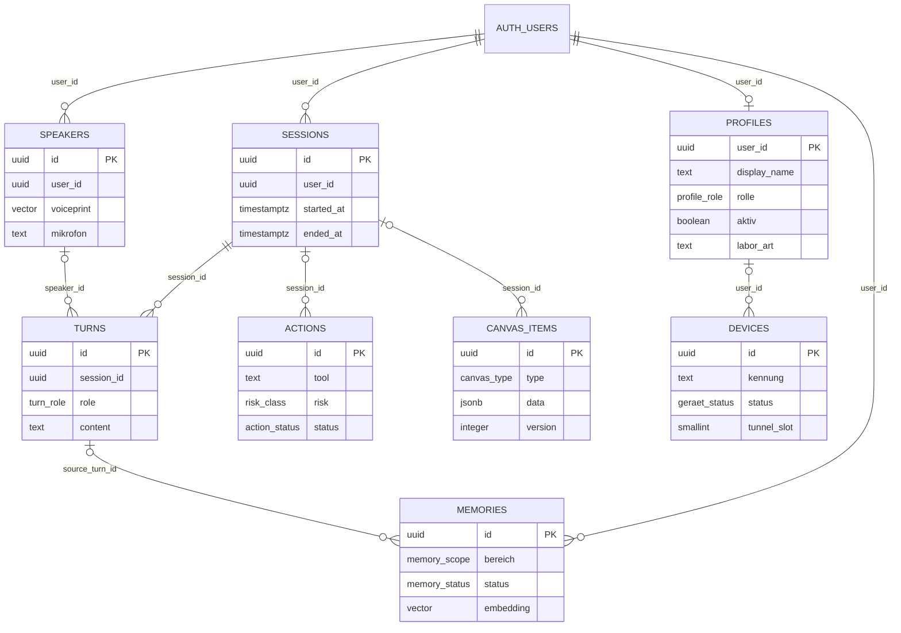

# Datenmodell: Datenbank, Rollen und Migrationen

| | |
|---|---|
| Zweck | Beschreibt die Postgres-Datenbank von W.A.I.S.: Schemas, Tabellen je Migration, Rollen und Rechte, Trigger und Funktionen, Aufbewahrungsregeln und die Regeln für Migrationen. |
| Zielgruppe | Entwicklerinnen und Entwickler, Datenbankprüfer, Administratoren. |
| Dokumentart | Referenz mit Erklärung |
| Stand | 19.11.2026, geprüft gegen Commit 497e3ce |
| Quellen | `supabase/migrations/` (Dateien `0001` bis `0003` und `0010` bis `0029`), `supabase/tests/`, `infra/sokrates2/supabase-wamo/wamo_auth.sql`, `scripts/render-migration.sh`, `scripts/wamo_db_rolle.py`, `scripts/wamo_dienst_db.py`, `CLAUDE.md` |

Dieses Dokument nennt nur Aufbau, Namen und Regeln. Zugangsdaten, Schlüssel und Inhalte von Datensätzen stehen nirgends, auch nicht gekürzt.

## 1. Überblick

Die Daten liegen in einem eigenen Supabase-Stack (Postgres mit GoTrue für die Anmeldung) auf Sokrates-2. Der Voice-Core spricht direkt mit Postgres, über den Pooler im Session-Modus und mit TLS-Prüfung (`CLAUDE.md`, Architektur-Entscheidung 1). Es gibt einen Datenbankzugriff der Oberfläche ausdrücklich nicht: `anon`, `authenticated` und `service_role` haben auf die W.A.I.S.-Schemas keinerlei Rechte (Kopf von `supabase/migrations/0001_wamo_init.sql`). Die Oberfläche meldet sich bei GoTrue an und redet danach nur mit dem Kern.

| Schema | Zweck | Quelle |
|---|---|---|
| `wamo_dev`, `wamo_test`, `wamo_prod` | je Umgebung ein vollständiger Satz der Tabellen. Die Migrationen enthalten den Platzhalter `__SCHEMA__`, `scripts/render-migration.sh` ersetzt ihn per `sed` und akzeptiert nur diese drei Namen. | `scripts/render-migration.sh` |
| `wamo_auth` | Erstanmeldung je Konto, global (nicht je Schema), weil Konten für alle drei Schemas dieselben sind | `infra/sokrates2/supabase-wamo/wamo_auth.sql` |
| `auth` | Konten (`auth.users`), gehört GoTrue | Supabase |
| `extensions` | Erweiterung `vector` (pgvector) für Stimm- und Gedächtnisvektoren | `0001_wamo_init.sql` |

Welche Migrationen in welchem Schema angewendet sind, steht in der Tabelle `schema_migrations` jedes Schemas. Der Zustand der Server ist nicht aus dem Repo belegbar, dafür gelten die Angaben in `README.md` und `infra/sokrates2/README.md`.

## 2. Rollen

Rollen gelten je Datenbank-Cluster, nicht je Schema. Login und Passwort setzen Skripte, nie die Migrationen.

| Rolle | Art | Zweck | Quelle |
|---|---|---|---|
| `wamo_core` | Gruppenrolle, `nologin` | Voice-Core: lesen, einfügen, wenige gezielte Updates, kein `delete` ohne Grund, keine Profile anlegen, keine Rollen ändern. Timeouts: `statement_timeout` 10 s, `idle_in_transaction_session_timeout` 15 s. | `0001` |
| `wamo_admin` | Gruppenrolle, `nologin` | Verwaltung (`voice-core/wamo_admin.py`): Profile anlegen und pflegen, gemeinsame Vorschläge freigeben, Laborprofile löschen. `statement_timeout` 30 s. | `0001` |
| `wamo_release` | Gruppenrolle, `nologin` | Release-Dienst (unprivilegiert): Anfragen anlegen, Ereignisse anfügen, veröffentlichen | `0013` |
| `wamo_anker` | Gruppenrolle, `nologin` | Freigabe-Dienst und Anker ohne root: klassifizieren, Freigaben schreiben, umschalten | `0013` |
| `wamo_core_s2` | Login-Rolle | Verbindung des Büro-Kerns auf Sokrates-2, Mitglied von `wamo_core` (laut `README.md` und `scripts/wamo_dienst_db.py`) | `scripts/wamo_db_rolle.py` |
| `wamo_release_s2`, `wamo_anker_s2` | Login-Rollen | Verbindungen der beiden Dienste, je Mitglied der Gruppenrolle | `scripts/wamo_dienst_db.py` |
| `postgres` | Eigentümer | führt Migrationen aus, besitzt `SECURITY DEFINER`-Funktionen wie `neue_mitglieder` und die Funktionen von `wamo_auth` | `0022`, `wamo_auth.sql` |

Verbindungen im Betrieb: `WAMO_DATABASE_URL` (Kern, Rolle `wamo_core`) und `WAMO_ADMIN_DATABASE_URL` (nur `voice-core/wamo_admin.py`, Rolle `wamo_admin`). Namen der Variablen stehen in [konfiguration.md](konfiguration.md), Werte nie.

## 3. Regeln für Rechte (verbindlich aus `CLAUDE.md`)

- Jede neue Tabelle: Row Level Security aktiviert, Policy `core_all` für `wamo_core`, nur die nötigen Grants (kein `delete` ohne Grund), Indizes auf Fremdschlüsseln (partiell bei optionalen Spalten), keine Rechte für `anon`, `authenticated` und `service_role`.
- Spaltenrechte statt Tabellenrechte, wo es genügt, zum Beispiel `grant update (is_active, use_count, last_used_at) on memories to wamo_core`.
- Rechte werden zuerst entzogen (`revoke all ... from public, anon, authenticated, service_role`) und dann neu vergeben, damit ein erneuter Lauf zum selben Stand führt.
- Zugriffsmuster des Kerns: Er arbeitet ohne JWT. Die Policy `core_all` lautet `for all to wamo_core using (true) with check (true)`, die Grenzen zwischen Profilen setzt der Kern im Code (immer `user_id` aus der geprüften Identität), die Datenbank begrenzt über Grants, Trigger und Funktionen, was ein fehlerhafter Kern anrichten könnte (Kopf von `0001` und `0002`).
- Funktionen mit `SECURITY DEFINER` setzen `search_path` leer und gehen den Pfad über vollqualifizierte Namen. Ausführen darf sie nur die genannte Rolle.
- Geheimnisse (Claude-Schlüssel, Claude-Code-Token, GitHub-Token) liegen nur als Chiffrat (`bytea`, AES-256-GCM, Profil-ID als zusätzliche Daten) in der Datenbank. Der Hauptschlüssel liegt nur in der Umgebung des Kerns (`voice-core/schluessel.py`). `wamo_admin` hat auf die Schlüsselspalten kein Recht.

## 4. Kerntabellen (Diagramm)

Hinweis zum Diagramm: In `0001` verweisen `user_id` von `profiles`, `sessions`, `speakers`, `memories`, `actions` und `canvas_items` auf `auth.users(id)`. Ab `0002` verweist `devices.user_id` auf `profiles(user_id)`. Neuere Tabellen (`model_access`, `vorgaenge`, `dateien`, `teilungen`, `auftrag_entwuerfe`, `github_zugang`) verweisen bewusst auf `profiles(user_id)`, nicht auf `auth.users`, damit die Tabelle der Anmeldung nicht gesperrt wird und GoTrue nicht staut (Kommentar in `0017` und `0026`).

## 5. Tabellen je Migration

Die Nummern `0004` bis `0009` fehlen im Verzeichnis. Als Beobachtung: Der Kommentar in `0010_modellzugang.sql` sagt, die Nummern `0002` bis `0009` gehörten anderen Strängen (Geräte, Teilen). Ein weiterer Beleg für die Lücke steht nicht im Repo. Insgesamt gibt es 23 Migrationen mit je einer `.down.sql`. SQL-Tests in `supabase/tests/` gibt es zu `0002`, `0003`, `0011`, `0013` bis `0015` und `0017` bis `0029`; zu `0001`, `0010`, `0012` und `0016` liegt dort keine Testdatei.

| Nr. | Datei | Zweck in einer Zeile | Neue Tabellen |
|---|---|---|---|
| 0001 | `0001_wamo_init` | Grundschema: Rollen, Typen, Profile, Gespräche, Gedächtnis, Canvas, Aktionen, Stimmabdrücke, Semantiksuche | `schema_migrations`, `profiles`, `devices`, `sessions`, `speakers`, `turns`, `memories`, `feedback`, `canvas_items`, `actions` |
| 0002 | `0002_wamo_geraete` | Geräteregister (persönliche Laptops mit Rücktunnel, gemeinsame Bürogeräte) und Hinweise an Profile | `device_events`, `hinweise` (umbaut `devices`) |
| 0003 | `0003_wamo_teilen` | Arbeit teilen mit Rechten, Widerruf, Hinweis und Protokoll, Dateien in der Datenbank | `dateien`, `teilungen`, `teilung_events` |
| 0010 | `0010_modellzugang` | Modellzugang je Profil: eigener Claude-Schlüssel (Chiffrat) oder nur Hausmodelle, Wahl Soniox oder Haus für Hören und Sprechen | `model_access` |
| 0011 | `0011_modellmodus_und_codetoken` | Modellwahl der Person (`automatisch` oder `nur_haus`) und zweiter Schlüsseltyp Claude-Code-Token | Spalten in `model_access` |
| 0012 | `0012_kontingent` | Kontingent des Max-Abos je Profil aus den Ereignissen von Claude Code | Spalten `kontingent`, `kontingent_stand` |
| 0013 | `0013_release_freigaben` | Freigaben und Rollen der Selbstüberarbeitung: Anfragen, Freigaben, Ereigniskette per Hash, Stand je Komponente, Rollen `wamo_release` und `wamo_anker` | `release_anfragen`, `release_freigaben`, `release_ereignisse`, `release_stand` |
| 0014 | `0014_geraete_verwaltung` | Geräteverwaltung durch Admins über die Oberfläche (freigeben, sperren, entsperren, widerrufen) als Funktionen | keine (Funktionen `geraete_verwaltung_liste`, `geraet_entscheiden`) |
| 0015 | `0015_rd_sitzungen` | Protokoll und Belegung der Fernsitzungen (Remote Desktop der Sparks), ein Zuschauer je Ziel per Index | `rd_sitzungen` |
| 0016 | `0016_release_freigaben_lesen` | Fehlerbehebung zu 0013: der Trigger liest Freigaben über zwei `SECURITY DEFINER`-Funktionen mit festen Rechten | keine |
| 0017 | `0017_vorgaenge` | Aufgabenleiste "Vorgänge" mit Status, Fortschritt und letztem Stand | `vorgaenge` |
| 0018 | `0018_labor_profile` | Laborprofile für das Testlabor (`labor_art`, `labor_platz`, `labor_aktiv`) und Löschfunktion `labor_loeschen` | Spalten in `profiles` |
| 0019 | `0019_rd_anmeldung_genuegt` | Fernzugriff startet mit dem Code der Anmeldung (höchstens 31 Tage alt), jeder Start geht als Hinweis an alle Admins | keine (ersetzt `rd_sitzung_beginnen`) |
| 0020 | `0020_gedaechtnis_vorschlaege` | Gemeinsame Gedächtnisvorschläge in der Oberfläche freigeben oder ablehnen | keine (Funktion `gedaechtnis_vorschlag_entscheiden`) |
| 0021 | `0021_profil_freischaltung` | Kein gewöhnliches Profil wird ohne Erstanmeldung aktiv (Trigger `profiles_freischaltung_guard`), zwei neue Hinweisarten | keine |
| 0022 | `0022_neue_mitglieder` | Admin-Übersicht "Neue Mitglieder" als Lesefunktion `neue_mitglieder(p_admin)` | keine |
| 0023 | `0023_stimme_selbst` | Die Person wählt Hören und Stimme selbst: Schreibrecht des Kerns auf `stt` und `tts` | keine (Rechte) |
| 0024 | `0024_modellwahl_selbst` | Die Person wählt Modelle je Bereich und die Stimme im Haus | Spalten `modell_gespraech`, `modell_bilder`, `modell_hintergrund`, `tts_stimme` |
| 0025 | `0025_stimme_schwelle` | Persönliche Schwelle der Stimme (Kalibrierung) in `speakers` | Spalte `voice_threshold` |
| 0026 | `0026_auftrag_entwuerfe` | Entwicklungsaufträge für später speichern, 50 je Person, 90 Tage | `auftrag_entwuerfe` |
| 0027 | `0027_github_zugang` | Persönliche GitHub-Zugänge für Entwicklungsaufträge, Rechte je Person | `github_zugang`, `github_rechte` |
| 0028 | `0028_stimme_schatten` | Abdruck des zweiten Sprechermodells im Schattenbetrieb | Spalten `voiceprint_shadow`, `shadow_model` |
| 0029 | `0029_stimme_mikrofone` | Ein Stimmabdruck je Mikrofon, höchstens drei je Person | Spalten `mikrofon`, `mikrofon_name`, Trigger `speakers_mikrofon_grenze` |

Reihenfolgen und Abhängigkeiten stehen im Kopf jeder Datei (zum Beispiel "0010 danach nie erneut anwenden" in `0011` und `0023`, weil ihr `revoke all` die Spaltenrechte der späteren Migrationen zurücknähme; `0018` vor dem Kern-Release, `0020` vor dem Kern mit `gedaechtnis_api.py`, `0029` nach dem Kern mit dem neuen Stand).

## 6. Wichtige Tabellen im Detail

| Tabelle | Inhalt und Besonderheiten | Quelle |
|---|---|---|
| `profiles` | Profil je Konto: Anzeigename, Rolle (`admin` oder `mitglied`), `aktiv`, Anrede (`du` oder `sie`), `settings` (höchstens 16 KB). Laborprofile haben `labor_art` (`platz` oder `schaufenster`), `labor_platz` 1 bis 16, `labor_aktiv`. | `0001`, `0018` |
| `sessions`, `turns` | Gespräch und seine Zeilen. `turns.content` höchstens 20000 Zeichen, bei `assistant` das tatsächlich Gesprochene. | `0001` |
| `memories` | Gedächtnis. `bereich` `persoenlich` oder `gemeinsam`, `status` `aktiv`, `vorgeschlagen`, `abgelehnt`, Vektor 1024 Werte (HNSW-Index). | `0001` |
| `speakers` | Stimmabdruck (biometrisch, DSGVO Art. 9): Vektor 192 Werte, nur mit dokumentierter Einwilligung (`stimme-1`, `stimme-2`, `stimme-3`) und nur für den Profilinhaber, dazu persönliche Schwelle `voice_threshold`, Schatten (`voiceprint_shadow`, `shadow_model`) und Mikrofon (`mikrofon`: `unbekannt` oder 32 Hexzeichen, `mikrofon_name`). Seit `0029` eine Zeile je Mikrofon, eindeutig je `user_id` und `mikrofon` (Index `speakers_owner_mikrofon_idx` statt `speakers_one_owner_idx`), höchstens drei je Person (Trigger `speakers_mikrofon_grenze`). Ein Abdruck aus der Zeit davor gilt als Mikrofon `unbekannt`. | `0001`, `0025`, `0028`, `0029` |
| `actions` | Audit und Freigaben: Werkzeug, Parameter, Risikoklasse (`read`, `change`, `critical`, `blocked`), Status. Trigger sichert unveränderliche Felder und den Statusablauf. Wird auch für Audit-Zeilen wie Entwicklungsaufträge, Stimm- und Modellwahl genutzt (`CLAUDE.md`). | `0001` |
| `canvas_items` | Canvas-Elemente (Typ, `data`, Version, `parent_id`, `bearbeitet_von`). | `0001`, `0003` |
| `devices`, `device_events` | Register aller Geräte. Persönlich: ein Besitzer, ed25519-Schlüssel, Tunnelplatz 1 bis 64, Kennung `pc-...`. Ein aktives persönliches Gerät je Profil (partieller Unique-Index). Statuswechsel nur durch einen aktiven Admin, Verlauf in `device_events`. | `0002`, `0014` |
| `hinweise` | Karten an Profile (Gerät gebunden, Teilung erhalten, Scan fertig, Erstanmeldung begonnen und weitere), `bezug` bewusst ohne Fremdschlüssel. | `0002`, `0021` |
| `dateien`, `teilungen`, `teilung_events` | Dateien liegen in der Datenbank (höchstens 25 MB je Datei, feste Typenliste), Teilungen mit Recht `lesen` oder `bearbeiten`, Protokoll ohne Inhalte. | `0003` |
| `model_access` | Eine Zeile je Profil: `nur_haus`, Claude-Schlüssel und Claude-Code-Token als Chiffrat mit je vier Endzeichen, `stt`, `tts`, `modell_modus`, Modellwahl, Kontingent. | `0010` bis `0012`, `0024` |
| `release_*` | Anfragen, Freigaben (gebunden an Commit und Tree-ID, zweiter Faktor höchstens 60 s alt), nur anfügbare Ereigniskette mit Hash, Stand je Komponente (`ui` oder `kern`). | `0013`, `0016` |
| `rd_sitzungen` | Wer, welches Ziel, wann, wie lange, warum beendet. Keine Bildschirminhalte, keine Eingaben. Höchstdauer 4 Stunden. | `0015` |
| `vorgaenge` | Eine Zeile je Boss-Aufgabe oder Entwicklungsauftrag, `daten` hält den letzten Stand (höchstens 256 KB). | `0017` |
| `auftrag_entwuerfe` | Gespeicherte Auftragskarten: Projekt, Art, Repo, Text (1 bis 4000 Zeichen), höchstens 5 Kriterien, Runden 1 bis 5, Zeitlimit 1 bis 60 Minuten. Nie ein Zugang. | `0026` |
| `github_zugang`, `github_rechte` | Persönliches GitHub-Token als Chiffrat (Art `fein` oder `klassisch`, Ablauf, geprüfter Login), Scope-Ausnahmen je Person durch Admins. Nie für Laborprofile. | `0027` |
| `wamo_auth.erstanmeldungen` | Merker je Konto (`start_hash` ist ein SHA-256 des Hashes), Frist höchstens 168 Stunden. | `wamo_auth.sql` |

## 7. Funktionen und Trigger (Auswahl)

| Name | Art | Aufgabe | Migration |
|---|---|---|---|
| `touch_updated_at` | Trigger-Funktion | pflegt `updated_at` (bei `memories` nur bei inhaltlicher Änderung) | `0001` |
| `memories_guard` | Trigger | gemeinsames Wissen wird nur durch einen aktiven Admin wirksam | `0001` |
| `actions_guard` | Trigger | `user_id`, `tool`, `params`, `risk` unveränderlich, Statuswechsel nur `pending` nach `approved` oder `rejected` oder `blocked`, `approved` nach `running`, `running` nach `done` oder `failed`, gesperrte Aktionen nie freigebbar | `0001` |
| `match_memories` | Funktion (`security invoker`) | semantische Suche: eigene persönliche plus aktive gemeinsame Einträge, `p_user_id` Pflicht, höchstens 50 Treffer | `0001` |
| `geraet_binden`, `devices_guard`, `pc_abgleich_liste` | Funktion, Trigger | erste Bindung automatisch nur für ein Mitglied ohne früheres Gerät, sonst beantragt. Verbraucher (Abgleich der Schlüssel, Kern, Tunnel) werten nur Geräte mit Status `aktiv` und aktivem Besitzerprofil aus. | `0002` |
| `teilung_recht_setzen`, `teilung_beenden`, `canvas_fassung_anlegen`, `datei_loeschen` | Funktionen | Teilen mit Besitzerprüfung, Fassungen (Konflikt `P0409` bei gleichzeitiger Bearbeitung) | `0003` |
| `model_access_guard` | Trigger | räumt Schlüssel, wenn ein Admin das Profil auf `nur_haus` setzt | `0010`, `0011` |
| `release_kette_pruefen`, `release_anfragen_guard`, `release_freigaben_guard` | Funktionen, Trigger | Hash-Kette prüfen, Statuswege vorwärts, Freigabe nur mit passender Commit- und Tree-ID, Sonderfreigabe nur mit zwei aktiven Admins | `0013`, `0016` |
| `rd_sitzung_beginnen`, `rd_sitzung_beenden` | Funktionen | Belegung und Protokoll der Fernsitzung | `0015`, `0019` |
| `profiles_labor_guard` | Trigger | `labor_art` und `labor_platz` nach dem Anlegen für jede Rolle unveränderlich | `0018` |
| `labor_loeschen`, `labor_zaehlen` | Funktionen (nur `wamo_admin`) | gesamten Text eines Laborprofils löschen, Zeilen zählen (Nachweis "nichts mehr da") | `0018` |
| `gedaechtnis_vorschlag_entscheiden` | Funktion | freigeben oder ablehnen, nur durch aktiven Admin | `0020` |
| `profiles_freischaltung_guard` | Trigger | `aktiv` von `false` auf `true` nur mit Merker in `wamo_auth.erstanmeldungen`, nie für Laborprofile (eigene Freischaltung) | `0021` |
| `neue_mitglieder` | Funktion (`SECURITY DEFINER`, nur `wamo_core`) | Stand der Einrichtung je Mitglied, ohne E-Mail, Schlüssel oder Vektoren, Laborprofile fehlen | `0022` |
| `auftrag_entwuerfe_grenze` | Trigger | höchstens 50 Entwürfe je Person (Sperre je Person) | `0026` |
| `github_zugang_guard`, `github_rechte_guard` | Trigger | Form und Grenzen der Token-Angaben und der Rechte | `0027` |
| `speakers_schatten_verwerfen`, `speakers_mikrofon_grenze` | Trigger | Schatten nur mit passender Einwilligung, höchstens drei Mikrofone je Person, Kennung nicht änderbar | `0028`, `0029` |
| `wamo_auth.erstanmeldung_stand`, `erstanmeldung_begonnen` | Funktionen | einzige Funktionen, die `wamo_core` ausführen darf | `wamo_auth.sql` |
| `wamo_auth.erstanmeldung_anlegen`, `erstanmeldung_uebersicht`, `passwort_geaendert` | Funktion, Trigger | nur `postgres`; der Trigger auf `auth.users` setzt "erledigt" beim Passwortwechsel und blockiert GoTrue nie | `wamo_auth.sql` |

## 8. Schema `wamo_auth`

Stände (`erstanmeldung_stand`): `keine` (kein Merker, zum Beispiel Konten von vor der Einführung und Laborkonten), `offen` (Frist läuft), `abgelaufen` (Frist vorbei, bleibt so, nur ein neues Freischalten hilft), `erledigt`. Schreiben darf nur `postgres` (Admin-Skript `scripts/wamo_nutzer.py` und der Trigger). Der Kern darf lesen und den Beginn melden. Einrichten nur über `infra/sokrates2/wamo-auth-einrichten.sh` (`einrichten`, `test`, `status`, `rueckweg`), in einer Transaktion, wiederholbar. Der Rückweg (`wamo_auth.down.sql`) entfernt Trigger und Rechte, die Tabelle der Merker bleibt. Ein Update von GoTrue kann am Trigger scheitern, wenn es den Typ von `auth.users.encrypted_password` ändert (Hinweis im Kopf von `wamo_auth.sql`).

## 9. Aufbewahrung und Löschen (aus dem SQL belegt)

| Daten | Regel | Quelle |
|---|---|---|
| Stimmabdrücke | Löschen erlaubt für `wamo_core` (DSGVO Art. 17), alle Abdrücke einer Person (`delete ... where user_id = ... and is_owner`) oder einzeln je Mikrofon; Schwelle und Schatten verschwinden mit der Zeile; Abdruck nur mit Einwilligung | `0001`, `0025`, `0028` |
| Gedächtnis | `wamo_core` kann nicht löschen, "Vergessen" setzt `is_active` auf `false` | `0001` |
| Dateien | Löschen zuerst weich (`geloescht_at`), nach 7 Tagen endgültig (`dateien_endgueltig_loeschen`, vom Kern täglich aufgerufen), Fassungen und Teilungen per Kaskade; höchstens 20 Fassungen je Datei | `0003` |
| Teilungen | Widerruf ist endgültig und wirkt sofort | `0003` |
| Geräte | Widerruf ist endgültig; Tunnelplätze werden nach dem Widerruf mindestens eine Stunde nicht neu vergeben; die Verwaltungsliste zeigt Widerrufene 90 Tage lang | `0002`, `0014` |
| Vorgänge | kein `delete`; nach 24 Stunden gilt ein offener Vorgang als abgebrochen, 30 Tage nach dem Ende wird der Stand geleert, die Zeile bleibt als Spur | `0017` |
| Auftragsentwürfe | höchstens 50 je Person, Aufbewahrung 90 Tage, der Kern löscht ältere höchstens einmal je Stunde und Prozess | `0026` |
| Fernsitzungen | Protokoll bleibt (Fremdschlüssel `restrict`): nur wer, wann, welches Ziel, wie lange, warum beendet | `0015` |
| Release-Wege | Anfragen, Freigaben und Ereignisse nicht löschbar, Ereignisse nicht änderbar; Profile mit Einträgen werden deaktiviert statt gelöscht | `0013` |
| Laborprofile | gesamter Text löschbar mit `labor_loeschen` (Liste in `voice-core/labor_loeschliste.py`), optional nur das Zeitfenster eines Durchlaufs | `0018` |
| Erstanmeldung | Frist höchstens 168 Stunden | `wamo_auth.sql` |
| Gespräche (`turns`) | im SQL keine Aufbewahrungsfrist belegt | `0001` |

## 10. Migrationsregeln

Aus `CLAUDE.md` und den Köpfen der Migrationsdateien:

- Migrationen sind nach dem Anwenden auf `wamo_prod` unveränderlich. Änderungen kommen als neue Migration mit `.down.sql`.
- Anwenden immer mit `psql -v ON_ERROR_STOP=1 --single-transaction`. Policies und Trigger werden mit `drop ... if exists` davor angelegt, damit ein zweiter Lauf nicht abbricht. Beispiel aus den Dateiköpfen: `bash scripts/render-migration.sh <schema> <datei> | docker exec -i wamo-supabase-db psql -U postgres -v ON_ERROR_STOP=1 --single-transaction`.
- Reihenfolge der Umgebungen: `wamo_dev`, `wamo_test`, dann das Schema des Büro-Kerns. `wamo_prod` nur nach ausdrücklicher Freigabe und nach dem Agenten `database-reviewer` (Dateiköpfe, `CLAUDE.md`).
- Jede Migration prüft ihre Voraussetzung selbst (Abbruch mit klarer Meldung, zum Beispiel "0003 braucht 0002") und trägt sich in `schema_migrations` ein. Ab `0013` hat die Tabelle eine Spalte `sha256` (Prüfsumme der angewendeten Datei, einmal gesetzt unveränderlich).
- Der Migrations-Lint `scripts/wamo_migrationen_pruefen.py` (CI-Job "Migrationen") prüft die vom Zweig geänderten Dateien unter `supabase/migrations/` und gibt Pfad, Zeile und Art aus, nie den Fundtext.
- Tests: SQL-Selbsttests unter `supabase/tests/<nr>_<name>_test.sql`, Python-Tests je Thema im Kern (zum Beispiel `voice-core/test_migration_0024.py`).
- Rückwege: `<nr>_<name>.down.sql`. Manche gelten nur unter Bedingungen (zum Beispiel `0002` nur solange `devices` leer ist, `0018` bricht bei jedem Laborprofil ab, `0003` nur ohne geteilte Arbeit).
- Reihenfolge mit dem Kern ist je Migration festgelegt und steht im Kopf (Kern zuerst oder Migration zuerst). Sie ist Teil der Ausrollschritte, siehe [../betrieb/release-und-ausrollen.md](../betrieb/release-und-ausrollen.md).

## Weiterführend

- [Voice-Core](voice-core.md) (Zugriffe: `memory.py`, `modellzugang.py`, `stimme_speicher.py` und weitere), [Konfiguration](konfiguration.md), [Schnittstellen](schnittstellen.md)
- Sicherheit und Datenschutz: [../sicherheit/sicherheit-und-datenschutz.md](../sicherheit/sicherheit-und-datenschutz.md)
- Betrieb: [../betrieb/betriebshandbuch.md](../betrieb/betriebshandbuch.md), [../betrieb/release-und-ausrollen.md](../betrieb/release-und-ausrollen.md)
- Bestehende Planpapiere: [../../ausrollen-neue-nutzer.md](../../ausrollen-neue-nutzer.md), [../../testlabor-wamo.md](../../testlabor-wamo.md), [../../selbstueberarbeitung.md](../../selbstueberarbeitung.md)
