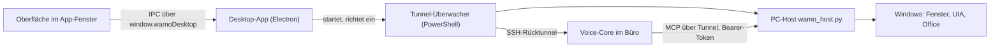

# PC-Host und Desktop-App

| | |
|---|---|
| Zweck | Beschreibt die zwei Teile von W.A.I.S., die auf dem Windows-PC der Person laufen: den Werkzeugserver `host/` ("die Hände") und die Electron-App `desktop/`. |
| Zielgruppe | Entwicklerinnen und Entwickler sowie Sicherheitsprüfer. |
| Dokumentart | Erklärung mit Referenztabellen |
| Stand | 19.11.2026, geprüft gegen Commit 497e3ce |
| Quellen | `host/wamo_host.py`, `host/host_http.py`, `host/live_bild.py`, `host/windows_control.py`, `host/uia_control.py`, `host/pyproject.toml`, `desktop/main.js`, `desktop/preload.js`, `desktop/update.js`, `desktop/installation.js`, `desktop/package.json`, `scripts/wamo-tunnel.ps1`, `voice-core/pc_host.py` |

Befunde zur ausgelieferten App (gebautes Paket, Fuses, Dateiliste) stehen in [desktop-auslieferung-rea.md](desktop-auslieferung-rea.md). Dieses Dokument beschreibt den Quellcode.

## 1. Zusammenspiel

Zwei Betriebsarten, beide am selben Host:

| Betriebsart | Kern läuft | Verbindung zum Host |
|---|---|---|
| Unterwegs (`lokal`) | auf dem PC | Der Kern startet den Host als Unterprozess (`--stdio`), nicht im Netz erreichbar (`voice-core/pc_host.py`) |
| Büro (`buero`) | auf Sokrates-2 | Der Host lauscht nur auf Loopback (`--http`), der Kern erreicht ihn über einen SSH-Rücktunnel mit Bearer-Token (`host/host_http.py`, `scripts/wamo-tunnel.ps1`) |

## 2. PC-Host (`host/`)

### 2.1 Aufbau

Python-Paket `wamo-host` (Version 0.6.0, `host/pyproject.toml`), Abhängigkeiten laut Datei: `mcp` (MCP-SDK, Version 1.x), `mss`, `pillow`, `pywin32` und `comtypes` (nur Windows), `python-docx`, `openpyxl`, `python-pptx`. Der Server heißt in FastMCP `wamo-host` (`FastMCP("wamo-host", ...)` in `wamo_host.py`). Start: `wamo_host.py --stdio` oder `--http`, ohne Argument bricht er mit einer Aufrufhilfe ab.

| Datei | Aufgabe |
|---|---|
| `host/wamo_host.py` | Alle MCP-Werkzeuge, Risikoklassen, Freigabeverwaltung (`PENDING`), Audit, Programmliste `APPS`, Sperrmuster `BLOCKED_PATTERNS` |
| `host/host_http.py` | HTTP-Betrieb: nur Loopback, Bearer-Token, kein Origin, nur Pfad `/mcp`, zustandslos, Gerätebindung |
| `host/windows_control.py` | Fenster, Tastatur, installierte Programme, Sperrstatus; Sicherheitsregeln direkt vor der Aktion |
| `host/uia_control.py` | UI-Automation: Elemente eines Fensters bedienen, ohne die Maus zu übernehmen |
| `host/live_bild.py` | Entscheidung, ob ein Einzelbild des Laptops entstehen darf (bei jedem Bild) |
| `host/office_dateien.py` | Word, Excel, PowerPoint, CSV und Markdown aus Canvas-Inhalten, ohne installiertes Office |
| `host/office_ablage.py` | Ablage `Dokumente\WAIS`, Dateinamen, Register `%LOCALAPPDATA%\WAMO\ablage.json` |
| `host/office_com.py` | Office per COM, nur wo es nicht anders geht (PDF über Word in eigener unsichtbarer Instanz) |
| `host/office_outlook.py`, `office_outlook_com.py` | Outlook: Erkennung, Karte, Senden über das klassische Outlook (zurückholbar), Entwurf im neuen Outlook |
| `host/office_onenote.py` | OneNote-Seite im Notizbuch "W.A.I.S." im OneDrive der Firma (COM) |
| `host/office_teams.py` | Teams-Chat mit Text im Eingabefeld, die Person drückt selbst Enter |
| `host/prozess_prioritaet.py` | hebt den Host-Prozess auf normale Priorität, schaltet EcoQoS ab (Befund 17.11.2026) |
| `host/vorlagen/` (darin `wmc-logo.png`) | Logo für erzeugte Dokumente |
| `host/test_*.py`, `host/conftest.py` | Tests; Marker `office` braucht Word oder OneNote am PC (`WAMO_OFFICE_ECHT=1`) |

### 2.2 Risikoklassen

Erzwungen wird hier im Host, nicht im Prompt (Kopf von `wamo_host.py`). Alles, was ein Modell schickt, gilt als nicht vertrauenswürdig.

| Klasse | Bedeutung |
|---|---|
| `read` | sofort, zum Beispiel `system_info`, `fenster_auflisten`, `powershell_lesen` mit reinen Get-/Test-Befehlen |
| `change` | sofort, protokolliert, zum Beispiel `webseite_oeffnen`, `programm_oeffnen`, `ordner_anlegen`, `tastatur_tippen` |
| `critical` | nur eine Freigabe-Anfrage (Status `needs_approval`), ausgeführt erst nach dem Klick der Person in der Oberfläche |
| `blocked` | nie, zum Beispiel Muster aus `BLOCKED_PATTERNS` (`bcdedit`, `net user`, Passwortbegriffe, "live-bild") |

Freigaben: Das Modell kann sie nicht selbst erteilen. Solange eine Anfrage offen ist oder eine freigegebene Aktion läuft, ruhen alle Eingaben (Status `wartet`). Das Werkzeug `freigabe_entscheiden` ruft nur der Kern nach einem Klick auf. Es steht nicht in `LLM_TOOLS` und verlangt ein zweites Geheimnis neben dem Bearer-Token (Umgebung `WAMO_HOST_FREIGABE` oder Datei `WAMO_HOST_FREIGABE_DATEI`). Eine Anfrage gilt `FREIGABE_GUELTIG_SECS` (300 s), für Eingaben `FREIGABE_EINGABE_SECS` (120 s), wird genau einmal ausgeführt, und direkt davor prüft der Host Ziel, Sperre und Adresse erneut. Höchstens `MAX_PENDING` (5) Anfragen sind offen.

Weitere Schutzmechanismen im Code (Auswahl): Doppelaufrufe innerhalb von 6 s werden nicht wiederholt (`_duplicate`), Eingaben und Klicks bei gesperrtem Bildschirm werden abgelehnt, Tippen nie in Konsolen, Registry, Admin- und Anmeldefenster oder Passwort-Manager, keine Tastenkürzel mit der Windows-Taste (`windows_control.py`), Passwortfelder werden nie gelesen oder beschrieben (`uia_control.py`), Ausgaben auf `MAX_OUTPUT_CHARS` (6000) gekürzt, Adressen auf `MAX_URL_LEN` (2048).

### 2.3 Werkzeuge

35 Werkzeuge sind mit `@mcp.tool()` in `wamo_host.py` registriert. Das Sprachmodell sieht nur die 19 aus `LLM_TOOLS` in `voice-core/pc_host.py`. Die übrigen 16 ruft allein der Kern auf (Spalte "Aufrufer").

| Werkzeug | Klasse laut Code | Aufrufer | Zweck |
|---|---|---|---|
| `webseite_oeffnen` | change (sehr lange Suchanfrage: Freigabe) | Modell | Seite im aktiven Tab des Browsers laden |
| `programm_oeffnen` | change | Modell | installiertes Programm aus fester Liste starten |
| `ordner_anlegen` | change | Modell | Ordner unter festen Wurzeln anlegen |
| `oeffnen_mit` | change | Modell | Ordner oder Datei in einem Programm öffnen |
| `fenster_auflisten` | read | Modell | offene Fenster mit Titel und Programm |
| `fenster_fokussieren` | change | Modell | Fenster nach vorne holen |
| `tastatur_tippen` | change | Modell | Text ins Zielfenster tippen |
| `tasten_druecken` | change | Modell | Taste oder Kombination |
| `maus_scrollen` | change | Modell | im Fenster scrollen |
| `powershell_lesen` | read, sonst critical oder blocked | Modell | lesende PowerShell-Befehle |
| `system_info` | read | Modell | Rechnername, Benutzer, feste Ordner |
| `dark_mode` | change | Modell | Windows-Dark-Mode (nur `HKCU`) |
| `elemente_auflisten` | read | Modell | bedienbare Elemente eines Fensters (UIA) |
| `element_lesen` | read | Modell | Wert oder Text eines Elements |
| `element_klicken` | change (Senden, Bezahlen, Löschen: Freigabe) | Modell | Element per UIA klicken |
| `element_text_setzen` | change | Modell | Text eines Eingabefelds setzen |
| `browser_lesen` | read | Modell | angezeigten Inhalt des Browsers lesen |
| `git_klonen` | change, ohne Freigabe | Modell | GitHub-Repo der Firma nach `Projekte\<name>` klonen |
| `github_repo_anlegen` | critical | Modell | Repo in der Organisation anlegen (nur per Karte) |
| `sperre_pruefen` | read | Kern | ist der Bildschirm gesperrt |
| `bildschirmfoto` | read | Kern | JPEG für ein Bildmodell |
| `maus_klicken` | change | Kern | Klick an Koordinaten (aus dem Bildmodell) |
| `live_bild_status`, `bild_holen`, `live_bild_anfordern`, `live_bild_beenden` | read oder change | Kern | Live-Bild des Laptops |
| `office_faehigkeiten` | read | Kern | welche Formate dieser PC erzeugt |
| `office_datei_erstellen`, `office_datei_oeffnen` | change | Kern | Datei aus Canvas-Inhalt bauen, selbst erzeugte Datei öffnen |
| `outlook_mail_anfragen`, `outlook_zurueckholen`, `outlook_versand_status` | critical (Senden), change (Entwurf), read | Kern | Mail vorbereiten, anhalten, Stand |
| `onenote_seite_anfragen` | critical | Kern | OneNote-Seite aus Canvas |
| `teams_chat_anfragen` | critical | Kern | Teams-Chat vorbereiten, W.A.I.S. sendet dort nie selbst |
| `freigabe_entscheiden` | durch Schlüssel geschützt | Kern | Entscheidung nach Klick ausführen |

Der Kern reicht die Werkzeuge nach Stufe der Person weiter (`werkzeuge_fuer` in `voice-core/pc_host.py`): Admins und freigeschaltete Mitglieder haben seit dem 16.11.2026 dieselbe Liste, Schutz und Freigabe für Mitglieder übernimmt `voice-core/pc_mitglied.py` (siehe [voice-core.md](voice-core.md)).

### 2.4 HTTP-Betrieb und Tunnel

`host/host_http.py` erzwingt:

- Bindung nur an `127.0.0.1` oder `::1` (Standard `127.0.0.1:8765` aus `WAMO_HOST_BIND` und `WAMO_HOST_PORT`), sonst startet der Host nicht.
- Jede Anfrage braucht genau einen Header `Authorization: Bearer <Token>`, sonst 401, auch für unbekannte Pfade. Vergleich in konstanter Zeit (`hmac.compare_digest`). Das Token kommt aus einer Datei (`WAMO_HOST_TOKEN_FILE`), nie aus Befehlszeile oder Umgebung, mindestens 43 Zeichen.
- Anfragen mit `Origin`-Header (Browser) werden mit 403 abgelehnt. Nur der Pfad `/mcp` ist erreichbar, WebSockets werden geschlossen. MCP läuft zustandslos mit JSON-Antworten.
- Gerätebindung (wenn `WAMO_HOST_GERAET_DATEI` gesetzt ist): `X-WAMO-Geraet` und `X-WAMO-Profil` müssen zu `geraet.json` passen, das die Desktop-App bei der Bindung schreibt. Zweite Schicht neben dem Token, keine Grenze gegen die Person am Laptop selbst.
- Fehlversuche landen gedrosselt im Audit, nie mit dem gesendeten Wert.

Den Tunnel hält `scripts/wamo-tunnel.ps1` am Laufen. Eine geplante Aufgabe "WAMO Tunnel" startet ihn bei der Anmeldung und alle 5 Minuten, nur für den aktuellen Benutzer, ohne Administratorrechte (eingerichtet von `scripts/wamo-tunnel-einrichten.ps1`, Rückweg `scripts/wamo-tunnel-entfernen.ps1`). Im Gerätebetrieb (`geraet.json` vorhanden) erzeugt der Überwacher bei jedem Start des Hosts ein neues Token und einen neuen Freigabe-Schlüssel und öffnet einen SSH-Rücktunnel mit einem Benutzer je Laptop (`wamo-t-NN`, Namensvertrag in `CLAUDE.md`). Beenden: Datei `%LOCALAPPDATA%\WAMO\tunnel.stop`.

### 2.5 Audit

Jeder Werkzeugaufruf schreibt eine JSON-Zeile in `host/wamo_audit.jsonl` (Pfad überschreibbar mit `WAMO_AUDIT_LOG`, `_audit` in `wamo_host.py`). Felder: `ts` (UTC, ISO), `kanal` (`stdio` oder `http`), `tool`, `risk` (`read`, `change`, `critical`, `blocked`, `rejected`, `duplicate` und weitere) und werkzeugabhängige Angaben, Adressen auf 200 Zeichen gekürzt. Fenstertitel von Browsern werden als "(Browser)" protokolliert, weil der Titel der Seiteninhalt wäre (`_audit_titel`). Die Datei steht in `.gitignore` und ist nicht Teil des Repos. Das Audit ist die Grundlage der Nachvollziehbarkeit, Einordnung in [../sicherheit/sicherheit-und-datenschutz.md](../sicherheit/sicherheit-und-datenschutz.md).

### 2.6 Live-Bild

Entscheidend ist der Host, bei jedem einzelnen Bild (`host/live_bild.py`), nicht der Kern und nicht die Oberfläche:

- Schalter am Laptop: die Desktop-App schreibt `%LOCALAPPDATA%\WAMO\live-bild.json` (Standard aus). Kein Host-Werkzeug schreibt sie, PowerShell-Befehle mit "live-bild" sind gesperrt.
- Der Schalter gilt nur, wenn Kennung und Besitzer zu `geraet.json` passen, die Stufe `admin` oder `mitglied` ist, die Einwilligung erteilt ist, die Frist `bis` (höchstens eine Stunde je Einschalten) nicht abgelaufen ist und der Hinweis am Laptop lebt (Herzschlag alle 2 s, roter Rahmen sichtbar).
- Höchstens ein Zuschauer je Laptop und ein Mindestabstand zwischen Bildern.

Die Gegenseite in der App ist `desktop/livebild.js`, im Kern `voice-core/bildstrom.py`.

## 3. Desktop-App (`desktop/`)

### 3.1 Aufbau

Electron 44 (`desktop/package.json`, Paket `wamo-desktop`, Version 0.6.0), gebaut mit `electron-builder` 26 als NSIS-Installer pro Benutzer ohne Administratorrechte (`oneClick`, `perMachine: false`, `allowElevation: false`). App-Kennung `de.wamocon.wamo`, Produktname "W.A.I.S.", Artefakt `WAIS-Setup-<Version>.exe`. Alle Module außer `main.js` und den Preload-Dateien sind reine Node-Module ohne `electron`-Import und deshalb mit `node --test` prüfbar (17 Testdateien).

| Datei | Aufgabe |
|---|---|
| `main.js` | Hauptprozess: Fenster, Tray, IPC, Dienste starten, Zertifikatsprüfung, Berechtigungen, Updates |
| `preload.js` | Brücke `window.wamoDesktop` für das Hauptfenster (nur Text und ganze Zahlen) |
| `overlay-preload.js`, `overlay.html`, `overlay.css`, `markierung.js` | Markierungsfenster je Monitor: roter Rahmen und Klickwelle |
| `lichtrahmen.js` | Prüfung und Umrechnung der Markierung, Entscheidung, ob auf diesem Laptop gezeichnet wird |
| `livebild.js`, `livebild-hinweis.html/.js/.css` | Schalter am Laptop für das Live-Bild, Einwilligung, roter Rahmen mit Plakette |
| `vollbild.js` | Wächter für Vollbild-Programme (PowerShell ruft `SHQueryUserNotificationState`), dann keine Markierung |
| `geraet.js` | Einrichtung des Laptops: Geräteschlüssel (ed25519), Signatur der Herausforderung, `known_hosts`, `geraet.json`, Tunnel, Wächter der Aufgabe "WAMO Tunnel" |
| `host-umgebung.js` | Python-Umgebung des Hosts beim ersten Start (`uv sync --locked --no-dev` aus `host/uv.lock`) |
| `installation.js` | Pfade und Formen: Entwickler (Repo) oder installiert (Ressourcen unter dem Installationsordner), Standardadressen im Code (`BUERO_UI_URL`, `BUERO_KERN_URL`, `LOKALE_UI_URL`, `LOKALER_KERN_URL`) |
| `zertifikat.js` | Vertrauen in die WAMO-CA nur innerhalb der App, Fingerabdruck fest eingetragen |
| `update.js` | Signierte Updates (siehe 3.4) |
| `berechtigungen.js` | Mikrofon nur Audio und Zwischenablage nur Schreiben, nur für das Hauptfenster; Diagnose-Log |
| `entladen.js` | Rückfrage beim Beenden, solange ein Entwicklungsauftrag läuft |
| `taskleiste.js`, `symbol-reparatur.js` | Absicherung des Taskleistensymbols, Reparaturwerkzeug im Tray (`scripts/wamo-symbol-reparieren.ps1`, nach Rückfrage) |
| `start.html`, `start.js` | Lade- und Fehlerseite mit "Wiederholen" |
| `update-schluessel.json` | öffentliche Schlüssel für die Signaturprüfung (nur öffentliche Teile) |
| `build/installer.nsh` | NSIS-Zusätze: Aufgabe "WAMO Tunnel" beim Deinstallieren entfernen, Sandbox-Leserecht, Symbol-Erneuerung |
| `testdaten/` | Zertifikate und ein Update-Beispiel für die Tests (`testdaten/update/`) |

### 3.2 Hauptprozess, Fenster und Sicherheit

- Hauptfenster mit der Oberfläche, ohne Hintergrund-Drosselung (`backgroundThrottling: false`), damit Mikrofon und Sprachausgabe weiterlaufen. Beim Start zeigt es sofort `start.html`.
- `webPreferences`: `contextIsolation: true`, `sandbox: true`, `nodeIntegration: false`. Navigation und Weiterleitungen bleiben auf dem Ursprung der Oberfläche (`will-navigate`, `setWindowOpenHandler`), keine Webviews, fremde Seiten öffnen im normalen Browser.
- Genau eine Instanz (`requestSingleInstanceLock`), Datenordner `%APPDATA%\WAMO` in der installierten App.
- Tray-Symbol: "W.A.I.S. öffnen", Betriebsart (Büro oder Unterwegs, Unterwegs in der installierten App ausgegraut), Live-Bild ein oder aus, "Mit Windows starten" (`app.setLoginItemSettings`, Autostart), Symbol reparieren, Voice-Core neu starten (nur Unterwegs), Beenden. Schließen des Fensters versteckt nur ins Tray, das Gespräch bleibt.
- `powerSaveBlocker` (`prevent-app-suspension`) während eines Gesprächs.
- Die WAMO-CA gilt nur in der App (`session.setCertificateVerifyProc` mit `zertifikat.js`), nie als Änderung am Windows-Speicher und nie über `--ignore-certificate-errors`. Der Kommentar im Kopf von `main.js` spricht noch vom "Windows-Speicher"; der Code in `zertifikat.js` und der spätere Kommentar in `main.js` sind eindeutig: nur innerhalb der App.
- Entwicklermodus: startet Voice-Core und Oberfläche bei Bedarf selbst (`WAMO_MANAGE_SERVICES=off` schaltet ab, `WAMO_UI_DEV=1` nutzt `next dev`). Installiert gibt es nur die Betriebsart Büro, die Oberfläche kommt vom Server.

### 3.3 Brücke `window.wamoDesktop` und IPC-Kanäle

Der Preload schneidet jeden Wert auf Text (höchstens 512 Zeichen) oder ganze Zahlen zu, `main.js` prüft Absender (`fromMainUi`: nur das Hauptfenster mit der eigenen Oberfläche) und Werte noch einmal.

| Brücke | IPC-Kanal | Richtung | Aufgabe |
|---|---|---|---|
| `isDesktop`, `version` | (Startargument) | Hauptprozess zu Seite | Kennzeichen, Version `x.y.z` |
| `levels({zustand})` | `levels` (`send`) | Seite zu Hauptprozess | Zustand für Energiesparschutz und Markierung, keine Pegel |
| `markierung(m)` | `markierung` (`send`) | Seite zu Hauptprozess | Rahmen und Welle: Art, Gerätekennung, Rechner, Rechtecke und Punkt als ganze Zahlen |
| `betriebsart.lesen/setzen/abonnieren` | `betriebsart:lesen`, `betriebsart:setzen`, `betriebsart` | beide | `buero` oder `unterwegs`, nie eine Adresse |
| `rechnername()` | `rechnername` | Seite fragt | Rechnername für den Autostart der PC-Steuerung |
| `mikrofonStatus()` | `mikrofon:status` | Seite fragt | Windows-Datenschutzstatus des Mikrofons |
| `geraet.vorbereiten/signieren/aktivieren/status` | `geraet:vorbereiten`, `geraet:signieren`, `geraet:aktivieren`, `geraet:status` | Seite fragt | Einrichtung des Laptops (nur Büro), der private Schlüssel bleibt im Hauptprozess |
| `update.pruefen/installieren` | `update:pruefen`, `update:installieren` | Seite fragt | signierte Updates |
| (Overlay) `overlay.onMarkierung` | `markierung` (Hauptprozess zu Overlay) | Hauptprozess zu Overlay | geprüfte, umgerechnete Markierung oder `null` |

Das Live-Bild lässt sich ausdrücklich nicht über die Brücke schalten: nur Tray-Menü oder eine Fernanfrage des Besitzers mit vorhandener Einwilligung (`desktop/livebild.js`).

### 3.4 Updater und Installation

`desktop/update.js` (nur installierte App):

1. Die Oberfläche holt beim Kern das Manifest (`GET /wamo/api/installer`) und gibt Text und Signatur an die App.
2. Die App vertraut dem Kern nicht. Sie prüft die Ed25519-Signatur über die exakten Bytes des Manifests gegen die fest eingebauten öffentlichen Schlüssel (`desktop/update-schluessel.json`), erst danach liest sie das JSON.
3. Ein Update gibt es nur bei streng steigender Version, nach einer Rückfrage im Hauptprozess, über eine Verbindung, deren Kette vor dem ersten gesendeten Byte zur WAMO-CA geprüft ist, und nur, wenn Größe und SHA-256 der geladenen Datei genau zum signierten Manifest passen. Dann startet der Installer.
4. Manifest `aktuell.json`: genau die Felder `v` (1), `produkt` (`wais-desktop`), `version`, `datei`, `groesse`, `sha256`, `bauzeit`, `commit`; höchstens 4 KB, UTF-8 ohne BOM. Signatur `aktuell.json.sig`: eine Zeile Base64 über 64 Byte.

Bau und Signatur (`scripts/`):

| Skript | Aufgabe |
|---|---|
| `wamo-dist-vorbereiten.cjs` | holt `uv` in der festgelegten Version (`desktop/build/uv-pin.json`), prüft SHA-256 vor dem Auspacken |
| `wamo-dist-pruefen.cjs` | prüft das entpackte Paket: keine Tests, Testdaten, `.env`, Schlüssel, Geheimnis-Muster |
| `wamo-dist-signieren.cjs` | erzeugt und signiert das Manifest (`signieren`, `pruefen`, `schluessel-erzeugen`), Schlüsseldatei nie in einem Git-Arbeitsbaum, Ziel ist ein Hardware-Token über PKCS#11 |
| `wamo-dist-codesign.cjs` | prüft die Authenticode-Signatur, Herausgeber "WAMOCON GmbH" |

Die npm-Skripte (`dist`, `dist:signiert`, `dist:pruefen`, `dist:codesign`) stehen in `desktop/package.json`. Betriebsablauf und Rückwege: [../betrieb/release-und-ausrollen.md](../betrieb/release-und-ausrollen.md).

`desktop/installation.js` unterscheidet zwei Formen. Entwickler: nicht paketiert (`npm start`, `scripts/wamo-desktop.cmd`), das Repo liegt eine Ebene über `desktop/`, Logs in `desktop/logs`. Installiert: Host und Skripte liegen als `extraResources` unter `resources/host` und `resources/scripts`, dazu die WAMO-CA und `uv`; es gibt keinen lokalen Kern, Logs und Einstellungen liegen unter `%APPDATA%\WAMO`. Die Python-Umgebung des Hosts entsteht beim ersten Start (`host-umgebung.js`), nicht im Installer.

### 3.5 Dateien am PC (Auswahl)

| Pfad | Inhalt |
|---|---|
| `%LOCALAPPDATA%\WAMO\geraet.json` | Bindung des Laptops (Kennung, Besitzer, Stufe), geschrieben von `geraet.js` |
| `%LOCALAPPDATA%\WAMO\tunnel.status`, `tunnel.stop` | Zustand des Tunnel-Überwachers, Stop-Datei |
| `%LOCALAPPDATA%\WAMO\live-bild.json` | Schalter des Live-Bilds |
| `%LOCALAPPDATA%\WAMO\ablage.json` | Register der erzeugten Office-Dateien (nie Inhalte) |
| `%LOCALAPPDATA%\WAMO\host-token`, `host-freigabe` | Geheimnisse des Hosts, nur für diesen Benutzer lesbar (Inhalte nie dokumentiert) |
| `%LOCALAPPDATA%\WAMO\updates` | Ordner für geladene Updates |
| `Dokumente\WAIS` | erzeugte Office-Dateien |
| `userData\einstellungen.json` | Betriebsart je Gerät |

## Weiterführend

- [Voice-Core](voice-core.md) (Gegenstelle: `pc_host.py`, `pc_tunnel.py`, `pc_geraet.py`), [Oberfläche](oberflaeche.md) (Brücke), [Konfiguration](konfiguration.md) (Host-Variablen)
- Befunde der ausgelieferten App: [desktop-auslieferung-rea.md](desktop-auslieferung-rea.md)
- Sicherheit: [../sicherheit/sicherheit-und-datenschutz.md](../sicherheit/sicherheit-und-datenschutz.md)
- Bestehende Dokumente: [../../office-und-versand.md](../../office-und-versand.md), [../../ausrollen-neue-nutzer.md](../../ausrollen-neue-nutzer.md), [../../remote-desktop.md](../../remote-desktop.md)
