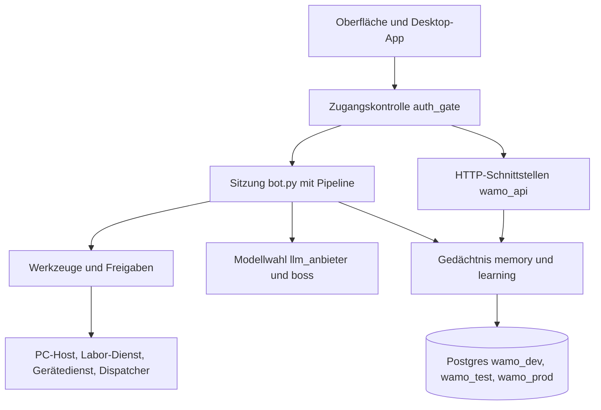
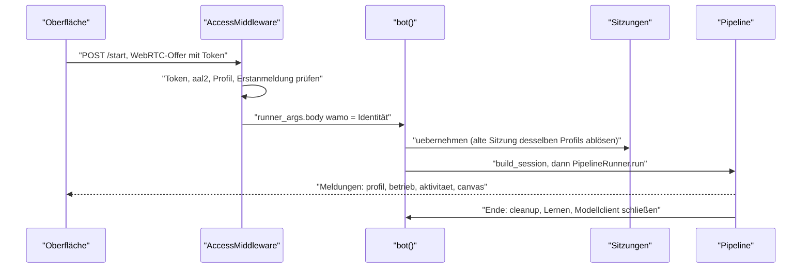

# Voice-Core: Aufbau des Python-Kerns

| | |
|---|---|
| Zweck | Zeigt, wie der Kern von W.A.I.S. (Ordner `voice-core/`) aufgebaut ist: Pipeline, Modulgruppen, Start, Lebenszyklus und wiederkehrende Muster. |
| Zielgruppe | Entwicklerinnen und Entwickler, die den Kern ändern, prüfen oder betreiben. |
| Dokumentart | Erklärung mit Referenztabellen |
| Stand | 19.11.2026, geprüft gegen Commit 497e3ce |
| Quellen | `voice-core/bot.py`, `voice-core/auth_gate.py`, `voice-core/wamo_api.py`, `voice-core/kern_dienst.py`, `voice-core/abschaltung.py`, `voice-core/pyproject.toml`, `infra/sokrates2/wamo-core@.service`, `CLAUDE.md` |

## 1. Überblick

Der Kern ist ein Python-Dienst auf Basis von Pipecat (Paket `pipecat-ai`, laut `voice-core/pyproject.toml` Version 1.12 bis unter 2). Er nimmt die Sprache der Person über WebRTC entgegen, erkennt sie, lässt ein Sprachmodell antworten, ruft bei Bedarf Werkzeuge auf und spricht die Antwort. Daneben stellt er unter `/wamo/api/` eigene HTTP-Schnittstellen bereit, die ohne laufendes Gespräch funktionieren.

Auf oberster Ebene liegen 335 Python-Dateien, davon 206 Testdateien (`test_*.py`). Es gibt keine Unterpakete: jedes Modul liegt flach in `voice-core/`, die Module importieren sich gegenseitig über ihren Dateinamen. Die Ausnahme ist `voice-core/eval/` mit Messläufen und Testsätzen für die Modellabnahme.

Der Kern läuft in zwei Betriebsarten (`WAMO_BETRIEB`, siehe `voice-core/bot.py` `betrieb_modus`): `lokal` (Standard, auf dem PC der Person, "Unterwegs") und `buero` (als Dienst `wamo-core` auf Sokrates-2). Alles andere als der Wert `buero` gilt als `lokal`.

Gemeinsame Begriffe stehen in [../glossar.md](../glossar.md).

## 2. Sprachpipeline

Eine Sitzung ist eine Pipecat-Pipeline, die `build_session` in `voice-core/bot.py` pro Verbindung aufbaut. Die Reihenfolge der Verarbeiter steht dort im Aufruf `Pipeline([...])`.

| Stufe | Modul und Verarbeiter | Aufgabe |
|---|---|---|
| Eingang | `transport.input()` (Pipecat WebRTC), `AudioInputMonitor` in `audio_monitor.py` | Mikrofon-Audio, Diagnose von Lücken und Pegel, Meldung `mikrofon` bei Stille |
| Stimmprüfer | `Stimmpruefer` in `stimme_pruefer.py` (nur mit Stimmabdruck) | schneidet jede Äußerung aus einem Ringpuffer und vergleicht sie mit dem Abdruck |
| Spracherkennung | `soniox_stt()` in `bot.py` oder `HausSTTService` in `sprache_anbieter.py` | Streaming-Erkennung, Deutsch strikt (`language_hints_strict`), Sprechertrennung |
| Schlüsselfilter | `SchluesselFilter` in `schluessel_filter.py` | entfernt Muster von Schlüsseln aus Text, der ans Modell ginge |
| Sprecher | `SpeakerTracker` in `audio_monitor.py`, `StimmWaechter` in `stimme_waechter.py` | färbt Kern und Stimmlinie, hält fremde Äußerungen vom Modell fern (Modus streng) |
| Zug | `user_agg` (Pipecat `LLMUserAggregator`) mit Silero-VAD und `LocalSmartTurnAnalyzerV3` | erkennt Sprechbeginn und Satzende, `LLMTurnCompletionUserTurnStopStrategy` lässt das Modell über Unfertiges mitentscheiden |
| Weiche Unterbrechung | `SoftInterruptGate`, `MeaningfulWordsUserTurnStartStrategy` in `soft_interrupt.py` | Rückmeldelaute ("mhm") stoppen nichts, Echo wird erkannt, bei Unterbrechung wird der Satz zu Ende gesprochen oder innegehalten |
| Wächter vor dem Modell | `JaWaechter` (`ja_waechter.py`), `AbbruchHinweis` (`werkzeug_wache.py`), `TurnWache.vorne()` (`turn_wache.py`) | "Ja" auf eine Rückfrage führt aus, abgebrochene Werkzeuge werden gemeldet, doppelte Antworten verhindert |
| Sprachmodell | `llm` aus `gespraech_llm` in `llm_anbieter.py` | Gespräch und Werkzeugaufrufe, Persona als Systemprompt aus `persona.py` |
| Wächter nach dem Modell | `TurnWache.hinten()`, `Wartesatz` (`wartesatz.py`), `ActivityReporter` (`activity.py`), `AusgabenKuerzer` (`ausgaben_kuerzen.py`), `FuellwortSpieler` (`fuellwoerter.py`) | kurzer Satz bei langen Werkzeugen, Zeitleiste für die Oberfläche, lange Ausgaben kürzen, "Moment." statt Stille |
| Sprachausgabe | `LazySonioxTTSService` in `soniox_tts.py` oder `HausTTSService` | Streaming-Sprachausgabe, `aussprache.py` schreibt "Wais" für die Stimme um |
| Ausgang | `WiedergabeStart` (`wiedergabe.py`), `transport.output()`, `PlaybackTracker` (`wiedergabe_tracker.py`) | Ton hinaus, meldet dem Gate jedes Wort, das wirklich gesprochen wurde |

Die Stimmprüfung misst im Standard nur (Modus `beobachten`, `voice-core/stimme_gate.py`): Sie zeigt das Urteil an und sperrt nichts. Nur mit `WAMO_STIMME_PRUEFUNG=streng` verwirft der Wächter fremde Äußerungen und sperrt Werkzeuge. Für PC-Befehle per Sprache brauchen Mitglieder unabhängig davon einen eingelernten Abdruck (`StimmGate.pflicht_grund`).

Die Stufen Füllwörter, Wartesatz, Ja-Wächter, Abbruchhinweis und Kürzer hängen an Schaltern (Abschnitt 6), sie sind nur bei eingeschaltetem Schalter in der Pipeline. Zusätzlich wirken Beobachter ohne Eingriff: `PipelineProtokoll` (`pipeline_protokoll.py`), `fehlerbuch.FehlerBeobachter` und, nur mit `WAMO_LATENZ_LOG=1`, `LatenzObserver` (`latenz.py`).

## 3. Komponentendiagramm

Die Zugangskontrolle hängt als ASGI-Middleware vor allen Routen des Pipecat-Runners (`install_access_gate` in `voice-core/auth_gate.py`). Ohne sie startet der Server nicht (`pruefe_zugang` in `voice-core/kern_dienst.py`). Der Bot liest die geprüfte Identität aus `runner_args.body["wamo"]`, einen anderen Weg zur Identität gibt es nicht.

## 4. Modulgruppen

Zeilenzahlen sind nicht angegeben, sie ändern sich laufend. Große Module sind `bot.py`, `dev_agent.py`, `llm_anbieter.py`, `soft_interrupt.py` und `modellzugang.py`.

### 4.1 Zugang, Sitzung, Dienst

| Modul | Aufgabe | wichtigste Schnittstelle |
|---|---|---|
| `auth_gate.py` | Token (ES256 lokal über JWKS), zweiter Faktor (aal2), Höchstalter, aktives Profil, Erstanmeldung, fail-closed | `AccessGate.authorize`, `install_access_gate`, `Identity`, `identity_from_body`, `erstanmeldung_sperre` |
| `bot.py` | Einstieg, Sitzungsaufbau, Pipeline, Meldungen an die Oberfläche | `bot`, `build_session`, `run_bot`, `SessionGuard`, `betrieb_message` |
| `sitzungen.py`, `sitzungen_bruecke.py` | eine Sitzung je Profil, Ablösung auch zwischen zwei Kern-Instanzen (Slots) | `Sitzungen.uebernehmen`, `Sitzung`, `Bruecke` |
| `kern_dienst.py` | Log-Stufe halten, Unix-Socket statt TCP, Zugangskontrolle erzwingen | `runner_vorbereiten`, `pruefe_zugang`, `pruefe_socket_verzeichnis` |
| `abschaltung.py` | begrenztes Herunterfahren mit Fristen und Notbremse | `lifespan_begrenzen`, `aufgaben_beenden`, `notbremse_starten` |
| `wamo_api.py` | Rahmen der HTTP-Schnittstellen unter `/wamo/api`, Lesen von Bodys mit Obergrenze | `installieren`, `identitaet`, `lies_json`, `lies_bytes` |
| `wamo_tls.py` | Vertrauen in die interne CA für Verbindungen zum Supabase-Stack | Umgebung `WAMO_CA_FILE` |
| `wamo_admin.py` | Kommandozeile für Profile und gemeinsame Gedächtnisvorschläge (Rolle `wamo_admin`) | `main` |

### 4.2 Stimme und Wächter

| Modul | Aufgabe | wichtigste Schnittstelle |
|---|---|---|
| `stimme_modell.py` | Rechenteil: Sprechermodell (TitaNet-Large als ONNX über `sherpa-onnx`), Abdruck aus Sprache | `StimmModell`, `Embedder`, `kosinus`, `ohne_pausen` |
| `stimme_pruefer.py` | Prüfer im Audiopfad, schneidet Äußerungen, lernt auf Klick ein | `Stimmpruefer`, `Urteil` |
| `stimme_gate.py` | Regelwerk: Urteil je Äußerung (eigen, fremd, unklar) als bester Wert über alle Abdrücke der Person. Der Modus kommt aus `WAMO_STIMME_PRUEFUNG` (Standard `beobachten`: messen und anzeigen). `StimmGate.sperrt` ist nur im Modus `streng` wahr, sonst ist das Urteil ein Hinweis. Pflichtstufe für PC-Befehle von Mitgliedern (`pflicht_grund`). | `StimmGate`, `Schwellen`, `Abdruck`, `pruefmodus`, `werkzeuge_absichern`, `schemas_absichern`, `tippen_beobachten` |
| `stimme_waechter.py` | nur im Modus `streng` mit bereitem Abdruck: nur die eigene Stimme erreicht das Modell und unterbricht (Laborprofile nie) | `StimmWaechter`, `ist_eigen`, `nur_endgueltig`, `nur_eigen_unterbricht` |
| `stimme_sitzung.py` | Klebstoff zwischen `bot.py` und den Teilen: Laden, Client-Nachrichten, Einwilligung, Löschen | `StimmSitzung`, `nachricht_aus` |
| `stimme_einlernen.py` | 20 Sekunden Sprache aufnehmen, Abdruck und persönliche Schwelle berechnen | `Einlernen`, Protokoll `Speichern` |
| `stimme_speicher.py` | Abdrücke in Tabelle `speakers` (eine Zeile je Mikrofon, seit Migration 0029), nur eigenes Profil, nur Rolle `wamo_core` | `abdruecke_laden`, `abdruck_speichern`, `abdruck_loeschen`, `schatten_alle_laden` |
| `stimme_mikrofon.py` | je eingelerntem Mikrofon ein Abdruck, höchstens drei je Person (`MAX_ABDRUECKE`, Migration 0029); Kennung `unbekannt` oder 32 Hexzeichen aus dem Namen | `Mikrofon`, `mikrofon_kennung`, `mikrofon_name`, `kennung_gueltig` |
| `stimme_einwilligung.py` | Text und Version der Einwilligung (Art. 9 DSGVO): `stimme-1` (ein Abdruck), `stimme-2` (mit Schattenabdruck), `stimme-3` (je Mikrofon, verlangt, sobald Migration 0029 da ist) | `einwilligung_gilt`, `einwilligung_nachricht`, `schatten_erlaubt` |
| `stimme_schatten.py` | zweites Sprechermodell, misst nur mit und entscheidet nie | `SchattenModell`, `SchattenPruefung`, `schatten_an` |
| `soft_interrupt.py` | weiche Unterbrechung, Echo-Erkennung, Innehalten | `SoftInterruptGate`, `MeaningfulWordsUserTurnStartStrategy`, `ist_echo` |
| `wiedergabe.py`, `wiedergabe_tracker.py` | Ton anhalten und fortsetzen, tatsächlich gesprochene Wörter melden | `WiedergabeStart`, `halt_fuer`, `PlaybackTracker` |

### 4.3 Gedächtnis und Lernen

| Modul | Aufgabe | wichtigste Schnittstelle |
|---|---|---|
| `memory.py` | Sitzungen, Gesprächszeilen, Lernspeicher, Profile in Postgres, zwei Rollen mit getrennten Verbindungen | `MemoryStore.from_env`, `MemoryStore.recall`, `Database`, `Recall`, `Profile`, `SharedProposal` |
| `learning.py` | Auswertung eines Gesprächsabschnitts, hält Fakten und Vorlieben fest | `learn_from_session`, `Gemerkt` |
| `gedaechtnis_api.py` | gemeinsame Vorschläge prüfen (nur Admins) | `router` |
| `canvas_sitzung.py`, `canvas_quelle.py`, `canvas_historie.py` | Canvas-Elemente der Sitzung, Lesen eigener Elemente, Historie | `CanvasSitzung`, `canvas_lesen`, `historie` |
| `teilen.py`, `teilen_api.py`, `teilen_werkzeuge.py` | Arbeit teilen: Canvas, Ergebnisse, Scans, Dateien | `Teilen`, `router` |
| `vorgaenge.py`, `vorgaenge_api.py`, `vorgang_stream.py` | Aufgabenleiste "Vorgänge" mit Livefortschritt, Verlauf aus Tabelle `vorgaenge` | `Vorgaenge`, `EntwicklungsVorgang` |
| `fehlerbuch.py` | Was nicht ging und warum, nur im Speicher der Sitzung | `Fehlerbuch`, `FehlerBeobachter`, Werkzeug `fehler_erklaeren` |

### 4.4 Rechte und Freigaben

| Modul | Aufgabe | wichtigste Schnittstelle |
|---|---|---|
| `rechte.py` | Stufe der PC-Steuerung an einer Stelle: `admin`, `mitglied` oder `None` | `pc_stufe`, `pc_mitglieder_profile` |
| `pc_mitglied.py` | Schutz vor jedem PC-Werkzeug für Mitglieder (Liste, Pflichtstufe der Stimme, Karte nach Fremdinhalt) | `MitgliedSchutz`, `kern_erlaubt`, `kern_werkzeuge_absichern` |
| `pc_freigaben.py` | Freigabekarte kritischer PC-Aktionen, von der Anfrage des Hosts bis zum Klick | `PcFreigaben` |
| `labor_freigaben.py` | Freigaben schreibender Labor-Aktionen (Job `labor`) | `LaborFreigaben`, `Antrag`, `Angebot` |
| `jira_freigaben.py` | Freigabekarte für Jira-Stories (Job `jira`) | `JiraFreigaben` |
| `activity.py` | Aktivitätszeitleiste, Karten und Markierungen für die Oberfläche | `ActivityReporter`, `freigabe_karte` |
| `schluessel.py`, `schluessel_filter.py` | AES-256-GCM für eigene Schlüssel und Tokens, Schwärzen in Logs, Schutz vor gesprochenen Schlüsseln | `Tresor`, `schwaerzen`, `SchluesselFilter` |

### 4.5 Werkzeuge

| Modul | Aufgabe | wichtigste Schnittstelle |
|---|---|---|
| `tools.py` | Werkzeuge im Gespräch: Zeit, Merken, Canvas, Websuche | `register_tools`, `TurnState`, `canvas_schema`, `web_search` |
| `suche.py` | Websuche über SearXNG statt Anthropic-Websuche | `searxng_suche`, `suchmodus` |
| `screen.py`, `bildstrom.py`, `bild_fern.py` | Bildschirm sehen und klicken, Live-Bild des eigenen Laptops, Prüfung der Fernanfrage | `register_screen_tools`, `Bildstrom`, `pruefer` |
| `office_werkzeuge.py`, `outlook_werkzeuge.py`, `onenote_werkzeuge.py`, `teams_werkzeuge.py` | Canvas als Datei, Mail über Outlook, OneNote-Seite, Teams-Nachricht (jeweils nur mit Schalter und PC-Stufe) | `fuer_sitzung`, `schema` |
| `jira_werkzeuge.py`, `jira_client.py` | User Stories in Jira aus dem Canvas, nur Admin im Büro | `JiraStory`, `sitzung_bauen` |
| `geraete_werkzeuge.py`, `geraete_client.py`, `geraete_register.py` | Bürogeräte über den Gerätedienst, Register `devices` | `Buerogeraete`, `aufruf`, `GeraeteRegister` |
| `werkzeug_wache.py` | abgebrochene und doppelte Werkzeugaufrufe | `umhuellen`, `DoppelWache`, `AbbruchHinweis` |
| `ausgaben_kuerzen.py` | lange Werkzeugausgaben kürzen, Original nachladen | `AusgabenKuerzer`, `register_nachladen` |
| `werkzeugkarte.py` | welche ECC-Skills und REA-Werkzeuge je Auftragsart zuerst genutzt werden | `Karte`, `anweisungsblock` |

### 4.6 Modelle

| Modul | Aufgabe | wichtigste Schnittstelle |
|---|---|---|
| `llm_anbieter.py` | Anbieter-Fabrik je Baustein (Gespräch, Lernen, Bildschirm, Zusammenfassung), Claude oder LiteLLM, Rückfall, Verbrauchslog | `gespraech_llm`, `zusammenfassung_llm`, `Zugang`, `Wahl`, `LLMNichtVerfuegbar` |
| `modellzugang.py`, `modellzugang_api.py` | Zugang je Profil: eigener Claude-Schlüssel oder nur Hausmodelle | `zugang_laden`, `hinterlegen`, `modus_setzen`, `modell_setzen`, `stimme_setzen` |
| `modellwahl.py` | was eine Person je Bereich wählen darf (Gespräch, Bilder, Hintergrund) | `optionen`, `gueltig` |
| `modellkarte.py` | Datenmodul: Fähigkeiten, gemessene Werte, Latenzklasse, Datenschutz je Modell | `modell`, `alle`, `mit_faehigkeit` |
| `boss.py` | wählt nach Aufgabenklasse das beste erlaubte Modell, verteilt Aufgaben an Spezialisten | `Boss`, `waehlen`, `rangliste`, `entwicklung_quelle` |
| `sprache_anbieter.py`, `soniox_tts.py` | Spracherkennung und Sprachausgabe je Sitzung: Soniox oder im Haus | `sprach_wahl`, `SprachWahl`, `haus_stt`, `haus_tts` |
| `cache_waerme.py`, `kontingent.py` | Prompt-Cache vorwärmen, Kontingent aus Ereignissen von Claude Code | `vorwaermen`, `nachricht` |
| `persona.py`, `aussprache.py` | Systemprompt (fester Teil zuerst für Prompt-Caching), Namensschreibweisen, Aussprache | `build_system_prompt`, `fuer_sprachausgabe` |

### 4.7 Labor (Testlabor)

Laborprofile (Profil mit `labor_art`) bekommen einen eigenen, engen Zweig: nur Zeit, Websuche, Canvas und die Labor-Werkzeuge, kein Gedächtnis, kein PC, keine Entwicklung (`voice-core/labor.py`).

| Modul | Aufgabe | wichtigste Schnittstelle |
|---|---|---|
| `labor.py` | Politik der Laborprofile an einer Stelle (Erlaubnislisten, Prüfungen) | `ist_labor`, `werkzeuge_erlaubt`, `client_nachricht_erlaubt` |
| `labor_sitzung.py` | die Laborsitzung als ein Objekt: Annahme, Speicher, Wache, Prompt | `LaborSitzung.starten` |
| `labor_durchlauf.py`, `labor_limit.py`, `labor_rtvi.py` | Durchlauf und Einwilligung, Ratenbegrenzung, Erlaubnisliste für Client-Nachrichten | `LaborWache`, `LaborRTVIProcessor` |
| `labor_werkzeuge.py`, `labor_ticket.py`, `labor_mail.py`, `labor_vertrag.py` | Werkzeuge `ticket_*` und `mail_senden` (nur Bestätigung, kein Versand), Prüfungen, Vertragskonstanten | `labor_sitzung` und `LaborSitzung` (Werkzeuge) in `labor_werkzeuge.py`, `pruefe_mail`, `bestaetigen` |
| `labor_client.py` | Client zum Test-Jira-Dienst (Vertrag Version 1) | `LaborClient`, `client_aus_umgebung` |
| `labor_speicher.py`, `labor_loeschliste.py`, `labor_verwaltung.py`, `labor_daten.py`, `labor_prompt.py` | Speicher ohne Gedächtnis, Löschliste, Löschung, Daten vom Server, Prompt | `LaborSpeicher` |
| `labor_attrappe.py`, `labor_testhilfe.py` | Attrappen, nur für Tests | nicht im Betrieb |

### 4.8 Entwicklungsaufträge

| Modul | Aufgabe | wichtigste Schnittstelle |
|---|---|---|
| `dev_agent.py` | Entwicklungsaufträge per Sprache an Claude Code, Karte, Runden, Freigabe | `DevAgent`, `Job`, `entwicklung_enabled` |
| `dev_agent_regeln.py`, `dev_agent_weg.py` | Umgebungs-Allowlist und Sperrmuster, SSH-Weg zu Sokrates-2 | `ssh_argv`, `remote_status` |
| `dev_guard.py` | Wächter als PreToolUse-Hook von Claude Code, prüft jeden Werkzeugaufruf | Aufruf über stdin, Konstante `SELF_REPOS` |
| `entwicklung_betrieb.py` | Büro-Schranken: Zulassung, Kostengrenzen, Quittung, Audit über `actions` | `BueroZulassung`, `zulassung_fuer`, `grund_fuer`, `SCHRANKEN_VERSION` |
| `abnahme.py`, `abnahme_befehl.py`, `abnahme_remote.py` | prüfbares Ziel mit Runden, Allowlist für Befehlskriterien, Prüfung am Dispatcher | `parse_abnahme`, `RemoteAusfuehrer`, `DispatcherPing` |
| `auftrag_entwuerfe.py` | Aufträge für später speichern (Tabelle `auftrag_entwuerfe`) | `DatenbankEntwuerfe`, Protokoll `EntwurfSpeicher` |
| `github_zugang.py`, `github_zugang_api.py`, `github_auftrag.py`, `dev_agent_github.py` | persönlicher GitHub-Weg (Plan C): Zugang je Person, Einreichen erst nach Klick | `github_zugang_fuer`, `Aenderung` |

### 4.9 Geräte, PC, Büro

| Modul | Aufgabe | wichtigste Schnittstelle |
|---|---|---|
| `pc_host.py` | Verbindung zum PC-Host per MCP, PC-Sperre je Sitzung | `host_client`, `host_tools`, `werkzeuge_fuer`, `pc_lease_nehmen` |
| `pc_tunnel.py` | PC-Host über den SSH-Rücktunnel (Unix-Socket, Gegenstellenprüfung) | `TunnelHost`, `pruefe_gegenstelle` |
| `pc_geraet.py`, `pc_nachverbinden.py` | Zuordnung der Sitzung zum eigenen Laptop (Tunnel je Gerät), Nachholen des Zugangs | `pc_zugang_fuer`, `register_modus`, `PcNachholer` |
| `geraet_api.py`, `geraete_admin_api.py`, `geraete_api.py`, `hinweise_api.py` | Gerätebindung, Geräteverwaltung für Admins, Scans, Hinweise | `router` |
| `buero_api.py`, `rd_api.py` | Büro-Karte (Gerätestatus), Fernzugriff auf die Sparks über das Gateway | `router` |
| `release_api.py`, `release_client.py`, `verteilung_api.py` | Stand des Release-Dienstes, Installer der Desktop-App vom Kern | `router`, `status` |

### 4.10 API-Module unter `/wamo/api`

Die Liste steht in `ROUTEN_MODULE` in `voice-core/wamo_api.py`. Welche Routen die Module bieten, steht in [schnittstellen.md](schnittstellen.md).

`geraet_api`, `hinweise_api`, `teilen_api`, `geraete_api`, `einwilligung_api`, `modellzugang_api`, `geraete_admin_api`, `rd_api`, `release_api`, `buero_api`, `vorgaenge_api`, `gedaechtnis_api`, `einrichtung_api`, `mitglieder_admin_api`, `verteilung_api`, `erstanmeldung_api`, `canvas_historie`, `github_zugang_api`.

Beobachtung: `einwilligung_api` steht in der Liste, im Ordner `voice-core/` liegt aber keine Datei dieses Namens. `_module()` in `wamo_api.py` überspringt fehlende Module ausdrücklich (Teilbereiche sollen sich unabhängig ausliefern lassen), der Eintrag schadet also nicht.

## 5. Start und Lebenszyklus

### 5.1 Start

Auf Sokrates-2 startet systemd die Vorlage `wamo-core@.service` (Instanz `a` oder `b`, Quelle `infra/sokrates2/wamo-core@.service`). Die Unit führt zuerst `wamo-core-vorpruefung` aus (`ExecStartPre`) und dann `venv/bin/python bot.py -t webrtc` im Ordner `/opt/wamo-core/slots/<slot>/voice-core`. Umgebung: `EnvironmentFile=/etc/wamo/core.env` plus feste `Environment=`-Zeilen (`WAMO_BETRIEB=buero`, `WAMO_CORE_UDS`, `WAMO_SLOT`, `SUPABASE_URL` und weitere).

Im Hauptteil von `bot.py` (`if __name__ == "__main__"`) passiert in dieser Reihenfolge:

1. `PIPECAT_ALLOWED_ORIGINS` wird auf einen Standardwert gesetzt, falls leer (sonst erlaubte der Runner jede Herkunft).
2. `install_access_gate(app)` hängt die Zugangskontrolle vor alle Routen.
3. `wamo_api.installieren(app, gate)` hängt alle vorhandenen API-Module unter `/wamo/api` ein und deren Hintergrundaufgaben an den Lebenszyklus der App.
4. `runner_vorbereiten(...)` aus `kern_dienst.py` setzt die Log-Stufe zurück (der Runner setzt Loguru auf DEBUG, das enthielte Gesprächsinhalte) und stellt, wenn `WAMO_CORE_UDS` gesetzt ist, auf einen Unix-Socket um. Der Socket-Ordner muss dem Dienstbenutzer gehören und für andere gesperrt sein, sonst bricht der Start ab.
5. `main()` des Pipecat-Runners startet uvicorn.

Im lokalen Betrieb ohne Unix-Socket lauscht der Runner auf TCP (Port 7860 im Container laut `voice-core/Dockerfile`).

### 5.2 Eine Sitzung

- `bot()` beendet jede Sitzung ohne geprüfte Identität sofort.
- `Sitzungen.uebernehmen` löst eine laufende Sitzung desselben Profils ab (Schalter `WAMO_SITZUNG_EINZELN`, Standard an). Mit `WAMO_SLOT` bittet die Instanz auch die andere Instanz um Ablösung (`sitzungen_bruecke.py`).
- `build_session` verzweigt früh: Laborprofil (eigener Zweig), sonst Stufe der PC-Steuerung, Entwicklungszulassung, Modellzugang, Gedächtnis laden, Dienste und Pipeline bauen.
- `SessionGuard` in `bot.py` prüft jede Minute (`PROFILE_RECHECK_SECS` 60): Höchstalter der Anmeldung, maximale Sitzungsdauer (`WAMO_MAX_SITZUNG_MIN`, Standard 120), Profil noch aktiv, Rolle unverändert und, außer bei Laborprofilen, der Stand der Erstanmeldung. Datenbankfehler toleriert er dreimal, dann endet die Sitzung.
- Scheitert der Aufbau (zum Beispiel `LLMNichtVerfuegbar`, `LaborAbgelehnt`), schickt `_verbindung_beenden` der Person einen Grund und trennt. Die Verbindung bleibt nie ohne Pipeline offen. Bei unerwarteten Fehlern gilt ein fester Satz (`SITZUNG_FEHLER_TEXT`), nie ein Detail der Ausnahme.

### 5.3 Slots und Herunterfahren

Zwei Instanzen (`a`, `b`) laufen nebeneinander, jede mit eigenem Socket `/run/wamo-core/core-<slot>.sock` und eigenem Release-Ordner (`/opt/wamo-core/releases/<name>` mit `voice-core/` und `venv/`). Caddy hält jede Sitzung über den Pfad `/i/<slot>/` auf ihrer Instanz. Verwaltet wird das mit `infra/sokrates2/wamo-core-slots.sh` (`umschalten-kern`, `bewaehren`, `ausleiten`, `rueckweg-kern`). Betriebsablauf: [../betrieb/release-und-ausrollen.md](../betrieb/release-und-ausrollen.md).

Das Herunterfahren hat Fristen unter `TimeoutStopSec=20` der Unit (`voice-core/abschaltung.py`): Verbindungen 4 s, Lifespan 5 s, Hintergrundaufgaben 2 s, Notbremse nach 9 s mit Exit 1. Anlass war ein Hänger zwischen Pipecat und aiortc beim Schließen alter Peer-Verbindungen.

## 6. Muster im Code

| Muster | Beschreibung | Belege |
|---|---|---|
| Schalter über Umgebung | Verhalten hängt an `WAMO_*`-Variablen. `schalter_an`, `schalter_oder_none` und `zahl_im_bereich` parsen einheitlich: leer oder nicht gesetzt gilt der Standard, ein unbekannter Wert bleibt beim Standard und wird einmal gewarnt. Auf Sokrates-2 setzt nur `wamo-core-env` die Werte, die Entwicklungsschalter stehen allein in einem Drop-in. Liste: [konfiguration.md](konfiguration.md) | `voice-core/env_schalter.py`, `infra/sokrates2/wamo_core_env.py` |
| Ports und Adapter | Abhängigkeiten nach außen sind kleine `Protocol`-Klassen, Datenbank oder Dienst stecken dahinter und lassen sich im Test ersetzen. | `ProfileLookup` in `auth_gate.py`, `EntwurfSpeicher` in `auftrag_entwuerfe.py`, `AuftragsSpeicher` in `entwicklung_betrieb.py`, `DurchlaufQuelle` in `labor_durchlauf.py`, `Speichern` in `stimme_einlernen.py`, `Rechner` und `ModellQuelle` in `stimme_modell.py` |
| Einhängepunkte je Sitzung | Ein Werkzeugbereich ist ein Modul mit `fuer_sitzung` oder `sitzung_bauen`, das `bot.py` nur aufruft, wenn Rolle, Stufe und Schalter es erlauben. | `office_werkzeuge.py`, `jira_werkzeuge.py`, `labor_werkzeuge.py`, `geraete_werkzeuge.py` |
| Router-Module | Jedes API-Modul stellt `router` (FastAPI-`APIRouter`) und optional `hintergrund` bereit, `wamo_api.installieren` sammelt sie. Fehlende Module werden übersprungen. | `voice-core/wamo_api.py` |
| Fail-closed | Fehlt Konfiguration oder ist ein Dienst nicht erreichbar, wird abgelehnt (503), nicht durchgelassen. Gilt für Tor, Erstanmeldung, Freigabestatus (fehlendes Attribut gilt als "Freigabe offen"). | `auth_gate.py`, `bot.py` `freigabe_offen` |
| Karte und Klick | Folgenreiche Aktionen erzeugen eine Karte in der Oberfläche, ausgeführt wird erst nach dem Klick der berechtigten Person. | `pc_freigaben.py`, `labor_freigaben.py`, `jira_freigaben.py`, `dev_agent.py` |
| Fremdinhalt ist Daten | Ergebnisse vom PC, aus dem Gedächtnis, vom Boss oder von Werkzeugen gelten als Daten, nie als Anweisung. Ein gefärbter Zug (`turn.taint()`) verhindert Lernen und sofort wirksames gemeinsames Wissen. | `boss.py`, `tools.py`, `pc_mitglied.py` |
| Fehlerbuch | Je Sitzung höchstens 20 Einträge im Speicher, nie in der Datenbank, nie Wortlaut. Das Werkzeug `fehler_erklaeren` gibt sie dem Modell, damit die Person erfährt, warum etwas nicht ging. Laborprofile bekommen es nicht. | `voice-core/fehlerbuch.py` |
| Gleiche Regel an einer Stelle | Rechte und Listen liegen je Thema in einem Modul, andere importieren sie. Verträge zwischen Kern und Dispatcher prüft ein Vertragstest. | `rechte.py`, `labor.py`, `test_kernkanal_vertrag.py` |
| Begrenztes Schreiben | Bodys mit Obergrenze lesen, Texte kürzen, Steuerzeichen entfernen, Geheimnisse schwärzen. | `wamo_api.py` `lies_json`, `persona.py` `clean_inline`, `schluessel.py` `schwaerzen` |

## 7. Tests und Messläufe

- Tests liegen neben den Modulen (`voice-core/test_*.py`, 206 Dateien), Konfiguration in `voice-core/pyproject.toml` (`pytest`, `asyncio_mode = "auto"`). Aufruf im Ordner `voice-core/` mit `uv run pytest`.
- `voice-core/eval/` enthält den Testsatz für die Abnahme der Gesprächsmodelle (`eval/faelle.py`, 51 Gesprächszüge laut Modulbeschreibung), Messungen am Stream (`eval/messung.py`), Messläufe für die Modellkarte (`eval/modellkarte_messen.py`) und den Bericht über gespeicherte Läufe (`eval/bericht.py`). Teststrategie insgesamt: [../entwicklung/qualitaet-und-tests.md](../entwicklung/qualitaet-und-tests.md).

## Weiterführend

- [Oberfläche](oberflaeche.md), [Host und Desktop](host-und-desktop.md), [Datenmodell](datenmodell.md), [Konfiguration](konfiguration.md), [Schnittstellen](schnittstellen.md)
- Architektur: [../architektur/arc42.md](../architektur/arc42.md), [../architektur/c4-diagramme.md](../architektur/c4-diagramme.md)
- Sicherheit: [../sicherheit/sicherheit-und-datenschutz.md](../sicherheit/sicherheit-und-datenschutz.md)
- Bestehende Konzepte: [../../selbstueberarbeitung.md](../../selbstueberarbeitung.md) (Slots), [../../entwicklung-im-betrieb.md](../../entwicklung-im-betrieb.md), [../../testlabor-wamo.md](../../testlabor-wamo.md), [../../hausmodelle-und-kikollege.md](../../hausmodelle-und-kikollege.md)
